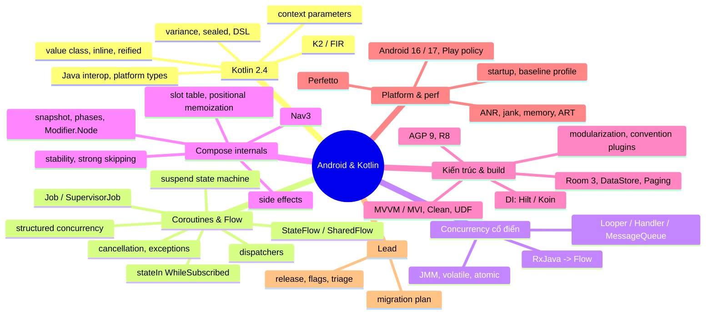
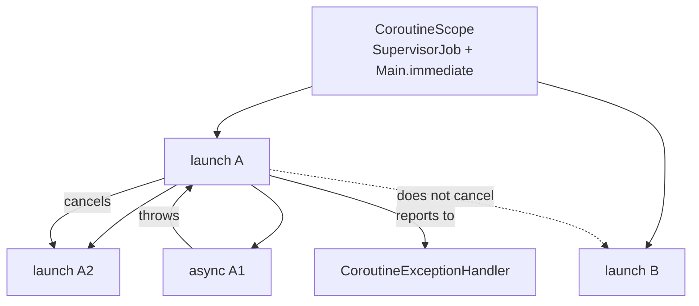
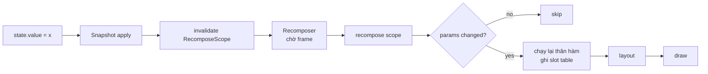
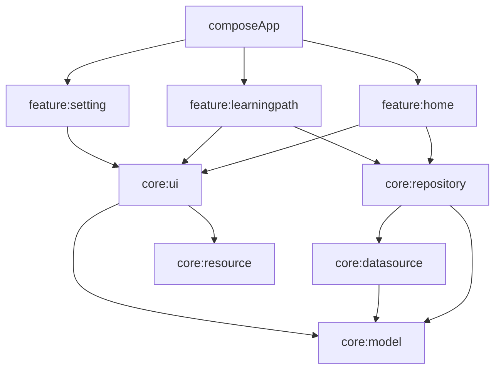
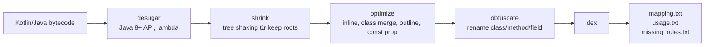

# 04. Android & Kotlin Deep Dive

> Mục tiêu: trả lời được mọi câu "tại sao" về Kotlin, coroutines, Compose, kiến trúc, build và performance ở mức có thể dạy lại cho người khác. | Mức cần đạt: Senior: giải thích cơ chế và trade-off của những gì mình dùng hằng ngày / Staff: giải thích internals (suspend state machine, slot table, R8 pipeline, ART), dẫn số liệu, chọn công nghệ có lý do / Lead: biến những thứ trên thành chuẩn đội, kế hoạch migration có metric và rollback. | Thời gian gợi ý: tuần 1-4, ~45 giờ (đây là file nặng nhất của bộ).

Lưu ý riêng cho bạn: phần lớn code trong `kmp-template-impl` và `compose-template` được sinh bởi Claude Code. Interviewer không quan tâm ai gõ code, họ quan tâm bạn có giải thích được từng quyết định hay không. Mỗi mục dưới đây có phần "bạn phải tự trả lời được gì" ngầm trong Q&A và trong drill "Own your own code". Hãy mở repo khi đọc.

## 0. Bản đồ chủ đề

Theo research JD trong `01-Market-Research-2026.md`: Kotlin xuất hiện ở 8/15 JD, Architecture 8/15, Performance 10/15, Compose 3/15, Coroutines 3/15. Con số Compose thấp vì JD viết chung chung, nhưng vòng technical của bank/fintech (GoTymeX, Timo, OCB, Techcombank) và foreign product đều đào sâu coroutines, Compose internals và R8. Vòng system design (xem `06-Mobile-System-Design.md`) sẽ quay lại hỏi modularization, DI, offline-first. Vòng lead (xem `11-Leadership-Management.md`) hỏi migration plan và build time.



Interviewer hỏi gì ở mảng này (tổng hợp từ pattern Grab/Agoda/bank):
- Vòng phone screen: 10-15 câu nhanh kiểu "StateFlow vs SharedFlow", "launch vs async", "remember vs rememberSaveable", "R8 làm gì".
- Vòng deep dive 60 phút: chọn 1-2 chủ đề và đào tới internals: "suspend compile ra gì", "recomposition skip khi nào", "tại sao crash sau khi bật minify".
- Vòng lead: "bạn đã migrate cái gì, đo bằng gì, rollback thế nào", "build time của team bạn bao nhiêu, bạn làm gì".
- Vòng live coding (xem `13-Coding-Interview.md`): viết Flow operator, fix leak trong coroutine, refactor ViewModel.

## 1. Kotlin 2.4

Trạng thái: Kotlin 2.4.21 (8/10/2026). 2.4.0 (3/6/2026) đưa context parameters, explicit backing fields và UUID API lên stable. 2.4.20 thêm coroutine stack-trace recovery và tự sinh `Package.swift`. K2 là compiler mặc định từ 2.0. Repo `kmp-template-impl` của bạn đang ở Kotlin 2.3.10 và đã bật `-Xexplicit-backing-fields` trong `build-logic/src/main/kotlin/primitive/KmpCommonPlugin.kt`; khi lên 2.4 flag này không còn cần nữa.

### 1.1 K2 compiler: cái gì đổi và vì sao bạn phải biết

K2 thay frontend cũ (PSI-based, lớn dần suốt 10 năm) bằng FIR (Frontend Intermediate Representation): một cây semantic thống nhất, mọi phase (resolve, type inference, smart cast) chạy trên cùng cấu trúc. Hệ quả thực tế:
- Compile nhanh hơn. JetBrains công bố số liệu theo từng project, không có con số chung; với project của bạn hãy đo bằng Gradle build scan trước và sau khi lên K2 rồi dùng số đó khi phỏng vấn.
- Smart cast thông minh hơn: smart cast qua biến local `val`, qua `||`, qua inline lambda, qua `when` subject phức tạp.
- Compose compiler plugin được gộp vào repo Kotlin từ 2.0 (`org.jetbrains.kotlin.plugin.compose`), hết cảnh chờ "compose compiler tương thích với Kotlin x.y".
- kapt chạy ở chế độ K1 fallback cho tới khi bạn chuyển sang KSP; đây là lý do kỹ thuật nữa để bỏ kapt (xem 5.6).
- IDE: Android Studio dùng K2 mode cho analysis, nên cảm nhận "IDE nhanh hơn" là thật nhưng khó dẫn số.

Những gì interviewer có thể hỏi tiếp: "K2 phá gì ở project cũ?" Trả lời thật: một số code dựa vào bug resolve cũ bị báo lỗi, một số thư viện annotation processor cần bản mới, và compiler plugin tự viết phải port sang FIR API.

**Lỗi hay gặp / trade-off**
- Nâng Kotlin mà không nâng KSP đúng cặp version; KSP 2.x gắn với Kotlin version (repo bạn: `ksp = "2.3.4"` đi với `kotlin = "2.3.10"`).
- Giữ `kotlin-android` plugin cũ khi AGP 9 đã có built-in Kotlin (xem 8.1), dẫn tới cảnh báo hoặc conflict.

**Đọc thêm:**
- https://kotlinlang.org/docs/k2-compiler-migration-guide.html
- https://blog.jetbrains.com/kotlin/
- https://kotlinlang.org/docs/whatsnew24.html

### 1.2 Context parameters

Context parameters (stable 2.4.0) thay thế context receivers thử nghiệm. Ý tưởng: hàm khai báo "tôi cần một thứ có sẵn trong scope gọi" mà không biến nó thành receiver hay tham số tường minh.

```kotlin
interface Analytics {
    fun track(event: String, params: Map<String, String> = emptyMap())
}

context(analytics: Analytics)
fun trackPurchase(sku: String, priceCents: Long) {
    analytics.track("purchase", mapOf("sku" to sku, "price" to priceCents.toString()))
}

class CheckoutViewModel(private val analytics: Analytics) : ViewModel() {
    fun onConfirmed(sku: String, priceCents: Long) {
        with(analytics) { trackPurchase(sku, priceCents) }
    }
}
```

Khác extension receiver: `this` không bị chiếm, nên hàm vẫn có thể là extension của kiểu khác; có thể có nhiều context cùng lúc; context không bị "lộ" ra API như tham số thường. Khác tham số thường: caller không truyền tay, mà phải có sẵn trong scope (qua `with`, qua context của hàm bao ngoài, hoặc qua class implement interface).

Khi nào dùng: cross-cutting dependency (logger, analytics, transaction scope, `CoroutineScope` trong DSL), DSL builder cần nhiều scope. Khi nào không: dependency nghiệp vụ nên inject qua constructor (DI nhìn thấy, test mock được); đừng dùng context parameter để lách DI.

**Lỗi hay gặp / trade-off**
- Lạm dụng khiến call site khó đọc: người đọc không biết `trackPurchase` cần gì nếu không mở declaration.
- Resolution ambiguity khi hai context cùng kiểu trong scope; compiler báo lỗi, phải đặt tên tường minh.
- Java interop: context parameters biến thành tham số đầu tiên trong signature JVM; Java caller phải truyền tay.

**Đọc thêm:**
- https://kotlinlang.org/docs/context-parameters.html
- https://github.com/Kotlin/KEEP (tìm proposal "context-parameters")

### 1.3 Explicit backing fields

Pattern cũ trong ViewModel:

```kotlin
private val _state = MutableStateFlow(UiState())
val state: StateFlow<UiState> = _state.asStateFlow()
```

Với explicit backing fields (stable 2.4.0, repo bạn bật bằng `-Xexplicit-backing-fields` từ 2.3):

```kotlin
class CounterViewModel : ViewModel() {
    val state: StateFlow<CounterUiState>
        field = MutableStateFlow(CounterUiState())

    fun increment() {
        // Bên trong class, `state` có kiểu của field: MutableStateFlow
        state.update { it.copy(count = it.count + 1) }
    }
}
```

Bên ngoài class chỉ thấy `StateFlow`. Lợi: bỏ cặp `_x`/`x`, không có `asStateFlow()` wrapper. Interviewer có thể hỏi "có khác gì về runtime?": không, vẫn là một field; chỉ là compiler ép kiểu khác nhau ở trong và ngoài class.

**Đọc thêm:**
- https://kotlinlang.org/docs/whatsnew24.html
- https://github.com/Kotlin/KEEP (proposal "explicit-backing-fields")

### 1.4 Value classes

```kotlin
@JvmInline
value class Money(val cents: Long) {
    operator fun plus(other: Money): Money = Money(cents + other.cents)
    fun format(): String = "%d.%02d".format(cents / 100, cents % 100)
}

@JvmInline
value class UserId(val raw: String)

fun charge(user: UserId, amount: Money) { /* ... */ }
```

Trên JVM, `charge` compile thành `charge-<hash>(String, long)`: tên bị mangle để tránh đụng overload, tham số là primitive/underlying type, không có allocation. Boxing xảy ra khi:
- dùng làm generic: `List<Money>`, `Flow<Money>`, `suspend fun f(): Money` (kết quả suspend đi qua `Any?` nên bị box khi suspend thật),
- kiểu nullable `Money?`,
- gán vào kiểu interface mà value class implement,
- gọi từ Java.

Giá trị thật trong app tài chính: `transfer(from: AccountId, to: AccountId, amount: Money)` không thể gọi nhầm thứ tự, compiler bắt lỗi; không tốn object như `data class`. `typealias` không cho bạn an toàn này (typealias chỉ là tên khác).

**Lỗi hay gặp / trade-off**
- Dùng với Gson/Moshi reflection: serializer thấy class wrapper hoặc underlying tuỳ thư viện; kotlinx.serialization hỗ trợ value class đúng. Nếu dùng Retrofit + Gson ở project cũ, viết TypeAdapter hoặc tránh value class ở DTO.
- Room 2.x không hỗ trợ value class làm column trực tiếp (cần `TypeConverter`); với Room 3 cần kiểm tra tại https://developer.android.com/jetpack/androidx/releases/room.
- `==` so sánh underlying; `===` trên value class là lỗi compile ở nhiều ngữ cảnh.

**Đọc thêm:**
- https://kotlinlang.org/docs/inline-classes.html
- Effective Kotlin 2nd ed, mục "Consider using inline value classes"

### 1.5 inline, noinline, crossinline, reified

`inline` chèn thân hàm và thân lambda vào call site. Hai lý do dùng: (1) tránh allocation Function object và virtual call cho lambda trong hot path (`forEach`, `let`, `withLock`), (2) `reified` giữ type argument tại runtime vì code đã được copy vào nơi biết kiểu cụ thể.

```kotlin
inline fun <reified T : Parcelable> Bundle.parcelableCompat(key: String): T? =
    if (Build.VERSION.SDK_INT >= 33) {
        getParcelable(key, T::class.java)
    } else {
        @Suppress("DEPRECATION") getParcelable(key)
    }

inline fun <T> measure(tag: String, block: () -> T): T {
    val start = System.nanoTime()
    try {
        return block()
    } finally {
        Log.d(tag, "took ${(System.nanoTime() - start) / 1_000_000} ms")
    }
}
```

- Non-local return: trong lambda của inline function, `return` thoát hàm bao ngoài. Đây là lý do `forEach { return }` hoạt động.
- `noinline`: lambda không inline, cần khi bạn muốn lưu lambda vào biến hoặc truyền tiếp.
- `crossinline`: lambda sẽ được gọi từ context khác (object/lambda khác), cấm non-local return.
- Chi phí: code size tăng theo số call site; đừng inline hàm dài hoặc hàm public của library (binary compatibility: thay đổi thân hàm inline không có hiệu lực với client đã compile).

**Đọc thêm:**
- https://kotlinlang.org/docs/inline-functions.html
- Kotlin in Action 2nd ed, chương về lambdas và inline functions

### 1.6 Delegation: `by`

Hai dạng, cùng keyword:

```kotlin
// 1. Class delegation: decorator không boilerplate
interface UserRepository {
    suspend fun user(id: String): User
    suspend fun refresh(id: String)
}

class CachedUserRepository(
    private val delegate: UserRepository,
) : UserRepository by delegate {
    private val cache = java.util.concurrent.ConcurrentHashMap<String, User>()

    override suspend fun user(id: String): User =
        cache[id] ?: delegate.user(id).also { cache[id] = it }
}

// 2. Property delegation
class SettingsStore(prefs: SharedPreferences) {
    var onboardingDone: Boolean by BooleanPref(prefs, "onboarding_done", false)
}

class BooleanPref(
    private val prefs: SharedPreferences,
    private val key: String,
    private val default: Boolean,
) : ReadWriteProperty<Any?, Boolean> {
    override fun getValue(thisRef: Any?, property: KProperty<*>): Boolean = prefs.getBoolean(key, default)
    override fun setValue(thisRef: Any?, property: KProperty<*>, value: Boolean) {
        prefs.edit().putBoolean(key, value).apply()
    }
}
```

`by lazy` mặc định `LazyThreadSafetyMode.SYNCHRONIZED` (double-checked locking bên trong). Dùng `LazyThreadSafetyMode.NONE` khi chắc chắn chỉ main thread (ví dụ field của Activity) để tránh lock. `Delegates.observable`/`vetoable` cho callback khi set. Trong Compose, `by remember { mutableStateOf() }` cũng là property delegation qua `getValue`/`setValue` extension của `State`.

**Đọc thêm:**
- https://kotlinlang.org/docs/delegation.html
- https://kotlinlang.org/docs/delegated-properties.html

### 1.7 sealed, data, enum và `when` exhaustive

| Nhu cầu | Chọn | Lý do |
|---|---|---|
| Tập hữu hạn giá trị không có dữ liệu kèm | `enum class` | serializable tự nhiên, `entries`, ordinal; `when` exhaustive |
| Tập hữu hạn kiểu, mỗi kiểu có dữ liệu khác nhau | `sealed interface` + `data class`/`data object` | exhaustive `when`, subtype có thể implement nhiều sealed interface |
| Kiểu cần kế thừa state chung | `sealed class` | có constructor, field chung |
| Giá trị so sánh theo nội dung | `data class` | `equals`/`hashCode`/`copy`; chú ý `copy` tạo object mới và không giữ invariant của constructor private |

```kotlin
sealed interface ScreenState<out T> {
    data object Loading : ScreenState<Nothing>
    data class Idle<T>(val data: T) : ScreenState<T>
    data class Error(val message: String) : ScreenState<Nothing>
}
```

Đây là dạng rút gọn của `ScreenState` trong `core/ui` của `kmp-template-impl` (trong repo, `Loading` là class có tham số nên gọi `ScreenState.Loading()`; hãy mở file để nói đúng chữ ký). Interviewer hỏi: "Vì sao `Loading` là `data object` chứ không phải `object`?" Trả lời: `data object` cho `toString()` đẹp và `equals` ổn định sau serialization (hai instance sau deserialize vẫn bằng nhau), quan trọng khi state đi qua `StateFlow` so sánh bằng `equals`.

`when` exhaustive trên sealed/enum là lỗi compile khi thiếu nhánh (từ Kotlin 1.7 với statement), nên thêm case mới là compiler chỉ cho bạn mọi chỗ cần sửa; đây là luận điểm mạnh nhất cho sealed so với inheritance mở.

**Đọc thêm:**
- https://kotlinlang.org/docs/sealed-classes.html
- https://kotlinlang.org/docs/data-classes.html

### 1.8 Generics và variance

- `out T` (covariant): T chỉ xuất hiện ở vị trí trả về. `List<out E>` nên `List<Cat>` gán được cho `List<Animal>`.
- `in T` (contravariant): T chỉ ở vị trí tham số. `Comparator<in T>`, nên `Comparator<Animal>` dùng được cho `Cat`.
- Invariant (mặc định): `MutableList<Cat>` không phải `MutableList<Animal>` vì nếu cho phép, bạn add `Dog` vào list mèo.
- Declaration-site (`class Box<out T>`) so với use-site (`fun copy(from: Array<out Any>, to: Array<Any>)`), use-site gọi là type projection.
- Star projection `List<*>` = `List<out Any?>`: đọc được, không biết kiểu.
- `reified` chỉ với inline (1.5). Type erasure: `is List<String>` không check được, chỉ `is List<*>`.

```kotlin
interface Mapper<in I, out O> {
    fun map(input: I): O
}

val toUi: Mapper<User, UserUi> = object : Mapper<User, UserUi> {
    override fun map(input: User) = UserUi(input.name)
}
val widened: Mapper<AdminUser, Any> = toUi // hợp lệ nhờ in/out
```

**Đọc thêm:**
- https://kotlinlang.org/docs/generics.html
- Kotlin in Action 2nd ed, chương "Generics"

### 1.9 DSL builders và `@DslMarker`

```kotlin
@DslMarker
annotation class FormDsl

@FormDsl
class FormBuilder {
    private val fields = mutableListOf<Field>()
    fun text(key: String, block: TextFieldBuilder.() -> Unit = {}) {
        fields += TextFieldBuilder(key).apply(block).build()
    }
    fun build(): Form = Form(fields.toList())
}

@FormDsl
class TextFieldBuilder(private val key: String) {
    var required: Boolean = false
    var maxLength: Int = Int.MAX_VALUE
    fun build(): Field = Field.Text(key, required, maxLength)
}

fun form(block: FormBuilder.() -> Unit): Form = FormBuilder().apply(block).build()

sealed interface Field {
    data class Text(val key: String, val required: Boolean, val maxLength: Int) : Field
}
data class Form(val fields: List<Field>)

val loginForm = form {
    text("phone") { required = true; maxLength = 12 }
    text("otp") { required = true; maxLength = 6 }
}
```

`@DslMarker` cấm gọi ngầm receiver ngoài từ lambda trong (ví dụ gọi `text()` bên trong `text {}`), tránh lỗi lồng scope im lặng. Gradle Kotlin DSL, Ktor routing, Koin `module { }`, Compose `LazyListScope` đều là pattern này.

**Đọc thêm:**
- https://kotlinlang.org/docs/type-safe-builders.html
- https://kotlinlang.org/docs/lambdas.html#function-literals-with-receiver

### 1.10 Extension vs member, resolution rules

- Extension resolve tĩnh theo kiểu khai báo của biến, không theo runtime type. `fun Animal.name() = "animal"; fun Cat.name() = "cat"; val a: Animal = Cat(); a.name()` trả "animal".
- Member luôn thắng extension cùng signature. Thêm member mới vào class có thể "nuốt" extension của client mà không báo lỗi (chỉ warning "extension is shadowed by a member").
- Extension trên nullable receiver (`fun String?.orDash()`) hợp lệ và là cách thay thế `?.let`.
- Extension được compile thành static method `FileNameKt.name(Animal)`; Java gọi được nhưng không có receiver syntax.
- Khi nào extension: tiện ích không cần state nội bộ, API của kiểu bạn không sở hữu (`Context.dp()`), giữ class nhỏ. Khi nào member: cần truy cập private, cần polymorphism.

**Đọc thêm:**
- https://kotlinlang.org/docs/extensions.html
- Effective Kotlin 2nd ed, chương "Class design" (member vs extension)

### 1.11 Nullability tại biên JVM và Java interop

Java không có null trong type system, nên Kotlin gán platform type `String!` cho giá trị từ Java không annotate. Bạn gán được vào `String` hoặc `String?`; NPE xảy ra ở nơi bạn "tin" nó non-null (assertion do compiler chèn, stack trace chỉ đúng dòng).

Cách khoá biên:
- Ưu tiên library có annotation `@Nullable/@NonNull` (androidx, JetBrains, JSpecify). Kotlin coi JSpecify và androidx annotations là nguồn nullability.
- Bật `-Xjsr305=strict` để annotation JSR-305 thành lỗi thay vì warning.
- Ở biên Retrofit/Gson: Gson bỏ qua nullability Kotlin và có thể gán null vào field non-null (vì khởi tạo bằng reflection không chạy constructor). Dùng Moshi với `KotlinJsonAdapterFactory` hoặc codegen, hoặc kotlinx.serialization: cả hai fail sớm với message rõ.

Annotation Kotlin cho Java caller: `@JvmStatic` (companion thành static), `@JvmField` (bỏ getter/setter), `@JvmOverloads` (sinh overload cho default args), `@JvmName` (đổi tên hoặc gỡ clash do erasure), `@Throws` (checked exception cho Java), `fun interface` (SAM conversion cho interface Kotlin). Kotlin gọi Java SAM tự động; Java gọi Kotlin lambda phải qua `Function1`.

Suspend function từ Java: signature có thêm `Continuation` cuối cùng; thực tế Java không gọi trực tiếp, bạn cung cấp wrapper `fun fooAsync(): CompletableFuture` qua `kotlinx-coroutines-jdk8` hoặc callback.

**Lỗi hay gặp / trade-off**
- `lateinit` để né null check rồi crash `UninitializedPropertyAccessException`; dùng `lateinit` chỉ khi lifecycle đảm bảo (Hilt field injection, test setup).
- `!!` trong production code: chấp nhận được khi có invariant rõ và comment, còn lại là code smell trong review.

**Đọc thêm:**
- https://kotlinlang.org/docs/java-interop.html
- https://kotlinlang.org/docs/java-to-kotlin-interop.html
- https://jspecify.dev

## 2. Coroutines & Flow internals

Trạng thái: kotlinx.coroutines 1.11.0 (repo bạn cũng ở 1.11.0). Kotlin 2.4.20 thêm coroutine stack-trace recovery ở compiler level; trước đó stack trace recovery chỉ ở debug mode của thư viện (`-ea` hoặc `kotlinx.coroutines.debug`). Chi tiết cần kiểm tra tại https://kotlinlang.org/docs/whatsnew24.html.

### 2.1 Suspend machinery: continuation và state machine

`suspend fun` không phải thread magic. Compiler biến nó thành hàm thường nhận thêm `Continuation<T>` (CPS: continuation-passing style) và cắt thân hàm thành state machine tại mỗi suspension point.

```kotlin
suspend fun loadProfile(id: String): Profile {
    val user = api.user(id)          // suspension point 1
    val posts = api.posts(user.id)   // suspension point 2
    return Profile(user, posts)
}
```

Dạng rút gọn sau compile (viết tay cho dễ đọc, không phải bytecode thật):

```kotlin
fun loadProfile(id: String, completion: Continuation<Profile>): Any? {
    val sm = completion as? LoadProfileStateMachine ?: LoadProfileStateMachine(completion)
    when (sm.label) {
        0 -> {
            sm.id = id
            sm.label = 1
            val r = api.user(id, sm)                     // truyền chính sm làm continuation
            if (r === COROUTINE_SUSPENDED) return COROUTINE_SUSPENDED
            sm.user = r as User
            // rơi xuống case 1 bằng goto trong bytecode
        }
        1 -> {
            sm.result.getOrThrow()                       // ném exception nếu api.user thất bại
            sm.user = sm.result as User
            sm.label = 2
            val r = api.posts(sm.user.id, sm)
            if (r === COROUTINE_SUSPENDED) return COROUTINE_SUSPENDED
            sm.posts = r as List<Post>
        }
        2 -> {
            sm.posts = sm.result as List<Post>
        }
    }
    return Profile(sm.user, sm.posts)
}
```

Điểm interviewer đào:
- `COROUTINE_SUSPENDED` là marker object: hàm trả về nó nghĩa là "tôi chưa xong, sẽ gọi `continuation.resumeWith` sau". Nếu kết quả có ngay (cache hit), hàm trả giá trị luôn, không có suspension thật, không có dispatch.
- `Continuation` chứa `context` (CoroutineContext) và `resumeWith(Result<T>)`. `BaseContinuationImpl.resumeWith` là vòng lặp: gọi `invokeSuspend`, nếu xong thì resume continuation cha; đây là cách tránh stack sâu.
- Mỗi suspend call không tạo thread; thread được quyết định bởi `ContinuationInterceptor` (dispatcher) trong context khi resume.
- Local variable sống qua suspension được "spill" vào field của state machine object: đây là lý do suspend fun có allocation nhỏ mỗi lần gọi nếu có suspension thật.
- Suspend lambda (`launch { }`) cũng compile thành class `SuspendLambda` tương tự.

**Đọc thêm:**
- Kotlin Coroutines: Deep Dive (Moskała), chương "How does suspension work?" và "Coroutines under the hood"
- https://kotlinlang.org/docs/coroutines-guide.html
- https://github.com/Kotlin/KEEP/blob/master/proposals/coroutines.md

### 2.2 Structured concurrency, Job và SupervisorJob

Structured concurrency: coroutine con gắn vào Job của cha qua context; cha chỉ hoàn thành khi mọi con hoàn thành; huỷ cha huỷ con; con lỗi (với Job thường) huỷ cha và anh em. Nhờ vậy không có coroutine "mồ côi" chạy sau khi màn hình đã chết.



- `Job`: lỗi của con lan lên cha, cha huỷ các con khác, rồi lan tiếp lên. Đây là mặc định của `coroutineScope { }` và của `launch`/`async` con.
- `SupervisorJob`: con lỗi không huỷ cha và anh em; lỗi của `launch` con đi tới `CoroutineExceptionHandler` (hoặc uncaught handler của thread). `viewModelScope` = `SupervisorJob() + Dispatchers.Main.immediate`.
- `coroutineScope { }` vs `supervisorScope { }`: cùng tạo scope con và chờ mọi con; khác nhau ở quy tắc lan lỗi.
- `Job.cancel()` chỉ chuyển state sang Cancelling; coroutine thực sự dừng khi tới suspension point có kiểm tra (2.4). `job.cancelAndJoin()` chờ dừng thật.
- `Job` states: New (lazy), Active, Completing, Cancelling, Cancelled, Completed. `isActive` false từ Cancelling.

```kotlin
suspend fun loadDashboard(): Dashboard = supervisorScope {
    val balance = async { balanceRepository.load() }
    val promos = async { promoRepository.load() }
    Dashboard(
        balance = suspendRunCatching { balance.await() }.getOrNull(),
        promos = suspendRunCatching { promos.await() }.getOrDefault(emptyList()),
    )
}

// runCatching chuẩn nuốt CancellationException, đây là bản an toàn:
inline fun <T> suspendRunCatching(block: () -> T): Result<T> = try {
    Result.success(block())
} catch (e: CancellationException) {
    throw e
} catch (e: Throwable) {
    Result.failure(e)
}
```

Trong ví dụ trên, nếu `promoRepository.load()` ném lỗi, `balance` vẫn tiếp tục nhờ `supervisorScope`. Nếu dùng `coroutineScope`, `balance` bị huỷ và toàn bộ `loadDashboard` ném.

**Lỗi hay gặp / trade-off**
- `CoroutineScope(Dispatchers.IO)` không có Job tường minh: scope vẫn có Job (được tạo ngầm), nhưng không ai cancel nó; đây là leak nếu scope sống trong object ngắn hạn.
- Dùng `SupervisorJob()` làm context của `launch` con: `launch(SupervisorJob())` tạo coroutine có cha mới là job mồ côi, mất structured concurrency. SupervisorJob chỉ có ý nghĩa ở scope.
- `GlobalScope`: không bị huỷ, không test được, lỗi đi thẳng ra uncaught handler. Chấp nhận duy nhất cho tác vụ thực sự app-wide (ví dụ flush analytics), và phải đánh dấu `@OptIn(DelicateCoroutinesApi::class)` có comment.

**Đọc thêm:**
- https://kotlinlang.org/docs/coroutine-context-and-dispatchers.html
- https://kotlinlang.org/docs/exception-handling.html
- Kotlin Coroutines: Deep Dive, chương "Exception handling"

### 2.3 CoroutineContext và dispatchers

`CoroutineContext` là map indexed theo `Key`: `Job`, `ContinuationInterceptor` (dispatcher), `CoroutineExceptionHandler`, `CoroutineName`, element tự định nghĩa. `+` ghép, phần tử bên phải ghi đè.

| Dispatcher | Thread pool | Dùng cho | Lưu ý |
|---|---|---|---|
| `Dispatchers.Main` | main thread | UI, ViewModel | Dispatch qua Handler, luôn post dù đang ở main |
| `Dispatchers.Main.immediate` | main thread | ViewModel, Compose | Nếu đang ở main thì chạy ngay, không post; `viewModelScope` dùng cái này |
| `Dispatchers.Default` | số core CPU, tối thiểu 2 | CPU-bound: parse JSON lớn, diff, sort | Đừng block I/O ở đây: cạn thread là treo toàn bộ CPU work |
| `Dispatchers.IO` | 64 thread hoặc số core, lấy lớn hơn | Blocking I/O: file, network blocking, DB JDBC | Chia sẻ thread với Default (elastic), chuyển Default sang IO không đổi thread |
| `Dispatchers.IO.limitedParallelism(n)` | view giới hạn n | Tài nguyên có giới hạn: 1 cho SQLite write, 4 cho image decode | Không trừ vào quota 64 của IO |
| `Dispatchers.Unconfined` | không dispatch | Test, một số lib | Resume trên thread nào gọi resume, nguy hiểm cho UI |

```kotlin
object AppDispatchers {
    val dbWrite: CoroutineDispatcher = Dispatchers.IO.limitedParallelism(1)
    val imageDecode: CoroutineDispatcher = Dispatchers.Default.limitedParallelism(2)
}
```

Khi nào `withContext` không tốn gì: `withContext(Dispatchers.Main.immediate)` khi đang ở main, hoặc `withContext(Dispatchers.IO)` từ `Dispatchers.Default` (cùng pool, chỉ đổi "view" nên không đổi thread; đây là tối ưu có thật của thư viện).

Retrofit với suspend fun và Room với suspend DAO đã tự chuyển sang thread riêng của chúng; bọc thêm `withContext(Dispatchers.IO)` là thừa (vô hại nhưng cho thấy bạn không hiểu). OkHttp `execute()` blocking thì cần IO.

**Đọc thêm:**
- https://kotlinlang.org/docs/coroutine-context-and-dispatchers.html
- https://kotlinlang.org/api/kotlinx.coroutines/kotlinx-coroutines-core/kotlinx.coroutines/-dispatchers/

### 2.4 Cancellation và cooperative checks

Cancellation là hợp tác: `cancel()` chỉ đặt cờ; code phải kiểm tra. Mọi suspend function của kotlinx.coroutines (`delay`, `yield`, `withContext`, `await`, `Flow.collect`) đều kiểm tra và ném `CancellationException`. Code CPU-bound hoặc vòng lặp blocking không tự dừng.

```kotlin
suspend fun parseAll(files: List<File>): List<Record> = withContext(Dispatchers.Default) {
    files.map { file ->
        ensureActive()            // ném CancellationException nếu đã huỷ
        parse(file)
    }
}

suspend fun saveDraft(draft: Draft) {
    // Việc phải hoàn thành dù scope bị huỷ (ví dụ user thoát màn hình)
    withContext(NonCancellable) {
        draftDao.upsert(draft)
    }
}

suspend fun <T> Task<T>.awaitResult(): T = suspendCancellableCoroutine { cont ->
    addOnSuccessListener { cont.resume(it) }
    addOnFailureListener { cont.resumeWithException(it) }
    addOnCanceledListener { cont.cancel() }
    cont.invokeOnCancellation { /* huỷ request gốc nếu API cho phép */ }
}
```

Quy tắc:
- `CancellationException` phải được rethrow. `catch (e: Exception)` hoặc `runCatching` nuốt nó khiến coroutine tiếp tục chạy sau khi đã huỷ, thường biểu hiện là "màn hình đã đóng vẫn gọi API" hoặc "state cập nhật vào ViewModel đã cleared".
- `finally` chạy khi huỷ; trong `finally` không được suspend trừ khi bọc `NonCancellable`.
- `yield()` vừa kiểm tra huỷ vừa nhường thread; `ensureActive()` chỉ kiểm tra; `isActive` để tự quyết định cleanup.
- Timeout: `withTimeout` ném `TimeoutCancellationException` (là CancellationException con), `withTimeoutOrNull` trả null.
- Kotlin 2.4.20 coroutine stack-trace recovery giúp stack trace của exception đi qua suspension point đầy đủ hơn; trước đó phải bật debug agent.

**Đọc thêm:**
- https://kotlinlang.org/docs/cancellation-and-timeouts.html
- Kotlin Coroutines: Deep Dive, chương "Cancellation"

### 2.5 Exception handling: nơi handler hoạt động và nơi không

```kotlin
val handler = CoroutineExceptionHandler { _, throwable ->
    crashReporter.recordNonFatal(throwable)
}
val scope = CoroutineScope(SupervisorJob() + Dispatchers.Main.immediate + handler)

scope.launch { throw IllegalStateException("A") }     // handler nhận "A"

scope.launch {
    val deferred = async { throw IllegalStateException("B") }
    deferred.await()
}
// "B": async là con của launch với Job thường, nên async lỗi là huỷ launch ngay,
// không chờ await(); exception đi lên launch rồi tới handler.

val d = scope.async { throw IllegalStateException("C") }
// "C" chỉ ném khi gọi d.await(); handler KHÔNG được gọi với async gốc.
```

- Handler chỉ có tác dụng ở coroutine gốc (root) tạo bằng `launch`, hoặc ở scope với SupervisorJob. Đặt handler vào `launch` con bên trong `coroutineScope` là vô ích vì lỗi đã lan lên cha.
- `async` gốc: exception lưu trong Deferred, chỉ lộ khi `await()`. Với `supervisorScope`, `async` con cũng như vậy.
- Thứ tự: lỗi xảy ra, coroutine huỷ các con, chờ con xong, rồi mới báo lỗi lên cha hoặc handler. Nhiều lỗi cùng lúc: lỗi đầu tiên là chính, các lỗi khác được `addSuppressed`.
- Trong Flow, `catch { }` chỉ bắt lỗi upstream; lỗi trong `collect { }` phải try/catch tại chỗ hoặc dùng `onEach { }.catch { }.collect()`.

**Đọc thêm:**
- https://kotlinlang.org/docs/exception-handling.html
- https://kotlinlang.org/api/kotlinx.coroutines/kotlinx-coroutines-core/kotlinx.coroutines/-coroutine-exception-handler/

### 2.6 Flow cơ bản: cold, operators, context

`Flow<T>` là cold: `flow { }` builder chỉ chạy khi có `collect`, mỗi collector chạy lại từ đầu. Toàn bộ pipeline là suspend function lồng nhau, không có queue ở giữa (trừ khi bạn thêm `buffer`), nên producer tự chậm lại theo consumer: đây là backpressure kiểu suspension.

```kotlin
fun observeItems(): Flow<List<ItemUi>> =
    itemDao.observeAll()                      // Room chạy query trên dispatcher của Room
        .map { entities -> entities.map(::toDomain) }   // chạy ở IO (trước flowOn)
        .flowOn(Dispatchers.IO)               // áp dụng cho mọi thứ phía trên
        .map { domain -> domain.map(::toUi) } // chạy ở context của collector
        .distinctUntilChanged()
```

- `flowOn` đổi context cho upstream, không ảnh hưởng downstream; bên trong nó dùng channel để chuyển dữ liệu qua ranh giới thread (nên có buffer ngầm).
- Context preservation: `flow { }` không được `emit` từ dispatcher khác với collector (ném `IllegalStateException`); muốn emit từ callback/thread khác thì dùng `channelFlow`/`callbackFlow`.
- Operator thường gặp: `map`, `filter`, `transform`, `take`, `onStart`, `onEach`, `onCompletion`, `catch`, `retry`, `retryWhen`, `debounce`, `sample`, `distinctUntilChanged`, `flatMapLatest`, `flatMapConcat`, `flatMapMerge`, `combine`, `zip`, `merge`.
- `combine` phát mỗi khi bất kỳ nguồn nào phát (sau khi mỗi nguồn có ít nhất một giá trị); `zip` ghép cặp theo thứ tự và dừng khi một nguồn kết thúc. UI state = `combine`; request-response ghép cặp = `zip`.
- `collectLatest` huỷ block xử lý cũ khi giá trị mới đến; `flatMapLatest` tương tự cho Flow lồng (search-as-you-type).
- `callbackFlow` cho API callback nhiều lần; `awaitClose` bắt buộc, nếu thiếu, flow kết thúc ngay sau khi builder return.

```kotlin
fun ConnectivityManager.isOnline(): Flow<Boolean> = callbackFlow {
    val callback = object : ConnectivityManager.NetworkCallback() {
        override fun onAvailable(network: Network) { trySend(true) }
        override fun onLost(network: Network) { trySend(false) }
    }
    registerDefaultNetworkCallback(callback)
    awaitClose { unregisterNetworkCallback(callback) }
}.distinctUntilChanged()
```

**Đọc thêm:**
- https://kotlinlang.org/docs/flow.html
- Kotlin Coroutines: Deep Dive, chương "Flow building", "Flow lifecycle functions", "Flow processing"

### 2.7 Hot flows: StateFlow, SharedFlow, buffer, conflation

| | StateFlow | SharedFlow |
|---|---|---|
| Giá trị ban đầu | bắt buộc | không |
| Replay | luôn 1 (giá trị hiện tại) | `replay` cấu hình, 0 mặc định |
| Dedup | bỏ qua giá trị `equals` giá trị hiện tại | không |
| Conflation | có, subscriber chậm chỉ thấy giá trị mới nhất | theo `onBufferOverflow` |
| Buffer | không có | `replay + extraBufferCapacity` |
| Dùng cho | UI state | event stream, broadcast |
| Đọc đồng bộ | `.value` | không |

`MutableSharedFlow(replay = 0, extraBufferCapacity = 0, onBufferOverflow = SUSPEND)`: `emit` suspend cho tới khi mọi subscriber nhận; nếu không có subscriber, giá trị bị bỏ (không lưu). Đây là lý do SharedFlow không hợp cho one-shot event (xem Q&A): event phát lúc chưa có subscriber (ví dụ đang rotate) mất luôn.

`buffer(capacity, onBufferOverflow)`, `conflate()` (= `buffer(CONFLATED)`), `collectLatest` là ba công cụ xử lý consumer chậm. `StateFlow` tự conflate nên `collect` trên StateFlow có thể bỏ qua giá trị trung gian: đừng dùng StateFlow để đếm sự kiện.

### 2.8 stateIn / shareIn và WhileSubscribed(5000)

Đây là đoạn trong `feature/home/.../HomeViewModel.kt` của bạn:

```kotlin
val screenState: StateFlow<ScreenState<HomeUiState>> = levelRepository.observeLevelCards()
    .map<List<LevelCard>, ScreenState<HomeUiState>> { cards ->
        ScreenState.Idle(HomeUiState(levels = cards.toImmutableList()))
    }
    .catch { throwable ->
        Napier.e(tag = TAG, throwable = throwable) { "Failed to load level cards" }
        emit(ScreenState.Error(message = Res.string.error_network))
    }
    .stateIn(
        scope = viewModelScope,
        started = SharingStarted.WhileSubscribed(SUBSCRIPTION_TIMEOUT_MS), // 5_000
        initialValue = ScreenState.Loading(),
    )
```

Bạn phải giải thích được:
- `stateIn` biến cold Flow thành StateFlow chia sẻ trong `viewModelScope`; nhiều collector (nhiều Composable) chỉ chạy một upstream.
- `WhileSubscribed(5000)`: upstream bắt đầu khi có subscriber đầu tiên, dừng 5 giây sau khi subscriber cuối rời. 5 giây đủ dài để qua configuration change (Activity recreate dưới 1 giây) mà không restart query, và đủ ngắn để dừng DB/network observation khi app vào background. Con số 5000 là convention từ Google samples, không phải hằng số thư viện.
- Phía UI dùng `collectAsStateWithLifecycle()` (dừng collect ở STOPPED), nên "subscriber rời" đúng nghĩa khi app vào background.
- `Eagerly` chạy ngay khi ViewModel tạo, không dừng; `Lazily` chạy khi có subscriber đầu và không dừng. Cả hai dùng khi upstream rẻ và cần giữ giá trị.
- `initialValue` là thứ UI thấy trước khi upstream phát; `Loading()` hợp lý. Nếu upstream là Room và bạn không muốn nháy Loading khi quay lại màn hình, giá trị cuối vẫn còn trong StateFlow trong 5 giây, sau đó sẽ lại thấy giá trị cũ cho tới khi query xong (không về Loading).
- `.catch` đặt trước `stateIn` để lỗi biến thành state, nếu không exception sẽ huỷ `viewModelScope` chia sẻ. Lưu ý: sau `catch` emit `Error`, flow kết thúc; muốn retry phải có trigger mới (ví dụ `retryWhen` hoặc `flatMapLatest` từ một `MutableStateFlow` refresh).

`shareIn` là bản SharedFlow (không có `value`, có `replay`). Dùng khi nguồn là event (location updates) chứ không phải state.

**Lỗi hay gặp / trade-off**
- `stateIn(viewModelScope, Eagerly)` trong `init` với upstream network: chạy cả khi màn hình chưa hiện, khó test, tốn pin.
- `WhileSubscribed()` không timeout: rotate là restart query, thấy nháy loading.
- Gọi `stateIn` trong Composable hoặc trong hàm được gọi nhiều lần: mỗi lần là một upstream mới. `stateIn` phải là property của ViewModel.

**Đọc thêm:**
- https://developer.android.com/kotlin/flow/stateflow-and-sharedflow
- https://developer.android.com/topic/libraries/architecture/coroutines
- https://kotlinlang.org/api/kotlinx.coroutines/kotlinx-coroutines-core/kotlinx.coroutines.flow/-sharing-started/

### 2.9 One-shot events từ ViewModel

Ba cách, mỗi cách một trade-off:

```kotlin
class LoginViewModel(private val auth: AuthRepository) : ViewModel() {
    // Cách 1: Channel + receiveAsFlow: buffer khi không có collector, mỗi event một consumer
    private val effects = Channel<LoginEffect>(Channel.BUFFERED)
    val effectFlow: Flow<LoginEffect> = effects.receiveAsFlow()

    fun login(phone: String, otp: String) = viewModelScope.launch {
        when (val result = auth.login(phone, otp)) {
            is AuthResult.Success -> effects.send(LoginEffect.NavigateHome)
            is AuthResult.Failure -> effects.send(LoginEffect.ShowError(result.message))
        }
    }
}

sealed interface LoginEffect {
    data object NavigateHome : LoginEffect
    data class ShowError(val message: String) : LoginEffect
}
```

- Cách 1 (Channel): không mất event khi chưa có collector, phù hợp navigation. Nhược: chỉ một collector; nếu process death, event trong buffer mất (chấp nhận được).
- Cách 2 (event trong state + `consumed()`): Google khuyến nghị cho đa số trường hợp: `uiState.copy(pendingNavigation = Home)`, UI xử lý rồi gọi `viewModel.onNavigationHandled()`. Ưu: sống qua process death nếu state được save, test dễ. Nhược: nhiều boilerplate.
- Cách 3 (`MutableSharedFlow(extraBufferCapacity = 1)`): đơn giản nhưng mất event khi không có subscriber; chỉ dùng cho event "bỏ lỡ cũng được" (toast).

Phía Compose:

```kotlin
@Composable
fun LoginScreen(viewModel: LoginViewModel, onLoggedIn: () -> Unit) {
    val currentOnLoggedIn by rememberUpdatedState(onLoggedIn)
    val lifecycleOwner = LocalLifecycleOwner.current
    LaunchedEffect(viewModel, lifecycleOwner) {
        viewModel.effectFlow
            .flowWithLifecycle(lifecycleOwner.lifecycle, Lifecycle.State.STARTED)
            .collect { effect ->
                when (effect) {
                    LoginEffect.NavigateHome -> currentOnLoggedIn()
                    is LoginEffect.ShowError -> { /* snackbar */ }
                }
            }
    }
}
```

**Đọc thêm:**
- https://developer.android.com/topic/architecture/ui-layer/events
- https://developer.android.com/topic/architecture/ui-layer/state-production

### 2.10 Bug thường gặp khi review coroutine code

1. `GlobalScope.launch` trong repository: không huỷ được, lỗi đi thẳng ra crash. Sửa: inject `CoroutineScope` app-level có `SupervisorJob` và handler, hoặc dùng WorkManager cho việc phải xong.
2. `viewModelScope.launch { repo.observe().collect { } }` với `observe` không bao giờ kết thúc, rồi `launch` lại mỗi lần user bấm refresh: rò rỉ N collector. Sửa: `stateIn`/`flatMapLatest` từ trigger.
3. `try { ... } catch (e: Exception) { }` trong coroutine: nuốt `CancellationException`. Sửa: rethrow hoặc bắt kiểu cụ thể (`IOException`).
4. `runBlocking` trong main thread (Application.onCreate, Activity) để lấy DataStore value: ANR tiềm tàng. Sửa: đọc async, hoặc đọc trong splash với timeout.
5. `withContext(Dispatchers.IO)` bọc Room/Retrofit suspend: thừa.
6. `Dispatchers.IO` cho CPU-bound: cạn 64 thread là treo.
7. `MutableStateFlow<List<T>>` rồi `list.add()` (mutable list cùng instance): StateFlow không phát vì `equals` bằng nhau. Sửa: `update { it + item }` với list bất biến.
8. Truyền `Dispatchers.Main` cứng vào class dùng trong unit test: inject dispatcher qua constructor (`AppDispatchers`) để test thay bằng `StandardTestDispatcher` (xem `19-Testing-Deep-Dive.md`).
9. `SharedFlow` cho navigation event: mất event khi rotate.
10. `launch` trong `init` của ViewModel gọi API không có `catch`: exception huỷ `viewModelScope`; mọi `launch` sau đó bị bỏ qua im lặng vì scope đã cancel.

**Đọc thêm:**
- https://developer.android.com/kotlin/coroutines/coroutines-best-practices
- https://github.com/Kotlin/kotlinx.coroutines/blob/master/docs/topics/coroutines-guide.md

## 3. Concurrency ngoài coroutines

### 3.1 Thread, Looper, Handler, MessageQueue

Main thread của app là một Looper thread: `ActivityThread.main()` gọi `Looper.prepareMainLooper()` rồi `Looper.loop()`. `loop()` là vòng lặp vô hạn lấy `Message` từ `MessageQueue.next()` và gọi `msg.target.dispatchMessage(msg)`; `target` là `Handler`. Mọi lifecycle callback, input event, frame draw đều là một Message trên queue này.

```kotlin
val mainHandler = Handler(Looper.getMainLooper())
mainHandler.post { textView.text = "done" }           // Message với callback Runnable
mainHandler.postDelayed({ hideHint() }, 3_000)        // sắp xếp theo `when` trong queue

val worker = HandlerThread("db-writer").apply { start() }
val workerHandler = Handler(worker.looper)
workerHandler.post { writeToDb() }
// nhớ worker.quitSafely() khi không dùng nữa
```

Cơ chế bên trong `MessageQueue.next()` (tới Android 16): danh sách liên kết sắp theo `when`, lock bằng `synchronized(this)`; khi không có message tới hạn, gọi `nativePollOnce` (epoll) ngủ tới message gần nhất; `nativeWake` khi có message mới. Sync barrier (`postSyncBarrier`) chặn message thường để message async (VSYNC của `Choreographer`) được ưu tiên: đây là lý do một `post {}` của bạn có thể chạy sau frame tiếp theo. `IdleHandler` chạy khi queue rỗng (LeakCanary và một số init trì hoãn dùng).

Android 17 (API 37, target 37): `MessageQueue` chuyển sang lock-free implementation. App nào reflection vào `MessageQueue` (đọc `mMessages`, hook `next()`, các thư viện giám sát ANR/jank kiểu BlockCanary, Matrix, hoặc đo "main thread message" tự viết) vỡ khi target 37. Việc bạn cần làm với vai trò lead: grep toàn bộ dependency (kể cả transitive) tìm `android.os.MessageQueue` qua reflection, kiểm tra changelog của các SDK APM/anti-fraud (DexProtector, bank SDK) trước khi nâng target. Chi tiết tại https://developer.android.com/about/versions/17/behavior-changes-17.

Vì sao vẫn cần biết Handler khi đã có coroutines: `Dispatchers.Main` chính là `Handler(Looper.getMainLooper())` phía dưới; `Choreographer` và `View.post` vẫn là Handler; ANR trace đọc là stack của Looper thread; `Main.immediate` chính là kiểm tra `Looper.myLooper() == mainLooper` để bỏ qua post.

**Đọc thêm:**
- https://developer.android.com/reference/android/os/Looper
- https://developer.android.com/about/versions/17/behavior-changes-17

### 3.2 Java memory model: volatile, synchronized, atomic

- Visibility vs atomicity: `@Volatile` đảm bảo thread khác thấy giá trị mới (không cache trong register/CPU cache) và cấm reorder qua nó, nhưng `count++` trên volatile vẫn là 3 thao tác, vẫn race.
- `synchronized`/`ReentrantLock`: cả visibility và atomicity cho block; chi phí uncontended rất nhỏ trên ART hiện đại, contended thì thread chờ.
- `AtomicInteger`/`AtomicReference`: CAS (compare-and-swap) không lock, phù hợp counter, flag, lazy init. `kotlinx.atomicfu` cho KMP (repo bạn chạy iOS nên cần nhớ: Kotlin/Native không có `@Volatile` từ JVM, dùng `kotlin.concurrent.Volatile` hoặc atomicfu).
- Happens-before: ghi trước khi `unlock` thấy được sau `lock`; ghi volatile thấy được sau đọc volatile; `Thread.start()` trước mọi thứ trong thread; coroutine resume trên thread khác cũng thiết lập happens-before qua dispatcher, nên bạn không cần volatile cho biến local qua `withContext`.

```kotlin
object DatabaseHolder {
    @Volatile private var instance: AppDatabase? = null

    fun get(context: Context): AppDatabase =
        instance ?: synchronized(this) {
            instance ?: build(context.applicationContext).also { instance = it }
        }
}
```

Double-checked locking cần `@Volatile`, nếu không thread khác có thể thấy reference non-null trỏ tới object chưa khởi tạo xong (reorder). `by lazy` làm đúng việc này, nên trong code mới hãy dùng `lazy`.

**Đọc thêm:**
- https://kotlinlang.org/docs/native-concurrency.html (phần cho KMP)
- Java Concurrency in Practice (Goetz), chương 2-3 và 16 (JMM)

### 3.3 RxJava (legacy ở app bank) và Flow

Nhiều app bank/fintech Việt Nam vẫn có RxJava 2/3 trong code 2018-2021. Interviewer ở đó hỏi hai thứ: bạn map khái niệm được không, và bạn migrate thế nào mà không vỡ.

| RxJava | Coroutines / Flow | Ghi chú |
|---|---|---|
| `Observable<T>` / `Flowable<T>` | `Flow<T>` | Flow có backpressure bằng suspension, không cần strategy riêng |
| `Single<T>` | `suspend fun (): T` | |
| `Maybe<T>` | `suspend fun (): T?` | |
| `Completable` | `suspend fun ()` | |
| `Subject` / `PublishSubject` | `MutableSharedFlow` | mất event khi không có subscriber, giống PublishSubject |
| `BehaviorSubject` | `MutableStateFlow` | StateFlow dedup theo equals, BehaviorSubject không |
| `ReplaySubject` | `MutableSharedFlow(replay = n)` | |
| `Disposable` / `CompositeDisposable` | `Job` / `CoroutineScope` | cancel scope = dispose tất cả |
| `subscribeOn` | `flowOn` | áp dụng upstream |
| `observeOn` | dispatcher của collector (`withContext` hoặc scope) | |
| `map`, `filter`, `distinctUntilChanged`, `debounce` | cùng tên | |
| `flatMap` | `flatMapMerge` | |
| `concatMap` | `flatMapConcat` | |
| `switchMap` | `flatMapLatest` | |
| `combineLatest` | `combine` | |
| `zip` | `zip` | |
| `onErrorReturn` / `onErrorResumeNext` | `catch { emit(...) }` / `catch { emitAll(...) }` | |
| `retryWhen` | `retryWhen` | |
| `doOnSubscribe` / `doOnNext` / `doFinally` | `onStart` / `onEach` / `onCompletion` | |
| `Schedulers.io()` / `computation()` | `Dispatchers.IO` / `Default` | |
| `blockingGet()` | `runBlocking` (chỉ test) | |

Migration an toàn (chi tiết kế hoạch ở mục 11):
1. Thêm `kotlinx-coroutines-rx3`: `Observable.asFlow()`, `Flow.asObservable()`, `Single.await()`. Hai thế giới sống chung.
2. Đi từ lá: data source mới viết bằng suspend/Flow, expose thêm `asObservable()` cho code cũ.
3. ViewModel: chuyển từng màn hình, giữ contract UI state. Test contract bằng Turbine trước và sau.
4. Xoá adapter khi không còn caller; đo bằng số file import `io.reactivex`.

**Đọc thêm:**
- https://github.com/Kotlin/kotlinx.coroutines/tree/master/reactive/kotlinx-coroutines-rx3
- https://developer.android.com/kotlin/flow

## 4. Jetpack Compose internals

Trạng thái: Jetpack Compose 1.12.1 (7/10/2026), Material3 1.4.0; Compose 1.12 cần compileSdk 37 và AGP 9.1.1+. Compose Multiplatform 1.12.2 đi cùng Jetpack Compose 1.12.1, min iOS 14 (repo bạn ở CMP 1.10.2). "Compose First" (19/5/2026): Views, Fragments, RecyclerView, ViewPager vào maintenance mode. Navigation 3 stable 19/11/2025.

### 4.1 Composition, slot table, positional memoization

Compose compiler plugin biến mỗi `@Composable` thành hàm nhận thêm `$composer: Composer` và `$changed: Int`. Thân hàm được bọc bởi `startRestartGroup(key)` / `endRestartGroup()`; mỗi lời gọi composable con, mỗi `remember`, mỗi `if` branch là một group có key sinh từ vị trí source code (compile-time), do đó gọi "positional memoization": identity của một node trong UI tree là vị trí gọi trong code, không phải object.

Slot table: mảng phẳng (gap buffer) lưu group và slot (giá trị `remember`, state, node của LayoutNode). Composition lần đầu ghi vào slot table; recomposition đọc lại theo vị trí và so sánh. `key(id) { }` và `items(key = )` thay key vị trí bằng key dữ liệu, để khi list đổi thứ tự, slot của item di chuyển theo thay vì bị tái tạo.

Recomposition:
1. Khi composable đọc một `State` (qua `.value`), Compose ghi nhận "RecomposeScope này phụ thuộc State này" (read observer của Snapshot).
2. Khi State ghi và snapshot apply, scope liên quan được đánh dấu invalid.
3. `Recomposer` (chạy trên `AndroidUiDispatcher`, đồng bộ với frame clock) recompose các scope invalid trong frame tiếp theo.
4. Mỗi hàm được gọi lại kiểm tra `$changed`/`$dirty`: nếu mọi tham số được coi là không đổi và hàm là skippable, nó `skipToGroupEnd()`.



Bạn phải giải thích được: tại sao đổi thứ tự `if` branch làm `remember` mất giá trị (vị trí group thay đổi); tại sao `remember` trong vòng `for` không có `key` là bug (vị trí trùng, giá trị bị dùng chéo khi list thay đổi).

**Đọc thêm:**
- Jetpack Compose Internals (Castillo), chương "The Compose compiler" và "The Compose runtime"
- https://developer.android.com/develop/ui/compose/mental-model
- https://developer.android.com/develop/ui/compose/lifecycle

### 4.2 Stability và strong skipping mode

Một composable restartable và skippable khi compiler chứng minh được nó có thể bỏ qua: cần tham số "stable". Stable nghĩa là: `equals` nhất quán, thay đổi public property sẽ báo cho Compose (như `MutableState`), và mọi property public cũng stable. Primitive, String, lambda không bắt unstable, `@Stable`/`@Immutable` class, `ImmutableList` của kotlinx-collections-immutable là stable. `List`, `Map` (interface stdlib), class từ module không chạy Compose compiler (ví dụ `core:model` thuần Kotlin), class có `var` là unstable.

Strong skipping mode (mặc định từ Kotlin 2.0.20): composable có tham số unstable vẫn skippable; tham số unstable được so sánh bằng `===` (instance equality), tham số stable vẫn `==`. Lambda trong composable được tự động `remember` kể cả khi bắt biến unstable. Hệ quả: đa số lo lắng về `List` ở tham số giảm nhiều, nhưng nếu bạn tạo list mới mỗi lần (`items.filter { }` trong composition), `===` sẽ khác và vẫn recompose; lúc này `@Immutable` data class với `ImmutableList` hoặc `remember(items) { }` vẫn cần.

Ví dụ trong repo của bạn:

```kotlin
@Immutable
internal data class HomeUiState(
    val levels: ImmutableList<LevelCard>,
)
```

Bạn phải trả lời được: `@Immutable` là lời hứa với compiler, không phải kiểm tra; nếu `LevelCard` nằm ở `core:model` (module không có Compose plugin) thì nó unstable theo suy luận, nhưng vì bọc trong `@Immutable HomeUiState` nên `HomeScreen(state)` vẫn skip được; nếu bạn truyền thẳng `LevelCard` vào `LevelCardItem(card)` thì trong strong skipping nó so sánh `===`, với Room/Flow phát list mới mỗi lần, mọi item recompose. Giải pháp: stability configuration file khai báo `me.ltthuc.kmp.core.model.*` là stable, hoặc đánh `@Immutable` ở model (cần dependency `compose.runtime` trong module model, chấp nhận hay không là quyết định kiến trúc).

```kotlin
// build-logic hoặc module build.gradle.kts
composeCompiler {
    reportsDestination = layout.buildDirectory.dir("compose_compiler")
    metricsDestination = layout.buildDirectory.dir("compose_compiler")
    stabilityConfigurationFiles.add(
        rootProject.layout.projectDirectory.file("config/compose_stability.conf")
    )
}
```

Tên option `stabilityConfigurationFiles` (số nhiều) có từ Kotlin 2.0.20; bản cũ là `stabilityConfigurationFile`. Cần kiểm tra tại https://developer.android.com/develop/ui/compose/compiler.

**Lỗi hay gặp / trade-off**
- Đánh `@Stable` lên class có `var` không phải `MutableState`: Compose bỏ qua thay đổi, UI không cập nhật. Đây là bug khó debug nhất của Compose.
- Tắt strong skipping để "an toàn": mất memoization lambda, nhiều recomposition hơn.
- Tối ưu stability khi chưa đo: báo cáo compiler là để xác nhận chẩn đoán từ Layout Inspector, không phải checklist chạy cho mọi file.

**Đọc thêm:**
- https://developer.android.com/develop/ui/compose/performance/stability
- https://developer.android.com/develop/ui/compose/performance/stability/diagnose
- https://developer.android.com/develop/ui/compose/performance/stability/strongskipping

### 4.3 remember, keys, derivedStateOf

- `remember { }`: lưu vào slot table, sống tới khi composable rời composition. `remember(key1, key2) { }`: tính lại khi key đổi (so sánh `equals`).
- `rememberSaveable`: thêm `SavedStateRegistry`, sống qua configuration change và process death; cần `Saver` cho kiểu không Parcelable.
- `derivedStateOf`: tạo State phụ thuộc State khác, chỉ thông báo khi kết quả đổi. Dùng khi input đổi thường xuyên nhưng output hiếm đổi.

```kotlin
val listState = rememberLazyListState()
// Xấu: recompose mỗi lần scroll qua item
val showFab = listState.firstVisibleItemIndex > 0
// Tốt: chỉ recompose khi boolean đổi
val showFab by remember { derivedStateOf { listState.firstVisibleItemIndex > 0 } }
```

Đừng dùng `derivedStateOf` khi output đổi cùng nhịp input (ví dụ `derivedStateOf { text.uppercase() }`): tốn thêm object mà không bớt recomposition; `remember(text) { }` đúng hơn. `derivedStateOf` bắt State đọc bên trong lambda, không phải tham số, nên nếu lambda dùng biến thường (không phải State) thì cần `remember(bien) { derivedStateOf { } }`.

**Đọc thêm:**
- https://developer.android.com/develop/ui/compose/state
- https://developer.android.com/develop/ui/compose/side-effects#derivedstateof

### 4.4 Side effects

| API | Chạy khi | Huỷ khi | Dùng cho |
|---|---|---|---|
| `LaunchedEffect(keys)` | vào composition và khi key đổi, trong coroutine scope của composition | rời composition hoặc key đổi | collect Flow, animation, one-shot load |
| `rememberCoroutineScope()` | trả scope gắn composition | rời composition | launch từ event handler (onClick) |
| `DisposableEffect(keys)` | như LaunchedEffect, đồng bộ | gọi `onDispose` | đăng ký/huỷ listener, lifecycle observer |
| `SideEffect` | sau mỗi composition thành công | không | đồng bộ state Compose sang object non-Compose (analytics, View cũ) |
| `rememberUpdatedState(v)` | mỗi recomposition cập nhật `.value` | | lấy giá trị mới nhất trong effect dài mà không restart effect |
| `produceState(initial, keys)` | như LaunchedEffect, có `value` | | chuyển nguồn non-Compose thành State |
| `snapshotFlow { }` | tạo Flow từ State | | chuyển State thành Flow để dùng operator (debounce) |

```kotlin
@Composable
fun AutoDismissBanner(onDismiss: () -> Unit) {
    val currentOnDismiss by rememberUpdatedState(onDismiss)
    LaunchedEffect(Unit) {           // không restart khi onDismiss đổi
        delay(3_000)
        currentOnDismiss()
    }
}

@Composable
fun TrackScreen(name: String, tracker: ScreenTracker) {
    DisposableEffect(name) {
        tracker.enter(name)
        onDispose { tracker.exit(name) }
    }
}

@Composable
fun SearchBox(onQuery: (String) -> Unit) {
    var text by rememberSaveable { mutableStateOf("") }
    LaunchedEffect(Unit) {
        snapshotFlow { text }
            .debounce(300)
            .distinctUntilChanged()
            .collect(onQuery)
    }
    TextField(value = text, onValueChange = { text = it })
}
```

Lỗi hay gặp: `LaunchedEffect(Unit)` gọi `viewModel.load()` mỗi lần vào màn hình (nên để ViewModel tự load trong `init` hoặc qua `stateIn`); dùng `LaunchedEffect(state)` với key là toàn bộ UiState (restart liên tục); gọi `scope.launch` trực tiếp trong composition thay vì trong handler.

**Đọc thêm:**
- https://developer.android.com/develop/ui/compose/side-effects
- Jetpack Compose Internals, chương "Effect handlers"

### 4.5 Snapshot system

`mutableStateOf` không phải biến thường có listener. Nó là `StateObject` với linked list `StateRecord`; mỗi `Snapshot` thấy record hợp lệ với snapshot id của nó (MVCC, giống database). Global snapshot là nơi main thread ghi; recomposition chạy trong `MutableSnapshot` riêng, ghi vào record mới, và `apply()` để merge; conflict giữa hai snapshot ghi cùng state sẽ ném hoặc merge theo `SnapshotMutationPolicy` (`structuralEqualityPolicy` mặc định: bằng nhau thì không coi là thay đổi, đây là lý do `state.value = sameValue` không recompose).

Hệ quả thực tế:
- Ghi state từ background thread là hợp lệ về mặt thread-safety (nhờ snapshot), nhưng Compose chỉ thấy khi global snapshot được advance (`Snapshot.sendApplyNotifications()`, được gọi tự động theo frame trên Android). Vẫn nên ghi từ main để tránh thứ tự lạ.
- `snapshotFlow` hoạt động bằng cách ghi lại state đọc trong lambda và nghe apply notification.
- Đây cũng là cơ chế `derivedStateOf` và read tracking của recomposition.

**Đọc thêm:**
- Jetpack Compose Internals, chương "State snapshot system"
- https://developer.android.com/develop/ui/compose/state#state-in-compose (phần snapshot)

### 4.6 Ba phase và việc trì hoãn đọc state

Mỗi frame: Composition (chạy composable, sinh tree LayoutNode) -> Layout (measure và place, một lần mỗi node) -> Draw. Compose chỉ chạy lại phase nào có state được đọc trong phase đó.

```kotlin
// Xấu: đọc scrollState.value trong composition -> recompose mỗi pixel
Box(Modifier.offset(y = (-scrollState.value).dp))

// Tốt: đọc trong lambda layout -> chỉ re-layout
Box(Modifier.offset { IntOffset(x = 0, y = -scrollState.value) })

// Tốt hơn cho hiệu ứng vẽ: chỉ re-draw
Box(Modifier.graphicsLayer { alpha = fadeState.value })
Box(Modifier.drawBehind { drawRect(colorState.value) })
```

Quy tắc: state đổi theo frame (scroll, animation) nên được đọc trong lambda modifier (`offset {}`, `graphicsLayer {}`, `drawBehind {}`, `layout {}`), không đọc ở tham số composable. `Modifier.drawWithCache` cache object vẽ (Path, Brush) giữa các lần draw.

**Đọc thêm:**
- https://developer.android.com/develop/ui/compose/phases
- https://developer.android.com/develop/ui/compose/performance/bestpractices

### 4.7 Modifier.Node

`Modifier.composed { }` cũ tạo composition riêng cho mỗi modifier mỗi node: tốn slot table, tốn recomposition. `Modifier.Node` (từ 1.3, hoàn thiện 1.5+) tách modifier thành hai phần: `ModifierNodeElement` (immutable, so sánh bằng `equals` để quyết định tạo mới hay `update`) và `Modifier.Node` (object sống cùng LayoutNode, có lifecycle `onAttach`/`onDetach`, implement `DrawModifierNode`, `LayoutModifierNode`, `PointerInputModifierNode`, `SemanticsModifierNode`...).

```kotlin
private class CircleNode(var color: Color) : Modifier.Node(), DrawModifierNode {
    override fun ContentDrawScope.draw() {
        drawCircle(color)
        drawContent()
    }
}

private data class CircleElement(val color: Color) : ModifierNodeElement<CircleNode>() {
    override fun create(): CircleNode = CircleNode(color)
    override fun update(node: CircleNode) {
        node.color = color
    }
}

fun Modifier.circleBackground(color: Color): Modifier = this then CircleElement(color)
```

Khi nào tự viết Node: modifier dùng lại ở nhiều nơi trong list dài, cần state nội bộ (animation, gesture) mà không muốn `composed`. Hầu hết modifier của foundation đã là Node, nên lợi ích đến tự nhiên khi nâng version.

**Đọc thêm:**
- https://developer.android.com/develop/ui/compose/custom-modifiers
- Jetpack Compose Internals, chương về Modifier (bản cập nhật)

### 4.8 Layout performance và LazyList

- Compose cấm measure hai lần một child trong cùng pass (ném exception), nên custom `Layout` buộc phải một pass; intrinsic measurement (`Modifier.height(IntrinsicSize.Min)`) là ngoại lệ có chi phí.
- `SubcomposeLayout` (dùng bởi `LazyColumn`, `BoxWithConstraints`, `Scaffold`) compose trong lúc layout: đắt hơn `Layout` thường; tránh `BoxWithConstraints` khi chỉ cần `Modifier.layout {}` hoặc `onSizeChanged`.
- `LazyColumn`: chỉ compose item nhìn thấy cộng prefetch; `key` giữ state và animation đúng item khi list đổi; `contentType` cho phép tái sử dụng slot giữa item cùng loại (giống ViewHolder type). `LazyListState` prefetch item kế tiếp trong thời gian rảnh của frame.
- Nested scroll cùng hướng: `LazyColumn` trong `Column(verticalScroll)` không có height cố định là lỗi runtime; thiết kế lại thành một `LazyColumn` với nhiều `item`/`items`.
- Ảnh: Coil 3 (repo bạn 3.4.0) decode theo size của composable khi có `Modifier.size`; không có size thì decode full, tốn memory.

```kotlin
LazyColumn(state = listState) {
    items(
        items = feed,
        key = { it.id },
        contentType = { it.type },
    ) { item ->
        when (item) {
            is FeedItem.Post -> PostRow(item)
            is FeedItem.Ad -> AdRow(item)
        }
    }
}
```

**Đọc thêm:**
- https://developer.android.com/develop/ui/compose/lists
- https://developer.android.com/develop/ui/compose/performance

### 4.9 Tooling: đo trước, sửa sau

1. Layout Inspector (Android Studio): bật "Show recomposition counts" và "skips"; số đếm nhảy liên tục khi không tương tác là dấu hiệu đọc state sai phase hoặc unstable param.
2. Compose compiler reports/metrics: file `<module>-classes.txt` (stability từng class), `<module>-composables.txt` (restartable/skippable từng hàm), `<module>-module.json` (tổng). Chạy trên release build để số liệu đúng.
3. Composition tracing: thêm `androidx.compose.runtime:runtime-tracing` và chạy System Trace trong Studio hoặc Macrobenchmark với `TraceSectionMetric` để thấy tên composable trong trace.
4. Macrobenchmark `FrameTimingMetric` cho scroll (`frameDurationCpuMs`, `frameOverrunMs` P50/P90/P99) trước và sau fix; chỉ chạy release với baseline profile.
5. `Modifier.testTag` + `ComposeTestRule` cho test; xem `19-Testing-Deep-Dive.md`.

**Đọc thêm:**
- https://developer.android.com/studio/debug/layout-inspector
- https://developer.android.com/develop/ui/compose/tooling/tracing

### 4.10 Compose First và thái độ của lead

Từ 19/5/2026 Google tuyên bố Views, Fragments, RecyclerView, ViewPager vào maintenance mode: vẫn được sửa bug, không có tính năng mới. Điều này thay đổi cách bạn trả lời câu "có nên migrate XML sang Compose": câu trả lời không còn là "tuỳ", mà là "có lộ trình, ưu tiên màn hình mới và màn hình thay đổi nhiều, giữ XML cho màn hình ổn định cho tới khi có lý do chạm vào". Chi tiết plan ở mục 11.

**Đọc thêm:**
- https://android-developers.googleblog.com (bài "Compose First", 5/2026)
- https://developer.android.com/develop/ui/compose/migrate

### 4.11 Navigation 3

Navigation 3 (stable 19/11/2025, có bản Compose Multiplatform) đảo ngược mô hình Navigation 2: bạn sở hữu back stack (một `List<NavKey>` dạng snapshot state), `NavDisplay` chỉ render. Không còn `NavController`, `NavGraph`, route string.

```kotlin
@Serializable
sealed interface Destination : NavKey {
    @Serializable data object Home : Destination
    @Serializable data class Lesson(val levelId: String, val unitId: String) : Destination
}

@Composable
fun AppNav() {
    val backStack = rememberNavBackStack(Destination.Home)
    NavDisplay(
        backStack = backStack,
        onBack = { backStack.removeLastOrNull() },
        entryDecorators = listOf(
            rememberSavedStateNavEntryDecorator(),
            rememberViewModelStoreNavEntryDecorator(),
        ),
        entryProvider = entryProvider {
            entry<Destination.Home> {
                HomeScreen(onOpenLesson = { l, u -> backStack.add(Destination.Lesson(l, u)) })
            }
            entry<Destination.Lesson> { key -> LessonScreen(key.levelId, key.unitId) }
        },
    )
}
```

Trong `kmp-template-impl`, `composeApp/.../AppNavHost.kt` làm đúng mô hình này: `rememberNavBackStack(Destination.config, *startDestinations.toTypedArray())`, bọc back stack bằng `rememberSilencingNavBackStack` (dừng audio ngay khi pop), `entryProvider { homeEntry(); paywallEntry(); ... }` với mỗi feature expose một extension `EntryProviderScope<NavKey>.homeEntry()` trong `HomeNavigation.kt`. Tên `EntryProviderScope` là theo version alpha của CMP mà repo dùng; tên và tham số `entryDecorators` cần kiểm tra theo version tại https://developer.android.com/guide/navigation/navigation-3.

Điểm interviewer đào:
- Scenes API: `SceneStrategy` quyết định nhiều entry hiển thị cùng lúc (list-detail trên tablet, dialog). Đây là cách Nav3 giải quyết adaptive layout mà Nav2 không làm được; chi tiết adaptive ở `21-UI-UX-Design-Adaptive.md`.
- ViewModel scope theo entry: `rememberViewModelStoreNavEntryDecorator` cho mỗi entry một `ViewModelStore`, huỷ khi entry rời back stack. Không có decorator này, `viewModel()` trong entry sẽ gắn vào Activity.
- Saved state: `NavKey` phải `@Serializable` để back stack sống qua process death.
- Multi-module: mỗi feature định nghĩa `NavKey` của mình trong module `api` hoặc trong `core:ui` (repo bạn chọn `core/ui/screen/Destination`), app module ghép entryProvider. Trade-off: mọi feature phụ thuộc `core:ui` để biết key của nhau; cách khác là mỗi feature có module `:feature:x:api` chỉ chứa key (xem 5.4).
- Predictive back: `NavDisplay` hỗ trợ `predictivePopTransitionSpec`; repo bạn có cấu hình này. Android 16 bật predictive back mặc định (mục 9).

**Đọc thêm:**
- https://developer.android.com/guide/navigation/navigation-3
- https://github.com/android/nav3-recipes
- https://developer.android.com/jetpack/androidx/releases/navigation3

## 5. Kiến trúc và modularization

### 5.1 MVVM, MVI, MVP

| | MVP | MVVM | MVI |
|---|---|---|---|
| Ai giữ state | Presenter gọi View method | ViewModel expose observable state | ViewModel giữ một State bất biến, reducer |
| Luồng | hai chiều, View interface | UDF: state xuống, event lên | UDF chặt: Intent -> reduce -> State, Effect riêng |
| Test | mock View interface | assert StateFlow | assert state sequence |
| Hợp với | Views cũ, Java | Compose, Flow | Compose, màn hình phức tạp nhiều nguồn |
| Chi phí | nhiều interface | vừa | boilerplate Intent/Reducer, cần kỷ luật |

Quan điểm Staff: MVVM với UDF và một `UiState` bất biến đã là 80% MVI; chỉ đi MVI đầy đủ (Intent sealed, reducer thuần, middleware) khi màn hình có nhiều nguồn sự kiện đồng thời (chat, trading) hoặc đội lớn cần chuẩn hoá chặt. Đừng mô tả MVI như "tốt hơn MVVM", mô tả như "ràng buộc thêm, đổi lấy predictability".

```kotlin
data class CheckoutUiState(
    val items: ImmutableList<CartItemUi> = persistentListOf(),
    val total: Money = Money(0),
    val isSubmitting: Boolean = false,
    val error: String? = null,
)

sealed interface CheckoutIntent {
    data class ChangeQuantity(val itemId: String, val quantity: Int) : CheckoutIntent
    data object Submit : CheckoutIntent
}

class CheckoutViewModel(private val cart: CartRepository) : ViewModel() {
    val state: StateFlow<CheckoutUiState>
        field = MutableStateFlow(CheckoutUiState())

    fun onIntent(intent: CheckoutIntent) {
        when (intent) {
            is CheckoutIntent.ChangeQuantity -> viewModelScope.launch {
                cart.setQuantity(intent.itemId, intent.quantity)
            }
            CheckoutIntent.Submit -> submit()
        }
    }

    private fun submit() = viewModelScope.launch {
        state.update { it.copy(isSubmitting = true, error = null) }
        val result = suspendRunCatching { cart.checkout() }
        state.update {
            it.copy(isSubmitting = false, error = result.exceptionOrNull()?.message)
        }
    }
}
```

**Đọc thêm:**
- https://developer.android.com/topic/architecture
- https://developer.android.com/topic/architecture/ui-layer

### 5.2 Clean Architecture, UDF, UseCase hay không

Google guide: UI layer (Compose + ViewModel), Domain layer (tuỳ chọn, UseCase), Data layer (Repository + DataSource). Dependency chỉ đi vào trong: UI -> Domain -> Data interface. Data implementation phụ thuộc interface qua DI.

UseCase: dùng khi (1) logic được tái sử dụng bởi nhiều ViewModel, (2) cần kết hợp nhiều repository, (3) logic nghiệp vụ đủ phức tạp để test riêng. Không dùng khi UseCase chỉ là `operator fun invoke() = repo.get()` cho mọi call, đó là boilerplate làm chậm đội và không tăng testability. Quan điểm "mỗi repository call một UseCase" là dấu hiệu của cargo cult; interviewer giỏi sẽ thích nghe bạn nói thẳng điều này kèm điều kiện.

Repo `kmp-template-impl` của bạn không có domain module tách riêng: `core:repository` expose `LevelRepository.observeLevelCards()` và ViewModel gọi trực tiếp. Bạn cần nói được vì sao chấp nhận (app một người, logic mỏng) và khi nào sẽ thêm (`core:domain` khi có 2 ViewModel cùng logic tổng hợp).

**Đọc thêm:**
- https://developer.android.com/topic/architecture/domain-layer
- https://developer.android.com/topic/architecture/data-layer

### 5.3 Modularization: tại sao và cắt thế nào

Lý do thật (nói đúng thứ tự): (1) build time nhờ parallel và cache theo module, (2) ranh giới ownership và API rõ ràng (`internal` có nghĩa thật), (3) tái sử dụng (template của bạn tách `core:*` để seed app mới), (4) Dynamic Feature nếu cần. Không phải lý do: "clean architecture bảo thế".

Cấu trúc phổ biến (Now in Android và repo bạn):
- `app` / `composeApp`: ghép mọi thứ, DI root, navigation host.
- `feature:*`: màn hình + ViewModel + DI module của feature; không phụ thuộc feature khác.
- `core:*`: `model`, `common`, `ui` (design system, theme), `datasource`, `repository`, `resource`, `billing`, `audio`, `content`.
- `build-logic`: convention plugins.



Quy tắc dependency graph:
- Feature không phụ thuộc feature. Giao tiếp qua navigation key chung hoặc interface trong core.
- Core không phụ thuộc feature và không phụ thuộc app.
- Core module thấp (`model`, `common`) không phụ thuộc Android framework nếu có thể, để test JVM nhanh và dùng được cho iOS.
- Mọi module Compose phụ thuộc `core:ui` cho theme; `core:ui` không biết nghiệp vụ.

Kiểm tra bằng Gradle: task `:feature:home:dependencies --configuration commonMainImplementation` (tên configuration tuỳ KMP); hoặc dùng plugin kiểm tra graph trong CI (ví dụ `dependency-analysis-gradle-plugin` của autonomousapps). Nếu dùng, cần kiểm tra tên plugin tại https://github.com/autonomousapps/dependency-analysis-gradle-plugin.

### 5.4 api / impl split

Khi feature A cần gọi feature B (ví dụ `feature:billing` cần biết user đã onboarding), tách `:feature:b:api` (interface + model + NavKey) và `:feature:b:impl`. A phụ thuộc `b:api`; app phụ thuộc `b:impl` và bind qua DI. Lợi: đổi impl của B không rebuild A (compile avoidance thật sự vì ABI của api không đổi). Chi phí: gấp đôi số module, cần kỷ luật đặt code đúng chỗ. Ngưỡng hợp lý: làm khi feature có hơn một consumer hoặc build time module đó đáng kể; app một người như template của bạn thì chưa cần, nhưng phải nói được điều kiện.

### 5.5 Convention plugins trong build-logic

Vấn đề: 15 module, mỗi `build.gradle.kts` lặp lại `compileSdk`, `jvmTarget`, Compose, detekt, KMP targets. Sửa một thứ phải sửa 15 chỗ. Convention plugin gói cấu hình thành plugin dùng lại, đặt trong `build-logic` (included build qua `pluginManagement { includeBuild("build-logic") }` trong `settings.gradle.kts`, đúng như repo bạn).

Repo `kmp-template-impl/build-logic/src/main/kotlin/primitive/`: `KmpCommonPlugin` (apply KMP plugin, `applyDefaultHierarchyTemplate()`, thêm `-Xexplicit-backing-fields`, platform BOM), `KmpAndroidPlugin`, `KmpIosPlugin`, `KmpComposePlugin`, `AndroidApplicationPlugin`, `AndroidLibraryPlugin`, `DetektPlugin`. Cách đặt tên "primitive" nghĩa là mỗi plugin làm một việc, module ghép nhiều primitive. `compose-template` thì có `AndroidApplicationConventionPlugin`, `AndroidLibraryConventionPlugin`, `AndroidFeatureConventionPlugin`, `AndroidHiltConventionPlugin`.

```kotlin
class KmpCommonPlugin : Plugin<Project> {
    override fun apply(target: Project) = with(target) {
        pluginManager.apply("org.jetbrains.kotlin.multiplatform")
        extensions.configure<KotlinMultiplatformExtension> {
            applyDefaultHierarchyTemplate()
            compilerOptions {
                freeCompilerArgs.add("-Xexplicit-backing-fields")
            }
            sourceSets.commonMain.dependencies {
                implementation(project.dependencies.platform(libs.library("kotlin-bom")))
            }
        }
    }
}
```

Bạn phải tự trả lời: tại sao included build mà không phải `buildSrc` (buildSrc thay đổi là invalidate toàn bộ build cache của mọi module; included build chỉ ảnh hưởng module dùng plugin đó); `libs.versions.toml` truy cập từ plugin thế nào (qua `VersionCatalogsExtension`, repo bạn có helper `libs.library("...")`); thứ tự apply plugin và lý do `pluginManager.withPlugin` khi cần cấu hình phụ thuộc plugin khác.

**Đọc thêm:**
- https://docs.gradle.org/current/userguide/sharing_build_logic_between_subprojects.html
- https://github.com/android/nowinandroid/tree/main/build-logic
- https://developer.android.com/build/migrate-to-catalogs

### 5.6 Gradle build time

Những gì có tác dụng, theo thứ tự đo được:
1. Configuration cache (`org.gradle.configuration-cache=true`, repo bạn đã bật): bỏ qua phase configuration khi build script không đổi; yêu cầu mọi task và plugin tương thích (không đọc `project` lúc execution).
2. Build cache (`org.gradle.caching=true`, đã bật): tái dùng output task theo input hash; remote cache cho CI và team (Develocity hoặc HTTP cache server).
3. Parallel (`org.gradle.parallel=true`, đã bật) và module nhỏ, ít phụ thuộc chuỗi.
4. KSP thay kapt: kapt phải sinh Java stub cho mọi file Kotlin rồi chạy javac annotation processing; KSP đọc trực tiếp Kotlin symbols, không stub. Google và JetBrains đều công bố KSP nhanh hơn kapt đáng kể; con số thực phụ thuộc project, bạn nên đo trên `compose-template` (Hilt kapt vs KSP) và dùng số đó.
5. JVM args hợp lý (`-Xmx6g` trong repo bạn), tắt Jetifier nếu không còn lib support cũ, `android.nonTransitiveRClass=true`.
6. Đo: `--scan` (Build Scan) hoặc `--profile`, nhìn "configuration time", "task execution critical path", "cache hit rate". Không nói "build nhanh hơn" mà nói "clean build từ X phút xuống Y, incremental từ A giây xuống B".

Monorepo nhiều app (template + nhiều app seed từ template): cân nhắc included build cho shared core, ownership theo thư mục (CODEOWNERS), CI chỉ build module ảnh hưởng (so sánh git diff với graph), version catalog chung. Chi tiết CI ở `20-Git-CICD.md`.

**Đọc thêm:**
- https://developer.android.com/build/optimize-your-build
- https://docs.gradle.org/current/userguide/configuration_cache.html
- https://kotlinlang.org/docs/ksp-overview.html

## 6. Dependency Injection

### 6.1 Hilt vs Koin vs manual

| | Hilt (Dagger) | Koin 4.x | Manual (AppContainer) |
|---|---|---|---|
| Resolve | compile-time, sinh code | runtime, DSL Kotlin | tay |
| Lỗi thiếu binding | lỗi compile | runtime (`NoDefinitionFoundException`), giảm bằng `verify()` trong test | compile |
| Build time | annotation processing (KSP từ Dagger 2.48) | không sinh code (trừ Koin Annotations) | không |
| Scope | `@Singleton`, `@ActivityRetainedScoped`, `@ViewModelScoped`, `@ActivityScoped`, `@FragmentScoped` gắn Android component | `single`, `factory`, `scope<T>`, `viewModel` | tự quản |
| KMP | không (Dagger là JVM, không có Native) | có, commonMain | có |
| Compose | `hiltViewModel()` | `koinViewModel()`, `koinInject()` | truyền tay / CompositionLocal |
| Test | `@HiltAndroidTest`, `@TestInstallIn`, `@UninstallModules` | `startKoin` với module test, `declareMock` | constructor |
| Startup cost | gần 0 (code sinh sẵn) | đọc DSL, lazy tạo; nhỏ nhưng đo được với vài trăm definition | 0 |

Alternatives compile-time cho KMP: `kotlin-inject` (KSP, Dagger-like), `Metro` (compiler plugin). Nếu nhắc trong phỏng vấn, nói "đã khảo sát" và cần kiểm tra trạng thái hiện tại tại repo GitHub của từng dự án.

### 6.2 Giải thích chọn Koin trong kmp-template-impl

Câu trả lời mẫu (tiếng Việt, bạn tự dịch sang EN khi phỏng vấn): "Template target Android và iOS từ commonMain. Hilt không chạy trên Kotlin/Native nên bị loại ngay. Giữa Koin và kotlin-inject, tôi chọn Koin vì: hệ sinh thái Compose Multiplatform và Nav3 có hỗ trợ sẵn (`koinViewModel`, `koin-compose-viewmodel`), DSL dễ đọc cho người mới vào repo, không thêm thời gian KSP. Rủi ro là lỗi binding chỉ lộ ở runtime; tôi giảm rủi ro bằng unit test gọi `module.verify()` cho mọi module và một smoke test khởi động `startKoin` với toàn bộ graph. Nếu team lớn hơn 10 người và graph nhiều trăm definition, tôi sẽ cân nhắc lại compile-time DI."

Cấu trúc trong repo: mỗi module có file `di/XModule.kt` (`commonModule`, `dataSourceModule` với `expect/actual dataSourcePlatformModule`, `repositoryModule`, `contentModule`, feature module `viewModelOf(::HomeViewModel)`). Bạn phải nói được `viewModelOf` là constructor DSL (reflection-free, resolve theo signature), `single` vs `factory`, cách `expect val platformModule` cung cấp `Context` cho Android và không gì cho iOS.

```kotlin
val homeModule = module {
    viewModelOf(::HomeViewModel)
}

val repositoryModule = module {
    singleOf(::DefaultLevelRepository) bind LevelRepository::class
}

// Test
class ModulesTest {
    @Test
    fun verifyGraph() {
        listOf(commonModule, dataSourceModule, repositoryModule, homeModule).forEach { it.verify() }
    }
}
```

`verify()` nằm trong `koin-test`; cần kiểm tra API tại https://insert-koin.io/docs/reference/koin-test/verify.

### 6.3 Hilt: scope và ViewModel

- `@HiltViewModel` + `@Inject constructor`: ViewModel lấy qua `hiltViewModel()`; `SavedStateHandle` inject được.
- `@ActivityRetainedScoped` sống qua rotation như ViewModel; `@ViewModelScoped` sống cùng một ViewModel; `@Singleton` sống cùng process.
- `@Binds` (abstract, bind interface -> impl, rẻ) vs `@Provides` (hàm, cho object bạn không sở hữu constructor như Retrofit).
- `@AssistedInject` cho runtime parameter (id) kết hợp với `@HiltViewModel(assistedFactory = ...)`.
- `@EntryPoint` để lấy dependency từ nơi Hilt không inject (ContentProvider, WorkManager trước khi có `HiltWorker`).
- Testing: `@HiltAndroidTest` + `HiltAndroidRule`, `@TestInstallIn(components = [SingletonComponent::class], replaces = [NetworkModule::class])`.

`compose-template` dùng Hilt qua `AndroidHiltConventionPlugin`; bạn nên mở plugin đó và nói được nó apply `com.google.dagger.hilt.android` và KSP processor nào.

**Đọc thêm:**
- https://dagger.dev/hilt/
- https://insert-koin.io
- https://developer.android.com/training/dependency-injection

## 7. Data layer

### 7.1 Room 3 và Room KMP

Room 3.0 (`androidx.room3`, stable 3.0.1 ngày 29/7/2026): package mới, codegen chỉ Kotlin, KSP bắt buộc (bỏ kapt), có thay đổi breaking so với 2.x. Repo bạn đang ở Room 2.8.4 KMP với `androidx.sqlite:sqlite-bundled`; migration lên room3 là một việc bạn có thể kể trong phỏng vấn nếu đã làm, còn chưa thì nói kế hoạch: đổi package, chạy KSP, review API đổi theo migration guide tại https://developer.android.com/jetpack/androidx/releases/room.

Room KMP (2.7+) trong `core/datasource` của bạn:

```kotlin
@Database(entities = [LevelEntity::class, /* ... */], version = 13)
@ConstructedBy(GrabeeDatabaseConstructor::class)
abstract class GrabeeDatabase : RoomDatabase() {
    abstract fun levelDao(): LevelDao
}

expect object GrabeeDatabaseConstructor : RoomDatabaseConstructor<GrabeeDatabase> {
    override fun initialize(): GrabeeDatabase
}

internal fun RoomDatabase.Builder<GrabeeDatabase>.buildGrabeeDatabase(
    queryDispatcher: CoroutineDispatcher = Dispatchers.IO,
): GrabeeDatabase = this
    .setDriver(BundledSQLiteDriver())
    .setQueryCoroutineContext(queryDispatcher)
    .fallbackToDestructiveMigration(dropAllTables = true)
    .build()
```

Bạn phải giải thích: `@ConstructedBy` + `expect object ... RoomDatabaseConstructor` để KSP sinh `actual` cho từng platform; `BundledSQLiteDriver` đóng gói SQLite riêng (cùng version trên mọi OS, tăng size vài MB, đổi lại hành vi nhất quán và có FTS/JSON mới); `setQueryCoroutineContext` thay cho executor; `fallbackToDestructiveMigration(dropAllTables = true)` chỉ chấp nhận vì app này DB là cache của content bundle (xoá là build lại được), không chấp nhận cho app có dữ liệu user; version 13 nghĩa là đã có 12 lần đổi schema mà không có migration, interviewer sẽ hỏi "nếu đây là app bank thì sao" (xem 7.2).

Tính năng Room cần nói được: DAO suspend và `Flow<List<T>>` (invalidation tracker theo table), `@Transaction`, `@Relation`, `@Upsert`, FTS, `@TypeConverter`, `exportSchema` với `room.schemaLocation` qua KSP arg, Multi-instance invalidation, `RoomDatabase.Callback`.

### 7.2 Migration

```kotlin
val MIGRATION_13_14 = object : Migration(13, 14) {
    override fun migrate(connection: SQLiteConnection) {
        connection.execSQL("ALTER TABLE level ADD COLUMN is_locked INTEGER NOT NULL DEFAULT 0")
    }
}
// builder.addMigrations(MIGRATION_13_14)
```

- Auto migration: `@Database(autoMigrations = [AutoMigration(from = 13, to = 14)])`, với `AutoMigrationSpec` + `@RenameColumn`/`@DeleteTable` khi đổi tên; cần `exportSchema = true` và schema JSON commit vào repo để Room diff.
- Test migration: `MigrationTestHelper` (androidx.room:room-testing) tạo DB ở version cũ từ schema JSON, chạy migration, validate schema.
- Quy tắc lead: schema JSON là artifact bắt buộc review; mọi PR đổi entity phải kèm migration hoặc auto migration; `fallbackToDestructiveMigration` chỉ trong debug build (dùng `BuildConfig.DEBUG` hoặc flavor); migration thất bại ở production là mất dữ liệu user hoặc crash loop, nên có integration test chạy migration từ mọi version còn trên thị trường (lấy từ Play Console phân bố version).
- SQLite trên iOS với Room KMP: `BundledSQLiteDriver` giúp không phụ thuộc SQLite hệ thống, hành vi migration giống nhau.

### 7.3 DataStore vs SharedPreferences

| | SharedPreferences | Preferences DataStore | Proto DataStore |
|---|---|---|---|
| API | sync, `apply()` async ghi | `Flow<Preferences>`, `edit {}` suspend | typed schema protobuf |
| Thread | đọc lần đầu block, `apply()` có thể gây ANR ở `onStop` (QueuedWork) | không block UI | không block UI |
| Lỗi | nuốt lỗi parse XML | throw `IOException` qua Flow, bạn `catch` | có |
| Transaction | `commit` atomic nhưng sync | `edit` atomic, serialized | có |
| Type safety | không | key typed, value không ràng buộc | có schema |
| KMP | không | `datastore-preferences-core` có KMP | có |

Chọn: config nhỏ, cần đọc sync lúc khởi động (theme trước khi vẽ frame đầu) thì vẫn có thể giữ SharedPreferences hoặc đọc DataStore trong splash với `runBlocking` có timeout rất ngắn (tranh cãi, nói rõ trade-off); mọi thứ khác dùng DataStore. Dữ liệu nhạy cảm (token) không để ở cả hai, dùng `EncryptedSharedPreferences` đã deprecated, nên mã hoá bằng Keystore rồi lưu (xem `08-Security.md`).

### 7.4 Paging 3

- `PagingSource<Key, Value>`: `load(params)` trả `LoadResult.Page(data, prevKey, nextKey)`; Room sinh sẵn `PagingSource` cho DAO trả `PagingSource<Int, Entity>`.
- `Pager(PagingConfig(pageSize = 20, prefetchDistance = 40, enablePlaceholders = false))` tạo `Flow<PagingData<T>>`; `cachedIn(viewModelScope)` bắt buộc để sống qua rotation và share giữa collector.
- `RemoteMediator`: network -> DB, UI đọc DB qua PagingSource (single source of truth); `RemoteKeys` table lưu con trỏ trang.
- Compose: `collectAsLazyPagingItems()` (`paging-compose`), `LoadState` cho header/footer loading/error, `retry()`, `refresh()`.
- KMP: `paging-common` đã hỗ trợ multiplatform từ 3.3; `paging-compose` trong Compose Multiplatform cần kiểm tra tại https://developer.android.com/jetpack/androidx/releases/paging.

### 7.5 Repository và single source of truth

Repository: expose domain model qua `Flow` (observe) và `suspend` (one-shot), ẩn nguồn (network, DB, memory). Quy tắc: UI chỉ quan sát DB/memory cache; network chỉ ghi vào DB. Lỗi network thành state "stale + error banner", không thành màn hình trắng. Offline-first đầy đủ (sync queue, conflict) ở `06-Mobile-System-Design.md`.

```kotlin
class DefaultLevelRepository(
    private val dao: LevelDao,
    private val api: ContentApi,
    private val dispatchers: AppDispatchers,
) : LevelRepository {
    override fun observeLevelCards(): Flow<List<LevelCard>> =
        dao.observeAll().map { entities -> entities.map(LevelEntity::toDomain) }

    override suspend fun refresh(): Result<Unit> = withContext(dispatchers.io) {
        suspendRunCatching {
            val remote = api.levels()
            dao.upsertAll(remote.map(LevelDto::toEntity))
        }
    }
}
```

**Đọc thêm (mục 7):**
- https://developer.android.com/training/data-storage/room
- https://developer.android.com/kotlin/multiplatform/room
- https://developer.android.com/topic/libraries/architecture/datastore
- https://developer.android.com/topic/libraries/architecture/paging/v3-overview

## 8. Build và R8

### 8.1 AGP 9.x và Gradle

AGP 9.4.0 stable (9/2026), Gradle 9.6, JDK 17. Điểm cần nói được:
- Built-in Kotlin: AGP tự cấu hình Kotlin compile cho Android module, không cần apply `org.jetbrains.kotlin.android` riêng; `kotlinOptions` cũ thay bằng `kotlin { compilerOptions { } }` trong `android` block. Module KMP (như repo bạn) vẫn dùng KMP plugin với Android target, không dùng built-in Kotlin.
- Variant API mới (`androidComponents { onVariants { variant -> } }`, `beforeVariants`, artifact API) thay cho `applicationVariants.all`; AGP 10 bắt buộc. Plugin cũ (một số Firebase/Crashlytics/third-party cũ) phải nâng.
- Gradle: hai phase configuration/execution; task input/output lazy (`Provider`, `Property`); `libs.versions.toml`; `gradle.properties` flags; `settings.gradle.kts` quản plugin và repo (`FAIL_ON_PROJECT_REPOS` như repo bạn).

### 8.2 R8 pipeline



- Shrink: bắt đầu từ entry point (Activity trong manifest, `-keep` rules, main dex) và đi theo graph reachable; code không reachable bị bỏ. Reflection, serialization theo tên, JNI, resource string gọi class đều "vô hình" với R8: đây là nguồn crash sau khi bật minify.
- Optimize: inline method nhỏ, gộp class chỉ có một impl (vertical/horizontal class merging), loại bỏ nhánh chết theo `BuildConfig.DEBUG`, enum unboxing, outlining.
- Obfuscate: đổi tên thành `a.b.c`; `mapping.txt` để dịch ngược; `-keepattributes SourceFile,LineNumberTable` để stack trace còn số dòng; `-renamesourcefileattribute SourceFile` để giữ tên file ngắn.
- Full mode mặc định từ AGP 8.0 (không còn compatibility mode): R8 giả định nhiều hơn (ví dụ không giữ default constructor của class được keep nếu không nêu rõ, giả định không có reflection vào member), nên rule cũ kiểu ProGuard có thể thiếu.
- Cấu hình: `isMinifyEnabled = true`, `isShrinkResources = true` (repo bạn đã bật ở release), `proguardFiles(getDefaultProguardFile("proguard-android-optimize.txt"), "proguard-rules.pro")`; library ship `consumer-rules.pro` (được gộp vào app).

### 8.3 Keep rules tối thiểu

```proguard
# Giữ model dùng reflection bởi Gson (nếu còn Gson)
-keep class me.ltthuc.kmp.core.network.dto.** { *; }
# Giữ tên cho stack trace đọc được
-keepattributes SourceFile,LineNumberTable
-renamesourcefileattribute SourceFile
# Class gọi từ JNI
-keepclasseswithmembers class * { native <methods>; }
# Chỉ giữ tên (vẫn shrink) cho class cần tên ổn định
-keepnames class * extends androidx.work.ListenableWorker
```

- `@Keep` (androidx.annotation) cho class/method cụ thể, rõ ràng hơn rule file.
- kotlinx.serialization và Room sinh code không dùng reflection theo tên, ít cần rule; Gson/Moshi reflection cần; Retrofit cần rule có sẵn trong artifact.
- `-dontwarn` chỉ cho package thật sự không có trên Android (ví dụ `-dontwarn com.amazon.**` trong `proguard-rules.pro` của repo bạn để bỏ qua RevenueCat Amazon store); không dùng `-dontwarn **`.
- `missing_rules.txt` trong `build/outputs/mapping/<variant>/` liệt kê rule R8 gợi ý khi thiếu class; đọc nó thay vì đoán.
- `-dontobfuscate`/`-dontoptimize` là tắt một nửa lợi ích; chỉ chấp nhận tạm thời khi debug.

### 8.4 Debug crash sau R8

Quy trình:
1. Lấy stack trace đã obfuscate (`a.b.c: null` hoặc `ClassNotFoundException`, `NoSuchMethodException`, `NullPointerException` từ Gson field).
2. Retrace: Crashlytics tự làm nếu plugin upload `mapping.txt` (Crashlytics Gradle plugin, `mappingFileUploadEnabled`); Play Console tự làm nếu bạn upload mapping cùng AAB (AGP làm tự động với bundle); local dùng `retrace` trong `cmdline-tools/latest/bin/retrace mapping.txt stacktrace.txt` hoặc Studio "Analyze Stack Trace".
3. Phân loại: `ClassNotFound`/`NoSuchMethod` = thiếu keep (reflection/JNI/XML); NPE trong model = reflection serializer khởi tạo object không chạy constructor; hành vi khác debug = optimize gộp class hoặc enum unboxing với `ordinal` dùng trong serialization.
4. Tái hiện local: build `release` với `signingConfig` debug, `adb logcat`; hoặc `debug` với `isMinifyEnabled = true` để debugger còn chạy (chậm).
5. Sửa bằng rule hẹp nhất, thêm test instrumented chạy trên build minified cho luồng đó (xem `19-Testing-Deep-Dive.md`).
6. Lưu `mapping.txt` theo mỗi version code trong artifact CI; mất mapping là mất khả năng đọc crash của version đó.

### 8.5 Resource shrinking, APK/AAB analysis

- `isShrinkResources = true` chỉ chạy khi minify bật: R8 báo resource nào còn được reference từ code; resource không dùng bị thay bằng bản rỗng nhỏ. `res/raw/keep.xml` với `tools:keep`/`tools:discard`/`tools:shrinkMode="strict"` cho resource load bằng tên (`getIdentifier`).
- APK Analyzer trong Studio: so sánh hai APK, xem dex method count, resource lớn nhất, native lib theo ABI. Dùng để nói chuyện bằng số: "bật R8 full giảm dex từ X MB xuống Y".
- AAB: Play sinh split APK theo ABI, density, language; `bundletool build-apks --mode=universal` để test local; `--local-testing` để test dynamic feature. Download size trên Play thường bằng khoảng một nửa đến hai phần ba universal APK vì split và compression, nhưng con số thực lấy từ Play Console.
- 16 KB page size: app có native code target 35+ phải build với AGP 8.5.1+ và NDK r28+ để `.so` align 16 KB; kiểm tra bằng APK Analyzer (alignment) hoặc script trong docs. Lưu ý Play chặn update không hỗ trợ từ 1/2/2027 (theo trang chính thức, mục 9).

**Đọc thêm (mục 8):**
- https://developer.android.com/build/shrink-code
- https://developer.android.com/build/releases/gradle-plugin
- https://developer.android.com/build/extend-agp
- https://r8.googlesource.com/r8
- https://developer.android.com/guide/practices/page-sizes

## 9. Android 16/17 behavior changes và Play policies

Chỉ dùng các fact đã verify (19/10/2026). Khi phỏng vấn, nói kèm "theo behavior-changes page", đừng thêm chi tiết bạn không chắc.

### 9.1 Android 16 (API 36)

- Edge-to-edge bắt buộc khi target 36, không còn opt-out: mọi màn hình phải xử lý insets (`WindowInsets`, `Scaffold` `contentWindowInsets`, `Modifier.safeDrawingPadding()`). Repo bạn đặt `contentWindowInsets = WindowInsets(0, 0, 0, 0)` và tự xử lý padding, phải giải thích được vì sao (floating nav bar và nội dung chạy dưới nó).
- Predictive back mặc định: `onBackPressed()` không được gọi, `KEYCODE_BACK` không dispatch. Code cũ override `onBackPressed` để chặn back (ví dụ dialog xác nhận thoát trong app bank) phải chuyển sang `OnBackPressedCallback` hoặc `BackHandler` trong Compose; Nav3 có `predictivePopTransitionSpec`.
- Trên màn hình sw600dp trở lên: hệ thống bỏ qua orientation, resizability, aspect-ratio restriction (có opt-out tạm thời, hết hiệu lực khi target 37). App bank khoá portrait sẽ bị chạy landscape trên tablet/foldable: cần adaptive layout (xem `21-UI-UX-Design-Adaptive.md`).
- Local network access cần permission opt-in (app dùng mDNS/LAN device, printer, IoT).
- Health permissions thay `BODY_SENSORS`.

### 9.2 Android 17 (API 37)

Khi target 37:
- Lock-free `MessageQueue`: reflection vào `MessageQueue` vỡ (mục 3.1).
- Không sửa `static final` qua reflection/JNI: thư viện mock/hook hoặc SDK anti-tamper cũ làm việc này sẽ hỏng.
- Bỏ hẳn opt-out orientation/resizability trên large screen.

Mọi app trên Android 17 bất kể target:
- Per-app memory limit theo RAM thiết bị: app nặng ảnh/video phải quản bitmap cache theo `ActivityManager.getMemoryClass()` và `onTrimMemory`, không giả định heap cố định.
- Keystore key caps: giới hạn số key; app tạo key mới mỗi lần login hoặc mỗi device binding phải dọn key cũ (quan trọng cho bank, xem `08-Security.md`).
- Contacts picker session-only: quyền chọn contact chỉ cho session, không còn truy cập lâu dài qua picker.
- Background audio restrictions: app audio (như template học tiếng Anh của bạn có `core:audio`) cần foreground service đúng loại hoặc chấp nhận bị dừng khi vào background.

### 9.3 Google Play

- Target API: app mới và update phải target 36 từ 31/8/2026 (có thể xin gia hạn tới 1/11/2026). App cũ cần target ít nhất 35 để hiện với user mới.
- 16 KB page size: app target 35+ có native code cần AGP 8.5.1+ và NDK r28+; trang chính thức ghi Play chặn update không hỗ trợ từ 1/2/2027.
- Developer verification: bắt đầu 30/9/2026 ở Brazil, Indonesia, Singapore, Thailand; toàn cầu 2027. Ảnh hưởng cả app phân phối ngoài Play; với công ty cần xác minh tổ chức sớm, tránh kẹt release. Chi tiết compliance ở `22-Product-Metrics-Compliance.md`.

Câu lead cần sẵn: "Checklist nâng target: đọc behavior-changes page, grep code và SDK cho API bị ảnh hưởng, chạy trên emulator API mới với `adb shell am compat enable <CHANGE_ID> <package>` để bật từng change trước khi đổi target, chạy regression trên foldable, theo dõi crash-free theo OS version sau rollout."

**Đọc thêm:**
- https://developer.android.com/about/versions/16/behavior-changes-16
- https://developer.android.com/about/versions/17/behavior-changes-17
- https://developer.android.com/google/play/requirements/target-sdk
- https://developer.android.com/guide/practices/page-sizes

## 10. Performance

### 10.1 App startup

- Cold start: process mới, `Application.onCreate`, Activity tạo, frame đầu. Warm: process còn, Activity tạo lại. Hot: Activity còn, chỉ resume. Metric: TTID (time to initial display, frame đầu) và TTFD (`reportFullyDrawn()`, nội dung thật sự sẵn sàng). Play vitals có ngưỡng cold start theo percent user; số cụ thể lấy từ Play Console.
- Nguồn chậm thường gặp: nhiều `ContentProvider` của SDK tự khởi tạo (mỗi cái chạy trước `Application.onCreate`), DI graph lớn eager, đọc SharedPreferences/DataStore sync, khởi tạo Firebase/ads/analytics đồng bộ, layout đầu quá sâu, font load.
- App Startup (`androidx.startup`): một `InitializationProvider` duy nhất chạy các `Initializer<T>` theo `dependencies()`; bỏ provider riêng của từng SDK bằng `tools:node="remove"`; lazy init bằng `AppInitializer.getInstance(ctx).initializeComponent()`.
- Thực hành: splash dùng `SplashScreen` API, trì hoãn init không cần cho frame đầu sang `Dispatchers.Default` sau frame đầu (`Choreographer.postFrameCallback` hoặc `IdleHandler`), đo bằng `adb shell am start -W` và Macrobenchmark `StartupTimingMetric` với `StartupMode.COLD`.

```kotlin
class AnalyticsInitializer : Initializer<Analytics> {
    override fun create(context: Context): Analytics = Analytics.init(context)
    override fun dependencies(): List<Class<out Initializer<*>>> = listOf(LoggerInitializer::class.java)
}
```

### 10.2 Baseline Profiles và Macrobenchmark

- Baseline Profile: file liệt kê method/class "hot" đi kèm APK/AAB (`assets/dexopt/baseline.prof`); khi cài, ART AOT compile các method đó ngay (thay vì chờ JIT và background dexopt), giảm cold start và jank lần chạy đầu. Google công bố cải thiện startup khoảng 30% ở một số app; số của bạn phải tự đo.
- Startup profile (DEX layout optimization): sắp class dùng lúc startup vào dex đầu, giảm page fault.
- Cách tạo: module `:baselineprofile` với plugin `androidx.baselineprofile`, test `BaselineProfileRule.collect(packageName) { startActivityAndWait(); /* scroll, navigate */ }` chạy trên device/emulator rooted hoặc AOSP userdebug; file sinh vào `src/release/generated/baselineProfiles/`. `ProfileInstaller` library cài profile khi app chạy lần đầu nếu Play chưa cài.
- Macrobenchmark: module riêng, `MacrobenchmarkRule.measureRepeated(packageName, metrics = listOf(StartupTimingMetric(), FrameTimingMetric()), compilationMode = CompilationMode.Partial(BaselineProfileMode.Require), startupMode = StartupMode.COLD, iterations = 10)`. So sánh `CompilationMode.None` vs `Partial` để chứng minh profile có tác dụng.
- Benchmark 1.4.1 thêm `ArtMetric` (đo hoạt động của ART trong lúc đo như JIT/class init; chi tiết cần kiểm tra tại https://developer.android.com/jetpack/androidx/releases/benchmark); 1.5.0-beta có baseline profile cho KMP, liên quan trực tiếp tới `kmp-template-impl`.
- Chạy ở CI trên device thật hoặc Firebase Test Lab; emulator cho số không ổn định.

### 10.3 Jank và frame timing

- 60 Hz: 16.6 ms mỗi frame; 90 Hz: 11.1 ms; 120 Hz: 8.3 ms. Jank = frame vượt deadline; Play vitals "slow rendering" và "frozen frames" (trên 700 ms).
- Nguyên nhân: composition nặng mỗi frame (unstable param, đọc state sai phase), layout sâu/intrinsic, bitmap decode trên main, `synchronized` contention với background thread, GC pause do allocation nhiều trong draw, overdraw.
- Đo: `FrameTimingMetric`, JankStats (`androidx.metrics`), Perfetto với track "Choreographer#doFrame" và "Compose:recompose", GPU profiler (`adb shell dumpsys gfxinfo <pkg>`).
- Fix theo thứ tự: tìm frame chậm trong Perfetto, xem thread main đang làm gì trong frame đó, sửa thứ chiếm nhiều ms nhất, đo lại.

### 10.4 ANR

- Ngưỡng: input dispatch 5 giây; BroadcastReceiver 10 giây foreground (60 giây background); Service 20 giây foreground (200 giây background); ContentProvider cũng có timeout riêng. Kiểm tra con số tại https://developer.android.com/topic/performance/vitals/anr.
- Nguyên nhân thường gặp: I/O trên main (SharedPreferences `commit`, file, DB không qua Room suspend), `runBlocking`, lock contention (main chờ lock mà background giữ trong lúc I/O), binder call chậm (`PackageManager`, `getSystemService` lần đầu), `Looper` bị ngập message (layout quá nặng), deadlock, `Thread.sleep` do copy code.
- Chẩn đoán: Play vitals ANR cluster với stack main thread; `ApplicationExitInfo` (`REASON_ANR`) để lấy trace sau khi app chết; file `/data/anr/` trên device debug; Perfetto để thấy main thread chờ gì (lock, binder, I/O). Trong trace, nhìn "waiting on lock held by thread X" rồi tìm X làm gì.
- Ngưỡng Play "bad behavior": user-perceived ANR rate 0.47%, user-perceived crash rate 1.09%; vượt là bị giảm hiển thị. Chi tiết ở `22-Product-Metrics-Compliance.md`.
- ANR do SDK bên thứ ba (ads, analytics) là phổ biến; lead cần "SDK budget": đo ANR theo stack chứa package SDK, có kế hoạch loại bỏ hoặc lazy init.

### 10.5 Memory

- LeakCanary: `ObjectWatcher` theo dõi Activity/Fragment/ViewModel/View đã destroy; chờ 5 giây, gọi GC, nếu còn retained (mặc định đủ 5 object hoặc app vào background) thì dump heap và Shark phân tích đường từ GC root tới object, báo leak trace. Chỉ debug build.
- Leak điển hình: listener static giữ Activity, `Handler` inner class không static với `postDelayed`, coroutine `GlobalScope` giữ ViewModel, `Context` Activity cache trong singleton, `Toast`/`Dialog` giữ Activity cũ, Compose `CompositionLocal` giữ View đã detach (hiếm), `ComposeView` trong Fragment không set `ViewCompositionStrategy`.
- Bitmap: `inSampleSize` hoặc để Coil decode theo size view; `Bitmap.Config.HARDWARE` để không giữ bản copy trong heap Java (Android 8+); memory cache theo % memory class (Coil mặc định ~25%); không dùng `largeHeap` để che leak.
- Android 17 per-app memory limit theo RAM (mục 9): chuẩn bị `onTrimMemory` để thả cache.
- Heap dump trong Studio Profiler: lọc theo class, nhìn "Retained Size", "Shallow Size", đường "Reference" tới GC root.

### 10.6 ART internals

- ART (từ Android 5) thay Dalvik; từ Android 7 có JIT + profile-guided AOT: lần chạy đầu interpret và JIT, ghi profile method hot, khi sạc và rảnh thì `dex2oat` compile AOT theo profile (`speed-profile`). Android 9+ có cloud profile (Play gom profile từ user, cài kèm); Baseline Profile là cách bạn chủ động cung cấp profile.
- GC: concurrent copying collector (Android 8+) với region-based heap, generational từ Android 10 (young/old) giảm pause; pause chủ yếu khi flip và khi allocation rate cao; "GC for alloc" trong logcat là dấu hiệu allocation quá nhanh.
- Lệnh hữu ích: `adb shell cmd package compile -m speed-profile -f <pkg>` ép compile theo profile; `-m verify` để về trạng thái chưa compile khi test; `adb shell dumpsys package <pkg> | grep status` xem trạng thái dexopt.
- Class verification, class loading lần đầu, `static init` nặng là chi phí startup thường bị bỏ qua; `ArtMetric` của Benchmark 1.4.1 giúp đo phần này.

### 10.7 Perfetto / systrace

- Perfetto là trace system-wide: CPU scheduling, binder, frame, memory, app trace (`Trace.beginSection`/`androidx.tracing.trace("name") { }`), Compose composition tracing.
- Lấy trace: Studio Profiler "System Trace", `adb shell perfetto -c config.pbtx -o /data/misc/perfetto-traces/trace`, hoặc "Record trace" từ Developer options. Mở ở ui.perfetto.dev; dùng SQL (`trace_processor`) để query: ví dụ tìm slice trên main thread dài hơn 16 ms.
- Đọc trace: tìm main thread của process, nhìn trạng thái (Running, Runnable: chờ CPU, Sleeping: chờ lock/I/O, Uninterruptible Sleep: I/O disk), nhìn slice `Choreographer#doFrame`, `measure`, `layout`, `draw`, `inflate`, `Compose:recompose`.
- Quy trình lead: trace trước khi tối ưu, lưu trace vào ticket, trace sau khi fix, so số.

### 10.8 Battery và background work

- Doze và App Standby Buckets giới hạn job/alarm/network khi app không dùng; WorkManager tôn trọng ràng buộc này; `setExpedited` cho việc gấp (có quota); foreground service với type cụ thể (Android 14+) cho việc user thấy được; exact alarm cần `SCHEDULE_EXACT_ALARM` hoặc `USE_EXACT_ALARM` (chỉ app alarm/calendar).
- Android 17 background audio restrictions (mục 9) ảnh hưởng app phát audio nền.
- Đo: Battery Historian (cũ nhưng vẫn dùng), Play vitals "excessive wakeups", "stuck partial wake locks", Perfetto power track trên device hỗ trợ, Macrobenchmark `PowerMetric`.
- Network là nguồn tốn pin lớn nhất ngoài màn hình: batching, cache, không polling; chi tiết ở `07-Network.md`.

**Đọc thêm (mục 10):**
- https://developer.android.com/topic/performance/vitals/launch-time
- https://developer.android.com/topic/performance/baselineprofiles/overview
- https://developer.android.com/topic/performance/benchmarking/macrobenchmark-overview
- https://developer.android.com/topic/performance/vitals/anr
- https://github.com/square/leakcanary
- https://perfetto.dev/docs/
- https://source.android.com/docs/core/runtime

## 11. Legacy và migration với vai trò lead

### 11.1 Java sang Kotlin

- Thứ tự: model/util trước (ít rủi ro), rồi data layer, rồi UI. Convert bằng IDE rồi sửa tay nullability (không chấp nhận `!!` hàng loạt).
- Giữ API public cho Java caller bằng `@JvmStatic`/`@JvmOverloads` tới khi caller cũng là Kotlin.
- Đo: % file Kotlin, số `!!`, số warning platform type; mục tiêu rõ theo quý.

### 11.2 XML/Fragment sang Compose (strangler pattern)

- Interop: `ComposeView` trong XML hoặc Fragment với `setViewCompositionStrategy(ViewCompositionStrategy.DisposeOnViewTreeLifecycleDestroyed)`; chiều ngược lại `AndroidView { }` cho View chưa có bản Compose (WebView, MapView, chart cũ). Theme bridge: khai báo lại Material theme trong Compose từ cùng token màu (compose-theme-adapter cũ đã ngừng phát triển; xem hướng dẫn interop hiện tại tại https://developer.android.com/develop/ui/compose/migrate).
- Strangler: màn hình mới 100% Compose; màn hình cũ thay từng leaf component (item list, bottom sheet) bằng `ComposeView`; khi một Fragment chỉ còn `ComposeView`, chuyển nó thành entry trong Nav3 hoặc màn hình Compose trong NavHost cũ; cuối cùng gỡ Fragment và Navigation Component.
- Hai navigation cùng tồn tại: giữ Navigation Component cũ ở ngoài, Compose nav bên trong Fragment host, cho tới khi đủ màn hình thì đảo ngược. Deep link phải được test ở cả hai giai đoạn.
- Rủi ro: ViewModel share giữa Fragment và Compose (dùng `viewModel(viewModelStoreOwner = fragment)`), `RecyclerView` + `ComposeView` item cần `pool` tốt (compose trong RecyclerView đã được hỗ trợ từ Compose 1.2 với `setViewCompositionStrategy` mặc định phù hợp), hiệu năng màn hình lẫn lộn hai hệ.
- Metric: số màn hình theo loại (XML, hybrid, Compose), jank P90 từng màn hình trước/sau, crash-free theo màn hình, thời gian build module UI.

### 11.3 Monolith sang modules

1. Đo baseline: clean build, incremental build khi sửa một file UI, số file, graph package.
2. Tách `core:model` và `core:common` trước (không phụ thuộc Android), rồi `core:ui` (design system), rồi data, rồi feature đầu tiên ít phụ thuộc nhất.
3. Mỗi bước là PR riêng, build xanh, không đổi hành vi; dùng `internal` ngay khi tách.
4. Convention plugin từ ngày đầu để module mới không copy cấu hình.
5. Đo sau mỗi mốc; đặt rule graph trong CI để không thoái lui.
6. Rollback: vì chỉ di chuyển code, rollback là revert PR; rủi ro thật là R8 keep rule bị lệch khi code đổi package, nên test release build mỗi bước.

### 11.4 RxJava sang Flow

Xem 3.3. Thêm cho lead: đặt lint rule cấm import `io.reactivex` trong module mới; dashboard đếm số usage theo module mỗi tuần; chọn 1 màn hình pilot có test tốt; sau pilot viết guideline nội bộ với mapping table và các bẫy (CancellationException, SharedFlow mất event).

### 11.5 Kế hoạch migration có metric và rollback

Khung chung bạn dùng cho mọi câu "bạn migrate X thế nào":
- Why now: đau cụ thể (build 12 phút, crash từ RxJava thread, không tuyển được người biết MVP cũ, Views vào maintenance mode).
- Scope và không-scope: màn hình nào đi trước, cái gì giữ nguyên.
- Metric: trước/sau, ai đo, tần suất.
- Rủi ro và rollback: feature flag cho màn hình mới, staged rollout, revert plan.
- Người và thời gian: ai làm, bao nhiêu % sprint, mentoring thế nào (xem `11-Leadership-Management.md`).
- Định nghĩa xong: điều kiện để tuyên bố done và gỡ code cũ.

**Đọc thêm (mục 11):**
- https://developer.android.com/develop/ui/compose/migrate
- https://developer.android.com/develop/ui/compose/migrate/interoperability-apis
- https://martinfowler.com/bliki/StranglerFigApplication.html

## 12. Release

- Staged rollout trên Play Console: 1% -> 5% -> 20% -> 50% -> 100%, mỗi bước chờ đủ session để crash-free và ANR có ý nghĩa thống kê (thường 24-48 giờ ở bước nhỏ); có thể halt rollout, không thể gỡ version đã cài, nên hotfix là release mới (quy trình ở `20-Git-CICD.md`). In-app updates (Play Core) ép hoặc gợi ý cập nhật khi cần.
- Feature flags: Firebase Remote Config hoặc hệ thống nội bộ; mọi tính năng rủi ro có kill switch; flag đọc từ cache để không chậm startup; dọn flag cũ theo lịch. Flag cho màn hình Compose mới trong quá trình migration là cách rollback không cần release.
- Crashlytics triage: nhóm theo frame gây lỗi, ưu tiên theo số user ảnh hưởng và velocity alert; gắn custom keys (screen, user segment, feature flag state) và breadcrumb (navigation); non-fatal cho lỗi nghiệp vụ đã xử lý để có số; upload `mapping.txt` qua plugin; quy ước SLA: crash mới ở top 5 phải có owner trong 24 giờ.
- Play vitals: crash rate, ANR rate, startup, rendering, battery; ngưỡng và cách đọc ở `22-Product-Metrics-Compliance.md`.
- Hotfix flow, branch model, CI: `20-Git-CICD.md`.

**Đọc thêm:**
- https://support.google.com/googleplay/android-developer/answer/6346149?hl=en (staged rollouts)
- https://firebase.google.com/docs/crashlytics
- https://developer.android.com/guide/playcore/in-app-updates

## Interview Q&A (English)

Cách dùng: che phần A, trả lời thành tiếng trong 60-90 giây, rồi so. Follow-ups là thứ interviewer dùng để phân biệt Senior và Staff; hãy chuẩn bị cả chúng.

### Q1. What did the K2 compiler change, and what did it mean for a real project you maintain?
**A:** K2 replaced the old PSI-based frontend with FIR, a single semantic tree that all phases share. For us it meant three practical things. Compile time dropped, which I measured with build scans rather than quoting a general number. Smart casts got stronger, for example through local `val`s and `||` conditions, so some `!!` and explicit casts became warnings I could delete. And the Compose compiler moved into the Kotlin repository, so I no longer wait for a matching compiler release when bumping Kotlin. The costs were a KSP version bump that must match the Kotlin version, and kapt running in a fallback mode, which pushed us to finish moving annotation processors to KSP.
**Follow-ups:** What broke when you moved to K2? How do you keep Kotlin, KSP and Compose versions aligned across modules? What is FIR?
**Điểm interviewer muốn nghe:** Có số liệu tự đo, biết cặp version Kotlin/KSP, biết lý do bỏ kapt.

### Q2. Explain context parameters and when you would use them instead of an extension receiver or a constructor parameter.
**A:** A context parameter declares that a function needs some value available in the calling scope, without making it the receiver or an explicit argument. They became stable in Kotlin 2.4.0. Compared to an extension receiver, `this` stays free, you can require several contexts, and the function can still be an extension of something else. Compared to a constructor parameter, it is implicit, so it suits cross-cutting things like logging, analytics, a transaction scope, or a DSL scope. I would not use them for business dependencies; those go through the constructor so DI and tests can see them. At the JVM level a context becomes a leading parameter, so Java callers pass it explicitly.
**Follow-ups:** How do you bring a context into scope at the call site? What happens with two contexts of the same type? How does this differ from the old context receivers?
**Điểm interviewer muốn nghe:** Phân biệt rõ với receiver và DI, biết trade-off về khả năng đọc.

### Q3. How do value classes work on the JVM and when do they box?
**A:** A `@JvmInline value class` wrapping one property compiles to the underlying type in most positions: a function taking `Money` takes a `long`, with a mangled name to avoid overload clashes. Boxing happens whenever the type must be an object: generics such as `List<Money>` or `Flow<Money>`, nullable `Money?`, when assigned to an interface it implements, and when crossing into Java. A suspend function returning a value class boxes on a real suspension because the result travels through `Any?`. The benefit I care about in payment code is type safety at zero cost: `transfer(from: AccountId, to: AccountId, amount: Money)` cannot have its arguments swapped by mistake, which a typealias does not guarantee.
**Follow-ups:** How do serialization libraries handle value classes? Why does `===` fail on value classes? What about Room columns?
**Điểm interviewer muốn nghe:** Biết mangling, biết danh sách trường hợp boxing, có ví dụ nghiệp vụ.

### Q4. Why do inline functions exist and what does `reified` give you?
**A:** Inlining copies the function and its lambda bodies into the call site. That removes the allocation of a function object and the virtual call for lambdas on hot paths, and enables non-local return inside the lambda. Because the body is copied where the type argument is known, `reified T` lets you use `T::class` or `is T` at runtime, which plain generics cannot do due to erasure. The costs are larger bytecode per call site and a binary compatibility rule for libraries: changing an inline body does not affect already compiled callers. `noinline` keeps a lambda as an object when you need to store it; `crossinline` forbids non-local return when the lambda runs from another context.
**Follow-ups:** Give a concrete reified use in Android. When should a public library function not be inline? How does `forEach { return }` work?
**Điểm interviewer muốn nghe:** Nêu được hai lý do riêng biệt (performance và reified) và chi phí.

### Q5. Explain declaration-site variance with a real example.
**A:** `out T` makes a type covariant: T only appears in output positions, so `Source<Cat>` can be used as `Source<Animal>`. `List<out E>` is why a `List<String>` fits a `List<Any>` parameter. `in T` makes it contravariant: T only appears in inputs, so a `Comparator<Animal>` works for `Cat`. Invariance is the default because a `MutableList<Cat>` used as `MutableList<Animal>` would let you add a `Dog`. In my code a `Mapper<in I, out O>` interface lets a `Mapper<User, UserUi>` be stored where a `Mapper<AdminUser, Any>` is expected, which keeps adapter registries simple. Use-site projection like `Array<out Any>` is for types you do not own.
**Follow-ups:** What is a star projection? Why are arrays invariant in Kotlin? How does variance interact with `sealed interface ScreenState<out T>`?
**Điểm interviewer muốn nghe:** Giải thích bằng lý do an toàn, không chỉ định nghĩa.

### Q6. Sealed class, sealed interface, or enum: how do you choose?
**A:** Enum when the set is finite and each member carries the same shape, usually no per-member data; it is trivially serializable and `when` is exhaustive. Sealed interface with data classes and data objects when members carry different data, because a subtype can implement several sealed interfaces and does not inherit state. Sealed class only when subtypes share constructor state. The main value is exhaustive `when`: adding a case produces compile errors at every switch, which is how we evolve UI state safely. I use `data object` rather than `object` for singleton states so equality survives serialization and `toString` is readable.
**Follow-ups:** Why does `data class copy` bypass constructor validation? When is a sealed hierarchy a mistake? How do sealed types affect R8?
**Điểm interviewer muốn nghe:** Biết `data object`, biết exhaustive `when` là lý do chính.

### Q7. How does Kotlin handle nullability at the Java boundary?
**A:** Java values without nullability annotations get a platform type like `String!`. Kotlin lets you assign it to either `String` or `String?`, and inserts a null check where you assume non-null, so the NPE appears at that line rather than deep inside. To lock the boundary I prefer libraries annotated with JSpecify or androidx annotations, enable `-Xjsr305=strict`, and never trust reflection-based JSON parsers: Gson can write null into a non-null Kotlin field because it bypasses the constructor. We use kotlinx.serialization or Moshi codegen so a bad payload fails early with a clear message. For Java callers of Kotlin code I use `@JvmStatic`, `@JvmOverloads` and `@Throws` as needed.
**Follow-ups:** What is `lateinit` and when is it acceptable? How does a suspend function look from Java? Where do you allow `!!`?
**Điểm interviewer muốn nghe:** Biết platform type, biết bẫy Gson, có quy tắc review cho `!!`.

### Q8. What does a Kotlin lambda cost and how do you avoid that cost?
**A:** A non-inline lambda compiles to a class implementing `FunctionN`; a lambda that captures nothing is a singleton, one that captures variables allocates per evaluation, and captured mutable locals are wrapped in `Ref` objects. On hot paths such as draw callbacks or per-frame work that allocation shows up as GC pressure. Inline functions remove it entirely. In Compose, strong skipping mode memoizes lambdas automatically, and before it we used `remember` for lambdas capturing unstable values. Function references to member functions also allocate unless inlined.
**Follow-ups:** What is a `Ref.IntRef`? Why does `fun interface` matter for SAM conversion? How would you verify a lambda allocation in a profiler?
**Điểm interviewer muốn nghe:** Biết lambda là object, biết khi nào singleton, nối với Compose.

### Q9. Explain delegation in Kotlin and give two production uses.
**A:** Class delegation with `by` forwards an interface to another object so you can write a decorator overriding only a few methods, for example a caching `UserRepository` wrapping a network one. Property delegation hands `get`/`set` to an object: `by lazy` for expensive singletons with thread-safe double-checked locking by default, `Delegates.observable` for change callbacks, and custom delegates for typed SharedPreferences keys. In Compose, `by remember { mutableStateOf() }` is property delegation over `State`. The trade-off is indirection; I keep delegates small and avoid hiding I/O behind a property getter.
**Follow-ups:** What does `LazyThreadSafetyMode.NONE` buy you? How does `by` interact with `override`? How is delegation compiled?
**Điểm interviewer muốn nghe:** Ví dụ cụ thể, biết lazy là DCL.

### Q10. How would you design a type-safe DSL and prevent scope leakage?
**A:** A DSL is a set of builder classes plus functions taking lambdas with receiver, so inside the lambda `this` is the builder. The risk is implicit access to an outer receiver from an inner lambda, which produces silent wrong nesting. `@DslMarker` on an annotation applied to all builders makes the compiler reject calling an outer receiver's members implicitly. I keep builders mutable and the output immutable, validate in `build()`, and keep the DSL surface small because every DSL function is API that someone will depend on. Gradle Kotlin DSL, Koin modules and Compose `LazyListScope` follow this pattern.
**Follow-ups:** What is a lambda with receiver at the bytecode level? How would you make the DSL safe for coroutines? When is a DSL a bad idea?
**Điểm interviewer muốn nghe:** Biết `@DslMarker` và lý do, nêu ví dụ thật.

### Q11. Extension functions versus members: resolution rules and pitfalls.
**A:** Extensions resolve statically on the declared type, not the runtime type, so an extension on `Animal` and one on `Cat` are chosen by the variable's declared type. A member always wins over an extension with the same signature, and adding a member later silently shadows client extensions with only a warning. Extensions compile to static methods, so Java calls them as `FileKt.name(receiver)`. I use extensions for utilities on types I do not own and to keep classes small; I use members when I need private state or polymorphism. Extensions on nullable receivers are a clean replacement for `?.let` chains.
**Follow-ups:** Can an extension be virtual? How do you organize extensions in a multi-module codebase? What is the cost of an extension property?
**Điểm interviewer muốn nghe:** Nêu đúng static resolution và member-wins.

### Q12. How does `suspend` work under the hood?
**A:** The compiler applies continuation-passing style: a suspend function gets an extra `Continuation` parameter and its body becomes a state machine with a label per suspension point. Locals that survive a suspension are stored as fields of that state machine object. When a callee cannot complete immediately it returns the `COROUTINE_SUSPENDED` marker and the caller returns it too, unwinding the stack; later someone calls `continuation.resumeWith(result)`, the dispatcher in the continuation's context chooses the thread, and the state machine jumps to the saved label. If the result is already available, for example a cache hit, no suspension occurs and no dispatch happens. That is why suspend functions are cheap and why they are not threads.
**Follow-ups:** What is `BaseContinuationImpl.resumeWith` doing? Why can a suspend function be called only from another suspend function? What allocation does a suspend call make?
**Điểm interviewer muốn nghe:** Nêu được CPS, label, COROUTINE_SUSPENDED, dispatcher quyết định thread.

### Q13. What is structured concurrency and why does it matter on Android?
**A:** Every coroutine has a parent Job through its scope; the parent completes only when its children complete, cancelling the parent cancels the children, and a failing child cancels its parent and siblings unless the parent is a supervisor. On Android this maps lifecycle to work: `viewModelScope` cancels on `onCleared`, `lifecycleScope` on destroy, so nothing outlives the screen. It also makes error handling predictable because exceptions flow up a tree instead of disappearing on a thread. The anti-patterns are `GlobalScope`, scopes created without anyone cancelling them, and passing `SupervisorJob()` to a child `launch`, which detaches it from the tree.
**Follow-ups:** What does `coroutineScope { }` guarantee that `launch` does not? How does `withContext` participate? When is GlobalScope acceptable?
**Điểm interviewer muốn nghe:** Nói được quy tắc cha-con và ánh xạ sang lifecycle.

### Q14. Job versus SupervisorJob, and coroutineScope versus supervisorScope.
**A:** With a regular Job, a failing child cancels the parent and all siblings and the exception propagates upward. With a SupervisorJob, children fail independently and the exception goes to the `CoroutineExceptionHandler` or the thread's uncaught handler. `viewModelScope` is `SupervisorJob() + Dispatchers.Main.immediate` so one failed `launch` does not kill the ViewModel's other work. `coroutineScope { }` is an all-or-nothing block: if any child fails everything is cancelled and the block throws. `supervisorScope { }` lets independent children fail separately, which I use for a dashboard that loads balance and promotions in parallel and shows whichever succeeded. The subtle part is `async` inside `supervisorScope`: the exception is still stored until `await()`.
**Follow-ups:** What happens if you pass `SupervisorJob()` as context to a child `launch`? How does a handler on a child coroutine behave? Where do exceptions from `async` go?
**Điểm interviewer muốn nghe:** Biết SupervisorJob chỉ có ý nghĩa ở scope, biết hành vi async.

### Q15. Walk through how an exception propagates in `launch` versus `async`.
**A:** A root `launch` treats an exception as uncaught: it cancels its children, waits for them, then reports to the `CoroutineExceptionHandler` in its context or crashes the app through the thread handler. A root `async` stores the exception in the `Deferred` and only throws at `await()`. A child `async` under a regular `launch` is different: when it fails, it cancels the parent `launch` immediately, so the exception surfaces through the `launch`, not at `await()`. Multiple failures are combined: the first is primary and the rest are added as suppressed. `CancellationException` is special: it is treated as normal completion of a cancelled coroutine, not reported.
**Follow-ups:** Why does `try/catch` around `async { }` not catch its exception? How do you make a child failure not cancel the parent? What is `invokeOnCompletion` useful for?
**Điểm interviewer muốn nghe:** Phân biệt root và child, phân biệt launch và async.

### Q16. Where does `CoroutineExceptionHandler` work and where does it not?
**A:** It works only for exceptions that have nowhere else to go: on a root coroutine started with `launch`, or on a scope whose Job is a SupervisorJob, or when installed in the scope's context. It is ignored on child coroutines because the exception propagates to the parent first, and it is ignored on root `async` because the exception is delivered through `await()`. Installing it on `viewModelScope.launch(handler)` works since `viewModelScope` is a supervisor. In practice I use it for logging and non-fatal reporting, never for recovery; recovery belongs in `try/catch` or `Flow.catch` at the call site.
**Follow-ups:** What happens on Android if there is no handler? How do you test that a handler is called? What is the difference between `catch` in Flow and the handler?
**Điểm interviewer muốn nghe:** Biết điều kiện handler có hiệu lực.

### Q17. How does cancellation work and why is it cooperative?
**A:** `cancel()` only changes the Job state to Cancelling and sets a flag; the coroutine stops when it reaches a suspension point that checks the flag, which every kotlinx.coroutines suspend function does, throwing `CancellationException`. CPU-bound loops do not stop by themselves, so I call `ensureActive()` or `yield()` inside them. Cleanup runs in `finally`, and anything that must complete after cancellation, like saving a draft, runs under `withContext(NonCancellable)`. For callback APIs I use `suspendCancellableCoroutine` and `invokeOnCancellation` to cancel the underlying request. Cooperative design is a trade-off: it avoids corrupting state mid-operation, at the cost of discipline from the author.
**Follow-ups:** What is the difference between `isActive`, `ensureActive()` and `yield()`? What does `withTimeout` throw? Why must you rethrow `CancellationException`?
**Điểm interviewer muốn nghe:** Nêu cơ chế cờ, các điểm kiểm tra, NonCancellable.

### Q18. What is wrong with `catch (e: Exception)` inside a coroutine?
**A:** It swallows `CancellationException`, which is how cancellation is delivered. The coroutine then continues after it was cancelled: a screen that has been closed still calls the API and writes into a cleared ViewModel, or a loop keeps running and the parent never completes. The fix is to rethrow `CancellationException` first, catch specific exceptions like `IOException`, or use a `runCatching` variant that rethrows cancellation. I add a lint or detekt rule for this because it is the most common coroutine bug I find in code review.
**Follow-ups:** Does `runCatching` have this problem? How does `Flow.catch` behave with cancellation? What about `TimeoutCancellationException`?
**Điểm interviewer muốn nghe:** Biết CancellationException là cơ chế huỷ, biết fix và cách phòng bằng tooling.

### Q19. Compare Dispatchers.Default, IO and Main.immediate, and explain `limitedParallelism`.
**A:** Default has as many threads as CPU cores, at least two, for CPU-bound work; IO has 64 threads or the core count, whichever is larger, for blocking calls, and shares its threads with Default so switching between them does not necessarily change thread. Main dispatches through the main Looper's Handler; Main.immediate runs the block right away if you are already on the main thread, which avoids a frame of latency and is what `viewModelScope` uses. `limitedParallelism(n)` returns a view of a dispatcher that allows at most n concurrent tasks without counting against IO's 64, so I use `IO.limitedParallelism(1)` for serialized SQLite writes and a small number for image decoding. Blocking inside Default starves all CPU work, which is the most common misuse.
**Follow-ups:** Why is wrapping a Retrofit suspend call in `withContext(IO)` unnecessary? What is Unconfined for? How do you inject dispatchers for tests?
**Điểm interviewer muốn nghe:** Số thread đúng, hiểu elastic sharing, biết dùng limitedParallelism.

### Q20. Cold versus hot flows.
**A:** A cold flow like `flow { }` runs its producer code for each collector, from the start, and only when collected; it is a recipe. A hot flow like `StateFlow` or `SharedFlow` exists independently of collectors and shares emissions. Cold is right for one-shot or per-subscriber work such as a Room query or a network call; hot is right for state and broadcasts. `stateIn` and `shareIn` convert cold to hot inside a scope with a start policy. The common mistake is treating a cold repository flow as shared and collecting it from several places, which runs the query several times.
**Follow-ups:** What does `SharingStarted.WhileSubscribed` do? Is a Room `Flow` cold or hot? What is a Channel compared to a Flow?
**Điểm interviewer muốn nghe:** Định nghĩa rõ, nối với stateIn.

### Q21. StateFlow versus SharedFlow: replay, buffer, conflation.
**A:** StateFlow always holds exactly one current value, requires an initial value, replays it to new collectors, skips emissions equal to the current value, and conflates so slow collectors only see the latest. SharedFlow has configurable `replay`, an `extraBufferCapacity`, an `onBufferOverflow` policy, and no equality filtering; with the defaults, `emit` suspends until every subscriber receives, and emissions with zero subscribers are dropped. So StateFlow is for UI state and SharedFlow for event streams where you accept that semantics. Neither is right for one-shot navigation events, where I use a Channel or an event in the state.
**Follow-ups:** Why does `MutableStateFlow<List<T>>` not emit when you mutate the list in place? When would you set `replay = 1` on a SharedFlow instead of using StateFlow? What does `tryEmit` return?
**Điểm interviewer muốn nghe:** Nêu đúng equality dedup, conflation, mất event khi không có subscriber.

### Q22. Explain `stateIn` with `WhileSubscribed(5000)`. Why 5000?
**A:** `stateIn` turns a cold upstream into a StateFlow shared in a scope, so several collectors run one upstream. `WhileSubscribed(5000)` starts the upstream on the first subscriber and stops it five seconds after the last one leaves. The five seconds cover a configuration change, where the Activity is recreated in well under a second, so we do not restart a Room query or network observation and do not flash a loading state, while still stopping work when the app goes to the background and the UI unsubscribes through `collectAsStateWithLifecycle`. The number is a convention from Google's samples, not a library constant; a shorter timeout risks restarts, a longer one wastes resources in the background. In my `HomeViewModel` the `.catch` sits before `stateIn` so an error becomes state instead of cancelling the shared scope.
**Follow-ups:** What does `Eagerly` change? What happens to the last value when the upstream stops? How do you retry after `catch` has emitted an error?
**Điểm interviewer muốn nghe:** Giải thích con số bằng config change và background, biết thứ tự `catch`.

### Q23. How does backpressure work in Flow, and when do you use buffer, conflate, or collectLatest?
**A:** Flow has no explicit backpressure protocol because the producer and consumer are suspend calls in the same coroutine by default: `emit` does not return until the collector finishes, so the producer is naturally slowed. When the collector is slower than you want, `buffer(n)` runs the producer in a separate coroutine with a channel of size n; `conflate()` keeps only the latest value for a slow collector; `collectLatest` cancels the in-flight processing when a new value arrives. I pick buffer when every value matters and latency is acceptable, conflate for state-like streams, and collectLatest for UI rendering where only the newest matters. `flowOn` also introduces a buffer because it crosses dispatchers through a channel.
**Follow-ups:** How does this differ from RxJava Flowable backpressure? What does `onBufferOverflow` do? What is the default buffer size of `flowOn`?
**Điểm interviewer muốn nghe:** Hiểu suspension là backpressure, phân biệt ba công cụ.

### Q24. What does `flowOn` do and why can't you emit from another dispatcher inside `flow { }`?
**A:** `flowOn` changes the coroutine context of everything upstream of it and leaves downstream in the collector's context; internally it uses a channel so the two sides can run on different threads. The `flow { }` builder enforces context preservation: the collector decides the context, and emitting from a different one would break the sequential guarantee that makes operators simple, so it throws. If you need to emit from callbacks or other threads, you use `channelFlow` or `callbackFlow`, which are built on a channel and allow `send` from anywhere. In practice I put `flowOn(Dispatchers.IO)` right after the heavy mapping and keep the UI mapping in the collector's context.
**Follow-ups:** How many times does `flowOn` switch threads if you chain two of them? Why does `withContext` inside `flow { }` fail? What is the fused buffer behaviour?
**Điểm interviewer muốn nghe:** Biết áp dụng upstream, biết context preservation.

### Q25. combine versus zip versus flatMapLatest.
**A:** `combine` emits whenever any source emits, using the latest value from each, once every source has emitted at least once; that is how I build a UI state from user, balance and settings flows. `zip` pairs the nth emissions and completes when the shortest source completes, which fits request and response pairing but rarely UI. `flatMapLatest` maps each value to a new flow and cancels the previous one, which is search-as-you-type: a new query cancels the old network call. `flatMapMerge` runs the inner flows concurrently and `flatMapConcat` sequentially.
**Follow-ups:** What does `combine` do with a StateFlow that has not changed? How would you debounce before `flatMapLatest`? What is the difference between `merge` and `combine`?
**Điểm interviewer muốn nghe:** Có ví dụ UI cho mỗi operator.

### Q26. How do you wrap a callback-based API into coroutines?
**A:** For a one-shot callback I use `suspendCancellableCoroutine`: resume on success, `resumeWithException` on failure, and `invokeOnCancellation` to cancel the underlying request so cancelling the coroutine cancels the work. For a multi-shot callback like a network state listener I use `callbackFlow`: register in the builder, `trySend` from the callback, and `awaitClose` to unregister; without `awaitClose` the flow ends immediately. I add `distinctUntilChanged` and `conflate` where appropriate. For Play Services `Task` there is already `await()` in `kotlinx-coroutines-play-services`.
**Follow-ups:** What happens if the callback fires twice with `suspendCancellableCoroutine`? Why `trySend` instead of `send` in a callback? How do you test a `callbackFlow`?
**Điểm interviewer muốn nghe:** Biết invokeOnCancellation và awaitClose.

### Q27. How do you deliver one-shot UI events such as navigation from a ViewModel?
**A:** I avoid SharedFlow for this because an event emitted while no collector exists, for example during rotation, is lost. My default is a `Channel(BUFFERED)` exposed as `receiveAsFlow()`: events are buffered until a collector arrives and each is consumed once. Where the event must survive process death or where the team prefers pure state, I model it as part of the UI state with an explicit "handled" callback, which is what Google's guide recommends. On the Compose side I collect inside `LaunchedEffect` with `flowWithLifecycle(STARTED)` and read the latest callback through `rememberUpdatedState` so a changed lambda does not restart the collector.
**Follow-ups:** What are the trade-offs of the state approach? What if two collectors subscribe to the Channel flow? How do you unit test the Channel approach?
**Điểm interviewer muốn nghe:** Nêu đủ ba cách và lý do chọn.

### Q28. What coroutine bugs do you see most in code review?
**A:** Swallowing `CancellationException` with broad catches; `GlobalScope` in repositories; launching a never-ending `collect` on every refresh and leaking collectors; `runBlocking` on the main thread to read preferences; blocking I/O on `Dispatchers.Default`; a ViewModel `init` that launches a network call without `catch`, so the first failure cancels `viewModelScope` and every later `launch` silently does nothing; mutating a list inside a `MutableStateFlow` so no emission happens; and hardcoding `Dispatchers.Main` so unit tests need Robolectric. I address them with a short internal guideline, detekt rules where possible, and `AppDispatchers` injected through DI.
**Follow-ups:** Which of these can you catch with static analysis? How do you enforce dispatcher injection? What is the fix for the `init` case?
**Điểm interviewer muốn nghe:** Liệt kê cụ thể và có cách phòng ở cấp team.

### Q29. At a high level, how do you test coroutines and Flow?
**A:** With `kotlinx-coroutines-test`: `runTest` provides a virtual-time scheduler, `StandardTestDispatcher` injected through `AppDispatchers` so no real threads are involved, `advanceUntilIdle` to drive work, and `Dispatchers.setMain` for `viewModelScope`. For Flow I use Turbine: `flow.test { assertEquals(Loading, awaitItem()); assertEquals(Idle(data), awaitItem()); cancelAndIgnoreRemainingEvents() }`. For `stateIn(WhileSubscribed)` the test must actually subscribe, otherwise the upstream never starts. Details are in my testing notes, but the design rule is that every class gets its dispatchers through the constructor.
**Follow-ups:** What is the difference between Standard and Unconfined test dispatchers? How do you test a `delay`? How do you test a Channel-based effect flow?
**Điểm interviewer muốn nghe:** Biết runTest, Turbine, inject dispatcher; chi tiết ở `19-Testing-Deep-Dive.md`.

### Q30. Explain Looper, Handler and MessageQueue, and how the main thread works.
**A:** The main thread runs `Looper.loop()`, an infinite loop that takes the next `Message` from a `MessageQueue` ordered by delivery time and dispatches it to the `Handler` that posted it. Lifecycle callbacks, input events and frame rendering are all messages on that queue. When there is nothing due, the queue blocks in a native poll until the next deadline or a wake-up. `Choreographer` posts frame work as asynchronous messages behind a sync barrier so a frame is not delayed by ordinary posts. `Dispatchers.Main` is a Handler on this Looper, and `Main.immediate` checks whether you are already on it to skip the post. ANR traces are snapshots of what this loop is stuck on.
**Follow-ups:** What is a sync barrier? What is `IdleHandler` used for? How does `HandlerThread` differ from an Executor?
**Điểm interviewer muốn nghe:** Nêu được loop, queue, sync barrier, mối liên hệ với coroutines.

### Q31. Android 17 replaces MessageQueue with a lock-free implementation. Who breaks and what do you do as a lead?
**A:** Apps targeting API 37 that reach into `MessageQueue` through reflection break: custom main-thread monitors, older APM or jank detection SDKs that read the pending message list or hook `next()`, and some anti-fraud or crash SDKs used in banking apps. Public `Handler` and `Looper` APIs are unaffected. Before raising the target I grep our code and all transitive dependencies for `android.os.MessageQueue` usage through reflection, read the changelogs of monitoring and security SDKs, run the app on an Android 17 image with the change enabled through the compat framework, and keep the target bump behind a release of its own so a regression is easy to attribute. The exact behaviour is documented in the Android 17 behavior changes page, which I cite rather than guess.
**Follow-ups:** How do you enable a single behavior change before changing targetSdk? What other target-37 changes matter to a bank app? How would you detect the breakage in CI?
**Điểm interviewer muốn nghe:** Quy trình nâng target có hệ thống, biết SDK bên thứ ba là rủi ro chính.

### Q32. volatile versus synchronized versus atomic; what is happens-before?
**A:** `@Volatile` guarantees visibility and ordering: a read sees the latest write and the compiler will not reorder across it, but compound operations like increment are still racy. `synchronized` or a lock gives both atomicity and visibility for the block, with a small uncontended cost on ART. Atomics use compare-and-swap for lock-free counters and flags. Happens-before is the JMM rule that makes writes visible: unlock before lock, volatile write before volatile read, thread start before its body, and dispatcher hand-offs in coroutines, which is why a local variable survives `withContext` without extra synchronization. Double-checked locking needs volatile; `by lazy` already does it correctly. In KMP I use `kotlin.concurrent.Volatile` or atomicfu because JVM annotations do not exist on Native.
**Follow-ups:** Why is `count++` on a volatile still wrong? When is `ConcurrentHashMap` better than `synchronized` map? What changed in Kotlin/Native memory model?
**Điểm interviewer muốn nghe:** Phân biệt visibility và atomicity, có nhắc KMP.

### Q33. Map RxJava concepts to coroutines and Flow, and describe a safe migration in a banking app.
**A:** Observable and Flowable map to Flow, Single to a suspend function, Completable to a suspend Unit function, Maybe to a nullable suspend result, PublishSubject to MutableSharedFlow, BehaviorSubject to MutableStateFlow, CompositeDisposable to a CoroutineScope, subscribeOn to flowOn, observeOn to the collector's dispatcher, switchMap to flatMapLatest, flatMap to flatMapMerge, concatMap to flatMapConcat, onErrorReturn to catch. Migration uses `kotlinx-coroutines-rx3` so both worlds interoperate: new data sources are suspend or Flow with `asObservable()` adapters for old callers, ViewModels move screen by screen with Turbine tests before and after, a lint rule forbids new Rx imports, and a weekly count of `io.reactivex` imports per module tracks progress. The traps are swallowing CancellationException where `onError` used to be, and replacing PublishSubject with SharedFlow and losing events.
**Follow-ups:** How do you map a `Flowable` with `BackpressureStrategy.LATEST`? What about RxJava schedulers with thread affinity? How long did such a migration take you?
**Điểm interviewer muốn nghe:** Bảng mapping thuộc lòng, kế hoạch có metric.

### Q34. Why is Dispatchers.IO not a good place for CPU-bound work, and what is thread starvation?
**A:** IO is sized for threads that mostly sleep in blocking calls; sixty-four CPU-bound tasks there would oversubscribe the cores, add context switching and starve `Default`, which shares the same underlying pool. Starvation is when every thread of a dispatcher is occupied, typically by blocking calls, so new tasks queue indefinitely; on `Default` that stalls parsing and layout preparation, on a `limitedParallelism(1)` it stalls everything behind one slow task. I size dispatchers by the resource they protect: CPU count for compute, a small number for a database or image decoder, and I never block inside `Default`.
**Follow-ups:** How would you detect starvation in production? What is the difference between blocking and suspending from the pool's point of view? Why does `runBlocking` inside a coroutine risk deadlock?
**Điểm interviewer muốn nghe:** Hiểu pool được thiết kế cho gì, biết dấu hiệu starvation.

### Q35. How do Choreographer and VSYNC relate to the message queue?
**A:** The display signals VSYNC at its refresh rate; `Choreographer` registers for it and, when a frame is requested, posts a sync barrier on the main queue and an asynchronous message that runs `doFrame`, which executes input, animation, traversal (measure, layout, draw) and commit callbacks in order. The barrier blocks ordinary synchronous messages until the frame is done, so UI work gets priority over your `post {}`. If `doFrame` takes longer than the frame interval the next VSYNC is missed and the user sees jank; Perfetto shows this as a long `Choreographer#doFrame` slice. Compose's `Recomposer` and `withFrameNanos` hook into the same clock through `AndroidUiDispatcher`.
**Follow-ups:** What is a frame deadline at 120 Hz? Why can `postDelayed(0)` run after the next frame? How does `withFrameNanos` relate?
**Điểm interviewer muốn nghe:** Nối được VSYNC, barrier, doFrame, Compose frame clock.

### Q36. What happens during composition and recomposition? Explain the slot table.
**A:** The Compose compiler rewrites each composable to take a `Composer` and a changed bitmask, and wraps the body in restart groups keyed by source position. The first composition walks the tree and writes groups and slots, including `remember` values and state objects, into the slot table, a flat gap buffer. Reading a `State` during composition records that the current recompose scope depends on it. When state changes and the snapshot is applied, affected scopes are invalidated, and the `Recomposer` recomposes them on the next frame. Each restarted function compares its parameters using the changed flags: if all are unchanged and the function is skippable it jumps to the end of its group. Identity is positional, which is why a `remember` inside a loop without `key` is wrong and why `key()` matters when order changes.
**Follow-ups:** What is a gap buffer and why use it? What does `$changed` encode? How does `key()` change slot reuse?
**Điểm interviewer muốn nghe:** Nêu được slot table, positional memoization, invalidation, skip.

### Q37. What is stability and what does strong skipping mode change?
**A:** A parameter is stable when Compose can trust `equals` and will be notified of changes: primitives, strings, immutable classes, `MutableState`, classes annotated `@Stable` or `@Immutable`, and `ImmutableList`. Interfaces like `List`, classes with `var`, and classes from modules compiled without the Compose compiler are inferred unstable. Without strong skipping, a composable with an unstable parameter cannot skip. Strong skipping, on by default since Kotlin 2.0.20, lets it skip by comparing unstable parameters by reference, and memoizes lambdas automatically. It removes most false recompositions, but a new list instance from a Flow emission still fails the reference check, so I keep `@Immutable` state classes with immutable collections and use a stability configuration file for model modules without the compiler. The compiler report confirms which functions are skippable.
**Follow-ups:** What is the danger of `@Stable` on a class with a plain `var`? How do you treat models from a pure Kotlin module? When would you disable strong skipping?
**Điểm interviewer muốn nghe:** Định nghĩa stable, biết strong skipping dùng `===`, biết config file.

### Q38. When do you use `derivedStateOf` versus `remember(key)`?
**A:** `derivedStateOf` creates a state whose value is recomputed when the states it reads change, but only notifies readers when the result changes. It pays off when the input changes far more often than the output, such as turning `firstVisibleItemIndex` into a `showScrollToTop` boolean. If the output changes every time the input does, it adds an object and a comparison for nothing, and `remember(input) { compute(input) }` is the right tool. Also, `derivedStateOf` tracks only state reads inside its lambda, so if the lambda depends on a plain parameter you still wrap it in `remember(param)`.
**Follow-ups:** What happens if you read a derived state during layout? How does `derivedStateOf` interact with `snapshotFlow`? Can it replace a ViewModel computation?
**Điểm interviewer muốn nghe:** Biết điều kiện dùng và bẫy "input đổi cùng nhịp".

### Q39. Compare LaunchedEffect, DisposableEffect, SideEffect and rememberCoroutineScope.
**A:** `LaunchedEffect(keys)` runs a coroutine when it enters composition and whenever a key changes, cancelling the previous one; it is for collecting flows and one-shot suspend work tied to a composable. `DisposableEffect(keys)` is synchronous and must return `onDispose`, so it fits registering and unregistering listeners or lifecycle observers. `SideEffect` runs after every successful composition and is for pushing Compose state into non-Compose objects. `rememberCoroutineScope` gives a scope tied to the composable's lifetime for launching from event handlers like `onClick`, where you cannot call `LaunchedEffect`. Launching directly in composition is wrong because composition can run many times and be discarded.
**Follow-ups:** What does `LaunchedEffect(Unit)` mean in practice and when is it a smell? How do you cancel work when the user leaves the screen? What is `produceState`?
**Điểm interviewer muốn nghe:** Nêu đúng lifecycle và trường hợp dùng của từng API.

### Q40. What is `rememberUpdatedState` for?
**A:** It solves the stale-lambda problem in long-lived effects. If a `LaunchedEffect(Unit)` captures an `onTimeout` lambda and the parent recomposes with a new lambda, the effect still holds the old one because it did not restart. `rememberUpdatedState(onTimeout)` returns a `State` updated on each recomposition; the effect reads `.value` when it finally fires and gets the latest callback without restarting. The alternative, keying the effect on the lambda, would restart the timer on every recomposition. I use it for timers, event collectors, and callbacks passed into `DisposableEffect` listeners.
**Follow-ups:** Why is restarting the effect sometimes the right choice? What does this look like in a `callbackFlow` wrapper? How does strong skipping affect this?
**Điểm interviewer muốn nghe:** Mô tả được vấn đề lambda cũ và cách fix.

### Q41. Explain the Compose snapshot system.
**A:** `mutableStateOf` returns a state object backed by a linked list of records, one per snapshot that wrote it, similar to MVCC in a database. Each snapshot has an id and sees the newest record valid for it. The main thread writes to the global snapshot; recomposition runs inside its own mutable snapshot and applies it at the end, which is when read observers and apply observers fire and recompose scopes get invalidated. A mutation policy decides whether a write counts as a change; the default structural equality policy is why setting the same value does not recompose. This design makes state writes from any thread safe and makes `snapshotFlow` and `derivedStateOf` possible, because both rely on recorded reads and apply notifications.
**Follow-ups:** What happens when two snapshots write the same state? Why is writing state from a background thread still discouraged? How does `Snapshot.withMutableSnapshot` help in tests?
**Điểm interviewer muốn nghe:** Nói được MVCC, record, apply, mutation policy.

### Q42. Describe the three Compose phases and how deferring state reads helps performance.
**A:** Each frame runs composition, which executes composables and builds the node tree; layout, which measures and places each node once; and draw. Compose re-runs only the phase in which a changed state was read. If I read `scrollState.value` as a composable parameter, every scroll pixel recomposes; if I read it inside `Modifier.offset { }` only layout re-runs; inside `graphicsLayer { }` or `drawBehind { }` only draw re-runs. So for per-frame values such as scroll, animation and gesture offsets, I read state inside lambda modifiers. The Layout Inspector recomposition counter confirms whether the change worked.
**Follow-ups:** Why can a child be measured only once per pass? What does `Modifier.drawWithCache` cache? How does `animateFloatAsState` fit this model?
**Điểm interviewer muốn nghe:** Ba phase, quy tắc đọc state đúng phase, ví dụ offset.

### Q43. Modifier.Node versus `composed {}`.
**A:** `composed` created a small composition per modifier per node, so a modifier with internal state cost slot table space and recomposition for every element in a list. `Modifier.Node` splits a modifier into an immutable `ModifierNodeElement`, compared with `equals` to decide between creating and updating, and a `Modifier.Node` instance that lives with the layout node, has attach and detach callbacks, and implements capabilities like draw, layout, pointer input or semantics. Updates mutate the node in place without recomposition. I write custom nodes when a modifier is reused across many list items or needs animation or gesture state; most foundation modifiers already migrated, so the benefit arrives with library upgrades.
**Follow-ups:** How does `update` get called? What is `DelegatingNode`? How do you invalidate draw from inside a node?
**Điểm interviewer muốn nghe:** Biết hai nửa Element/Node và lý do rẻ hơn.

### Q44. How do you keep a LazyColumn fast?
**A:** Provide stable `key`s so items keep state and animations when the list changes and so Compose can move slots instead of recreating them; provide `contentType` so slots are reused between items of the same type, like view holder types. Keep item composables skippable with stable parameters, read per-frame state inside lambda modifiers, give images explicit sizes so Coil decodes at the right resolution, avoid nested scrollables in the same direction, and avoid `SubcomposeLayout`-based containers inside items. Use `rememberLazyListState` and let prefetch work. Then measure with Macrobenchmark `FrameTimingMetric` on a release build with a baseline profile, because debug numbers are meaningless.
**Follow-ups:** What does prefetch do? Why is `LazyColumn` inside a vertical `Column` a problem? How do you animate item placement?
**Điểm interviewer muốn nghe:** key, contentType, stability, đo ở release.

### Q45. A Compose screen is slow. Walk me through your diagnosis.
**A:** First I reproduce on a release build and record a system trace with composition tracing enabled, or run a Macrobenchmark to get P50 and P90 frame times, so I have a baseline. In the Layout Inspector I turn on recomposition counts and look for composables recomposing while nothing visible changes; that points to unstable parameters or state read in the wrong phase. The compiler report tells me which functions are not skippable and why. Then I fix the single biggest contributor: immutable state classes, lambda modifiers for scroll and animation, `derivedStateOf` for rarely changing booleans, keys in lists, image sizing. I re-measure after each change and keep the trace in the ticket. If composition is fine but layout is slow, I look at intrinsic measurement and subcomposition; if draw is slow, at overdraw and bitmap work.
**Follow-ups:** How do you enable composition tracing? What numbers would you report to a product manager? When is the ViewModel the real problem?
**Điểm interviewer muốn nghe:** Quy trình đo trước sửa sau, biết công cụ.

### Q46. What is state hoisting and how does it relate to unidirectional data flow?
**A:** Hoisting moves state out of a composable into its caller, replacing it with a value parameter and an event lambda, so the composable becomes stateless, previewable, testable and reusable. Unidirectional data flow is the same idea at screen scale: state flows down from the ViewModel as an immutable UI state, events flow up as function calls, and the ViewModel is the only writer. I hoist to the lowest common owner that needs the state, keep transient UI state like text field contents local or in `rememberSaveable`, and keep business state in the ViewModel. The trade-off is parameter lists growing, which I manage with small state classes.
**Follow-ups:** Where does text field state belong? How do you avoid passing the whole UI state deep down the tree? What is a stateful versus stateless composable?
**Điểm interviewer muốn nghe:** Định nghĩa gọn, quy tắc "owner thấp nhất".

### Q47. Navigation 3 versus Navigation 2: what changed and why?
**A:** Navigation 2 owned the back stack inside a `NavController` with a graph of string routes, which made custom back stack logic, multi-pane layouts and state restoration awkward. Navigation 3, stable since November 2025, flips this: the app owns the back stack as a snapshot-state list of `NavKey`s, typically from `rememberNavBackStack`, and `NavDisplay` renders it through an `entryProvider` that maps a key to content. Keys are `@Serializable` classes, so arguments are typed and the stack survives process death. Decorators give each entry its own saved state and ViewModel store, and the Scenes API lets a strategy show several entries at once for list-detail on large screens. In my KMP template each feature exposes an `entry` extension and the app composes them, and I wrap the back stack to stop audio as soon as an entry is popped.
**Follow-ups:** How do you scope a ViewModel to an entry? How do you handle deep links? How does multi-module navigation avoid feature-to-feature dependencies?
**Điểm interviewer muốn nghe:** Mô hình "bạn sở hữu back stack", decorators, Scenes.

### Q48. What does "Compose First" mean for your team's roadmap?
**A:** Since May 2026 Views, Fragments, RecyclerView and ViewPager are in maintenance mode: bug fixes only, no new features. That changes the migration question from "if" to "in what order". New screens are Compose only. Existing XML screens are migrated when they are touched for product reasons or when they are on a measured hot path, using `ComposeView` for leaf components first and converting a Fragment once it is only a host. I keep a dashboard of screens by type and jank per screen, and I keep interop constraints in mind, such as ViewModel sharing and theme bridging. The team gets a small set of Compose standards and reviews around stability and side effects before we scale the migration.
**Follow-ups:** What would make you keep an XML screen? How do you train a team that only knows Views? What is the risk in a hybrid RecyclerView?
**Điểm interviewer muốn nghe:** Kế hoạch có thứ tự ưu tiên và metric, không giáo điều.

### Q49. How do you make a Compose screen previewable and testable?
**A:** The screen is split into a stateful wrapper that obtains the ViewModel and a stateless content composable taking `UiState` plus event lambdas. Previews call the stateless one with fixture states, including loading, error and empty. UI tests use `ComposeTestRule` with `testTag`s and semantics, drive the stateless composable directly for pure UI logic, and drive the stateful one with a fake repository for integration. In Compose Multiplatform 1.10 the `@Preview` annotation is unified across targets, which my template uses. The testing specifics are in my testing notes; the design rule here is that the content composable has no dependencies it cannot receive as parameters.
**Follow-ups:** How do you test a `LaunchedEffect` that collects events? How do you handle `CompositionLocal` in tests? What about screenshot tests?
**Điểm interviewer muốn nghe:** Tách stateful/stateless, chi tiết ở `19-Testing-Deep-Dive.md`.

### Q50. What differs between Compose Multiplatform and Jetpack Compose in daily work?
**A:** The runtime, UI and foundation are the same code with a JetBrains distribution that tracks Jetpack releases; today 1.12.2 pairs with Jetpack Compose 1.12.1. Differences are at the edges: resources go through `Res` generated from `composeResources` rather than Android `R`, platform APIs sit behind `expect`/`actual`, iOS integration goes through `ComposeUIViewController`, and some libraries ship JetBrains-maintained multiplatform forks such as Navigation, Lifecycle and ViewModel. Text rendering, accessibility and scrolling physics are implemented per platform, so I test on real iOS devices. My template keeps the common code in `commonMain` and isolates Android-only pieces in `androidMain`; details are in my cross-platform notes.
**Follow-ups:** How does `expect`/`actual` interact with DI? What is the iOS minimum you support and why? How do you handle Material 3 on iOS?
**Điểm interviewer muốn nghe:** Biết cùng runtime, khác ở resources và platform; chi tiết ở `05-Cross-Platform-iOS-KMP-Flutter.md`.

### Q51. MVVM versus MVI versus MVP: how do you choose?
**A:** MVP suits legacy View code with Java and an interface per screen, but it is two-way and verbose. MVVM with unidirectional data flow, an immutable UI state in a StateFlow and events as function calls is my default for Compose; it is testable by asserting state sequences. MVI adds a sealed Intent type, a pure reducer and a separate effect channel, which buys predictability and replayable logs at the cost of boilerplate and discipline. I go full MVI only for screens with many concurrent event sources such as chat or trading, or when a large team needs a strict template. I describe MVI as MVVM with extra constraints, not as a better pattern.
**Follow-ups:** Where do side effects live in MVI? How do you prevent a reducer from doing I/O? How do you migrate MVP to MVVM gradually?
**Điểm interviewer muốn nghe:** Có tiêu chí chọn, không fanboy.

### Q52. Clean Architecture: when do the layers help and when do they hurt?
**A:** The layering, UI depending on domain, domain on data interfaces, implementations injected, helps when business rules are reused across screens, when the data sources change, and when the team is large enough that boundaries prevent accidental coupling. It hurts when every call needs a DTO, a domain model, a UI model and three mappers for a screen that only displays a list; that slows the team and adds no test value. My rule is to keep the UI and data layers always, add a domain layer when a use case is shared or genuinely complex, and let simple screens call repositories directly. In my KMP template the ViewModel talks to `core:repository` directly, and I can explain the threshold at which I would add `core:domain`.
**Follow-ups:** Do you map every DTO to a domain model? How do you keep the domain module free of Android? Where do you put validation?
**Điểm interviewer muốn nghe:** Biết chi phí mapper, có ngưỡng rõ.

### Q53. Do you use UseCases? When not?
**A:** Yes when the logic combines several repositories, is reused by more than one ViewModel, or is complex enough to deserve its own unit tests, for example computing a lesson progress summary from content and user progress. No when the use case would be a one-line pass-through to a repository; that is ceremony that slows reviews and tempts people to put logic in the wrong place. I name them as verbs, make them `operator fun invoke`, keep them stateless and main-safe, and inject them like any dependency.
**Follow-ups:** Should a UseCase return Flow or a suspend result? How do you keep UseCases from becoming a service layer? Where do you put caching?
**Điểm interviewer muốn nghe:** Điều kiện cụ thể, dám nói "không".

### Q54. How did you modularize your project and why that structure?
**A:** The template has an app module, feature modules per screen group, and core modules for model, common utilities, UI design system, data sources, repositories, resources, billing, audio and content. Features never depend on each other; they depend on core, and the app module wires them together with DI and navigation. The reasons, in order, are build time through parallelism and caching, real `internal` boundaries, and reuse of core across apps seeded from the template. Build logic lives in an included build with small convention plugins so a new module is a handful of lines. The cost is more Gradle files and discipline about where code lives, which the convention plugins and a dependency rule in CI enforce.
**Follow-ups:** How do two features communicate? When would you add api/impl modules? How did build times change?
**Điểm interviewer muốn nghe:** Nêu tên module thật, lý do theo thứ tự, chi phí.

### Q55. What is the api/impl split and when is it worth it?
**A:** A feature is split into an api module with interfaces, models and navigation keys, and an impl module with the implementation. Consumers depend only on api, the app depends on impl and binds them through DI. Because the api's ABI rarely changes, changing the implementation no longer recompiles consumers, which is real compile avoidance, and features stop depending on each other's internals. It is worth it when a feature has multiple consumers or its module is on the build critical path; for a small app it doubles the module count for little gain. I can state that threshold rather than apply it everywhere.
**Follow-ups:** How does this affect Hilt or Koin wiring? What goes into api beyond interfaces? How do you prevent impl leaking into api?
**Điểm interviewer muốn nghe:** Hiểu compile avoidance, có ngưỡng.

### Q56. What are convention plugins and why use an included build instead of buildSrc?
**A:** Convention plugins are small Gradle plugins that apply and configure other plugins the same way for every module: Android library defaults, KMP targets, Compose, detekt. They remove copy-pasted build scripts, so a change to `compileSdk` or a compiler flag happens in one place. They live in an included build declared in `settings.gradle.kts`, which is better than `buildSrc` because a change in `buildSrc` invalidates the build cache for every module, while an included build only affects modules that apply the changed plugin, and it can be published or shared. In my template the plugins are primitives, one responsibility each, composed per module, and they read versions from the version catalog.
**Follow-ups:** How does a convention plugin access the version catalog? How do you test a convention plugin? What is the configuration cache impact?
**Điểm interviewer muốn nghe:** Biết buildSrc invalidation, nêu primitives trong repo.

### Q57. How do you implement navigation across feature modules without feature-to-feature dependencies?
**A:** Navigation keys live in a shared module that every feature can see, either a small navigation module or the UI core, and each feature contributes its entries through an extension on the entry provider builder. The app module composes all entries into one `NavDisplay`. A feature navigates to another by adding the other feature's key to the back stack, never by calling its screen. With Navigation 2 the same idea used nested graph extension functions and route constants. The trade-off is that the shared key module becomes a coupling point, which the api/impl split addresses when needed.
**Follow-ups:** How do you pass results back? How do you handle deep links in this setup? How do you test navigation?
**Điểm interviewer muốn nghe:** Key chung, entry extension, app ghép.

### Q58. Build time: what did you measure and what helped?
**A:** I measure clean build, incremental build after editing one UI file, and configuration time, with build scans so I can see cache hit rates and the critical path. What helped most, in order: enabling the configuration cache so configuration is skipped when scripts do not change; the build cache locally and a remote cache for CI; replacing kapt with KSP, since kapt generates Java stubs for every Kotlin file; splitting large modules so more tasks run in parallel; and sane JVM memory for the daemon. I report numbers as before and after on the same machine, and I keep a CI check that fails if configuration cache compatibility regresses.
**Follow-ups:** What breaks the configuration cache? How do you set up a remote cache safely? Why does KSP beat kapt?
**Điểm interviewer muốn nghe:** Có phương pháp đo, biết từng biện pháp làm gì.

### Q59. KSP versus kapt.
**A:** kapt runs Java annotation processors by first generating Java stubs for all Kotlin sources, then running javac processing, then compiling Kotlin; the stub phase is the cost and it runs in a K1 fallback under K2. KSP exposes Kotlin symbols directly to processors, understands nullability and Kotlin-specific constructs, has no stub phase and supports incremental processing better, so it is faster and the only option for Room 3, and Hilt and Dagger support it. Migration is mostly swapping the plugin and dependency configurations, then checking generated code paths and any custom processors.
**Follow-ups:** Which processors still lack KSP support? How does KSP interact with KMP source sets? What does Room 3 require?
**Điểm interviewer muốn nghe:** Giải thích cơ chế stub, biết Room 3 bắt buộc KSP.

### Q60. Hilt versus Koin versus manual DI.
**A:** Hilt is compile-time: a missing binding is a build error, scopes map to Android components, and the generated graph has near-zero startup cost; it needs annotation processing and only works on the JVM. Koin resolves at runtime from a Kotlin DSL: no code generation, first-class Kotlin Multiplatform and Compose support, but missing definitions surface at runtime unless you verify modules in tests, and large graphs add a small startup cost. Manual DI through a container is compile-time, zero dependencies and fine for small apps, but scopes and lifecycle become hand-written. My Android-only template uses Hilt; my KMP template uses Koin because Dagger cannot run on Native.
**Follow-ups:** How do you test with each? How do you scope a dependency to a navigation entry? What about kotlin-inject?
**Điểm interviewer muốn nghe:** Bảng so sánh đúng, biết lý do khác nhau giữa hai repo.

### Q61. Why Koin in your KMP template, and how do you mitigate its runtime failures?
**A:** The template targets Android and iOS from common code, so Dagger and Hilt are out. Between Koin and compile-time KMP options I chose Koin for its Compose Multiplatform and ViewModel integration, readable DSL for newcomers, and no KSP time in the build. The runtime risk is a missing or cyclic definition appearing at the first injection. I mitigate it with unit tests that call `verify()` on every module, a smoke test that starts Koin with the full graph, and `platformModule` per target so Android-only dependencies never leak into common code. If the graph grew into many hundreds of definitions with a large team, I would reconsider a compile-time option.
**Follow-ups:** What does `verify()` actually check? How do you provide `Context` on Android but nothing on iOS? What is the startup cost you measured?
**Điểm interviewer muốn nghe:** Lý do loại Hilt, biện pháp giảm rủi ro, điều kiện đổi.

### Q62. Explain Hilt scopes and how a ViewModel is injected.
**A:** Hilt generates Dagger components matching Android lifecycles: Singleton for the application, ActivityRetained surviving rotation, ViewModel, Activity, Fragment, View. A binding without a scope annotation is created on every injection; with a scope it is cached per component instance. `@HiltViewModel` with an `@Inject` constructor registers the ViewModel in a factory that `hiltViewModel()` uses, and `SavedStateHandle` can be injected; assisted injection handles runtime arguments. `@Binds` is for interface-to-implementation, cheap because it generates no method; `@Provides` for objects you construct. Over-scoping to Singleton is the usual mistake because it keeps objects alive and hides lifecycle bugs.
**Follow-ups:** What is `@EntryPoint` for? How does Hilt work with WorkManager? How do you replace a module in tests?
**Điểm interviewer muốn nghe:** Scope mapping đúng, biết @Binds vs @Provides.

### Q63. How do you test code that uses DI?
**A:** Most tests should not need the container: classes receive dependencies through constructors, so a unit test passes fakes directly. For integration tests with Hilt I use `@HiltAndroidTest` and `@TestInstallIn` to swap a module, for example replacing the network module with fakes. With Koin I start a test Koin with the production modules plus an override module, or call `verify()` for graph validation without running the app. The rule I enforce is that no class calls the container directly; only the composition root does.
**Follow-ups:** How do you test a ViewModel without Hilt at all? What is `declareMock` in Koin? How do you avoid flaky tests from a shared Koin instance?
**Điểm interviewer muốn nghe:** Constructor injection là chìa khoá, chi tiết ở `19-Testing-Deep-Dive.md`.

### Q64. What changed in Room 3?
**A:** Room 3 lives in the `androidx.room3` package, stable at 3.0.1 since July 2026. It generates Kotlin only, requires KSP, and is a breaking release, so it is a deliberate migration rather than a version bump. It continues the multiplatform direction of Room 2.7 and later: a `RoomDatabaseConstructor` with `@ConstructedBy`, a `SQLiteDriver` such as the bundled driver, and coroutine-based query context instead of executors. My template is on Room 2.8 KMP today; the migration plan is to change packages, confirm all annotation processing is KSP, and review the API changes in the release notes, with the migration tests as the safety net.
**Follow-ups:** Why is bundled SQLite useful on iOS? What does `@ConstructedBy` generate? How do you keep schema JSON in review?
**Điểm interviewer muốn nghe:** Fact đúng về room3, có kế hoạch migrate.

### Q65. What is your Room migration strategy for an app with user data?
**A:** Every schema change ships with a migration: an auto migration with a spec for renames and deletions when Room can infer it, a manual `Migration` with SQL when it cannot, never destructive migration in release builds. Schema JSON is exported and committed so Room can diff and so reviewers see the change. `MigrationTestHelper` tests run each migration from the previous version and I also run a chain from the oldest version still installed according to Play Console. In my learning template the database is a cache rebuilt from bundled content, so destructive migration is acceptable there, and I can say why that would not be acceptable in a banking app.
**Follow-ups:** How do you handle a failed migration in production? What about data transformation during migration? How do you test on iOS?
**Điểm interviewer muốn nghe:** Quy trình, test, phân biệt cache và dữ liệu user.

### Q66. DataStore versus SharedPreferences.
**A:** SharedPreferences is synchronous, loads the whole file on first access, and its `apply()` queues disk writes that the system flushes during `onStop`, which is a known ANR source; it also swallows parse errors. DataStore exposes a `Flow` and suspend `edit`, never blocks the UI thread, surfaces I/O errors as exceptions you handle, serializes writes transactionally, and has a Proto variant with a typed schema. It is multiplatform, which matters for my KMP template. The one case where SharedPreferences is still debated is a value needed synchronously before the first frame; I prefer reading DataStore in the splash window with a bounded wait or restructuring so the value is not needed that early.
**Follow-ups:** How do you migrate existing preferences? Where do you store tokens? What happens with concurrent `edit` calls?
**Điểm interviewer muốn nghe:** Nêu đúng lỗi ANR của apply, biết trade-off đọc sync.

### Q67. Describe Paging 3's architecture.
**A:** A `PagingSource` loads pages given a key and returns data with previous and next keys; Room can generate one from a DAO. `Pager` with a `PagingConfig` produces a `Flow<PagingData>`, which must be `cachedIn(viewModelScope)` so it survives rotation and is shared. For network plus database, a `RemoteMediator` fetches pages from the API into the database, and the UI reads only from the database through the PagingSource, keeping a single source of truth with remote keys stored in a table. Compose consumes it through `collectAsLazyPagingItems`, with `LoadState` driving loading and error rows and `retry`. The core library is multiplatform, which lets the data layer be shared.
**Follow-ups:** How do you invalidate on data change? How do you handle placeholders? What is the problem with mapping PagingData in the UI layer?
**Điểm interviewer muốn nghe:** Nêu đủ các thành phần và cachedIn.

### Q68. What does "single source of truth" mean in your repository design?
**A:** The UI observes one source, usually the local database or an in-memory cache, exposed as a `Flow`. The network never feeds the UI directly; it writes into that source, and the UI reacts. Errors from refresh become a state alongside the last good data rather than an empty screen. This gives consistent reads across screens, offline behaviour for free, and simple tests. The costs are a mapping layer and the need to think about staleness and invalidation, which is where cache policies and sync queues come in, as covered in the system design notes.
**Follow-ups:** How do you show stale data with an error? How do you avoid double mapping? When is a memory cache enough?
**Điểm interviewer muốn nghe:** UI chỉ đọc từ một nguồn, network ghi vào đó; chi tiết `06-Mobile-System-Design.md`.

### Q69. AGP 9: what are built-in Kotlin and the new Variant API?
**A:** With AGP 9 the Android plugin configures Kotlin compilation itself for Android modules, so you no longer apply the separate Kotlin Android plugin and the old `kotlinOptions` block is replaced by compiler options under the `android` extension; KMP modules keep using the multiplatform plugin with an Android target. The Variant API is the lazy, typed way to customise builds, `androidComponents { onVariants { } }` and artifact transforms, replacing the old `applicationVariants` iteration; AGP 10 removes the old API, so third-party plugins must be upgraded. The current stable is 9.4 with Gradle 9.6 and JDK 17. For a lead the job is to audit plugins against the new API before the forced migration.
**Follow-ups:** How do you add a generated source directory with the new API? How do you read `BuildConfig` fields now? What is the AGP to Gradle compatibility rule?
**Điểm interviewer muốn nghe:** Biết hai thay đổi chính và tác động tới plugin bên thứ ba.

### Q70. What does R8 do, and in what order?
**A:** R8 takes bytecode and runs desugaring for newer Java features, shrinking by tree-shaking from entry points and keep rules, optimization such as inlining, class merging, dead branch removal and enum unboxing, obfuscation by renaming to short identifiers, and finally dexing. It outputs `mapping.txt` for retracing, `usage.txt` for removed code and a `missing_rules.txt` suggesting rules for classes it could not resolve. Full mode has been the default since AGP 8, so R8 makes stronger assumptions than ProGuard about reflection and constructors, which is why old rules sometimes fall short. Resource shrinking runs after and removes resources no reachable code references.
**Follow-ups:** What is the difference between `-keep` and `-keepnames`? Why can enum unboxing break serialization? What does `-keepattributes LineNumberTable` cost?
**Điểm interviewer muốn nghe:** Thứ tự và output file, biết full mode.

### Q71. A release build crashes but debug works. How do you debug it?
**A:** I retrace the stack with the `mapping.txt` of that exact build, through Crashlytics if the plugin uploaded it or the command line tool otherwise, and classify the exception. `ClassNotFound` or `NoSuchMethod` means reflection, JNI or XML references code R8 removed; a null in a model means a reflection serializer built an object without its constructor; a behaviour difference means an optimization like class merging interacted with code that relied on names or ordinals. I check `missing_rules.txt`, reproduce locally with a minified build and debug signing, add the narrowest keep rule or an `@Keep`, and add an instrumented test on the minified build for that flow. Mapping files are archived per version code in CI so this is always possible.
**Follow-ups:** How do you keep mapping files for every release? Why not just disable obfuscation? How do you test R8 in CI?
**Điểm interviewer muốn nghe:** Quy trình có thứ tự, rule hẹp, test trên build minified.

### Q72. What keep rules do you consider necessary and which are smells?
**A:** Necessary: rules for reflection-based serializers on DTO packages if you still use them, JNI classes and native methods, classes referenced by name from XML or manifest that R8 cannot see, and attribute rules for readable stack traces. Library consumer rules cover most SDKs. Smells: `-keep class ** { *; }` on whole packages to make a crash go away, `-dontobfuscate` or `-dontoptimize` in release, and `-dontwarn **`. I prefer `@Keep` on the specific class, kotlinx.serialization or codegen adapters that need no rules, and reading `missing_rules.txt` instead of guessing. My template's rules are a few lines, with a comment explaining the Amazon store exclusion it inherited from a billing SDK.
**Follow-ups:** How do consumer rules propagate? When do you need `-keepclassmembers`? How do you verify a rule is still needed?
**Điểm interviewer muốn nghe:** Rule hẹp, biết nguồn rule, có ví dụ từ repo.

### Q73. How do you analyse and reduce app size?
**A:** I start with the APK Analyzer on a release build to see dex, resources, native libraries and assets by size, and compare two builds to see what a change added. Reductions in order of payoff: R8 with resource shrinking, AAB so Play serves per-ABI, density and language splits, WebP or vector drawables, removing unused SDKs, bundled SQLite only if it is worth its megabytes, and dynamic feature modules for rarely used flows. For native code I verify 16 KB page alignment, which Play requires for targets 35 and above. I report download size from Play Console rather than universal APK size.
**Follow-ups:** How do you test an AAB locally? How do you find which library pulled in a large dependency? What does `--mode=universal` do?
**Điểm interviewer muốn nghe:** Công cụ và thứ tự biện pháp, biết AAB split.

### Q74. Which Android 16 behavior changes affected your app and how did you handle them?
**A:** Targeting API 36 makes edge-to-edge mandatory with no opt-out, so every screen handles insets; my template sets zero content insets on the Scaffold and pads explicitly because of a floating navigation bar. Predictive back is on by default: `onBackPressed` is not called and the back key event is not dispatched, so any interception moves to `OnBackPressedCallback` or `BackHandler`, and Navigation 3 gets a predictive pop transition. On screens of 600dp and wider the system ignores orientation, resizability and aspect ratio restrictions, with a temporary opt-out that ends at target 37, which forces portrait-only apps to become adaptive. Local network access needs an opt-in permission, and health permissions replace the old body sensors permission.
**Follow-ups:** How did you test predictive back? What did you do about tablets for a portrait-only banking flow? Where did you find the full list?
**Điểm interviewer muốn nghe:** Đúng fact, có ví dụ xử lý trong repo.

### Q75. What is new in Android 17 and what does targeting API 37 require?
**A:** For apps targeting 37: the main-thread MessageQueue is lock-free and reflection into it breaks; modifying `static final` fields through reflection or JNI is no longer allowed, which affects some test and hooking libraries; and the large-screen orientation and resizability opt-out is gone. Regardless of target, on Android 17 devices there is a per-app memory limit scaled to device RAM, caps on Keystore keys, a session-only contacts picker, and background audio restrictions. For my audio-based learning app the audio restriction matters most; for a bank app the Keystore cap and the memory limit do. Android 17 went stable in June 2026 and I rely on the behavior changes page for exact details.
**Follow-ups:** How do you clean up Keystore keys safely? What does the memory limit mean for image caching? How do you stage a target bump?
**Điểm interviewer muốn nghe:** Phân biệt "khi target 37" và "mọi app", liên hệ tới loại app.

### Q76. What Play policy deadlines are you tracking right now?
**A:** New apps and updates must target API 36 from 31 August 2026, with an extension available to 1 November 2026; existing apps need at least API 35 to stay visible to new users. Apps with native code targeting 35 or higher must support 16 KB page sizes, built with AGP 8.5.1 or newer and NDK r28 or newer, and the official page states that unsupported updates are blocked from 1 February 2027. Developer verification started on 30 September 2026 in Brazil, Indonesia, Singapore and Thailand and goes global in 2027, which affects distribution outside Play too, so organisation verification should be done early. I keep these in the release calendar with owners.
**Follow-ups:** How do you check 16 KB compliance of third-party native libraries? What happens if you miss the target deadline? Who owns developer verification in your organisation?
**Điểm interviewer muốn nghe:** Ngày tháng đúng, có chủ sở hữu và lịch.

### Q77. How do you optimise cold start?
**A:** I measure first: `adb shell am start -W` for a quick number, then a Macrobenchmark with `StartupTimingMetric` in cold mode on a release build, reporting time to initial display and time to fully drawn with `reportFullyDrawn`. Typical wins: collapse SDK content providers into App Startup initializers and make non-critical ones lazy, keep `Application.onCreate` free of synchronous I/O and heavy DI graphs, move analytics and ads initialization after the first frame, avoid reading preferences synchronously, keep the first screen shallow, and ship a baseline profile so the startup path is AOT compiled on install. Then I check class loading and verification cost in the trace. I keep the benchmark in CI on a real device so regressions are caught.
**Follow-ups:** What is the difference between TTID and TTFD? How does a baseline profile change startup? What did a content provider cost in your trace?
**Điểm interviewer muốn nghe:** Đo trước, danh sách biện pháp có thứ tự, baseline profile.

### Q78. How do Baseline Profiles work and how do you generate them?
**A:** A baseline profile is a list of hot classes and methods shipped in the APK or AAB. On install ART compiles those ahead of time instead of interpreting and JIT-compiling them on first run, and Play's cloud profiles complement it later. A startup profile additionally orders classes in the dex for locality. I generate it with a benchmark module using the baseline profile Gradle plugin and `BaselineProfileRule`, driving the app through startup and the main journeys on a device that allows profile collection; the output lands in the app's generated profile directory and `ProfileInstaller` installs it on first run if needed. I prove the effect with Macrobenchmark comparing no compilation against partial compilation requiring the profile. Benchmark 1.5 adds Kotlin Multiplatform support for profiles, which is relevant to my template.
**Follow-ups:** How often do you regenerate the profile? What happens on devices where Play already installed a cloud profile? What does `ArtMetric` report?
**Điểm interviewer muốn nghe:** Cơ chế AOT theo profile, quy trình tạo và chứng minh.

### Q79. How do you diagnose an ANR?
**A:** An ANR means the main thread missed a deadline: about five seconds for input, ten for a foreground broadcast, twenty for a foreground service. I start from the Play vitals cluster or Crashlytics ANR report and read the main thread stack: blocking I/O, a `runBlocking`, a lock held by another thread, a slow binder call, or a flooded queue from heavy layout. For a lock, I find the thread holding it and what it was doing. `ApplicationExitInfo` gives traces after the fact, and a Perfetto trace shows whether the thread was sleeping on I/O, waiting for a lock, or starved of CPU. Third-party SDKs are frequent causes, so I tag ANRs by the package in the stack. Play's bad behaviour threshold for user-perceived ANR rate is 0.47 percent, which I track per release.
**Follow-ups:** How do you reproduce an ANR locally? What is `StrictMode` good for here? How do you decide whether an SDK must go?
**Điểm interviewer muốn nghe:** Ngưỡng, cách đọc trace, biết nguyên nhân phổ biến.

### Q80. How do you find and fix jank?
**A:** The frame budget is 16.6 milliseconds at 60 Hz and 8.3 at 120 Hz. I record a system trace while reproducing the scroll or animation, find frames where `Choreographer#doFrame` overruns, and look at what the main thread did inside: recomposition of large scopes, measure and layout of deep or intrinsic hierarchies, bitmap decoding, lock waits, or GC from allocation churn. In Compose the fixes are stability, phase-correct state reads, lazy list keys and content types, and image sizing; in Views, flattening hierarchies and moving work off the main thread. I quantify with Macrobenchmark frame metrics at P50, P90 and P99 before and after, on a release build with a profile, and I watch Play vitals slow and frozen frame rates after release.
**Follow-ups:** What is a frozen frame? How does JankStats help in production? What allocation patterns trigger GC during scroll?
**Điểm interviewer muốn nghe:** Ngân sách frame, công cụ, số liệu trước sau.

### Q81. How do you hunt memory leaks and handle bitmaps?
**A:** In debug builds LeakCanary watches destroyed Activities, Fragments, ViewModels and Views, waits, forces a GC, dumps the heap when objects are retained, and reports the shortest path from a GC root. Common culprits are static references to a Context, non-static Handlers with delayed messages, listeners never unregistered, coroutines launched in a global scope capturing a ViewModel, and `ComposeView` in Fragments without a view composition strategy. For production I use heap dumps from the Studio profiler and watch memory in Play vitals. Bitmaps are the largest allocations, so images are decoded at the display size through Coil, hardware bitmaps avoid a Java heap copy, caches are sized from the memory class, and `onTrimMemory` releases them; on Android 17 the per-app memory limit scales with RAM, so I do not assume a fixed heap.
**Follow-ups:** How does LeakCanary decide to dump? What is the difference between retained and shallow size? Why is `largeHeap` a bad fix?
**Điểm interviewer muốn nghe:** Cơ chế LeakCanary, danh sách leak thật, bitmap theo size.

### Q82. Explain ART's GC and JIT/AOT model.
**A:** ART replaced Dalvik with ahead-of-time compilation, then from Android 7 moved to a mix: new code is interpreted and JIT-compiled, hot methods are recorded in a profile, and a background `dex2oat` compiles them ahead of time when the device is idle and charging. Android 9 added cloud profiles from Play, and baseline profiles let developers ship their own. The collector is a concurrent copying, region-based collector since Android 8 and generational since Android 10, so young objects are collected cheaply and pauses are short, but high allocation rates during scrolling still cause visible GC work. For testing I can force compilation state with the package compile command, and I look at class loading and verification cost in traces as part of startup work.
**Follow-ups:** What does `speed-profile` mean? How do you check whether your app is compiled on a device? What is class verification?
**Điểm interviewer muốn nghe:** Mốc Android 7/8/9/10 đúng, biết lệnh kiểm tra.

### Q83. Describe your Perfetto workflow.
**A:** I capture a trace with the Studio system trace or the perfetto command with a config covering scheduling, frames, binder and app tracing, with `androidx.tracing` sections in my code and Compose composition tracing enabled. In the Perfetto UI I pin the main thread and render thread of my process, look at thread states, Running versus Runnable versus Sleeping, to tell CPU starvation from lock or I/O waits, and follow long slices such as `doFrame`, `inflate`, `measure` or named composables. For repeatable questions I use trace processor SQL, for example all main-thread slices longer than 16 milliseconds. I attach before and after traces to the ticket so the improvement is reviewable, and I keep a small library of configs in the repo.
**Follow-ups:** How do you add custom trace sections in Kotlin? What is the difference between Perfetto and the old systrace? How do you trace on a user's device?
**Điểm interviewer muốn nghe:** Biết đọc thread state, có quy trình lưu trace.

### Q84. How do you design background work for battery?
**A:** Deferrable work goes to WorkManager with constraints like unmetered network and charging, so Doze and standby buckets batch it with other apps; urgent work uses expedited jobs with their quota; user-visible long work uses a foreground service with the correct type. Exact alarms are reserved for alarm and calendar use cases because they need a special permission. Network is the biggest battery cost after the screen, so I batch requests, cache, and never poll. On Android 17 background audio restrictions apply to apps like my learning template, so audio continues only through a proper foreground service. I verify with Play vitals wake lock and wakeup metrics and, when needed, Macrobenchmark power metrics.
**Follow-ups:** What is a standby bucket? How do you test Doze behaviour? When is a foreground service rejected by the system?
**Điểm interviewer muốn nghe:** Biết WorkManager ràng buộc, foreground service type, hạn chế Android 17.

### Q85. How would you plan an XML to Compose migration for a large app?
**A:** First the baseline: screens by type, jank and crash rate per screen, build time of UI modules, and team skills. Then a strangler plan: all new screens in Compose, a design system in Compose that mirrors the XML theme so both look the same, leaf components replaced with `ComposeView` on screens being touched anyway, Fragments converted once they are only hosts, and navigation flipped from the old component to Compose navigation when enough screens have moved. Each step ships behind a feature flag with staged rollout and a revert path. I report progress by screen count and the per-screen metrics, keep a short Compose standards document, and pair engineers so knowledge spreads. With Views in maintenance mode since May 2026 the question is sequencing, not whether.
**Follow-ups:** How do you handle a RecyclerView with mixed items? How do you share a ViewModel between a Fragment and Compose? How long did your last migration take?
**Điểm interviewer muốn nghe:** Baseline, strangler, flag và rollback, metric.

### Q86. How do you break a monolith into modules with a measurable, reversible plan?
**A:** I measure clean and incremental build times and map package dependencies first. Extraction order is by dependency direction: pure Kotlin model and common utilities, then the UI design system, then data, then the feature with the fewest dependencies. Each extraction is one pull request that moves code without behaviour change, marks APIs `internal`, and must pass the release build so R8 rules are checked. Convention plugins exist from the first new module so configuration is not duplicated. After each milestone I re-measure build times and add a CI check for the dependency rules so the graph cannot regress. Rollback is a revert because nothing but structure changed, and the main risk is package renames breaking keep rules, which the release build test covers.
**Follow-ups:** How do you handle cyclic dependencies you discover? What do you do when a core module becomes a dumping ground? How did build times move?
**Điểm interviewer muốn nghe:** Thứ tự tách, PR nhỏ, đo và rule CI.

### Q87. How do you run a staged rollout and use feature flags?
**A:** A release goes out at a small percentage, grows in steps while I compare crash-free users, ANR rate, startup and key business metrics against the previous version, and halts if a threshold is crossed; since an installed version cannot be recalled, a halt plus a hotfix release is the recovery, and in-app updates can push it. Every risky feature ships behind a remote flag with a kill switch read from cache so startup is not blocked, and flags are cleaned up on a schedule. During migrations the flag is the rollback: a Compose screen can be switched back to the XML one without a release. Alerts on crash velocity go to the release owner.
**Follow-ups:** What thresholds do you use to halt? How do you avoid flag debt? How do you test both flag states?
**Điểm interviewer muốn nghe:** Biết không rút được bản đã cài, flag là rollback.

### Q88. How do you triage crashes after a release?
**A:** Crashlytics groups by the crashing frame; I sort by users affected and velocity, not raw counts, and pick up new issues in the top five within a day with a named owner. Custom keys carry the screen, feature flag state and user segment, and breadcrumbs carry navigation so I can reconstruct the path. Non-fatal reports capture handled business errors so I see trends before they become crashes. Mapping files are uploaded by the Gradle plugin so stacks are readable, and each issue gets linked to a ticket and a version where the fix shipped so regressions are visible. Play vitals is the second source because it defines the thresholds that affect store visibility.
**Follow-ups:** How do you distinguish a device-specific crash from a code bug? What do you do about crashes inside third-party SDKs? How do you measure crash-free sessions versus users?
**Điểm interviewer muốn nghe:** Ưu tiên theo user và velocity, custom keys, mapping, SLA.

## Hands-on / Bài tập

Làm trên chính repo của bạn. Mỗi bài có đầu ra cụ thể để bạn kể được trong phỏng vấn ("tôi đã đo X, sửa Y, kết quả Z").

### Bài 1. Decompile suspend function của chính bạn (2 giờ)
1. Mở `feature/home/.../HomeViewModel.kt` trong `kmp-template-impl`, chọn một suspend function trong `core/repository` (ví dụ hàm refresh nếu có, hoặc tự viết một hàm có 2 suspension point).
2. Android Studio: Tools > Kotlin > Show Kotlin Bytecode > Decompile. Tìm `label`, `COROUTINE_SUSPENDED`, các field spill.
3. Viết lại bằng tay dạng state machine như mục 2.1 vào một file ghi chú. Giải thích thành tiếng trong 2 phút.
Đầu ra: một đoạn giải thích 10 dòng bạn thuộc.

### Bài 2. Chứng minh WhileSubscribed(5000) (1 giờ)
1. Thêm `onStart { Napier.d { "upstream start" } }` và `onCompletion { Napier.d { "upstream stop" } }` trước `stateIn` trong `HomeViewModel`.
2. Chạy app, rotate màn hình, xem log: upstream không restart. Đưa app ra background hơn 5 giây rồi quay lại: upstream restart.
3. Đổi thành `WhileSubscribed()` không timeout và lặp lại. Ghi lại khác biệt.
Đầu ra: hai dòng log so sánh, dùng làm ví dụ cho Q22.

### Bài 3. Bug catching CancellationException (1 giờ)
1. Trong một ViewModel của `feature/learningpath`, bọc tạm một `launch` bằng `try { ... } catch (e: Exception) { log }` và thêm `delay(3000)` trước một state update.
2. Mở màn hình, thoát ngay. Quan sát state update vẫn chạy sau khi ViewModel cleared (thêm log trong `onCleared`).
3. Sửa bằng `suspendRunCatching` ở mục 2.2. Viết một detekt rule hoặc tìm rule có sẵn cấm catch `Exception` rộng trong coroutine (cần kiểm tra tại https://detekt.dev/docs/rules/coroutines).
Đầu ra: PR nhỏ với rule và fix.

### Bài 4. Compose compiler report cho feature:home (2 giờ)
1. Thêm `reportsDestination`/`metricsDestination` vào `KmpComposePlugin` trong `build-logic` (chỉ khi có property, ví dụ `-PcomposeReports=true`).
2. Build release, mở `feature_home-composables.txt`. Liệt kê composable không skippable và lý do (param unstable nào).
3. Kiểm tra `LevelCard` trong `core:model`: stable hay unstable? Thử hai cách sửa: stability configuration file và `@Immutable`. Chọn một và viết lý do.
4. Bật recomposition counts trong Layout Inspector, scroll Home, chụp số trước và sau.
Đầu ra: bảng 5 dòng "composable, trước, sau, cách sửa".

### Bài 5. Macrobenchmark + Baseline Profile cho composeApp (4 giờ, cuối tuần)
1. Thêm module `benchmark` với plugin `androidx.baselineprofile` (Android target của `composeApp`). Nếu plugin chưa hỗ trợ KMP module trong version bạn dùng, kiểm tra Benchmark 1.5.0-beta tại https://developer.android.com/jetpack/androidx/releases/benchmark.
2. Viết `BaselineProfileRule.collect` đi qua Home -> Unit list -> Lesson map.
3. Chạy `StartupTimingMetric` với `CompilationMode.None` và `CompilationMode.Partial(BaselineProfileMode.Require)` trên device thật, 10 iterations.
4. Ghi TTID/TTFD median hai trường hợp.
Đầu ra: hai con số bạn dùng cho Q77/Q78.

### Bài 6. R8 drill (2 giờ)
1. Trong `composeApp/build.gradle.kts` release đã có `isMinifyEnabled = true`. Tạm thêm một class dùng reflection theo tên (ví dụ `Class.forName("me.ltthuc.kmp.Probe")`) và gọi nó ở Settings.
2. Build release, chạy, nhận `ClassNotFoundException` obfuscated. Retrace bằng `mapping.txt` trong `composeApp/build/outputs/mapping/release/`.
3. Đọc `missing_rules.txt`, thêm `@Keep` thay vì rule rộng. Build lại, xác nhận.
4. So sánh dex size trước/sau khi bật `isMinifyEnabled` bằng APK Analyzer.
Đầu ra: ba con số (dex size debug, release không minify, release minify) và quy trình retrace bạn thuộc.

### Bài 7. Nav3 trong repo của bạn (1 giờ)
1. Đọc `composeApp/.../AppNavHost.kt` và `core/ui/.../SilencingNavBackStack.kt`. Vẽ sơ đồ: back stack ở đâu, ai thêm/bớt, `entryProvider` ghép từ đâu.
2. Trả lời: ViewModel của mỗi entry được scope thế nào trong version CMP Nav3 bạn dùng? Nếu không có decorator, chuyện gì xảy ra khi pop?
3. Thêm một entry giả `Destination.Debug` từ một feature mới và ghép vào host, không thêm dependency feature-feature.
Đầu ra: sơ đồ và câu trả lời 5 dòng.

### Bài 8. Convention plugin (1 giờ)
1. Mở `build-logic/src/main/kotlin/primitive/KmpCommonPlugin.kt` và các plugin còn lại. Viết bảng: plugin, apply gì, cấu hình gì, module nào dùng.
2. Thử đổi `-Xexplicit-backing-fields` thành cờ khác và xem module nào rebuild (so với đổi file trong `buildSrc` nếu bạn từng dùng).
3. Giải thích vì sao `includeBuild("build-logic")` nằm trong `pluginManagement`.
Đầu ra: bảng và 3 câu giải thích.

### Bài 9. Build time baseline (1 giờ)
1. `./gradlew --stop`, rồi `./gradlew :composeApp:assembleDebug --scan` (hoặc `--profile` nếu không muốn scan) cho clean build và cho incremental sau khi sửa một dòng trong `HomeScreen`.
2. Tắt tạm `org.gradle.configuration-cache=true` và đo lại configuration time.
3. Ghi 4 con số.
Đầu ra: số liệu cho Q58.

### Bài 10. Room migration thật (2 giờ)
1. Trong `core/datasource`, thêm một column vào một entity, tăng version 13 -> 14, viết `Migration(13, 14)` với `SQLiteConnection.execSQL`, và bỏ `fallbackToDestructiveMigration` trong một build type riêng.
2. Bật `exportSchema` với `room.schemaLocation` qua KSP arg; commit JSON.
3. Viết test với `MigrationTestHelper` (Android target). Ghi lại khó khăn với KMP/iOS nếu có.
Đầu ra: PR và câu trả lời cho Q65 có ví dụ thật.

### Bài 11. compose-template với Hilt (1 giờ)
1. Mở `build-logic/convention/src/main/kotlin/AndroidHiltConventionPlugin.kt`. Liệt kê plugin và dependency nó apply; kiểm tra là KSP hay kapt.
2. Nếu còn kapt, chuyển sang KSP và đo build time trước/sau (Bài 9).
Đầu ra: số liệu cho Q59.

### Drill "Own your own code"
Tự hỏi và trả lời thành tiếng, không nhìn AI:
1. Vì sao `HomeViewModel` dùng `stateIn` thay vì `MutableStateFlow` cập nhật tay? Nếu cần thêm nút refresh thì đổi thế nào?
2. `ScreenState` của bạn là `sealed interface` với `out T`; vì sao cần `out`? Nếu bỏ thì chỗ nào không compile?
3. `HomeUiState` đánh `@Immutable` và dùng `ImmutableList`: nếu bỏ cả hai, Layout Inspector sẽ cho thấy gì khi Room phát list mới?
4. `buildGrabeeDatabase` dùng `BundledSQLiteDriver` và `fallbackToDestructiveMigration(dropAllTables = true)`: lý do chấp nhận ở app này là gì, và câu trả lời khi interviewer nói "đây là app bank"?
5. `AppNavHost` bọc back stack bằng `rememberSilencingNavBackStack`: vấn đề gì nó giải quyết, và vì sao không làm trong `DisposableEffect` của từng màn hình?
6. Koin: `viewModelOf(::HomeViewModel)` resolve `LevelRepository` từ đâu? Nếu thiếu binding thì lỗi xuất hiện lúc nào và test nào bắt được?
7. `KmpCommonPlugin` thêm `-Xexplicit-backing-fields`: tìm một property trong repo dùng cú pháp `field =`, giải thích kiểu trong và ngoài class.
8. `composeApp/proguard-rules.pro` có `-keep class com.amazon.** { *; }`: vì sao, và rule này có thể hẹp hơn không?

## Checklist tự đánh giá

- [ ] Tôi giải thích được K2/FIR đổi gì và đã đo build time trước/sau trên repo của mình.
- [ ] Tôi viết được context parameter, explicit backing field, value class và nói được khi nào value class bị box.
- [ ] Tôi viết tay được state machine của một suspend function có 2 suspension point.
- [ ] Tôi vẽ được cây Job và nói đúng điều gì xảy ra khi một child `async` ném exception dưới `launch`, dưới `coroutineScope`, dưới `supervisorScope`.
- [ ] Tôi nói được số thread của Default/IO, ý nghĩa `limitedParallelism`, và vì sao `Main.immediate` khác `Main`.
- [ ] Tôi liệt kê được 8 bug coroutine thường gặp và cách phòng bằng rule/tooling.
- [ ] Tôi giải thích được `WhileSubscribed(5000)` bằng config change và background, có log chứng minh.
- [ ] Tôi mô tả được Looper/MessageQueue/sync barrier và thay đổi lock-free MessageQueue của Android 17 ảnh hưởng ai.
- [ ] Tôi đọc thuộc bảng RxJava -> Flow và kể được kế hoạch migration có metric.
- [ ] Tôi giải thích được slot table, positional memoization, vì sao `remember` trong vòng lặp không key là bug.
- [ ] Tôi định nghĩa được stable, nói được strong skipping dùng `===`, và đã đọc compiler report của `feature:home`.
- [ ] Tôi chọn đúng side effect API cho 5 tình huống và giải thích `rememberUpdatedState`.
- [ ] Tôi mô tả được 3 phase và sửa được một chỗ đọc state sai phase trong repo.
- [ ] Tôi giải thích được Nav3: ai sở hữu back stack, entryProvider, decorators, Scenes, và cách multi-module trong repo.
- [ ] Tôi nêu được lý do chọn Koin cho KMP và cách giảm rủi ro runtime, cộng khi nào sẽ đổi.
- [ ] Tôi kể được pipeline R8, đã retrace một crash thật, và có số dex size trước/sau.
- [ ] Tôi nói đúng các behavior change Android 16/17 và deadline Play (target 36, 16 KB, developer verification) kèm checklist nâng target.
- [ ] Tôi có hai con số startup với và không có baseline profile từ Macrobenchmark trên device thật.
- [ ] Tôi đọc được một Perfetto trace: tìm main thread, phân biệt Runnable/Sleeping, tìm frame quá 16 ms.
- [ ] Tôi trình bày được kế hoạch migration (XML -> Compose, monolith -> modules) với baseline, flag, rollback và metric.

## Đọc thêm tổng hợp

Ưu tiên theo thứ tự:
1. https://kotlinlang.org/docs/whatsnew24.html và https://kotlinlang.org/docs/k2-compiler-migration-guide.html
2. Kotlin Coroutines: Deep Dive (Marcin Moskała, Leanpub): chương "Coroutines under the hood", "Cancellation", "Exception handling", "SharedFlow and StateFlow"
3. https://kotlinlang.org/docs/coroutines-guide.html (đọc hết, kể cả phần Flow và exception)
4. https://developer.android.com/kotlin/flow/stateflow-and-sharedflow và https://developer.android.com/topic/architecture/ui-layer/events
5. Jetpack Compose Internals (Jorge Castillo, Leanpub): chương compiler, runtime, snapshot, effect handlers
6. https://developer.android.com/develop/ui/compose/performance (toàn bộ nhánh: stability, phases, bestpractices, tooling)
7. https://developer.android.com/guide/navigation/navigation-3 và https://github.com/android/nav3-recipes
8. https://developer.android.com/topic/architecture và https://github.com/android/nowinandroid (đọc `build-logic` và cấu trúc module)
9. https://docs.gradle.org/current/userguide/configuration_cache.html và https://developer.android.com/build/optimize-your-build
10. https://developer.android.com/build/shrink-code và https://r8.googlesource.com/r8
11. https://developer.android.com/about/versions/16/behavior-changes-16, https://developer.android.com/about/versions/17/behavior-changes-17, https://developer.android.com/google/play/requirements/target-sdk, https://developer.android.com/guide/practices/page-sizes
12. https://developer.android.com/topic/performance/baselineprofiles/overview và https://developer.android.com/topic/performance/benchmarking/macrobenchmark-overview
13. https://developer.android.com/topic/performance/vitals/anr và https://perfetto.dev/docs/
14. https://insert-koin.io và https://dagger.dev/hilt/
15. https://developer.android.com/kotlin/multiplatform/room và https://developer.android.com/jetpack/androidx/releases/room
16. Kotlin in Action 2nd ed (Manning 2024): chương generics, lambdas, coroutines và Flow
17. Effective Kotlin 2nd ed (Moskała): phần "Efficiency" và "Class design"
18. https://github.com/amitshekhariitbhu/android-interview-questions và https://github.com/Kirchhoff-/Android-Interview-Questions để luyện câu hỏi nhanh

Liên kết tới file khác trong bộ: `05-Cross-Platform-iOS-KMP-Flutter.md` (KMP/CMP sâu), `06-Mobile-System-Design.md` (offline-first, caching), `07-Network.md` (OkHttp, Ktor, network perf), `08-Security.md` (Keystore, R8/DexGuard, pinning), `19-Testing-Deep-Dive.md` (runTest, Turbine, Compose test), `20-Git-CICD.md` (hotfix, CI build cache), `21-UI-UX-Design-Adaptive.md` (adaptive, Scenes), `22-Product-Metrics-Compliance.md` (Play vitals, policy).
