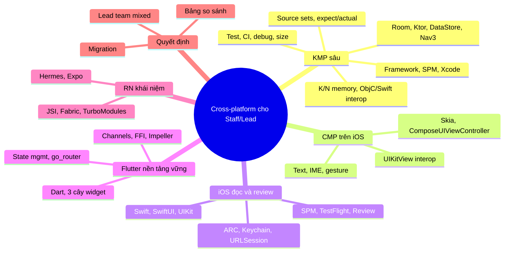
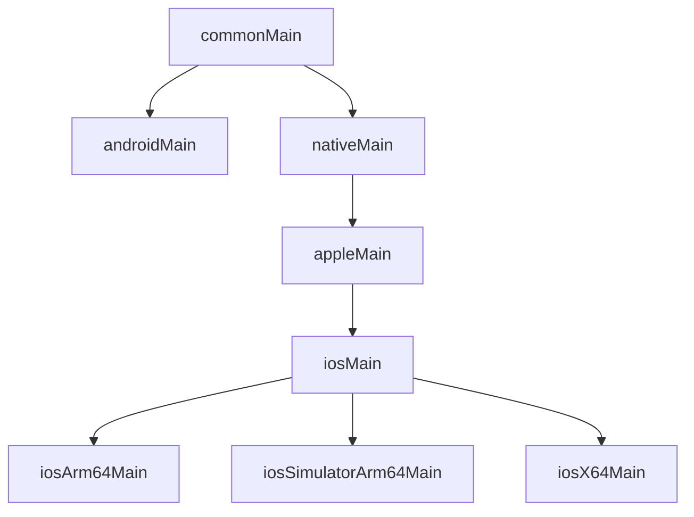
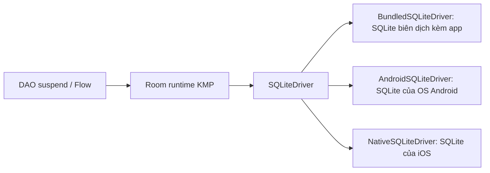
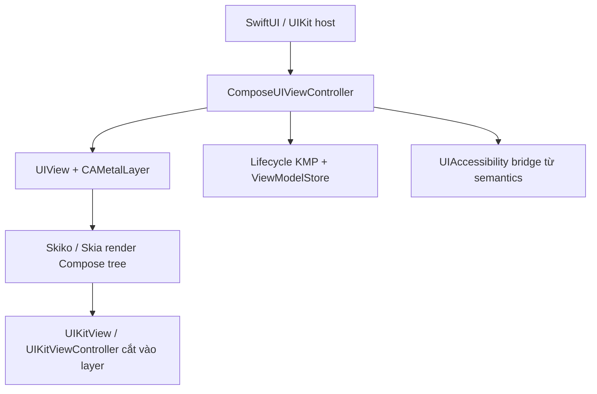
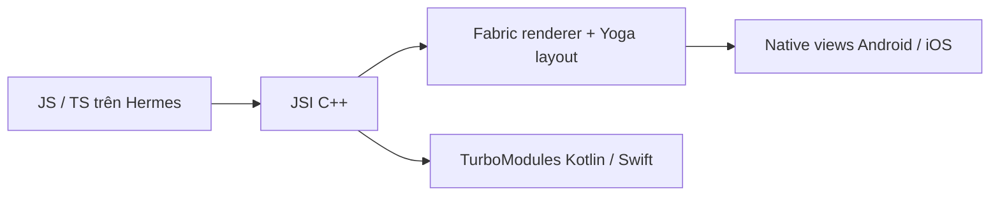

# 5. Cross-Platform: iOS, KMP/CMP, Flutter, React Native

> Mục tiêu: tự giải thích và bảo vệ mọi quyết định trong `kmp-template-impl` mà không cần AI; đọc và review được Swift; so sánh và chọn công nghệ cross-platform như một architect. | Mức cần đạt: Senior: hiểu KMP source set, expect/actual, build iOS framework, chạy được app trên simulator / Staff: giải thích memory model, interop, Room KMP, trade-off KMP vs Flutter vs RN với số liệu từ chính project / Lead: ra quyết định tech stack, kế hoạch migration, dẫn team mixed native + Flutter. | Thời gian gợi ý: tuần 5-6, ~22 giờ (KMP 9h, iOS 6h, Flutter 5h, RN 2h)

## 0. Bản đồ chủ đề

Theo research JD trong `01-Market-Research-2026.md`: trong 15 JD mobile, Flutter xuất hiện 8 lần, iOS/Swift kèm theo 8 lần, RN 6 lần, KMP chỉ 2 lần và luôn là "plus". Không còn JD "Android Lead" thuần. Vị trí Staff/Principal/Architect 8-14+ năm mặc định cover cả iOS, và thường nói "có Flutter/RN là lợi thế". Nghĩa là interviewer không cần bạn code Flutter giỏi, họ cần bạn:

1. Nói chuyện được với iOS dev, review Swift PR, hiểu App Store pipeline.
2. So sánh KMP, Flutter, RN, native một cách có căn cứ, và chọn đúng cho bài toán của họ (bank/fintech thường native + shared logic; outsourcing thường Flutter).
3. Với KMP: đây là thứ bạn đã làm thật (port app sang iOS, publish library). Đây là điểm khác biệt duy nhất của bạn so với đa số ứng viên Android, nên phải nắm sâu nhất.

Điểm quan trọng với riêng bạn: app KMP/CMP của bạn do Claude Code sinh phần lớn. Interviewer giỏi sẽ hỏi 3 lớp: "bạn chọn gì" (Koin, Room KMP, static framework), "tại sao" (trade-off), và "nếu đổi điều kiện thì sao" (team có iOS dev, cần UI native, cần Intel simulator...). Lớp 3 là nơi lộ ra ai chỉ copy. File này viết để bạn trả lời được cả 3 lớp.



"Cross-platform breadth" ở mức Staff/Lead nghĩa là: bạn biết cách mỗi stack render UI, gọi platform API, quản lý memory, build và ship; bạn biết mỗi stack vỡ ở đâu trong production; và bạn ước lượng được chi phí người, build, size, hiring. Không cần thuộc API.

**Đọc thêm:**
- https://kotlinlang.org/docs/multiplatform/
- https://docs.flutter.dev/
- https://reactnative.dev/
- `01-Market-Research-2026.md` mục tần suất skill

## 1. KMP sâu: học lại để tự bảo vệ code của mình

### 1.1 Cấu trúc project và source sets

Một module KMP có nhiều **compilation target** (androidTarget, iosArm64, iosSimulatorArm64, iosX64, jvm, js...). Mỗi target compile từ một tập **source set**. Source set là thư mục `src/<tên>/kotlin` cộng với dependency riêng. Quy tắc: code trong source set cha chỉ được dùng API chung của mọi target con.

Trong repo của bạn, `build-logic/src/main/kotlin/primitive/KmpCommonPlugin.kt` gọi `applyDefaultHierarchyTemplate()`. Nó tạo sẵn cây:



Ý nghĩa thực tế trong repo:

- `core/datasource/src/commonMain`: entity, DAO, `GrabeeDatabase`, `DatabaseFactory.kt` (dùng `BundledSQLiteDriver`, chạy được mọi target).
- `core/datasource/src/androidMain`: `DatabaseBuilder.android.kt` cần `Context`.
- `core/datasource/src/iosMain`: `DatabaseBuilder.ios.kt` dùng `NSFileManager`. Một file cho cả 3 target iOS nhờ intermediate source set `iosMain`.
- `KmpIosPlugin.kt` khai báo 3 target iOS và tạo framework `composeApp`, `isStatic = true`.

Dependency theo source set:

```kotlin
kotlin {
    sourceSets {
        commonMain.dependencies {
            implementation(libs.ktor.core)
        }
        androidMain.dependencies {
            implementation(libs.ktor.okhttp)     // engine Android
        }
        iosMain.dependencies {
            implementation(libs.ktor.darwin)     // engine iOS
        }
        commonTest.dependencies {
            implementation(kotlin("test"))
        }
    }
}
```

Câu hỏi interviewer đào sâu: "Tại sao không viết thẳng `iosArm64Main`?" Trả lời: vì 3 target iOS dùng chung Foundation/UIKit API; viết ở `iosMain` để một file phục vụ cả device và simulator. Chỉ xuống target cụ thể khi API khác nhau giữa device và simulator (hiếm).

`enableFeaturePreview("TYPESAFE_PROJECT_ACCESSORS")` trong `settings.gradle.kts` cho phép viết `projects.core.model` thay cho `project(":core:model")`. Repo của bạn hiện vẫn dùng `project(":core:model")` trong `composeApp/build.gradle.kts`; cả hai cách đều hợp lệ.

**Lỗi hay gặp / trade-off**
- Thêm thư viện vào `commonMain` mà thư viện không có artifact cho iosX64: build Android vẫn xanh, iOS vỡ lúc resolve. Đây chính là lý do repo pin `androidx.sqlite = 2.6.1`.
- Quên `applyDefaultHierarchyTemplate()` rồi tự `iosMain.dependsOn(commonMain)` bằng tay: dễ sai, Kotlin 1.9.20+ đã mặc định template.
- Để Room/KSP ở nhiều module: mỗi module phải thêm 4 cấu hình `kspX`. Repo giới hạn Room trong `core:datasource` là đúng.
- Rule "feature không phụ thuộc feature" trong `CLAUDE.md` giữ build graph phẳng; nếu vi phạm, Gradle configuration time tăng và iOS link lâu hơn.

**Đọc thêm:**
- https://kotlinlang.org/docs/multiplatform-hierarchy.html
- https://kotlinlang.org/docs/multiplatform-discover-project.html
- https://kotlinlang.org/docs/multiplatform-add-dependencies.html

### 1.2 expect/actual và khi nào nên dùng interface + DI thay thế

`expect` khai báo API trong `commonMain`, `actual` hiện thực ở từng platform source set. Compiler bắt buộc mọi target phải có `actual`.

```kotlin
// commonMain
expect fun platformName(): String

// androidMain
actual fun platformName(): String = "Android ${android.os.Build.VERSION.SDK_INT}"

// iosMain
import platform.UIKit.UIDevice
actual fun platformName(): String =
    UIDevice.currentDevice.systemName + " " + UIDevice.currentDevice.systemVersion
```

Repo của bạn dùng `expect`/`actual` cho **Koin module**: `internal expect val dataSourcePlatformModule: Module` trong `commonMain`, `actual` trong `DataSourceModule.android.kt` và `DataSourceModule.ios.kt`. Đây là pattern tốt: chỉ một điểm `expect`, còn lại là class bình thường được DI bind.

Khi nào ưu tiên **interface + DI**:

| Tiêu chí | expect/actual | interface + DI |
|---|---|---|
| Số lượng implementation | đúng 1 mỗi platform | nhiều (fake cho test, feature flag) |
| Test trong commonTest | phải có actual cho jvm/test target | inject fake, không cần actual |
| API bề mặt | nhỏ (hàm, constant, typealias) | lớn (service, repository) |
| Ví dụ trong repo | `dataSourcePlatformModule`, `appModulePlatform` | `PreferenceHelper` interface + `PreferenceHelperImpl` mỗi platform |

```kotlin
// commonMain: không expect, chỉ interface
interface PreferenceHelper {
    suspend fun getString(key: String): String?
    suspend fun putString(key: String, value: String)
}

// iosMain: implementation thường, bind qua Koin
internal actual val dataSourcePlatformModule: Module = module {
    single<PreferenceHelper> { PreferenceHelperImpl(ioDispatcher = get()) }
}
```

`expect class` với constructor cũng hợp lệ nhưng khó test hơn và từ Kotlin 2.x compiler cảnh báo khi `expect`/`actual` class có member mismatch; cần `@OptIn(ExperimentalMultiplatform::class)` cho một số dạng (cần kiểm tra tại https://kotlinlang.org/docs/multiplatform-expect-actual.html).

**Lỗi hay gặp / trade-off**
- `expect class` lan tràn: mỗi lần thêm hàm phải sửa N file. Giữ `expect` cho "factory của platform thing", phần còn lại là interface.
- `actual` ở `androidMain` cần `Context`: đừng truyền Context qua `expect fun`; bind Context vào Koin (`androidContext(this)`) và lấy `get()` trong module Android.
- `actual typealias` cho `Parcelable`/`@Parcelize` chỉ có ý nghĩa trên Android; trên iOS phải trống.

**Đọc thêm:**
- https://kotlinlang.org/docs/multiplatform-expect-actual.html
- https://kotlinlang.org/docs/multiplatform-connect-to-apis.html
- https://insert-koin.io/docs/reference/koin-mp/kmp/

### 1.3 Kotlin/Native memory model

Từ Kotlin 1.7.20 Kotlin/Native dùng **new memory manager** mặc định. Những điều phải nói được:

- **Không còn freezing.** Object chia sẻ giữa thread tự do như JVM. `InvalidMutabilityException` và `freeze()` là lịch sử. Nếu bạn thấy thư viện cũ còn `ensureNeverFrozen()`, đó là code trước 1.7.20.
- **GC riêng của Kotlin/Native**: tracing GC, stop-the-world mark rồi sweep; các bản gần đây có concurrent marking để giảm pause (bật mặc định ở version nào cần kiểm tra tại https://kotlinlang.org/docs/native-memory-manager.html). GC chạy theo heuristics, có thể gọi `kotlin.native.internal.GC.collect()` khi debug nhưng không nên trong production.
- **Kotlin GC và ARC của ObjC/Swift là hai hệ thống khác nhau.** Object Kotlin khi sang Swift được bọc trong một ObjC wrapper; Swift giữ wrapper bằng ARC; Kotlin GC coi wrapper còn sống là root. Object Swift/ObjC được Kotlin giữ bằng `retain`, release khi object Kotlin bị GC. Hệ quả: **cycle đi qua biên giới** (Kotlin giữ Swift closure, closure giữ Kotlin object) không được thu, gây leak. Phải phá cycle bằng tay (`[weak self]` phía Swift, hoặc dispose rõ ràng phía Kotlin).
- Deinit của object Kotlin được gọi khi GC thu, không xác định thời điểm; đừng dựa vào nó để giải phóng tài nguyên; dùng `close()` tường minh.
- Thread: `Dispatchers.Main` trên iOS map vào main run loop; `Dispatchers.IO` và `Dispatchers.Default` có trên Native từ kotlinx.coroutines 1.7+. Repo của bạn inject `ioDispatcher` qua Koin, đúng hướng.

```kotlin
// commonMain: Repository dùng dispatcher inject, không hard-code
class LevelRepository(
    private val dao: LevelDao,
    private val io: CoroutineDispatcher,
) {
    suspend fun levels(): List<LevelEntity> = withContext(io) { dao.getAll() }
}
```

Interviewer đào sâu: "Vậy memory leak trên iOS tìm bằng gì?" Trả lời: Xcode Instruments (Leaks, Allocations) chỉ thấy ObjC wrapper; heap Kotlin xem qua `kotlin.native.internal.GC` stats hoặc log GC (`-Xruntime-logs=gc=info`, cần kiểm tra flag ở docs). Thực tế team thường log số instance ViewModel/Repository và test leak bằng cách pop screen rồi đếm.

**Lỗi hay gặp / trade-off**
- Giữ `UIViewController` hoặc Swift closure trong singleton Kotlin: leak toàn bộ cây view.
- Callback từ Swift vào Kotlin trên thread lạ rồi cập nhật `MutableStateFlow` của UI: không crash nhưng Compose state phải được set trên main; dùng `withContext(Dispatchers.Main)`.
- Khác JVM: không có `WeakReference` tiện dụng cho mọi trường hợp; `kotlin.native.ref.WeakReference` tồn tại nhưng không dùng được cho ObjC object.

**Đọc thêm:**
- https://kotlinlang.org/docs/native-memory-manager.html
- https://kotlinlang.org/docs/native-arc-integration.html
- https://kotlinlang.org/docs/native-migration-guide.html

### 1.4 Objective-C/Swift interop, SKIE, Swift Export

Kotlin/Native xuất framework ở dạng **Objective-C header**; Swift dùng qua ObjC bridging. Vì thế có mapping và mất mát:

| Kotlin | Objective-C/Swift thấy gì |
|---|---|
| `class Foo` | `class Foo : KotlinBase` (prefix là baseName nếu bật `-Xobjc-prefix`; mặc định không prefix trong framework riêng) |
| `data class` | class thường, có `copy`, `equals`, `hash`, `description` |
| `sealed class` | class cha + subclass, Swift không thấy exhaustive `switch` |
| `enum class` | class với static instance, không phải Swift `enum` |
| `object Foo` | `Foo.shared` |
| Top-level `fun bar()` trong `Baz.kt` | `BazKt.bar()` |
| Top-level `fun initKoin()` | `InitHelperKt.doInitKoin()` vì tên bắt đầu bằng `init` bị ObjC hiểu là initializer, Kotlin tự thêm `do` |
| `suspend fun` | hàm có completion handler, Swift thấy `async throws` (chỉ gọi được từ main thread trừ khi cấu hình khác) |
| `Flow<T>` | class `Kotlinx_coroutines_coreFlow`, Swift không collect trực tiếp được |
| `Int`, `Long` | `Int32`, `Int64` (chú ý: Kotlin `Int` là `Int32` trong Swift) |
| `List<String>` | `[String]` nhưng `List<Int>` thành `[KotlinInt]` |
| `String?` | `String?`; nullability primitive thành boxed `KotlinInt?` |
| Generic | giữ ở mức ObjC lightweight generics, mất variance |
| Exception | chỉ exception trong `@Throws(...)` mới thành `NSError`; còn lại crash app |

Repo của bạn: `Application.kt` có `fun MainViewController()` nên Swift gọi `ApplicationKt.MainViewController()`. `InitHelper.kt` có `initKoin()` và `initNapier()` nên Swift gọi `InitHelperKt.doInitKoin()` và `InitHelperKt.doInitNapier()`. Nếu interviewer hỏi "tại sao có chữ do", bạn phải trả lời được: ObjC coi selector bắt đầu bằng `init` là initializer, Kotlin đổi tên để tránh vi phạm quy tắc ARC về ownership.

**Suspend từ Swift**

```kotlin
// commonMain
class LevelApi(private val repo: LevelRepository) {
    @Throws(CancellationException::class, Exception::class)
    suspend fun load(): List<Level> = repo.levels()
}
```

```swift
// Swift
let api = LevelApi(repo: repo)
Task {
    do {
        let levels = try await api.load()
    } catch {
        print(error)
    }
}
```

Không có `@Throws`, lỗi Kotlin sẽ terminate app, Swift không catch được.

**Flow từ Swift** không có cách native; ba lựa chọn:

1. Viết wrapper `CommonFlow<T>` trong Kotlin có `fun watch(block: (T) -> Unit): Closeable`.
2. Dùng **SKIE** (Touchlab): plugin Gradle sinh Swift code để `Flow` thành `AsyncSequence`, `suspend` thành `async` thật, `sealed class` thành Swift `enum` với exhaustive switch, default argument giữ được. Đổi lại build chậm hơn và thêm dependency.
3. Giữ UI trong Compose (cách của repo bạn): Swift không cần đụng Flow vì toàn bộ UI là Compose. Đây là lý do thực tế bạn không cần SKIE.

**Swift Export** là hướng chính thức của JetBrains để xuất Kotlin trực tiếp sang Swift (không qua ObjC), có từ Kotlin 2.2.20 ở trạng thái experimental; trạng thái hiện tại trong Kotlin 2.4.x cần kiểm tra tại https://kotlinlang.org/docs/native-swift-export.html. Khi nói trong phỏng vấn: "ObjC interop là stable path; Swift Export đang tiến tới, tôi theo dõi nhưng chưa dùng production".

**Lỗi hay gặp / trade-off**
- Quên `@Throws` ở suspend function: iOS crash khi mạng lỗi mà Android chỉ hiện error state.
- Gọi suspend function từ background thread Swift: Kotlin yêu cầu caller trên main thread hoặc phải bật `kotlin.native.binary.objcExportSuspendFunctionLaunchThreadRestriction=none` (cần kiểm tra tên option). Mặc định an toàn là gọi từ `@MainActor`.
- Export quá nhiều class: header ObjC phình, compile Swift chậm. Chỉ `export()` module nào Swift cần.

**Đọc thêm:**
- https://kotlinlang.org/docs/native-objc-interop.html
- https://skie.touchlab.co/
- https://kotlinlang.org/docs/native-swift-export.html

### 1.5 Build framework iOS: static vs dynamic, XCFramework, SPM, CocoaPods, Package.swift

```kotlin
// build-logic/src/main/kotlin/primitive/KmpIosPlugin.kt (repo của bạn, rút gọn)
listOf(iosX64(), iosArm64(), iosSimulatorArm64()).forEach { target ->
    target.binaries.framework {
        baseName = "composeApp"
        isStatic = true
    }
}
```

Giải thích từng quyết định:

- **3 target**: `iosArm64` (device), `iosSimulatorArm64` (simulator trên Apple Silicon), `iosX64` (simulator trên Intel Mac). Giữ `iosX64` là lý do phải pin `androidx.sqlite 2.6.1` và lo lắng Ktor. Nếu team không còn Intel Mac, bỏ `iosX64` sẽ mở khóa thư viện mới hơn và giảm 1/3 thời gian link. Đây là quyết định bạn phải nói được "tôi giữ vì X, tôi sẽ bỏ khi Y".
- **`isStatic = true`**: framework tĩnh được link vào binary app lúc build, không cần "Embed & Sign", launch nhanh hơn một chút, dead code elimination tốt hơn. Dynamic framework cần embed, cho phép nhiều framework dùng chung runtime Kotlin (nếu app có 2 Kotlin framework thì mỗi framework static sẽ duplicate runtime và crash khi 2 runtime gặp nhau; lúc đó phải gộp thành 1 umbrella framework). Với 1 framework như repo, static là lựa chọn mặc định đúng.
- **baseName `composeApp`**: Swift `import composeApp`.

**Cách iOS app tiêu thụ framework** (3 đường):

1. **Direct integration qua Gradle task**: Xcode có Run Script phase gọi `./gradlew :composeApp:embedAndSignAppleFrameworkForXcode`. Task đọc `CONFIGURATION`, `SDK_NAME`, `ARCHS` từ env Xcode để chọn target. Đây là cách project wizard của JetBrains sinh ra và gần như chắc chắn là cách repo bạn dùng (thư mục `iosApp/` không nằm trong repo root hiện tại, cần kiểm tra bạn để ở đâu).
2. **CocoaPods**: plugin `kotlin("native.cocoapods")`, sinh `podspec`, Xcode dùng `pod install`. Hợp khi app iOS đã dùng Pods.
3. **SPM với XCFramework**: build `XCFramework` chứa cả device và simulator slice, publish kèm `Package.swift`. Hợp khi team iOS riêng, nhận framework như thư viện. Kotlin 2.4.20 thêm tự động sinh `Package.swift` cho XCFramework (theo brief; cấu hình chi tiết cần kiểm tra tại https://kotlinlang.org/docs/whatsnew2420.html).

```kotlin
// Ví dụ khai báo XCFramework (khi đi đường 3)
import org.jetbrains.kotlin.gradle.plugin.mpp.apple.XCFramework

kotlin {
    val xcf = XCFramework("Shared")
    listOf(iosArm64(), iosSimulatorArm64()).forEach {
        it.binaries.framework {
            baseName = "Shared"
            xcf.add(this)
        }
    }
}
// ./gradlew assembleSharedXCFramework  -> build/XCFrameworks/release/Shared.xcframework
```

```swift
// iosApp/iOSApp.swift: entry point SwiftUI gọi Kotlin
import SwiftUI
import composeApp

@main
struct iOSApp: App {
    init() {
        InitHelperKt.doInitNapier()
        InitHelperKt.doInitKoin()
    }

    var body: some Scene {
        WindowGroup {
            ContentView().ignoresSafeArea(.all)
        }
    }
}

struct ContentView: UIViewControllerRepresentable {
    func makeUIViewController(context: Context) -> UIViewController {
        ApplicationKt.MainViewController()
    }
    func updateUIViewController(_ uiViewController: UIViewController, context: Context) {}
}
```

**Lỗi hay gặp / trade-off**
- Build "arm64 simulator" trên Intel Mac hoặc ngược lại: lỗi "building for iOS Simulator, but linking in object file built for iOS". Kiểm tra `ARCHS` và `EXCLUDED_ARCHS`.
- Quên `export(project(":core:model"))` trong `framework {}`: Swift không thấy class của module đó dù Kotlin dùng được. `transitiveExport = true` tiện nhưng làm header phình, không khuyến nghị.
- Apple yêu cầu Xcode 26 / iOS 26 SDK để upload từ 28/4/2026 (brief). Kotlin version phải hỗ trợ Xcode đó; kiểm tra bảng tương thích trước khi nâng.

**Đọc thêm:**
- https://kotlinlang.org/docs/multiplatform-build-native-binaries.html
- https://kotlinlang.org/docs/multiplatform-ios-integration-overview.html
- https://kotlinlang.org/docs/native-cocoapods.html

### 1.6 iOS app lifecycle và khởi tạo Koin trên iOS

Trên Android, Koin khởi tạo trong `Application.onCreate()` (repo dùng `koin-androidx-startup`, tức là App Startup initializer) với `androidContext(this)`. Trên iOS không có `Application` class, nên repo xuất hàm `initKoin()` và Swift gọi trong `init()` của `@main struct iOSApp`. Thứ tự: Napier trước (để log lỗi Koin), Koin sau, rồi mới tạo `MainViewController()`.

```kotlin
// composeApp/src/iosMain/kotlin/me/ltthuc/kmp/InitHelper.kt (repo của bạn)
fun initKoin() {
    startKoin {
        applyModules()      // gom module của core:* và feature:* trong commonMain
    }
}
```

```kotlin
// composeApp/src/iosMain/kotlin/me/ltthuc/kmp/Application.kt (repo của bạn, rút gọn)
fun MainViewController() = ComposeUIViewController {
    val settingRepository = koinInject<AppSettingRepository>()
    val billingRepository = koinInject<BillingRepository>()
    val userData by settingRepository.setting.collectAsStateWithLifecycle(null)

    LaunchedEffect(Unit) {
        billingRepository.configure()
        settingRepository.initializeIdIfNeeded()
    }

    userData?.let { GrabeeApp(modifier = Modifier.fillMaxSize(), setting = it) }
}
```

Những điểm phải tự giải thích được:

- Trên Android việc `configure()` billing và init id nằm trong `MainViewModel`; trên iOS nằm trong `LaunchedEffect(Unit)` của root composable. Lý do: không có Activity/ViewModel host ở tầng root iOS. Trade-off: `LaunchedEffect(Unit)` chạy lại nếu `ComposeUIViewController` bị recreate; thực tế root controller sống suốt app nên chấp nhận được. Cách sạch hơn: tạo `AppViewModel` ở commonMain và dùng `viewModel()` của lifecycle KMP ngay trong `ComposeUIViewController`, vì CMP cung cấp `ViewModelStoreOwner` cho controller.
- Lifecycle iOS (`applicationDidEnterBackground`, `willEnterForeground`) được CMP map vào `Lifecycle` KMP của `ComposeUIViewController`, nên `collectAsStateWithLifecycle` hoạt động trên iOS. Nếu cần hook sâu hơn (ví dụ dừng audio khi background), dùng `NSNotificationCenter` với `UIApplicationDidEnterBackgroundNotification` trong iosMain hoặc nhận callback từ `AppDelegate` Swift.
- Koin `koinInject()` trong composable cần `KoinContext` hoặc Koin đã `startKoin` toàn cục; repo đi đường toàn cục nên không cần `KoinApplication {}` wrapper.

```kotlin
// iosMain: nghe lifecycle app qua NSNotificationCenter (ví dụ dừng audio)
import platform.Foundation.NSNotificationCenter
import platform.UIKit.UIApplicationDidEnterBackgroundNotification

fun observeBackground(onBackground: () -> Unit) {
    NSNotificationCenter.defaultCenter.addObserverForName(
        name = UIApplicationDidEnterBackgroundNotification,
        `object` = null,
        queue = null,
    ) { _ -> onBackground() }
}
```

**Lỗi hay gặp / trade-off**
- Gọi `doInitKoin()` hai lần (ví dụ trong cả `AppDelegate` và `App.init`): Koin ném `KoinApplicationAlreadyStartedException`. Guard bằng `GlobalContext.getOrNull()`.
- Preview SwiftUI không chạy `init()` của App: crash "No Koin context". Bọc preview bằng hàm init riêng.
- Koin trên iOS resolve lazily lúc `koinInject()` trong frame đầu: nếu module nặng (mở Room, đọc DataStore), frame đầu khựng. Đẩy việc nặng vào `suspend` trong `LaunchedEffect`.

**Đọc thêm:**
- https://insert-koin.io/docs/setup/koin
- https://insert-koin.io/docs/reference/koin-compose/compose/
- https://developer.apple.com/documentation/uikit/app_and_environment/managing_your_app_s_life_cycle

### 1.7 Room KMP: driver, BundledSQLiteDriver, migration, và pin androidx.sqlite 2.6.1

Room từ 2.7 hỗ trợ KMP; repo dùng Room 2.8.4 + KSP 2.3.4 + `androidx.sqlite:sqlite-bundled 2.6.1`. Kiến trúc:



- **Driver**: Room KMP tách lớp driver. `BundledSQLiteDriver` đóng gói SQLite của riêng nó vào binary, nên version SQLite giống nhau trên mọi platform và mọi OS version, có FTS, JSON, window function. Đổi lại binary tăng vài MB. `NativeSQLiteDriver` dùng SQLite hệ thống iOS, nhẹ hơn nhưng version tùy iOS. Repo chọn Bundled: đúng cho app cần hành vi giống hệt 2 platform.
- **Constructor**: `@ConstructedBy(GrabeeDatabaseConstructor::class)` và `expect object GrabeeDatabaseConstructor : RoomDatabaseConstructor<GrabeeDatabase>`; KSP sinh `actual` cho từng target. Đó là lý do phải thêm `kspIosX64`, `kspIosArm64`, `kspIosSimulatorArm64`, `kspAndroid` (4 dòng trong `core/datasource/build.gradle.kts`).

```kotlin
// commonMain
@Database(entities = [LevelEntity::class, UnitEntity::class], version = 1)
@ConstructedBy(GrabeeDatabaseConstructor::class)
abstract class GrabeeDatabase : RoomDatabase() {
    abstract fun levelDao(): LevelDao
}

@Suppress("NO_ACTUAL_FOR_EXPECT")
expect object GrabeeDatabaseConstructor : RoomDatabaseConstructor<GrabeeDatabase> {
    override fun initialize(): GrabeeDatabase
}

@Dao
interface LevelDao {
    @Query("SELECT * FROM levels ORDER BY sortOrder")
    fun observeAll(): Flow<List<LevelEntity>>

    @Upsert
    suspend fun upsert(items: List<LevelEntity>)
}

// commonMain: DatabaseFactory.kt (repo của bạn)
internal fun RoomDatabase.Builder<GrabeeDatabase>.buildGrabeeDatabase(
    queryDispatcher: CoroutineDispatcher = Dispatchers.IO,
): GrabeeDatabase = this
    .setDriver(BundledSQLiteDriver())
    .setQueryCoroutineContext(queryDispatcher)
    .fallbackToDestructiveMigration(dropAllTables = true)
    .build()
```

```kotlin
// iosMain: DatabaseBuilder.ios.kt (repo của bạn) - đường dẫn trong Documents
internal fun createGrabeeDatabaseBuilder(): RoomDatabase.Builder<GrabeeDatabase> {
    val documentDirectory = NSFileManager.defaultManager.URLForDirectory(
        directory = NSDocumentDirectory,
        inDomain = NSUserDomainMask,
        appropriateForURL = null,
        create = false,
        error = null,
    )
    val dbFilePath = requireNotNull(documentDirectory?.path) + "/$GRABEE_DB_NAME"
    return Room.databaseBuilder<GrabeeDatabase>(name = dbFilePath)
}
```

**Migration** trong KMP dùng `SQLiteConnection` thay `SupportSQLiteDatabase`:

```kotlin
val MIGRATION_1_2 = object : Migration(1, 2) {
    override fun migrate(connection: SQLiteConnection) {
        connection.execSQL("ALTER TABLE levels ADD COLUMN isPremium INTEGER NOT NULL DEFAULT 0")
    }
}
// builder.addMigrations(MIGRATION_1_2)
```

Repo hiện dùng `fallbackToDestructiveMigration(dropAllTables = true)`. Phải nói thẳng trong phỏng vấn: hợp lý khi DB là cache của content pack có thể seed lại (`DatabaseSeeder.kt`), **không hợp lý** nếu chứa tiến độ học của trẻ (`UserProgressEntity`, `LessonProgressEntity`). Câu trả lời đúng: "Progress phải có migration thật hoặc được tách sang DB/DataStore khác; destructive chỉ cho bảng curriculum". Đây là lỗ hổng bạn nên tự vá trước khi phỏng vấn.

**Tại sao pin `androidx.sqlite = 2.6.1`**: comment trong `libs.versions.toml` nói rõ: "2.7.0 dropped iosX64 (Intel simulator); 2.6.1 is the newest that still ships it". Vì `KmpIosPlugin` vẫn khai báo `iosX64()`, Gradle phải resolve artifact `sqlite-bundled-iosx64`; từ 2.7.0 artifact này không tồn tại nên build fail. Hai cách thoát: bỏ `iosX64` (khuyến nghị nếu không còn Intel Mac) hoặc giữ pin và chấp nhận không nhận bug fix mới. Comment tương tự nói Ktor 3.5.0 bỏ iosX64 nhưng catalog đang để `ktor = 3.5.2`; bạn cần tự build `linkDebugFrameworkIosX64` để xác nhận trạng thái thật, vì interviewer có thể hỏi "vậy iosX64 của bạn có build được không".

**Room 3.0** (`androidx.room3`, stable 3.0.1 ngày 29/7/2026, theo brief): Kotlin-only codegen, KSP bắt buộc, breaking package. Repo ở 2.8.4 vẫn được hỗ trợ; kế hoạch nâng: đổi package, chạy lại schema export, so sánh schema JSON, chạy migration test trên cả Android và iOS simulator.

**Room KMP vs SQLDelight** (câu hay bị hỏi):

| | Room KMP | SQLDelight |
|---|---|---|
| Nguồn sự thật | Kotlin entity + annotation | file `.sq` SQL |
| Type-safe query | kiểm tra lúc compile qua KSP | sinh Kotlin từ SQL, compile-time |
| Migration | `Migration` object, `autoMigrations` + schema JSON | file `.sqm`, verify bằng Gradle task |
| Driver | `androidx.sqlite` driver | driver riêng từng platform (`NativeSqliteDriver`) |
| Team Android quen | rất quen | học thêm |
| Hỗ trợ | Google, cùng nhịp AndroidX | Cash App, cộng đồng |

Lý do chọn Room cho template: team Android đã quen Room, code review dễ, Paging/Flow tích hợp sẵn, và Google đang đẩy KMP cho Room/DataStore/Lifecycle. Chọn SQLDelight khi team thích SQL-first hoặc target JS/Wasm (Room chưa có).

**Lỗi hay gặp / trade-off**
- Quên `setQueryCoroutineContext`: trên iOS query chạy trên thread gọi, có thể là main.
- `Flow` từ DAO không emit trên iOS nếu quên invalidation tracker; Room KMP xử lý nhưng cần `BundledSQLiteDriver` hoặc driver hỗ trợ.
- Schema export: thêm `room { schemaDirectory("$projectDir/schemas") }` để có JSON cho auto-migration và test; cần kiểm tra plugin `androidx.room` dùng chung với KMP.

**Đọc thêm:**
- https://developer.android.com/kotlin/multiplatform/room
- https://developer.android.com/jetpack/androidx/releases/room
- https://sqldelight.github.io/sqldelight/

### 1.8 Ktor client, kotlinx-serialization, DataStore KMP

**Ktor**: `HttpClient` chung ở commonMain, engine theo platform. Repo đặt `ktor-okhttp` ở `androidMain` và `ktor-darwin` ở `iosMain`; khi gọi `HttpClient { }` không chỉ định engine, Ktor tự chọn engine có trên classpath của target.

```kotlin
// commonMain
val json = Json { ignoreUnknownKeys = true; isLenient = true }

fun createHttpClient(logger: (String) -> Unit): HttpClient = HttpClient {
    install(ContentNegotiation) { json(json) }
    install(Logging) {
        level = LogLevel.INFO
        this.logger = object : Logger { override fun log(message: String) = logger(message) }
    }
    install(HttpTimeout) { requestTimeoutMillis = 15_000 }
    defaultRequest { url("https://api.example.com/") }
}

@Serializable
data class LevelDto(val id: String, val title: String, @SerialName("is_premium") val isPremium: Boolean = false)

class LevelRemote(private val client: HttpClient) {
    suspend fun levels(): List<LevelDto> = client.get("levels").body()
}
```

Darwin engine dùng `NSURLSession`: tự theo ATS (App Transport Security), hỗ trợ HTTP/2, proxy hệ thống; cấu hình thêm qua `engine { configureRequest { setAllowsCellularAccess(true) } }`. Certificate pinning trên Darwin làm qua `handleChallenge` (xem `08-Security.md`). Engine `CIO` là Kotlin thuần, chạy mọi nơi nhưng không có HTTP/2 trên Native và không đi qua ATS, nên tránh cho iOS production.

**kotlinx-serialization**: plugin `kotlin("plugin.serialization")`, `@Serializable` ở commonMain, không reflection nên chạy trên Native. Nav3 cũng cần `@Serializable` cho `NavKey`.

**DataStore KMP** (`androidx.datastore:datastore-preferences-core`, repo dùng 1.2.0):

```kotlin
// commonMain
import androidx.datastore.core.DataStore
import androidx.datastore.preferences.core.PreferenceDataStoreFactory
import androidx.datastore.preferences.core.Preferences
import okio.Path.Companion.toPath

fun createPreferenceDataStore(producePath: () -> String): DataStore<Preferences> =
    PreferenceDataStoreFactory.createWithPath(produceFile = { producePath().toPath() })

// iosMain
fun createPreferenceDataStore(): DataStore<Preferences> = createPreferenceDataStore {
    val dir = NSFileManager.defaultManager.URLForDirectory(
        NSDocumentDirectory, NSUserDomainMask, null, false, null,
    )
    requireNotNull(dir?.path) + "/app.preferences_pb"
}

// androidMain
fun createPreferenceDataStore(context: Context): DataStore<Preferences> =
    createPreferenceDataStore { context.filesDir.resolve("app.preferences_pb").absolutePath }
```

Quy tắc: mỗi file DataStore chỉ một instance trong process (Koin `single`). Proto DataStore trên KMP cần `OkioSerializer`; repo dùng preferences cho `AppSettingDataSource`, đủ cho setting.

**Lỗi hay gặp / trade-off**
- Hai instance DataStore cùng file: `IllegalStateException: There are multiple DataStores active for the same file`.
- Ktor `Logging` ở level BODY trong release: lộ token vào log; gate theo `BuildKonfig`.
- `ignoreUnknownKeys = false` mặc định: backend thêm field là app cũ crash parse.

**Đọc thêm:**
- https://ktor.io/docs/client-engines.html
- https://github.com/Kotlin/kotlinx.serialization
- https://developer.android.com/kotlin/multiplatform/datastore

### 1.9 Compose resources, Navigation 3 CMP, Lifecycle/ViewModel KMP

**Resources**: thư mục `src/commonMain/composeResources/` với `values/strings.xml`, `drawable/`, `font/`, `files/`. Plugin sinh object `Res`. Repo để toàn bộ resource ở `core:resource` (có `files/stories`, `files/audio/level_1/...`).

```kotlin
import grabee.core.resource.generated.resources.Res   // package thật tùy cấu hình; cần kiểm tra trong module core:resource
import org.jetbrains.compose.resources.stringResource
import org.jetbrains.compose.resources.painterResource

@Composable
fun Header() {
    Text(stringResource(Res.string.app_name))
    Image(painterResource(Res.drawable.logo), contentDescription = null)
}

suspend fun loadStory(id: String): ByteArray = Res.readBytes("files/stories/$id.json")
fun audioUri(path: String): String = Res.getUri("files/audio/$path")
```

Resource đa ngôn ngữ: `values-vi/strings.xml`. Đa density: `drawable-xxhdpi`. Trên iOS resource được copy vào bundle của framework; `Res.getUri` trả `file://` URI, dùng được cho `AVPlayer`.

**Navigation 3 CMP** (`org.jetbrains.androidx.navigation3:navigation3-ui`, repo dùng 1.0.0-alpha06; Nav3 Android stable 19/11/2025 theo brief, bản CMP đi sau):

```kotlin
@Serializable
sealed interface Destination : NavKey {
    @Serializable data object Home : Destination
    @Serializable data class UnitDetail(val unitId: String) : Destination
}

@Composable
fun AppNavHost() {
    val backStack = rememberNavBackStack(Destination.Home)
    CompositionLocalProvider(LocalNavBackStack provides backStack) {
        NavDisplay(
            backStack = backStack,
            onBack = { backStack.removeLastOrNull() },
            entryDecorators = listOf(
                rememberSavedStateNavEntryDecorator(),
                rememberViewModelStoreNavEntryDecorator(),
            ),
            entryProvider = entryProvider {
                entry<Destination.Home> { HomeScreen() }
                entry<Destination.UnitDetail> { key -> UnitDetailScreen(unitId = key.unitId) }
            },
        )
    }
}
```

Repo: `Destination` sealed interface nằm ở `core:ui`, `LocalNavBackStack` là CompositionLocal, feature đăng ký bằng extension `EntryProviderScope.homeEntries()` gọi trong `AppNavHost`. Lý do: feature không biết nhau, chỉ biết `Destination`. Tên decorator có thể khác giữa alpha; cần kiểm tra tại https://developer.android.com/guide/navigation/navigation-3.

Khác Nav2: back stack là `List<NavKey>` bạn sở hữu, không còn route string, không `NavController`. Predictive back và transition qua Scenes API. Trên iOS, swipe-back không tự có; cần tự xử lý (mục 2.2).

**Lifecycle/ViewModel KMP** (`org.jetbrains.androidx.lifecycle:*`, repo 2.9.6): `ViewModel`, `viewModelScope`, `collectAsStateWithLifecycle` chạy trên iOS. Koin: `viewModelOf(::HomeViewModel)` và `koinViewModel<HomeViewModel>()` trong composable; scope theo `NavEntry` nhờ `rememberViewModelStoreNavEntryDecorator()`.

```kotlin
class HomeViewModel(private val repo: LevelRepository) : ViewModel() {
    val state: StateFlow<ScreenState<List<Level>>> = repo.observeLevels()
        .map<List<Level>, ScreenState<List<Level>>> { ScreenState.Idle(it) }
        .catch { emit(ScreenState.Error(it)) }
        .stateIn(viewModelScope, SharingStarted.WhileSubscribed(5_000), ScreenState.Loading)
}
```

**Lỗi hay gặp / trade-off**
- Resource ID đổi tên khi đổi tên file; `Res` sinh lại nên build fail có kiểm soát, tốt hơn `R.string` runtime crash.
- Nav3 alpha trên CMP: API đổi giữa alpha; pin version và đọc changelog mỗi lần nâng.
- `SavedStateHandle` trên iOS: không có process death kiểu Android nhưng vẫn cần cho config change và decorator.

**Đọc thêm:**
- https://www.jetbrains.com/help/kotlin-multiplatform-dev/compose-multiplatform-resources.html
- https://developer.android.com/guide/navigation/navigation-3
- https://www.jetbrains.com/help/kotlin-multiplatform-dev/compose-viewmodel.html

### 1.10 Testing: commonTest và test trên iOS

- `commonTest` với `kotlin("test")` chạy trên mọi target: `./gradlew :core:datasource:testDebugUnitTest` (Android/JVM) và `./gradlew :core:datasource:iosSimulatorArm64Test` (chạy trên simulator qua `xcrun simctl`).
- **MockK không hỗ trợ Kotlin/Native**. Trong commonTest dùng fake viết tay hoặc Mokkery (KSP, hỗ trợ Native; cần kiểm tra tại https://mokkery.dev). MockK giữ cho `androidUnitTest`.
- Turbine chạy trên Native; `kotlinx-coroutines-test` với `runTest` chạy mọi nơi.
- Room trên test iOS: dùng `BundledSQLiteDriver` với `inMemoryDatabaseBuilder` nếu có cho KMP, hoặc file tạm trong `NSTemporaryDirectory()`.
- Ktor: `MockEngine` (repo đã có `ktor-client-mock` trong commonTest).

```kotlin
// commonTest
class LevelRepositoryTest {
    private val fakeDao = FakeLevelDao()
    private val repo = LevelRepository(fakeDao, io = UnconfinedTestDispatcher())

    @Test
    fun emitsLevelsInOrder() = runTest {
        fakeDao.seed(listOf(LevelEntity("l2", sortOrder = 2), LevelEntity("l1", sortOrder = 1)))
        repo.observeLevels().test {
            assertEquals(listOf("l1", "l2"), awaitItem().map { it.id })
            cancelAndIgnoreRemainingEvents()
        }
    }
}
```

UI test CMP trên iOS: `compose-ui-test` chạy được trên iOS từ 1.6+ (`runComposeUiTest`), nhưng thực tế team chạy UI test trên Android và dùng screenshot test + manual QA trên iOS. Xem `19-Testing-Deep-Dive.md`.

**Lỗi hay gặp / trade-off**
- `iosSimulatorArm64Test` cần simulator cài sẵn; trên CI phải `xcrun simctl boot`.
- Test dùng `Dispatchers.Main` trên Native cần `Dispatchers.setMain`.
- Thư viện test chỉ có JVM (Robolectric, MockK) kéo vào commonTest làm iOS test không resolve.

**Đọc thêm:**
- https://kotlinlang.org/docs/multiplatform-run-tests.html
- https://github.com/cashapp/turbine
- `19-Testing-Deep-Dive.md`

### 1.11 Build time, binary size, debugging iOS, CI cho iOS

**Build time**: compile Kotlin/Native chậm hơn JVM vì LLVM backend. Giảm bằng: bật Gradle cache và configuration cache; `kotlin.native.cacheKind=static` (mặc định cho debug trên một số target) để cache thư viện phụ thuộc; chỉ link target đang cần (`linkDebugFrameworkIosSimulatorArm64` thay vì tất cả); bỏ `iosX64` nếu không cần; tách module để incremental. `kotlin.incremental.native=true` là experimental, cần kiểm tra trạng thái.

**Binary size**: static framework + dead code elimination của linker giúp; Compose runtime + Skiko là phần lớn size. Release build dùng `-opt`; kiểm tra size qua `xcrun size` hoặc App Store Connect "App size report". Không nêu số cụ thể nếu bạn chưa đo; đo trên chính app của bạn và ghi vào `16-Side-Project-Portfolio.md`.

**Debugging**: Xcode debug được Kotlin frame với symbol nếu dùng debug framework; plugin `xcode-kotlin` của Touchlab cho breakpoint vào `.kt` và xem biến. Crash production: stack trace Kotlin cần symbolicate; Crashlytics cần `CrashKiOS` (Touchlab) để report Kotlin exception với frame Kotlin. Kotlin 2.4.20 thêm coroutine stack-trace recovery (brief) giúp stack trace suspend dễ đọc hơn.

**CI iOS** (chi tiết GitHub Actions trong `20-Git-CICD.md`):

```yaml
# .github/workflows/ios.yml (rút gọn)
jobs:
  ios:
    runs-on: macos-15
    steps:
      - uses: actions/checkout@v4
      - uses: actions/setup-java@v4
        with: { distribution: temurin, java-version: 17 }
      - uses: gradle/actions/setup-gradle@v4
      - name: Cache konan
        uses: actions/cache@v4
        with:
          path: ~/.konan
          key: konan-${{ runner.os }}-${{ hashFiles('gradle/libs.versions.toml') }}
      - run: ./gradlew :core:datasource:iosSimulatorArm64Test
      - run: ./gradlew :composeApp:linkDebugFrameworkIosSimulatorArm64
      - run: xcodebuild -project iosApp/iosApp.xcodeproj -scheme iosApp -sdk iphonesimulator -destination 'platform=iOS Simulator,name=iPhone 16' build CODE_SIGNING_ALLOWED=NO
```

Signing cho TestFlight: Fastlane `match` lưu cert trong repo riêng mã hóa, hoặc App Store Connect API key. macOS runner đắt gấp khoảng 10 lần Linux runner trên GitHub Actions, nên chỉ chạy iOS job trên PR vào main hoặc nightly.

**Lỗi hay gặp / trade-off**
- `~/.konan` không cache: mỗi lần CI tải toolchain LLVM vài trăm MB.
- Xcode version trên runner khác local: lỗi SDK; pin bằng `xcode-select` hoặc `maxim-lobanov/setup-xcode`.
- Quên `CODE_SIGNING_ALLOWED=NO` cho build simulator trên CI: fail vì thiếu cert.

**Đọc thêm:**
- https://kotlinlang.org/docs/native-debugging.html
- https://github.com/touchlab/CrashKiOS
- https://github.com/touchlab/xcode-kotlin
- `20-Git-CICD.md`

### 1.12 Production issues thường gặp của CMP trên iOS

| Vấn đề | Nguyên nhân | Cách xử lý |
|---|---|---|
| Keyboard che TextField | Compose không tự dời nội dung như UIKit | `Modifier.imePadding()` và `WindowInsets.ime` được CMP hỗ trợ trên iOS; kết hợp `Scaffold(contentWindowInsets)`; kiểm tra `onFocusBehavior` trong `ComposeUIViewController(configure = {...})` |
| Nội dung dính notch / home indicator | Quên safe area | `Modifier.windowInsetsPadding(WindowInsets.safeDrawing)` hoặc `Scaffold` mặc định; Swift bên ngoài để `.ignoresSafeArea()` để Compose tự xử lý |
| Text input khác iOS (autocorrect, selection, emoji) | CMP có text input riêng bridging UIKit | Nâng CMP 1.8+ (text input viết lại), test VoiceOver và dictation; fallback `UIKitView` với `UITextField` cho form nhạy cảm |
| Scroll không "mượt như native" | Overscroll bounce và fling physics được CMP mô phỏng; chạy ở 120Hz cần Metal | Bật `CADisableMinimumFrameDurationOnPhone` trong Info.plist để 120Hz; tránh recomposition nặng trong item; dùng `key` cho LazyColumn |
| Font khác iOS | CMP không dùng San Francisco mặc định | Nạp font qua resources hoặc dùng `FontFamily.Default` (CMP map tới system font); kiểm tra |
| Swipe back không có | Nav3 không biết UIKit gesture | Tự thêm gesture ở edge; hoặc dùng UIKit navigation host + `ComposeUIViewController` mỗi screen |
| Accessibility / VoiceOver | Semantics tree phải map sang `UIAccessibility` | CMP tự map, bật mặc định từ 1.6.x (cần kiểm tra); test thật bằng VoiceOver |
| Share sheet, file picker, camera | Không có API chung | `UIKitViewController`, `expect/actual`, hoặc thư viện (repo dùng FileKit, Calf) |
| Crash do exception chưa `@Throws` | Interop | `@Throws` ở biên; `setUnhandledExceptionHook` để log |
| Hình ảnh nặng | Coil 3 trên iOS decode qua Skia | Giới hạn size request, `memoryCachePolicy` |

**Đọc thêm:**
- https://www.jetbrains.com/help/kotlin-multiplatform-dev/compose-ios-ui-integration.html
- https://github.com/JetBrains/compose-multiplatform/issues
- https://developer.apple.com/design/human-interface-guidelines/

## 2. Compose Multiplatform trên iOS

### 2.1 Rendering qua Skia, ComposeUIViewController, interop UIKit

CMP trên iOS không dùng UIKit để vẽ. Toàn bộ cây Compose được vẽ bằng **Skia** (qua Skiko) lên một `CAMetalLayer` trong một `UIView` duy nhất. UIKit chỉ cung cấp: cửa sổ, touch event, keyboard, accessibility bridge, và lifecycle. Vì vậy:

- Mọi pixel giống nhau giữa Android và iOS (cùng Material 3), nhưng không phải "native look".
- Input, text, scroll physics do Compose mô phỏng; chất lượng phụ thuộc version CMP.
- Interop với UIKit là "cửa sổ" cắt vào layer Compose.



```kotlin
// iosMain
fun MainViewController(): UIViewController = ComposeUIViewController(
    configure = {
        // các option như onFocusBehavior, opaque, enforceStrictPlainTextInput,
        // parallelRendering; tên và mặc định cần kiểm tra theo version CMP bạn dùng
    },
) {
    App()
}
```

Interop:

```kotlin
import androidx.compose.ui.viewinterop.UIKitView
import platform.MapKit.MKMapView

@Composable
fun NativeMap(modifier: Modifier = Modifier) {
    UIKitView(
        factory = { MKMapView() },
        modifier = modifier.fillMaxWidth().height(240.dp),
        update = { map -> map.showsUserLocation = true },
    )
}
```

`UIKitViewController(factory = { SomeViewController() })` cho cả controller (ví dụ `SFSafariViewController`, `AVPlayerViewController`). Hai chiều: Swift có thể nhúng `ComposeUIViewController` vào `NavigationStack` của SwiftUI; Compose có thể nhúng UIKit vào trong. Pattern "UIKit host + Compose screen" dùng khi muốn navigation gesture native.

**Lỗi hay gặp / trade-off**
- `UIKitView` là view thật nằm trên layer Compose: không clip theo `Modifier.clip`, không alpha, z-order bị giới hạn; cần `UIKitInteropProperties` cho interaction mode (cần kiểm tra tên).
- Mỗi `ComposeUIViewController` tạo một Compose runtime; nhiều controller cùng lúc tốn memory.
- `opaque = false` để nền trong suốt tốn thêm blending.

**Đọc thêm:**
- https://www.jetbrains.com/help/kotlin-multiplatform-dev/compose-ios-ui-integration.html
- https://github.com/JetBrains/skiko
- https://www.jetbrains.com/compose-multiplatform/

### 2.2 Platform look, text/IME, navigation gesture, performance

**Shared look vs platform look**: với app trẻ em như Grabee, shared look (một bộ Material 3 Expressive + brand) là lợi thế: UI là thương hiệu. Với app ngân hàng cho user iOS, kỳ vọng "giống iOS" cao: cân nhắc Cupertino-style component (thư viện cộng đồng), `UIKitView` cho picker/date, hoặc giữ UI native và chỉ share logic. Nói với interviewer: "tôi quyết định theo user expectation, không theo công nghệ".

**Text và IME**: CMP 1.8 viết lại text input trên iOS; hỗ trợ autocorrect, selection handle, magnifier, dictation ở mức gần native. Chạy checklist: paste, undo, emoji keyboard, hardware keyboard trên iPad, VoiceOver đọc TextField.

**Navigation gesture**: iOS user mong edge swipe back. Lựa chọn: (1) `UINavigationController` host, mỗi screen một `ComposeUIViewController` (native gesture, mất shared transition của Nav3); (2) Nav3 + tự `Modifier.pointerInput` ở mép trái để pop; (3) chấp nhận chỉ có nút back (app trẻ em chấp nhận được). Repo của bạn hiện là (3); cần nói rõ đây là quyết định có ý thức.

**Performance**: bật 120Hz qua `CADisableMinimumFrameDurationOnPhone = YES` trong Info.plist; tránh `Modifier.blur` lớn; giảm `drawWithCache` phức tạp; `LazyColumn` với `key` và `contentType`; đo bằng Xcode Instruments (Core Animation FPS, Time Profiler sẽ thấy frame Kotlin). Hot Reload (stable từ CMP 1.10) chỉ cho desktop target; trên iOS vẫn phải rebuild, nên quy trình "làm UI trên desktop/Android, verify trên iOS" là chuẩn.

**Lỗi hay gặp / trade-off**
- Dùng `LocalConfiguration` Android trong common code: không compile; dùng `LocalWindowInfo` hoặc adaptive `currentWindowAdaptiveInfo()`.
- Hình nền full-screen với `Modifier.blur`: drop frame trên iPhone cũ.
- `rememberSaveable` với custom Saver chứa class Android: crash iOS.

**Đọc thêm:**
- https://www.jetbrains.com/help/kotlin-multiplatform-dev/compose-ios-touch.html
- https://developer.apple.com/documentation/quartzcore/optimizing_promotion_refresh_rates_for_iphone_13_pro_and_ipad_pro
- `21-UI-UX-Design-Adaptive.md` mục CMP trên iPad

### 2.3 Dòng thời gian version: ổn định từ 1.8, thay đổi ở 1.10 đến 1.12

Theo brief (đã verify 19/10/2026):

| Version | Điểm chính |
|---|---|
| 1.8.0 (5/2025) | iOS **stable**. Text input viết lại, accessibility, hiệu năng scroll. |
| 1.9.x | Theo Jetpack Compose 1.9; Material 3 adaptive, `@Preview` tiến tới chung. |
| 1.10 (1/2026) | Unified `@Preview` (một annotation dùng chung commonMain), Navigation 3 cho CMP, Hot Reload stable (desktop). Repo của bạn ở 1.10.2. |
| 1.12.2 (hiện tại) | Đi với Jetpack Compose 1.12.1; min iOS 14. Compose 1.12 cần compileSdk 37 và AGP 9.1.1+ (brief), nên nâng CMP 1.12 kéo theo nâng AGP; repo đang AGP 8.13.2 và compileSdk 36, tức là bước nâng này có chi phí. |

Material3 cho CMP: repo dùng `org.jetbrains.compose.material3:material3 1.10.0-alpha05` (bản Expressive). Jetpack Material3 stable là 1.4.0. Bạn phải nói được: "tôi dùng alpha vì cần Expressive component X; rủi ro API đổi; tôi pin version và có test screenshot".

**Lỗi hay gặp / trade-off**
- Nâng CMP mà không nâng Kotlin tương thích: lỗi compiler plugin. Kiểm tra bảng tương thích trong release notes.
- Unified `@Preview` cần Android Studio hỗ trợ CMP preview; nếu không thấy preview, kiểm tra plugin.

**Đọc thêm:**
- https://github.com/JetBrains/compose-multiplatform/releases
- https://blog.jetbrains.com/kotlin/
- https://developer.android.com/jetpack/androidx/releases/compose

## 3. iOS/Swift ở mức đọc và review

Mục tiêu: không viết app iOS từ đầu, nhưng đọc hiểu, review PR, debug cùng iOS dev, và biết pipeline release. Đây là yêu cầu thực tế của mọi JD Staff/Architect mobile trong `01-Market-Research-2026.md`.

### 3.1 Swift essentials cho Kotlin dev

| Khái niệm | Swift | Kotlin tương đương | Ghi chú |
|---|---|---|---|
| Optional | `var name: String?`, `if let n = name`, `guard let n = name else { return }`, `name ?? "x"`, `name!` | `String?`, `?.`, `?:`, `!!` | `guard let` giống early return với smart cast |
| Value type | `struct Point { var x: Int }` | `data class` nhưng **copy khi gán** | struct là value semantics, không có identity |
| Reference type | `class` | `class` | ARC quản lý |
| Protocol | `protocol Repo { func load() async throws -> [Item] }` | `interface` | protocol có `associatedtype` như generic interface |
| Extension | `extension String { var isBlank: Bool { ... } }` | extension function | thêm cả conformance: `extension Foo: Codable {}` |
| Closure | `{ (x: Int) -> Int in x * 2 }`, `@escaping`, `[weak self]` | lambda | `@escaping` khi closure sống sau khi hàm return |
| Enum | `enum State { case loading, loaded([Item]), failed(Error) }` | `sealed class` | `switch` phải exhaustive |
| Error | `throws`, `do { try } catch` | exception | lỗi là value, không unwind như Java |
| Async | `async`, `await`, `Task { }`, `async let` | `suspend`, `launch`, `async` | structured concurrency gần giống |
| Actor | `actor Cache { var map = [:] }` | class với `Mutex` | actor bảo đảm truy cập tuần tự |
| Main thread | `@MainActor` | `Dispatchers.Main` | SwiftUI view là `@MainActor` |
| Sendable | `Sendable` protocol | không có | Swift 6 strict concurrency báo lỗi khi gửi non-Sendable qua actor |
| Property wrapper | `@State`, `@Published`, `@AppStorage` | delegate property | macro-like, hay gặp trong SwiftUI |
| Generics | `func f<T: Equatable>(_ a: T)` | `fun <T : Any> f(a: T)` | `some View` là opaque type |
| Null-safety với ObjC | `String!` implicitly unwrapped | | hay gặp khi gọi ObjC/Kotlin framework |

```swift
import Foundation

struct Level: Codable, Identifiable {
    let id: String
    let title: String
    var isPremium: Bool = false
}

protocol LevelRepository {
    func levels() async throws -> [Level]
}

final class RemoteLevelRepository: LevelRepository {
    private let session: URLSession
    init(session: URLSession = .shared) { self.session = session }

    func levels() async throws -> [Level] {
        let url = URL(string: "https://api.example.com/levels")!
        let (data, response) = try await session.data(from: url)
        guard let http = response as? HTTPURLResponse, (200..<300).contains(http.statusCode) else {
            throw URLError(.badServerResponse)
        }
        return try JSONDecoder().decode([Level].self, from: data)
    }
}

@MainActor
final class LevelListModel: ObservableObject {
    @Published private(set) var levels: [Level] = []
    @Published private(set) var error: String?
    private let repo: LevelRepository

    init(repo: LevelRepository) { self.repo = repo }

    func load() async {
        do { levels = try await repo.levels() } catch { self.error = error.localizedDescription }
    }
}
```

**Lỗi hay gặp / trade-off**
- Nhầm struct với data class: sửa field của struct trong mảng không ảnh hưởng bản gốc.
- `[weak self]` thiếu trong closure lưu lâu: retain cycle.
- `Task { }` không gắn lifecycle: cần `.task {}` modifier trong SwiftUI hoặc cancel trong `deinit`.

**Đọc thêm:**
- https://docs.swift.org/swift-book/
- https://developer.apple.com/documentation/swift
- https://developer.apple.com/documentation/swift/concurrency

### 3.2 SwiftUI vs Compose: bảng ánh xạ

Mở rộng từ `docs/swift-compose-mapping.md` trong `compose-template` của bạn (tài liệu đó là hướng port iOS sang Compose; bảng dưới là hai chiều và thêm cột "khác nhau ở đâu").

| SwiftUI | Compose | Khác nhau cần nhớ |
|---|---|---|
| `@State var x` | `var x by remember { mutableStateOf() }` | SwiftUI lưu `@State` trong view storage theo identity; Compose theo slot table |
| `@Binding var x` | state hoisting: `value` + `onValueChange` | `$x` tạo Binding; Compose truyền 2 tham số |
| `@StateObject var vm` | `viewModel()` / `koinViewModel()` | `@StateObject` sống cùng view identity |
| `@ObservedObject` | nhận ViewModel từ cha | không sở hữu |
| `ObservableObject` + `@Published` | `ViewModel` + `StateFlow` | SwiftUI publish mọi thay đổi property |
| `@Observable` (iOS 17, macro) | snapshot state `mutableStateOf` | tracking theo field đọc, giống Compose |
| `@EnvironmentObject` / `@Environment` | `CompositionLocal` | cả hai implicit, dễ lạm dụng |
| `NavigationStack(path:)` | Nav3 `NavDisplay(backStack)` | cả hai: back stack là list bạn sở hữu |
| `.navigationDestination(for:)` | `entry<T>` | type-safe |
| `List` | `LazyColumn` | `List` có style iOS sẵn (inset grouped) |
| `LazyVStack` trong `ScrollView` | `LazyColumn` | `LazyVStack` không có recycling kiểu Compose, nhưng lazy init |
| `ForEach(items, id:)` | `items(items, key =)` | key bắt buộc để animation đúng |
| `VStack/HStack/ZStack` | `Column/Row/Box` | `spacing` vs `Arrangement.spacedBy` |
| `.padding().background()` thứ tự | `Modifier.padding().background()` | thứ tự modifier quan trọng ở cả hai, SwiftUI mỗi modifier bọc view mới |
| `.frame(maxWidth: .infinity)` | `fillMaxWidth()` | |
| `GeometryReader` | `BoxWithConstraints` / `Layout` | cả hai đắt, tránh lạm dụng |
| `.onAppear` / `.task` | `LaunchedEffect` | `.task` tự cancel khi view biến mất |
| `.onChange(of:)` | `LaunchedEffect(key)` / `snapshotFlow` | |
| `withAnimation {}` | `animate*AsState`, `AnimatedVisibility` | SwiftUI animation implicit theo transaction |
| `matchedGeometryEffect` | `SharedTransitionLayout` + `sharedElement` | |
| `.sheet` | `ModalBottomSheet` | |
| `.alert` | `AlertDialog` | |
| `PreviewProvider` / `#Preview` | `@Preview` | |
| `UIViewRepresentable` | `AndroidView` / `UIKitView` | interop |

**Đọc thêm:**
- https://developer.apple.com/documentation/swiftui
- https://developer.android.com/develop/ui/compose/mental-model
- `/Volumes/Entertainment/ComposeProject/compose-template/docs/swift-compose-mapping.md`

### 3.3 UIKit còn cần, ARC và retain cycle, Keychain, URLSession

**UIKit tối thiểu**: `UIApplication`, `AppDelegate` (`application(_:didFinishLaunchingWithOptions:)`, push token, URL scheme), `SceneDelegate`, `UIViewController` lifecycle (`viewDidLoad`, `viewWillAppear`, `viewDidAppear`, `viewWillDisappear`), `UINavigationController` (push/pop, gesture), `UIWindow`, `UIView` layer, Auto Layout khái niệm (constraint, intrinsic size). Lý do còn cần: CMP host là `UIViewController`; SDK (Firebase, AdMob, RevenueCat) hook vào AppDelegate; crash log nói bằng ngôn ngữ UIKit.

**ARC**: reference counting lúc compile chèn retain/release. Không có GC, không có pause, nhưng cycle không tự thu. Cycle điển hình: `self.handler = { self.doX() }`; closure giữ self, self giữ closure. Phá bằng `[weak self]` (optional) hoặc `[unowned self]` (crash nếu nil). Delegate pattern: `weak var delegate: FooDelegate?`. Dùng Xcode Memory Graph Debugger để nhìn cycle.

**Keychain**: lưu secret (token, key) có mã hóa bởi Secure Enclave/Data Protection. API C-style: `SecItemAdd`, `SecItemCopyMatching`, `SecItemUpdate`, `SecItemDelete` với dictionary `kSecClass`, `kSecAttrService`, `kSecAttrAccount`, `kSecValueData`, `kSecAttrAccessible`. Mức bảo vệ nên dùng: `kSecAttrAccessibleWhenUnlockedThisDeviceOnly` (không backup sang máy khác). Biometric gate: `SecAccessControlCreateWithFlags(... .biometryCurrentSet ...)`. Tương đương Android Keystore + EncryptedSharedPreferences/`BiometricPrompt` (xem `08-Security.md`). Từ Kotlin có thể gọi `platform.Security.*` trực tiếp trong iosMain, nhưng thư viện như `multiplatform-settings` hoặc KVault gọn hơn.

**URLSession**: `URLSession.shared.data(from:)` async; `URLSessionConfiguration` (`default`, `ephemeral`, `background`), `URLCache`, `waitsForConnectivity`; `URLSessionDelegate` cho pinning (`urlSession(_:didReceive:completionHandler:)`); ATS yêu cầu HTTPS. Ktor Darwin engine ngồi trên chính `NSURLSession`, nên những gì bạn biết về URLSession áp dụng cho Ktor iOS.

**Lỗi hay gặp / trade-off**
- Keychain item sống qua lần cài lại app: user gỡ app cài lại vẫn thấy token cũ; xóa Keychain khi first launch.
- `URLSession` background cần AppDelegate handler; Ktor không hỗ trợ background session.
- Biometric trên simulator cần Features > Face ID > Enrolled.

**Đọc thêm:**
- https://developer.apple.com/documentation/uikit
- https://developer.apple.com/documentation/security/keychain-services
- https://developer.apple.com/documentation/foundation/urlsession
- https://docs.swift.org/swift-book/documentation/the-swift-programming-language/automaticreferencecounting/

### 3.4 SPM, Xcode build settings, TestFlight, App Store review

**SPM**: `Package.swift` khai báo `products`, `targets`, `dependencies`. Xcode > Add Package Dependency. Lock file `Package.resolved` commit vào repo. Binary target: `.binaryTarget(name:, path: "Shared.xcframework")` là cách consume Kotlin XCFramework. CocoaPods vẫn tồn tại nhưng đang lùi.

**Xcode build settings cần biết**: Bundle Identifier, Team, Signing (Automatic vs Manual, Provisioning Profile, Certificate: Development/Distribution), Build Configuration (Debug/Release, thêm Staging qua `.xcconfig`), Scheme (chọn configuration + test plan), `Info.plist` (permission string `NSCameraUsageDescription`, `CADisableMinimumFrameDurationOnPhone`, URL scheme), Capabilities (Push, Sign in with Apple, In-App Purchase, App Groups), `IPHONEOS_DEPLOYMENT_TARGET` (CMP 1.12 min iOS 14), `ENABLE_BITCODE` đã bỏ, `Other Linker Flags`. Run Script phase cho Gradle: dùng `$CONFIGURATION`, `$SDK_NAME`.

**TestFlight**: Archive (Product > Archive hoặc `xcodebuild archive` + `-exportArchive`) rồi upload qua Xcode Organizer, Transporter, hoặc Fastlane `pilot`. Internal tester (team App Store Connect, tối đa 100, không review) và external tester (tối đa 10.000, cần Beta App Review lần đầu). Build hết hạn sau 90 ngày. Tương đương Internal testing track của Play.

**App Store review**: Guidelines 2.1 (app phải hoàn chỉnh, demo account), 3.1.1 (IAP bắt buộc cho digital goods; RevenueCat của bạn phải cấu hình đúng), 4.8 (Sign in with Apple khi có login bên thứ ba), 5.1.1 (privacy: Privacy Nutrition Label, `PrivacyInfo.xcprivacy` với required reason API và tracking domain), 1.3 Kids Category (app trẻ em: không third-party analytics/ads không được phép, parental gate; liên quan trực tiếp Grabee và COPPA). Review mất 1-2 ngày; reject thường gặp: thiếu demo account, crash trên iPad, metadata sai, permission string chung chung. Apple yêu cầu Xcode 26 / iOS 26 SDK để upload từ 28/4/2026 (brief).

**Lỗi hay gặp / trade-off**
- Thiếu `PrivacyInfo.xcprivacy` cho SDK dùng `UserDefaults`/file timestamp API: bị reject với lý do "required reason API".
- App có AdMob trong Kids Category: cần SDK cấu hình child-directed, nếu không reject.
- Quên tăng `CFBundleVersion`: upload bị từ chối trùng build.

**Đọc thêm:**
- https://developer.apple.com/documentation/xcode/swift-packages
- https://developer.apple.com/testflight/
- https://developer.apple.com/app-store/review/guidelines/
- https://developer.apple.com/documentation/bundleresources/privacy-manifest-files

### 3.5 Checklist review Swift PR với tư cách Android lead

Bạn không cần bắt lỗi syntax; Xcode làm việc đó. Bạn review **kiến trúc, lifecycle, an toàn, và hợp đồng với Kotlin framework**.

1. **Boundary với Kotlin**: mọi `suspend` Kotlin được gọi qua `try await`; có `@Throws`; gọi từ `@MainActor`; không giữ Kotlin object trong closure escaping mà không cân nhắc leak.
2. **Memory**: closure lưu vào property có `[weak self]`; delegate là `weak`; `Timer`, `NotificationCenter` observer được remove; `Task` được cancel khi view biến mất.
3. **Concurrency**: UI update trong `@MainActor`; không `DispatchQueue.main.async` rải rác khi đã dùng async/await; `Sendable` warning không bị tắt bằng `@unchecked Sendable` vô cớ.
4. **State**: `@StateObject` cho owner, `@ObservedObject` cho non-owner; không tạo ViewModel trong `body`.
5. **Error handling**: không `try!`, không `!` unwrap trên dữ liệu từ mạng/user; lỗi có hiển thị cho user.
6. **Security**: token vào Keychain không `UserDefaults`; không log PII; ATS không bị tắt (`NSAllowsArbitraryLoads`).
7. **Build**: không thay đổi signing/team trong PR; `Package.resolved` cập nhật có chủ đích; không thêm dependency lớn mà không nêu size.
8. **Accessibility và i18n**: `accessibilityLabel` cho icon button; string qua `String(localized:)`/catalog; Dynamic Type không bị khóa.
9. **Test**: có unit test cho logic Swift thuần (XCTest hoặc Swift Testing); UI test nếu đụng flow thanh toán.
10. **Diff hygiene**: `.xcodeproj` thay đổi chỉ những dòng cần (file reference), không re-order ngẫu nhiên; storyboard không đụng nếu không cần.

Khi không chắc một API Swift: hỏi "what happens if this closure outlives the view?" hoặc "is this called on the main actor?" Hai câu đó bắt được đa số bug iOS.

**Đọc thêm:**
- https://www.swift.org/documentation/api-design-guidelines/
- https://developer.apple.com/documentation/swift/concurrency
- `11-Leadership-Management.md` mục code review

## 4. Flutter: nền tảng vững để so sánh và dẫn team

Flutter 3.47 (8/2026, brief), Impeller là renderer mặc định. Mục tiêu: hiểu đủ để làm mini app, review PR Flutter cơ bản, và so sánh chính xác với KMP.

### 4.1 Dart essentials

- **Null safety** (sound từ Dart 2.12): `String?`, `!`, `?.`, `??`, `late`, `required`. Giống Kotlin nên học nhanh.
- **Class**: `class`, `abstract class`, `mixin`, `extension`, `sealed class` (Dart 3) với `switch` exhaustive, `record` `(int, String)`, pattern matching.
- **Async**: `Future<T>`, `async`/`await`, `Stream<T>` (như Flow), `StreamController`, `async*`/`yield`. Single-thread event loop: `await` không chặn UI nhưng CPU nặng thì chặn.
- **Isolate**: thread riêng với heap riêng, giao tiếp bằng message copy. `Isolate.run(() => heavyParse(json))` hoặc `compute()`. Không có shared memory, khác coroutines.
- Tooling: `dart format`, `dart analyze`, `pubspec.yaml`, `pub.dev`, `build_runner` cho code gen (`freezed`, `json_serializable`).

```dart
sealed class LoadState<T> {}
class Loading<T> extends LoadState<T> {}
class Loaded<T> extends LoadState<T> { final T data; Loaded(this.data); }
class Failed<T> extends LoadState<T> { final Object error; Failed(this.error); }

Future<List<Level>> fetchLevels(http.Client client) async {
  final res = await client.get(Uri.parse('https://api.example.com/levels'));
  if (res.statusCode != 200) throw HttpException('status ${res.statusCode}');
  final list = await Isolate.run(() => jsonDecode(res.body) as List<dynamic>);
  return list.map((e) => Level.fromJson(e as Map<String, dynamic>)).toList();
}
```

**Đọc thêm:**
- https://dart.dev/language
- https://dart.dev/language/concurrency
- https://docs.flutter.dev/get-started/fundamentals/dart

### 4.2 Widget tree, Element, RenderObject; Stateless vs Stateful

Flutter có **ba cây**:

| Cây | Vai trò | Tương đương Compose |
|---|---|---|
| Widget | mô tả cấu hình, immutable, tạo lại mỗi `build` | composable function call |
| Element | instance sống, giữ state và vị trí trong cây, quyết định reuse hay rebuild | slot table node / group |
| RenderObject | layout, paint, hit test | `LayoutNode` + `Modifier.Node` |

`build()` rẻ vì chỉ tạo Widget; Element so sánh `runtimeType` và `key` để reuse RenderObject. Vì thế `const` constructor và `Key` quan trọng như `remember` và `key` trong Compose.

- `StatelessWidget`: `build(context)` thuần từ constructor param.
- `StatefulWidget` + `State<T>`: state sống trong Element; `setState(() {})` đánh dấu rebuild; lifecycle `initState`, `didChangeDependencies`, `didUpdateWidget`, `dispose`.
- `BuildContext` là Element; `InheritedWidget` là cơ chế CompositionLocal (Provider/Theme/MediaQuery xây trên nó).

```dart
class Counter extends StatefulWidget {
  const Counter({super.key});
  @override
  State<Counter> createState() => _CounterState();
}

class _CounterState extends State<Counter> {
  int _count = 0;

  @override
  Widget build(BuildContext context) {
    return Column(
      mainAxisSize: MainAxisSize.min,
      children: [
        Text('$_count', style: Theme.of(context).textTheme.headlineMedium),
        FilledButton(onPressed: () => setState(() => _count++), child: const Text('Add')),
      ],
    );
  }
}
```

**Đọc thêm:**
- https://docs.flutter.dev/resources/architectural-overview
- https://docs.flutter.dev/resources/inside-flutter
- https://api.flutter.dev/flutter/widgets/StatefulWidget-class.html

### 4.3 State management: Provider, Riverpod, BLoC, và chọn cái nào

| | Provider | Riverpod | BLoC / Cubit |
|---|---|---|---|
| Cơ chế | `InheritedWidget` + `ChangeNotifier` | provider toàn cục, compile-safe, không cần `BuildContext` | event in, state out qua `Stream` |
| Boilerplate | thấp | trung bình (code gen tùy chọn) | cao (event, state class) |
| Test | dễ | rất dễ (`ProviderContainer`) | rất dễ (`blocTest`) |
| Phù hợp | app nhỏ, team mới | app vừa và lớn, team muốn type-safe | team lớn, bank/fintech cần audit trail của event |
| Tương đương Android | `ViewModel` + `LiveData` | `ViewModel` + `StateFlow` + DI | MVI |

```dart
// Riverpod 2.x
final levelRepositoryProvider = Provider<LevelRepository>((ref) => RemoteLevelRepository(http.Client()));

final levelsProvider = FutureProvider<List<Level>>((ref) async {
  return ref.watch(levelRepositoryProvider).levels();
});

class LevelListScreen extends ConsumerWidget {
  const LevelListScreen({super.key});

  @override
  Widget build(BuildContext context, WidgetRef ref) {
    final levels = ref.watch(levelsProvider);
    return levels.when(
      loading: () => const Center(child: CircularProgressIndicator()),
      error: (e, _) => Center(child: Text('Error: $e')),
      data: (items) => ListView.builder(
        itemCount: items.length,
        itemBuilder: (_, i) => ListTile(
          title: Text(items[i].title),
          onTap: () => context.go('/levels/${items[i].id}'),
        ),
      ),
    );
  }
}
```

Cách chọn khi bạn là lead: team mới và app nhỏ thì Provider; mặc định cho app sản phẩm thì Riverpod; bank yêu cầu truy vết hành động thì BLoC. Đừng trộn hai cái trong một app. `setState` vẫn đúng cho state cục bộ (toggle, animation).

**Đọc thêm:**
- https://docs.flutter.dev/data-and-backend/state-mgmt/options
- https://riverpod.dev/
- https://bloclibrary.dev/

### 4.4 Navigation (go_router), platform channels, FFI, và Flutter nói chuyện với Kotlin

**go_router**: declarative, URL-based, deep link sẵn, hỗ trợ `ShellRoute` cho bottom nav, `redirect` cho auth guard.

```dart
final router = GoRouter(
  initialLocation: '/',
  redirect: (context, state) => isLoggedIn ? null : '/login',
  routes: [
    GoRoute(path: '/', builder: (_, __) => const LevelListScreen()),
    GoRoute(
      path: '/levels/:id',
      builder: (_, state) => LevelDetailScreen(id: state.pathParameters['id']!),
    ),
    GoRoute(path: '/login', builder: (_, __) => const LoginScreen()),
  ],
);
```

**Platform channels**: `MethodChannel` (request/response), `EventChannel` (stream), `BasicMessageChannel`. Dữ liệu qua codec chuẩn (num, String, List, Map, Uint8List). Pigeon sinh code type-safe hai phía, nên dùng cho team.

```dart
// Dart
const _channel = MethodChannel('me.ltthuc/battery');
Future<int> batteryLevel() async => await _channel.invokeMethod<int>('getBatteryLevel') ?? -1;
```

```kotlin
// Android: MainActivity.kt
class MainActivity : FlutterActivity() {
    override fun configureFlutterEngine(flutterEngine: FlutterEngine) {
        super.configureFlutterEngine(flutterEngine)
        MethodChannel(flutterEngine.dartExecutor.binaryMessenger, "me.ltthuc/battery")
            .setMethodCallHandler { call, result ->
                when (call.method) {
                    "getBatteryLevel" -> {
                        val bm = getSystemService(BatteryManager::class.java)
                        result.success(bm.getIntProperty(BatteryManager.BATTERY_PROPERTY_CAPACITY))
                    }
                    else -> result.notImplemented()
                }
            }
    }
}
```

**FFI**: `dart:ffi` gọi C trực tiếp, không qua channel, sync, nhanh; `ffigen` sinh binding từ header; `jnigen` sinh binding gọi Kotlin/Java qua JNI (cần kiểm tra trạng thái). Dùng khi cần crypto/codec native. Plugin Flutter (`flutter create --template=plugin`) đóng gói channel code Kotlin + Swift + Dart.

**Add-to-app**: nhúng Flutter vào app Android có sẵn bằng `FlutterActivity`/`FlutterFragment`/`FlutterEngineCache`; đây là cách migration từng màn hình.

**Lỗi hay gặp / trade-off**
- `MethodChannel` gọi trên background thread Dart isolate: handler Android chạy trên main; nặng thì tự chuyển thread.
- Codec không chở được class tùy ý: phải serialize Map; Pigeon giải quyết.
- FFI gọi hàm block lâu: chặn UI isolate; chạy trong `Isolate.run`.

**Đọc thêm:**
- https://pub.dev/packages/go_router
- https://docs.flutter.dev/platform-integration/platform-channels
- https://docs.flutter.dev/add-to-app

### 4.5 Impeller, build/release, testing, performance

**Impeller**: renderer thay Skia, precompile shader lúc build nên hết "shader jank" frame đầu; Metal trên iOS, Vulkan trên Android (fallback OpenGL ES trên device cũ). Mặc định trên cả hai platform ở Flutter 3.47 (brief). Khi nói chuyện với team: Impeller vẫn có issue trên một số GPU Android cũ; kiểm tra `flutter run --no-enable-impeller` để so sánh.

**Build/release**: `flutter build appbundle --release` (AAB với R8, cần `--split-debug-info` và `--obfuscate` cho Dart), `flutter build ipa` rồi upload. Flavor qua `--flavor` và `--dart-define`. Size: engine ~ vài MB thêm vào mỗi app; kiểm tra bằng `flutter build apk --analyze-size`.

**Testing**: `flutter test` cho unit test và **widget test** (`testWidgets`, `WidgetTester.pumpWidget`, `find.text`, `tester.tap`, `pumpAndSettle`) chạy trên VM không cần device, rất nhanh; **integration test** (`integration_test` package) chạy trên device/simulator; golden test (`matchesGoldenFile`) cho screenshot.

```dart
testWidgets('increments', (tester) async {
  await tester.pumpWidget(const MaterialApp(home: Counter()));
  expect(find.text('0'), findsOneWidget);
  await tester.tap(find.text('Add'));
  await tester.pump();
  expect(find.text('1'), findsOneWidget);
});
```

**Performance basics**: `const` widget; tách widget nhỏ để rebuild cục bộ; `ListView.builder` thay `ListView(children:)`; `RepaintBoundary` cho phần vẽ nặng; tránh `Opacity` lồng nhau (dùng `FadeTransition`); DevTools Performance tab, `--profile` mode (không đo trong debug vì debug là JIT). Raster thread vs UI thread: jank ở raster thường do shader/ảnh lớn, ở UI thread do build nặng.

**Đọc thêm:**
- https://docs.flutter.dev/perf/impeller
- https://docs.flutter.dev/testing/overview
- https://docs.flutter.dev/perf/best-practices
- https://docs.flutter.dev/deployment/android

### 4.6 Kế hoạch mini app 1.5 ngày: list + detail + API

Mục tiêu: có một repo Flutter nhỏ trên GitHub để nói "tôi đã làm" (xem `16-Side-Project-Portfolio.md`). Gợi ý: gọi cùng API hoặc JSON tĩnh mà app KMP của bạn dùng, để so sánh trực tiếp.

```
flutter_levels/
  pubspec.yaml            # http, go_router, flutter_riverpod, freezed_annotation, json_annotation
  lib/
    main.dart             # ProviderScope + MaterialApp.router
    app/router.dart       # GoRouter: '/', '/levels/:id'
    data/
      level.dart          # @freezed data class + fromJson
      level_api.dart      # http.Client, fetchLevels(), fetchLevel(id)
      level_repository.dart
    features/
      levels/levels_screen.dart     # ConsumerWidget, FutureProvider, pull-to-refresh
      levels/levels_provider.dart
      detail/detail_screen.dart     # FutureProvider.family<Level, String>
    core/
      async_view.dart     # loading/error/data wrapper
      theme.dart
  test/
    level_api_test.dart   # MockClient
    levels_screen_test.dart   # widget test với ProviderScope overrides
```

| Thời gian | Việc |
|---|---|
| Sáng ngày 1 (2.5h) | `flutter create`, cài Riverpod + go_router, model + API client, unit test API với `MockClient` |
| Chiều ngày 1 (2.5h) | List screen: loading/error/data, pull-to-refresh, navigation sang detail |
| Tối ngày 1 (1h) | Detail screen, theme M3 (`useMaterial3: true`, `ColorScheme.fromSeed`) |
| Sáng ngày 2 (2h) | Widget test cho list screen; `flutter build appbundle`; chạy trên iOS simulator |
| Chiều ngày 2 (1h) | README: so sánh với màn hình KMP tương ứng (LOC, build time, size, cảm nhận) |

Nếu còn thời gian: thêm một `MethodChannel` lấy battery level để có ví dụ Kotlin interop.

**Đọc thêm:**
- https://docs.flutter.dev/get-started/codelab
- https://docs.flutter.dev/cookbook
- `16-Side-Project-Portfolio.md`

## 5. React Native ở mức khái niệm

RN 0.88 (10/2026, brief), chỉ còn **New Architecture** (bắt buộc từ 0.82). Bạn cần nói đúng tên các mảnh và biết khi nào team chọn RN.

### 5.1 New Architecture: JSI, Fabric, TurboModules, bridgeless; Hermes; Expo

- **Kiến trúc cũ**: Bridge async, serialize JSON giữa JS và native, batch; chậm và không đồng bộ được layout.
- **JSI** (JavaScript Interface): lớp C++ cho JS gọi native object trực tiếp, đồng bộ, giữ reference (host object) không qua JSON.
- **Fabric**: renderer mới; shadow tree C++ chạy layout (Yoga) đồng bộ, hỗ trợ concurrent rendering của React 18, native view mount nhanh hơn.
- **TurboModules**: native module lazy load, khai báo qua spec TypeScript, **Codegen** sinh interface Kotlin/ObjC lúc build, gọi qua JSI.
- **Bridgeless mode**: bỏ hẳn bridge cũ; mặc định trong New Architecture.
- **Hermes**: JS engine của Meta tối ưu cho RN, precompile bytecode lúc build, giảm TTI và memory; mặc định.
- **Expo**: framework trên RN: Expo Router (file-based), EAS Build/Submit/Update (CI và OTA update JS bundle), Expo Modules API (viết native module bằng Kotlin/Swift với DSL gọn), prebuild sinh project native. Đa số team mới dùng Expo thay vì bare RN.



**Đọc thêm:**
- https://reactnative.dev/architecture/overview
- https://reactnative.dev/docs/hermes
- https://docs.expo.dev/

### 5.2 Native module bằng Kotlin, và khi nào team chọn RN

TurboModule: viết spec TS, chạy codegen, implement class Kotlin kế thừa spec sinh ra (tên lớp dạng `NativeXxxSpec`), đăng ký qua `ReactPackage`/`TurboReactPackage`. Với Expo Modules API, module Kotlin khai báo bằng DSL `Module` với `Function("name") { ... }` và `AsyncFunction`. Tên API cụ thể thay đổi theo version; cần kiểm tra tại https://reactnative.dev/docs/turbo-native-modules-introduction và https://docs.expo.dev/modules/overview/.

Khi team chọn RN:

- Có web team React mạnh, muốn tái dùng kỹ năng, component logic, và đôi khi code (`react-native-web`).
- Cần OTA update JS (EAS Update) để fix nhanh không qua store (lưu ý giới hạn policy của Apple: chỉ JS, không đổi mục đích app).
- UI chủ yếu form/list/content, không game/đồ họa.
- Không chọn khi: UI nặng animation/custom drawing, cần nhiều native API phức tạp, team không có JS.

**Lỗi hay gặp / trade-off**
- Thư viện cũ chưa hỗ trợ New Architecture: phải tìm thay thế vì 0.82+ không còn bridge.
- Debug memory JS vs native là hai thế giới; Hermes có profiler riêng.
- Bundle size JS lớn làm TTI chậm; Hermes bytecode giúp nhưng vẫn phải code-split.

**Đọc thêm:**
- https://reactnative.dev/docs/native-platform
- https://docs.expo.dev/modules/overview/
- https://reactnative.dev/docs/the-new-architecture/landing-page

## 6. Khung quyết định: KMP vs Flutter vs RN vs native x2

### 6.1 Bảng so sánh

| Tiêu chí | Native x2 (Kotlin + Swift) | KMP (+CMP) | Flutter | React Native |
|---|---|---|---|---|
| UI fidelity (giống platform) | cao nhất | KMP logic-only: cao nhất; CMP: shared look, tùy chỉnh được | shared look, Cupertino widget mô phỏng | dùng native view thật qua Fabric, nhìn native |
| Performance UI | chuẩn | CMP: Skia + Metal, gần native, text/scroll cần verify | Impeller, gần native, hết shader jank | native view, logic JS chậm hơn Kotlin/Dart AOT |
| Truy cập platform API | trực tiếp | trực tiếp từ Kotlin (cinterop ObjC) | qua channel/FFI/plugin | qua TurboModule/Expo Modules |
| Hiring pool VN (theo JD research) | Android nhiều, iOS vừa | Android dev học được; iOS dev ít thích | lớn (8/15 JD), outsourcing nhiều | vừa (6/15 JD), web dev chuyển sang |
| Kỹ năng team hiện có | 2 team | team Android dùng ngay; team iOS phải chấp nhận Kotlin ở logic | học Dart (dễ với Kotlin dev) | cần JS/TS + React |
| Build / CI complexity | 2 pipeline | 1 Gradle + Xcode; K/N compile chậm; macOS runner | 1 toolchain; nhẹ nhất | JS bundle + 2 native build; Expo EAS giảm đau |
| Binary size | nhỏ nhất | +runtime Kotlin, +Skiko nếu CMP | +engine Flutter vài MB | +Hermes + JS bundle |
| Độ chín (2026) | chuẩn | KMP stable, CMP iOS stable từ 1.8 (5/2025) | rất chín | chín, New Architecture ổn định |
| Chi phí migration từ native Android | 0 | thấp nhất: giữ Kotlin, module hóa dần | viết lại UI, add-to-app từng màn | viết lại UI, add từng màn |
| Ownership dài hạn | Google + Apple | JetBrains + Google (Room, DataStore, Lifecycle, Nav KMP) | Google | Meta + Expo |
| Test | JUnit + XCTest | commonTest + 2 platform | widget test rất nhanh | Jest + Detox/Maestro |
| Khi nào hợp | bank lớn có 2 team, UI phải "chuẩn platform" | team Android-first muốn ship iOS; share logic cho app bank giữ UI native | outsourcing, startup, MVP nhanh, UI brand | web team mạnh, cần OTA |

**Đọc thêm:**
- https://kotlinlang.org/docs/multiplatform/
- https://docs.flutter.dev/resources/faq
- https://reactnative.dev/architecture/overview

### 6.2 Chiến lược migration

1. **Shared logic first (KMP)**: tách `domain`/`data` thành module KMP, Android dùng ngay, iOS consume framework cho logic (network, cache, validation, business rule). UI hai bên giữ nguyên. Rủi ro thấp nhất, phù hợp bank. Đây cũng là cách bán KMP cho team iOS: họ không mất SwiftUI.
2. **Strangler**: app cũ giữ nguyên, màn hình mới viết bằng công nghệ mới (Flutter add-to-app, `ComposeUIViewController` trong UIKit host), dần dần "bóp" phần cũ. Cần một lớp navigation bridge và một bộ design token chung để hai thế giới không lệch.
3. **Feature-by-feature**: chọn feature ít phụ thuộc (settings, onboarding, help) làm pilot; đo build time, crash rate, size, velocity; quyết định tiếp sau 1-2 feature.
4. **Big bang rewrite**: chỉ khi app nhỏ hoặc codebase cũ không thể bảo trì; luôn giữ app cũ chạy song song để so sánh metric.

Metric để quyết định tiếp tục hay dừng: crash-free rate không giảm, p95 cold start không tăng quá ngưỡng, size tăng trong giới hạn, velocity (story point/sprint) tăng sau 2 sprint, số bug "chỉ xảy ra trên một platform" giảm.

**Đọc thêm:**
- https://docs.flutter.dev/add-to-app
- https://kotlinlang.org/docs/multiplatform-ios-integration-overview.html
- https://martinfowler.com/bliki/StranglerFigApplication.html

### 6.3 Trả lời "Why KMP vs Flutter" như architect, và dẫn team mixed

Khung trả lời 4 bước (dùng cho mọi câu "why X vs Y"):

1. **Constraint**: team hiện có gì (Android mạnh, iOS 1 người), sản phẩm cần gì (UI brand hay platform look), tổ chức cần gì (bank: audit, security review từng SDK).
2. **Option và trade-off**: nêu 2-3 lựa chọn với bảng ở 6.1, nói cả điểm yếu của lựa chọn mình chọn.
3. **Quyết định và điều kiện đảo ngược**: "Tôi chọn KMP vì giữ Kotlin, tận dụng Room/Koin/Compose sẵn có, và iOS dev vẫn có thể giữ SwiftUI nếu cần. Tôi sẽ chọn Flutter nếu team mới 100%, cần ship 2 platform trong 3 tháng, và không có codebase Android."
4. **Bằng chứng**: số liệu từ project của bạn (thời gian port, số dòng share, build time, size, bug per platform). Ghi vào `16-Side-Project-Portfolio.md`.

Dẫn team mixed native + Flutter (câu hỏi lead hay gặp):

- Một **design system** chung (token, component spec) để UI hai bên khớp; screenshot test so sánh.
- **Contract rõ** giữa Flutter module và native: Pigeon spec là tài liệu; versioning spec.
- **Ownership**: mỗi feature có một owner, không "Flutter team" và "native team" tách rời; pairing review chéo.
- **CI chung**: một pipeline build cả hai, gate chung (lint, test, size).
- **Career path**: native dev lo bị thay thế; cho họ sở hữu phần platform (performance, security, SDK) và kiến trúc bridge.
- **Tiêu chí dừng**: nếu sau 2 quý metric không đạt, quay về native; nói trước để không ai sợ.

**Đọc thêm:**
- https://kotlinlang.org/docs/multiplatform/
- https://docs.flutter.dev/resources/faq
- `06-Mobile-System-Design.md` mục tech stack decision
- `11-Leadership-Management.md` mục architecture decision record

## Interview Q&A (English)

Nhóm A: KMP cơ chế (Q1-Q12). Nhóm B: về chính template của bạn (Q13-Q26). Nhóm C: CMP trên iOS (Q27-Q31). Nhóm D: iOS/Swift (Q32-Q37). Nhóm E: Flutter (Q38-Q43). Nhóm F: RN và quyết định kiến trúc (Q44-Q48).

### Q1. What is a Kotlin Multiplatform source set hierarchy and why does it matter?
**A:** A KMP module compiles to several targets, and each target compiles a chain of source sets. `commonMain` sits at the top and can only use APIs that exist on every target. The default hierarchy template adds intermediate sets like `iosMain` (shared by iosArm64, iosSimulatorArm64, iosX64), `appleMain`, and `nativeMain`. It matters because it decides where code lives: database path resolution with `NSFileManager` goes in `iosMain` once, not three times, and anything in `commonMain` is forced to stay platform-neutral, which keeps the business logic honest. In my template, `KmpCommonPlugin` calls `applyDefaultHierarchyTemplate()` so every module gets the same tree without hand-written `dependsOn`.
**Follow-ups:** When would you create a custom intermediate source set? What happens if a dependency in `commonMain` has no artifact for one target? How do dependencies declared on `iosMain` reach the three iOS compilations?
**Điểm interviewer muốn nghe:** Bạn hiểu source set là hợp đồng API theo target, không phải chỉ là thư mục; và bạn biết template mặc định tạo `iosMain`.

### Q2. Explain expect/actual. When do you prefer an interface plus dependency injection instead?
**A:** `expect` declares a symbol in common code; each platform provides an `actual`, and the compiler enforces that every target has one. It is the right tool for small platform facts: a function returning the platform name, a typealias, a factory that needs `Context` or `NSFileManager`. For anything with real behavior I prefer a common interface with platform implementations bound through DI. Reasons: I can inject a fake in `commonTest` without providing an `actual` for the test target, I can have more than one implementation per platform, and the surface area of `expect` declarations stays tiny. In my template the only `expect` symbols are Koin modules like `dataSourcePlatformModule`; everything they bind, such as `PreferenceHelper`, is an ordinary interface.
**Follow-ups:** How do you test code that depends on an `expect` function? What are the rules for `expect class` members and default arguments? How does Koin resolve a platform module on iOS?
**Điểm interviewer muốn nghe:** Expect/actual cho "platform fact", interface + DI cho "behavior"; biết lý do test.

### Q3. Describe the Kotlin/Native memory model. What changed and what still bites?
**A:** Since Kotlin 1.7.20 the new memory manager is the default. Objects can be shared freely across threads, freezing and `InvalidMutabilityException` are gone, and Kotlin/Native runs its own tracing garbage collector with stop-the-world marking and concurrent phases in recent versions. What still bites is the boundary with ARC: a Kotlin object exposed to Swift is wrapped in an Objective-C object that Swift retains; an Objective-C object held by Kotlin is retained until the Kotlin owner is collected. Cycles that cross the boundary are not collected by either side, so a Swift closure captured by a Kotlin singleton that captures the view controller leaks. The other practical difference is that finalization timing is not deterministic, so resources need explicit `close()`.
**Follow-ups:** How would you find a leak that crosses the Kotlin and Swift boundary? Is `Dispatchers.IO` available on Kotlin/Native? What does `@Throws` have to do with memory safety?
**Điểm interviewer muốn nghe:** Biết freezing đã chết, biết GC riêng, và nêu được rủi ro cycle qua biên giới ARC.

### Q4. How does a `suspend` function look from Swift, and how do you make it safe?
**A:** The Objective-C export turns a `suspend` function into a method with a completion handler, which Swift surfaces as `async throws`. Two things make it safe. First, annotate with `@Throws(CancellationException::class, Exception::class)`; without it any Kotlin exception terminates the process because it cannot be converted to `NSError`. Second, call it from the main actor; by default Kotlin/Native restricts launching exported suspend functions to the main thread unless you change a binary option. For `Flow` there is no direct mapping, so I either expose a `CommonFlow` wrapper with a `watch` callback, use SKIE which generates `AsyncSequence` adapters, or, as in my template, keep the UI in Compose so Swift never has to consume a `Flow`.
**Follow-ups:** What does SKIE do to sealed classes? What is Swift Export and what is its status? How do you cancel a Kotlin coroutine from a Swift `Task` cancellation?
**Điểm interviewer muốn nghe:** `@Throws` + main thread + Flow strategy. Nêu được SKIE và Swift Export với trạng thái đúng.

### Q5. Static or dynamic framework for a KMP iOS binary? Why?
**A:** Static by default. A static framework is linked into the app binary at build time, no embed and sign step, slightly faster launch, and the linker can strip unused Kotlin code. A dynamic framework is needed when more than one framework must share the Kotlin runtime, because two static Kotlin frameworks in one process each carry their own runtime and crash when objects cross between them; in that case you merge into one umbrella framework or go dynamic. My template exposes a single `composeApp` framework with `isStatic = true`, which is the common case.
**Follow-ups:** How would you ship the shared code to a separate iOS team as an SPM package? What is an XCFramework? What does `export()` do inside `binaries.framework`?
**Điểm interviewer muốn nghe:** Lý do static, điều kiện phải đổi sang dynamic hoặc umbrella.

### Q6. Walk me through how the iOS app consumes your Kotlin framework.
**A:** There are three integration paths: direct Gradle integration where an Xcode run script calls `embedAndSignAppleFrameworkForXcode`, CocoaPods through the `native.cocoapods` plugin, and SPM with a prebuilt XCFramework plus a `Package.swift`, which Kotlin 2.4.20 can generate automatically. My template uses direct integration: the Xcode project has a run script phase, Gradle reads `CONFIGURATION`, `SDK_NAME` and `ARCHS` from the Xcode environment to pick the right target, builds the static framework, and the SwiftUI `App` imports `composeApp`, calls `InitHelperKt.doInitNapier()` and `doInitKoin()` in `init`, then hosts `ApplicationKt.MainViewController()` through `UIViewControllerRepresentable`.
**Follow-ups:** Why is the function called `doInitKoin` in Swift when you named it `initKoin`? What breaks when you switch between an Intel and an Apple Silicon Mac? How would you move to SPM for a separate iOS team?
**Điểm interviewer muốn nghe:** Biết cả ba đường và mô tả chính xác đường mình dùng, kèm chi tiết thật như `doInitKoin`.

### Q7. How does Room work on Kotlin Multiplatform?
**A:** Room 2.7 added KMP support by separating the runtime from the SQLite driver. The database class is abstract common code annotated with `@Database` and `@ConstructedBy`, DAOs use `suspend` functions and `Flow`, and KSP generates the implementation for every target, which is why the build adds the compiler to `kspAndroid` and the three `kspIos*` configurations. You pick a driver at build time: `BundledSQLiteDriver` ships its own SQLite so behavior is identical on Android and iOS; `NativeSQLiteDriver` uses the OS SQLite on iOS. Migrations use `SQLiteConnection.execSQL` instead of `SupportSQLiteDatabase`. Query dispatch is set with `setQueryCoroutineContext`.
**Follow-ups:** Why did you choose the bundled driver over the native one? How do you test a migration on iOS? What changes with Room 3.0?
**Điểm interviewer muốn nghe:** Driver layer, KSP cho từng target, migration API khác Android.

### Q8. Ktor on iOS: which engine and why? How is it different from OkHttp?
**A:** On iOS I use the Darwin engine, which sits on `NSURLSession`. That means App Transport Security applies, the system proxy and HTTP/2 come for free, and certificate pinning is done in the `handleChallenge` hook. On Android I use the OkHttp engine so interceptors, connection pooling and existing pinning code still work. The common `HttpClient` configuration, content negotiation with kotlinx.serialization, timeouts and logging live in `commonMain`. The pure-Kotlin CIO engine would run everywhere but bypasses ATS and lacks HTTP/2 on native, so I avoid it for iOS production.
**Follow-ups:** How do you implement certificate pinning on both engines? How do you mock the client in `commonTest`? How does Ktor choose the engine when you call `HttpClient { }` without one?
**Điểm interviewer muốn nghe:** Darwin = NSURLSession, hệ quả ATS/pinning; OkHttp giữ interceptor.

### Q9. How do you run tests for a KMP module on iOS, and what tooling does not work there?
**A:** `commonTest` with `kotlin.test` compiles to every target. `./gradlew :module:testDebugUnitTest` runs the JVM side, `./gradlew :module:iosSimulatorArm64Test` runs the same tests on a booted simulator. What does not work on Kotlin/Native: MockK and Robolectric, because they need JVM bytecode. So common tests use hand-written fakes or a KSP-based mocking library, Turbine for `Flow`, `kotlinx-coroutines-test` for `runTest`, and Ktor `MockEngine`. UI tests on iOS are possible with the Compose test APIs but in practice the team runs UI tests on Android and screenshot plus manual checks on iOS.
**Follow-ups:** How do you set `Dispatchers.Main` in a native test? How would you run an iOS test job on CI without code signing? What is your coverage strategy across platforms?
**Điểm interviewer muốn nghe:** Biết MockK không chạy trên Native, biết task test iOS.

### Q10. What makes Kotlin/Native builds slow and how do you keep CI acceptable?
**A:** The LLVM backend compiles every Kotlin module to native code per target, and linking a framework with Compose and Skiko is heavy. On CI I cache `~/.konan` and the Gradle cache, build only the target the job needs, for example `linkDebugFrameworkIosSimulatorArm64`, drop `iosX64` when no Intel Mac is left, keep modules small so incremental compilation helps, and run the iOS job only on PRs to main or nightly because macOS runners cost roughly ten times a Linux runner. Signing is handled by Fastlane match or an App Store Connect API key, and simulator builds pass `CODE_SIGNING_ALLOWED=NO`.
**Follow-ups:** What is `kotlin.native.cacheKind`? How would you measure which module costs the most link time? How do you keep the Xcode version on CI in sync with developers?
**Điểm interviewer muốn nghe:** Cache konan, chọn target, chi phí macOS runner.

### Q11. How do you debug and symbolicate a Kotlin crash on iOS in production?
**A:** During development Xcode shows Kotlin frames with symbols when the framework is a debug build, and the Touchlab `xcode-kotlin` plugin lets me set breakpoints in `.kt` files. In production a Kotlin exception that reaches the Objective-C boundary becomes a process crash with native frames; to get readable reports I install a Kotlin-side unhandled exception hook and use CrashKiOS so Crashlytics receives the Kotlin stack trace with symbol names, and I keep the dSYM for the framework so native frames symbolicate too. Kotlin 2.4.20 adds coroutine stack trace recovery, which makes suspend call chains readable.
**Follow-ups:** How is a crash inside a `LaunchedEffect` reported? What is the difference between an iOS crash log and an Android ANR trace? How do you reproduce a simulator-only crash?
**Điểm interviewer muốn nghe:** dSYM, CrashKiOS, hook exception; biết Kotlin frame cần xử lý riêng.

### Q12. What are the most common production issues of Compose Multiplatform on iOS?
**A:** Keyboard and safe area insets, text input behavior such as autocorrect and selection, missing edge swipe back, scroll feel on 120 Hz devices, fonts that do not match San Francisco, VoiceOver gaps, and anything that needs a system sheet such as share or file picking. The fixes are `imePadding` and `safeDrawing` insets, upgrading to CMP 1.8 or later where text input was rewritten, choosing a navigation strategy deliberately, enabling `CADisableMinimumFrameDurationOnPhone`, bundling fonts through resources, and using `UIKitView` or small expect/actual bridges for system UI. Exceptions without `@Throws` at the boundary are the top crash source.
**Follow-ups:** How do you test VoiceOver on a Compose screen? How would you add swipe-back to a Navigation 3 app? Where does Coil decode images on iOS?
**Điểm interviewer muốn nghe:** Nêu được 5-6 vấn đề thật và cách xử lý, không chỉ "it just works".

### Q13. Why Koin in your KMP template instead of Hilt or kotlin-inject?
**A:** Hilt is Android-only; it depends on the Android Gradle plugin and generates code around `Application` and `Activity`, so it cannot provide dependencies to iOS. The KMP options are Koin, kotlin-inject and Metro. I chose Koin because it is runtime DSL with no code generation, which keeps Kotlin/Native build times down and removes a KSP pass per target; it has first-class Compose Multiplatform support with `koinInject` and `koinViewModel`; and `viewModelOf` plus `singleOf` keep modules short. The trade-off is that missing bindings surface at runtime rather than compile time, so I run a verification test that starts all modules and checks the graph, and I keep modules per Gradle module so the graph stays reviewable.
**Follow-ups:** How do you catch a missing binding before release? How would you scope a dependency to a navigation entry? What would make you move to a compile-time DI framework?
**Điểm interviewer muốn nghe:** Hilt không chạy iOS; lý do chọn runtime DI; cách bù rủi ro runtime.

### Q14. How is Koin initialized on iOS in your app, and what is different from Android?
**A:** On Android, Koin starts through App Startup with `androidContext`, and `MainViewModel` kicks off billing configuration and the installation id. On iOS there is no `Application` class, so `iosMain` exposes a top-level `initKoin()` that calls `startKoin { applyModules() }`; Swift calls `InitHelperKt.doInitKoin()` inside the `init` of the `@main` SwiftUI `App`, after `doInitNapier()` so DI errors are logged. The root `ComposeUIViewController` then resolves repositories with `koinInject` and runs the same start-up work in a `LaunchedEffect(Unit)`. The difference is that the platform module on iOS binds database and preferences without a `Context`, using `NSFileManager` paths.
**Follow-ups:** Why does Swift see `doInitKoin` instead of `initKoin`? What happens if Koin is started twice? Would you move the start-up work into a ViewModel on iOS?
**Điểm interviewer muốn nghe:** Mô tả đúng file `InitHelper.kt`, `Application.kt`, và giải thích prefix `do`.

### Q15. Why Room KMP instead of SQLDelight in the template?
**A:** The team is Android-first and already fluent in Room: entities, DAOs, `Flow` queries and migrations read naturally in review. Room KMP is maintained by Google in step with the rest of AndroidX KMP such as DataStore, Lifecycle and Navigation, so upgrades move together. SQLDelight is excellent and SQL-first, and I would pick it when the team prefers writing SQL, when we target JS or Wasm which Room does not support, or when we want the schema to be the single source of truth in `.sq` files. For this product, type-safe Kotlin entities plus KSP fit better.
**Follow-ups:** What does Room 3.0 change for you? How do you share schema JSON between platforms for auto-migrations? How would you unit test a DAO on iOS?
**Điểm interviewer muốn nghe:** So sánh có điều kiện, không nói SQLDelight kém.

### Q16. Why is `androidx.sqlite` pinned to 2.6.1 in your version catalog?
**A:** Because my iOS plugin still declares the `iosX64` target for Intel simulators. `androidx.sqlite:sqlite-bundled` 2.7.0 stopped publishing an `iosx64` artifact, so with 2.7.0 the Gradle resolution for that target fails even though the Android build is green. 2.6.1 is the last version that ships all three iOS slices. The honest trade-off is that I am not receiving fixes from newer sqlite releases. The decision I owe the team is either to drop `iosX64`, which also simplifies CI and link time, or to keep the pin until the last Intel Mac is retired. The catalog has a similar note about Ktor, so I verify the iosX64 link task on every dependency bump.
**Follow-ups:** How would you detect this class of problem automatically? Does Apple still support Intel simulators in the Xcode version you need? What is the cost of keeping a target nobody uses?
**Điểm interviewer muốn nghe:** Biết nguyên nhân chính xác và có kế hoạch gỡ pin, không chỉ "it was like that".

### Q17. Your database builder uses `fallbackToDestructiveMigration`. Defend or fix it.
**A:** I will not defend it for all tables. The database holds two kinds of data: curriculum content that is seeded from bundled JSON and can be rebuilt at any time, and learner progress that must survive updates. Destructive migration is acceptable for the first and unacceptable for the second. The fix is either to write real `Migration` objects with schema export and a migration test, or to split progress into its own database or DataStore so the content database can stay destructive. I would do the split, because the content schema changes with every content pack and the progress schema is small and stable.
**Follow-ups:** How do you export the schema in a KMP module? How do you test a migration on both Android and iOS? What is `dropAllTables = true` doing?
**Điểm interviewer muốn nghe:** Thừa nhận lỗ hổng, đưa fix cụ thể theo loại dữ liệu.

### Q18. Where do resources live in your template and how do they reach iOS?
**A:** All shared resources live in `core:resource` under `src/commonMain/composeResources`: strings in `values`, drawables, fonts, and raw files such as story JSON and audio under `files`. The Compose resources plugin generates a `Res` object, so screens use `stringResource(Res.string.x)` and `painterResource(Res.drawable.y)`, and content code reads bytes with `Res.readBytes("files/...")` or gets a `file://` URI with `Res.getUri` for the audio player. On iOS the plugin copies the resources into the framework bundle during the Xcode build; localization uses `values-vi` folders exactly like Android. The advantage over Android `R` is that a missing resource fails at compile time on every platform.
**Follow-ups:** How large can bundled resources get before you move them to a download? How are string plurals handled? How do you add an iOS-only asset?
**Điểm interviewer muốn nghe:** `Res`, `files/`, bundle copy, trade-off về size (repo có content pack tải về).

### Q19. Why Navigation 3 in a Compose Multiplatform app while it is still alpha on CMP?
**A:** Navigation 3 fits Compose better than Navigation 2: the back stack is a plain list of serializable keys that I own, destinations are types instead of route strings, and per-entry `ViewModel` scoping comes from a decorator rather than a `NavController`. The multiplatform artifacts were still alpha when I adopted it, so I pinned the version, wrapped the back stack behind a `LocalNavBackStack` composition local and a `Destination` sealed interface in `core:ui`, and let features register entries through extension functions on the entry provider scope. If the alpha API moves, the change is contained in `AppNavHost`. The risk I accept is reading the changelog on every bump.
**Follow-ups:** How do you handle deep links with Navigation 3? What happens to swipe back on iOS? How are ViewModels scoped to an entry?
**Điểm interviewer muốn nghe:** Lý do kỹ thuật + cách cô lập rủi ro alpha.

### Q20. How is the Kotlin framework built and which targets do you ship?
**A:** A convention plugin `ltthuc.primitive.kmp.ios` in `build-logic` declares `iosArm64`, `iosSimulatorArm64` and `iosX64`, and for each creates a static framework named `composeApp`. It also opts the iOS source sets into `ExperimentalForeignApi` so cinterop calls like `NSFileManager` do not need annotations in every file. Device builds use `iosArm64`; simulators on Apple Silicon use `iosSimulatorArm64`. `iosX64` exists only for Intel Macs, costs a third of link time, and is the reason for two dependency pins, so it is the first thing I would cut.
**Follow-ups:** Why a convention plugin instead of repeating this in each module? What does `optIn("kotlinx.cinterop.ExperimentalForeignApi")` protect you from? Where is the Xcode project?
**Điểm interviewer muốn nghe:** Đọc đúng `KmpIosPlugin.kt`; nói được quyết định về iosX64.

### Q21. Your app reads secrets through BuildKonfig. Is that safe?
**A:** BuildKonfig compiles values from `local.properties` or environment variables into a Kotlin object, so they are available on both platforms without a Gradle `BuildConfig` that only exists on Android. It is a configuration mechanism, not a secret store: anything compiled in can be read from the binary, which is why the developer PIN in my build script carries a comment saying it is not a secret. Real secrets such as the RevenueCat and AdMob keys are public client identifiers by design and are protected server-side by bundle id and attestation. Anything that must stay private cannot live in the app at all; it belongs behind a backend call, as covered in the security notes.
**Follow-ups:** How would you rotate an API key that is compiled in? What is the difference between obfuscation and secrecy here? How do you keep staging and production values apart?
**Điểm interviewer muốn nghe:** Phân biệt config và secret; không giả vờ BuildKonfig bảo mật.

### Q22. Why does the template keep Room only in `core:datasource` and forbid feature-to-feature dependencies?
**A:** Room with KSP adds four compiler configurations per module and a schema to maintain, so isolating it in one module keeps every other module free of KSP and keeps the Kotlin/Native build graph flat. The feature rule exists for the same reason plus ownership: features depend on `core:*` and expose entries to the app module, so a feature can be removed or rewritten without touching another feature, and Gradle can configure and compile them in parallel. The price is some duplication of small UI helpers, which I move to `core:ui` once they are used twice.
**Follow-ups:** How does a feature navigate to another feature then? How do you prevent the rule from being broken silently? What does this buy you on iOS link time?
**Điểm interviewer muốn nghe:** Lý do build graph và ownership; biết cơ chế navigation gián tiếp qua `Destination`.

### Q23. Billing on both platforms: why RevenueCat KMP rather than Play Billing and StoreKit directly?
**A:** Play Billing and StoreKit 2 have different purchase models, receipt validation and subscription states. Writing both and keeping entitlement logic consistent is a product in itself. RevenueCat KMP gives one Kotlin API for offerings, purchase and entitlements, does server-side receipt validation, and exposes the same `BillingRepository` to Compose on both platforms. The cost is a vendor dependency, a revenue share above the free tier, and an SDK that ships an Amazon store module whose ProGuard rules disabled R8 optimization for the whole app until I excluded them. For a bank app I would still write native billing, because they rarely sell digital goods and prefer no third-party in the payment path.
**Follow-ups:** How do you test purchases in debug without real money? What did the Amazon module do to your R8 build? How do you handle App Store rule 3.1.1 for a kids app?
**Điểm interviewer muốn nghe:** Trade-off vendor vs tự viết, kèm chi tiết thật về R8 trong `composeApp/build.gradle.kts`.

### Q24. Your start-up logic on iOS lives in a `LaunchedEffect` in the root view controller. Is that a problem?
**A:** It works because the root `ComposeUIViewController` lives for the whole process, so the effect runs once. The problem is symmetry: on Android the same work runs in `MainViewModel`, so two places can drift. The cleaner design is a common `AppStartupViewModel` in `commonMain`, obtained with `viewModel()` inside the root composable on both platforms, holding the start-up sequence and its state; the Android Activity and the iOS controller then share one implementation. I would also guard the effect with a state flag persisted in the ViewModel so recreation never repeats billing configuration.
**Follow-ups:** Does `ComposeUIViewController` provide a `ViewModelStoreOwner`? How would you report start-up failures to the user on iOS? What is your cold start budget?
**Điểm interviewer muốn nghe:** Nhận ra sự bất đối xứng, đề xuất ViewModel chung.

### Q25. How does content download work across platforms in your app, and why not bundle everything?
**A:** Audio and story files are served from Cloud Storage under hash-addressed paths, so any CDN can front them without app changes. The app downloads content packs with Ktor, unpacks them with a multiplatform zip library, and stores them in the platform files directory; on iOS that is the Documents directory resolved through `NSFileManager`. Bundling everything would push the app over the cellular download threshold on iOS and inflate the Android bundle, and every content fix would need a store release. The trade-off is offline-first logic: a manifest, integrity checks, a cleanup pass after updates, and a visible download state in the UI.
**Follow-ups:** How do you verify integrity of a downloaded pack? Where do you store large files so iCloud backup does not include them? What is the cost of hash-addressed paths?
**Điểm interviewer muốn nghe:** Lý do tách content, cơ chế path bất biến, chi tiết iOS Documents.

### Q26. If an iOS developer joined your team tomorrow, what would they need to touch and what would they hate?
**A:** They would own the Xcode project: signing, Info.plist, privacy manifest, SDK hooks in the app delegate, and any `UIKitView` bridges. They would not have to write Kotlin for UI because Compose is shared, but they would read Kotlin in reviews. What they would dislike: the Objective-C-shaped API if they consume Kotlin directly, slow framework links, Kotlin-style enums without exhaustive switches unless we add SKIE, and a UI that is Material rather than platform-native. My answer as a lead is to give them the platform layer and the App Store pipeline as real ownership, add SKIE if they need to call Kotlin from Swift, and agree on which screens, if any, should be native SwiftUI hosted beside Compose.
**Follow-ups:** How do you host a SwiftUI screen next to Compose screens? What would convince you to keep UI native on iOS? How do you review Swift as an Android lead?
**Điểm interviewer muốn nghe:** Nhìn từ góc iOS dev; có kế hoạch ownership, không chỉ "họ sẽ học Kotlin".

### Q27. How does Compose Multiplatform render on iOS?
**A:** Compose does not use UIKit views for drawing. The whole tree is rendered by Skia through Skiko into a Metal-backed layer inside a single `UIView` owned by `ComposeUIViewController`. UIKit supplies the window, touches, keyboard, accessibility bridge and lifecycle. The consequence is pixel parity with Android and full control of the look, at the cost of having to emulate platform behaviors like scroll physics and text input in Compose itself, which is why CMP quality on iOS is tied to the version; iOS became stable in 1.8.
**Follow-ups:** How do you embed a native map or web view? What does `UIKitView` cost in terms of clipping and z-order? How many Compose runtimes exist if you have several controllers?
**Điểm interviewer muốn nghe:** Skia + Metal, UIKit chỉ là host; hệ quả cho input và text.

### Q28. When would you choose shared Compose UI on iOS versus native SwiftUI with shared Kotlin logic?
**A:** Shared Compose when the product owns its look, the team is Android-first and small, and shipping both platforms with one UI team matters more than platform conventions. A kids learning app is that case. Native SwiftUI with shared logic when users expect platform idioms, when there is an iOS team that must stay productive, or when the business, for example a bank, insists on platform-native accessibility and security review of every UI component. The shared-logic approach keeps most of the KMP benefit: networking, caching, validation and business rules in Kotlin, with only presentation duplicated.
**Follow-ups:** How would you convince an iOS team to accept Kotlin in the logic layer? What would the module boundary look like? How do you keep two UIs consistent?
**Điểm interviewer muốn nghe:** Quyết định theo user expectation và team, không theo công nghệ.

### Q29. What changed in Compose Multiplatform from 1.8 to 1.12 that matters for your app?
**A:** 1.8 made iOS stable with a rewritten text input stack and accessibility work. 1.10 brought a unified `@Preview` usable from common code, Navigation 3 for multiplatform, and stable Hot Reload for desktop, which changed my workflow to iterate UI on desktop or Android and verify on iOS. 1.12 tracks Jetpack Compose 1.12.1 and keeps the iOS minimum at 14; because Compose 1.12 needs compileSdk 37 and a newer AGP, upgrading CMP from 1.10 to 1.12 is really an Android toolchain upgrade too, so I plan it as one change with a screenshot test run.
**Follow-ups:** Does Hot Reload work for the iOS target? What is the risk of using a Material 3 alpha for Expressive components? How do you schedule toolchain upgrades?
**Điểm interviewer muốn nghe:** Dùng đúng timeline trong brief; nhìn ra ràng buộc AGP/compileSdk.

### Q30. How do you handle text input and the keyboard in a shared Compose UI on iOS?
**A:** Compose Multiplatform implements text input by bridging UIKit's text input protocols, so autocorrect, dictation and selection work, but behavior depends on version and I test it on every upgrade with a checklist: paste, undo, emoji, hardware keyboard, VoiceOver. For layout I use `Modifier.imePadding()` and scaffold content insets so fields stay visible, and the `ComposeUIViewController` configuration exposes a focus behavior option for how the view reacts to the keyboard. For forms where fidelity is critical I can drop a `UITextField` through `UIKitView`, but that loses theming, so it is the exception.
**Follow-ups:** How do you test IME behavior automatically? What do you do about the iOS text selection magnifier? How does `BringIntoViewRequester` behave on iOS?
**Điểm interviewer muốn nghe:** Biết rủi ro và checklist; biết đường fallback.

### Q31. How do you integrate native iOS UI inside Compose and vice versa?
**A:** Inside Compose, `UIKitView` and `UIKitViewController` host a native view or controller inside the Compose layer with `factory`, `update` and `onRelease` callbacks; I use it for map, web content, camera previews, and system pickers. In the other direction, any Compose screen is a `ComposeUIViewController`, so a SwiftUI app can push it inside a `NavigationStack` or a `UINavigationController`, which is also how to get native edge-swipe back. Constraints: a hosted native view is a real `UIView` above the Metal layer, so Compose clipping, alpha and z-order do not apply to it, and each controller is its own Compose runtime.
**Follow-ups:** How do you pass state from Compose to the hosted view efficiently? How do you release native resources? How would you mix Compose and SwiftUI in one navigation flow?
**Điểm interviewer muốn nghe:** Hai chiều interop và giới hạn về layer.

### Q32. You are an Android lead reviewing a Swift PR. What do you look for?
**A:** I do not chase syntax; Xcode does that. I check the boundary with Kotlin: `try await` on suspend calls, `@Throws` on the Kotlin side, calls from the main actor. Memory: `[weak self]` in stored closures, weak delegates, observers removed, tasks cancelled. Concurrency: UI on `@MainActor`, no `@unchecked Sendable` to silence warnings. State ownership: `@StateObject` for owners, no ViewModel created inside `body`. Safety: no `try!` or forced unwraps on network data, tokens in Keychain, ATS not disabled. Build hygiene: no signing changes, `Package.resolved` changed on purpose. Accessibility labels and localized strings. Two questions catch most bugs: does this closure outlive the view, and which thread calls this.
**Follow-ups:** What is the difference between `weak` and `unowned`? How do you detect a retain cycle? What would block a merge outright?
**Điểm interviewer muốn nghe:** Checklist có cấu trúc, tập trung vào lifecycle, memory, biên giới Kotlin.

### Q33. Explain ARC and retain cycles to a Kotlin developer.
**A:** ARC inserts retain and release calls at compile time; an object is freed the moment its count hits zero, so there is no garbage collector and no pause, but two objects that strongly reference each other are never freed. The classic cycle is a closure stored in a property that captures `self`, or a delegate held strongly. Swift breaks cycles with `weak`, which becomes an optional that turns nil, or `unowned`, which assumes the target outlives the reference and crashes otherwise. Kotlin on the JVM collects cycles; Kotlin/Native also collects cycles within Kotlin, but not cycles that cross into ARC, which is why the Kotlin and Swift boundary needs the same discipline.
**Follow-ups:** When would you use `unowned`? How does Xcode's memory graph help? What about cycles between Kotlin objects and Swift closures?
**Điểm interviewer muốn nghe:** Compile-time counting, không GC, `weak` vs `unowned`, liên hệ K/N.

### Q34. Structs versus classes in Swift. Why does it matter for a reviewer?
**A:** Structs are value types: assignment copies, mutation is local, and they are implicitly thread-safe when immutable. Classes are reference types managed by ARC with identity and inheritance. SwiftUI views and most models are structs; `ObservableObject` view models are classes. For a reviewer it matters because mutating a struct taken out of an array does not change the array, because `let` on a struct freezes every field while `let` on a class only freezes the reference, and because passing a struct across an actor boundary is cheap and safe while passing a class requires `Sendable` reasoning.
**Follow-ups:** What is copy-on-write? When would you choose a class for a model? How does `@Observable` interact with structs?
**Điểm interviewer muốn nghe:** Value vs reference semantics và hệ quả thực tế khi review.

### Q35. Map Swift concurrency to Kotlin coroutines.
**A:** `async func` is `suspend fun`; `await` is a suspension point; `Task { }` creates a top-level unit like `launch` in a scope, `async let` is `async { }`; `TaskGroup` is `coroutineScope` with children; cancellation is cooperative in both and checked at suspension points. `@MainActor` corresponds to `Dispatchers.Main`; an `actor` corresponds to a class guarded by a `Mutex` or a single-thread dispatcher. Swift adds `Sendable` checking at compile time, strict in Swift 6, which Kotlin does not have. For a reviewer: unstructured `Task { }` without cancellation is the Swift equivalent of `GlobalScope.launch`.
**Follow-ups:** How does cancellation propagate from a Swift Task into a Kotlin coroutine? What is actor reentrancy? How do you bridge a Kotlin `Flow` to an `AsyncSequence`?
**Điểm interviewer muốn nghe:** Mapping chính xác, nêu được `Sendable` là khác biệt lớn.

### Q36. What should an Android lead know about the iOS release pipeline?
**A:** Signing: development versus distribution certificates and provisioning profiles, usually managed by Fastlane match or automatic signing with an App Store Connect API key on CI. Build: archive with `xcodebuild` then export; the Kotlin framework is produced by a run script phase. Distribution: TestFlight internal testers without review, external testers after a beta review, builds expire in 90 days. Review: guidelines on in-app purchase for digital goods, Sign in with Apple when third-party login exists, privacy nutrition labels and the privacy manifest with required-reason APIs, and the Kids Category rules for a children's app. Apple requires the current Xcode and SDK for uploads on a schedule, so the Kotlin version must be compatible with that Xcode.
**Follow-ups:** How do you handle a rejection for a missing privacy manifest? What is the difference between internal and external TestFlight? How do you do a staged rollout on iOS?
**Điểm interviewer muốn nghe:** Signing, TestFlight, review rule chính; liên hệ với Kotlin/Xcode compatibility.

### Q37. Where do you store a token on iOS and how is it different from Android?
**A:** In the Keychain, with an accessibility class such as `WhenUnlockedThisDeviceOnly` so the item is encrypted at rest, unavailable before first unlock, and not migrated to another device through backup. Biometric gating uses an access control object so the item can only be read after Face ID or Touch ID. On Android the equivalent is a Keystore-backed key wrapping the token in encrypted storage plus `BiometricPrompt`. Two iOS-specific details: Keychain items survive app reinstall, so I clear them on first launch, and from Kotlin I can call Security framework functions directly in `iosMain` or use a multiplatform settings library.
**Follow-ups:** What happens to Keychain items when the user changes passcode? How do you share Keychain between app and extension? How do you test this on a simulator?
**Điểm interviewer muốn nghe:** Keychain + accessibility class + biometric; so sánh Keystore.

### Q38. Explain Flutter's three trees and why `const` and keys matter.
**A:** Widgets are immutable descriptions rebuilt on every `build`; Elements are the live instances that hold state and position and decide whether an existing RenderObject can be reused; RenderObjects do layout, paint and hit testing. Rebuilding widgets is cheap; recreating elements and render objects is not. A `const` widget is the same instance every build so the element skips it entirely, and a `Key` tells the element tree which child corresponds to which when siblings reorder, exactly like `remember` and `key` in Compose. In Compose terms: widget is the composable call, element is the slot table node, render object is the layout node.
**Follow-ups:** What does `setState` actually do? What is an `InheritedWidget`? When does Flutter create a new `State` object?
**Điểm interviewer muốn nghe:** Ba cây và ánh xạ sang Compose; `const` và `Key`.

### Q39. Provider, Riverpod or BLoC: how would you choose for a new team?
**A:** For a small app and a new team, Provider is enough and easy to teach. For a product with growth, Riverpod: providers are compile-safe, do not need a `BuildContext`, are trivially overridden in tests, and `FutureProvider` and `AsyncValue` cover loading and error states. BLoC when the organization wants an explicit event log, for example a bank that audits user actions, and accepts the boilerplate. I would never mix two in one app, and I keep `setState` for local UI state. The mapping for Android developers: Riverpod is `ViewModel` plus `StateFlow` plus DI, BLoC is MVI.
**Follow-ups:** How do you test a Riverpod provider? What is the difference between `Bloc` and `Cubit`? How do you handle global app state like auth?
**Điểm interviewer muốn nghe:** Chọn theo team và tổ chức, có mapping sang Android.

### Q40. How does Flutter talk to native Kotlin, and when do you use FFI instead?
**A:** Platform channels: a `MethodChannel` for request and response, an `EventChannel` for streams, with a standard codec for primitives, lists, maps and byte arrays; on Android the handler is registered in `configureFlutterEngine` of a `FlutterActivity` or in a plugin. Pigeon generates type-safe Dart and Kotlin code from a spec, which I would mandate for a team. Channels are asynchronous and serialize data, so for hot paths or existing C libraries I use `dart:ffi` which calls C synchronously without copying; `ffigen` creates bindings from headers. Add-to-app with `FlutterFragment` and a cached engine is how I would migrate an existing Android app one screen at a time.
**Follow-ups:** What thread does a MethodChannel handler run on? How do you stream location updates to Dart? What are the limits of the standard codec?
**Điểm interviewer muốn nghe:** Channel vs FFI, Pigeon, add-to-app.

### Q41. What is Impeller and why did Flutter move off Skia?
**A:** Impeller is Flutter's renderer that precompiles its shaders at build time and uses Metal on iOS and Vulkan on Android, with an OpenGL ES fallback. Skia compiled shaders at runtime, which caused first-use jank in animations that users saw as stutter. Impeller removes that class of jank, gives more predictable frame times, and is the default on both platforms in Flutter 3.47. The caveat for a lead is older Android GPUs and driver bugs, so I keep a device matrix and know the flag to compare renderers when a bug report mentions artifacts.
**Follow-ups:** How do you profile a jank in Flutter? What is the difference between the UI thread and the raster thread? What would make you disable Impeller?
**Điểm interviewer muốn nghe:** Shader precompile, Metal/Vulkan, mặc định; biết caveat.

### Q42. How do you test a Flutter app, and how does that compare to Compose?
**A:** Unit tests with `test`, widget tests with `testWidgets` and `WidgetTester` which run on the Dart VM without a device and are very fast, integration tests with the `integration_test` package on a device or simulator, and golden tests for screenshots. Compose has the same layers: JVM unit tests, `createComposeRule` tests which run on device or Robolectric, and screenshot tests with Roborazzi or the official tool. Flutter widget tests are the standout because they need no emulator and run in seconds, which makes a high widget coverage realistic; Compose tests on Robolectric get close but are slower to set up.
**Follow-ups:** How do you mock a provider in a widget test? What is `pumpAndSettle`? How do you run integration tests on CI for iOS?
**Điểm interviewer muốn nghe:** Ba tầng test, điểm mạnh widget test, so sánh fair với Compose.

### Q43. How would you plan a Flutter proof of concept in under two days and what would you measure?
**A:** A list and detail app against the same API my KMP app uses: Riverpod for state, go_router for navigation, a repository with an HTTP client and a unit test using a mock client, a widget test for the list, Material 3 theme from a seed color, and a release build for both platforms. I measure lines of code per screen, clean build time, release size, time to first frame, and the number of platform-specific issues hit, and I write the comparison against the equivalent Compose Multiplatform screens in the README. The goal is evidence for the stack decision, not a product.
**Follow-ups:** What would you do on day three? Which numbers would change your recommendation? How do you keep the comparison fair?
**Điểm interviewer muốn nghe:** Kế hoạch gọn, có metric so sánh với KMP.

### Q44. Explain React Native's New Architecture in two minutes.
**A:** The old bridge serialized JSON asynchronously between JavaScript and native, so every call was slow and layout could not be synchronous. The New Architecture replaces it with JSI, a C++ layer where JavaScript holds direct references to native host objects and calls them synchronously. Fabric is the renderer built on JSI with a C++ shadow tree and Yoga layout, which supports React 18 concurrent rendering. TurboModules are lazily loaded native modules declared with TypeScript specs; codegen generates the Kotlin and Objective-C interfaces at build time. Bridgeless mode removes the old bridge entirely. Hermes is the default engine, precompiling bytecode for faster start. Since 0.82 the New Architecture is the only architecture.
**Follow-ups:** What is Expo's role today? How is a native module written in Kotlin? Why do teams choose React Native over Flutter?
**Điểm interviewer muốn nghe:** Đúng tên JSI, Fabric, TurboModules, bridgeless, Hermes; biết 0.82 mốc.

### Q45. When would you recommend React Native over KMP or Flutter?
**A:** When the company has a strong React web team and wants to share people, patterns and sometimes code with the web; when over-the-air JavaScript updates through a service like EAS Update are a real operational need within store policy; and when the UI is mostly forms, lists and content rendered with native views. I would not choose it for animation-heavy or drawing-heavy apps, for teams without JavaScript experience, or when deep native integration dominates. Compared with KMP it does not reuse an existing Kotlin codebase; compared with Flutter it renders real native views, which some product teams prefer.
**Follow-ups:** What are the limits of OTA updates under App Store rules? How do you handle a library that does not support the New Architecture? How does hiring differ between the three in Vietnam?
**Điểm interviewer muốn nghe:** Điều kiện chọn RN rõ ràng, có cả lý do không chọn.

### Q46. Compare KMP, Flutter, React Native and native for a banking app. What would you recommend and why?
**A:** A bank values platform-native UI for trust and accessibility, strict security review of every SDK, two existing native teams, and long-term ownership. I would recommend native UI on both platforms with a shared Kotlin layer for networking, validation, business rules and offline cache, grown module by module. It keeps the UI teams productive, keeps security review on native components, and removes the class of bugs where the two apps compute different results. Flutter fits better for a greenfield neobank with one small team and a strong brand UI. React Native fits if the bank's web team is the strongest asset. I would show the comparison table, the migration plan, and the metrics that would make me revisit the decision.
**Follow-ups:** How would you sell Kotlin in the logic layer to the iOS team? What does the security team need from each option? What is the first module you would share?
**Điểm interviewer muốn nghe:** Khuyến nghị có lý do theo ngữ cảnh bank; nêu điều kiện đổi quyết định.

### Q47. How would you migrate a large native Android app to shared code without stopping feature work?
**A:** Shared logic first and feature by feature. Step one: carve a domain and data layer into KMP modules while the app is still Android-only; nothing changes for users. Step two: produce the iOS framework and let the iOS app adopt one capability, say networking or validation, behind its existing interfaces. Step three: pick a low-risk feature such as settings as a pilot for shared UI if we want shared UI at all, with a design token set agreed by both platforms. Throughout: a dual-platform CI gate, crash-free and cold-start budgets, and a written stop condition. The strangler pattern keeps the old code alive until metrics prove the new code.
**Follow-ups:** How do you keep the iOS team engaged? What metrics decide go or no-go? How do you handle shared code ownership and on-call?
**Điểm interviewer muốn nghe:** Thứ tự migration, metric, stop condition; không "rewrite".

### Q48. You lead a team with native Android, native iOS and a new Flutter squad. How do you keep them from fighting?
**A:** One design system with shared tokens and screenshot tests so the three UIs match; a written contract for every bridge, generated by Pigeon or codegen, versioned like an API; feature ownership that cuts across stacks instead of stack-based teams; one CI pipeline with the same gates for all; explicit career paths for native engineers that own platform, performance, security and the bridge architecture; and a time-boxed evaluation with metrics and a stated exit plan so nobody feels the decision is political. Cross-stack review pairs and a monthly architecture forum keep the knowledge moving.
**Follow-ups:** How do you handle a native engineer who refuses to learn Dart? What goes into the architecture decision record? How do you measure team health?
**Điểm interviewer muốn nghe:** Cơ chế tổ chức cụ thể: token, contract, ownership, metric, exit plan.

## Hands-on / Bài tập

### Drill 3 ngày: học lại KMP trên chính `kmp-template-impl`

**Ngày 1 (3h): Build graph và biên giới platform**
1. Mở `settings.gradle.kts`, vẽ tay module graph; so với `CLAUDE.md`. Đánh dấu module nào có `kmp.ios` plugin.
2. Đọc `build-logic/src/main/kotlin/primitive/KmpCommonPlugin.kt` và `KmpIosPlugin.kt`. Viết ra 5 dòng giải thích mỗi plugin làm gì, không nhìn AI.
3. Chạy `./gradlew :core:datasource:linkDebugFrameworkIosSimulatorArm64 --console=plain` và ghi lại thời gian. Chạy lại lần 2 để thấy cache.
4. Chạy `./gradlew :composeApp:linkDebugFrameworkIosX64`. Nếu fail, ghi lỗi; đây là bằng chứng cho Q16.
5. Liệt kê mọi `expect` trong repo: `grep -rn "expect " --include=*.kt core feature composeApp`. Với mỗi cái, trả lời: tại sao không phải interface + DI?

**Ngày 2 (3h): Dữ liệu và DI**
1. Đọc `GrabeeDatabase.kt`, `DatabaseFactory.kt`, `DatabaseBuilder.android.kt`, `DatabaseBuilder.ios.kt`. Vẽ sequence từ `startKoin` tới query đầu tiên.
2. Viết một `Migration(1, 2)` thêm cột vào `LevelEntity`, bật schema export, viết test migration chạy trên `testDebugUnitTest`. Sau đó quyết định: tách progress DB hay giữ destructive; ghi ADR 10 dòng vào `docs/`.
3. Thay `BundledSQLiteDriver` bằng `NativeSQLiteDriver` trên iOS trong một branch thử nghiệm; build và so size framework. Ghi số.
4. Viết test Koin: start mọi module với `koinApplication { modules(...) }.checkModules()` (API `checkModules` cần kiểm tra ở Koin 4.2) để bắt missing binding.
5. Đọc `AppSettingDataSource.kt` và `PreferenceHelper` hai platform; trả lời: tại sao iOS không cần `Context` và path lưu ở đâu.

**Ngày 3 (3h): iOS host, test, CI**
1. Tìm Xcode project của bạn (không nằm trong repo root). Mở Build Phases, chép nguyên văn run script vào ghi chú. Giải thích từng biến env.
2. Đọc `Application.kt`, `InitHelper.kt`. Đổi tên `initKoin` thành `startKoinIos` trong branch thử, build, xem Swift đổi thành gì. Hoàn tác.
3. Chạy `./gradlew :core:datasource:iosSimulatorArm64Test`. Thêm một test `Flow` với Turbine trong commonTest.
4. Viết workflow GitHub Actions tối thiểu (mục 1.11) chạy test iOS; chạy thử trên repo (tham chiếu `20-Git-CICD.md`).
5. Mở Xcode, Product > Profile > Time Profiler, scroll màn hình list 30 giây, chụp màn hình frame Kotlin. Ghi 3 hàm tốn nhất.

### Drill 2 ngày iOS/Swift

- Ngày 1: Đọc Swift book chương The Basics, Optionals, Structures and Classes, Protocols, Closures, Concurrency (mỗi chương 20 phút). Viết `LevelRepository` Swift như mục 3.1, có unit test XCTest. Mở Memory Graph Debugger, cố tình tạo retain cycle và nhìn thấy nó.
- Ngày 2: Viết một màn SwiftUI `List` gọi `LevelApi` Kotlin từ framework của bạn (`try await`), hiển thị lỗi. Push màn đó trong `NavigationStack` cùng với một `ComposeUIViewController`. Archive build và upload TestFlight internal (nếu có tài khoản). Ghi checklist review Swift PR của riêng bạn (mục 3.5) vào `docs/`.

### Drill 1.5 ngày Flutter

Theo mục 4.6. Deliverable: repo GitHub + README so sánh với KMP (LOC, build time, size, cảm nhận). Thêm vào `16-Side-Project-Portfolio.md`.

### Drill 0.5 ngày React Native

- Đọc https://reactnative.dev/architecture/overview và https://docs.expo.dev/ (90 phút).
- `npx create-expo-app` một app Hello, chạy trên Android emulator, mở Hermes profiler (60 phút).
- Đọc một TurboModule Kotlin mẫu trong docs và ghi 5 dòng khác biệt so với `MethodChannel` (30 phút).

### Drill "Own your own code"

Tự hỏi, trả lời thành tiếng bằng English, 2 phút mỗi câu, ghi âm:

1. "Why three iOS targets, and what would I lose if I dropped `iosX64` today?"
2. "Trace a tap on a level card from Compose to the Room query and back on iOS. Which thread runs each step?"
3. "What exactly runs before the first frame on iOS, in order, and which step could fail silently?"
4. "If RevenueCat disappeared tomorrow, which files change and how long would it take?"
5. "Which two decisions in this template did I inherit from the AI without understanding at the time, and what is my position on them now?"

## Checklist tự đánh giá

- [ ] Tôi vẽ được cây source set mặc định và nói đúng file nào của repo nằm ở `commonMain`, `androidMain`, `iosMain` và tại sao.
- [ ] Tôi giải thích được khi nào dùng expect/actual, khi nào interface + DI, và chỉ ra ví dụ trong repo cho cả hai.
- [ ] Tôi mô tả được Kotlin/Native memory model mới, lý do freezing biến mất, và rủi ro cycle qua biên giới ARC.
- [ ] Tôi nói được suspend và Flow hiện ra thế nào trong Swift, vai trò `@Throws`, SKIE, và trạng thái Swift Export.
- [ ] Tôi giải thích được static vs dynamic framework, ba cách iOS consume framework, và cách repo của tôi đang làm (kể cả `doInitKoin`).
- [ ] Tôi mô tả được Room KMP: driver, KSP cho 4 target, migration bằng `SQLiteConnection`, và lý do pin `androidx.sqlite 2.6.1`.
- [ ] Tôi có lập trường rõ về `fallbackToDestructiveMigration` trong repo và kế hoạch sửa.
- [ ] Tôi cấu hình được Ktor với engine theo platform, DataStore KMP với path iOS, và `Res` resources.
- [ ] Tôi biết Navigation 3 CMP khác Nav2 ở đâu và cách repo cô lập rủi ro alpha.
- [ ] Tôi chạy được test trên iOS simulator, biết MockK không chạy trên Native, và viết được CI job iOS tối thiểu.
- [ ] Tôi kể được ít nhất 6 production issue của CMP trên iOS và cách xử lý.
- [ ] Tôi đọc hiểu Swift (optional, struct/class, protocol, closure, async/await, actor) và review được PR Swift theo checklist 10 mục.
- [ ] Tôi giải thích được ba cây của Flutter, chọn được state management theo team, và nói được Impeller là gì.
- [ ] Tôi nêu đúng tên các mảnh của RN New Architecture và khi nào team chọn RN.
- [ ] Tôi trả lời "why KMP vs Flutter" theo khung 4 bước với số liệu từ project của mình, và có kế hoạch migration kèm metric và stop condition.

## Đọc thêm tổng hợp

1. https://kotlinlang.org/docs/multiplatform/ (root docs KMP: source sets, expect/actual, iOS integration, build binaries)
2. https://kotlinlang.org/docs/native-memory-manager.html và https://kotlinlang.org/docs/native-arc-integration.html
3. https://kotlinlang.org/docs/native-objc-interop.html và https://kotlinlang.org/docs/native-swift-export.html
4. https://www.jetbrains.com/compose-multiplatform/ và https://github.com/JetBrains/compose-multiplatform/releases
5. https://www.jetbrains.com/help/kotlin-multiplatform-dev/ (hướng dẫn CMP: iOS integration, resources, ViewModel, touch)
6. https://developer.android.com/kotlin/multiplatform (Room, DataStore, Lifecycle KMP từ Google)
7. https://ktor.io/docs/client-engines.html và https://insert-koin.io/docs/reference/koin-mp/kmp/
8. https://skie.touchlab.co/, https://github.com/touchlab/CrashKiOS, https://github.com/touchlab/xcode-kotlin, https://github.com/touchlab/KaMPKit
9. https://docs.swift.org/swift-book/ (The Swift Programming Language: chương Optionals, Structures and Classes, Protocols, Closures, Concurrency)
10. https://developer.apple.com/documentation/swiftui, https://developer.apple.com/documentation/uikit, https://developer.apple.com/documentation/security/keychain-services
11. https://developer.apple.com/testflight/ và https://developer.apple.com/app-store/review/guidelines/
12. https://docs.flutter.dev/ (Architectural overview, State management options, Platform channels, Impeller, Testing)
13. https://dart.dev/language và https://riverpod.dev/
14. https://reactnative.dev/architecture/overview, https://reactnative.dev/docs/hermes, https://docs.expo.dev/
15. Sách: Kotlin in Action 2nd ed (Manning 2024), chương về coroutines và Flow để nền tảng chung; Mobile System Design Interview (Manuel Vivo, ByteByteGo 2025), chương về tech stack decision; The Staff Engineer's Path (Reilly), chương về writing a decision document.
