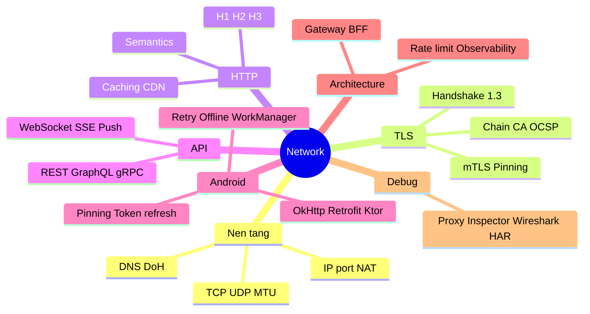
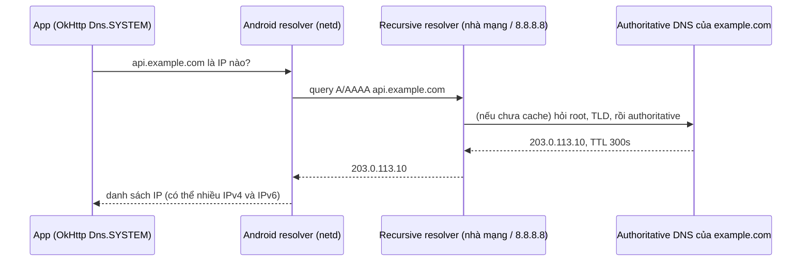
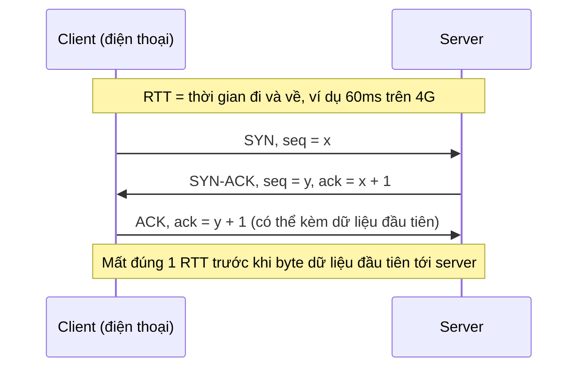
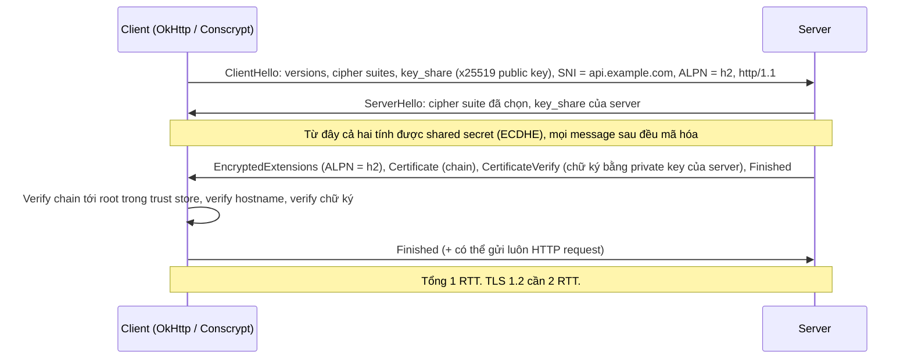
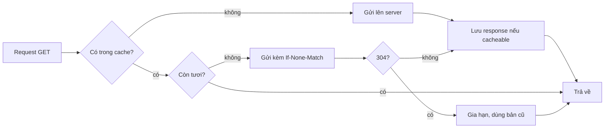
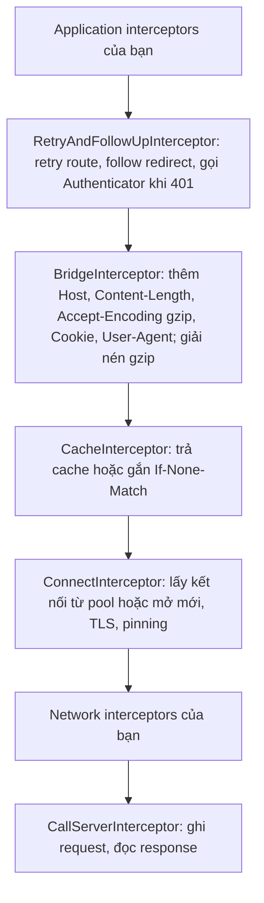
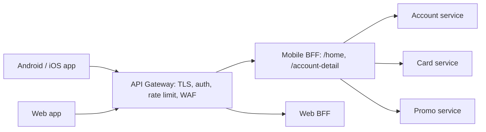

# 07. Network

> Mục tiêu: hiểu đường đi của một request từ app tới server và ngược lại ở mức có thể tự debug, chọn đúng protocol cho từng use case, và tự giải thích được lớp network trong `kmp-template-impl` (Ktor) và các project Retrofit/OkHttp cũ mà không cần AI. | Mức cần đạt: Senior: giải thích TCP/TLS/HTTP/2, OkHttp interceptor chain, retry, pinning, token refresh. / Staff: chọn protocol theo trade-off, thiết kế client chịu lỗi (backoff, idempotency, offline), đọc HAR/Wireshark để tìm nguyên nhân. / Lead: đặt chuẩn network layer cho team (timeout, observability, pinning rotation, API versioning), nói chuyện được với backend về gateway/BFF/rate limit. | Thời gian gợi ý: tuần 5-6, ~16 giờ

## 0. Bản đồ chủ đề

Bạn tự nhận network là điểm yếu, nên file này đi từ zero: bắt đầu từ "một gói tin đi qua đâu", lên TLS, HTTP, rồi mới tới OkHttp/Ktor. Mỗi khái niệm có một ví dụ cụ thể và một câu "tại sao Android dev phải quan tâm". Cách học: đọc phần 1-3 một lượt để có bức tranh, làm Hands-on bài 1 (bắt traffic app của bạn) ngay sau đó, vì khi nhìn thấy ClientHello, 101 Switching Protocols, 304 Not Modified trong Proxyman thì lý thuyết mới dính.



Theo research JD (`01-Market-Research-2026.md`): REST xuất hiện trong 10/15 JD, Security 8/15, Performance 10/15. Bank/fintech (GoTymeX, Timo, OCB, Techcombank) hỏi thẳng: pinning rotation thế nào, token refresh race xử lý ra sao, replay attack chặn ở đâu. Foreign product (Grab, Agoda) hỏi kiểu system design: "design the network layer for a feed with offline support", "why HTTP/2", "how do you retry safely". Interviewer thường đào tới mức: bạn có biết OkHttp tự retry POST trong trường hợp nào không, `readTimeout` đo cái gì, 0-RTT nguy hiểm ở đâu. Bạn phải tự trả lời được bằng cơ chế, không phải bằng tên thư viện.

## 1. Nền tảng: từ gói tin đến HTTP

### 1.1 Mô hình OSI vs TCP/IP

OSI có 7 tầng, TCP/IP thực tế có 4. Khi debug bạn chỉ cần 4 tầng của TCP/IP, OSI dùng để nói chuyện cho chuẩn thuật ngữ ("layer 4 load balancer", "layer 7 firewall").

| OSI | TCP/IP | Ví dụ cụ thể khi app gọi `GET https://api.example.com/v1/products` |
|---|---|---|
| 7 Application, 6 Presentation, 5 Session | Application | HTTP request/response, JSON body, TLS (nhiều người xếp TLS vào giữa tầng 4 và 7) |
| 4 Transport | Transport | TCP: port 443, đánh số thứ tự byte, retransmission. UDP: QUIC |
| 3 Network | Internet | IP: địa chỉ nguồn/đích, routing qua nhiều router |
| 2 Data link, 1 Physical | Link | WiFi 802.11, LTE/5G radio, Ethernet |

Ví dụ cụ thể: app của bạn gửi 1 request JSON 300 byte. Tầng Application tạo HTTP text, TLS mã hóa thành record, TCP cắt thành segment và gắn header 20 byte, IP gắn header 20 byte, WiFi gắn frame header rồi phát sóng. Router nhà bạn bóc tầng Link, nhìn IP đích, chuyển tiếp. Server bóc ngược lại. Mỗi tầng chỉ biết tầng ngay dưới và ngay trên, nên bạn có thể đổi WiFi sang 4G (tầng Link) mà HTTP không cần biết, trừ khi kết nối TCP bị đứt (vì IP đổi).

Tại sao Android dev cần biết: khi lỗi xảy ra, bạn phải đoán đúng tầng. `UnknownHostException` là DNS (trước cả tầng Transport). `ConnectException`/`SocketTimeoutException` lúc connect là tầng Transport. `SSLHandshakeException` là TLS. HTTP 503 là tầng Application, kết nối hoàn toàn ổn. Đoán sai tầng là debug sai chỗ.

- **Lỗi hay gặp / trade-off**
  - Gộp mọi lỗi thành "network error" trong UI và log. Phân loại theo tầng giúp support và backend biết tìm ở đâu.
  - Nghĩ "đã có WiFi là có internet". WiFi là tầng Link, internet là tầng Internet trở lên (captive portal khách sạn là ví dụ kinh điển).
- **Đọc thêm:**
  - https://hpbn.co/primer-on-latency-and-bandwidth/ (chương 1 sách High Performance Browser Networking, free)
  - https://www.cloudflare.com/learning/ddos/glossary/open-systems-interconnection-model-osi/

### 1.2 IP, port, NAT

IP address: địa chỉ của một máy trên mạng. IPv4 dài 32 bit (`203.0.113.10`), IPv6 dài 128 bit (`2001:db8::1`). Mạng di động Việt Nam hiện nay phần lớn cấp IPv6 cho điện thoại và dùng cơ chế dịch (464XLAT/NAT64) để tới server IPv4. Hệ quả thực tế: app hardcode địa chỉ IPv4 hoặc parse IP bằng regex IPv4 sẽ hỏng trên mạng chỉ có IPv6. Luôn dùng hostname.

Port: số 0-65535 để phân biệt nhiều ứng dụng trên cùng một máy. Server HTTPS nghe port 443, HTTP port 80. Phía client, hệ điều hành cấp một port tạm (ephemeral, ví dụ 51234) cho mỗi kết nối. Một kết nối TCP được định danh bằng bộ 5: (protocol, IP nguồn, port nguồn, IP đích, port đích).

NAT (Network Address Translation): nhà bạn có 1 IP public từ nhà mạng, nhưng có 10 thiết bị dùng IP private (`192.168.1.x`, `10.x.x.x`, `172.16-31.x.x`). Router viết lại IP nguồn và port nguồn của mỗi gói đi ra thành IP public và một port do router chọn, lưu vào bảng ánh xạ. Gói trả về được dịch ngược theo bảng. Nhà mạng di động còn làm thêm một lớp (CGNAT) vì không đủ IPv4.

Ví dụ: điện thoại `192.168.1.5:51234` gọi `api.example.com:443`. Router đổi thành `113.161.x.x:40001`. Server chỉ thấy `113.161.x.x:40001`. Khi server trả lời về `113.161.x.x:40001`, router tra bảng, chuyển về `192.168.1.5:51234`.

Tại sao Android dev cần biết:
- Server không thể tự mở kết nối tới điện thoại, vì không có entry trong bảng NAT. Đó là lý do push notification cần điện thoại giữ một kết nối ra ngoài (FCM giữ một socket tới Google), và WebSocket phải do client mở.
- Entry NAT hết hạn nếu không có traffic (UDP vài chục giây tới vài phút, TCP lâu hơn nhưng vẫn có). WebSocket im lặng 10 phút có thể bị NAT "quên", gói tiếp theo rơi vào hư không, app tưởng vẫn kết nối. Vì vậy cần ping/pong định kỳ (OkHttp `pingInterval`).
- Nhiều user chung một IP public (CGNAT), nên rate limit theo IP sẽ chặn nhầm cả một khu vực. Rate limit nên theo user/device.
- `adb reverse tcp:8080 tcp:8080` và địa chỉ `10.0.2.2` trên emulator tồn tại vì thiết bị không thể trực tiếp thấy `localhost` của máy dev.

- **Lỗi hay gặp / trade-off**
  - Dùng IP làm định danh user hoặc thiết bị. IP thay đổi khi đổi mạng, và nhiều người chung IP.
  - Quên keep-alive cho kết nối dài, rồi đổ lỗi "server rớt kết nối".
- **Đọc thêm:**
  - https://www.cloudflare.com/learning/network-layer/what-is-a-nat/
  - https://datatracker.ietf.org/doc/html/rfc6877 (464XLAT, để hiểu vì sao mạng di động hay là IPv6-only)

### 1.3 DNS resolution và DoH/DoT

DNS dịch tên miền thành IP. Khi OkHttp cần kết nối `api.example.com`, nó gọi `Dns.SYSTEM` (bản chất là `InetAddress.getAllByName`), hệ điều hành hỏi resolver của mạng hiện tại (do nhà mạng hoặc router cấp qua DHCP). Resolver hỏi lần lượt root server, TLD server (`.com`), rồi authoritative server của `example.com`, và cache kết quả theo TTL (ví dụ 300 giây). Lần sau trong TTL thì trả lời ngay.



DNS truyền thống đi qua UDP port 53, không mã hóa, nhà mạng và WiFi công cộng đọc và sửa được. Hai cách mã hóa:
- DoT (DNS over TLS, RFC 7858): DNS bọc trong TLS trên port 853. Android 9 trở lên có "Private DNS" trong Settings, dùng DoT, áp dụng cho toàn hệ thống, app không cần làm gì.
- DoH (DNS over HTTPS, RFC 8484): DNS bọc trong HTTPS, khó bị chặn vì giống traffic web thường. OkHttp có module `okhttp-dnsoverhttps` (`DnsOverHttps.Builder()`) để app tự làm DoH tới resolver bạn chọn, bỏ qua resolver của nhà mạng. Android cũng có thêm hỗ trợ DoH ở mức hệ thống qua bản cập nhật module về sau, cần kiểm tra tại https://developer.android.com/ (tìm "Private DNS").

Tại sao Android dev cần biết:
- `UnknownHostException` không có nghĩa là server chết. Có thể resolver của WiFi quán cà phê bị hỏng, captive portal đang trả IP giả, hoặc TTL cũ trỏ sai IP sau khi backend đổi IP.
- Khi backend failover sang IP khác, client vẫn dùng IP cũ cho tới khi hết TTL. TTL dài (1 giờ) thì failover chậm, TTL ngắn thì tốn thêm query.
- Server thường trả nhiều IP (IPv4 lẫn IPv6). OkHttp thử lần lượt từng route khi connect fail. OkHttp 5 có tùy chọn `fastFallback` để thử song song kiểu Happy Eyeballs (RFC 8305), cần kiểm tra tại https://github.com/square/okhttp/blob/master/CHANGELOG.md.
- Resolver của nhà mạng có thể chèn trang quảng cáo hoặc chặn tên miền. DoH trong app là cách vượt qua, nhưng pinning và TLS mới là thứ bảo vệ nội dung.

- **Lỗi hay gặp / trade-off**
  - Tự cache DNS trong app rồi quên TTL.
  - Dùng DoH tới một resolver cố định: nếu resolver đó chết thì app chết dù mạng vẫn tốt. OkHttp `DnsOverHttps` cho phép fallback về `Dns.SYSTEM`, hãy cấu hình.
- **Đọc thêm:**
  - https://www.cloudflare.com/learning/dns/what-is-dns/
  - https://github.com/square/okhttp (tìm module dnsoverhttps)
  - https://www.rfc-editor.org/rfc/rfc8484

### 1.4 TCP: 3-way handshake

TCP là giao thức tin cậy: dữ liệu tới đúng thứ tự, không mất, không trùng. Để làm được, hai bên phải đồng bộ số thứ tự (sequence number) trước khi gửi dữ liệu. Đó là 3-way handshake.



Chi phí: 1 RTT trước khi gửi được byte nào. Trên 4G với RTT 60ms thì mất 60ms, trên 3G hoặc roaming RTT 300ms thì mất 300ms chỉ để "chào nhau". Sau đó TLS 1.3 thêm 1 RTT nữa, rồi request/response thêm 1 RTT. Tổng cộng một HTTPS request trên kết nối mới tốn tối thiểu 3 RTT cộng DNS. Đây là lý do số một để tái sử dụng kết nối (keep-alive, connection pool, HTTP/2).

Đóng kết nối: 4 bước FIN/ACK mỗi chiều. Bên chủ động đóng vào trạng thái `TIME_WAIT` khoảng 1-4 phút để chắc chắn không còn gói lạc. Server bận có thể có hàng chục nghìn socket `TIME_WAIT`, một lý do nữa để không mở/đóng kết nối liên tục.

Ví dụ số: màn hình Home gọi 6 API, nếu mỗi API mở kết nối mới trên 4G (RTT 60ms): 6 x (60 TCP + 60 TLS + 60 request) = 1080ms chỉ tính độ trễ, chưa tính xử lý server. Cùng 6 API trên một kết nối HTTP/2 có sẵn: khoảng 60-120ms. Đây là con số bạn nên nói trong phỏng vấn khi giải thích vì sao chọn HTTP/2 và một `OkHttpClient` dùng chung.

- **Lỗi hay gặp / trade-off**
  - Tạo `OkHttpClient` mới cho mỗi request (mỗi lần là pool mới, kết nối mới, handshake mới).
  - Nghĩ `connectTimeout` bao gồm TLS. Trong OkHttp, `connectTimeout` tính cho TCP connect và TLS handshake của lần thử kết nối đó, còn thời gian đọc body thuộc `readTimeout`. Cần kiểm tra chi tiết tại https://github.com/square/okhttp mục Calls và Connections.
- **Đọc thêm:**
  - https://hpbn.co/building-blocks-of-tcp/ (chương 2, phần Three-Way Handshake)
  - https://www.rfc-editor.org/rfc/rfc9293 (TCP, bản hợp nhất 2022)

### 1.5 TCP: retransmission, congestion control, head-of-line blocking

**Retransmission.** Mỗi byte có số thứ tự. Bên nhận gửi ACK "tôi đã nhận tới byte N". Bên gửi giữ timer (RTO, tính từ RTT đo được). Hết timer mà chưa có ACK thì gửi lại. Nếu nhận được 3 ACK trùng nhau (bên nhận báo "tôi vẫn chờ byte N" nhiều lần vì các gói sau N đã tới), bên gửi gửi lại ngay không chờ timer (fast retransmit). SACK cho phép báo chính xác khúc nào thiếu. Hệ quả: mất 1 gói trên mạng di động có thể làm dữ liệu chậm thêm 200ms tới hơn 1 giây, dù băng thông rất lớn.

**Congestion control.** TCP không biết mạng rộng bao nhiêu, nên dò: bắt đầu với cửa sổ nhỏ (initial congestion window, mặc định 10 segment, khoảng 14 KB theo RFC 6928), mỗi RTT không mất gói thì nhân đôi (slow start), tới ngưỡng thì tăng tuyến tính (congestion avoidance), mất gói thì giảm mạnh. Thuật toán phổ biến: CUBIC (mặc định Linux), BBR (Google, dựa trên đo băng thông và RTT thay vì chờ mất gói).

Ví dụ số: response JSON 100 KB trên kết nối mới. RTT 60ms. Cửa sổ 14 KB → 28 KB → 56 KB → 112 KB. Cần 4 RTT (240ms) chỉ vì slow start, dù băng thông 4G là 50 Mbps (lý thuyết chuyển 100 KB mất 16ms). Kết luận cho mobile: kết nối "ấm" (đã qua slow start) quý hơn băng thông; response nhỏ hơn 14 KB đi trong 1 RTT; gzip/brotli giảm số RTT chứ không chỉ giảm byte.

**Head-of-line (HOL) blocking.** TCP giao dữ liệu đúng thứ tự. Nếu gói số 5 mất, gói 6-10 đã tới cũng phải nằm chờ trong buffer tới khi gói 5 được gửi lại. Ở tầng HTTP:
- HTTP/1.1: mỗi kết nối chỉ xử lý 1 response tại một thời điểm, request sau chờ request trước (HOL ở tầng HTTP).
- HTTP/2: nhiều stream trên 1 kết nối TCP, hết HOL tầng HTTP, nhưng 1 gói TCP mất chặn tất cả stream (HOL tầng TCP).
- HTTP/3 (QUIC): mỗi stream có retransmission riêng, mất gói của stream A không chặn stream B.

Trên mạng tốt (mất gói < 1%), HTTP/2 thắng rõ. Trên mạng mất gói nhiều (2% trở lên, ví dụ tàu điện, vùng sóng yếu), nhiều kết nối HTTP/1.1 song song có thể tốt hơn 1 kết nối HTTP/2 vì không gom hết trứng vào một giỏ. hpbn chương HTTP/2 có số liệu về điểm này.

- **Lỗi hay gặp / trade-off**
  - Tin rằng "tăng băng thông là nhanh hơn". Với response nhỏ, RTT và slow start quyết định, không phải băng thông.
  - Tự viết retry ở tầng app chồng lên TCP retransmission với timeout quá ngắn, tạo thêm tải khi mạng đang nghẽn.
- **Đọc thêm:**
  - https://hpbn.co/building-blocks-of-tcp/ (các phần Congestion Avoidance and Control, Head-of-Line Blocking)
  - https://www.rfc-editor.org/rfc/rfc6928 (initial window 10 segment)

### 1.6 UDP

UDP là "gửi rồi quên": header 8 byte, không handshake, không đảm bảo thứ tự, không gửi lại, không congestion control. Nghe tệ, nhưng chính vì không làm gì nên tầng trên tự quyết định làm gì.

Ai dùng UDP:
- DNS (câu hỏi nhỏ, hỏi lại rẻ hơn handshake).
- QUIC/HTTP/3: tự làm tin cậy và congestion control ở user space trên UDP, để không bị TCP của hệ điều hành trói.
- VoIP, video call (WebRTC dùng RTP trên UDP): gói mất thì bỏ qua, phát tiếp, vì audio trễ 500ms để chờ gửi lại còn tệ hơn mất 20ms âm thanh.
- Game thời gian thực.

Ví dụ: gọi video, gói chứa khung hình thứ 100 mất. Với TCP, khung 101-110 đã tới phải chờ khung 100 gửi lại (vài trăm ms), hình đứng rồi nhảy. Với UDP, decoder bỏ khung 100, hiện khung 101, người xem chỉ thấy hơi giật.

Hạn chế: nhiều mạng doanh nghiệp, WiFi công cộng chặn UDP ngoài port 53, nên HTTP/3 và WebRTC phải có đường lùi (fallback về TCP, TURN over TCP).

- **Đọc thêm:**
  - https://hpbn.co/building-blocks-of-udp/
  - https://www.rfc-editor.org/rfc/rfc9000 (QUIC, phần giới thiệu để thấy QUIC thêm gì lên UDP)

### 1.7 MTU, MSS, fragmentation

MTU (Maximum Transmission Unit): kích thước gói lớn nhất tầng Link chịu được. Ethernet và phần lớn WiFi là 1500 byte. Trừ header IP (20) và TCP (20) còn MSS 1460 byte dữ liệu mỗi segment. VPN, PPPoE, một số mạng di động có MTU nhỏ hơn (1400, 1380...).

Vấn đề: nếu client gửi gói 1500 byte qua đường có MTU 1400, router phải cắt (fragmentation, IPv4) hoặc bỏ và báo lỗi ICMP "packet too big" (IPv6 và IPv4 với bit DF). Nhiều firewall chặn ICMP, nên bên gửi không biết gói bị bỏ, cứ gửi lại cùng kích thước. Đây là "MTU black hole": handshake thành công (gói nhỏ), request nhỏ thành công, nhưng upload ảnh hoặc response lớn treo tới timeout.

Dấu hiệu nhận biết trong app: "login được, lấy danh sách được, nhưng upload avatar hoặc tải báo cáo PDF thì treo, chỉ xảy ra khi bật VPN công ty hoặc trên một nhà mạng". Cách xác nhận: Wireshark thấy segment 1460 byte bị retransmit liên tục, không có ACK. Cách xử lý: thường là phía hạ tầng (server bật PMTUD hoặc MSS clamping), app chỉ cần biết để không đổ lỗi cho backend hay OkHttp. QUIC quy định datagram tối thiểu 1200 byte phải đi lọt và tự dò MTU.

- **Đọc thêm:**
  - https://www.cloudflare.com/learning/network-layer/what-is-mtu/
  - https://hpbn.co/building-blocks-of-tcp/ (phần Optimizing for TCP)

### 1.8 Latency vs bandwidth trên mạng di động

Hai đại lượng khác nhau: bandwidth là bao nhiêu byte mỗi giây (độ rộng ống), latency là bao lâu một byte đi từ A tới B (độ dài ống). Mobile có bandwidth tốt nhưng latency xấu và biến thiên: 4G thường 30-100ms RTT, 3G có thể vài trăm ms, roaming hoặc sóng yếu hơn 1 giây (số gần đúng, xem hpbn chương Mobile Networks).

Radio của điện thoại có máy trạng thái (RRC): khi im lặng vài giây, radio xuống trạng thái tiết kiệm; muốn gửi gói mới phải "đánh thức" radio, mất vài chục tới vài trăm ms và tốn pin đáng kể. Hệ quả thiết kế:
- Gom request theo đợt (batch) thay vì gửi lắt nhắt mỗi 5 giây (analytics là thủ phạm quen thuộc).
- Prefetch khi radio đang bật (vừa load xong màn hình thì tải sẵn trang kế).
- Giảm số round trip quan trọng hơn giảm số byte: 1 request 50 KB thường nhanh hơn 5 request 5 KB.

Ví dụ: màn hình chi tiết sản phẩm gọi API chi tiết, rồi từ response mới gọi API đánh giá, rồi mới gọi API sản phẩm liên quan (3 round trip nối tiếp). Trên 4G 80ms RTT là tối thiểu 240ms chưa tính server. Gộp thành 1 endpoint BFF (xem phần 6) hoặc gọi 3 request song song trên HTTP/2 giảm còn khoảng 80-100ms.

- **Đọc thêm:**
  - https://hpbn.co/mobile-networks/
  - https://hpbn.co/optimizing-for-mobile-networks/

## 2. TLS

### 2.1 TLS 1.3 handshake từng bước

TLS làm 3 việc: xác thực server (đúng là `api.example.com`, không phải kẻ giả mạo), thỏa thuận khóa đối xứng mà kẻ nghe lén không tính ra được, rồi mã hóa và chống sửa dữ liệu. TLS 1.3 (RFC 8446) rút handshake còn 1 RTT.



Giải thích từng message:
- ClientHello: client liệt kê phiên bản và cipher suite nó hỗ trợ, gửi luôn public key tạm thời (key_share) cho thuật toán trao đổi khóa đoán trước (thường x25519). SNI (Server Name Indication) cho server biết client muốn host nào, vì một IP có thể phục vụ nhiều tên miền. ALPN cho server biết client nói được HTTP/2 hay không. SNI đi dạng cleartext, nên nhà mạng thấy bạn kết nối tới host nào (không thấy nội dung). ECH (Encrypted ClientHello) đang được triển khai để giấu SNI, chưa phổ biến trên Android, cần kiểm tra.
- ServerHello: server chọn cipher suite và gửi key_share của nó. Hai bên nhân public key của bên kia với private key của mình, ra cùng một shared secret (Diffie-Hellman trên đường cong elliptic, ECDHE). Khóa này chỉ dùng cho phiên này (forward secrecy): dù private key dài hạn của server lộ sau này, traffic cũ không giải mã được.
- Certificate + CertificateVerify: server gửi chuỗi chứng chỉ và ký lên transcript bằng private key tương ứng với public key trong chứng chỉ. Đây là bước chứng minh "tôi sở hữu private key của api.example.com".
- Finished: MAC trên toàn bộ transcript để chắc chắn không ai sửa message handshake (chống downgrade).

Cipher suite TLS 1.3 chỉ còn 3 cái phổ biến: `TLS_AES_128_GCM_SHA256`, `TLS_AES_256_GCM_SHA384`, `TLS_CHACHA20_POLY1305_SHA256`. Key exchange luôn là (EC)DHE, RSA key exchange bị loại bỏ. Mọi thứ sau ServerHello đều mã hóa, kể cả chứng chỉ.

Session resumption và 0-RTT: sau phiên đầu, server cấp PSK (pre-shared key) dạng ticket. Lần sau client gửi PSK trong ClientHello và có thể gửi luôn dữ liệu ứng dụng (early data, 0-RTT). Rủi ro: kẻ tấn công bắt gói 0-RTT và gửi lại (replay). Vì vậy 0-RTT chỉ dùng cho request idempotent; server có thể trả `425 Too Early` (RFC 8470). Ngân hàng thường tắt 0-RTT phía server.

Trên Android: TLS 1.3 bật mặc định từ Android 10 (API 29). Conscrypt là module cập nhật qua Google Play system update nên thiết bị cũ hơn cũng có thể có. OkHttp `ConnectionSpec.MODERN_TLS` chỉ cho TLS 1.2 và 1.3; muốn ép 1.3 thì dùng `ConnectionSpec.Builder(MODERN_TLS).tlsVersions(TlsVersion.TLS_1_3)`. Kiểm tra `response.handshake?.tlsVersion` để biết thực tế.

- **Lỗi hay gặp / trade-off**
  - Tưởng TLS tự chống replay ở tầng app. TLS chống replay trong một phiên (record sequence number), nhưng nếu token bị trộm thì kẻ tấn công cứ mở phiên mới mà gửi. Chống replay chuyển tiền là việc của idempotency key, nonce, chữ ký (xem phần Q&A banking).
  - Bật 0-RTT để nhanh mà không phân loại request.
- **Đọc thêm:**
  - https://hpbn.co/transport-layer-security-tls/
  - https://www.rfc-editor.org/rfc/rfc8446
  - https://www.cloudflare.com/learning/ssl/what-happens-in-a-tls-handshake/

### 2.2 Certificate chain, CA, trust store trên Android

Chứng chỉ (certificate) là public key kèm tên miền, thời hạn, và chữ ký của một CA (Certificate Authority). Chain gồm:
1. Leaf: `api.example.com`, hạn ngắn (Let's Encrypt 90 ngày, CA thương mại tới 1 năm, xu hướng rút ngắn tiếp).
2. Intermediate: CA trung gian ký leaf, bản thân nó được root ký.
3. Root: tự ký, nằm sẵn trong trust store của hệ điều hành.

Client verify: chữ ký leaf hợp lệ với public key của intermediate, chữ ký intermediate hợp lệ với root, root có trong trust store, còn hạn, hostname khớp SAN (Subject Alternative Name), key usage đúng. Server phải gửi leaf và intermediate; thiếu intermediate thì Chrome vẫn chạy (tự tải AIA) nhưng Android thường fail với `SSLHandshakeException: Trust anchor for certification path not found`. Đây là lỗi hay gặp số một khi backend đổi chứng chỉ.

Trust store Android:
- System store: do Google quản lý, cập nhật theo OS (và qua Mainline ở bản mới, cần kiểm tra). Thiết bị cũ không có root mới: ví dụ kinh điển là root ISRG của Let's Encrypt, thiết bị Android 7 trở xuống gặp vấn đề khi cross-sign cũ hết hạn (2021-2024). Lesson: test trên thiết bị cũ nhất bạn hỗ trợ khi đổi CA.
- User store: CA người dùng tự cài (ví dụ CA của Charles/Proxyman). Từ Android 7 (API 24), app mặc định không tin user CA. Muốn tin thì khai trong Network Security Config (xem phần 5.9 và `08-Security.md`). Đây là lý do bạn không bắt được traffic release build bằng Proxyman dù đã cài CA.

- **Lỗi hay gặp / trade-off**
  - Fix lỗi chain bằng cách viết `TrustManager` chấp nhận mọi chứng chỉ. Google Play quét và cảnh báo, pentest chấm critical, và thực sự tắt TLS về mặt xác thực.
  - Không có cảnh báo trước khi chứng chỉ hết hạn. Lead nên có lịch và alert (ví dụ monitoring chứng chỉ còn dưới 14 ngày).
- **Đọc thêm:**
  - https://developer.android.com/privacy-and-security/security-ssl
  - https://letsencrypt.org/docs/certificate-compatibility/

### 2.3 Revocation: CRL, OCSP, OCSP stapling

Nếu private key của server lộ, CA thu hồi chứng chỉ. Client biết bằng cách nào?
- CRL: CA công bố danh sách thu hồi. To, tải chậm, cập nhật trễ.
- OCSP (RFC 6960): client hỏi CA "chứng chỉ số X còn hiệu lực không?" cho từng kết nối. Tốn 1 round trip, lộ cho CA biết bạn đang truy cập site nào, và nếu OCSP server chậm hoặc chết thì client thường "soft-fail" (coi như hợp lệ), nên giá trị bảo mật thấp.
- OCSP stapling: server tự hỏi CA định kỳ, lấy câu trả lời có chữ ký CA, đính kèm (staple) vào handshake. Client không cần hỏi ai. Đây là cách đúng về mặt latency và privacy.

Thực tế Android: TrustManager mặc định không chủ động kiểm tra revocation qua OCSP/CRL (cần kiểm tra tại https://developer.android.com/privacy-and-security/security-ssl và tài liệu Conscrypt). Vì vậy với app ngân hàng, pinning và thời hạn chứng chỉ ngắn thực tế quan trọng hơn revocation. Certificate Transparency (CT): mọi chứng chỉ public được ghi vào log công khai, giúp phát hiện chứng chỉ cấp sai; Chrome ép CT, Android app muốn ép phải dùng thư viện ngoài (ví dụ `appmattus/certificatetransparency`, cần kiểm tra trạng thái maintain).

- **Đọc thêm:**
  - https://www.cloudflare.com/learning/ssl/what-is-ocsp-stapling/
  - https://www.rfc-editor.org/rfc/rfc6960

### 2.4 mTLS (mutual TLS)

TLS thường chỉ server chứng minh danh tính. mTLS bắt client cũng chứng minh bằng chứng chỉ riêng: server gửi `CertificateRequest`, client gửi `Certificate` và `CertificateVerify` (chữ ký bằng private key của client). Server kiểm tra chain tới CA nội bộ của nó.

Khi nào dùng trong mobile:
- Ngân hàng, fintech: định danh thiết bị đã đăng ký cho các luồng giá trị cao (chuyển tiền, soft OTP). Private key nằm trong Android Keystore (không xuất được), chứng chỉ được server cấp lúc enrollment (device binding, xem `08-Security.md` mục Auth).
- B2B, API nội bộ giữa service.

Cách làm trên Android (phác thảo):
1. Tạo key pair trong `AndroidKeyStore` (EC P-256), kèm key attestation nếu cần.
2. Tạo CSR, gửi lên server trong phiên đã xác thực user; server ký và trả chứng chỉ client.
3. Lưu chứng chỉ; private key vẫn nằm trong Keystore.
4. Cấu hình OkHttp với `SSLContext` dùng một `X509KeyManager` tùy biến trả về `PrivateKey` từ Keystore và chain đã cấp.

```kotlin
// Phác thảo, cần kiểm tra chi tiết API khi triển khai thật
val keyManager = object : X509ExtendedKeyManager() {
    override fun chooseClientAlias(keyType: Array<String>?, issuers: Array<Principal>?, socket: Socket?) = ALIAS
    override fun getCertificateChain(alias: String?): Array<X509Certificate> = clientChain
    override fun getPrivateKey(alias: String?): PrivateKey =
        (keyStore.getEntry(ALIAS, null) as KeyStore.PrivateKeyEntry).privateKey
    override fun getClientAliases(keyType: String?, issuers: Array<Principal>?) = arrayOf(ALIAS)
    override fun chooseServerAlias(keyType: String?, issuers: Array<Principal>?, socket: Socket?) = null
    override fun getServerAliases(keyType: String?, issuers: Array<Principal>?) = null
}
val trustManager = platformTrustManager() // lấy từ TrustManagerFactory mặc định
val sslContext = SSLContext.getInstance("TLS").apply {
    init(arrayOf(keyManager), arrayOf(trustManager), null)
}
val client = OkHttpClient.Builder()
    .sslSocketFactory(sslContext.socketFactory, trustManager)
    .build()
```

Giới hạn: mTLS chứng minh "thiết bị này có key đã đăng ký", không chứng minh "người cầm máy là chủ tài khoản". Vẫn cần user auth. Chi phí: hạ tầng CA, cấp lại khi mất máy, rotation, và debug khó hơn (proxy không bắt được nếu không có key).

- **Đọc thêm:**
  - https://www.cloudflare.com/learning/access-management/what-is-mutual-tls/
  - https://developer.android.com/privacy-and-security/keystore

### 2.5 Certificate pinning: vì sao hoạt động, rủi ro, rotation

Vấn đề: trust store có hơn 100 root CA. Bất kỳ CA nào bị hack hoặc cấp nhầm chứng chỉ cho `api.yourbank.com` thì client vẫn tin. Trên thiết bị đã root, kẻ tấn công cài CA riêng vào system store rồi chạy proxy, đọc mọi request. Pinning giải quyết bằng cách nói: "chỉ tin chứng chỉ (hoặc public key) mà tôi đã biết trước".

Pin cái gì:
- Pin SPKI hash (SHA-256 của Subject Public Key Info), không pin cả chứng chỉ, để đổi chứng chỉ mà giữ key vẫn chạy.
- Pin ở mức nào: leaf (chặt nhất, phải cập nhật app mỗi lần đổi key), intermediate (đổi leaf thoải mái, chỉ vỡ khi CA đổi intermediate), root (lỏng nhất, vẫn chặn user CA và CA khác). Ngân hàng thường pin leaf hoặc intermediate kèm backup.

Vì sao hoạt động: OkHttp sau khi TLS handshake xong sẽ lấy chain đã verify, hash SPKI từng cert, so với danh sách pin. Không khớp thì ném `SSLPeerUnverifiedException` kèm danh sách pin thực tế (mẹo lấy pin nhanh khi dev). Proxy MITM dùng chứng chỉ của CA proxy nên không khớp pin.

Pinning không chống được gì: thiết bị đã root và attacker dùng Frida/objection hook thẳng `CertificatePinner.check` để nó không ném exception. Vì vậy pinning là một lớp, phải đi cùng Play Integrity, root detection, hardening (xem `08-Security.md`).

Rủi ro lớn nhất: rotation. Nếu backend đổi key mà app cũ chỉ có pin cũ, toàn bộ user không thể dùng app cho tới khi cập nhật. Web từng có HPKP (RFC 7469) và các browser đã bỏ vì quá nhiều site tự khóa mình. Chiến lược:
1. Luôn có ít nhất 2 pin: key hiện tại và key dự phòng đã tạo sẵn nhưng chưa dùng (pre-generated backup key, giữ offline).
2. Có ngày hết hạn cho pin (Network Security Config hỗ trợ `expiration`; qua ngày đó pinning tự tắt, fail-open có chủ ý).
3. Lịch rotation gắn với lịch hết hạn chứng chỉ, ship pin mới vào app ít nhất một chu kỳ cập nhật trước khi dùng key mới.
4. Kill switch từ xa: config tắt pinning tải từ một domain khác domain đang pin (nếu không sẽ kẹt gà và trứng), hoặc chấp nhận là kill switch chỉ cứu được user còn vào được.
5. Monitoring: đếm `SSLPeerUnverifiedException` theo app version; spike là dấu hiệu rotation sai hoặc có MITM diện rộng.
6. Force update path: server trả mã bắt cập nhật nếu app version thấp hơn mức có pin mới.

Code và XML cụ thể ở phần 5.9.

- **Lỗi hay gặp / trade-off**
  - Pin 1 key duy nhất, hardcode, không có expiration.
  - Pin trong release nhưng không có cơ chế tắt trong debug để dùng proxy, dev bèn comment code pinning rồi quên bật lại.
  - Quên rằng WebView và SDK bên thứ ba có network stack riêng, không đi qua `CertificatePinner` của OkHttp. Network Security Config áp dụng rộng hơn, cần kiểm tra phạm vi cụ thể tại https://developer.android.com/privacy-and-security/security-config.
- **Đọc thêm:**
  - https://github.com/square/okhttp/blob/master/docs/features/https.md (mục Certificate Pinning)
  - https://developer.android.com/privacy-and-security/security-config
  - https://mas.owasp.org/MASTG/ (tìm MASVS-NETWORK-2)

## 3. HTTP

### 3.1 Semantics: methods, status codes, headers, cookies, idempotency

HTTP là giao thức request/response dạng text (HTTP/1.1) hoặc binary frame (HTTP/2, 3) nhưng ngữ nghĩa giống nhau (RFC 9110).

**Methods.** Hai thuộc tính quan trọng: safe (không đổi trạng thái server) và idempotent (gọi 1 lần hay N lần kết quả như nhau).

| Method | Safe | Idempotent | Dùng cho |
|---|---|---|---|
| GET | có | có | đọc; cacheable |
| HEAD | có | có | lấy header không lấy body (check size, ETag) |
| PUT | không | có | thay thế toàn bộ resource |
| DELETE | không | có | xóa (xóa lần 2 trả 404 hoặc 204 vẫn tính là idempotent về trạng thái) |
| PATCH | không | không đảm bảo | sửa một phần |
| POST | không | không | tạo mới, hành động (chuyển tiền) |

Idempotency là chìa khóa cho retry: GET/PUT/DELETE retry thoải mái, POST retry có thể tạo 2 đơn hàng hoặc chuyển tiền 2 lần. Giải pháp là `Idempotency-Key` header (phần 5.5).

**Status codes.** Nhớ theo hành động của client:

| Mã | Nghĩa | App nên làm gì |
|---|---|---|
| 200/201/204 | OK / đã tạo / không có body | parse (204 không parse body) |
| 304 | Not Modified | dùng cache (OkHttp tự xử lý, bạn thấy 200 từ cache) |
| 301/308, 302/307 | redirect vĩnh viễn / tạm | OkHttp tự follow (tối đa 20); 307/308 giữ method, 301/302 có thể đổi POST thành GET |
| 400 | request sai | không retry; lỗi code hoặc validation, hiện message |
| 401 | chưa xác thực / token hết hạn | refresh token rồi retry 1 lần (Authenticator) |
| 403 | không có quyền | không retry, không refresh |
| 404 | không có | không retry; có thể là route sai version |
| 408 | server chờ request quá lâu | retry được |
| 409 | xung đột (idempotency key trùng với payload khác, version cũ) | xử lý theo nghiệp vụ |
| 410 | đã gỡ vĩnh viễn | dừng gọi (API cũ bị tắt) |
| 413 | body quá lớn | giảm kích thước (nén ảnh) |
| 422 | validation thất bại | hiện lỗi theo field |
| 425 | Too Early (0-RTT) | gửi lại trên kết nối đã handshake đầy đủ |
| 429 | rate limited | đọc `Retry-After`, backoff |
| 500 | lỗi server | retry thận trọng (chỉ idempotent) |
| 502/503/504 | gateway lỗi / quá tải / timeout upstream | retry với backoff + jitter, tôn trọng `Retry-After` |

**Headers hay dùng ở mobile.**
- Request: `Authorization: Bearer <token>`, `Accept: application/json`, `Accept-Encoding` (OkHttp tự thêm gzip), `Accept-Language`, `User-Agent` (đặt tên app/version để backend lọc log), `If-None-Match`, `Idempotency-Key`, `X-Request-Id`/`traceparent` (W3C Trace Context, nối log client-server), `X-App-Version`/`X-Device-Id` (tùy backend).
- Response: `Content-Type`, `Content-Length`, `Content-Encoding`, `Cache-Control`, `ETag`, `Vary`, `Retry-After`, `Set-Cookie`, `Alt-Svc` (quảng cáo HTTP/3).

**Cookies.** Trình duyệt dùng cookie, app mobile thường dùng bearer token nên OkHttp mặc định `CookieJar.NO_COOKIES` (bỏ qua `Set-Cookie`). Nếu backend dùng session cookie (hay gặp với BFF của web team), cấu hình `CookieJar` hoặc `JavaNetCookieJar`. Thuộc tính cookie cần biết khi review: `Secure` (chỉ gửi qua HTTPS), `HttpOnly` (JS không đọc được, chỉ ý nghĩa với WebView), `SameSite`, `Max-Age`, `Domain`, `Path`. WebView có `CookieManager` riêng, phải clear khi logout.

**Ví dụ thực tế:** bạn gọi `POST /transfers` 10 giây không thấy response rồi `SocketTimeoutException`. Server có thể đã chuyển tiền xong, chỉ là response không về kịp. Retry mù là chuyển lần 2. Đây là lý do mọi API "hành động" ở bank phải có idempotency key và client phải lưu key trước khi gửi.

- **Lỗi hay gặp / trade-off**
  - Dùng POST cho mọi thứ "cho tiện", mất khả năng cache và retry an toàn.
  - Trả 200 với `{"success": false}`: client không phân biệt được với thành công, cache có thể lưu lỗi, monitoring không thấy error rate.
- **Đọc thêm:**
  - https://www.rfc-editor.org/rfc/rfc9110 (HTTP Semantics)
  - https://developer.mozilla.org/en-US/docs/Web/HTTP
  - https://datatracker.ietf.org/doc/draft-ietf-httpapi-idempotency-key-header/

### 3.2 HTTP/1.1: keep-alive

HTTP/1.0 mở kết nối mới cho mỗi request. HTTP/1.1 mặc định giữ kết nối (keep-alive) để gửi request tiếp theo, nhưng trên một kết nối chỉ xử lý tuần tự: gửi request, chờ response xong, mới gửi request kế. Pipelining (gửi nhiều request không chờ) có trong spec nhưng gần như không ai bật vì proxy lỗi và HOL.

Để chạy song song, client mở nhiều kết nối: trình duyệt 6 kết nối/host, OkHttp giới hạn 5 call đồng thời mỗi host (`Dispatcher.maxRequestsPerHost`) nên với HTTP/1.1 sẽ có tối đa 5 kết nối tới một host. Mỗi kết nối tốn handshake riêng và slow start riêng.

OkHttp `ConnectionPool` mặc định giữ 5 kết nối rảnh trong 5 phút. Server cũng có timeout keep-alive (nginx mặc định 75 giây). Khi server đóng mà client chưa biết, request tiếp theo gặp `IOException: unexpected end of stream` và OkHttp tự thử lại trên kết nối mới (đây là một trong những trường hợp `retryOnConnectionFailure` phát huy).

- **Đọc thêm:**
  - https://hpbn.co/http1x/
  - https://github.com/square/okhttp/blob/master/docs/features/connections.md

### 3.3 HTTP/2: multiplexing, HPACK

HTTP/2 (RFC 9113) giữ nguyên ngữ nghĩa (method, status, header) nhưng đổi cách đóng gói:
- Binary framing: request/response cắt thành frame (HEADERS, DATA, SETTINGS, PING, GOAWAY...).
- Stream: mỗi request là một stream có id, nhiều stream xen kẽ trên 1 kết nối TCP. 20 ảnh thumbnail tải đồng thời trên 1 kết nối, không cần 5-6 kết nối.
- HPACK (RFC 7541): nén header bằng bảng tĩnh (61 header phổ biến) và bảng động (header đã gửi trong kết nối này). `Authorization: Bearer <800 byte JWT>` gửi lần đầu tốn 800 byte, các request sau chỉ tốn 1-2 byte tham chiếu. Với mobile gửi hàng trăm request mỗi phiên, tiết kiệm đáng kể, nhất là request nhỏ.
- Flow control per stream, priority (bị hạ cấp trong RFC 9113 vì ít ai dùng đúng), server push (Chrome đã bỏ, coi như chết).

Thương lượng: qua ALPN trong TLS handshake (client ghi `h2`, server chọn). Không cần thêm round trip. OkHttp bật HTTP/2 mặc định khi server hỗ trợ; bạn kiểm tra bằng `response.protocol` (`Protocol.HTTP_2`). HTTP/2 cleartext (h2c) OkHttp chỉ hỗ trợ dạng `Protocol.H2_PRIOR_KNOWLEDGE` (biết trước, không upgrade), chỉ dùng nội bộ.

Lợi ích cho mobile: 1 handshake TCP+TLS, 1 slow start, ít đánh thức radio, header nhỏ. Điểm yếu: HOL ở tầng TCP khi mất gói (phần 1.5); GOAWAY khi server muốn đóng kết nối thì các stream chưa xử lý phải retry (OkHttp tự xử lý cho request chưa gửi); server đứng sau load balancer L4 có thể giới hạn số stream đồng thời (`SETTINGS_MAX_CONCURRENT_STREAMS`, thường 100).

Ví dụ đo được: màn hình feed tải 30 ảnh qua Coil (dùng OkHttp của bạn nếu bạn truyền vào). HTTP/1.1: 5 kết nối, mỗi kết nối tuần tự 6 ảnh, tổng thời gian xấp xỉ 6 x (RTT + thời gian truyền). HTTP/2: 30 stream song song, bị giới hạn bởi băng thông chứ không phải RTT. Hands-on bài 3 bắt bạn đo con số này trên app của mình.

- **Lỗi hay gặp / trade-off**
  - Tạo nhiều `OkHttpClient` khác nhau (mỗi cái pool riêng) rồi mất lợi ích 1 kết nối. Dùng `client.newBuilder()` để biến thể chia sẻ pool và dispatcher.
  - Tưởng HTTP/2 làm mọi thứ nhanh: với 1 request đơn lẻ, HTTP/2 không nhanh hơn HTTP/1.1.
- **Đọc thêm:**
  - https://hpbn.co/http2/
  - https://www.rfc-editor.org/rfc/rfc9113
  - https://www.rfc-editor.org/rfc/rfc7541 (HPACK)

### 3.4 HTTP/3 và QUIC, 0-RTT

HTTP/3 (RFC 9114) chạy trên QUIC (RFC 9000) thay vì TCP. QUIC chạy trên UDP và tự làm:
- Tin cậy và congestion control per stream: mất gói của stream A không chặn stream B (hết HOL tầng transport).
- TLS 1.3 tích hợp vào handshake: kết nối mới mất 1 RTT (TCP+TLS 1.3 mất 2), resumption 0-RTT gửi dữ liệu ngay trong gói đầu.
- Connection migration: kết nối định danh bằng Connection ID chứ không bằng bộ 5 (IP, port). Điện thoại từ WiFi sang 4G đổi IP mà kết nối QUIC vẫn sống, không cần handshake lại. Với TCP, đổi IP là đứt kết nối, mọi request đang chạy fail.
- QPACK (RFC 9204) thay HPACK để nén header mà không gây HOL.

Trạng thái trên Android (cần kiểm tra lại trước phỏng vấn vì thay đổi nhanh):
- OkHttp: hỗ trợ HTTP/1.1 và HTTP/2, chưa có HTTP/3 trong các bản ổn định mà tài liệu này biết. Kiểm tra tại https://github.com/square/okhttp/blob/master/CHANGELOG.md.
- Cronet (network stack của Chromium, có sẵn qua Google Play services hoặc nhúng): hỗ trợ QUIC/HTTP/3, có adapter cho OkHttp (`okhttp-cronet` hoặc `cronet-okhttp`), cần kiểm tra https://developer.android.com/develop/connectivity/cronet.
- iOS: `URLSession` (engine Darwin của Ktor) tự dùng HTTP/3 khi server quảng cáo `Alt-Svc` (từ iOS 15), cần kiểm tra.

Deployment: server quảng cáo qua header `Alt-Svc: h3=":443"`; client lần đầu dùng HTTP/2, lần sau thử HTTP/3, nếu UDP bị chặn thì rơi về HTTP/2. CDN lớn (Cloudflare, Akamai, Google) đều bật HTTP/3.

Khi nào đáng quan tâm với app bạn: user hay di chuyển (grab/delivery app, đổi mạng liên tục), mạng mất gói nhiều, nhiều request nhỏ. App ngân hàng gọi 10 API mỗi phiên trên WiFi nhà thì lợi ích thấp, đổi stack sang Cronet tốn công và mất một số tính năng OkHttp (interceptor chain, pinner).

- **Đọc thêm:**
  - https://www.rfc-editor.org/rfc/rfc9114
  - https://www.cloudflare.com/learning/performance/what-is-http3/
  - https://developer.android.com/develop/connectivity/cronet

### 3.5 HTTP caching

Cache HTTP có 2 khái niệm: freshness (còn tươi thì dùng luôn, không hỏi server) và validation (hết tươi thì hỏi server "còn dùng được không", server trả 304 không body nếu còn).

Directive `Cache-Control` (RFC 9111) hay gặp:

| Directive | Nghĩa |
|---|---|
| `max-age=300` | tươi 300 giây kể từ lúc nhận |
| `s-maxage` | như max-age nhưng cho shared cache (CDN) |
| `no-cache` | được lưu nhưng phải validate mỗi lần trước khi dùng |
| `no-store` | không được lưu ở đâu cả (dữ liệu nhạy cảm: số dư, token) |
| `private` | chỉ cache ở client, CDN không được lưu |
| `public` | CDN được lưu (kể cả response có Authorization nếu ghi rõ) |
| `must-revalidate` | hết hạn thì bắt buộc hỏi, không được dùng stale khi offline |
| `immutable` | không bao giờ đổi (asset có hash trong tên) |
| `stale-while-revalidate=60` | hết hạn vẫn trả cache ngay, đồng thời tải mới ở nền (RFC 5861) |
| `stale-if-error=600` | server lỗi thì trả cache cũ |

Validation: server trả `ETag: "abc123"` (hash nội dung) hoặc `Last-Modified`. Client gửi `If-None-Match: "abc123"`. Server so, không đổi thì `304 Not Modified`, body rỗng, client dùng bản cũ và gia hạn freshness. Tiết kiệm băng thông nhưng vẫn tốn 1 RTT.



OkHttp `Cache`:
- `OkHttpClient.Builder().cache(Cache(File(context.cacheDir, "http"), 10L * 1024 * 1024))`.
- Chỉ cache GET, tuân thủ header server; `CacheInterceptor` nằm trước `ConnectInterceptor` nên cache hit không mở kết nối, network interceptor không chạy.
- `CacheControl.FORCE_CACHE` (chỉ cache, offline mode; không có thì 504), `FORCE_NETWORK`, `maxStale(1, DAYS)` (chấp nhận cũ), `onlyIfCached`.
- `response.cacheResponse` và `response.networkResponse` cho biết nguồn.
- Lưu trên đĩa dạng plaintext. App bank: server phải trả `no-store` cho dữ liệu nhạy cảm và client không bật cache cho host đó, hoặc xóa cache lúc logout. Hỗ trợ `stale-while-revalidate` trong OkHttp cần kiểm tra tại docs, đừng khẳng định trong phỏng vấn.
- Ktor có plugin `HttpCache` (in-memory mặc định, có file storage) với ngữ nghĩa tương tự.

Thiết kế từ phía mobile lead: catalog/sản phẩm/config: `max-age` vài phút + ETag; avatar/ảnh với hash trong URL: `immutable, max-age=1 năm`; dữ liệu cá nhân: `private, no-store` hoặc `no-cache` + ETag; feed: `no-cache` + ETag để tiết kiệm băng thông nhưng luôn tươi. Cache HTTP không thay cho cache ứng dụng (Room): cache HTTP là tối ưu network, Room là nguồn dữ liệu offline có cấu trúc.

- **Lỗi hay gặp / trade-off**
  - Bật OkHttp cache rồi thấy "dữ liệu cũ": do server trả `max-age` dài. Phải phối hợp với backend, không hack bằng `FORCE_NETWORK` khắp nơi.
  - Quên `Vary: Accept-Language` nên cache trả tiếng Anh cho user đã đổi tiếng Việt.
- **Đọc thêm:**
  - https://github.com/square/okhttp/blob/master/docs/features/caching.md
  - https://www.rfc-editor.org/rfc/rfc9111
  - https://developer.mozilla.org/en-US/docs/Web/HTTP/Caching

### 3.6 Compression: gzip, brotli

JSON và text nén được 60-80%. Hai thuật toán phổ biến: gzip (mọi nơi hỗ trợ) và brotli (nén tốt hơn khoảng 15-20% cho text, giải nén nhanh; cần server và client hỗ trợ).

OkHttp: `BridgeInterceptor` tự thêm `Accept-Encoding: gzip` nếu bạn chưa đặt, và tự giải nén response, đồng thời bỏ header `Content-Encoding` và `Content-Length` (nên `response.body.contentLength()` là -1 với response gzip, đừng dùng để hiển thị progress). Nếu bạn tự đặt `Accept-Encoding` (ví dụ muốn thêm `br`), OkHttp sẽ không tự giải nén, bạn phải tự làm. Module `okhttp-brotli` cung cấp `BrotliInterceptor` (thêm bằng `addInterceptor`) xử lý cả gzip và br.

Request body không tự nén. Upload JSON lớn (log batch, form eKYC) thì tự gzip và đặt `Content-Encoding: gzip`, và server phải hỗ trợ (nginx không tự giải nén request body, backend phải làm). Ảnh/video đã nén sẵn, gzip thêm chỉ tốn CPU; dùng định dạng tốt hơn (WebP, AVIF) và resize tại CDN. Protobuf nhỏ hơn JSON 3-10 lần cho dữ liệu số, lại nén tiếp được.

- **Đọc thêm:**
  - https://github.com/square/okhttp (tìm brotli)
  - https://developer.mozilla.org/en-US/docs/Web/HTTP/Compression

### 3.7 CDN

CDN (Content Delivery Network) là mạng server đặt gần user (edge, PoP). Lợi ích cho mobile: TLS handshake với edge ở HCM/HN thay vì origin ở Singapore (RTT 5-20ms thay vì 40-80ms), cache asset tĩnh (ảnh, font, bundle JS của WebView, config), resize ảnh theo tham số URL (`?w=400&q=80`), chống DDoS, WAF, rate limit, và HTTP/3 miễn phí vì edge nói HTTP/3 với client còn origin chỉ cần HTTP/1.1.

Khái niệm cần biết: cache key (URL + header trong `Vary`), TTL (`s-maxage`), purge/invalidation khi đổi nội dung (hoặc đổi URL có hash), origin shield (lớp cache trung gian giảm tải origin), signed URL/token cho media riêng tư (ảnh CCCD, sao kê PDF: URL có chữ ký và hết hạn sau vài phút). API động cũng có thể đi qua CDN để hưởng TLS termination gần user và WAF, cache tắt bằng `private, no-store`.

Ví dụ: app delivery tải 50 ảnh món ăn mỗi màn hình. Đặt ảnh ở S3 + CloudFront/Cloudflare, URL dạng `cdn.example.com/dish/123_v7.jpg?w=300`, header `immutable`. Coil cache đĩa thêm một lớp. Đổi ảnh thì tăng `v7` lên `v8`, không cần purge.

- **Đọc thêm:**
  - https://www.cloudflare.com/learning/cdn/what-is-a-cdn/
  - https://hpbn.co/primer-on-web-performance/

## 4. API protocols và khi nào chọn

### 4.1 REST design

REST trong thực tế là: resource dạng danh từ, URL phân cấp, method HTTP mang ngữ nghĩa, status code chuẩn, JSON body, stateless (mỗi request tự mang auth).

Quy ước hay dùng: `GET /v1/accounts`, `GET /v1/accounts/{id}`, `GET /v1/accounts/{id}/transactions?from=&to=&limit=`, `POST /v1/transfers`, `PATCH /v1/users/me`. Hành động không map được thành resource thì dùng sub-resource hoặc verb rõ ràng (`POST /v1/transfers/{id}/cancel`), đừng cố gượng.

**Versioning.** Mobile khác web: app version cũ sống hàng năm (user không cập nhật), nên API phải tương thích ngược lâu. Lựa chọn:
- Path `/v1/`, `/v2/`: rõ ràng, dễ route ở gateway, dễ log. Phổ biến nhất.
- Header (`Accept: application/vnd.example.v2+json` hoặc `X-API-Version`): URL sạch, khó thấy trong log.
- Nguyên tắc: thêm field thì không bump version (client phải `ignoreUnknownKeys`); đổi nghĩa field, bỏ field, đổi kiểu thì bump; có header `Sunset` (RFC 8594) và `Deprecation` báo lịch tắt; server trả mã bắt cập nhật (ví dụ 426 hoặc mã riêng) khi app version dưới mức tối thiểu, client có màn hình force update không phụ thuộc API nào khác.

**Pagination.** Offset: `?offset=40&limit=20`. Đơn giản, nhảy trang được, nhưng (1) chậm ở offset lớn vì DB vẫn phải đếm bỏ qua, (2) khi có item mới chèn vào đầu, trang kế bị trùng hoặc sót item. Cursor (keyset): `?cursor=eyJjcmVhdGVkIjoiMjAyNi0xMC0xOCIsImlkIjo5OTl9&limit=20`, cursor là base64 của (created_at, id) item cuối; server query `WHERE (created_at, id) < (?, ?) ORDER BY created_at DESC, id DESC LIMIT 20`. Ổn định khi dữ liệu đổi, nhanh nhờ index, nhưng không nhảy tới trang 7 được. Feed, lịch sử giao dịch, chat: cursor. Bảng admin cần nhảy trang: offset. Response nên có `next_cursor` (null khi hết) để client không tự đoán.

**Error format.** Dùng RFC 9457 Problem Details hoặc tương đương, nhất quán toàn hệ thống:

```json
{
  "type": "https://api.example.com/errors/insufficient-funds",
  "title": "Insufficient funds",
  "status": 422,
  "detail": "Balance 120000 VND is lower than amount 500000 VND",
  "instance": "/v1/transfers/req_8f3a",
  "code": "INSUFFICIENT_FUNDS",
  "errors": [{"field": "amount", "message": "exceeds balance"}]
}
```

Client map `code` sang domain error (sealed class), `status` quyết định retry hay không, `errors[]` map vào form. Không parse `detail` để rẽ nhánh logic vì text đổi theo ngôn ngữ.

Những thứ khác interviewer hay chạm: field selection (`?fields=id,name`) để giảm payload; `ETag` cho optimistic concurrency (`If-Match` khi PATCH, 412 nếu ai đó đã sửa); filtering/sorting chuẩn; bulk endpoint để tránh N request; rate limit header; OpenAPI làm hợp đồng, sinh model hoặc mock.

- **Lỗi hay gặp / trade-off**
  - Response "shape" theo DB thay vì theo màn hình, mobile phải gọi 5 API và join ở client (giải bằng BFF, phần 6.1).
  - Không có `next_cursor`, client đoán "hết dữ liệu" bằng `size < limit` (sai khi server lọc sau phân trang).
- **Đọc thêm:**
  - https://cloud.google.com/apis/design (Google API Design Guide)
  - https://github.com/microsoft/api-guidelines
  - https://www.rfc-editor.org/rfc/rfc9457

### 4.2 GraphQL

Một endpoint `POST /graphql`, client gửi query mô tả chính xác field cần, server trả đúng shape đó. Giải quyết over-fetching (REST trả 40 field mà màn hình dùng 5) và under-fetching (phải gọi 3 API để dựng 1 màn hình). Schema có kiểu, tooling sinh model (Apollo Kotlin hỗ trợ KMP, có normalized cache).

Điểm cần nói ở mức Staff:
- Caching HTTP gần như mất (POST, một URL); giải bằng persisted queries (gửi hash thay vì query, dùng GET được) và cache ở client (Apollo normalized cache).
- Lỗi trả trong body với HTTP 200 (`errors[]`), monitoring theo status code không thấy; phải log theo `errors`.
- Server khó: N+1 (DataLoader), tính chi phí query để rate limit, authorization per field, query sâu gây DoS (depth limit).
- Mobile hưởng lợi khi có nhiều màn hình với shape khác nhau, nhiều client (iOS, Android, web) và backend team đồng ý vận hành GraphQL. Nếu chỉ có 1 app và backend là microservice REST sẵn, BFF REST thường rẻ hơn.

- **Đọc thêm:**
  - https://graphql.org/learn/
  - https://www.apollographql.com/docs/kotlin

### 4.3 gRPC và protobuf

gRPC: định nghĩa service trong file `.proto`, sinh code client/server, chạy trên HTTP/2, payload protobuf (binary, có schema, field đánh số nên thêm field không vỡ). Bốn kiểu: unary, server streaming, client streaming, bidirectional streaming. Có deadline (timeout lan truyền qua các service), status code riêng (`UNAVAILABLE`, `DEADLINE_EXCEEDED`...), interceptor, metadata (header).

Android: `grpc-kotlin` (coroutine stub, `Flow` cho streaming), transport `grpc-okhttp` (dùng OkHttp socket, không phải `OkHttpClient` của bạn), `protobuf-javalite` để nhẹ. KMP: Square Wire có gRPC client cho Kotlin Multiplatform, cần kiểm tra tại https://github.com/square/wire.

Khi chọn: service nội bộ, IoT, streaming dữ liệu lớn (ticker giá, telemetry), đội có sẵn proto. Khi không: public API mà web cũng dùng (cần gRPC-Web + proxy), đội backend bank dùng REST qua gateway, cần debug bằng proxy (binary khó đọc, Proxyman có hỗ trợ protobuf nếu có schema), CDN/WAF hỗ trợ kém hơn. Protobuf không cần gRPC: bạn có thể dùng protobuf qua REST (`Content-Type: application/x-protobuf`) với Retrofit converter.

- **Đọc thêm:**
  - https://grpc.io/docs/
  - https://github.com/grpc/grpc-kotlin
  - https://protobuf.dev/

### 4.4 WebSocket

Kết nối hai chiều lâu dài. Bắt đầu bằng HTTP request có header `Upgrade: websocket`, server trả `101 Switching Protocols`, từ đó hai bên gửi frame (text/binary) bất kỳ lúc nào trên cùng socket. Qua được proxy/firewall vì bắt đầu như HTTP, dùng TLS (`wss://`).

OkHttp: `client.newWebSocket(request, listener)`, listener có `onOpen`, `onMessage`, `onClosing`, `onFailure`. `OkHttpClient.Builder().pingInterval(30, SECONDS)` gửi ping định kỳ để giữ NAT và phát hiện kết nối chết (không có pong thì `onFailure`). Ktor có plugin `WebSockets` chạy chung code trên Android và iOS (engine OkHttp và Darwin đều hỗ trợ).

Việc bạn phải tự làm (OkHttp không làm):
- Reconnect với backoff + jitter khi `onFailure`, và dừng khi app vào background nếu không cần.
- Resume: gửi `last_seq` khi kết nối lại để server gửi bù tin nhắn thiếu, hoặc gọi REST lấy lịch sử.
- Auth: gửi token qua header lúc handshake (app làm được, trình duyệt thì không), hoặc message đầu tiên; xử lý token hết hạn giữa chừng (server đóng với code riêng, client refresh rồi nối lại).
- Thứ tự và ack ở tầng app: mỗi message có id, server ack, client lưu outbox để gửi lại.
- Theo dõi lifecycle: ProcessLifecycleOwner để đóng khi background quá lâu (giữ socket ở background tốn pin và Doze sẽ cắt mạng).

Khi dùng: chat, giá realtime, trạng thái tài xế, collaborative. Khi không: chỉ cần server đẩy một chiều ít tần suất (SSE hoặc push rẻ hơn), hoặc dữ liệu đổi vài phút một lần (polling đủ).

- **Đọc thêm:**
  - https://github.com/square/okhttp (tìm WebSocket)
  - https://hpbn.co/websocket/
  - https://www.rfc-editor.org/rfc/rfc6455

### 4.5 SSE và long polling

SSE (Server-Sent Events): một HTTP response không bao giờ kết thúc, `Content-Type: text/event-stream`, server gửi từng block `id:`, `event:`, `data:`. Một chiều (server tới client). Client gửi `Last-Event-ID` khi nối lại để server gửi tiếp. Chạy tốt trên HTTP/2 (một stream). OkHttp có module `okhttp-sse` (`EventSources.createFactory(client).newEventSource(request, listener)`); Ktor 3 có plugin `SSE`. Dùng cho: streaming token của LLM (Gemini/Claude API trả stream dạng SSE), bảng điểm trực tiếp, thông báo trong phiên. Với LLM trên mobile xem `10-AI-for-Mobile-Lead.md`.

Long polling: client gửi request, server giữ tới khi có sự kiện hoặc hết 30 giây rồi trả, client gửi tiếp ngay. Đơn giản, chạy mọi nơi, nhưng tốn kết nối treo ở server và vẫn có độ trễ nhỏ giữa 2 lần poll. Thường là fallback khi WebSocket bị chặn.

Short polling: gọi mỗi N giây. Đủ cho dữ liệu đổi chậm (trạng thái đơn hàng mỗi 15 giây), nhưng nhớ dừng khi màn hình không hiển thị (`repeatOnLifecycle`), tăng khoảng cách khi app ở background, và dùng ETag để 304 rẻ.

- **Đọc thêm:**
  - https://hpbn.co/server-sent-events-sse/
  - https://ktor.io/docs/client-server-sent-events.html

### 4.6 Push (FCM)

FCM (Firebase Cloud Messaging) giữ một kết nối từ Google Play services tới Google. Khi server của bạn muốn báo điện thoại, nó gọi FCM HTTP v1 API với device token; Google đẩy xuống qua kết nối đó. App không cần giữ socket riêng.

Cần biết:
- Token: `FirebaseMessagingService.onNewToken` khi token đổi (cài lại, xóa data), gửi lên server; token cũ hết hạn.
- Loại message: notification message (hệ thống hiện khi app background, app không chạy code) vs data message (luôn gọi `onMessageReceived`, app tự xử lý). App bank thường dùng data message để tự dựng notification và không lộ nội dung qua hệ thống.
- Priority: `high` đánh thức app kể cả trong Doze (có hạn ngạch, lạm dụng sẽ bị hạ), `normal` bị gom lại khi Doze.
- TTL và collapse key: tin "có 3 tin nhắn mới" không cần gửi 3 lần; đặt collapse để chỉ giữ cái mới nhất.
- Không đảm bảo giao: thiết bị tắt, không có Google Play services (máy Huawei đời mới ở VN cần HMS Push), user tắt notification, OEM giết tiến trình. Thiết kế đúng: push là tín hiệu "có gì mới, lên server mà lấy", không phải kênh truyền dữ liệu chính. Chat nhận push rồi gọi REST lấy tin nhắn theo `last_seq`.
- Android 13+ cần runtime permission `POST_NOTIFICATIONS` để hiện notification; data message vẫn tới.

- **Đọc thêm:**
  - https://firebase.google.com/docs/cloud-messaging/android/client
  - https://firebase.google.com/docs/cloud-messaging/android/client

### 4.7 Bảng quyết định

| Use case | Chọn | Vì sao | Cần để ý |
|---|---|---|---|
| CRUD, màn hình thông thường | REST + JSON (hoặc protobuf) qua HTTP/2 | đơn giản, cache được, tooling đầy đủ | pagination cursor, error format, versioning |
| Màn hình cần ghép nhiều nguồn | BFF endpoint (REST) hoặc GraphQL | giảm round trip trên mobile | ai sở hữu BFF, cache |
| Nhiều client với shape khác nhau | GraphQL | client tự chọn field | persisted query, cost limit |
| Service nội bộ, streaming số liệu | gRPC | nhỏ, nhanh, typed, streaming | debug, gateway support |
| Chat, giá realtime, vị trí tài xế | WebSocket + push để đánh thức + REST lịch sử | hai chiều, độ trễ thấp | reconnect, resume, pin |
| Stream một chiều (LLM token, live score) | SSE | đơn giản, đi qua HTTP/2, auto-resume | không gửi ngược được |
| Thông báo khi app không chạy | FCM data message | không giữ socket, tiết kiệm pin | không đảm bảo giao, HMS cho máy không GMS |
| Trạng thái đổi chậm (đơn hàng) | Short polling + ETag | rẻ, đơn giản | dừng khi background |
| Upload lớn (video eKYC) | REST multipart, chunk/resumable (tus hoặc S3 multipart) | retry từng chunk | timeout riêng, WorkManager |
| Gọi thoại/video | WebRTC (UDP, STUN/TURN) + WebSocket signaling | độ trễ thấp | TURN cost, NAT, quyền mic/cam |
| Đồng bộ nền định kỳ | WorkManager + REST | hệ điều hành gom, tôn trọng Doze | constraint, backoff |

- **Đọc thêm:**
  - Sách Mobile System Design Interview (Manuel Vivo, ByteByteGo 2025), chương về networking và real-time
  - https://github.com/weeeBox/mobile-system-design

## 5. Android stack

### 5.1 OkHttp internals

`OkHttpClient` là object nặng: chứa `Dispatcher` (thread pool), `ConnectionPool`, `Cache`, SSL context. Tạo một lần, chia sẻ toàn app (singleton qua Koin/Hilt). Cần biến thể (timeout khác, không có authenticator) thì `client.newBuilder()...build()`: biến thể dùng chung pool, dispatcher, cache.

**Dispatcher.** Quản lý call bất đồng bộ (`enqueue`): mặc định tối đa 64 call đang chạy, 5 call mỗi host; vượt thì xếp hàng. `execute()` (đồng bộ, Retrofit suspend và Ktor OkHttp engine dùng `enqueue`) không bị giới hạn này nhưng chiếm thread gọi. Điều chỉnh khi app tải nhiều ảnh cùng lúc từ một CDN host: `maxRequestsPerHost = 10` chẳng hạn, nhưng với HTTP/2 tất cả vẫn đi trên 1 kết nối.

**ConnectionPool.** Giữ kết nối rảnh để tái sử dụng: mặc định 5 kết nối, 5 phút. Kết nối HTTP/2 được nhiều call dùng đồng thời. OkHttp còn "coalescing": nếu `cdn.example.com` và `api.example.com` cùng IP và chứng chỉ bao cả hai tên, OkHttp dùng chung một kết nối HTTP/2.

**Interceptor chain.** Trái tim của OkHttp. Thứ tự cố định:



Application vs network interceptor:

| | Application (`addInterceptor`) | Network (`addNetworkInterceptor`) |
|---|---|---|
| Số lần chạy mỗi call | đúng 1 lần, kể cả redirect/retry | mỗi request thật trên mạng (mỗi redirect, mỗi retry) |
| Thấy response cache | có (như response thường) | không chạy khi cache hit |
| Thấy header OkHttp thêm (gzip, Content-Length) | không | có, thấy body còn nén |
| Được gọi `proceed` nhiều lần | có (viết retry ở đây) | không, phải gọi đúng 1 lần |
| Truy cập `chain.connection()` | null | có (biết TLS version, protocol, IP) |
| Dùng cho | auth header, retry, idempotency key, logging mức logic, mock | logging byte thật, metrics mạng, đo kích thước nén |

**Timeouts.** `connectTimeout` (TCP + TLS cho một lần thử route), `readTimeout` (khoảng im lặng tối đa giữa hai lần nhận byte, không phải tổng), `writeTimeout` (tương tự khi gửi), `callTimeout` (tổng toàn bộ call gồm DNS, connect, mọi interceptor, retry, redirect; mặc định 0 = vô hạn). Mặc định 10 giây cho 3 cái đầu. Response stream 2 phút vẫn ổn với `readTimeout` 10 giây miễn mỗi 10 giây có byte. Muốn "tối đa 15 giây cho một API thường" thì đặt `callTimeout`; muốn upload 5 phút thì `newBuilder().callTimeout(5, MINUTES)` cho client riêng, hoặc per-request qua `chain.withConnectTimeout` trong interceptor hoặc Retrofit `@Tag`.

**Silent retry.** `retryOnConnectionFailure(true)` mặc định: nếu kết nối từ pool đã chết, hoặc host có nhiều IP và IP đầu không tới được, OkHttp tự thử lại. Điểm Staff: OkHttp có thể gửi lại request kể cả POST nếu lỗi xảy ra theo cách mà nó cho là "an toàn" (ví dụ lỗi trước khi gửi body, hoặc body không phải one-shot). Chi tiết logic nằm trong `RetryAndFollowUpInterceptor.recover`. Hệ quả: POST không idempotent có thể được gửi 2 lần mà bạn không viết dòng retry nào. Cách phòng: idempotency key cho mọi POST quan trọng, hoặc `RequestBody.isOneShot()` trả true cho body không được gửi lại, hoặc tắt `retryOnConnectionFailure` cho client dùng cho giao dịch (đổi lại là kết nối pool chết sẽ nổi lỗi lên app).

**EventListener.** Hook mọi mốc: `dnsStart/End`, `connectStart`, `secureConnectStart/End`, `connectEnd`, `requestHeadersStart`, `responseHeadersEnd`, `responseBodyEnd`, `callEnd/Failed`. Dùng `EventListener.Factory` để đo per-call và đẩy sang Datadog/Firebase Performance; đây là nguồn số liệu "DNS mất bao lâu, TLS mất bao lâu" từ thiết bị thật.

**Protocol.** HTTP/2 mặc định qua ALPN; `protocols(listOf(Protocol.HTTP_1_1))` để ép 1.1 (dùng khi đo hoặc khi server có bug h2). HTTP/3: chưa, xem 3.4. OkHttp 5.x có module `okhttp-coroutines` (`Call.executeAsync()`), artifact `okhttp-android` với tích hợp Android (logging, DNS); chi tiết từng bản cần kiểm tra changelog.

Ví dụ cấu hình chuẩn mình hay dùng:

```kotlin
fun buildOkHttp(appContext: Context, auth: TokenAuthenticator, debug: Boolean): OkHttpClient =
    OkHttpClient.Builder()
        .connectTimeout(10, TimeUnit.SECONDS)
        .readTimeout(15, TimeUnit.SECONDS)
        .writeTimeout(15, TimeUnit.SECONDS)
        .callTimeout(30, TimeUnit.SECONDS)
        .cache(Cache(File(appContext.cacheDir, "http"), 20L * 1024 * 1024))
        .addInterceptor(AuthHeaderInterceptor(tokenStore))     // thêm Bearer
        .addInterceptor(IdempotencyKeyInterceptor())           // đọc tag, gắn header
        .addInterceptor(RetryInterceptor())                    // backoff + jitter
        .authenticator(auth)                                   // refresh khi 401
        .apply {
            if (debug) {
                addNetworkInterceptor(HttpLoggingInterceptor().apply {
                    level = HttpLoggingInterceptor.Level.BODY
                    redactHeader("Authorization")
                })
            } else {
                certificatePinner(pinner)                      // chỉ release
            }
        }
        .eventListenerFactory(NetworkMetricsListener.Factory(metrics))
        .build()
```

- **Lỗi hay gặp / trade-off**
  - `HttpLoggingInterceptor` mức BODY trong release: lộ token, chậm (đọc toàn bộ body vào bộ nhớ).
  - Đọc `response.body` hai lần (body là stream một lần); interceptor muốn xem body phải `peekBody(limit)`.
  - Quên `response.close()` trong interceptor retry, rò kết nối, pool cạn, call sau treo tới timeout.
- **Đọc thêm:**
  - https://github.com/square/okhttp/blob/master/docs/features/interceptors.md
  - https://github.com/square/okhttp/blob/master/docs/features/calls.md
  - https://github.com/square/okhttp/blob/master/docs/features/events.md

### 5.2 Retrofit

Retrofit biến interface Kotlin thành HTTP call trên OkHttp. Ba thứ cắm được: `Converter.Factory` (body sang object), `CallAdapter.Factory` (kiểu trả về), và `OkHttpClient`.

```kotlin
interface AccountApi {
    @GET("v1/accounts")
    suspend fun accounts(@Query("cursor") cursor: String? = null): Page<AccountDto>

    @GET("v1/accounts/{id}")
    suspend fun account(@Path("id") id: String): Response<AccountDto>   // không ném HttpException

    @POST("v1/transfers")
    suspend fun transfer(@Body body: TransferRequest, @Tag key: IdempotencyKey): TransferDto

    @Streaming
    @GET("v1/statements/{id}.pdf")
    suspend fun statement(@Path("id") id: String): ResponseBody         // stream, không load hết vào RAM
}

val json = Json { ignoreUnknownKeys = true; coerceInputValues = true; explicitNulls = false }
val retrofit = Retrofit.Builder()
    .baseUrl("https://api.example.com/")          // phải kết thúc bằng /
    .client(okHttp)
    .addConverterFactory(json.asConverterFactory("application/json".toMediaType()))
    .build()
```

Điểm phải tự giải thích được:
- Converter: `retrofit2:converter-kotlinx-serialization` là converter chính thức (từ Retrofit 2.11). Thứ tự `addConverterFactory` quan trọng: converter đầu tiên nhận kiểu sẽ thắng; đặt scalars/protobuf trước JSON nếu dùng nhiều loại.
- Suspend: Retrofit hỗ trợ `suspend fun` trực tiếp, bên dưới dùng `enqueue` và `suspendCancellableCoroutine`; khi coroutine bị cancel, Retrofit gọi `call.cancel()`, OkHttp đóng socket. Kiểu trả về `T` ném `HttpException` cho non-2xx và `IOException` cho lỗi mạng; `Response<T>` không ném cho non-2xx; `Call<T>` cho API cũ.
- Call adapter: viết `CallAdapter.Factory` trả `ApiResult<T>` (sealed: Success/HttpError/NetworkError) để repository không rải try/catch; hoặc đơn giản hơn là một hàm `safeApiCall` trong repository. Cả hai cách đều được hỏi "bạn map lỗi ở đâu".
- `@Tag` truyền object vào `Request.tag(Class)` để interceptor đọc (idempotency key, timeout riêng, cờ "không retry").
- Retrofit 3.x đã phát hành (2025); thay đổi cụ thể cần kiểm tra tại https://github.com/square/retrofit/blob/trunk/CHANGELOG.md.

```kotlin
sealed interface ApiResult<out T> {
    data class Success<T>(val data: T) : ApiResult<T>
    data class HttpError(val code: Int, val problem: Problem?) : ApiResult<Nothing>
    data class NetworkError(val cause: IOException) : ApiResult<Nothing>
}

suspend fun <T> safeApiCall(json: Json, block: suspend () -> T): ApiResult<T> = try {
    ApiResult.Success(block())
} catch (e: HttpException) {
    val problem = e.response()?.errorBody()?.string()?.let { runCatching { json.decodeFromString<Problem>(it) }.getOrNull() }
    ApiResult.HttpError(e.code(), problem)
} catch (e: IOException) {
    ApiResult.NetworkError(e)
}
```

Lưu ý `CancellationException` kế thừa `IllegalStateException` chứ không phải `IOException` nên không bị nuốt ở đây; nếu bạn `catch (e: Exception)` thì phải rethrow `CancellationException`.

- **Lỗi hay gặp / trade-off**
  - `baseUrl` thiếu `/` cuối hoặc path bắt đầu bằng `/` làm mất prefix.
  - Trả `T` rồi `catch (e: Exception)` nuốt luôn `CancellationException`, coroutine không hủy được.
- **Đọc thêm:**
  - https://github.com/square/retrofit
  - https://github.com/square/retrofit (CHANGELOG)

### 5.3 Ktor client cho KMP

Trong `kmp-template-impl`, network layer là Ktor vì chạy chung `commonMain` cho Android và iOS. Bạn phải giải thích được engine nào chạy ở đâu và plugin nào làm gì.

Engine:

| Engine | Platform | Ghi chú |
|---|---|---|
| OkHttp | Android, JVM | dùng OkHttp bên dưới, HTTP/2, WebSocket, có thể truyền `preconfigured` OkHttpClient (pinner, interceptor) |
| Darwin | iOS, macOS | dùng `NSURLSession`; HTTP/2, HTTP/3 do OS; pinning qua `handleChallenge` |
| CIO | JVM, Native | thuần Kotlin coroutine; không có mọi tính năng (HTTP/2 client cần kiểm tra) |
| Android | Android | `HttpURLConnection`, chỉ HTTP/1.1, hiếm dùng |
| Js | Web | fetch |

Cách cấu trúc: `commonMain` có `fun createHttpClient(engine: HttpClientEngine, tokenStore, ...)`; `androidMain` cung cấp `OkHttp.create { preconfigured = okHttpClient }`, `iosMain` cung cấp `Darwin.create { handleChallenge { ... } }`; Koin module per platform (xem `05-Cross-Platform-iOS-KMP-Flutter.md`).

```kotlin
// commonMain
fun createHttpClient(engine: HttpClientEngine, tokens: TokenStore, authApi: AuthApi): HttpClient =
    HttpClient(engine) {
        expectSuccess = true  // non-2xx ném ClientRequestException / ServerResponseException
        install(ContentNegotiation) {
            json(Json { ignoreUnknownKeys = true; coerceInputValues = true; explicitNulls = false })
        }
        install(HttpTimeout) {
            connectTimeoutMillis = 10_000
            socketTimeoutMillis = 15_000
            requestTimeoutMillis = 30_000   // tổng, tương đương callTimeout
        }
        install(HttpRequestRetry) {
            maxRetries = 3
            retryIf { request, response ->
                request.method in setOf(HttpMethod.Get, HttpMethod.Head) &&
                    response.status.value in setOf(408, 429, 502, 503, 504)
            }
            retryOnExceptionIf { _, cause -> cause is IOException }
            exponentialDelay(base = 2.0, maxDelayMs = 8_000, randomizationMs = 500)
        }
        install(Auth) {
            bearer {
                loadTokens { tokens.current()?.let { BearerTokens(it.access, it.refresh) } }
                refreshTokens {
                    val old = oldTokens
                    tokens.refreshSingleFlight(old?.accessToken) { refreshToken ->
                        authApi.refresh(refreshToken, client)   // client này không có Auth plugin
                    }?.let { BearerTokens(it.access, it.refresh) }
                }
                sendWithoutRequest { it.url.host == "api.example.com" }
            }
        }
        install(Logging) { level = if (isDebug) LogLevel.HEADERS else LogLevel.NONE }
        defaultRequest {
            url("https://api.example.com/")
            header("X-App-Version", appVersion)
        }
    }
```

Giải thích để trả lời interviewer:
- `expectSuccess = true` và `HttpResponseValidator { handleResponseExceptionWithRequest { ... } }` là chỗ map lỗi HTTP sang domain error một lần.
- `HttpRequestRetry`: có `retryOnServerErrors`, `retryIf`, `retryOnExceptionIf`, `delayMillis`, `exponentialDelay`, `modifyRequest` (ví dụ gắn header `X-Retry-Attempt`). Tùy chọn tôn trọng `Retry-After` cần kiểm tra tham số tại https://ktor.io/docs/client-request-retry.html.
- `Auth` bearer: `loadTokens` gọi khi cần token lần đầu, `refreshTokens` khi nhận 401 (và header `WWW-Authenticate` hoặc khi `sendWithoutRequest` đúng). Request refresh phải dùng client không cài `Auth` (hoặc `markAsRefreshTokenRequest()`) để không đệ quy. Plugin có cơ chế gom các request 401 đồng thời, nhưng bạn vẫn nên có single-flight của riêng mình trong `TokenStore` (phần 5.10) vì token store là của bạn, và vì iOS/Android dùng chung code này.
- Plugin tùy biến: `createClientPlugin("TraceId") { onRequest { req, _ -> req.headers.append("X-Request-Id", uuid()) } }`. Đây là tương đương interceptor.
- Pinning: không có API chung. Android: `OkHttp.create { config { certificatePinner(...) } }` hoặc `preconfigured`. iOS: `Darwin.create { handleChallenge { session, task, challenge, completion -> ... } }` tự so SPKI hoặc dùng TrustKit. Phải test cả hai.
- Serialization lỗi (`SerializationException`) không phải `IOException`: không retry, log kèm body (cắt ngắn, che PII) vì đây là lỗi contract.

- **Lỗi hay gặp / trade-off**
  - Cài `Auth` nhưng refresh request lại đi qua chính client có `Auth`, 401 của refresh gọi refresh tiếp.
  - Dùng `HttpClient` khác nhau cho mỗi repository, mất pool và plugin chung. Ktor `HttpClient` cũng cần `close()` nếu tạo tạm.
- **Đọc thêm:**
  - https://ktor.io/docs/client-engines.html
  - https://ktor.io/docs/client-auth.html
  - https://ktor.io/docs/client-plugins.html

### 5.4 kotlinx.serialization

Dùng trong cả Retrofit và Ktor. Những cấu hình bạn phải biết lý do:

```kotlin
val json = Json {
    ignoreUnknownKeys = true     // server thêm field không làm app cũ vỡ
    coerceInputValues = true     // null hoặc enum lạ về giá trị default của field (field phải có default)
    explicitNulls = false        // không ghi "field": null khi encode, và thiếu field nullable thì hiểu là null
    isLenient = false            // giữ strict để bắt lỗi contract sớm
    encodeDefaults = false       // không gửi field default (giảm payload); bật nếu server cần
}

@Serializable
data class AccountDto(
    val id: String,
    @SerialName("display_name") val displayName: String,
    val balance: Long,                       // tiền tính bằng đơn vị nhỏ nhất, không dùng Double
    val currency: String = "VND",
    val status: AccountStatus = AccountStatus.UNKNOWN,
    val openedAt: Instant? = null,           // kotlinx-datetime có serializer sẵn
)

@Serializable
enum class AccountStatus { @SerialName("active") ACTIVE, @SerialName("frozen") FROZEN, UNKNOWN }
```

Vì sao `UNKNOWN` + `coerceInputValues`: server thêm status mới, app cũ không crash. Polymorphism: sealed class + `classDiscriminator = "type"` hoặc `JsonContentPolymorphicSerializer` khi server không có discriminator. Dữ liệu động: `JsonElement`. So với Moshi/Gson: không reflection (nhanh khởi động, không cần keep rule cho model vì serializer là code sinh ra lúc compile), chạy KMP, nhưng mọi model phải `@Serializable` và lỗi kiểu là exception lúc runtime nếu contract lệch. DTO tách khỏi domain model: DTO theo server, domain theo app, mapper ở data layer; đổi API không lan vào UI.

- **Lỗi hay gặp / trade-off**
  - Dùng `Double` cho tiền, mất chính xác. Dùng `Long` đơn vị nhỏ nhất hoặc `String` + BigDecimal.
  - Quên `@SerialName` rồi rename property khi refactor, app gửi sai key.
- **Đọc thêm:**
  - https://kotlinlang.org/docs/serialization.html
  - https://github.com/Kotlin/kotlinx.serialization/blob/master/docs/json.md

### 5.5 Retry/backoff + jitter, idempotency key

Retry đúng cần trả lời 4 câu: retry lỗi nào, chờ bao lâu, bao nhiêu lần, request nào được phép.

Lỗi nào: `IOException` lúc connect/DNS (chắc chắn chưa tới server), `SocketTimeoutException` khi đọc (có thể đã tới server, chỉ retry nếu idempotent), HTTP 408/429/502/503/504. Không retry: 4xx còn lại, 500 với POST không idempotent, `SSLPeerUnverifiedException` (pinning fail, retry vô ích và che giấu tấn công), `SerializationException`.

Chờ bao lâu: exponential backoff `base * 2^attempt` có trần, cộng jitter. Full jitter (AWS): `delay = random(0, min(cap, base * 2^attempt))`. Jitter để 10.000 client cùng mất kết nối không cùng gõ cửa server lúc giây thứ 2, 4, 8 (thundering herd). Tôn trọng `Retry-After` nếu có (429/503). Tổng thời gian retry phải nằm trong `callTimeout`.

Bao nhiêu lần: 2-3 lần cho request tương tác; retry budget toàn app (ví dụ retry không vượt 10% tổng request) để không tự DDoS backend khi sự cố. Circuit breaker: sau N lỗi liên tiếp tới một host, dừng retry một lúc.

Request nào: idempotent (GET/PUT/DELETE) luôn được; POST chỉ khi có `Idempotency-Key`.

```kotlin
class RetryInterceptor(
    private val maxRetries: Int = 3,
    private val baseDelayMs: Long = 500,
    private val capDelayMs: Long = 8_000,
    private val random: Random = Random.Default,
    private val sleep: (Long) -> Unit = Thread::sleep,
) : Interceptor {

    private val retryableStatus = setOf(408, 429, 502, 503, 504)

    override fun intercept(chain: Interceptor.Chain): Response {
        val request = chain.request()
        if (request.tag(NoRetry::class.java) != null) return chain.proceed(request)
        val safeToRetry = request.method in setOf("GET", "HEAD", "PUT", "DELETE") ||
            request.header("Idempotency-Key") != null

        var attempt = 0
        while (true) {
            var retryAfterMs: Long? = null
            try {
                val response = chain.proceed(request)
                val retryable = response.code in retryableStatus && safeToRetry
                if (!retryable || attempt >= maxRetries) return response
                retryAfterMs = response.header("Retry-After")?.toLongOrNull()?.times(1000)
                response.close()   // bắt buộc trước khi proceed lại
            } catch (e: IOException) {
                val canRetry = safeToRetry && isRetryable(e) && attempt < maxRetries && !chain.call().isCanceled()
                if (!canRetry) throw e
            }
            attempt++
            sleep(retryAfterMs ?: fullJitter(attempt))
            if (chain.call().isCanceled()) throw IOException("Canceled during retry backoff")
        }
    }

    private fun fullJitter(attempt: Int): Long {
        val exp = (baseDelayMs * (1L shl (attempt - 1))).coerceAtMost(capDelayMs)
        return random.nextLong(0, exp + 1)
    }

    private fun isRetryable(e: IOException): Boolean = when (e) {
        is SSLPeerUnverifiedException, is SSLHandshakeException -> false
        is SocketTimeoutException, is ConnectException, is UnknownHostException -> true
        else -> true
    }
}

object NoRetry
```

Nhớ: đây là application interceptor (được gọi `proceed` nhiều lần). Mỗi `proceed` là một request thật, nên network interceptor và `EventListener` thấy từng lần. `Thread.sleep` chấp nhận được vì OkHttp chạy trên thread riêng của Dispatcher; với Ktor dùng `HttpRequestRetry` (suspend, không block).

**Idempotency key end-to-end.**
1. ViewModel/use case tạo `UUID` ngay khi user bấm "Chuyển" (một ý định = một key), lưu cùng bản nháp giao dịch (nếu có outbox offline thì lưu vào Room).
2. Gửi header `Idempotency-Key: <uuid>` (Retrofit `@Tag` + interceptor, hoặc `@Header`).
3. Server: lưu (key, user_id) → trạng thái + response trong 24 giờ. Lần đầu xử lý và lưu; lần sau trả lại đúng response cũ (kể cả lỗi nghiệp vụ); cùng key nhưng payload khác → 422/409; request đang xử lý mà key tới lần nữa → 409 hoặc chờ.
4. Client retry (do mình hoặc do OkHttp) dùng cùng key nên chỉ có một giao dịch. Timeout mà không biết kết quả → gọi lại với cùng key hoặc gọi `GET /transfers?idempotency_key=` để đối chiếu.

```kotlin
class IdempotencyKeyInterceptor : Interceptor {
    override fun intercept(chain: Interceptor.Chain): Response {
        val req = chain.request()
        val key = req.tag(IdempotencyKey::class.java) ?: return chain.proceed(req)
        return chain.proceed(req.newBuilder().header("Idempotency-Key", key.value).build())
    }
}
data class IdempotencyKey(val value: String)
```

- **Lỗi hay gặp / trade-off**
  - Sinh key trong interceptor: mỗi retry một key mới, mất tác dụng.
  - Retry 401 trong RetryInterceptor thay vì để Authenticator làm.
  - Retry khi `SSLPeerUnverifiedException`: che giấu MITM, nên log và dừng.
- **Đọc thêm:**
  - https://aws.amazon.com/blogs/architecture/exponential-backoff-and-jitter/
  - https://docs.stripe.com/api/idempotent_requests
  - https://ktor.io/docs/client-request-retry.html

### 5.6 Cancellation gắn với lifecycle

Structured concurrency là cơ chế: `viewModelScope` hủy khi ViewModel clear; coroutine hủy thì Retrofit/Ktor hủy OkHttp `Call`; OkHttp đóng socket (hoặc reset stream HTTP/2), trả slot Dispatcher và kết nối cho pool. Không hủy thì request tiếp tục chạy, parse JSON, tốn CPU/pin, và có thể ghi dữ liệu cũ vào state.

Quy tắc:
- UI-driven request: `viewModelScope`. Màn hình đóng là hủy.
- Search as you type: `debounce(300)` + `collectLatest`/`mapLatest` để hủy request cũ khi có từ khóa mới.
- Request phải hoàn thành dù user rời màn (logout gọi server revoke, analytics flush, đánh dấu đã đọc): `applicationScope` (SupervisorJob + Dispatchers.IO, inject qua Koin) hoặc WorkManager nếu phải sống qua process death.
- Ghi DB sau khi nhận response: bọc `withContext(NonCancellable)` cho đoạn ghi để tránh ghi dở.
- Compose: `LaunchedEffect(key)` hủy khi key đổi hoặc rời composition; `repeatOnLifecycle(STARTED)` cho polling/WebSocket để dừng khi background.
- Timeout ở coroutine (`withTimeout`) hủy call tương tự; chọn một nơi quyết định timeout (thường OkHttp/Ktor) để tránh hai lớp timeout mâu thuẫn.

Ví dụ thường bị hỏi: user mở chi tiết sản phẩm rồi back ngay. Nếu request không hủy, response về sau khi ViewModel đã clear, bạn gọi `_state.value = ...` trên object đã chết (không crash nhưng rò). Với `viewModelScope`, coroutine bị hủy, `CancellationException` ném tại điểm suspend, không chạm state.

- **Đọc thêm:**
  - https://developer.android.com/kotlin/coroutines/coroutines-best-practices
  - Sách Kotlin Coroutines: Deep Dive (Moskała), chương Cancellation và Structured Concurrency

### 5.7 Offline detection và mạng yếu

`ConnectivityManager.NetworkCallback` là cách đúng (broadcast `CONNECTIVITY_ACTION` đã deprecated).

```kotlin
fun Context.connectivityFlow(): Flow<Boolean> = callbackFlow {
    val cm = getSystemService(ConnectivityManager::class.java)
    val callback = object : ConnectivityManager.NetworkCallback() {
        override fun onCapabilitiesChanged(network: Network, caps: NetworkCapabilities) {
            trySend(
                caps.hasCapability(NetworkCapabilities.NET_CAPABILITY_INTERNET) &&
                    caps.hasCapability(NetworkCapabilities.NET_CAPABILITY_VALIDATED)
            )
        }
        override fun onLost(network: Network) { trySend(false) }
    }
    cm.registerDefaultNetworkCallback(callback)   // API 24+
    awaitClose { cm.unregisterNetworkCallback(callback) }
}.distinctUntilChanged()
```

Điểm phải nói được:
- `NET_CAPABILITY_VALIDATED`: hệ thống đã thử truy cập internet thật (captive portal sẽ không có cờ này). "Connected" không có nghĩa "có internet".
- Trạng thái này chỉ là gợi ý cho UI (banner "Bạn đang offline", tắt nút gửi). Quyết định thật sự là kết quả request. Không chặn request chỉ vì callback nói offline; cứ gửi và xử lý lỗi, vì callback có độ trễ.
- Giới hạn 100 callback đăng ký mỗi app (`TooManyRequestsException`): đăng ký một lần ở tầng app, expose Flow, không đăng ký trong mỗi ViewModel.
- Metered: `cm.isActiveNetworkMetered`, Data Saver: `cm.restrictBackgroundStatus`. Khi metered hoặc Data Saver: không prefetch, ảnh chất lượng thấp, hoãn sync lớn.
- Băng thông ước lượng: `caps.linkDownstreamBandwidthKbps` (chỉ là ước lượng của modem).

Chiến lược cho mạng yếu (Grab/Agoda rất hay hỏi "design for poor connectivity"):
1. Cache-first UI: hiện dữ liệu Room trước, tải mới ở nền, báo "cập nhật lúc 10:32".
2. Giảm round trip: BFF, HTTP/2, batch.
3. Giảm byte: gzip/brotli, protobuf, ảnh resize ở CDN theo kích thước và theo loại mạng.
4. Timeout theo loại request: GET nhỏ 10 giây, upload theo kích thước, không dùng một con số cho tất cả.
5. Retry + jitter cho idempotent; outbox + WorkManager cho ghi.
6. Progressive: tải trang đầu nhỏ (10 item) rồi trang sau lớn hơn.
7. UX: skeleton có giới hạn thời gian, nút "Thử lại", không spinner vô tận.
8. Đo: Firebase Performance phân theo loại mạng, nhìn p90 chứ không phải trung bình.

- **Đọc thêm:**
  - https://developer.android.com/develop/connectivity/network-ops/reading-network-state
  - https://developer.android.com/develop/connectivity/network-ops/data-saver

### 5.8 WorkManager, Doze, batching

WorkManager cho việc phải hoàn thành dù app bị giết hoặc máy reboot: sync outbox, upload ảnh eKYC, tải prefetch lớn.

```kotlin
val request = OneTimeWorkRequestBuilder<SyncOutboxWorker>()
    .setConstraints(Constraints(requiredNetworkType = NetworkType.CONNECTED))
    .setBackoffCriteria(BackoffPolicy.EXPONENTIAL, WorkRequest.MIN_BACKOFF_MILLIS, TimeUnit.MILLISECONDS)
    .setExpedited(OutOfQuotaPolicy.RUN_AS_NON_EXPEDITED_WORK_REQUEST)
    .build()
WorkManager.getInstance(context).enqueueUniqueWork("sync-outbox", ExistingWorkPolicy.KEEP, request)
```

- Worker trả `Result.retry()` thì WorkManager tự backoff (tối thiểu 10 giây, tối đa 5 giờ), bạn không viết vòng lặp retry trong worker.
- Unique work + `KEEP`/`REPLACE`/`APPEND_OR_REPLACE` để không chạy trùng.
- Periodic tối thiểu 15 phút, thời điểm không chính xác (hệ thống gom với app khác để tiết kiệm pin). Cần đúng giờ thì AlarmManager, cần tức thời thì FCM.
- Expedited work cho việc user đang chờ (gửi tin nhắn); hết quota thì rơi về thường.
- Upload dài: `setForeground` với foreground service type `dataSync` (Android 14+ phải khai type trong manifest).

Doze và App Standby: màn hình tắt, máy đứng yên một lúc thì Doze cắt mạng và hoãn job, chỉ mở "maintenance window" định kỳ (thưa dần). FCM high priority được phép đánh thức app trong thời gian ngắn. App Standby Buckets (active/working set/frequent/rare/restricted) giới hạn số job và alarm theo mức độ user dùng app. Hệ quả: đừng hứa "đồng bộ mỗi 5 phút ở background"; thiết kế sync khi app mở, khi có push, và khi WorkManager được hệ thống cho chạy. Test bằng `adb shell dumpsys deviceidle force-idle` (xem 7.3).

Outbox pattern cho chat/giao dịch offline: bảng `outbox` trong Room (id, payload, idempotency_key, attempts, state). UI ghi vào outbox và hiện "đang gửi"; worker đọc, gửi với key, cập nhật state; app mở lại thì worker chạy tiếp. Xem `06-Mobile-System-Design.md` bài chat.

- **Đọc thêm:**
  - https://developer.android.com/develop/background-work/background-tasks/persistent
  - https://developer.android.com/training/monitoring-device-state/doze-standby

### 5.9 Certificate pinning: implementation và rotation

Lấy pin SPKI từ server (chạy trên máy dev):

```bash
openssl s_client -connect api.example.com:443 -servername api.example.com < /dev/null 2>/dev/null \
  | openssl x509 -pubkey -noout \
  | openssl pkey -pubin -outform der \
  | openssl dgst -sha256 -binary | base64
```

OkHttp:

```kotlin
val pinner = CertificatePinner.Builder()
    .add("api.example.com", "sha256/AAAAAAAAAAAAAAAAAAAAAAAAAAAAAAAAAAAAAAAAAAA=")   // key hiện tại
    .add("api.example.com", "sha256/BBBBBBBBBBBBBBBBBBBBBBBBBBBBBBBBBBBBBBBBBBB=")   // backup key, chưa dùng
    .add("*.example.com", "sha256/CCCCCCCCCCCCCCCCCCCCCCCCCCCCCCCCCCCCCCCCCCC=")     // intermediate CA (tùy chiến lược)
    .build()
val client = OkHttpClient.Builder().certificatePinner(pinner).build()
```

Network Security Config (`res/xml/network_security_config.xml`, khai trong manifest `android:networkSecurityConfig`):

```xml
<network-security-config>
    <base-config cleartextTrafficPermitted="false">
        <trust-anchors>
            <certificates src="system" />
        </trust-anchors>
    </base-config>
    <domain-config>
        <domain includeSubdomains="true">api.example.com</domain>
        <pin-set expiration="2027-06-30">
            <pin digest="SHA-256">AAAAAAAAAAAAAAAAAAAAAAAAAAAAAAAAAAAAAAAAAAA=</pin>
            <pin digest="SHA-256">BBBBBBBBBBBBBBBBBBBBBBBBBBBBBBBBBBBBBBBBBBB=</pin>
        </pin-set>
    </domain-config>
    <debug-overrides>
        <trust-anchors>
            <certificates src="user" />
        </trust-anchors>
    </debug-overrides>
</network-security-config>
```

So sánh: NSC là khai báo, áp dụng cho mọi stack dùng trust manager mặc định của platform (OkHttp, HttpURLConnection, nhiều SDK), có `expiration` fail-open, không cần code, nhưng không thay đổi được lúc runtime và bị bỏ qua nếu SDK dùng trust manager riêng. OkHttp `CertificatePinner` chỉ áp dụng cho client đó, nhưng linh hoạt (tải pin từ config, bật/tắt theo flag). Nhiều bank dùng cả hai. `debug-overrides` chỉ có hiệu lực khi `android:debuggable=true`, nên release không bao giờ tin user CA kể cả bạn quên.

Rotation runbook (Lead phải nói được):
1. Trước khi phát hành lần đầu: tạo key A (đang dùng) và key B (backup, giữ offline, CSR sẵn). App ship pin A + B.
2. Chứng chỉ gia hạn (renew) với cùng key A: không cần làm gì (pin SPKI).
3. Đổi key (rotate) sang B: backend phát hành chứng chỉ với key B, tạo key C mới. App version mới ship pin B + C. Chờ phần lớn user cập nhật (theo dõi adoption), rồi mới chuyển server sang B. User còn ở app cũ vẫn chạy vì pin B có từ đầu.
4. Khẩn cấp (key A lộ): chuyển server sang B ngay; app cũ vẫn chạy (có pin B). Ship app mới với B + C.
5. Monitoring: đếm `SSLPeerUnverifiedException` theo version và host, alert khi tăng.
6. Kill switch: cờ tắt pinning lấy từ remote config qua domain khác, hoặc từ Firebase Remote Config (SDK Firebase không đi qua pinner OkHttp của bạn). Cân nhắc rủi ro: attacker cũng có thể giả cờ này nếu kênh đó không được bảo vệ, nên chỉ nên coi đây là phanh tay.
7. Lịch: ghi vào calendar ngày hết hạn chứng chỉ và ngày hết hạn `pin-set`.

Debug build: không pin, cho phép user CA, để dùng Proxyman. Flavor hoặc `BuildConfig.DEBUG` quyết định, không comment code.

- **Đọc thêm:**
  - https://github.com/square/okhttp/blob/master/docs/features/https.md
  - https://developer.android.com/privacy-and-security/security-config
  - https://mas.owasp.org/MASTG/ (MASVS-NETWORK-2, kỹ thuật test pinning)

### 5.10 Token refresh với Authenticator và refresh race

Hai cơ chế bổ sung nhau:
- Proactive (interceptor): trước khi gửi, nếu access token sắp hết hạn (đọc `exp` trong JWT hoặc thời điểm lưu + `expires_in`), refresh trước. Giảm số 401.
- Reactive (`Authenticator`): server trả 401, OkHttp gọi `authenticate(route, response)`; bạn trả request mới với token mới, OkHttp gửi lại; trả `null` để bỏ cuộc. OkHttp gọi trên thread của call đó.

Refresh race: màn hình Home gọi 6 API song song, token hết hạn, cả 6 nhận 401 gần như cùng lúc, 6 Authenticator chạy song song, 6 lần refresh. Nếu refresh token có rotation (mỗi lần refresh cấp refresh token mới và vô hiệu cái cũ), lần refresh thứ 2 dùng refresh token đã bị thu hồi → server coi là reuse (dấu hiệu bị đánh cắp) → thu hồi cả family → user bị logout vô cớ. Đây là bug kinh điển ở app bank.

```mermaid
sequenceDiagram
    participant A as Call A
    participant B as Call B
    participant T as TokenStore (lock)
    participant S as Auth server
    A->>S: GET /accounts (token v1)
    B->>S: GET /cards (token v1)
    S-->>A: 401
    S-->>B: 401
    A->>T: lock; token hiện tại == v1 (token đã fail) → refresh
    T->>S: POST /token (refresh r1)
    S-->>T: access v2, refresh r2
    T-->>A: v2; unlock
    B->>T: lock; token hiện tại v2 != v1 → không refresh, dùng v2
    T-->>B: v2; unlock
    A->>S: GET /accounts (v2)
    B->>S: GET /cards (v2)
```

```kotlin
class TokenAuthenticator(
    private val store: TokenStore,            // đọc/ghi token đã mã hóa (xem 08-Security.md)
    private val refreshApi: RefreshApi,       // Retrofit tạo từ OkHttpClient KHÔNG có authenticator này
    private val onSessionExpired: () -> Unit, // phát event logout
) : Authenticator {

    private val lock = Any()

    override fun authenticate(route: Route?, response: Response): Request? {
        if (responseCount(response) >= 2) return null          // đã thử 1 lần với token mới, bỏ cuộc
        val failedToken = response.request.header("Authorization")?.removePrefix("Bearer ")
        val fresh = synchronized(lock) {
            val current = store.accessToken()
            if (current != null && current != failedToken) {
                current                                          // thread khác đã refresh xong
            } else {
                val refreshToken = store.refreshToken() ?: return null
                val result = runCatching { refreshApi.refresh(RefreshRequest(refreshToken)).execute() }.getOrNull()
                val body = result?.takeIf { it.isSuccessful }?.body()
                if (body == null) {
                    if (result?.code() in setOf(400, 401, 403)) { store.clear(); onSessionExpired() }
                    return null                                  // lỗi mạng: không logout, để call fail
                }
                store.save(body.accessToken, body.refreshToken)
                body.accessToken
            }
        }
        return response.request.newBuilder().header("Authorization", "Bearer $fresh").build()
    }

    private fun responseCount(response: Response): Int {
        var count = 1
        var prior = response.priorResponse
        while (prior != null) { count++; prior = prior.priorResponse }
        return count
    }
}
```

Điểm phải nói được:
- Lock + so sánh token đã fail với token hiện tại là single-flight: chỉ một refresh, các call khác chờ và dùng kết quả.
- Refresh API dùng client riêng không có authenticator và không có `AuthHeaderInterceptor` (tránh đệ quy và tránh gửi access token cũ).
- Phân biệt refresh fail vì mạng (giữ session, call fail bình thường) và fail vì server từ chối (logout). Logout vì mất mạng là bug UX nghiêm trọng.
- Chặn vòng lặp bằng `priorResponse` (hoặc đếm header `X-Retry-Auth`).
- Ktor bản KMP: `Mutex` thay `synchronized`, cùng logic, đặt trong `TokenStore.refreshSingleFlight(failedToken) { ... }` để `Auth` plugin gọi.
- Nếu refresh token nằm sau biometric (bank), Authenticator không thể hiện prompt (không có UI, thread OkHttp): để Authenticator trả null, phát event, UI hiện prompt và retry từ use case.

```kotlin
class TokenStore(private val mutex: Mutex = Mutex()) {
    @Volatile private var tokens: Tokens? = null
    suspend fun refreshSingleFlight(failedAccess: String?, refresh: suspend (String) -> Tokens?): Tokens? =
        mutex.withLock {
            val current = tokens
            if (current != null && current.access != failedAccess) return current
            val refreshed = refresh(current?.refresh ?: return null)
            tokens = refreshed
            refreshed
        }
}
```

- **Lỗi hay gặp / trade-off**
  - Refresh trong interceptor thường bằng cách bắt 401 rồi gọi lại, không có lock, không chặn vòng lặp.
  - Lưu token mới nhưng request đang xếp hàng vẫn dùng token cũ từ biến local: `AuthHeaderInterceptor` phải đọc token tại thời điểm gửi, không phải lúc tạo request.
  - Xóa token khi refresh fail vì timeout.
- **Đọc thêm:**
  - https://github.com/square/okhttp (tìm Authenticator, `priorResponse`)
  - https://ktor.io/docs/client-auth.html#bearer
  - https://www.rfc-editor.org/rfc/rfc9700 (OAuth 2.0 Security Best Current Practice, refresh token rotation)

## 6. Architecture

### 6.1 API gateway và BFF

API gateway: một cửa vào cho mọi client. Làm việc chung: TLS termination, xác thực token, rate limit, routing tới microservice, WAF, log/trace, đôi khi transform. Ví dụ: Kong, AWS API Gateway, Apigee, nginx/Envoy tự dựng. Bank VN thường có "mobile middleware" là gateway + aggregator.

BFF (Backend for Frontend): một service riêng cho từng loại client (mobile BFF, web BFF), nằm sau gateway, gọi nhiều service nội bộ và trả về đúng shape màn hình cần. Lý do tồn tại: mobile cần ít round trip, payload nhỏ, và API phải tương thích ngược lâu; web cần khác. Để backend chung phục vụ cả hai thì ai cũng khổ.



Ví dụ: màn hình Home cần số dư, 3 thẻ, 5 giao dịch gần nhất, banner khuyến mãi. Không BFF: 4 request, 4 lần auth, join ở client, mỗi service đổi contract là app vỡ. Có BFF: `GET /mobile/v1/home` trả một JSON, BFF gọi 4 service song song, timeout từng phần (promo chậm thì trả `promos: null` chứ không chặn số dư), cache phần ít đổi.

Trade-off: thêm service phải vận hành, logic trùng giữa BFF mobile và web, cần ownership rõ (lý tưởng: mobile team sở hữu mobile BFF, đó là lý do JD Lead đòi "fullstack mindset", xem `09-Backend-Fullstack.md`). GraphQL là một cách làm BFF "tự phục vụ" nếu team chịu vận hành.

- **Đọc thêm:**
  - https://samnewman.io/patterns/architectural/bff/
  - https://microservices.io/patterns/apigateway.html

### 6.2 Rate limiting và versioning ở gateway

Rate limit bảo vệ backend và chống abuse. Thuật toán: token bucket (cho burst, nạp đều), leaky bucket (đầu ra đều), fixed window (đơn giản, có "biên cửa sổ" cho phép gấp đôi), sliding window (chính xác hơn). Khóa giới hạn: theo user, theo device, theo IP (kém vì CGNAT), theo endpoint (login chặt hơn, OTP chặt nhất). Phản hồi chuẩn: `429 Too Many Requests` + `Retry-After` + có thể `RateLimit-Limit/Remaining/Reset` (IETF draft).

Phía client: tôn trọng `Retry-After`, không retry 429 dồn dập, hiện thông báo phù hợp với login/OTP ("thử lại sau 60 giây"), và quan trọng nhất là không tự tạo burst (analytics, polling, retry không jitter). Lead nên xin backend số giới hạn cụ thể để test.

Versioning ở gateway: route `/v1/*` tới service cũ, `/v2/*` tới mới; gateway đọc `X-App-Version`/`User-Agent` để chặn app quá cũ (trả mã bắt cập nhật) và để A/B. Chính sách hỗ trợ: ví dụ "hỗ trợ 12 tháng hoặc 3 major version", công bố `Sunset`. Contract test (OpenAPI + test trên CI, xem `20-Git-CICD.md`) để backend không vô tình phá app cũ.

- **Đọc thêm:**
  - https://www.cloudflare.com/learning/bots/what-is-rate-limiting/
  - https://datatracker.ietf.org/doc/draft-ietf-httpapi-ratelimit-headers/

### 6.3 Observability: Datadog, CloudWatch, Firebase Performance

Phía client (nhìn từ thiết bị thật, vì server thấy 200 nhanh không có nghĩa user thấy nhanh):
- Firebase Performance Monitoring: tự ghi HTTP/S request của OkHttp và HttpURLConnection (URL pattern, thời gian, kích thước, tỷ lệ thành công), custom trace cho luồng (ví dụ "login_to_home"), phân theo OS, version, quốc gia, loại mạng. Rẻ, đủ cho đa số app. Giới hạn: URL pattern gom tự động, sampling.
- Datadog RUM Android SDK: resource timing, error, session replay, và điểm mạnh là nối trace client với APM backend qua header `traceparent`/`x-datadog-trace-id` (SDK có interceptor OkHttp). Một giao dịch chậm có thể xem từ tap trên điện thoại tới query DB. Giá cao, dùng ở công ty đã có Datadog.
- Crashlytics non-fatal cho lỗi network bất thường (pinning fail, serialization fail), kèm key: endpoint, status, app version.
- Tự làm: `EventListener` + Kotlin log có cấu trúc, đẩy batch lên endpoint riêng.

Phía server: CloudWatch (AWS) metric/log/alarm; APM (Datadog, New Relic); distributed tracing với OpenTelemetry và W3C Trace Context. Yêu cầu tối thiểu từ mobile lead: mỗi response có `X-Request-Id`, hiện trong màn hình lỗi để support tra log.

Dashboard mà Lead nên có: p50/p95/p99 latency per endpoint từ client, error rate theo status và theo app version, tỷ lệ 401 (đo refresh race), tỷ lệ pinning fail, phân theo loại mạng và nhà mạng, so sánh trước/sau release. SLO ví dụ: 95% request tới `/home` dưới 1 giây trên 4G. Alert khi error rate một version mới cao hơn version cũ.

Che PII: không log URL có token/query nhạy cảm, không log body giao dịch; `redactHeader`, mask số tài khoản. Xem `08-Security.md` mục log masking.

- **Đọc thêm:**
  - https://firebase.google.com/docs/perf-mon
  - https://docs.datadoghq.com/real_user_monitoring/
  - https://www.w3.org/TR/trace-context/

### 6.4 Real-time cho chat và VoIP (cơ bản)

Chat (mức để trả lời system design, chi tiết ở `06-Mobile-System-Design.md`):
- Kênh: WebSocket khi app foreground; FCM data message để đánh thức khi background; REST cho lịch sử và gửi khi socket chưa sẵn sàng.
- Tin nhắn có `client_msg_id` (UUID, dùng dedupe) và `server_seq` (thứ tự toàn conversation). Client lưu `last_seq` per conversation, reconnect gửi `since=last_seq`.
- Outbox trong Room, trạng thái sending/sent/delivered/read; retry có backoff; ack từ server.
- Presence và typing: gửi thưa, không lưu, có TTL.
- Scale phía server: sticky session hoặc pub/sub (Redis), fan-out; client không cần biết nhưng nên hiểu để trả lời "why do we need message ordering by server".
- E2EE (Signal protocol) nếu yêu cầu, đổi lại là mất search server-side và phức tạp multi-device.

VoIP/video (WebRTC):
- Signaling (trao đổi SDP offer/answer và ICE candidate) qua WebSocket của bạn; WebRTC không quy định signaling.
- NAT traversal: STUN giúp thiết bị biết IP:port public của mình; TURN là relay khi hai bên không nối trực tiếp được (symmetric NAT, firewall), tốn băng thông server nên có giá; ICE thử các ứng viên và chọn đường tốt nhất.
- Media: RTP/SRTP trên UDP, mã hóa DTLS-SRTP, codec Opus (audio), VP8/H.264 (video), jitter buffer, packet loss concealment, bitrate thích ứng theo mạng.
- Android: `ConnectionService`/Telecom để tích hợp màn hình gọi hệ thống, notification `CallStyle`, foreground service type `phoneCall`, FCM high priority + full-screen intent cho cuộc gọi đến, quyền mic/camera.
- Câu hỏi hay gặp: "Vì sao không dùng WebSocket để truyền audio?" Vì TCP HOL và retransmission tạo độ trễ, audio cần UDP và chấp nhận mất gói.

- **Đọc thêm:**
  - https://hpbn.co/webrtc/
  - https://webrtc.org/getting-started/overview
  - https://developer.android.com/develop/connectivity/telecom

## 7. Debugging

### 7.1 Proxyman, Charles, mitmproxy

Cách hoạt động: proxy đứng giữa, với HTTPS nó tự sinh chứng chỉ cho từng host ký bằng CA của proxy. Thiết bị phải tin CA đó, nên bước đầu là cài CA của proxy vào thiết bị (user store). Từ Android 7, app chỉ tin user CA khi Network Security Config cho phép (`debug-overrides` + `certificates src="user"`), và chỉ trong build debuggable. Release có pinning sẽ chặn tiếp.

Setup nhanh:
1. Máy tính và điện thoại cùng WiFi. Proxyman/Charles hiện IP:port (ví dụ `192.168.1.10:9090`).
2. Điện thoại: WiFi → Proxy manual → nhập IP:port. Hoặc `adb shell settings put global http_proxy 192.168.1.10:9090` (tắt: `adb shell settings put global http_proxy :0`).
3. Mở `http://proxy.man/ssl` hoặc trang tương tự của tool để tải CA, cài trong Settings → Security → Install certificate → CA certificate.
4. App debug build có `debug-overrides` → thấy request/response đầy đủ.
5. Emulator: `emulator -avd <name> -http-proxy 192.168.1.10:9090` hoặc Extended controls → Settings → Proxy.

Tính năng đáng dùng: breakpoint (sửa request/response trước khi tới), map local (trả file JSON thay server, mock lỗi 500/timeout), throttle (giả lập 3G, mất gói), repeat request, export HAR, so sánh hai response. mitmproxy (mã nguồn mở, CLI/web) có script Python để tự động hóa (ví dụ tự chèn delay cho `/transfers`), chạy được transparent mode trên router.

Với app release có pinning: không bắt được, đó là mục đích. Pentester dùng Frida/objection trên máy root để bỏ pinning; bạn chỉ cần biết điều đó tồn tại, chi tiết ở `08-Security.md`.

- **Đọc thêm:**
  - https://docs.proxyman.io/
  - https://docs.mitmproxy.org/stable/
  - https://www.charlesproxy.com/documentation/

### 7.2 Android Studio Network Inspector

App Inspection → Network Inspector. Hoạt động với OkHttp và HttpURLConnection (instrument tự động trong build debuggable), không thấy Ktor engine CIO hay traffic của iOS. Hiện timeline từng request, header, body (JSON có format), thread khởi tạo, và tính năng Rules: sửa status code, header, body của response theo pattern URL để test đường lỗi mà không cần proxy. Khi nào dùng thay proxy: nhanh, không cần cài CA, chỉ xem traffic của app mình. Khi nào dùng proxy: cần throttle, map local phức tạp, so sánh với iOS, hoặc xem traffic WebView/SDK.

- **Đọc thêm:**
  - https://developer.android.com/studio/debug/network-profiler

### 7.3 adb và emulator

```bash
# proxy toàn hệ thống
adb shell settings put global http_proxy 192.168.1.10:9090
adb shell settings put global http_proxy :0

# đưa localhost:8080 của máy dev vào thiết bị (device gọi http://localhost:8080)
adb reverse tcp:8080 tcp:8080
# emulator gọi host qua 10.0.2.2

# bật tắt mạng để test offline / resume
adb shell svc wifi disable && adb shell svc data disable
adb shell svc wifi enable && adb shell svc data enable
adb shell cmd connectivity airplane-mode enable   # bản Android mới, cần kiểm tra

# trạng thái mạng, DNS, VPN
adb shell dumpsys connectivity

# Doze và App Standby
adb shell dumpsys battery unplug
adb shell dumpsys deviceidle force-idle
adb shell dumpsys deviceidle unforce
adb shell dumpsys battery reset
adb shell am set-standby-bucket <package> rare

# Data Saver
adb shell cmd netpolicy set restrict-background true

# data usage theo uid
adb shell dumpsys netstats

# log OkHttp (khi dùng HttpLoggingInterceptor với tag OkHttp)
adb logcat -s OkHttp

# bắt gói trên emulator (ghi pcap để mở bằng Wireshark)
emulator -avd Pixel_8 -tcpdump /tmp/emu.pcap
# trên máy root: adb shell tcpdump -i any -w /sdcard/cap.pcap rồi adb pull
```

Emulator Extended controls → Cellular: chọn network type (GSM, EDGE, LTE), signal strength, và delay để giả lập mạng chậm nhanh hơn dùng proxy. Lưu ý: emulator đi qua NAT của máy host, không phản ánh NAT của nhà mạng và không có IPv6-only; test trên máy thật với SIM Viettel/Vina/Mobi trước khi kết luận.

- **Đọc thêm:**
  - https://developer.android.com/tools/adb
  - https://developer.android.com/studio/run/emulator-networking

### 7.4 Wireshark cơ bản

Wireshark xem từng gói ở tầng 2-4. Không đọc được body HTTPS (không có key), nhưng thấy được thứ bạn không thấy ở proxy: handshake fail ở đâu, retransmission, RST, kích thước segment, DNS query/response, SNI, ALPN.

Mở file pcap từ emulator hoặc tcpdump, dùng display filter:
- `dns` : xem query và thời gian trả lời.
- `tcp.port == 443 && ip.addr == 203.0.113.10` : một kết nối.
- `tls.handshake.type == 1` : ClientHello (xem SNI, ALPN, versions). `tls.handshake.type == 2` ServerHello (xem version thật, cipher).
- `tcp.analysis.retransmission` hoặc `tcp.analysis.flags` : mất gói, dup ACK, zero window.
- `tcp.flags.reset == 1` : server hoặc middlebox đóng thô.
- Follow → TCP Stream để xem một kết nối theo thứ tự. Statistics → Conversations để thấy app mở bao nhiêu kết nối tới host nào (bắt bug "mỗi request một kết nối").

Kịch bản triage mẫu:
1. "Login timeout chỉ trên WiFi công ty": thấy ClientHello đi, không có ServerHello, sau đó RST từ IP lạ → firewall chặn SNI hoặc chặn TLS 1.3 → bật fallback hoặc làm việc với IT.
2. "Upload treo trên VPN": segment 1460 byte retransmit 5 lần không ACK, gói nhỏ vẫn qua → MTU black hole.
3. "App chậm sau khi backend đổi CDN": DNS trả CNAME nhiều tầng, mỗi lần 150ms, TTL 30 giây → yêu cầu tăng TTL hoặc giảm tầng.
4. "Kết nối HTTP/2 chỉ dùng được vài phút": thấy GOAWAY từ load balancer mỗi 60 giây → OkHttp phải reconnect, tăng latency đột biến mỗi phút; làm việc với infra để tăng idle timeout.

- **Đọc thêm:**
  - https://www.wireshark.org/docs/wsug_html_chunked/
  - https://hpbn.co/building-blocks-of-tcp/ (để đối chiếu khái niệm với cột trong Wireshark)

### 7.5 Đọc HAR

HAR (HTTP Archive) là JSON ghi lại các request/response, xuất từ Proxyman/Charles/Chrome. Cấu trúc: `log.entries[]`, mỗi entry có `request` (url, method, headers, postData), `response` (status, headers, content.size, content.mimeType), và `timings`:

| Timing | Nghĩa | Nếu lớn thì nghi |
|---|---|---|
| `blocked` | chờ kết nối rảnh | hết slot (maxRequestsPerHost, HTTP/1.1), quá nhiều request song song |
| `dns` | phân giải tên | resolver chậm, TTL ngắn, không cache |
| `connect` | TCP handshake | RTT cao, không tái sử dụng kết nối |
| `ssl` | TLS handshake | không reuse, TLS 1.2 2-RTT, OCSP, chain dài |
| `send` | gửi request | body lớn, upload chậm |
| `wait` | TTFB, chờ byte đầu của response | backend chậm (đây là phần của server) |
| `receive` | nhận body | payload lớn, băng thông thấp, không nén |

Cách đọc nhanh: sort theo tổng thời gian; nếu `connect + ssl` xuất hiện ở nhiều entry cùng host là không reuse kết nối; `wait` lớn là backend; `receive` lớn là payload; `blocked` lớn là app bắn quá nhiều request cùng lúc. Nhìn thêm header `Content-Encoding` (có nén không), `Cache-Control`, `:status` 304 (cache validation có chạy không), protocol (h2 hay http/1.1).

```json
{
  "startedDateTime": "2026-10-19T03:12:45.120Z",
  "time": 812,
  "request": { "method": "GET", "url": "https://api.example.com/v1/home", "httpVersion": "h2" },
  "response": { "status": 200, "content": { "size": 48213, "mimeType": "application/json" } },
  "timings": { "blocked": 2, "dns": 31, "connect": 58, "ssl": 61, "send": 1, "wait": 540, "receive": 119 }
}
```

Entry trên: 812ms, trong đó server 540ms (wait), handshake 150ms (chưa reuse), nhận 119ms cho 48 KB (có thể chưa nén hoặc mạng yếu). Hành động: hỏi backend về 540ms, kiểm tra reuse kết nối (lần gọi sau có còn connect/ssl không), kiểm tra `Content-Encoding`.

HAR chứa token, cookie, body: che trước khi gửi cho ai, không đính kèm vào ticket công khai. Google có công cụ xem HAR trực tuyến (tìm "HAR Analyzer" của Google Admin Toolbox), nhưng với HAR có dữ liệu nhạy cảm thì mở offline.

- **Đọc thêm:**
  - http://www.softwareishard.com/blog/har-12-spec/
  - https://docs.proxyman.io/ (mục export HAR)

## Interview Q&A (English)

Cách dùng: đọc câu hỏi, trả lời thành tiếng trong 60-90 giây, rồi so với đáp án. Đáp án viết ở mức Staff: cơ chế, trade-off, ví dụ. Với câu Lead, thêm một câu "what I would standardize for the team".

**Nhóm A: Fundamentals (Q1-Q10)**

### Q1. Walk me through what happens when the app calls GET https://api.bank.com/v1/accounts on a fresh connection.
**A:** First DNS: OkHttp asks the system resolver for api.bank.com, which may hit the carrier's recursive resolver and return several IPv4/IPv6 addresses with a TTL. Then TCP: a SYN, SYN-ACK, ACK three-way handshake, one RTT, so on a 60 ms 4G link that is 60 ms before any byte of data. Then TLS 1.3: ClientHello with key_share, SNI and ALPN, ServerHello plus encrypted certificate and Finished, another RTT; the client validates the chain to a system root, checks the hostname against the SAN, and if we have pinning, compares the SPKI hashes. ALPN picks h2. Then HTTP/2: the request becomes HEADERS frames, HPACK-compressed, on stream 1. The server responds, OkHttp's BridgeInterceptor transparently gunzips the body, the CacheInterceptor may store it if headers allow, and Retrofit's converter decodes JSON into the DTO. On the way back out we also parked the connection in the ConnectionPool, so the next call skips DNS, TCP and TLS entirely. Total before the first response byte is roughly DNS plus three RTTs, which is why connection reuse and HTTP/2 matter more than bandwidth on mobile.
**Follow-ups:** Where exactly would an UnknownHostException versus an SSLHandshakeException come from? What changes with session resumption? What does OkHttp do if the first IP is unreachable?
**Điểm interviewer muốn nghe:** Đi đúng thứ tự tầng, biết chi phí RTT từng bước, và nối được với OkHttp (pool, interceptor) chứ không chỉ lý thuyết.

### Q2. Explain the TCP three-way handshake and why it matters for mobile latency.
**A:** TCP needs both sides to agree on initial sequence numbers before data flows. The client sends SYN with sequence x, the server replies SYN-ACK with its own sequence y and ack x+1, the client sends ACK y+1 and can piggyback data. That costs one full round trip before the first byte of application data. On mobile, RTT is the dominant cost: 4G is often 30 to 100 ms, 3G hundreds of ms, and radio wake-up adds more. A fresh HTTPS request therefore pays TCP plus TLS plus the request itself, about three RTTs. The practical consequences are: share one OkHttpClient so the ConnectionPool reuses connections, prefer HTTP/2 so many requests share one handshake, and batch work so the radio does not go idle and wake repeatedly. HTTP/3 over QUIC folds the transport and TLS handshake into one RTT and supports 0-RTT resumption, which is the next step when the stack supports it.
**Follow-ups:** What is TIME_WAIT and why does it matter for servers? How does TCP Fast Open differ from QUIC 0-RTT? How does the OkHttp connectTimeout relate to this?
**Điểm interviewer muốn nghe:** Biết handshake tốn 1 RTT và suy ra hành động cụ thể trên Android.

### Q3. What is head-of-line blocking, and how does it differ across HTTP/1.1, HTTP/2 and HTTP/3?
**A:** HOL blocking is when one stalled unit blocks others behind it. In HTTP/1.1, a connection serves one response at a time, so a slow 2 MB image delays the small JSON queued after it; clients work around it with several parallel connections, each paying its own handshake and slow start. HTTP/2 multiplexes streams on one TCP connection, which removes application-level HOL, but TCP still delivers bytes in order: if one packet is lost, every stream waits until it is retransmitted, even streams whose packets arrived fine. HTTP/3 runs on QUIC, where each stream has independent loss recovery, so a lost packet only delays the stream it belonged to. On a clean network HTTP/2 wins clearly; on a lossy network, say over 2 percent loss, several HTTP/1.1 connections can beat a single HTTP/2 connection because the loss is not concentrated, and HTTP/3 beats both. For an Android app that means HTTP/2 by default with OkHttp, and considering Cronet for HTTP/3 only if the user base is often on poor or changing networks.
**Follow-ups:** Does HTTP/2 still have any HOL at the HPACK level? How does OkHttp handle a GOAWAY? When would you deliberately open multiple connections?
**Điểm interviewer muốn nghe:** Phân biệt HOL tầng HTTP và tầng TCP; nói được điều kiện mạng nào thì cái nào thắng.

### Q4. If QUIC over UDP is faster, why do we still use TCP?
**A:** TCP is in every kernel, every middlebox understands it, and it is free from the operating system. QUIC runs in user space on UDP, so the library has to implement reliability, congestion control and encryption itself; that costs CPU and battery and means the app ships the stack. Some corporate and public networks block or throttle UDP, so a QUIC client must always be able to fall back to TCP. On Android, OkHttp does not do HTTP/3; Cronet does, at the price of a different programming model and losing OkHttp's interceptors and CertificatePinner. QUIC's real wins are faster handshakes, no transport-level HOL and connection migration when the IP changes, so it pays off for apps with users on the move and many small requests. For a banking app that makes a dozen calls per session on home Wi-Fi, TCP with HTTP/2 and a warm connection pool is good enough and simpler to secure and debug.
**Follow-ups:** How does QUIC survive a Wi-Fi to cellular switch? What is Alt-Svc? What happens to in-flight requests on TCP when the IP changes?
**Điểm interviewer muốn nghe:** Biết UDP bị chặn, QUIC tốn CPU, OkHttp chưa hỗ trợ, và lợi ích thực tế là migration và handshake.

### Q5. What is NAT and how does it affect push notifications and WebSockets?
**A:** NAT lets many devices with private addresses share one public IP; the router rewrites the source IP and port of outgoing packets and keeps a mapping table so replies can be translated back. Mobile carriers add another layer, CGNAT. Two consequences for apps. First, nobody on the internet can initiate a connection to the phone, because there is no mapping until the phone talks first. That is why push works through a long-lived outbound connection that Google Play services keeps open to FCM, and why WebSockets are always opened by the client. Second, NAT mappings expire when idle, UDP in tens of seconds, TCP in minutes depending on the router. A quiet WebSocket can be silently dropped at the NAT while both ends think it is alive, so we send pings, OkHttp's pingInterval, both to keep the mapping and to detect a dead socket. A third, smaller effect: IP-based rate limiting hurts because thousands of users share one CGNAT address, so limits should key on user or device.
**Follow-ups:** What is STUN and why do VoIP apps need it? How does adb reverse relate to this? Why can two devices on the same Wi-Fi sometimes not reach each other?
**Điểm interviewer muốn nghe:** Nối NAT với push, keep-alive và rate limit, không chỉ định nghĩa.

### Q6. How does DNS resolution work on Android and what can go wrong? Where does DoH fit?
**A:** The app, through OkHttp's Dns.SYSTEM, asks the platform resolver; the resolver asks the recursive resolver the network handed out via DHCP, which walks root, TLD and authoritative servers unless cached, and returns the addresses with a TTL. Failures show up as UnknownHostException and do not mean the server is down: a broken coffee-shop resolver, a captive portal returning fake answers, an ISP injecting ads, or a stale cache after a backend IP change are all common. Also, mobile networks here are often IPv6-only with NAT64, so hardcoded IPv4 breaks. DNS over TLS is built into Android 9+ as Private DNS, system-wide, nothing to do in the app. DNS over HTTPS can be done per app with OkHttp's DnsOverHttps module, which bypasses the carrier resolver and resists blocking because it looks like normal HTTPS; it should be configured with a fallback to the system resolver so a dead DoH endpoint does not take the app down. Neither protects the content, that is TLS and pinning; they protect the lookup from tampering and snooping.
**Follow-ups:** How does TTL affect failover speed? What is Happy Eyeballs and does OkHttp do it? Would you ship DoH in a banking app?
**Điểm interviewer muốn nghe:** Phân biệt lỗi DNS với lỗi server, biết Private DNS của hệ thống và DoH trong OkHttp.

### Q7. What is TCP congestion control, and why would an 80 KB response take several round trips?
**A:** TCP does not know the capacity of the path, so it probes. The sender starts with a small congestion window, by default 10 segments, about 14 KB, and doubles it every RTT while there is no loss, slow start, then grows linearly, and cuts back on loss. So an 80 KB response on a fresh connection goes out as roughly 14, 28 and 56 KB per RTT, needing three to four round trips regardless of whether the link is 5 or 50 Mbps. Over 60 ms RTT that is about 200 ms of pure protocol behavior. The lessons are that a warm connection that has already grown its window is worth more than raw bandwidth, that keeping responses under about 14 KB lets them arrive in one RTT, and that compression reduces round trips, not only bytes. Algorithms differ: CUBIC is the Linux default and reacts to loss, BBR models bandwidth and RTT and does better on lossy mobile links; that is a server choice, but it explains why the same app feels different on different backends.
**Follow-ups:** What is the initial congestion window and who sets it? How does HTTP/2 help here compared to six HTTP/1.1 connections? How do you measure this from the client?
**Điểm interviewer muốn nghe:** Hiểu slow start và rút ra "kết nối ấm quý hơn băng thông".

### Q8. What is MTU, and how would an MTU problem show up in a mobile app?
**A:** MTU is the largest packet the link layer accepts, 1500 bytes on Ethernet and most Wi-Fi, less on VPNs and some carriers. TCP sizes segments by MSS, MTU minus 40 bytes of headers. If a path segment has a smaller MTU and ICMP "packet too big" messages are filtered, the sender never learns, keeps sending full-size packets that silently vanish, and retransmits forever. The symptom is very specific: small requests like login and list calls work, but large uploads or large responses hang until timeout, and only on a certain network, typically a corporate VPN or one carrier. In Wireshark you see 1460-byte segments retransmitted repeatedly with no ACK while small packets go through. The fix is on the infrastructure side, MSS clamping or path MTU discovery, but as the app owner you need to recognize it so you do not waste a week blaming OkHttp or the backend. QUIC avoids part of this by requiring a 1200-byte minimum and probing the path.
**Follow-ups:** How would you reproduce it locally? Why does IPv6 not fragment in routers? What is the relation between MSS and the initial congestion window?
**Điểm interviewer muốn nghe:** Nhận diện triệu chứng đặc trưng "nhỏ qua, lớn treo" và cách xác nhận bằng Wireshark.

### Q9. Latency versus bandwidth: which matters more for a mobile app and why?
**A:** Latency, almost always. Most API responses are small, so transfer time at 4G bandwidth is a few milliseconds, while each round trip is tens to hundreds of milliseconds and a screen often needs several sequential round trips: DNS, TCP, TLS, request, then a second request that depends on the first. The cellular radio also has a state machine: after a few idle seconds it drops to a low-power state and waking it costs around 100 ms and real battery, so bursts of tiny requests, analytics every five seconds for example, are both slow and expensive. Design follows: reduce round trips with a BFF endpoint per screen, parallelize independent calls on one HTTP/2 connection, reuse connections, prefetch the next page while the radio is already up, batch telemetry. Bandwidth matters for media, so images go through a CDN with resizing and modern formats, and uploads are chunked. When I profile, I look at p90 time-to-first-byte per endpoint by network type rather than payload size.
**Follow-ups:** How would you measure the radio wake-up cost? What is a reasonable request budget per screen? How does this change the API contract you ask from backend?
**Điểm interviewer muốn nghe:** Câu trả lời "latency" kèm radio state machine và hành động thiết kế.

### Q10. OSI versus TCP/IP: which layer does TLS belong to, and why does the model matter in practice?
**A:** OSI has seven layers, TCP/IP has four: link, internet, transport, application. TLS sits between transport and application: it rides on a TCP stream and provides an encrypted, authenticated byte stream to HTTP above it; some people call it session or presentation layer in OSI terms, but the exact label is not important. The model matters for debugging and for talking to infra. Each exception maps to a layer: UnknownHostException is DNS before transport, ConnectException or a connect timeout is transport, SSLHandshakeException and SSLPeerUnverifiedException are TLS, and an HTTP 503 means every lower layer worked. Likewise, "layer 4 load balancer" means it routes TCP connections and cannot see HTTP paths, so it cannot route /v2 separately, while a "layer 7" gateway can read headers and do auth and rate limiting. When a request fails, my first question is which layer, because that decides whether I open Wireshark, a proxy, or the backend logs.
**Follow-ups:** Where does QUIC sit in this picture? What does a layer 4 LB imply for HTTP/2 connection reuse? Which layer handles NAT?
**Điểm interviewer muốn nghe:** Dùng mô hình để phân loại lỗi và nói chuyện với infra, không học thuộc 7 tầng.

**Nhóm B: TLS (Q11-Q16)**

### Q11. Walk through the TLS 1.3 handshake step by step.
**A:** The client sends ClientHello: supported versions and cipher suites, a key_share with an ephemeral public key, usually x25519, the SNI naming the host, and ALPN listing h2 and http/1.1. The server answers ServerHello with the chosen suite and its own key_share; at that point both derive the shared secret via ECDHE and everything after is encrypted. The server then sends EncryptedExtensions including the ALPN choice, its Certificate chain, CertificateVerify which is a signature over the transcript with the certificate's private key, proving possession, and Finished, a MAC over the transcript. The client validates the chain to a trusted root, checks the hostname against the SAN, verifies the signature, optionally checks pins, sends its own Finished and can send the HTTP request in the same flight. One RTT total versus two in TLS 1.2. Forward secrecy comes from the ephemeral keys. Resumption uses a PSK ticket and allows 0-RTT early data, which is replayable, so it is only for idempotent requests and servers may answer 425 Too Early. On Android, TLS 1.3 is on by default from API 29 and OkHttp's MODERN_TLS allows 1.2 and 1.3.
**Follow-ups:** Why is the certificate encrypted in 1.3 but not in 1.2? What does ALPN decide? What is sent in the clear and why does that matter for privacy?
**Điểm interviewer muốn nghe:** Đúng thứ tự message, hiểu vai trò CertificateVerify và Finished, biết 0-RTT có rủi ro replay.

### Q12. How does the client verify a server certificate, and what breaks most often?
**A:** The client builds a chain from the leaf the server sent through intermediates to a root in its trust store, verifying each signature, validity dates, key usage and that the hostname matches a SAN entry. Android uses the system store, which the app cannot extend, and since Android 7 ignores user-installed CAs unless Network Security Config opts in. The most common breakages: the server forgets to send the intermediate, which browsers tolerate by fetching it but Android reports as "Trust anchor for certification path not found"; a new root that old devices do not have, like the Let's Encrypt ISRG root on Android 7 and older; an expired certificate nobody had an alert for; or a hostname mismatch after a domain change. The wrong fix is a trust-all TrustManager, which Play flags and which disables authentication entirely. The right practices are: test certificate changes on the oldest supported device, monitor expiry, and keep pinning rotation in the same runbook.
**Follow-ups:** What is OCSP stapling? How do you detect a missing intermediate quickly? What does Network Security Config let you do that code does not?
**Điểm interviewer muốn nghe:** Biết lỗi thiếu intermediate, trust store cũ và từ chối fix bằng trust-all.

### Q13. What differences between TLS 1.2 and 1.3 actually matter for an app?
**A:** Three practical ones. Latency: 1.3 needs one RTT instead of two for a full handshake, and resumption can be 0-RTT, which is noticeable on mobile where every RTT is tens of milliseconds. Security: 1.3 removed RSA key exchange, static DH, CBC suites, RC4 and renegotiation, so every connection has forward secrecy and the handshake has downgrade protection built into the server random; this is why "TLS downgrade" is mostly a TLS 1.2 and older concern. Visibility: in 1.3 the certificate and most extensions are encrypted, so middleboxes only see the SNI; some corporate firewalls break or block it, which shows up as handshake failures on office Wi-Fi. For an Android app, you get 1.3 from the platform on API 29+, you configure OkHttp's ConnectionSpec to allow only 1.2 and 1.3, and you ask the backend to prefer 1.3 and to disable 0-RTT for non-idempotent endpoints.
**Follow-ups:** What is the downgrade sentinel in ServerHello? Can you force TLS 1.3 only, and should you? What about older devices?
**Điểm interviewer muốn nghe:** Nêu được 1 RTT, forward secrecy, mã hóa chứng chỉ, và ảnh hưởng tới cấu hình thật.

### Q14. What is OCSP stapling, and does Android check certificate revocation?
**A:** Revocation answers "was this certificate cancelled before expiry". CRLs are big lists downloaded periodically; OCSP is a per-connection query to the CA, which adds a round trip, leaks browsing to the CA, and is usually soft-fail, so an attacker who can block the OCSP server defeats it. Stapling fixes that: the server periodically fetches a signed OCSP response and attaches it to the handshake, so the client verifies freshness without contacting anyone. On Android, the default trust manager does not perform online revocation checks by default as far as I know, and I would verify that against the current platform docs before stating it in a design doc. The practical consequence for a banking app is that revocation is not a control you can rely on from the client; you rely on short-lived certificates, certificate pinning with a rotation plan, and server-side monitoring, and you can add Certificate Transparency checking with a library if the threat model includes mis-issued certificates.
**Follow-ups:** How does Certificate Transparency help? What is the risk of soft-fail? How short can certificate lifetimes go?
**Điểm interviewer muốn nghe:** Thành thật về giới hạn của Android, và chuyển sang control thực tế (pinning, cert ngắn hạn).

### Q15. What is 0-RTT and when is it dangerous?
**A:** With TLS 1.3 resumption, the client holds a PSK ticket from a previous session and can encrypt application data in its very first flight, saving a round trip. The catch is that early data is not protected against replay: an attacker who captured the packets can resend them, and the server will decrypt and process them again, because the keys are derived only from the PSK and client-side material. For GET /balance that is harmless; for POST /transfers it is a duplicate transaction. Mitigations are: servers reject early data on non-idempotent endpoints with 425 Too Early and the client retries after the handshake completes, or the server disables 0-RTT entirely, which most banks do. On the client, you rarely control this directly through OkHttp, so the answer in an interview is mostly about knowing the risk, agreeing with backend on the policy, and making sure non-idempotent requests carry an idempotency key anyway so a replay is absorbed.
**Follow-ups:** How does QUIC's 0-RTT differ? What is single-use ticket anti-replay? How do idempotency keys interact with this?
**Điểm interviewer muốn nghe:** Replay là rủi ro, 425, policy phía server, idempotency key là lưới an toàn.

### Q16. What is mutual TLS, when would you use it in a mobile app, and what are its limits?
**A:** In mTLS the server also asks the client for a certificate and verifies a signature made with the client's private key, so the connection authenticates both ends. In mobile, the client key lives in the Android Keystore, generated on device, non-exportable, ideally hardware-backed; during enrollment the app sends a CSR in an authenticated session and the bank's CA issues a device certificate. OkHttp is configured with an SSLContext whose X509KeyManager returns that Keystore key and chain. It is used for high-value flows and device binding: transfers, soft OTP, partner APIs. Limits: it proves the device holds a registered key, not who is holding the device, so user authentication is still needed; it requires a CA and lifecycle processes for issuance, renewal and revocation when a phone is lost; it makes debugging harder because proxies cannot terminate the connection; and the device certificate must be protected from extraction on rooted phones, which is where key attestation and Play Integrity come in. For most consumer apps, a Keystore-based request signing scheme gives similar device binding with less infrastructure.
**Follow-ups:** How would you rotate client certificates? Where does key attestation fit? How does this compare with DPoP?
**Điểm interviewer muốn nghe:** Keystore giữ key, server cấp chứng chỉ, mTLS chứng minh thiết bị chứ không phải người.

**Nhóm C: HTTP (Q17-Q24)**

### Q17. What is idempotency, which HTTP methods are idempotent, and why does it matter for retries?
**A:** An operation is idempotent when doing it once or many times leaves the same end state. GET, HEAD, PUT and DELETE are idempotent by specification; POST and, in practice, PATCH are not. It matters because retries are unavoidable: timeouts do not tell you whether the server processed the request, OkHttp itself may transparently retry on a stale pooled connection, and users double-tap. Retrying an idempotent request is safe; retrying POST /transfers can charge twice. The solution for non-idempotent operations is an Idempotency-Key header: the client generates a UUID when the user's intent is created, stores it with the pending operation, and sends it on every attempt; the server stores the key with the result and returns the same response on duplicates, and 409 or 422 if the same key arrives with a different payload. My rule for the team is that no retry logic may touch a POST that lacks a key, and that keys are generated in the use case, never in an interceptor, otherwise each retry gets a new key.
**Follow-ups:** Is DELETE returning 404 the second time still idempotent? How long should the server keep keys? What about requests queued offline?
**Điểm interviewer muốn nghe:** Định nghĩa đúng, liên hệ retry ngầm của OkHttp, và nguyên tắc sinh key ở use case.

### Q18. What does HTTP/2 give a mobile app, and when is it worse?
**A:** On one TCP+TLS connection you get multiplexed streams, so a screen's ten requests share one handshake and one slow start instead of up to five or six connections each paying their own; HPACK compresses headers so a repeated 800-byte bearer token costs a byte or two after the first request; and fewer connections mean fewer radio wake-ups. OkHttp negotiates it through ALPN automatically and you can check response.protocol. It is worse on lossy networks because a single lost packet stalls every stream, TCP head-of-line blocking, and in that regime several HTTP/1.1 connections can outperform it; it also concentrates risk, a GOAWAY from a load balancer resets all in-flight streams, and some L4 load balancers cap concurrent streams at 100. It does not speed up a single isolated request. So: HTTP/2 by default, make sure everything, including Coil, shares the same OkHttpClient so they share the connection, measure with an EventListener, and keep HTTP/3 via Cronet as an option if the metrics show loss-dominated latency.
**Follow-ups:** How would you prove in production that you are actually on h2? What is connection coalescing? Why was server push abandoned?
**Điểm interviewer muốn nghe:** Lợi ích cụ thể (handshake, HPACK, radio), điểm yếu (TCP HOL, GOAWAY), và việc chia sẻ client.

### Q19. How does HTTP caching work, and how would you set cache headers for a product catalog versus an account balance?
**A:** Two mechanisms: freshness, where Cache-Control max-age says how long a stored response may be used without asking, and validation, where ETag or Last-Modified let the client ask "still valid?" with If-None-Match and get a 304 with no body. OkHttp's Cache implements RFC 9111 for GET requests, sits before the connect step so hits never touch the network, and supports FORCE_CACHE for offline reads. For a product catalog I would use max-age of a few minutes plus an ETag, so repeat views are instant and background refreshes cost a 304; images with a content hash in the URL get immutable with a one-year max-age. For account balance I want Cache-Control: no-store, private, so neither OkHttp's disk cache nor any CDN keeps it; if the backend wants bandwidth savings it can use no-cache plus ETag, which forces validation every time but can still return 304. Vary must include Accept-Language if responses are localized. Separately from HTTP cache, the app keeps its own Room cache for offline-first screens; HTTP cache is a network optimization, Room is the data source.
**Follow-ups:** What does stale-while-revalidate do and does OkHttp support it? How do you invalidate on logout? What happens with Authorization headers and shared caches?
**Điểm interviewer muốn nghe:** Phân biệt freshness/validation, chọn header theo loại dữ liệu, biết OkHttp cache nằm trên đĩa.

### Q20. ETag versus Last-Modified; what does a 304 cost?
**A:** Last-Modified is a timestamp with one-second granularity and depends on the server knowing a modification time; ETag is an opaque validator, usually a hash of the representation, which handles sub-second changes and content that has no file date, and can be weak (W/"...") to mean semantically equivalent. The client sends If-None-Match with the ETag, or If-Modified-Since with the date; the server replies 304 Not Modified with no body when unchanged. A 304 still costs a full round trip and the request headers, so on a 100 ms RTT link it is 100 ms, but saves the body transfer and parsing; for a 50 KB JSON on a slow link that is a clear win, for a 300-byte response it is not. ETag also enables optimistic concurrency: send If-Match on PUT or PATCH and get 412 if someone else changed the resource first, which I have used for profile edits to avoid lost updates.
**Follow-ups:** Strong versus weak ETag? How does gzip interact with ETags? When is max-age better than validation?
**Điểm interviewer muốn nghe:** Biết 304 vẫn tốn 1 RTT và ETag dùng được cho concurrency.

### Q21. Why does header compression (HPACK/QPACK) matter, and what is the difference?
**A:** Mobile apps send the same headers on every request: a long bearer token, user agent, accept headers, tracing IDs, often 1 to 2 KB, which on small requests exceeds the body and adds packets, which matters under slow start. HPACK in HTTP/2 uses a static table of common headers and a dynamic table built per connection, plus Huffman coding, so a repeated header becomes a one- or two-byte index. The dynamic table is stateful and in order, which is fine on TCP because delivery is ordered. In HTTP/3, streams can arrive out of order, so HPACK's ordering assumption would reintroduce head-of-line blocking; QPACK separates the table updates onto their own stream and lets encoders choose between referencing dynamic entries, which may block, or encoding literally. For an app developer the takeaways are: share one connection so the dynamic table is warm, keep custom headers stable rather than randomly ordered, and remember that header compression is one more reason not to open a new OkHttpClient per request.
**Follow-ups:** Is there a security issue with compressing headers? How big is a JWT typically? What is CRIME?
**Điểm interviewer muốn nghe:** Hiểu bảng động per connection và lý do QPACK tách ra.

### Q22. 401 versus 403, 404 versus 410, 409 versus 422, and how should the client react to each?
**A:** 401 means the request lacks valid authentication, so the client should refresh the token once via the Authenticator and retry; a second 401 means log out. 403 means authenticated but not allowed, so no refresh, no retry, show a permission message and possibly log it as a potential authorization bug. 404 is "not here", maybe a wrong path or deleted item; 410 is "gone for good", which backends use to tell old app versions an endpoint is retired, so the client should stop calling it and trigger an upgrade flow. 409 is a state conflict: version mismatch on an optimistic update or an idempotency key reused with a different payload; the client reloads and lets the user decide. 422 is validation failure with a well-formed request; map the errors array to form fields. 429 means back off using Retry-After; 503 the same with less certainty; 500 is unknown and I retry only idempotent requests. Encoding these rules once in the network layer, as a sealed error type, is what makes the rest of the app consistent.
**Follow-ups:** Where do you put this mapping in a clean architecture? Should 401 on the refresh endpoint itself log the user out? What about 426?
**Điểm interviewer muốn nghe:** Mỗi mã kèm hành động client, và việc gom mapping về một chỗ.

### Q23. gzip versus Brotli, and does OkHttp handle compression for you?
**A:** gzip is universal and shrinks JSON by 60 to 80 percent; Brotli is typically 15 to 20 percent smaller still for text with fast decompression, but needs server support and the client advertising br. OkHttp's BridgeInterceptor adds Accept-Encoding: gzip when you did not set it and transparently decompresses, stripping Content-Encoding and Content-Length, which is why contentLength is -1 on compressed responses and progress bars must not rely on it. If you set Accept-Encoding yourself, OkHttp stops decompressing and you own it; the okhttp-brotli module's BrotliInterceptor handles both gzip and br. Request bodies are never compressed automatically: for large JSON uploads you gzip the body and set Content-Encoding: gzip, after confirming the backend decodes it. Images and video are already compressed, so you choose better formats and CDN resizing instead, and for numeric-heavy payloads protobuf shrinks more than any text compressor.
**Follow-ups:** How do you measure actual bytes on the wire in OkHttp? Does compression interact with TLS security? When is compression a CPU problem on low-end devices?
**Điểm interviewer muốn nghe:** Biết BridgeInterceptor tự gzip và hệ quả Content-Length, request body không tự nén.

### Q24. How do you use a CDN for a mobile app, and what are signed URLs?
**A:** A CDN puts edge servers near users, so the TLS handshake terminates in Ho Chi Minh City instead of Singapore or Tokyo, static assets are cached by URL, and images can be resized by query parameters so a phone downloads a 300-pixel thumbnail instead of a 4 MB original. I version assets by putting a content hash or version in the URL and serve them with Cache-Control: immutable, so no purge is needed. Dynamic APIs can also go through the CDN for WAF, DDoS protection, rate limiting and HTTP/3 at the edge, with Cache-Control: private, no-store so nothing is cached. Signed URLs solve private media: statements, ID photos; the backend generates a URL with an expiry and an HMAC signature, the CDN validates it, so the client never needs the storage credentials and a leaked URL dies in minutes. The app side must treat those URLs as short-lived, not cache them in Room, and request a fresh one on 403.
**Follow-ups:** How do you handle cache invalidation when you cannot change the URL? What is origin shield? How does Coil's cache interact with CDN headers?
**Điểm interviewer muốn nghe:** Edge TLS, immutable + hash, signed URL hết hạn, và ảnh hưởng tới cache phía app.

**Nhóm D: API protocols (Q25-Q31)**

### Q25. REST, GraphQL or gRPC for a new banking app: how do you choose?
**A:** I start from constraints, not preference. A bank has an API gateway, security review processes, partner integrations and a web team; REST over HTTP/2 with JSON fits all of that, every tool, proxy, WAF and pentester understands it, and it caches. The mobile pain with REST is screen composition, so I would pair it with a mobile BFF that returns screen-shaped responses and that the mobile team owns. GraphQL solves the same composition problem more flexibly and is attractive with many clients and fast-changing screens, but it moves complexity to the server: query cost limits, per-field authorization, N+1, and monitoring that cannot rely on HTTP status codes; in a bank where every endpoint is reviewed individually, that flexibility is often a liability. gRPC is great for internal services and streaming, but a public mobile API over gRPC complicates proxies, debugging and the web client. So: REST plus BFF by default, GraphQL if the organization already runs it, gRPC for a specific streaming feature such as a price ticker.
**Follow-ups:** How would you version the BFF? What does the mobile team need to own the BFF? When would protobuf over REST make sense?
**Điểm interviewer muốn nghe:** Quyết định theo tổ chức và vận hành, không theo trend, có BFF trong câu trả lời.

### Q26. Offset versus cursor pagination: trade-offs and which one for a transaction history?
**A:** Offset pagination, page and limit, is simple and allows jumping to page N, but it degrades at large offsets because the database still scans the skipped rows, and it is unstable: when a new transaction is inserted at the top while the user scrolls, page two repeats an item or skips one, which users notice in a feed. Cursor pagination returns an opaque token encoding the sort key of the last item, for example created_at and id, and the next query is a range scan on an index, so it is fast at any depth and stable under inserts; the cost is no random access and the need to keep the cursor opaque so clients do not build their own. Transaction history is append-mostly, sorted by time, scrolled sequentially, so cursor is the right choice, with next_cursor null when exhausted so the client never guesses based on page size. On the client I store items in Room keyed by id and use Paging 3 with a RemoteMediator, which fits cursor semantics naturally.
**Follow-ups:** How do you handle filters changing mid-scroll? What about a cursor that points to a deleted item? How do you paginate in both directions?
**Điểm interviewer muốn nghe:** Nêu rõ instability của offset, cursor là keyset, và liên hệ Paging 3.

### Q27. How do you version an API for mobile apps that live in the wild for years?
**A:** The constraint is that we cannot force everyone to update, so the API must stay backward compatible for a long window, and the app must tolerate forward changes. Rules I set: adding fields is not a breaking change and clients must ignore unknown keys; removing, renaming or changing the type or meaning of a field is breaking and goes under a new path version, /v2, because path versioning is explicit in logs and easy to route at the gateway. Every client sends an app version header; the gateway can serve different behavior, and below a minimum version the server returns a dedicated response that the app turns into a force-update screen that depends on no other API. We publish Sunset and Deprecation headers, track usage per version to know when old versions can be retired, and run contract tests against OpenAPI in CI so backend changes that break v1 are caught before deploy. On the client, DTOs with defaults and ignoreUnknownKeys, plus a feature-flag layer so a new screen can be dark until backend is ready.
**Follow-ups:** Path, header or media-type versioning? How long do you support old versions? How do you test old app versions against new backends?
**Điểm interviewer muốn nghe:** Chính sách rõ: cái gì breaking, force update độc lập, đo adoption, contract test.

### Q28. WebSocket, SSE, long polling or push: how do you pick for a feature?
**A:** The questions are: do I need client-to-server messages on the same channel, how frequent are updates, must it work when the app is in the background, and what does the backend already run. Bidirectional and frequent, like chat or a driver's live position, means WebSocket, with ping intervals for NAT, reconnection with backoff and a resume cursor. Server-to-client only, like streaming an LLM answer token by token or live scores, means SSE: plain HTTP, works on HTTP/2, automatic reconnection with Last-Event-ID, trivially proxied. Long polling is the universal fallback when sockets are blocked, costing held connections. Push via FCM is the only thing that works when the app is not running, but it is not guaranteed delivery, so it is a signal to fetch, never the data path. Slow-changing state, like an order status every 15 seconds, is plain polling with ETags and lifecycle-aware stop. Most real features combine them: WebSocket in foreground, FCM to wake, REST for history.
**Follow-ups:** How do you authenticate a WebSocket? What happens to your socket in Doze? How do you dedupe when both push and socket deliver the same event?
**Điểm interviewer muốn nghe:** Có khung câu hỏi để chọn, và biết thực tế là kết hợp ba kênh.

### Q29. Design the real-time layer for a chat feature in our app.
**A:** Transport: a WebSocket opened when the app is in the foreground, authenticated with the bearer token in the handshake header, with pingInterval around 30 seconds and a reconnect loop using exponential backoff with jitter, stopped when ProcessLifecycleOwner goes to background for more than a short grace period. Data model: each message has a client_msg_id generated on device for deduplication and a server_seq assigned by the server for ordering; the client stores last_seq per conversation and on reconnect sends it so the server replays what was missed, or falls back to a REST history call. Sending: an outbox table in Room with states pending, sent, delivered, read; the UI inserts and renders optimistically; a sender coroutine drains it over the socket and marks state on ack; if the socket is down, a WorkManager job drains it over REST with the same client_msg_id as idempotency key. Background: FCM data messages wake the app to sync, never carry the message body for privacy. Observability: counts of reconnects, time to resume, duplicates dropped. The hard parts are ordering across devices and conversation fan-out, which the server handles with per-conversation sequence numbers.
**Follow-ups:** How do you handle a message sent on two devices simultaneously? What is your retention and encryption story? How do you test reconnection?
**Điểm interviewer muốn nghe:** Ba kênh phối hợp, dedupe và ordering, outbox, lifecycle.

### Q30. How does FCM actually deliver a message, and why can you not rely on it?
**A:** Google Play services keeps one long-lived connection from the device to FCM; your server calls the FCM HTTP v1 API with the device token, and FCM pushes the message down that connection, so apps do not keep their own sockets and the OS can batch wake-ups. Notification messages are displayed by the system when the app is in the background without running app code; data messages always invoke onMessageReceived, which is what a bank wants so content is rendered by the app and never sits in the system tray unencrypted. High priority can wake the app in Doze within quota; normal priority is deferred. Delivery is best effort: the device may be off, the OEM may have killed the process, the user may have revoked notifications, the device may lack Google services, which is a real share of phones in Vietnam, and tokens rotate, so onNewToken must re-register. Therefore the design rule is push as a trigger to sync from the server, with the server as the source of truth, collapse keys for "you have new messages", and TTLs so stale pushes are dropped.
**Follow-ups:** How do you support Huawei devices? What is the difference between topic and token messaging? How do you measure push delivery rate?
**Điểm interviewer muốn nghe:** Cơ chế một kết nối của Play services, notification vs data, và "push là tín hiệu".

### Q31. What error response format do you want from backend, and how does the client consume it?
**A:** One consistent envelope across all services, ideally RFC 9457 Problem Details: a stable machine-readable code, an HTTP status that is actually used, a human title and detail that the client may display but never branches on, and an optional errors array with field-level messages for validation. On the client, the Retrofit or Ktor layer decodes the problem body on non-2xx exactly once and converts it to a sealed ApiError: Http with code and problem, Network for IOException, Serialization for contract breaks. Repositories map ApiError codes to domain outcomes, for instance INSUFFICIENT_FUNDS becomes a typed result the ViewModel renders, while unknown codes fall back to the status-based behavior from the status table. Retry eligibility, token refresh and logout are decided in the network layer by status and code, not by screens. This separation is what lets us change a backend message without an app release and lets support search by code.
**Follow-ups:** How do you localize error messages? How do you avoid leaking internal details in detail? How do you handle a 200 with an error body from a legacy service?
**Điểm interviewer muốn nghe:** Có contract lỗi chuẩn, decode một lần, không rẽ nhánh theo text.

**Nhóm E: Android stack (Q32-Q44)**

### Q32. Explain the OkHttp interceptor chain and when you use an application versus a network interceptor.
**A:** A call passes through a fixed chain: the application interceptors I added, then RetryAndFollowUpInterceptor which handles route retries, redirects and calls the Authenticator on 401, BridgeInterceptor which adds Host, gzip, cookies and decompresses, CacheInterceptor, ConnectInterceptor which obtains a connection and performs TLS and pinning, then my network interceptors, then CallServerInterceptor which writes and reads. An application interceptor runs exactly once per call, sees the logical request and the final response including cache hits, does not see OkHttp's added headers or compressed bodies, and may call proceed several times, so that is where auth headers, idempotency keys, retry with backoff, and request-level mocking live. A network interceptor runs once per physical request, including each redirect and retry, sees the bytes as sent, has access to the Connection for protocol and TLS details, is skipped on cache hits, and must call proceed exactly once; it is for wire-level logging, metrics and measuring compressed sizes. A common bug is putting retry logic in a network interceptor or reading the body in an application interceptor without peekBody.
**Follow-ups:** Where does the Authenticator run relative to your interceptors? Why is proceed only once for network interceptors? How do you add a per-request timeout?
**Điểm interviewer muốn nghe:** Thứ tự chain, bảng khác biệt, và ví dụ đặt cái gì ở đâu.

### Q33. Why should OkHttpClient be a singleton, and what do the Dispatcher and ConnectionPool do?
**A:** OkHttpClient owns a Dispatcher with an executor, a ConnectionPool, the optional disk Cache and the TLS context; each instance is a separate pool, so two clients to the same host open two connections and pay two handshakes. The Dispatcher bounds async concurrency, 64 total and 5 per host by default, queuing the rest; the ConnectionPool keeps up to 5 idle connections for 5 minutes and multiplexes many calls over an HTTP/2 connection, and even coalesces hosts that share an IP and certificate. So one client is injected everywhere, including into Coil's image loader and Ktor's OkHttp engine, and when I need variants, no authenticator for the refresh call, longer timeouts for uploads, I derive them with newBuilder, which shares the pool, dispatcher and cache. In the KMP template, the Android HttpClientEngine is created from that same OkHttpClient via preconfigured, so iOS and Android code stays common while Android keeps one pool.
**Follow-ups:** When would you raise maxRequestsPerHost? How do you close a client properly in tests? What does evictAll do?
**Điểm interviewer muốn nghe:** Lý do chia sẻ pool/handshake và cách tạo biến thể bằng newBuilder.

### Q34. connectTimeout, readTimeout, writeTimeout, callTimeout: what does each measure and what do you set?
**A:** connectTimeout bounds a single attempt to establish TCP and TLS to one route; OkHttp may try several routes, each with its own budget. readTimeout is the maximum silence between two reads of the response, not the total time, so a streaming response can run for minutes as long as bytes keep flowing. writeTimeout mirrors that for sending. callTimeout caps the entire call: DNS, connect, every interceptor including any sleep in a retry interceptor, redirects, and reading the body; its default is zero, unlimited, which surprises people. My standard: connect 10 s, read and write 15 s, callTimeout 30 s for ordinary API calls, a derived client with callTimeout of several minutes for uploads and downloads with Streaming, and per-request overrides via a request tag read by an interceptor using chain.withReadTimeout. The important principle is one place decides timeouts; stacking withTimeout in coroutines on top of OkHttp timeouts produces confusing errors. Ktor mirrors this with HttpTimeout: connect, socket and request timeouts.
**Follow-ups:** Which exception do you get for each? Does callTimeout include the Authenticator refresh? How do you choose values from data rather than guessing?
**Điểm interviewer muốn nghe:** readTimeout là khoảng im lặng, callTimeout là tổng và mặc định vô hạn.

### Q35. Does OkHttp retry requests on its own? Is that safe for POST?
**A:** Yes, with retryOnConnectionFailure enabled by default, RetryAndFollowUpInterceptor retries when it considers the failure recoverable: a pooled connection turned out to be dead, a connect failed and another route exists, certain IOExceptions before or sometimes after the request was sent as long as the body is not one-shot and the error is not a protocol error, TLS failure or interrupted timeout. It also follows redirects and re-sends after the Authenticator. That means a POST can be sent twice without any retry code of mine, which is a real risk for transfers. Three defenses: make important POSTs carry an Idempotency-Key so a duplicate is absorbed; for bodies that must never be replayed, return true from RequestBody.isOneShot so OkHttp will not resend after it started writing; or use a derived client with retryOnConnectionFailure false for transactional calls, accepting that stale pooled connections then surface as errors the app must handle. In code review I check for the first option on every non-idempotent endpoint.
**Follow-ups:** What does isOneShot change exactly? How would you observe silent retries in production? Does Ktor's OkHttp engine inherit this behavior?
**Điểm interviewer muốn nghe:** Biết OkHttp có retry ngầm và cách phòng bằng idempotency key hoặc isOneShot.

### Q36. How does Retrofit work internally: converters, call adapters and suspend functions?
**A:** Retrofit builds a dynamic proxy for the interface; each method's annotations are parsed once into a RequestFactory that knows how to turn arguments into an OkHttp Request. The return type is handled by a CallAdapter: for suspend functions Retrofit uses a built-in adapter that enqueues the call and bridges it with suspendCancellableCoroutine, cancelling the OkHttp call when the coroutine is cancelled; returning T throws HttpException on non-2xx and IOException on transport errors, returning `Response<T>` never throws for HTTP errors. Converters turn bodies into objects; the first factory that accepts the type wins, so order matters when mixing scalars, protobuf and JSON. I use the official kotlinx-serialization converter so DTOs are shared with the KMP module. A custom CallAdapter can return a sealed ApiResult so repositories do not try-catch; the alternative, a safeApiCall wrapper, is simpler and what the template uses. Tags via @Tag let interceptors read per-call metadata such as an idempotency key or a no-retry marker.
**Follow-ups:** Why must baseUrl end with a slash? What happens if a converter throws? How do you unit test an API interface?
**Điểm interviewer muốn nghe:** Proxy + RequestFactory, suspend cancel OkHttp call, thứ tự converter, chỗ map lỗi.

### Q37. How did you structure networking with Ktor in your KMP template, and what are the engine differences?
**A:** The HttpClient factory lives in commonMain and takes an HttpClientEngine; androidMain supplies the OkHttp engine built from the shared OkHttpClient via preconfigured, so pinning and Android interceptors stay in Android code, and iosMain supplies Darwin, where I implement pinning in handleChallenge against NSURLSession. The common configuration installs ContentNegotiation with kotlinx.serialization, HttpTimeout, HttpRequestRetry limited to idempotent methods and retryable statuses with exponential delay and jitter, Auth bearer with loadTokens and refreshTokens backed by a TokenStore that does single-flight refresh with a Mutex, DefaultRequest for base URL and version headers, Logging gated by build type, and expectSuccess with a HttpResponseValidator that maps errors once. Engine differences that bit me: Darwin follows the OS for HTTP/2 and HTTP/3 and uses the system proxy settings, CIO lacks some features, and only the OkHttp engine is visible in Android Studio's Network Inspector. Custom plugins via createClientPlugin replace OkHttp interceptors for cross-platform concerns like request IDs.
**Follow-ups:** How does the Auth plugin avoid recursive refresh? How do you test the common client with MockEngine? What do you do differently for WebSockets per platform?
**Điểm interviewer muốn nghe:** Engine per platform, plugin cụ thể và lý do, pinning hai nơi, MockEngine cho test.

### Q38. What kotlinx.serialization settings do you use and why?
**A:** ignoreUnknownKeys true, so backend can add fields without breaking old apps; coerceInputValues true with defaults on enums and nullable fields, so a new enum value or an explicit null does not crash but lands on UNKNOWN or the default; explicitNulls false so nulls are omitted on encode and missing nullable fields decode as null; isLenient false to catch malformed JSON as a contract error rather than silently accepting it; encodeDefaults off to keep payloads small unless the server needs them. Money is Long in minor units or a String decoded to BigDecimal, never Double. Every DTO has @Serializable and @SerialName where the wire name differs, so refactoring Kotlin names cannot change the wire format. Polymorphic payloads use sealed classes with a classDiscriminator. Because serializers are generated at compile time, there is no reflection and no ProGuard keep rules for models, which also helps R8 full mode. DTOs stay in the data layer and map to domain models, so API drift does not reach the UI.
**Follow-ups:** How do you handle a field whose type changed from int to string server-side? How do you serialize dates? How do you test decoding against real sample payloads?
**Điểm interviewer muốn nghe:** Mỗi flag có lý do, tiền không dùng Double, DTO tách domain.

### Q39. Implement retry with exponential backoff and jitter: what do you retry and what not?
**A:** Retry only when a repeat cannot cause harm and has a chance to succeed. Retry: connection and DNS failures, 408, 429 and 503 honoring Retry-After, 502 and 504, and read timeouts only for idempotent requests or those carrying an Idempotency-Key. Never retry: 400, 401 which belongs to the Authenticator, 403, 404, 422, certificate pinning failures which may indicate an attack and must be surfaced, serialization errors which are contract bugs, and anything when the call was cancelled. Delay is full jitter: a random value between zero and min(cap, base times two to the attempt), for example base 500 ms, cap 8 s, three attempts, so a fleet of clients recovering from an outage spreads out instead of hammering the server at the same instants. The whole sequence stays under callTimeout, and I add a retry budget so retries never exceed a fraction of total traffic. In OkHttp it is an application interceptor that closes the previous response before calling proceed again and checks isCanceled after sleeping; in Ktor it is HttpRequestRetry with retryIf and exponentialDelay.
**Follow-ups:** Why full jitter rather than equal jitter? Where does the circuit breaker go? How do you unit test the delay sequence?
**Điểm interviewer muốn nghe:** Danh sách retry/không retry có lý do, jitter chống thundering herd, chi tiết OkHttp (close, isCanceled).

### Q40. Describe idempotency keys end to end, client and server.
**A:** When the user confirms a transfer, the use case creates a UUID and persists it with the pending transfer before any network call, so a process death does not lose it. The request carries Idempotency-Key, injected from a request tag by an interceptor so every retry, mine or OkHttp's, sends the same key. The server stores the key scoped to the user with the request fingerprint and, once processed, the response, for a day or so. A duplicate with the same key returns the stored response, including business errors; the same key with a different payload returns 422 or 409; a key whose first request is still in progress returns 409 so the client waits and polls. If the client times out without a result it re-sends with the same key or queries the transfer by key. On the UI side the confirmation button is disabled while pending, but the key is the real protection, not the button state. I document this as a team rule: any non-idempotent endpoint gets a key, generated in the domain layer, never in the network layer.
**Follow-ups:** How do you scope keys per user to prevent cross-user replay? What about keys in offline queues? How does this interact with TLS 0-RTT replay?
**Điểm interviewer muốn nghe:** Key sinh và lưu trước khi gửi, server lưu response, xử lý các trường hợp biên.

### Q41. How do you tie request cancellation to the UI lifecycle?
**A:** Through structured concurrency. Screen-scoped calls run in viewModelScope; when the ViewModel is cleared the scope cancels, the suspend Retrofit or Ktor call throws CancellationException at its suspension point, the OkHttp Call is cancelled, the socket or HTTP/2 stream is closed, and the dispatcher and pool slots are released, so no CPU is wasted parsing a response nobody will show. Search-as-you-type uses debounce plus mapLatest so a new keystroke cancels the previous request. Work that must finish even if the user leaves, logout revocation, analytics flush, marking a message read, goes to an application-scoped CoroutineScope injected through Koin, or to WorkManager if it must survive process death. Writes after a response are wrapped in NonCancellable so a half-written Room transaction is not left behind. In Compose, LaunchedEffect keyed on the parameters and repeatOnLifecycle for sockets and polling complete the picture. The classic bug is catching Exception in a repository and swallowing CancellationException, which breaks all of this.
**Follow-ups:** What happens to an OkHttp call if you cancel while reading a large body? How do you cancel an upload? How do you test cancellation with Turbine?
**Điểm interviewer muốn nghe:** Chuỗi viewModelScope → OkHttp cancel → giải phóng tài nguyên; ngoại lệ cho việc phải hoàn thành.

### Q42. How do you detect offline, and what do you do about "connected but no internet"?
**A:** I register one ConnectivityManager.registerDefaultNetworkCallback at the application level and expose a Flow derived from onCapabilitiesChanged, requiring both NET_CAPABILITY_INTERNET and NET_CAPABILITY_VALIDATED; VALIDATED means the system's probe reached the internet, which filters out captive portals and Wi-Fi with a dead uplink. The flow drives UI hints, an offline banner, disabling submit, and WorkManager constraints, but it never gates requests: the callback lags reality and the only true test is the request itself, so I send and handle the IOException. One registration per app matters because the system caps callbacks at 100 per process. Metered and Data Saver status adjust prefetching and image quality. For poor rather than absent connectivity, the app is cache-first with Room, uses HTTP/2 and compression, sizes timeouts by request type, retries idempotent calls with jitter, queues writes in an outbox, and shows bounded loading states with a retry action. I measure p90 latency by network type in Firebase Performance to know whether these are working.
**Follow-ups:** How do you test captive portals? What does isActiveNetworkMetered change in your app? How do you surface "stale data" honestly in UI?
**Điểm interviewer muốn nghe:** VALIDATED, một callback cho toàn app, trạng thái mạng chỉ là gợi ý.

### Q43. How do you do background sync given Doze and App Standby?
**A:** I assume the system decides when background work runs. User-visible deferred work, sending a queued message, uploading KYC photos, goes through WorkManager with a network constraint, exponential backoff by returning Result.retry, unique work names to avoid duplicates, expedited when the user is waiting, and a foreground service with the dataSync type for long uploads. Periodic refresh is a 15-minute-minimum PeriodicWorkRequest and I treat its timing as approximate because Doze batches it into maintenance windows and standby buckets throttle rarely-used apps. For timely events I rely on FCM: a high-priority data message gets a short network window even in Doze, and the app syncs from the server. Sync also runs on app foreground. The data model is an outbox table with idempotency keys so retries are safe. I test with adb deviceidle force-idle and standby bucket commands, and I watch the Android 15 to 17 restrictions on foreground services and background work in the behavior-changes docs before each targetSdk bump.
**Follow-ups:** When is AlarmManager justified? How do you handle a worker that keeps failing? How does the outbox survive reinstall?
**Điểm interviewer muốn nghe:** WorkManager + FCM + sync lúc mở app, không hứa chu kỳ chính xác.

### Q44. What is the HTTP/2 and HTTP/3 status in OkHttp, and what would you do if you needed HTTP/3?
**A:** OkHttp speaks HTTP/1.1 and HTTP/2, negotiating h2 through ALPN on TLS and supporting cleartext h2 only with prior knowledge; it does not implement HTTP/3 in the versions I know, and I would check the changelog before claiming otherwise. If I needed HTTP/3, the practical route is Cronet, Chromium's stack, available through Google Play services or embedded, which supports QUIC and has an OkHttp-style adapter so Retrofit can keep working, at the cost of losing OkHttp interceptors, CertificatePinner and EventListener in the same form, so pinning and logging must be redone. On iOS, URLSession, hence Ktor's Darwin engine, uses HTTP/3 when the server advertises Alt-Svc. Before switching I would want evidence: EventListener data showing handshake and loss-dominated latency for users on the move. For most apps, a warm HTTP/2 connection pool and a BFF deliver more than HTTP/3 would.
**Follow-ups:** What is H2_PRIOR_KNOWLEDGE used for? How would you A/B test Cronet? What breaks in your pinning strategy with Cronet?
**Điểm interviewer muốn nghe:** Thành thật về trạng thái, biết Cronet là đường đi và cái giá phải trả.

**Nhóm F: Architecture và observability (Q45-Q49)**

### Q45. What is a BFF, when do you introduce one, and who should own it?
**A:** A Backend for Frontend is a service shaped for one client type that aggregates internal services into screen-sized responses. I introduce one when the mobile app needs several sequential calls per screen, when mobile needs long backward compatibility that general services do not want to carry, or when the payload for mobile should differ from web. It cuts round trips, lets partial failures degrade gracefully, promos null while balances load, and gives mobile a stable contract while microservices evolve. Ownership should be the mobile team, or a shared squad with mobile on call for it, because the BFF changes in lockstep with screens; that is where the "full-stack mindset" in lead job descriptions comes from. Costs: another service to deploy and monitor, potential logic duplication with the web BFF, and the temptation to push business rules into it. Alternatives are GraphQL if the organization runs it, or API gateway aggregation for simple cases.
**Follow-ups:** How do you version a BFF with app releases? How do you keep business logic out of it? What is the testing strategy?
**Điểm interviewer muốn nghe:** Lý do tồn tại cụ thể, ownership mobile, và chi phí vận hành.

### Q46. How does rate limiting work at the gateway, and what should the client do about it?
**A:** The gateway counts requests per key, user, device, endpoint, rarely IP alone because of carrier NAT, using token bucket for burst tolerance or sliding windows for accuracy, and returns 429 with Retry-After and optionally RateLimit headers. Sensitive endpoints such as login and OTP get stricter limits and lockouts. On the client, the rules are: never retry 429 immediately, honor Retry-After with jitter, surface a clear message for user-triggered flows, and above all do not generate bursts: batch analytics, avoid polling storms after reconnection, use jitter in reconnection logic, and avoid N parallel identical calls caused by recomposition or duplicate ViewModels. As a lead I ask backend for the actual limits so we can test against them and so our retry budget is below them, and I monitor 429 rates per app version because a release that accidentally doubles calls shows up there first.
**Follow-ups:** Token bucket versus leaky bucket? How do you rate limit a WebSocket? How do you test your client against limits?
**Điểm interviewer muốn nghe:** 429 + Retry-After, client không tạo burst, phối hợp số liệu với backend.

### Q47. What observability do you set up for the network layer, and which metrics matter?
**A:** From the device: an OkHttp EventListener feeding per-call timings, DNS, connect, TLS, TTFB, body, protocol and whether the connection was reused, into Firebase Performance or Datadog RUM, plus Crashlytics non-fatals for pinning failures and serialization errors keyed by endpoint and version. Every request carries a request ID and W3C traceparent so a slow transfer can be followed into the backend APM. Metrics I watch: p50, p95, p99 latency per endpoint from the client, error rate by status and by app version, 401 rate as a proxy for refresh problems, pinning failure rate, connection reuse ratio, bytes per session, and all of it sliced by network type and OS. SLOs are stated from the user's side, for example 95 percent of home-screen loads under one second on 4G. Alerts compare a new version against the previous one in the first hours of rollout. Logs redact Authorization, tokens in URLs and account numbers; bodies are never logged in release.
**Follow-ups:** How do you correlate client traces with backend traces? What sampling rate do you use? How do you avoid PII in RUM tools?
**Điểm interviewer muốn nghe:** Nguồn số liệu từ thiết bị, metric cụ thể, trace ID nối hai phía, che PII.

### Q48. Explain the basics of VoIP in a mobile app: STUN, TURN, ICE.
**A:** Voice and video use WebRTC: media flows as RTP over UDP, encrypted with DTLS-SRTP, because retransmission latency is worse than a lost 20 ms audio frame. Before media can flow, both peers must find a path through NAT. STUN lets a device ask a public server "what is my public IP and port", which works for most home NATs. When NATs are symmetric or firewalls block direct traffic, TURN relays the media through a server, which always works but costs bandwidth, so it is the fallback. ICE gathers candidates, local, STUN, TURN, exchanges them through your own signaling channel, usually a WebSocket, along with SDP offer and answer, and tests pairs to pick the best one. On Android you add the Telecom ConnectionService for system call UI, a foreground service of type phoneCall, FCM high-priority plus a full-screen intent for incoming calls, and you handle audio focus and Bluetooth routing. Quality work is jitter buffers, Opus bitrate adaptation and loss concealment, which the WebRTC library handles.
**Follow-ups:** Why not send audio over the WebSocket? What percentage of calls need TURN? How does the app behave when switching Wi-Fi to cellular mid-call?
**Điểm interviewer muốn nghe:** UDP vì độ trễ, STUN/TURN/ICE đúng vai trò, phần Android (Telecom, FCM).

### Q49. How do you reduce battery and data usage caused by networking?
**A:** Battery is mostly radio wake-ups, so I batch: telemetry and logs are buffered and flushed every few minutes or on foreground, polling is lifecycle-aware and backs off in background, and WorkManager groups deferred sync so the system aligns it with other apps. Fewer connections help: one OkHttpClient, HTTP/2, pings only as often as NAT needs. Data: gzip or Brotli, protobuf where payloads are numeric, ETags for 304s, image sizes from the CDN matched to the view, prefetch only on unmetered networks and never under Data Saver, pagination sized to the screen. I measure with Battery Historian or the Android Studio profilers, dumpsys netstats per UID, and Firebase Performance payload sizes, and I set budgets, for example under 5 MB per typical session. The surprising offenders are usually third-party SDKs and verbose analytics, so I audit what each SDK sends with a proxy before each release.
**Follow-ups:** How do you audit SDK traffic? What is the cost of a WebSocket ping every 15 seconds? How does Doze change your telemetry design?
**Điểm interviewer muốn nghe:** Radio wake-up là chi phí chính, batch, đo và đặt budget, audit SDK.

**Nhóm G: Network for banking apps (Q50-Q57)**

### Q50. Certificate pinning: what does it defend against, what does it not, and how do you rotate without bricking the app?
**A:** Pinning narrows trust from the hundred-plus system roots to the public keys we expect, so a compromised or coerced CA, a mis-issued certificate, or a user-installed CA on a rooted phone cannot intercept traffic. It does not stop an attacker who controls the device and hooks the pinning check with Frida, so it is one layer next to Play Integrity, root detection and hardening. I pin SPKI hashes, not certificates, so renewals with the same key are free, and I always ship at least two pins: the live key and a pre-generated backup key kept offline. Rotation: when we move to the backup key, the new app version ships the backup plus a new spare; we wait for adoption, then switch the server; old apps keep working because they had the backup all along. Network Security Config pins carry an expiration date so a forgotten rotation fails open instead of locking users out, and OkHttp's CertificatePinner can read pins from config for a soft kill switch delivered via a separate channel. We monitor SSLPeerUnverifiedException rates per version and have a calendar entry well before certificate expiry.
**Follow-ups:** Leaf, intermediate or root pin? What is the risk of a remote kill switch? How do you handle third-party SDK domains?
**Điểm interviewer muốn nghe:** SPKI, backup pin, expiration, lịch rotation và monitoring; biết Frida bypass được.

### Q51. Would you use mTLS or request signing for device binding in a banking app?
**A:** Both bind requests to a key that lives in the Android Keystore and never leaves the device; the difference is where the proof happens. mTLS proves it at the TLS layer: strong, transparent to application code, but it needs a client CA, certificate issuance and revocation processes, and it is all-or-nothing per connection. Request signing proves it at the application layer: the app signs a canonical form of the request, method, path, body hash, timestamp and nonce, with the Keystore key, the server verifies with the public key registered at enrollment, and only sensitive endpoints need it; it works through any gateway and is easy to step up with biometrics by requiring user authentication to use the key for transfers. For a bank I would use signing for transaction endpoints with key attestation at enrollment and Play Integrity in the risk engine, and consider mTLS if the gateway team already operates a client CA. Either way the key must be hardware-backed and attested, otherwise a rooted device can clone the binding.
**Follow-ups:** How do you canonicalize a request for signing? What happens when the user re-enrolls biometrics? How do you revoke a device?
**Điểm interviewer muốn nghe:** So sánh tầng TLS vs tầng app, Keystore + attestation, step-up bằng biometric.

### Q52. How do you prevent replay attacks at the API level?
**A:** TLS prevents replay inside a session, but if an attacker has a captured request or a stolen token they can open a new session and send it again, and 0-RTT early data is replayable by design. Defenses stack by endpoint sensitivity. For non-idempotent calls, an Idempotency-Key makes a replayed request return the original result instead of executing again. For transactions, the signed payload includes a timestamp and a nonce; the server rejects timestamps outside a short window and keeps nonces for that window, so a captured transfer cannot be re-submitted. Short-lived access tokens and sender-constrained tokens, DPoP or mTLS, limit what a stolen token can do. The server disables 0-RTT for state-changing endpoints or returns 425. And device signals, Play Integrity verdict bound to the request hash, make it harder to replay from a different environment. On the client the discipline is to generate nonces and keys per intent and never to log them.
**Follow-ups:** How do you handle clock skew for timestamps? Where do you store used nonces at scale? How does Play Integrity's requestHash help?
**Điểm interviewer muốn nghe:** Phân tầng: idempotency key, nonce + timestamp + chữ ký, token ngắn hạn, 0-RTT policy.

### Q53. Explain the token refresh race and how you fixed it.
**A:** When the access token expires while several requests are in flight, each gets a 401 and each triggers a refresh; with refresh token rotation the second refresh presents an already-rotated token, which the server interprets as reuse, revokes the whole family, and the user is logged out for no reason. I fix it with single-flight refresh: a lock, synchronized in the OkHttp Authenticator or a Mutex in the Ktor TokenStore, inside which I compare the token that failed with the token currently stored; if they differ, another request already refreshed, so I just reuse the new token; if they match, I perform the one refresh, store the result, and release the lock, and the waiting requests pick up the new token. The refresh call uses a separate client without the Authenticator to avoid recursion, loops are capped by inspecting priorResponse, and a refresh failure is split: server rejection clears the session, network failure does not. I verified it with a test that fires ten concurrent calls against a MockWebServer returning 401 and asserts exactly one refresh.
**Follow-ups:** What if the refresh token is protected by biometrics? How do you handle refresh on app start? How do you test it on CI?
**Điểm interviewer muốn nghe:** Mô tả đúng nguyên nhân (rotation + reuse detection), fix bằng lock + so sánh token, test cụ thể.

### Q54. What is a TLS downgrade attack and how is the app protected?
**A:** A downgrade attack is an active attacker on the path forcing the two ends to negotiate a weaker protocol or cipher than they both support, for example by tampering with the ClientHello or by triggering fallback behavior, then exploiting a weakness of the older protocol, as with POODLE on SSL 3. Modern protections: TLS 1.3 includes a downgrade sentinel in the server random that a 1.3-capable client detects if it ends up on 1.2 or lower, and the Finished MAC covers the whole handshake transcript so modified negotiation fails; TLS_FALLBACK_SCSV protects clients that implement version fallback. On Android I keep OkHttp on ConnectionSpec.MODERN_TLS, which allows only TLS 1.2 and 1.3 with strong suites, I do not implement custom fallback to older versions, and the backend disables anything below 1.2. Pinning adds another check because a downgrade that involves a different certificate fails the pin, and Network Security Config blocks cleartext so an attacker cannot strip TLS entirely. In the risk engine, a handshake that lands on 1.2 when 1.3 is expected is a signal worth logging.
**Follow-ups:** What does OkHttp do on a handshake failure, does it retry with a weaker spec? What is HSTS and does it apply to apps? How do you verify the negotiated version in production?
**Điểm interviewer muốn nghe:** Cơ chế chống downgrade trong 1.3, cấu hình ConnectionSpec, chặn cleartext.

### Q55. Should a banking app cache responses? What about OkHttp's disk cache?
**A:** Cache what is public or low-risk and never cache what identifies money or people. Branch locations, exchange rates, product catalogs, terms, images: yes, with max-age and ETags, because they make the app feel instant. Balances, transactions, personal details, tokens: Cache-Control: no-store from the server and no local HTTP cache for those hosts. OkHttp's Cache writes response bodies to disk in plaintext under the app's cache directory; on a rooted or backed-up device that is readable, so for a bank I either do not enable it for the API host or clear it on logout and keep it for CDN assets only. Data the app needs offline, such as recent transactions, lives in an encrypted Room database with SQLCipher or relies on file-based encryption plus Keystore-wrapped keys, with explicit retention and wipe on logout. The pentest checklist item is MASVS-STORAGE: no sensitive data in caches, logs, screenshots or backups.
**Follow-ups:** How do you clear OkHttp cache safely? What about Coil's image cache for ID card photos? Does FBE make this moot?
**Điểm interviewer muốn nghe:** Phân loại dữ liệu, no-store, cache đĩa plaintext, xóa khi logout.

### Q56. A user's bearer token leaks. How do you limit the damage, and what in the client design helps?
**A:** Damage is bounded by token lifetime and binding. Access tokens live minutes, so a leaked one expires quickly; refresh tokens rotate with reuse detection, so a thief and the real user cannot both keep refreshing without the server noticing and revoking the family. Sensitive operations require step-up: a signature with a Keystore key gated by biometrics, or a fresh OTP, so the token alone cannot move money. Sender-constrained tokens, DPoP or mTLS, make a token useless off the original device. Server-side, sessions are revocable, there is a logout-everywhere that bumps a session version, and the risk engine flags new device or location. In the client I reduce leak paths: tokens in memory and Keystore-encrypted storage, never in logs, URLs or analytics, redacted in HTTP logging, excluded from backups, not cached by OkHttp, and FLAG_SECURE on screens. When a leak is confirmed we revoke the session, force re-login with step-up, and investigate how it leaked, which is usually logging or a third-party SDK.
**Follow-ups:** What is refresh token reuse detection exactly? How do you detect leaks in logs proactively? Where do you store the device key?
**Điểm interviewer muốn nghe:** Token ngắn, rotation, step-up, sender-constrained; client giảm đường rò.

### Q57. How would you design transaction request signing from the mobile side?
**A:** At enrollment the app generates an EC key in the Android Keystore with key attestation and, for the signing key, setUserAuthenticationRequired so a biometric is needed per use; the public key and attestation go to the server, which stores them against the device. For a transfer, the app builds a canonical string: method, path, a hash of the body, a timestamp, a nonce, and the device ID; signs it with the key inside a BiometricPrompt CryptoObject so the user sees what they sign, what you see is what you sign; and sends the signature and inputs in headers. The server verifies the signature against the registered key, checks the timestamp window and nonce uniqueness, matches the Idempotency-Key, and only then executes. Pinning and Play Integrity cover the transport and environment; the signature covers the content and the user's presence. Key rotation and biometric re-enrollment invalidate the key by design, so the app re-enrolls through an authenticated flow. Details of Keystore flags and biometric classes are in the security file.
**Follow-ups:** What goes into the canonical string and why order matters? How do you prevent the signature from being computed by malware via hooking? What if the device has no hardware-backed Keystore?
**Điểm interviewer muốn nghe:** Key trong Keystore + biometric, chuỗi chuẩn hóa có nonce/timestamp, server verify, liên hệ `08-Security.md`.

**Nhóm H: Debugging (Q58-Q60)**

### Q58. The app is slow on 4G but fine on Wi-Fi. How do you investigate?
**A:** First I get numbers from the field: Firebase Performance or our EventListener metrics sliced by network type, to see whether it is one endpoint or everything, and whether the time is in DNS, connect, TLS, TTFB or body transfer. If handshake times dominate, we are not reusing connections or not on HTTP/2, which I confirm with response.protocol and the reuse ratio; fixes are a shared client, keep-alive alignment with the gateway's idle timeout, and fewer hosts. If TTFB dominates only on cellular, it is usually the number of sequential round trips per screen, so I count requests per screen with a HAR from Proxyman under throttling and push for a BFF or parallelization. If body time dominates, payloads are too large or uncompressed, so I check Content-Encoding and image sizes. I reproduce locally with the emulator's cellular throttling or a proxy delay, and if nothing matches I capture with tcpdump and look for retransmissions, MTU issues or a carrier proxy. Then I ship the fix behind a flag and compare p90 on the next release.
**Follow-ups:** How do you emulate 4G latency on CI? What carrier-specific behaviors have you seen? How do you decide between client fix and backend fix?
**Điểm interviewer muốn nghe:** Đi từ số liệu, phân theo thành phần thời gian, có công cụ cho từng giả thuyết.

### Q59. How do you inspect traffic of a release build that has pinning enabled?
**A:** You should not be able to, and that is the point. For debugging I use a debug or internal build variant with a Network Security Config debug-overrides trusting user CAs and without the CertificatePinner, so Proxyman or Charles can terminate TLS; the variant also disables Play Integrity enforcement. If I truly need the release binary, say to verify what SDKs send, I use Android Studio's Network Inspector only on debuggable builds, or a rooted test device where a Frida script or objection disables pinning, which is exactly what a pentester does and a good reminder that pinning is not absolute. HAR exports from those sessions are scrubbed of tokens before sharing. For production diagnosis I rely on logs and metrics instead of intercepting traffic: request IDs, EventListener timings and Crashlytics keys.
**Follow-ups:** How do you keep the debug variant from leaking into production? What does objection actually do to bypass pinning? How do you verify pinning is active in release?
**Điểm interviewer muốn nghe:** Debug variant có mục đích, không comment code, biết công cụ pentest tồn tại.

### Q60. Read this HAR entry for me: blocked 2, dns 31, connect 58, ssl 61, send 1, wait 540, receive 119 ms for a 48 KB JSON. What do you conclude?
**A:** Total 812 ms. The 150 ms of DNS plus connect plus TLS means this request opened a new connection, so either it is the first call of the session or the app is not reusing connections; I would check the next entries to the same host, which should show zero for those three. The 540 ms wait is time to first byte, that is server processing plus one RTT, so the biggest win is on the backend or by splitting the call; I would hand the request ID to the backend team. 119 ms to receive 48 KB suggests a slow link or missing compression, so I would check Content-Encoding and whether the payload could be trimmed with field selection. Blocked is negligible, so we are not hitting connection limits. The action list is: confirm reuse, ask backend about TTFB, confirm gzip, and see whether this endpoint belongs in a BFF aggregate so the screen needs fewer of these.
**Follow-ups:** What would blocked of 400 ms indicate? How would the numbers change on HTTP/3? What would you add to the HAR to make it more useful?
**Điểm interviewer muốn nghe:** Đọc đúng từng timing và biến thành hành động cho client, backend, infra.

## Hands-on / Bài tập

Làm trên `kmp-template-impl` (Ktor) hoặc `compose-template`/`YammyDelivery` (OkHttp/Retrofit). Mỗi bài ghi lại kết quả thành 5-10 dòng trong `PROGRESS.md` để có "số liệu thật" khi kể trong phỏng vấn.

### Bài 1. Bắt traffic app của chính bạn (2 giờ)
1. Cài Proxyman (hoặc Charles). Ghi IP:port.
2. Thêm `res/xml/network_security_config.xml` với `debug-overrides` tin user CA (xem 5.9), khai trong manifest. Build debug.
3. Cài CA của proxy vào điện thoại, đặt proxy WiFi. Mở app, thao tác 3 màn hình.
4. Trả lời bằng chứng cứ: app mở bao nhiêu kết nối tới mỗi host (Proxyman hiện), protocol là h2 hay http/1.1, có `Content-Encoding: gzip` không, có request nào lặp vô ích khi xoay màn hình không, header nào có token (và có lộ trong log không).
5. Export HAR, mở file, tìm entry có `wait` lớn nhất và entry có `connect + ssl` lớn nhất. Viết 5 dòng kết luận.
6. Bật throttle 3G trong Proxyman, dùng app 2 phút, ghi lại những màn hình có spinner vô tận hoặc lỗi không rõ ràng.

### Bài 2. Viết retry/backoff interceptor có test (3 giờ)
1. Copy `RetryInterceptor` ở 5.5 vào project, inject `sleep` và `Random` để test không phải chờ thật.
2. Dùng `okhttp3.mockwebserver.MockWebServer` (hoặc `mockwebserver3`): enqueue 503, 503, 200 và assert request được gọi 3 lần, response cuối 200.
3. Enqueue 503 cho POST không có `Idempotency-Key`: assert không retry. Thêm key: assert có retry.
4. Enqueue `Retry-After: 2` và assert `sleep` nhận 2000.
5. Test cancel: gọi `call.cancel()` trong lúc `sleep` và assert ném `IOException`.
6. Với Ktor: cấu hình `HttpRequestRetry` tương đương và test bằng `MockEngine` đếm số lần gọi. Ghi lại khác biệt API giữa hai bên.

### Bài 3. Đo HTTP/2 vs HTTP/1.1 trên app (1,5 giờ)
1. Tạo màn hình debug tải 30 ảnh từ cùng một CDN host (Coil dùng OkHttp của bạn).
2. Thêm `EventListener.Factory` ghi `connectStart/End`, `secureConnectEnd`, `callEnd` và `response.protocol`.
3. Chạy lần 1 với client mặc định, lần 2 với `.protocols(listOf(Protocol.HTTP_1_1))`. Xóa cache ảnh giữa hai lần.
4. Ghi: số kết nối mở, tổng thời gian tới ảnh cuối, số handshake TLS. Lặp 3 lần trên WiFi và 3 lần trên 4G.
5. Viết kết luận 5 dòng, kèm số. Đây là câu trả lời "số liệu thật" cho Q18.

### Bài 4. Thêm pinning vào side project và diễn tập rotation (2 giờ)
1. Lấy SPKI pin của host API bằng lệnh openssl ở 5.9. Lấy thêm pin của intermediate.
2. Thêm `CertificatePinner` chỉ cho release (dựa vào `BuildConfig.DEBUG`). Thêm `pin-set` có `expiration` vào Network Security Config.
3. Cố ý đặt pin sai, chạy release build, đọc message exception (OkHttp liệt kê pin thật). Sửa lại.
4. Diễn tập: viết runbook rotation 10 dòng cho project (ai, khi nào, kiểm tra gì, rollback thế nào).
5. KMP: cấu hình `handleChallenge` cho engine Darwin trên iOS simulator, hoặc ghi rõ "cần kiểm tra" nếu chưa làm được, kèm link docs Ktor.

### Bài 5. Token refresh race: tái hiện và sửa (2 giờ)
1. Dùng MockWebServer: 10 request song song đều trả 401 lần đầu, endpoint `/token` đếm số lần gọi.
2. Viết `Authenticator` không có lock, chạy test, thấy `/token` gọi gần 10 lần.
3. Thay bằng `TokenAuthenticator` ở 5.10, assert `/token` gọi đúng 1 lần và 10 request đều thành công lần 2.
4. Thêm test: `/token` trả 401 → `onSessionExpired` gọi 1 lần; `/token` timeout → không gọi `onSessionExpired`.
5. Ktor: viết `TokenStore.refreshSingleFlight` với `Mutex` và test tương tự bằng `MockEngine`.

### Bài 6. Offline và WorkManager outbox (3 giờ, tùy chọn)
1. Tạo bảng `outbox` trong Room, màn hình gửi "ghi chú" khi offline (tắt WiFi và data bằng adb).
2. Worker đọc outbox, gửi với `Idempotency-Key`, đánh dấu sent.
3. Bật mạng, xem worker chạy; kill app giữa chừng và xác nhận không gửi trùng (server mock đếm theo key).
4. Test với `adb shell dumpsys deviceidle force-idle` để thấy worker bị hoãn.

### Drill "Own your own code"
Tự hỏi về network layer trong repo của bạn, trả lời thành tiếng, không mở AI:
1. `HttpClient` của tôi được tạo ở đâu, engine nào trên Android và iOS, plugin nào được cài và vì sao từng cái?
2. Khi token hết hạn giữa 5 request song song, code của tôi làm gì? Chỉ ra dòng xử lý lock.
3. Request nào trong app là POST không idempotent? Có idempotency key chưa? Nếu OkHttp retry ngầm thì sao?
4. Timeout nào đang áp dụng cho upload ảnh? `callTimeout` có đặt không? Mặc định là bao nhiêu?
5. Khi user back khỏi màn hình đang tải, request có bị hủy không? Chứng minh bằng log OkHttp `Canceled`.
6. App có cache HTTP không? Dữ liệu gì nằm trong `cacheDir/http` lúc này? Có nhạy cảm không?
7. Pinning áp dụng cho host nào, có backup pin không, hết hạn ngày nào?

## Checklist tự đánh giá

- [ ] Tôi vẽ được đường đi của một HTTPS request qua DNS, TCP, TLS, HTTP/2 và nói được chi phí RTT từng bước.
- [ ] Tôi phân biệt được HOL blocking ở HTTP/1.1, HTTP/2 và HTTP/3 và nói được khi nào cái nào thắng.
- [ ] Tôi giải thích được NAT và vì sao WebSocket cần ping, push cần kết nối do client mở.
- [ ] Tôi mô tả được TLS 1.3 handshake từng message, vai trò của CertificateVerify, và rủi ro 0-RTT.
- [ ] Tôi biết Android tin CA nào, vì sao proxy không bắt được release build, và cách Network Security Config hoạt động.
- [ ] Tôi nói được pinning chống gì, không chống gì, và runbook rotation với backup pin và expiration.
- [ ] Tôi phân loại được status code theo hành động client (refresh, retry, logout, force update).
- [ ] Tôi vẽ được interceptor chain của OkHttp và chọn đúng application vs network interceptor cho từng việc.
- [ ] Tôi biết OkHttp có thể retry POST ngầm và cách phòng.
- [ ] Tôi viết được retry interceptor có backoff + full jitter, tôn trọng Retry-After, chỉ retry request an toàn, có test.
- [ ] Tôi giải thích và code được idempotency key end to end.
- [ ] Tôi tái hiện và sửa được refresh race bằng lock + so sánh token, phân biệt lỗi mạng và lỗi từ chối.
- [ ] Tôi giải thích được Ktor engine per platform và từng plugin trong project KMP của mình.
- [ ] Tôi thiết kế được chiến lược cache HTTP theo loại dữ liệu và biết OkHttp cache nằm trên đĩa dạng plaintext.
- [ ] Tôi đọc được HAR và chỉ ra thành phần thời gian nào là lỗi của ai.
- [ ] Tôi chọn được REST/GraphQL/gRPC/WebSocket/SSE/push cho một use case và nói được trade-off.

## Đọc thêm tổng hợp

Ưu tiên theo thứ tự:
1. https://hpbn.co/ : High Performance Browser Networking (Ilya Grigorik, free). Đọc chương Building Blocks of TCP, Transport Layer Security, Mobile Networks, Optimizing for Mobile Networks, HTTP/2, WebSocket. Đây là nền cho toàn bộ file này.
2. https://github.com/square/okhttp : docs OkHttp, đọc Calls, Connections, Interceptors, Caching, HTTPS, Events, và changelog.
3. https://github.com/square/retrofit : Retrofit.
4. https://ktor.io/docs/client-create-new-application.html : Ktor client, rồi client-engines, client-auth, client-request-retry, client-plugins.
5. https://developer.android.com/privacy-and-security/security-config : Network Security Config.
6. https://developer.android.com/develop/connectivity/network-ops/reading-network-state : ConnectivityManager.
7. https://developer.android.com/develop/background-work/background-tasks/persistent : WorkManager.
8. https://developer.android.com/training/monitoring-device-state/doze-standby : Doze và App Standby.
9. https://www.rfc-editor.org/rfc/rfc9110 , https://www.rfc-editor.org/rfc/rfc9111 , https://www.rfc-editor.org/rfc/rfc9113 , https://www.rfc-editor.org/rfc/rfc9114 , https://www.rfc-editor.org/rfc/rfc8446 : HTTP semantics, caching, HTTP/2, HTTP/3, TLS 1.3. Đọc phần giới thiệu và mục lục, không cần đọc hết.
10. https://aws.amazon.com/blogs/architecture/exponential-backoff-and-jitter/ : bài gốc về jitter.
11. https://docs.stripe.com/api/idempotent_requests : idempotency key thực tế.
12. https://www.rfc-editor.org/rfc/rfc9700 : OAuth 2.0 Security BCP (refresh token rotation, sender-constrained tokens).
13. https://firebase.google.com/docs/perf-mon và https://docs.datadoghq.com/real_user_monitoring/ : observability phía client.
14. https://github.com/weeeBox/mobile-system-design : framework trả lời system design có phần network.
15. Sách Mobile System Design Interview (Manuel Vivo, ByteByteGo 2025): chương networking, real-time, offline.
16. https://mas.owasp.org/MASTG/ : phần MASVS-NETWORK để nối sang `08-Security.md`.
