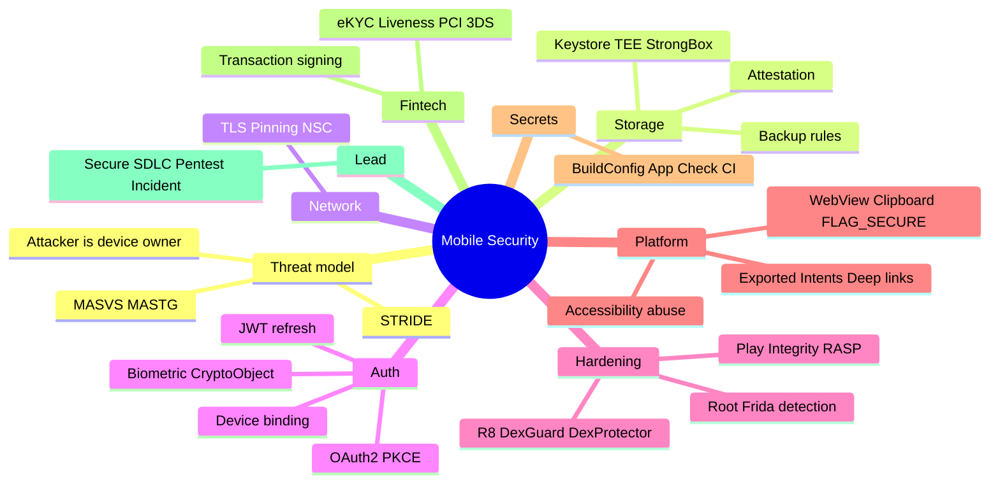
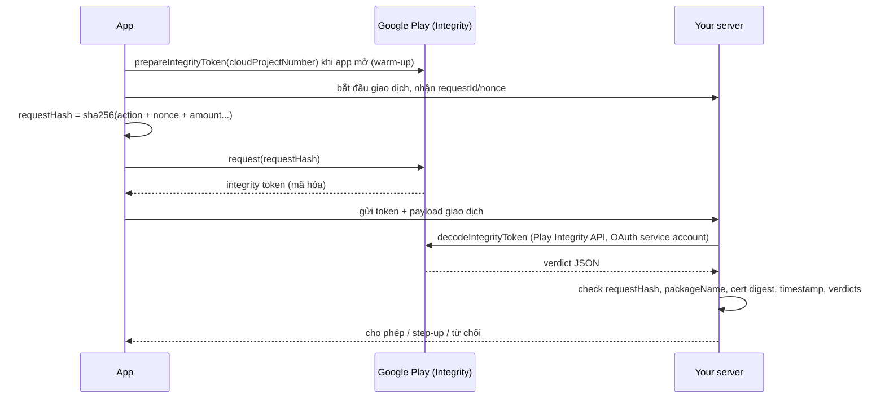
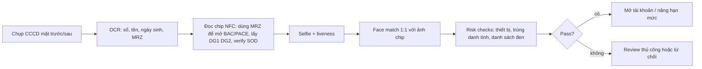
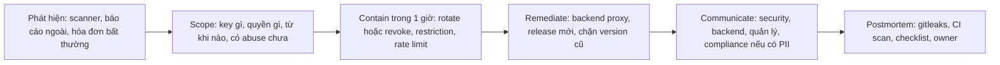

# 08. Security

> Mục tiêu: trả lời được mọi câu hỏi security mà bank/fintech VN và công ty nước ngoài hỏi Android Senior/Lead: Keystore, pinning, biometric, hardening (R8/DexGuard/DexProtector), Play Integrity, IPC, secrets, eKYC, và cách vận hành security như một lead. Tự giải thích được vì sao từng control tồn tại và nó không chống được gì. | Mức cần đạt: Senior: áp dụng đúng Keystore, pinning, BiometricPrompt, Network Security Config, exported components. / Staff: threat model, thiết kế device binding và transaction signing, đọc được pentest report theo MASVS và biết control nào là lớp nào. / Lead: secure SDLC, chọn vendor hardening theo yêu cầu bank, incident response, checklist review, nói chuyện được với security team và compliance. | Thời gian gợi ý: tuần 6-7, ~18 giờ

## 0. Bản đồ chủ đề

Security là mảng xuất hiện 8/15 JD và là mảng mà bank hỏi sâu nhất (GoTymeX, Timo, OCB, Techcombank, One Mount, Payoo theo `01-Market-Research-2026.md`). Câu hỏi không phải "bạn có biết pinning không" mà là "pinning chống gì, không chống gì, rotation thế nào, bị bypass bằng gì, và bạn phối hợp với lớp nào". Interviewer bank thường là security engineer hoặc lead đã đọc pentest report; họ đào tới mức: key nằm ở TEE hay StrongBox, verdict nào của Play Integrity bạn chấp nhận, bạn phản ứng ra sao khi phát hiện root, và cái giá của mỗi lựa chọn với user thật.



Nguyên tắc xuyên suốt file: **client là của attacker**. Mọi thứ trong APK, trong RAM, trong storage của thiết bị đều có thể bị đọc và sửa bởi người cầm máy đã root. Control phía client chỉ làm tăng chi phí tấn công và tạo tín hiệu; quyết định cuối cùng (có cho chuyển tiền không) phải nằm ở server với bằng chứng server tự kiểm chứng được (chữ ký, attestation, Play Integrity verdict đã decode phía server). Nói được câu này đầu tiên trong mọi câu hỏi security là bạn đã ở mức Staff.

Liên hệ: phần network (TLS, pinning rotation, token refresh race) chi tiết ở `07-Network.md`; system design cho bank app ở `06-Mobile-System-Design.md`; câu chuyện STAR về security incident ở `12-Behavioral-STAR-Bank.md`.

## 1. OWASP MASVS/MASTG và threat modeling

### 1.1 MASVS, MASTG, MASWE: chúng là gì và interviewer dùng thế nào

OWASP Mobile Application Security (MAS) gồm ba tài liệu:
- MASVS (Mobile Application Security Verification Standard): tiêu chuẩn, liệt kê control theo nhóm. Phiên bản 2 gom thành 8 nhóm: MASVS-STORAGE, MASVS-CRYPTO, MASVS-AUTH, MASVS-NETWORK, MASVS-PLATFORM, MASVS-CODE, MASVS-RESILIENCE, MASVS-PRIVACY. Ví dụ MASVS-STORAGE-1: "The app securely stores sensitive data", MASVS-NETWORK-2: "The app performs identity pinning for all remote endpoints under the developer's control", MASVS-RESILIENCE-1: "The app validates the integrity of the platform".
- MASTG (Testing Guide): cách test từng control, công cụ (Frida, objection, jadx, apktool, MobSF, Burp), kỹ thuật bypass. Pentester đi theo MASTG.
- MASWE (Weakness Enumeration): danh sách điểm yếu nối MASVS với test case, đang được bổ sung.
- MAS Checklist: bảng Excel/markdown map control với test, dùng làm scope cho pentest và self-assessment.

Mức xác minh (profile): L1 (mọi app), L2 (app xử lý dữ liệu nhạy cảm: bank, health), R (resilience: chống reverse engineering và tamper, bổ sung cho L1/L2, bank gần như luôn yêu cầu L2+R). Tên và cách chia profile ở bản mới nhất cần kiểm tra tại https://mas.owasp.org/MASVS/.

OWASP Mobile Top 10 (bản 2024) là danh sách rủi ro, hay bị hỏi để kiểm tra bạn có theo dõi không: M1 Improper Credential Usage, M2 Inadequate Supply Chain Security, M3 Insecure Authentication/Authorization, M4 Insufficient Input/Output Validation, M5 Insecure Communication, M6 Inadequate Privacy Controls, M7 Insufficient Binary Protections, M8 Security Misconfiguration, M9 Insecure Data Storage, M10 Insufficient Cryptography.

Interviewer dùng thế nào:
- "App của bạn target MASVS level nào? Ai verify?" Họ muốn nghe: L2+R cho bank, pentest hàng năm bởi bên thứ ba, finding được map theo MASVS ID.
- "Pentest report có finding MASVS-STORAGE-2 (data leak qua log/backup), bạn xử lý thế nào?" Họ muốn nghe quy trình: tái hiện, đánh giá severity, fix, retest, và đưa vào checklist để không tái phát.
- "Bạn tự test kiểu MASTG được không?" Họ muốn nghe: bạn đã chạy MobSF, apktool/jadx trên APK của mình, biết objection bypass pinning, biết Frida hook là gì.

- **Lỗi hay gặp / trade-off**
  - Nói "app tôi đạt MASVS" mà không có pentest hay checklist. Interviewer sẽ hỏi bằng chứng.
  - Đọc MASVS như danh sách tick box, không hiểu vì sao control tồn tại.
- **Đọc thêm:**
  - https://mas.owasp.org/MASVS/
  - https://mas.owasp.org/MASTG/
  - https://mas.owasp.org/checklists/
  - https://owasp.org/www-project-mobile-top-10/

### 1.2 Threat modeling cho mobile app (STRIDE lite)

Threat model là trả lời 4 câu: ta bảo vệ cái gì (asset), ai tấn công và có gì (attacker), tấn công qua đâu (entry point), ta làm gì (mitigation) và chấp nhận gì (residual risk). Làm ở đầu mỗi feature lớn, 1-2 giờ với mobile, backend, security.

Asset của bank app: credential và token, PII (CCCD, địa chỉ), dữ liệu tài chính (số dư, giao dịch), tính toàn vẹn giao dịch (đúng số tiền, đúng người nhận), key ký, uy tín và tuân thủ.

Entry point: network (API, WebSocket, CDN), IPC (exported component, deep link, content provider, broadcast), UI (overlay, accessibility, clipboard, screenshot), storage (file, DB, SharedPreferences, backup, log), binary (APK bị repackage, hook), SDK bên thứ ba, CI/CD và supply chain.

STRIDE map sang mobile:

| Threat | Ví dụ mobile | Mitigation chính |
|---|---|---|
| Spoofing (giả danh) | app giả mạo, phishing overlay, giả server (MITM) | TLS + pinning, Play Integrity app verdict, App Links verified, user auth mạnh |
| Tampering (sửa) | sửa APK bỏ root check, sửa request trong proxy, sửa DB local | R8/DexGuard + anti-tamper, request signing, server validation, Keystore |
| Repudiation (chối) | "tôi không chuyển tiền đó" | transaction signing với key gắn biometric, audit log server, device binding |
| Information disclosure (lộ) | token trong log, số dư trong screenshot/recents, backup, clipboard | log masking, FLAG_SECURE, backup rules, Keystore encryption, no-store |
| Denial of service | spam OTP, lock account người khác, crash qua intent | rate limit, exported=false, input validation |
| Elevation of privilege | bypass màn hình login bằng intent, WebView JS bridge gọi hàm nội bộ | exported audit, PendingIntent immutable, WebView hardening, server-side authz |

Attacker model (nói rõ với team):
1. Remote attacker không có thiết bị: tấn công API, phishing, SIM swap, credential stuffing. Phòng: server-side auth, rate limit, device binding, OTP không qua SMS.
2. Network attacker (MITM): WiFi công cộng, nhà mạng, proxy. Phòng: TLS 1.2+, pinning, không cleartext.
3. Malware trên thiết bị của nạn nhân (không root): dùng accessibility, overlay, đọc clipboard, SMS. Phòng: FLAG_SECURE, accessibility hardening, tapjacking filter, không dùng SMS OTP cho giao dịch lớn, Play Integrity + risk engine.
4. Device owner là attacker (root, Frida, emulator, repackage): muốn gian lận (bonus abuse, giả vị trí, bypass KYC) hoặc nghiên cứu để tấn công người khác. Phòng: hardening, Play Integrity/attestation, server-side decision, không có logic quyết định tiền ở client.
5. Thiết bị bị mất/đánh cắp đã mở khóa: phòng bằng idle timeout, re-auth cho giao dịch, token ngắn, remote logout.
6. Insider và supply chain: SDK độc, CI bị chiếm, key ký lộ. Phòng: dependency scanning, Play App Signing, secret management.

Cách ưu tiên: xác suất x tác động, đặt lên bảng, chọn top 5 để có mitigation trong sprint này, phần còn lại ghi residual risk có chủ sở hữu. Không cố diệt hết; interviewer thích người biết chấp nhận rủi ro có lý do hơn người nói "tôi chặn mọi thứ".

Ví dụ: feature "chuyển tiền nhanh qua QR". Asset: tính toàn vẹn số tiền và người nhận. Threat lớn nhất: malware overlay đổi số tài khoản trên màn hình xác nhận (Tampering/Spoofing qua UI), và replay request. Mitigation: màn hình xác nhận có FLAG_SECURE, filterTouchesWhenObscured, accessibilityDataSensitive; request ký với nonce; server kiểm tra hạn mức và người nhận lạ; step-up biometric trên 10 triệu theo quy định.

- **Đọc thêm:**
  - https://owasp.org/www-community/Threat_Modeling
  - https://mas.owasp.org/MASTG/ (phần General Mobile App Security Testing, mục threat modeling)
  - Sách Mobile System Design Interview (Manuel Vivo), chương security considerations

## 2. Storage

### 2.1 Android Keystore: TEE, StrongBox, key caps

Android Keystore là hệ thống quản lý key mà **key material không bao giờ rời khỏi môi trường bảo vệ**. App gọi "ký cái này", "giải mã cái này", Keystore làm trong TEE (Trusted Execution Environment, một thế giới riêng trên CPU) hoặc StrongBox (chip bảo mật riêng, như Titan M), app chỉ nhận kết quả. Kể cả root cũng không đọc được private key (có thể dùng key khi app chạy, nhưng không sao chép sang máy khác).

Các thuộc tính quan trọng của `KeyGenParameterSpec`:
- `setIsStrongBoxBacked(true)` (API 28): yêu cầu StrongBox; không có thì ném `StrongBoxUnavailableException`, phải fallback về TEE.
- `setUserAuthenticationRequired(true)`: key chỉ dùng được sau khi user xác thực (biometric hoặc credential).
- `setUserAuthenticationParameters(timeoutSeconds, AUTH_BIOMETRIC_STRONG or AUTH_DEVICE_CREDENTIAL)` (API 30): timeout 0 nghĩa là mỗi lần dùng phải xác thực (dùng với `CryptoObject`), timeout N giây cho phép dùng trong N giây sau khi mở khóa.
- `setInvalidatedByBiometricEnrollment(true)`: thêm vân tay/mặt mới là key vô hiệu, buộc enroll lại (mặc định true cho key yêu cầu biometric).
- `setUnlockedDeviceRequired(true)` (API 28): không dùng được khi màn hình khóa.
- `setAttestationChallenge(bytes)`: tạo attestation chain (xem 2.2).
- `setRandomizedEncryptionRequired` (mặc định true cho AES-GCM, buộc IV ngẫu nhiên).

Android 17 (API 37) áp dụng "Keystore key caps" cho mọi app chạy trên 17 (không chỉ target 37): giới hạn số key Keystore mỗi app được giữ. Con số cụ thể và hành vi khi vượt cần kiểm tra tại https://developer.android.com/about/versions/17/behavior-changes-all. Hệ quả thiết kế: không tạo một Keystore key cho mỗi mẩu dữ liệu; tạo một (hoặc vài) master key trong Keystore và dùng nó wrap các data key sinh trong app (envelope encryption); xóa key không dùng khi logout hoặc migrate.

Mẫu mã hóa token bằng AES-GCM với key trong Keystore:

```kotlin
object KeystoreCrypto {
    private const val ALIAS = "app.master.v1"
    private const val GCM_TAG_BITS = 128

    private fun keyStore() = KeyStore.getInstance("AndroidKeyStore").apply { load(null) }

    fun getOrCreateKey(requireStrongBox: Boolean = false): SecretKey {
        (keyStore().getEntry(ALIAS, null) as? KeyStore.SecretKeyEntry)?.secretKey?.let { return it }
        val spec = KeyGenParameterSpec.Builder(ALIAS, KeyProperties.PURPOSE_ENCRYPT or KeyProperties.PURPOSE_DECRYPT)
            .setBlockModes(KeyProperties.BLOCK_MODE_GCM)
            .setEncryptionPaddings(KeyProperties.ENCRYPTION_PADDING_NONE)
            .setKeySize(256)
            .apply { if (requireStrongBox && Build.VERSION.SDK_INT >= 28) setIsStrongBoxBacked(true) }
            .build()
        return try {
            KeyGenerator.getInstance(KeyProperties.KEY_ALGORITHM_AES, "AndroidKeyStore")
                .apply { init(spec) }.generateKey()
        } catch (e: StrongBoxUnavailableException) {
            getOrCreateKey(requireStrongBox = false)   // fallback TEE, ghi log để biết tỷ lệ
        }
    }

    // Output: [iv(12)] + [ciphertext + tag]
    fun encrypt(plain: ByteArray, aad: ByteArray? = null): ByteArray {
        val cipher = Cipher.getInstance("AES/GCM/NoPadding")
        cipher.init(Cipher.ENCRYPT_MODE, getOrCreateKey())      // Keystore tự sinh IV ngẫu nhiên
        aad?.let { cipher.updateAAD(it) }
        val iv = cipher.iv
        return iv + cipher.doFinal(plain)
    }

    fun decrypt(blob: ByteArray, aad: ByteArray? = null): ByteArray {
        val iv = blob.copyOfRange(0, 12)
        val body = blob.copyOfRange(12, blob.size)
        val cipher = Cipher.getInstance("AES/GCM/NoPadding")
        cipher.init(Cipher.DECRYPT_MODE, getOrCreateKey(), GCMParameterSpec(GCM_TAG_BITS, iv))
        aad?.let { cipher.updateAAD(it) }
        return cipher.doFinal(body)
    }
}
```

Điểm để trả lời interviewer: AES-GCM cho confidentiality + integrity (tag), IV phải duy nhất cho mỗi lần mã hóa với cùng key (Keystore tự sinh, đừng tự đặt), AAD gắn ngữ cảnh (ví dụ user id) để blob của user A không giải mã được trong ngữ cảnh user B. Kiểm tra key có hardware-backed không: `KeyFactory.getInstance(alg, "AndroidKeyStore").getKeySpec(key, KeyInfo::class.java).securityLevel` (API 31) hoặc `isInsideSecureHardware` (cũ).

Giới hạn Keystore phải nói được: key có thể bị xóa khi user xóa lock screen (với key yêu cầu auth) hoặc factory reset; một số OEM có bug (key biến mất sau update OS), nên app phải xử lý `KeyPermanentlyInvalidatedException` và `UnrecoverableKeyException` bằng cách enroll lại thay vì crash; thao tác Keystore chậm hơn software (vài ms tới vài chục ms), không gọi trong vòng lặp lớn; trên emulator không có hardware.

- **Lỗi hay gặp / trade-off**
  - Tự sinh IV cố định hoặc tái sử dụng: AES-GCM với IV trùng là lộ plaintext XOR và mất tính toàn vẹn.
  - Lưu key AES dạng byte trong SharedPreferences "đã mã hóa bằng key hardcode". Đây là obfuscation, không phải mã hóa.
  - Không bắt exception khi key bị invalidate, user bị kẹt không vào được app.
- **Đọc thêm:**
  - https://developer.android.com/privacy-and-security/keystore
  - https://developer.android.com/privacy-and-security/cryptography
  - https://developer.android.com/about/versions/17/behavior-changes-all

### 2.2 Key attestation

Key attestation là Keystore tạo một chuỗi chứng chỉ cho key pair, ký bởi key của thiết bị do Google cấp lúc sản xuất, chứa extension mô tả: key sinh ở đâu (`attestationSecurityLevel`: Software/TEE/StrongBox), có yêu cầu user auth không, trạng thái verified boot (`verifiedBootState`: Verified/SelfSigned/Unverified/Failed), bootloader locked hay không, OS version và patch level, và challenge bạn đưa vào (chống replay).

Dùng cho: device binding lúc enrollment (server chỉ chấp nhận key có attestation hợp lệ với root Google, security level TEE/StrongBox, verified boot Verified), chứng minh "key này sinh trong hardware của một thiết bị hợp lệ, bootloader khóa". Khác với Play Integrity: attestation là về key và boot state, không cần Google Play services (chạy trên mọi thiết bị có Keymaster đúng chuẩn), và là bằng chứng mã học server tự verify được; Play Integrity là verdict tổng hợp từ Google về app + thiết bị + tài khoản.

```kotlin
val spec = KeyGenParameterSpec.Builder("device.binding.v1", KeyProperties.PURPOSE_SIGN or KeyProperties.PURPOSE_VERIFY)
    .setDigests(KeyProperties.DIGEST_SHA256)
    .setAlgorithmParameterSpec(ECGenParameterSpec("secp256r1"))
    .setAttestationChallenge(serverChallenge)         // bytes server cấp cho phiên enrollment này
    .setUserAuthenticationRequired(true)
    .setUserAuthenticationParameters(0, KeyProperties.AUTH_BIOMETRIC_STRONG)
    .build()
KeyPairGenerator.getInstance(KeyProperties.KEY_ALGORITHM_EC, "AndroidKeyStore").apply { initialize(spec) }.generateKeyPair()
val chain = KeyStore.getInstance("AndroidKeyStore").apply { load(null) }.getCertificateChain("device.binding.v1")
// gửi chain (DER từng cert) lên server
```

Server verify: chain tới root Google (public key công bố), kiểm tra revocation list của Google cho attestation keys, parse extension `1.3.6.1.4.1.11129.2.1.17`, so challenge, kiểm tra security level và verified boot, lưu public key. Chi tiết và thư viện mẫu tại https://developer.android.com/privacy-and-security/security-key-attestation.

Giới hạn: thiết bị cũ hoặc OEM lạ có attestation hỏng hoặc software-level; một số thiết bị bị lộ attestation key (Google thu hồi); module "Play Integrity Fix" trên Magisk giả được một số signal cũ nhưng không giả được chữ ký hardware hợp lệ. Chính sách thực tế: attestation TEE trở lên cho device binding, software thì chỉ cho phép thao tác thấp.

- **Đọc thêm:**
  - https://developer.android.com/privacy-and-security/security-key-attestation
  - https://source.android.com/docs/security/features/keystore/attestation

### 2.3 Mã hóa dữ liệu: Jetpack Security, Tink, DataStore, SQLCipher

Thực trạng (cần kiểm tra lại ngày phỏng vấn): thư viện `androidx.security:security-crypto` (`EncryptedSharedPreferences`, `EncryptedFile`) đã bị Google đánh dấu deprecated; hướng dẫn hiện tại là dùng trực tiếp Keystore + AES-GCM như 2.1, hoặc Tink (`AndroidKeysetManager` với master key URI `android-keystore://alias`). Nếu project cũ của bạn còn dùng `EncryptedSharedPreferences`, hãy chuẩn bị câu trả lời: "it works but is deprecated, migration plan is Keystore-wrapped AES-GCM with a versioned blob format".

Lớp dữ liệu và cách bảo vệ:

| Dữ liệu | Nơi lưu | Bảo vệ |
|---|---|---|
| Access token | RAM (TokenStore) | không ghi đĩa, xóa khi logout, không log |
| Refresh token, device key id | file nhỏ hoặc DataStore | AES-GCM với Keystore key; cân nhắc thêm `setUserAuthenticationRequired` cho bank |
| Cài đặt không nhạy cảm | DataStore Preferences | không cần mã hóa, nhưng loại khỏi backup nếu chứa id |
| Dữ liệu cấu trúc nhạy cảm (giao dịch offline) | Room + SQLCipher, hoặc Room thường + mã hóa field | key SQLCipher sinh ngẫu nhiên, wrap bằng Keystore |
| Ảnh CCCD, selfie eKYC | không lưu, hoặc file tạm trong `cacheDir` mã hóa, xóa ngay sau upload | FLAG_SECURE khi hiển thị, không vào Coil disk cache |
| Mật khẩu, PIN, CVV, PAN đầy đủ, seed OTP dạng plain | không bao giờ | |

Proto DataStore mã hóa: viết `Serializer<T>` bọc: `readFrom` giải mã bytes rồi parse, `writeTo` serialize rồi mã hóa. Preferences DataStore không có hook tương đương nên dùng Proto hoặc mã hóa từng value.

```kotlin
class EncryptedSerializer<T>(
    private val inner: Serializer<T>,
    private val aad: ByteArray,                       // ví dụ userId.toByteArray()
) : Serializer<T> {
    override val defaultValue: T get() = inner.defaultValue

    override suspend fun readFrom(input: InputStream): T {
        val blob = input.readBytes()
        if (blob.isEmpty()) return defaultValue
        val plain = try {
            KeystoreCrypto.decrypt(blob, aad)
        } catch (e: GeneralSecurityException) {
            throw CorruptionException("cannot decrypt datastore", e)   // CorruptionHandler reset về default
        }
        return inner.readFrom(ByteArrayInputStream(plain))
    }

    override suspend fun writeTo(t: T, output: OutputStream) {
        val buffer = ByteArrayOutputStream()
        inner.writeTo(t, buffer)
        output.write(KeystoreCrypto.encrypt(buffer.toByteArray(), aad))
    }
}

// Khai báo: val secureStore = DataStoreFactory.create(
//     serializer = EncryptedSerializer(SessionProtoSerializer, aad = userId.toByteArray()),
//     corruptionHandler = ReplaceFileCorruptionHandler { SessionProto.getDefaultInstance() },
// ) { File(context.filesDir, "session.pb") }
```

Điểm cần nói: `CorruptionException` khi không giải mã được (key bị invalidate, blob từ backup của máy khác) để DataStore reset thay vì crash loop; AAD gắn blob với user; file này nằm trong danh sách exclude backup.

SQLCipher cho Room: `net.zetetic:sqlcipher-android` cung cấp `SupportOpenHelperFactory(passphrase)`; truyền vào `Room.databaseBuilder(...).openHelperFactory(factory)`. Passphrase: 32 byte ngẫu nhiên, lưu dạng AES-GCM blob bằng Keystore, giải mã lúc mở DB, xóa khỏi RAM khi có thể. Chi phí: kích thước APK (native lib ~ vài MB), hiệu năng giảm khoảng 5-15% (tự đo), phức tạp migration. Có cần không khi Android đã có File-Based Encryption? FBE bảo vệ khi thiết bị tắt/khóa chưa mở lần đầu; khi máy đã mở khóa và root, file đọc được bình thường; backup và `run-as` trên debuggable cũng đọc được. SQLCipher bảo vệ nội dung DB khỏi các đường đó miễn key nằm trong Keystore. Bank thường yêu cầu, app thường thì Room + mã hóa field nhạy cảm là đủ.

- **Lỗi hay gặp / trade-off**
  - Passphrase SQLCipher hardcode hoặc dẫn xuất từ Android ID: ai cũng tính được.
  - Mã hóa toàn bộ rồi để log ghi plaintext ngay bên cạnh.
- **Đọc thêm:**
  - https://developers.google.com/tink
  - https://www.zetetic.net/sqlcipher/sqlcipher-for-android/
  - https://developer.android.com/topic/libraries/architecture/datastore

### 2.4 Backup: allowBackup, auto backup rules, device transfer

Auto Backup sao chép dữ liệu app (SharedPreferences, DB, file nội bộ) lên Google Drive của user, và device-to-device transfer chuyển sang máy mới. Với bank: dữ liệu trong backup rời khỏi thiết bị và có thể được restore trên thiết bị khác; token/device key khi restore sang máy khác tạo "thiết bị bị nhân bản". Pentest finding kinh điển: `adb backup` hoặc restore cho thấy token.

Cấu hình:
- `android:allowBackup="false"` tắt backup (Play và pentest coi là mặc định cho bank).
- Nếu cần backup một phần: `android:fullBackupContent="@xml/backup_rules"` (API 30 trở xuống) và `android:dataExtractionRules="@xml/data_extraction_rules"` (API 31+), khai cả hai cho tương thích.

```xml
<!-- res/xml/data_extraction_rules.xml -->
<data-extraction-rules>
    <cloud-backup>
        <exclude domain="sharedpref" path="auth.xml" />
        <exclude domain="database" path="app.db" />
        <exclude domain="file" path="tokens.bin" />
    </cloud-backup>
    <device-transfer>
        <exclude domain="sharedpref" path="auth.xml" />
        <exclude domain="database" path="app.db" />
        <exclude domain="file" path="tokens.bin" />
    </device-transfer>
</data-extraction-rules>
```

Lưu ý: từ Android 12, cách `allowBackup` tương tác với device-to-device transfer thay đổi; hãy khai `dataExtractionRules` tường minh thay vì tin vào `allowBackup` và kiểm tra tại https://developer.android.com/identity/data/autobackup. Test: `adb shell bmgr backupnow <package>` rồi `bmgr restore`, hoặc dùng flow chuyển máy. Keystore key không được backup, nên dữ liệu mã hóa bằng Keystore khi restore sang máy khác sẽ không giải mã được: đây là tính năng, app phải xử lý bằng cách yêu cầu login lại thay vì crash.

- **Đọc thêm:**
  - https://developer.android.com/identity/data/autobackup
  - https://mas.owasp.org/MASTG/ (MASVS-STORAGE-2, test backup)

## 3. Network security

Chi tiết TLS, pinning rotation, token refresh race nằm ở `07-Network.md` mục 2 và 5.9-5.10. Phần này gom những gì pentest và interviewer bank hỏi dưới góc security.

### 3.1 TLS và Network Security Config

Yêu cầu tối thiểu (MASVS-NETWORK-1): mọi traffic qua TLS 1.2+, không cleartext, không custom TrustManager chấp nhận mọi chứng chỉ, không `HostnameVerifier` trả true. Google Play quét và gửi cảnh báo "Unsafe TrustManager"/"Unsafe HostnameVerifier" cho app vi phạm, có thể chặn update.

Network Security Config là file khai báo duy nhất bạn phải thuộc:

```xml
<network-security-config>
    <base-config cleartextTrafficPermitted="false">
        <trust-anchors>
            <certificates src="system" />
        </trust-anchors>
    </base-config>
    <domain-config cleartextTrafficPermitted="false">
        <domain includeSubdomains="true">api.yourbank.vn</domain>
        <pin-set expiration="2027-06-30">
            <pin digest="SHA-256">current==</pin>
            <pin digest="SHA-256">backup==</pin>
        </pin-set>
    </domain-config>
    <debug-overrides>
        <trust-anchors>
            <certificates src="user" />
        </trust-anchors>
    </debug-overrides>
</network-security-config>
```

Điều interviewer kiểm tra: bạn biết `debug-overrides` chỉ có hiệu lực khi `debuggable=true`; bạn biết từ Android 7 user CA không được tin mặc định; bạn biết `pin-set` có `expiration` và lý do; bạn biết NSC áp dụng cho stack dùng platform trust manager, còn SDK có stack riêng thì không. Cleartext: Android 9+ chặn mặc định; chỉ mở cho domain cụ thể (ví dụ `localhost` khi dev) qua `domain-config`, không bao giờ `base-config cleartextTrafficPermitted="true"`.

- **Lỗi hay gặp / trade-off**
  - Đặt `debug-overrides` nhưng build "internal" dùng để test lại là release (không debuggable), dev bèn thêm user CA vào `base-config` rồi quên gỡ.
  - Pin-set không có `expiration`, hoặc expiration quá xa (5 năm) làm mất ý nghĩa fail-open.
- **Đọc thêm:**
  - https://developer.android.com/privacy-and-security/security-config
  - https://developer.android.com/privacy-and-security/security-ssl

### 3.2 Pinning: pros/cons và rotation (tóm tắt)

Pros: chặn CA bị hack, chứng chỉ cấp sai, user CA trên máy có proxy; là yêu cầu MASVS-NETWORK-2 (L2) và gần như mọi pentest bank. Cons: rotation sai là bricking; bị bypass trên máy root bằng Frida/objection; tốn công duy trì; không bảo vệ SDK bên thứ ba dùng stack riêng. Rotation: pin SPKI, 2+ pin (live + backup pre-generated), expiration, lịch gắn với cert expiry, monitoring `SSLPeerUnverifiedException`, force update path. Code OkHttp và Ktor xem `07-Network.md` 5.9.

- **Đọc thêm:**
  - https://github.com/square/okhttp/blob/master/docs/features/https.md
  - https://mas.owasp.org/MASTG/ (MASVS-NETWORK-2 và kỹ thuật bypass pinning trong MASTG để biết pentester làm gì)

### 3.3 Proxy, VPN và MITM detection

Có thể lấy tín hiệu: `System.getProperty("http.proxyHost")`, `ProxySelector.getDefault().select(uri)`, `NetworkCapabilities.hasTransport(TRANSPORT_VPN)`, và quan trọng nhất là pinning fail (bằng chứng có ai đó chặn TLS). Nhưng VPN và proxy là hợp pháp (VPN công ty, Private DNS), nên không chặn app chỉ vì thấy VPN; gửi tín hiệu về risk engine, chặn chỉ ở giao dịch rủi ro cao, hoặc hiện cảnh báo. Pinning + Play Integrity + request signing mới là lớp chặn thật, detection chỉ là telemetry.

- **Lỗi hay gặp / trade-off**
  - Chặn mọi VPN: mất user doanh nghiệp và user dùng Private DNS, không chặn được attacker (họ tắt VPN detection bằng hook).
  - Thiếu test trên thiết bị có Private DNS bật.
- **Đọc thêm:**
  - https://developer.android.com/privacy-and-security/security-config
  - https://developer.android.com/privacy-and-security/security-ssl
  - https://mas.owasp.org/MASTG/ (MASVS-NETWORK)

## 4. Auth

### 4.1 OAuth2 Authorization Code + PKCE

Vì sao không implicit flow: token trả qua redirect URL, lộ trong log/history và không có refresh. Vì sao cần PKCE (RFC 7636) cho native app: app không giữ được client secret (APK đọc được), và redirect URI dạng custom scheme có thể bị app khác đăng ký cướp (scheme hijack). PKCE: app sinh `code_verifier` ngẫu nhiên, gửi `code_challenge = BASE64URL(SHA256(verifier))` khi mở trang login; khi đổi authorization code lấy token, app gửi `code_verifier`; server so hash. App độc hại cướp được code cũng không có verifier. RFC 8252 (OAuth for Native Apps) và RFC 9700 (OAuth 2.0 Security BCP) quy định: dùng system browser (Custom Tabs), không WebView; PKCE bắt buộc; redirect bằng App Links (https, verified) ưu tiên hơn custom scheme; `state` chống CSRF.

```mermaid
sequenceDiagram
    participant U as User
    participant A as App
    participant B as Custom Tab (system browser)
    participant AS as Authorization server
    A->>A: verifier = random(32 bytes); challenge = base64url(sha256(verifier)); state = random
    A->>B: open /authorize?client_id&redirect_uri&code_challenge&code_challenge_method=S256&state&scope
    U->>B: login + consent (có thể kèm MFA)
    B->>A: redirect https://app.bank.vn/callback?code=...&state=... (App Link)
    A->>A: verify state
    A->>AS: POST /token (code, code_verifier, client_id, redirect_uri)
    AS-->>A: access_token (ngắn), refresh_token (rotation), id_token
```

```kotlin
fun pkcePair(): Pair<String, String> {
    val bytes = ByteArray(32).also { SecureRandom().nextBytes(it) }
    val verifier = Base64.encodeToString(bytes, Base64.URL_SAFE or Base64.NO_WRAP or Base64.NO_PADDING)
    val digest = MessageDigest.getInstance("SHA-256").digest(verifier.toByteArray(Charsets.US_ASCII))
    val challenge = Base64.encodeToString(digest, Base64.URL_SAFE or Base64.NO_WRAP or Base64.NO_PADDING)
    return verifier to challenge
}
```

Thư viện: AppAuth-Android làm đúng những điều trên. Bank VN thường có login tự xây (username + password + OTP/biometric) gọi API riêng thay vì OAuth chuẩn; khi đó vẫn giữ nguyên tắc: không WebView cho SSO bên thứ ba, token ngắn, refresh rotation, step-up.

Custom Tabs vs WebView: WebView để app đọc được mọi thứ user gõ (kể cả mật khẩu Google), không chia sẻ session với trình duyệt, không có URL bar để user kiểm tra domain; Google chặn Google Sign-In trong WebView. Custom Tabs chạy trong Chrome, app không thấy nội dung, có cookie SSO. Trả lời "WebView cho login nội bộ của chính bank" vẫn phải nói rủi ro: JS injection, không có pinning của OkHttp, phải hardening WebView (phần 6.5).

- **Đọc thêm:**
  - https://www.rfc-editor.org/rfc/rfc7636
  - https://www.rfc-editor.org/rfc/rfc8252
  - https://github.com/openid/AppAuth-Android

### 4.2 JWT, access/refresh, rotation và reuse detection

JWT = header.payload.signature, base64url, không mã hóa (ai cũng đọc payload). Client chỉ nên dùng `exp` để biết khi nào refresh chủ động; không dùng claim để quyết định quyền (server quyết). Thuật toán: RS256/ES256 (bất đối xứng; resource server verify bằng public key) tốt hơn HS256 (shared secret) cho hệ nhiều service; `alg: none` phải bị từ chối phía server. Claims cần có: `iss`, `aud`, `exp`, `iat`, `sub`, `jti` (id để revoke/blacklist).

Chính sách: access token 5-15 phút; refresh token dài hơn (ngày/tuần) với rotation: mỗi lần refresh cấp refresh token mới và vô hiệu cái cũ; reuse detection: nếu refresh token đã dùng xuất hiện lại, server thu hồi cả family (dấu hiệu bị đánh cắp). Hệ quả phía client: refresh race (`07-Network.md` 5.10) phải được xử lý single-flight, nếu không rotation sẽ logout user vô cớ.

Lưu trữ: access token trong RAM; refresh token mã hóa bằng Keystore (2.1), bank có thể gắn `setUserAuthenticationRequired` cho key giải mã refresh token để mỗi lần mở app phải biometric; không lưu trong SharedPreferences plaintext, không log, không đưa vào URL.

Sender-constrained token (Staff+): DPoP (RFC 9449) ký mỗi request bằng key của client, hoặc mTLS, để token trộm được cũng không dùng được từ máy khác. Nhiều bank thay bằng request signing tự thiết kế (4.5).

- **Đọc thêm:**
  - https://www.rfc-editor.org/rfc/rfc9700
  - https://www.rfc-editor.org/rfc/rfc7519
  - https://www.rfc-editor.org/rfc/rfc9449

### 4.3 Biometric: BiometricPrompt + CryptoObject

Hai cách dùng biometric, khác nhau về bảo mật:
- Event-based: gọi `BiometricPrompt.authenticate(promptInfo)`, trong `onAuthenticationSucceeded` thì mở màn hình. Attacker có Frida hook callback này và gọi thẳng `onAuthenticationSucceeded`, hoặc sửa smali để bỏ qua. Chỉ là "khóa UI".
- Crypto-based: key trong Keystore với `setUserAuthenticationRequired(true)`, timeout 0; tạo `Cipher`/`Signature` với key đó (lúc này chưa dùng được), bọc thành `CryptoObject`, gọi `authenticate(promptInfo, cryptoObject)`; chỉ sau khi hardware xác nhận biometric, Keystore mới cho phép cipher hoàn thành. Hook callback không giúp gì vì không có biometric thì cipher ném exception; không có cipher thì không giải mã được refresh token hay ký giao dịch. Đây là cách bank phải dùng (MASVS-AUTH-2 + MASVS-CRYPTO).

```kotlin
class BiometricUnlock(private val activity: FragmentActivity) {

    fun canUseStrongBiometric(): Boolean =
        BiometricManager.from(activity).canAuthenticate(BiometricManager.Authenticators.BIOMETRIC_STRONG) ==
            BiometricManager.BIOMETRIC_SUCCESS

    fun decryptWithBiometric(blob: ByteArray, key: SecretKey, onResult: (Result<ByteArray>) -> Unit) {
        val iv = blob.copyOfRange(0, 12)
        val cipher = Cipher.getInstance("AES/GCM/NoPadding").apply {
            try {
                init(Cipher.DECRYPT_MODE, key, GCMParameterSpec(128, iv))
            } catch (e: KeyPermanentlyInvalidatedException) {
                onResult(Result.failure(e)); return   // biometric đổi: xóa key, enroll lại
            }
        }
        val promptInfo = BiometricPrompt.PromptInfo.Builder()
            .setTitle("Xác thực để tiếp tục")
            .setSubtitle("Dùng vân tay hoặc khuôn mặt đã đăng ký")
            .setAllowedAuthenticators(BiometricManager.Authenticators.BIOMETRIC_STRONG)
            .setNegativeButtonText("Hủy")   // bắt buộc khi không cho DEVICE_CREDENTIAL
            .build()
        val prompt = BiometricPrompt(activity, ContextCompat.getMainExecutor(activity),
            object : BiometricPrompt.AuthenticationCallback() {
                override fun onAuthenticationSucceeded(result: BiometricPrompt.AuthenticationResult) {
                    val c = result.cryptoObject?.cipher ?: return onResult(Result.failure(IllegalStateException("no cipher")))
                    onResult(runCatching { c.doFinal(blob.copyOfRange(12, blob.size)) })
                }
                override fun onAuthenticationError(code: Int, msg: CharSequence) {
                    onResult(Result.failure(SecurityException("$code $msg")))
                }
            })
        prompt.authenticate(promptInfo, BiometricPrompt.CryptoObject(cipher))
    }
}
```

Điểm phải nói được:
- Class 3 (BIOMETRIC_STRONG) mới dùng được với CryptoObject; Class 2 (WEAK, nhiều face unlock camera thường) không. Bank chỉ chấp nhận STRONG.
- `setInvalidatedByBiometricEnrollment(true)`: thêm vân tay mới là key chết → `KeyPermanentlyInvalidatedException` → xóa key, yêu cầu login đầy đủ và enroll lại. Trade-off UX, nhưng chặn kịch bản "kẻ trộm biết PIN, thêm vân tay mình rồi dùng biometric".
- `DEVICE_CREDENTIAL` fallback (PIN/pattern): tiện nhưng PIN yếu hơn; bank thường cho fallback về mật khẩu app, không phải PIN thiết bị, cho giao dịch.
- Biometric của thiết bị không gửi lên server. Server chỉ thấy chữ ký/giải mã thành công. "Biometric login" ở bank VN thực chất là: biometric mở khóa key → key ký challenge hoặc giải mã refresh token → server xác thực. Khác với eKYC face match (so khuôn mặt với CCCD, chạy trên server).
- Quyết định 2345/QĐ-NHNN (2023) bắt buộc xác thực sinh trắc học (khuôn mặt khớp CCCD) cho giao dịch trên 10 triệu VND hoặc tổng trên 20 triệu/ngày từ 1/7/2024; chi tiết ngưỡng và hiệu lực cần kiểm tra văn bản gốc. Interviewer bank sẽ hỏi bạn phân biệt được biometric của thiết bị và sinh trắc học theo 2345.

- **Đọc thêm:**
  - https://developer.android.com/identity/sign-in/biometric-auth
  - https://developer.android.com/privacy-and-security/keystore (phần user authentication)
  - https://mas.owasp.org/MASTG/ (MASVS-AUTH-2, test biometric bypass)

### 4.4 Device binding và session management

Device binding: thiết bị được định danh bằng key pair trong Keystore (không sao chép được), đăng ký với server kèm attestation lúc enrollment (sau khi user xác thực mạnh, thường kèm OTP/eKYC). Sau đó mỗi phiên login hoặc mỗi giao dịch, app ký challenge của server bằng key đó. Lợi ích: credential bị lộ không dùng được từ máy khác; SIM swap không đủ; thiết bị bị clone (restore backup) không có key. Quản lý: danh sách thiết bị trong app và web, xóa thiết bị từ xa, giới hạn số thiết bị, thông báo khi thêm thiết bị mới. Không dùng Android ID/IMEI làm "device binding": chúng đọc được và giả được, và IMEI không còn truy cập được từ API 29.

Session policy cho bank (nói được con số và lý do):
- Idle timeout ngắn (ví dụ 5 phút không thao tác → khóa, cần biometric), absolute timeout (ví dụ 24 giờ → login lại).
- Step-up: thao tác nhạy cảm (chuyển tiền, đổi hạn mức, thêm người nhận, đổi số điện thoại) cần biometric/OTP ngay cả khi phiên còn.
- Một phiên active mỗi tài khoản hoặc giới hạn N thiết bị; login nơi khác thì nơi cũ bị đẩy ra (thông báo).
- Logout: client xóa token RAM, xóa blob refresh token, xóa Room/cache/OkHttp cache/WebView cookies/Coil disk cache nếu chứa ảnh nhạy cảm, hủy WorkManager jobs có dữ liệu; server revoke refresh token family và session.
- Logout everywhere: server tăng "session version" trong user record hoặc revoke tất cả refresh token families; access token còn hạn vẫn có thể bị từ chối nếu resource server kiểm tra version (hoặc chấp nhận cửa sổ tối đa 15 phút); push "session_revoked" tới các thiết bị để xóa local ngay.

Logout phải là một use case duy nhất, idempotent (push "session_revoked" và 401 có thể cùng tới), chạy trong application scope để không bị hủy khi màn hình đóng:

```kotlin
class LogoutUseCase(
    private val tokenStore: TokenStore,
    private val authApi: AuthApi,                 // client không có Authenticator
    private val db: AppDatabase,
    private val okHttpCache: Cache?,
    private val imageLoader: ImageLoader,
    private val workManager: WorkManager,
    private val sessionEvents: MutableSharedFlow<SessionEvent>,
    private val appScope: CoroutineScope,
) {
    private val running = AtomicBoolean(false)

    fun execute(reason: LogoutReason) {
        if (!running.compareAndSet(false, true)) return
        appScope.launch {
            try {
                val refresh = tokenStore.refreshToken()
                tokenStore.clear()                                        // RAM + blob mã hóa
                runCatching { refresh?.let { authApi.revoke(it) } }       // best effort, không chặn logout
                withContext(Dispatchers.IO) {
                    db.clearAllTables()
                    okHttpCache?.evictAll()
                    imageLoader.diskCache?.clear()
                    imageLoader.memoryCache?.clear()
                    CookieManager.getInstance().removeAllCookies(null)
                    WebStorage.getInstance().deleteAllData()
                }
                workManager.cancelAllWorkByTag("needs-session")
                sessionEvents.emit(SessionEvent.Ended(reason))            // UI điều hướng về login
            } finally {
                running.set(false)
            }
        }
    }
}
```

- **Đọc thêm:**
  - https://pages.nist.gov/800-63-3/sp800-63b.html (session management, authenticator assurance)
  - https://mas.owasp.org/MASTG/ (MASVS-AUTH-1, MASVS-AUTH-3)

### 4.5 Transaction signing (tóm tắt, chi tiết ở phần 8)

Chuỗi chuẩn hóa (amount, currency, beneficiary, timestamp, nonce, idempotency key) → hash → ký bằng key Keystore yêu cầu biometric (CryptoObject với `Signature`) → server verify public key đã đăng ký, kiểm tra nonce/timestamp, rồi thực hiện. WYSIWYS: màn hình xác nhận hiển thị đúng dữ liệu được ký, có FLAG_SECURE và chống overlay. Xem Q&A nhóm bank và code ở 8.2.

- **Đọc thêm:**
  - https://developer.android.com/identity/sign-in/biometric-auth (CryptoObject với Signature)
  - https://mas.owasp.org/MASTG/ (MASVS-AUTH-3, MASVS-CRYPTO-2)

## 5. App hardening

### 5.1 R8 vs ProGuard vs DexGuard vs DexProtector (và các vendor khác)

| | R8 | ProGuard | DexGuard (Guardsquare) | DexProtector (Licel) |
|---|---|---|---|---|
| Là gì | Shrinker/obfuscator/optimizer tích hợp trong AGP | Tiền thân mã nguồn mở của Guardsquare; AGP đã thay bằng R8 | Sản phẩm thương mại, mở rộng từ ProGuard | Sản phẩm thương mại độc lập |
| Chi phí | miễn phí | miễn phí | license theo app/năm, giá đáng kể | license theo app/năm |
| Rename class/method/field | có | có | có, mạnh hơn (và cho resource/asset) | có |
| String encryption | không | không | có | có |
| Class/DEX encryption | không | không | có | có (DEX, SO, asset) |
| Control-flow obfuscation, reflection hóa call | không | không | có | có |
| Native code (SO) obfuscation | không | không | có | có |
| RASP: root/hook/debugger/emulator/tamper detection với phản ứng | không | không | có (kèm console giám sát ThreatCast) | có |
| Hỗ trợ Flutter/RN/KMP native | n/a | n/a | có (cần kiểm tra) | có (cần kiểm tra) |
| Build time, crash symbolication | nhanh; mapping.txt upload Play/Crashlytics | | chậm hơn, cần quy trình mapping riêng | tương tự |

Vendor khác hay gặp trong RFP của bank: Promon SHIELD, Appdome (no-code), Zimperium zShield/zDefend, Digital.ai (Arxan), Verimatrix, AppSealing, Talsec freeRASP (có bản miễn phí). Bank VN thường có sẵn license một trong số này và hỏi "bạn đã tích hợp cái nào, gặp vấn đề gì".

R8 cần nói đúng:
- Làm 3 việc: shrink (bỏ code không dùng), obfuscate (đổi tên thành a, b, c), optimize (inline, bỏ nhánh chết). Full mode là mặc định từ AGP 8.0: giả định mạnh hơn (không giữ attribute/constructor cho class không keep), dễ vỡ thư viện reflection nếu thiếu rule.
- Không phải security control: jadx vẫn đọc được logic, string vẫn plaintext (`strings classes.dex | grep https`), không có anti-tamper. Nó làm reverse chậm hơn một chút và giảm kích thước. Pentest sẽ ghi "M7 Insufficient Binary Protections" nếu chỉ có R8 cho app bank.
- `-keep` tối thiểu; `-repackageclasses ''`; `-assumenosideeffects` cho Log; `isMinifyEnabled` và `isShrinkResources` cho release; upload `mapping.txt` lên Play Console và Crashlytics; dùng `-printconfiguration` để xem rule gộp từ thư viện; kotlinx.serialization không cần keep model (serializer là code sinh ra), nhưng kiểm tra rule mà thư viện ship kèm.

Khi nào bank yêu cầu commercial hardening: khi pentest/audit yêu cầu MASVS-R, khi quy định nội bộ hoặc đối tác (thẻ, ví) yêu cầu, khi risk engine cần telemetry RASP. Chi phí thật: tiền license, thời gian build tăng, crash khó đọc hơn, false positive (user bị chặn do custom ROM hoặc phần mềm hỗ trợ tiếp cận hợp pháp), phụ thuộc vendor khi bump AGP/Kotlin. Lead phải cân được: fintech startup với R8 + Play Integrity + server-side control thường đủ cho giai đoạn đầu; bank thì commercial gần như bắt buộc.

- **Đọc thêm:**
  - https://developer.android.com/build/shrink-code
  - https://www.guardsquare.com/dexguard
  - https://licelus.com/products/dexprotector
  - https://mas.owasp.org/MASTG/ (MASVS-RESILIENCE)

### 5.2 Anti-tamper và signature verification

Repackaging: attacker giải nén APK (apktool), sửa smali (bỏ root check, đổi endpoint), đóng gói, ký bằng key của họ, phát tán qua kênh ngoài Play. Chứng chỉ ký khác là dấu hiệu duy nhất chắc chắn.

Kiểm tra chữ ký trong app:

```kotlin
fun isSignatureValid(context: Context, expectedSha256: Set<String>): Boolean {
    val pm = context.packageManager
    val info = if (Build.VERSION.SDK_INT >= 28) {
        pm.getPackageInfo(context.packageName, PackageManager.GET_SIGNING_CERTIFICATES)
    } else {
        @Suppress("DEPRECATION") pm.getPackageInfo(context.packageName, PackageManager.GET_SIGNATURES)
    }
    val signatures = if (Build.VERSION.SDK_INT >= 28) {
        info.signingInfo?.apkContentsSigners ?: return false
    } else {
        @Suppress("DEPRECATION") info.signatures ?: return false
    }
    return signatures.any { sig ->
        val digest = MessageDigest.getInstance("SHA-256").digest(sig.toByteArray())
        digest.joinToString("") { "%02x".format(it) } in expectedSha256
    }
}
```

Giới hạn: hàm này chạy trong tiến trình attacker kiểm soát, họ hook `getPackageInfo` hoặc patch hàm trả true. Vì vậy: (1) hash kỳ vọng không nằm dạng string dễ tìm, (2) kiểm tra ở nhiều chỗ, trong native code nếu có hardening, (3) quan trọng nhất là gửi kết quả về server kèm Play Integrity `appIntegrity` (Google tự xác nhận chữ ký và version từ Play, attacker không hook được phía Google). Với Play App Signing, chữ ký phân phối là key Google giữ; hash bạn kiểm tra là của key đó, không phải upload key.

Anti-tamper khác: checksum DEX/so tự tính (yếu), phát hiện `BuildConfig.DEBUG`/`ApplicationInfo.FLAG_DEBUGGABLE` trong release, phát hiện installer (`pm.getInstallSourceInfo`) không phải Play (tín hiệu, không chặn vì sideload hợp pháp ở doanh nghiệp).

- **Lỗi hay gặp / trade-off**
  - So sánh với hash của upload key thay vì key phân phối của Play App Signing: release từ Play luôn fail check.
  - Kiểm tra chữ ký rồi `exitProcess()` ngay: attacker tìm chỗ gọi `getPackageInfo` trong 5 phút. Gửi tín hiệu về server và để server hạ quyền.
- **Đọc thêm:**
  - https://developer.android.com/google/play/integrity/verdicts (appIntegrity là cách Google xác nhận chữ ký thay bạn)
  - https://developer.android.com/studio/publish/app-signing (Play App Signing, upload key vs app signing key)
  - https://mas.owasp.org/MASTG/ (MASVS-RESILIENCE-2, -3)

### 5.3 Root, emulator, debugger, Frida/hook detection và giới hạn

Root detection (tín hiệu phổ biến, thư viện RootBeer gom lại): file `su` trong PATH, app Magisk/SuperSU, `ro.build.tags=test-keys`, `ro.debuggable=1`, `ro.secure=0`, thư mục system ghi được, Magisk mount namespace, Zygisk. Magisk DenyList/Shamiko giấu root khỏi process cụ thể, nên detection trong app bị qua mặt; Play Integrity (`MEETS_DEVICE_INTEGRITY` dựa trên verified boot và hardware attestation) khó qua mặt hơn nhiều, và từ 2025 Google chuyển verdict thiết bị sang dựa vào tín hiệu hardware trên Android 13+ (cần kiểm tra tại docs Play Integrity).

Emulator: `Build.FINGERPRINT` chứa generic/emulator, `Build.HARDWARE` ranchu/goldfish, `ro.kernel.qemu`, không có baseband, sensor thiếu. Play Integrity có `MEETS_VIRTUAL_INTEGRITY` cho emulator được Google chứng nhận (dev dùng được, app có thể cho phép ở debug).

Debugger: `Debug.isDebuggerConnected()`, `TracerPid` trong `/proc/self/status` khác 0, `android:debuggable` false trong release, thời gian thực thi bất thường.

Frida: port 27042 mặc định (`frida-server`), chuỗi "frida", "gum-js-loop", "gmain", "linjector" trong `/proc/self/maps` và tên thread, thư viện `frida-agent`/`frida-gadget` đã load, kiểm tra prologue các hàm libc hay bị inline hook (`open`, `read`, `connect`) xem có nhảy bất thường. Xposed/LSPosed: class `de.robv.android.xposed.XposedBridge` trong stack trace, file `/system/framework/XposedBridge.jar`.

Giới hạn phải nói: mọi check client đều chạy trong tiến trình attacker kiểm soát. Frida có thể hook chính hàm check. Vì vậy: viết check trong native code và obfuscate (hoặc để vendor RASP làm), gọi ở nhiều thời điểm và vị trí, không đặt tên hàm `isRooted`, không hiện toast "Rooted device" ngay (attacker tìm string đó ra chỗ check), và gửi tín hiệu về server để risk engine kết hợp với Play Integrity và hành vi. Mục tiêu là tăng chi phí tấn công và có telemetry, không phải bất khả xâm phạm.

- **Đọc thêm:**
  - https://github.com/scottyab/rootbeer
  - https://frida.re/docs/android/
  - https://mas.owasp.org/MASTG/ (MASVS-RESILIENCE-1, -2, -4: root, debugger, hooking)

### 5.4 Play Integrity API: verdicts, standard vs classic, server-side verification

Play Integrity trả về một token mã hóa chứa verdict do Google chấm về: app (có phải bản từ Play, đúng chữ ký, không bị sửa), thiết bị (verified boot, Keystore hardware, GMS hợp lệ), tài khoản (có license từ Play), và tùy chọn môi trường (app access risk: có app nào đang ghi màn hình/điều khiển, Play Protect bật không).



Verdict chính (tên trường kiểm tra lại tại docs, vì Google thêm giá trị mới theo thời gian):
- `requestDetails`: `requestPackageName`, `requestHash` (standard) hoặc `nonce` (classic), `timestampMillis`.
- `appIntegrity.appRecognitionVerdict`: `PLAY_RECOGNIZED` (đúng app từ Play), `UNRECOGNIZED_VERSION` (chữ ký hoặc version không khớp: sideload, repackage, hoặc bản chưa lên Play), `UNEVALUATED`.
- `deviceIntegrity.deviceRecognitionVerdict`: tập hợp có thể chứa `MEETS_BASIC_INTEGRITY`, `MEETS_DEVICE_INTEGRITY`, `MEETS_STRONG_INTEGRITY`, `MEETS_VIRTUAL_INTEGRITY`; rỗng là thiết bị không đạt gì. Thêm `deviceAttributes`, `recentDeviceActivity` (mức độ thiết bị gọi API bất thường) tùy cấu hình.
- `accountDetails.appLicensingVerdict`: `LICENSED`, `UNLICENSED`, `UNEVALUATED`.
- `environmentDetails.appAccessRiskVerdict`: `KNOWN_INSTALLED`, `UNKNOWN_INSTALLED`, `UNKNOWN_CAPTURING`, `UNKNOWN_CONTROLLING` (app lạ đang ghi/điều khiển màn hình: dấu hiệu trojan accessibility), `playProtectVerdict`.

Standard vs classic:
- Standard (`StandardIntegrityManager`): `prepareIntegrityToken` một lần (tốn vài giây lần đầu, cache được), sau đó `request(requestHash)` nhanh và dùng nhiều lần; `requestHash` do bạn tính từ nội dung action để gắn token với giao dịch; Google khuyến nghị cho đa số use case.
- Classic (`IntegrityManager.requestIntegrityToken`): bạn cấp `nonce` ngẫu nhiên từ server, mỗi lần gọi là một round trip tới Google (chậm hơn, có quota mặc định khoảng 10.000/ngày/app, cần xin tăng); dùng cho action hiếm, giá trị cao, hoặc khi cần nonce do server sinh.

Server-side verification bắt buộc: token chỉ có ý nghĩa khi server decode (qua Play Integrity API với service account của Cloud project, hoặc tự decrypt bằng key Google cấp cho app có lưu lượng lớn) và kiểm tra: `requestHash`/`nonce` khớp action đang xử lý (chống replay token), `timestampMillis` mới (vài phút), `requestPackageName` và `certificateSha256Digest` đúng, rồi áp chính sách theo verdict. Không bao giờ để client tự đọc verdict rồi quyết định.

Chính sách gợi ý cho bank: login thường: yêu cầu `MEETS_DEVICE_INTEGRITY` + `PLAY_RECOGNIZED`, thiếu thì cho xem số dư nhưng chặn giao dịch hoặc bắt step-up; giao dịch lớn: `MEETS_STRONG_INTEGRITY` nếu có; `UNKNOWN_CONTROLLING`/`UNKNOWN_CAPTURING`: chặn giao dịch và cảnh báo trojan. Thiết bị không có Google Play services (Huawei): fallback sang key attestation + risk engine, hoặc không hỗ trợ (quyết định kinh doanh có số liệu thị phần).

Giới hạn: cần GMS và mạng tới Google; độ trễ; quota; `UNEVALUATED` xảy ra; verdict là của Google, bạn không kiểm soát thuật toán; test với emulator Google-certified và Play Console "Integrity API responses" để giả lập verdict.

- **Đọc thêm:**
  - https://developer.android.com/google/play/integrity
  - https://developer.android.com/google/play/integrity/verdicts
  - https://developer.android.com/google/play/integrity/standard
  - https://developer.android.com/google/play/integrity/classic

### 5.5 RASP, anti-fraud, device fingerprinting, tamper response

RASP (Runtime Application Self-Protection): SDK chạy trong app, liên tục kiểm tra root/hook/debugger/emulator/overlay/repackage và phản ứng (báo về console, chặn, crash). Vendor ở 5.1. Khi tích hợp: cấu hình phản ứng theo policy từ server, không hardcode crash; map event sang analytics để đo false positive theo model thiết bị trước khi bật chặn.

Anti-fraud/device fingerprinting: thu thập tín hiệu thiết bị (model, OS, cài đặt, danh sách tính năng, timezone, locale, Play Integrity, VPN/proxy, mock location `Location.isMock()` (API 31) hoặc `isFromMockProvider` cũ hơn, accessibility services đang bật, overlay, sensor), hành vi (tốc độ gõ, cách cầm máy: behavioral biometrics như BioCatch), vị trí (GeoComply chuyên về geolocation compliance: xác minh vị trí thật, phát hiện VPN/proxy/spoof, dùng trong cá cược hợp pháp và fintech có ràng buộc địa lý), và tạo device id ổn định + risk score. Vendor: GeoComply, Sardine, SEON, LexisNexis ThreatMetrix, Sift, BioCatch. Vai trò của Android lead: tích hợp SDK đúng lifecycle, không làm chậm cold start, không thu thập quá mức (Data safety form, luật dữ liệu), chuyển tín hiệu về server, và không để SDK là single point of failure (timeout, fail-open có kiểm soát).

Tamper response strategy (interviewer bank hỏi "phát hiện root rồi làm gì"):

| Chiến lược | Khi nào | Lưu ý |
|---|---|---|
| Silent telemetry | luôn, giai đoạn đầu | đo tỷ lệ, false positive theo OEM |
| Degrade | thiết bị không đạt integrity | cho xem thông tin, chặn giao dịch, hiện lý do rõ |
| Block với thông báo | chính sách bank/quy định | thông báo generic, có đường hỗ trợ |
| Step-up | tín hiệu mơ hồ (VPN, emulator certified) | thêm OTP/biometric thay vì chặn |
| Server-side risk score | mọi trường hợp | client chỉ gửi tín hiệu; quyết định ở server; attacker không hook được |
| Delayed/random response | chống RE | khó debug, dễ gây bug, chỉ với vendor RASP |

Không nên: crash ngay khi phát hiện (giúp attacker tìm check nhanh), hiện message tiết lộ check nào bắt được, chặn không có kênh kháng nghị (user Xiaomi/custom ROM hợp pháp).

- **Đọc thêm:**
  - https://www.geocomply.com/
  - https://mas.owasp.org/MASTG/ (MASVS-RESILIENCE-3, anti-tampering và phản ứng)
  - https://developer.android.com/google/play/integrity/verdicts (environmentDetails)

## 6. IPC và entry points

### 6.1 Exported components và intent redirection

Mỗi Activity/Service/BroadcastReceiver/ContentProvider có intent-filter phải khai `android:exported` tường minh khi target API 31+. `exported=true` nghĩa là app bất kỳ gọi được. Lỗi kinh điển: Activity "TransferConfirm" exported (vì có deep link) và tin vào extras từ intent, cho phép app khác mở thẳng màn hình đã qua login; hoặc Activity nhận một `Intent` lồng trong extras rồi `startActivity(it)` (intent redirection: attacker dùng app bạn, vốn có quyền, để mở component nội bộ không exported hoặc đọc content provider riêng; Play quét và cảnh báo lỗi này).

Quy tắc: mặc định `exported=false`; component cần exported thì không tin extras, kiểm tra trạng thái auth ở component đích, dùng `android:permission` với `protectionLevel="signature"` cho IPC giữa các app của cùng công ty; không forward intent lồng nếu chưa kiểm tra `component`/`package`/flags; broadcast nội bộ dùng `LocalBroadcastManager` thay thế bằng Flow hoặc đặt `setPackage`; Service exported không nhận lệnh nhạy cảm; `PendingIntent` xem 6.3.

```kotlin
// Activity có deep link: chỉ nhận tham số, không nhận Intent lồng, kiểm tra đăng nhập, luôn qua màn hình xác nhận
class TransferActivity : ComponentActivity() {
    override fun onCreate(savedInstanceState: Bundle?) {
        super.onCreate(savedInstanceState)
        val prefill = parsePrefill(intent) ?: run { finish(); return }
        if (!session.isAuthenticated()) { startLoginThenReturn(prefill); return }
        setContent { TransferConfirmScreen(prefill) }       // xác nhận + step-up, không tự thực hiện
    }

    private fun parsePrefill(intent: Intent): TransferPrefill? {
        val uri = intent.data ?: return null
        if (uri.scheme != "https" || uri.host != "app.mybank.vn") return null
        val amount = uri.getQueryParameter("amount")?.toLongOrNull()?.takeIf { it in 1..MAX_PREFILL } ?: return null
        val account = uri.getQueryParameter("to")?.takeIf { it.matches(Regex("^[0-9]{6,20}$")) } ?: return null
        return TransferPrefill(amount, account)
    }
}

// Không bao giờ: val next = intent.getParcelableExtra<Intent>("next"); startActivity(next)
```

- **Lỗi hay gặp / trade-off**
  - Thêm `intent-filter` cho deep link vào Activity đã có sẵn, quên rằng nó tự động phải exported.
  - Dùng `Intent` lồng trong extras để "quay lại màn hình trước" (intent redirection).
- **Đọc thêm:**
  - https://developer.android.com/guide/topics/manifest/activity-element (thuộc tính exported)
  - https://developer.android.com/privacy-and-security/risks (Intent redirection, Implicit intent hijacking)
  - https://developer.android.com/guide/components/intents-filters

### 6.2 Deep links và App Links verification

Custom scheme (`mybank://pay?to=...`): bất kỳ app nào cũng đăng ký được scheme đó; hệ thống hỏi user chọn hoặc tự chọn app độc nếu nó là duy nhất. Không dùng cho callback OAuth hay magic link.

App Links (`https://app.mybank.vn/pay`) với `android:autoVerify="true"` và file `https://app.mybank.vn/.well-known/assetlinks.json` khai package + SHA-256 của signing cert: hệ thống xác minh lúc cài, chỉ app có chữ ký khớp mở được link mà không hỏi. Android 12+: link web chưa verify không mở app mặc định. Kiểm tra bằng `adb shell pm get-app-links <package>` và Play Console.

Dữ liệu trong link: không bao giờ chứa token/session; magic link chứa mã một lần có hạn ngắn, đổi lấy session qua API sau khi app xác thực; validate mọi tham số (số tiền, tài khoản) phía server; màn hình đích phải kiểm tra login và không tự động thực hiện hành động chỉ vì có link (hiện màn hình xác nhận). Với Navigation 3/Compose, điểm vào deep link cũng là một `NavKey` được dựng từ URI: validate ở hàm parse, trả về null khi sai thay vì crash.

- **Đọc thêm:**
  - https://developer.android.com/training/app-links
  - https://developer.android.com/training/app-links/verify-android-applinks

### 6.3 PendingIntent mutability

`PendingIntent` cho phép app khác (hệ thống, notification, widget, AlarmManager) thực hiện intent với quyền của app bạn. Nếu intent bên trong "implicit" (không chỉ component) và PendingIntent mutable, app nhận được có thể điền component và extras, biến nó thành intent tới component nội bộ bất kỳ với quyền của bạn. Từ API 31 bắt buộc chọn `FLAG_IMMUTABLE` hoặc `FLAG_MUTABLE`. Mặc định dùng `FLAG_IMMUTABLE`; chỉ `FLAG_MUTABLE` khi cần hệ thống điền dữ liệu (direct reply notification, một số API location/bubbles), và khi đó intent phải explicit (có `setComponent`/`setPackage`) để không điền được gì nguy hiểm. `FLAG_UPDATE_CURRENT` với extras nhạy cảm cũng cần cân nhắc vì PendingIntent cũ còn tồn tại.

- **Đọc thêm:**
  - https://developer.android.com/reference/android/app/PendingIntent
  - https://developer.android.com/privacy-and-security/risks (tìm Pending Intents)

### 6.4 Content providers

Mặc định `exported=false`. Nếu phải chia sẻ file: `FileProvider` với `grantUriPermissions` và `FLAG_GRANT_READ_URI_PERMISSION` theo từng URI, không mở cả thư mục. Rủi ro: path traversal trong `openFile` (`../` thoát khỏi thư mục), SQL injection qua `selection`/`sortOrder` trong `query` (dùng `SQLiteQueryBuilder` với projection map và `setStrict(true)`), lộ dữ liệu qua `android:readPermission` yếu. Room không exposed qua provider trừ khi bạn tự viết; nhiều app bank không có provider nào exported và pentest sẽ liệt kê từng provider để kiểm tra.

- **Đọc thêm:**
  - https://developer.android.com/guide/topics/providers/content-provider-creating (mục security)
  - https://developer.android.com/reference/androidx/core/content/FileProvider

### 6.5 WebView hardening

WebView trong app bank hay dùng cho: điều khoản, 3DS challenge, khuyến mãi, một số tính năng web. Checklist:
- `settings.javaScriptEnabled = false` trừ khi cần; nếu bật, chỉ load domain allowlist và chặn navigation ra ngoài trong `shouldOverrideUrlLoading` (mở Custom Tabs cho link ngoài).
- `addJavascriptInterface` chỉ khi thật cần, chỉ method có `@JavascriptInterface`, chỉ cho origin của bạn (kiểm tra `url` trước khi inject, hoặc dùng `WebViewCompat.addWebMessageListener(webView, "bridge", setOf("https://app.mybank.vn"))` có allowlist origin sẵn). Mọi phương thức bridge coi input là untrusted.
- `allowFileAccess = false` (mặc định false từ API 30), `allowContentAccess = false`, `allowFileAccessFromFileURLs`/`allowUniversalAccessFromFileURLs` false (deprecated, giữ false), asset nội bộ qua `WebViewAssetLoader` thay `file://`.
- `mixedContentMode = MIXED_CONTENT_NEVER_ALLOW`; `onReceivedSslError` không bao giờ gọi `proceed()` (Play cảnh báo lỗi này).
- Safe Browsing bật (mặc định từ API 27; `EnableSafeBrowsing` manifest meta-data), `setSafeBrowsingEnabled(true)`.
- Không log URL (có thể chứa token), xóa cookie/cache/storage khi logout (`CookieManager.removeAllCookies`, `WebStorage.deleteAllData`, `clearCache`).
- Không hiển thị dữ liệu nhạy cảm từ server bên thứ ba trong cùng WebView với bridge. Tắt `setGeolocationEnabled` nếu không dùng. Cập nhật WebView qua Play (bạn không kiểm soát version, nhưng kiểm tra `WebViewCompat.getCurrentWebViewPackage` để biết).
- Pinning: WebView không dùng OkHttp; NSC `pin-set` có áp dụng cho WebView hay không cần kiểm tra tại docs NSC; nếu cần chặt, nội dung nhạy cảm không đi qua WebView.

- **Đọc thêm:**
  - https://developer.android.com/develop/ui/views/layout/webapps
  - https://developer.android.com/privacy-and-security/risks (các mục WebView)

### 6.6 Clipboard, screenshots (FLAG_SECURE), tapjacking

Clipboard: mọi app foreground đọc được clipboard (Android 10+ giới hạn app background, Android 13 hiện toast khi app đọc). Không tự động copy số thẻ/OTP; nếu copy số tài khoản, đánh dấu nhạy cảm bằng `ClipDescription.extras` với `EXTRA_IS_SENSITIVE` (API 33) để không hiện preview, và cân nhắc tự xóa sau 30-60 giây. Không paste tự động token từ clipboard.

FLAG_SECURE: `window.setFlags(FLAG_SECURE, FLAG_SECURE)` chặn screenshot, screen recording, hiện trong recents (thumbnail đen), và casting. Đặt cho màn hình số dư, thẻ, OTP, xác nhận giao dịch, eKYC. Trong Compose: `Dialog`/`ModalBottomSheet` có window riêng, cần `DialogProperties(securePolicy = SecureFlagPolicy.SecureOn)`; với Navigation, bật/tắt flag theo destination trong một `DisposableEffect` hoặc đặt cho cả Activity nếu đơn giản. Android 14 có `Activity.registerScreenCaptureCallback` (quyền `DETECT_SCREEN_CAPTURE`) để biết user chụp màn hình và cảnh báo. FLAG_SECURE không chặn accessibility đọc nội dung và không chặn camera ngoài chụp màn hình.

Tapjacking: app độc vẽ overlay (SYSTEM_ALERT_WINDOW) trong suốt hoặc che một phần, dụ user bấm vào nút "Xác nhận" của app bạn mà họ tưởng là nút khác. Phòng: `android:filterTouchesWhenObscured="true"` cho nút nhạy cảm (touch bị bỏ nếu có cửa sổ che), hoặc kiểm tra `MotionEvent.FLAG_WINDOW_IS_OBSCURED`/`FLAG_WINDOW_IS_PARTIALLY_OBSCURED`; Android 12+ chặn touch xuyên qua overlay không tin cậy cho app target 31; `Window.setHideOverlayWindows(true)` (API 31, quyền `HIDE_OVERLAY_WINDOWS`) ẩn overlay của app khác khi màn hình nhạy cảm hiển thị. Compose: dùng `Modifier.pointerInteropFilter` hoặc bọc trong `AndroidView` cho nút quan trọng nếu cần kiểm tra flag; cần kiểm tra API Compose hiện tại cho việc này.

- **Đọc thêm:**
  - https://developer.android.com/privacy-and-security/risks (Tapjacking)
  - https://developer.android.com/about/versions/14/features/screenshot-detection
  - https://developer.android.com/about/versions/12/behavior-changes-all (untrusted touch events)

### 6.7 Accessibility abuse: banking overlay trojans

Mẫu tấn công thực tế ở VN: trojan (GoldDigger được Group-IB báo cáo năm 2023 nhắm vào bank VN, biến thể iOS GoldPickaxe năm 2024, cùng họ Anatsa/Octo/Vultur ở nơi khác) dụ user cài APK ngoài Play ("app dịch vụ công", "app thuế"), xin quyền Accessibility, rồi: đọc mọi text trên màn hình bank (số dư, OTP), tự bấm nút, vẽ overlay giả màn hình login để lấy mật khẩu, đọc SMS OTP, giữ màn hình sáng và ẩn mình.

Phòng thủ phía app (mỗi cái chỉ là một lớp):
- `android:accessibilityDataSensitive="accessibilityDataSensitiveYes"` (API 34) trên view/màn hình nhạy cảm: chỉ accessibility tool "thật" (được hệ thống coi là accessibility tool, như TalkBack) đọc được, service lạ không. Compose có semantics tương ứng cần kiểm tra tại docs.
- Phát hiện accessibility service không phải hệ thống đang bật: `AccessibilityManager.getEnabledAccessibilityServiceList(FEEDBACK_ALL_MASK)`, so với allowlist (TalkBack, Select to Speak, Switch Access, app hỗ trợ tiếp cận phổ biến) → cảnh báo hoặc chặn giao dịch. Nhiều bank VN chặn hẳn ("Ứng dụng không hỗ trợ khi bật trợ năng") theo yêu cầu từ cơ quan quản lý và vendor RASP; trade-off: user khiếm thị bị ảnh hưởng, cần allowlist và kênh hỗ trợ.
- Play Integrity `appAccessRiskVerdict` `UNKNOWN_CONTROLLING`/`UNKNOWN_CAPTURING` ở server cho giao dịch.
- FLAG_SECURE (chống ghi màn hình), `filterTouchesWhenObscured`, `setHideOverlayWindows`.
- Không dùng SMS OTP cho giao dịch lớn (trojan đọc được SMS); Smart OTP/push + biometric.
- Phát hiện mất focus bất thường (`onWindowFocusChanged(false)` khi màn hình login đang hiển thị) để cảnh báo overlay.
- Hệ thống: Android 13+ "Restricted settings" chặn app sideload bật Accessibility nếu không qua bước mở khóa; Play Protect; giáo dục user.

- **Đọc thêm:**
  - https://developer.android.com/reference/android/view/View#setAccessibilityDataSensitive(int)
  - https://developer.android.com/google/play/integrity/verdicts (appAccessRiskVerdict)
  - https://mas.owasp.org/MASTG/ (MASVS-PLATFORM-3, overlay attacks)

## 7. Secrets

### 7.1 Không có secret nào an toàn trong APK

`BuildConfig.API_KEY` là hằng string trong DEX: `apktool d app.apk` rồi `grep -r "AIza"` hoặc `strings classes*.dex` là ra. Secrets Gradle plugin chỉ đưa key từ `local.properties` vào BuildConfig, không bảo vệ gì. Obfuscate string (DexGuard) hay giấu trong native code chỉ làm chậm: app phải giải mã để dùng, attacker hook hàm nhận key hoặc đọc RAM, hoặc đơn giản bắt request ra khỏi app.

Phân loại:
- Identifier công khai (Firebase `google-services.json`, Google Maps key, client_id OAuth): không phải secret, nhưng phải giới hạn (API key restrictions theo package + SHA-1, Firebase App Check, quota).
- Secret thật (payment gateway secret, HMAC key với đối tác, private key ký, Gemini/Claude API key trả tiền theo lượt): không bao giờ vào app. Backend làm proxy; app xác thực với backend bằng user token + App Check/Play Integrity.
- Remote config giao key lúc runtime: vẫn đọc được từ RAM/proxy, chỉ dùng cho key giá trị thấp, thu hồi được, hoặc có hạn ngắn (token tạm do backend cấp cho session).

Firebase App Check: app lấy token chứng minh "request đến từ app thật" (provider Play Integrity trên Android, App Attest/DeviceCheck trên iOS, debug provider khi dev), gửi kèm request tới Firestore/Storage/Functions/Realtime DB/AI Logic; backend Firebase từ chối request không có token hợp lệ khi bật enforcement. Với Firebase AI Logic (Gemini), App Check được tự động enforce từ 7/2026 (theo brief), nên app gọi Gemini qua AI Logic phải tích hợp App Check, và token "limited use" (`getLimitedUseAppCheckToken`) chống replay cho call quan trọng. App Check không phải auth user và không chống được attacker chạy app thật trên máy thật rồi gọi quota; vẫn cần rate limit per user và giới hạn chi phí.

CI secrets: GitHub Actions `secrets.*` và environment protection rules; keystore ký app lưu dạng base64 trong secret, decode ra file tạm trong job, không bao giờ `echo`; dùng OIDC federation tới GCP/AWS thay vì static service account key; PR từ fork không nhận secrets (và không dùng `pull_request_target` với checkout code fork); log được mask nhưng không tin mask tuyệt đối; rotate ngay khi nghi lộ; Play App Signing giữ release key, bạn chỉ giữ upload key (reset được). Chi tiết pipeline ở `20-Git-CICD.md`. Pre-commit: gitleaks/git-secrets; `local.properties`, `*.jks`, `google-services.json` (tùy chính sách) trong `.gitignore`.

- **Lỗi hay gặp / trade-off**
  - "Mã hóa" API key bằng XOR với hằng số rồi coi là an toàn.
  - Key Gemini Developer API trực tiếp trong app vì "nhanh để demo", rồi lên production.
  - Secrets trong log CI khi build fail in ra env.
- **Đọc thêm:**
  - https://firebase.google.com/docs/app-check
  - https://firebase.google.com/docs/ai-logic
  - https://docs.github.com/en/actions/security-for-github-actions/security-guides/using-secrets-in-github-actions

## 8. Fintech specifics

### 8.1 eKYC/OCR, NFC chip, liveness



Điểm kỹ thuật phải nói được:
- OCR trên thiết bị (ML Kit text recognition, vendor SDK) để hướng dẫn chụp, nhưng kết quả có giá trị pháp lý lấy từ server hoặc từ chip.
- CCCD gắn chip theo chuẩn ICAO 9303 (như hộ chiếu): app đọc qua NFC (`IsoDep`), dùng dữ liệu MRZ (số, ngày sinh, ngày hết hạn) làm khóa mở BAC/PACE, đọc DG1 (thông tin), DG2 (ảnh mặt), và verify SOD (chữ ký của cơ quan cấp) để biết dữ liệu chip là thật (passive authentication); active/chip authentication chứng minh chip không bị clone. Thư viện: JMRTD (Java), vendor VN đóng gói sẵn. Dữ liệu chip là nguồn tin cậy cao nhất, ảnh chip dùng để face match thay vì ảnh chụp mặt trước (dễ giả).
- Liveness: chống presentation attack (ảnh in, màn hình, mặt nạ, deepfake). Active (bắt quay đầu, chớp mắt) dễ hướng dẫn nhưng bị video deepfake qua mặt; passive (một ảnh, phân tích texture/độ sâu) tiện hơn; chuẩn kiểm định ISO/IEC 30107-3 (iBeta Level 1/2). Injection attack (feed video giả vào camera qua virtual camera trên máy root/emulator) là mối đe dọa mới: phòng bằng Play Integrity, phát hiện virtual camera, ký frame trong SDK, và server-side analytics.
- Vendor VN hay gặp: VNPT eKYC, FPT.AI eKYC, TrueID (VNG), và tích hợp VNeID/NEAC cho xác thực định danh điện tử (cần kiểm tra trạng thái tích hợp hiện tại). Quyết định 2345 yêu cầu đối chiếu sinh trắc với dữ liệu CCCD chip/VNeID cho giao dịch lớn.
- Bảo vệ dữ liệu eKYC trên client: không lưu ảnh CCCD/selfie lâu hơn cần thiết, lưu tạm mã hóa, xóa sau upload, FLAG_SECURE, không vào cache ảnh, upload qua TLS có pinning, log không chứa số CCCD.

- **Lỗi hay gặp / trade-off**
  - Face match với ảnh in trên mặt trước CCCD thay vì ảnh chip: ảnh in dễ làm giả, chip có chữ ký.
  - Giữ ảnh selfie trong `cacheDir` không mã hóa "để retry upload", rồi quên xóa.
  - Chọn vendor liveness theo demo, không theo chứng nhận và false reject rate đo trên thiết bị phổ biến ở VN.
- **Đọc thêm:**
  - https://www.icao.int/ (tìm "Doc 9303 Machine Readable Travel Documents") (ICAO Doc 9303, chuẩn chip eMRTD)
  - https://jmrtd.org/ (thư viện đọc chip theo ICAO 9303)
  - https://mas.owasp.org/MASTG/ (MASVS-STORAGE và MASVS-PLATFORM cho dữ liệu eKYC)

### 8.2 PCI-DSS cho mobile, 3DS, transaction signing

PCI-DSS (v4.0) áp dụng cho ai lưu/xử lý/truyền dữ liệu thẻ. Mobile app nên tự loại mình khỏi scope càng nhiều càng tốt: không bao giờ lưu PAN đầy đủ, CVV, track data; hiển thị PAN che (6 đầu 4 cuối hoặc chỉ 4 cuối); nhập thẻ qua SDK của PSP (Stripe/Adyen/cổng VN) để PAN đi thẳng tới PSP và app chỉ nhận token; TLS 1.2+; log/crash report/analytics không chứa PAN (mask ở Timber tree và HTTP logging); screenshot chặn; không cache response có PAN. Tap to Phone/softPOS có chuẩn riêng PCI MPoC. Nếu bạn là issuer app (ngân hàng), card data hiển thị từ server dạng token hóa, có step-up khi xem số thẻ đầy đủ.

3-D Secure 2 (EMVCo): xác thực chủ thẻ khi thanh toán online. Thành phần: 3DS Server (merchant side), Directory Server (scheme: Visa/Mastercard), ACS (issuer). Luồng: 3DS SDK (được EMVCo chứng nhận) trong app merchant thu thập device data → frictionless (risk-based, không hỏi gì) hoặc challenge (OTP, hoặc OOB: push sang app bank để xác nhận bằng biometric). Vai trò: nếu bạn làm app merchant/ví, tích hợp PSP SDK có 3DS; nếu làm app bank (issuer), bạn làm OOB authentication: nhận push, hiện chi tiết giao dịch, biometric, ký, trả kết quả cho ACS.

Transaction signing (WYSIWYS): thiết kế đầy đủ ở Q&A nhóm bank. Nguyên tắc: dữ liệu ký = dữ liệu user thấy; key trong Keystore yêu cầu biometric; nonce + timestamp + idempotency key; server verify; audit log lưu chữ ký để chống chối bỏ. Soft OTP/Smart OTP: seed TOTP được cấp lúc enrollment, lưu mã hóa Keystore (yêu cầu biometric để giải mã), sinh OTP offline; "OTP nâng cao" ký cả nội dung giao dịch (transaction data signing) chứ không chỉ thời gian.

Code phác thảo transaction signing phía client (key đã tạo như 2.2 với `PURPOSE_SIGN`, yêu cầu biometric, timeout 0):

```kotlin
class TransactionSigner(private val alias: String = "device.binding.v1") {

    /** Dữ liệu ký = dữ liệu hiển thị trên màn hình xác nhận, thứ tự cố định, chuẩn hóa Unicode. */
    fun canonical(tx: TransferRequest, nonce: String, timestamp: Long): ByteArray =
        listOf(
            "v1", tx.idempotencyKey, tx.amountMinor.toString(), tx.currency,
            tx.beneficiaryAccount, Normalizer.normalize(tx.beneficiaryName, Normalizer.Form.NFC),
            tx.feeMinor.toString(), timestamp.toString(), nonce,
        ).joinToString("\n").toByteArray(Charsets.UTF_8)

    /** Gọi trước BiometricPrompt: initSign xong nhưng Keystore chỉ cho sign() sau khi biometric thành công. */
    fun prepareSignature(): Signature {
        val entry = KeyStore.getInstance("AndroidKeyStore").apply { load(null) }
            .getEntry(alias, null) as KeyStore.PrivateKeyEntry
        return Signature.getInstance("SHA256withECDSA").apply { initSign(entry.privateKey) }
    }

    /** Gọi trong onAuthenticationSucceeded với result.cryptoObject?.signature */
    fun sign(signature: Signature, payload: ByteArray): String =
        Base64.encodeToString(signature.apply { update(payload) }.sign(), Base64.NO_WRAP)
}

// Luồng:
// val sig = signer.prepareSignature()
// prompt.authenticate(promptInfo, BiometricPrompt.CryptoObject(sig))
// callback: val b64 = signer.sign(result.cryptoObject!!.signature!!, signer.canonical(tx, nonce, ts))
// request: body chứa đúng các field đã ký + headers X-Tx-Signature, X-Tx-Nonce, X-Tx-Timestamp, Idempotency-Key
// server: dựng lại canonical từ field sẽ thực hiện, verify với public key đã đăng ký, check nonce/timestamp, lưu chữ ký vào audit log
```

Điểm hay bị hỏi: số tiền dùng đơn vị nhỏ nhất (Long) để không có vấn đề float; tên người nhận chuẩn hóa NFC vì iOS và Android có thể encode khác nhau; version prefix `v1` để đổi format sau này; nonce do server cấp hoặc UUID client nhưng server lưu để chống replay trong cửa sổ timestamp.

- **Đọc thêm:**
  - https://www.pcisecuritystandards.org/
  - https://www.emvco.com/emv-technologies/3-d-secure/
  - https://developer.android.com/identity/sign-in/biometric-auth (CryptoObject với Signature)

### 8.3 Log masking, SIM swap, Data safety

Log masking: `Timber.Tree` cho release chỉ gửi level WARN+ tới Crashlytics và đi qua hàm mask (regex PAN 13-19 số với Luhn, số CCCD 12 số, số điện thoại, email, token `Bearer`); `HttpLoggingInterceptor` không bật ở release, ở debug `redactHeader("Authorization")`, `redactHeader("Cookie")`; `-assumenosideeffects` loại `Log.d/v` khi R8; crash report custom keys không chứa PII; screenshot đính kèm bug report phải có FLAG_SECURE tắt chủ động trong build nội bộ. Kiểm tra bằng `adb logcat` khi chạy luồng giao dịch rồi grep số tài khoản.

SIM swap: attacker thuyết phục nhà mạng cấp lại SIM, nhận SMS OTP, đổi mật khẩu. Hệ quả cho thiết kế: SMS OTP chỉ cho thao tác thấp; giao dịch lớn dùng Smart OTP/push + biometric + device binding; phát hiện đổi SIM (subscription thay đổi qua `SubscriptionManager`, cần `READ_PHONE_STATE`, giới hạn từ API 29) chỉ là tín hiệu; server kiểm tra "đổi số điện thoại gần đây" để tăng mức xác thực; SMS Retriever API/User Consent API để đọc OTP không cần quyền SMS.

Google Play Data safety form: khai dữ liệu thu thập/chia sẻ (loại, mục đích, bắt buộc hay không), có mã hóa khi truyền không, cách xóa dữ liệu, và phải khớp hành vi thật của app và mọi SDK (Firebase, Datadog, anti-fraud SDK có tài liệu "data disclosure" riêng). Sai lệch là lý do bị gỡ. Kèm chính sách account deletion (app có tạo tài khoản phải có xóa tài khoản trong app và qua web). Luật VN: Nghị định 13/2023/NĐ-CP về bảo vệ dữ liệu cá nhân và Luật Bảo vệ dữ liệu cá nhân (thông qua 2025, hiệu lực 2026) đặt yêu cầu về đồng ý, mục đích, chuyển dữ liệu xuyên biên giới; xem `22-Product-Metrics-Compliance.md` và kiểm tra văn bản gốc trước khi dẫn trong phỏng vấn.

Quy định SBV hay được nhắc: Quyết định 2345/QĐ-NHNN (2023, hiệu lực 1/7/2024) về xác thực sinh trắc học; Thông tư 50/2024/TT-NHNN về an toàn, bảo mật cho dịch vụ trực tuyến ngành ngân hàng (hiệu lực 1/1/2025) có yêu cầu về ứng dụng di động (phát hiện root/jailbreak, chống can thiệp, định danh thiết bị, hạn chế khi bật trợ năng không rõ nguồn gốc...). Nội dung chi tiết từng điều khoản cần kiểm tra văn bản gốc; trong phỏng vấn nói "tôi biết hai văn bản này và đã map yêu cầu vào checklist release" là đủ và trung thực.

- **Đọc thêm:**
  - https://www.pcisecuritystandards.org/
  - https://www.emvco.com/emv-technologies/3-d-secure/
  - https://support.google.com/googleplay/android-developer/answer/10787469?hl=en (Data safety)
  - https://developers.google.com/identity/sms-retriever/overview

## 9. Security engineering as a lead

### 9.1 Secure SDLC cho mobile team

| Giai đoạn | Việc cụ thể | Công cụ |
|---|---|---|
| Requirements | security story cho feature nhạy cảm, map MASVS control | MAS Checklist |
| Design | threat model 1-2 giờ, data flow diagram, quyết định step-up | STRIDE lite (1.2) |
| Code | coding standard (Keystore, no log PII, exported=false, WebView rules), PR checklist (9.3) | detekt custom rules, Android Lint security checks |
| Build | SAST trên CI, secret scanning, dependency scanning, SBOM | Semgrep (rule Android/Kotlin), MobSF static, gitleaks, OWASP Dependency-Check hoặc Snyk, CycloneDX Gradle plugin, Gradle dependency verification (checksum/signature) và dependency locking |
| Test | DAST nội bộ trước release lớn: MobSF dynamic, objection, Frida script bypass pinning/root để xác nhận phản ứng | MobSF, objection, Frida |
| Release | R8 + hardening, mapping upload, Play Integrity policy bật, NSC đúng, `debuggable=false`, signing qua Play App Signing | AGP, Play Console |
| Pentest | bên thứ ba hàng năm và trước release lớn, scope MASVS L2+R, SLA fix theo severity (critical 7 ngày, high 30 ngày, ví dụ), retest | báo cáo map MASVS |
| Runtime | telemetry RASP/Play Integrity rate, pinning fail rate, Crashlytics security keys, Play Console warnings | dashboard |
| Supply chain | review SDK mới (quyền, data disclosure, kích thước, reputation), Renovate/Dependabot, pin version, GitHub Advisory, không dùng repo lạ | Renovate, Dependabot |

Metrics Lead theo dõi: số finding mở theo severity và tuổi, thời gian fix critical, % dependency có CVE, tỷ lệ thiết bị fail integrity, pinning failure rate, số secret bị scanner bắt trước merge. Training: 1 buổi/quý, security champion trong team mobile. Phối hợp với security team của bank: họ chạy scanner và pentest, bạn chịu trách nhiệm fix và giải thích trade-off; đừng để họ là "người nói không", mời vào threat modeling sớm.

- **Lỗi hay gặp / trade-off**
  - Bật mọi scanner cùng lúc với hàng trăm finding, team ngó lơ. Bắt đầu với secret scanning và dependency CVE (ít noise, giá trị cao), rồi thêm SAST với rule đã tinh chỉnh.
  - Pentest chỉ làm một lần trước go-live rồi không retest sau khi đổi auth flow.
- **Đọc thêm:**
  - https://owasp.org/www-project-samm/ (OWASP SAMM, khung đánh giá mức trưởng thành secure SDLC)
  - https://mas.owasp.org/checklists/
  - https://docs.github.com/en/code-security/dependabot

### 9.2 Incident response: key bị lộ

Ví dụ: một dev commit `google-services.json` cùng key của payment gateway vào repo public, hoặc bạn phát hiện key qua `strings` trên APK production. Các bước:
1. Xác định phạm vi: key gì, quyền gì, dùng ở đâu, lộ từ khi nào, có dấu hiệu bị dùng không (log gateway, billing).
2. Contain: thu hồi/rotate key ở nhà cung cấp ngay; nếu app đang dùng key đó thì hệ thống phải có cách cấp key mới (remote config, backend proxy) hoặc chấp nhận một phần tính năng chết tới khi update; bật rate limit/API key restriction; đổi secret CI liên quan.
3. Remediate: chuyển key về backend proxy, ship app mới, server chặn app version cũ nếu cần (min version), xóa key khỏi lịch sử git (và coi như đã lộ dù đã xóa).
4. Communicate: security team, lead backend, quản lý; nếu liên quan PII hoặc là tổ chức tín dụng thì có nghĩa vụ báo cáo theo quy định (Nghị định 13, Thông tư 50 có yêu cầu báo cáo sự cố; thời hạn cụ thể cần kiểm tra).
5. Postmortem không đổ lỗi: vì sao scanner không bắt, thêm pre-commit gitleaks, thêm rule CI, thêm vào checklist.
Câu chuyện STAR cho mục này xem `12-Behavioral-STAR-Bank.md`.



Runbook nên có sẵn trước khi cần: danh sách mọi key app đang dùng (chủ sở hữu, nơi rotate, app version phụ thuộc), kênh liên lạc khẩn, và tiêu chí hotfix (ví dụ: key cho phép thao tác tài chính hoặc đọc PII là hotfix trong 24 giờ).

- **Lỗi hay gặp / trade-off**
  - Xóa key khỏi git history rồi coi là xong; key đã lộ là đã lộ, phải rotate.
  - Rotate key mà quên app cũ còn dùng key cũ, tạo sự cố thứ hai lớn hơn sự cố thứ nhất.
- **Đọc thêm:**
  - https://sre.google/sre-book/postmortem-culture/ (văn hóa postmortem không đổ lỗi)
  - https://cheatsheetseries.owasp.org/cheatsheets/Secrets_Management_Cheat_Sheet.html
  - https://owasp.org/www-project-mobile-top-10/ (M1 Improper Credential Usage)

### 9.3 Security review checklist cho PR

- [ ] Không có secret, token, URL nội bộ, hoặc dữ liệu test thật trong code/test/resources.
- [ ] Không log PII/token; `Log.d` không nằm trong luồng giao dịch; HTTP logging chỉ debug.
- [ ] Dữ liệu nhạy cảm mới: nơi lưu, có qua Keystore không, có loại khỏi backup không, xóa khi logout chưa.
- [ ] Endpoint mới: HTTPS, host nằm trong pin-set/NSC, không cleartext, có idempotency key nếu POST.
- [ ] Component mới: `exported` đúng, permission, validate intent extras, deep link validate tham số.
- [ ] PendingIntent: `FLAG_IMMUTABLE` trừ khi có lý do ghi trong PR.
- [ ] WebView: JS bật có lý do, allowlist URL, không `proceed()` SSL error, bridge có origin check.
- [ ] Màn hình nhạy cảm: FLAG_SECURE, filterTouchesWhenObscured, accessibilityDataSensitive.
- [ ] Biometric: dùng CryptoObject, chỉ BIOMETRIC_STRONG, xử lý KeyPermanentlyInvalidatedException.
- [ ] Dependency mới: license, quyền manifest merge thêm, data disclosure, kích thước, có CVE không.
- [ ] Quyền runtime mới: có lý do trong Data safety và privacy policy chưa.
- [ ] R8 rule mới: tối thiểu, có giải thích; không tắt minify/obfuscation.
- [ ] Phản ứng với Play Integrity/root: quyết định ở server, client chỉ gửi tín hiệu.
- [ ] Test: có unit test cho logic auth/crypto (vector cố định), có test cho refresh race nếu chạm token.

- **Đọc thêm:**
  - https://mas.owasp.org/checklists/
  - https://semgrep.dev/
  - https://github.com/MobSF/Mobile-Security-Framework-MobSF
  - https://docs.gradle.org/current/userguide/dependency_verification.html
  - Sách The Staff Engineer's Path (Reilly), chương về leading cross-team initiatives (dùng cho security program)

## Interview Q&A (English)

Cách dùng: với mỗi câu, mở đầu bằng threat model (ai tấn công, có gì), rồi control, rồi giới hạn của control, rồi lớp bù. Interviewer bank chấm điểm cao cho người nói được giới hạn.

**Nhóm A: MASVS và threat model (Q1-Q6)**

### Q1. What is OWASP MASVS and how have you used it in practice?
**A:** MASVS is the Mobile Application Security Verification Standard: a list of controls grouped into storage, crypto, auth, network, platform, code, resilience and privacy, with verification profiles L1 for every app, L2 for apps handling sensitive data, and R for resilience against reverse engineering, which banks require on top of L2. MASTG is the companion testing guide that tells a pentester how to test each control with Frida, objection, jadx, MobSF and so on, and the MAS checklist maps controls to tests. I use it in three ways: as the scope definition when we commission a pentest so findings come back with MASVS IDs we can track; as a self-assessment before major releases, where I run MobSF and objection on our own build; and as the vocabulary in PR review, for example "this violates STORAGE-2, tokens must not be in backups". It keeps conversations with the bank's security team concrete instead of arguing about opinions.
**Follow-ups:** Which MASVS controls do you find most often violated in real apps? What is the difference between L2 and R? How do you prioritize findings from a report?
**Điểm interviewer muốn nghe:** Biết ba tài liệu, profile L1/L2/R, và dùng thật trong pentest scope và review.

### Q2. Walk me through threat modeling a mobile banking feature, say QR transfers.
**A:** I start with assets: the integrity of amount and beneficiary, the user's credentials and session, and PII. Then entry points: the API, the QR scanner input, the confirmation screen, deep links that prefill a transfer, local storage, and the binary itself. Then attackers: a remote attacker with stolen credentials, a MITM on public Wi-Fi, malware on the victim's phone using accessibility and overlays, and the device owner with root trying to abuse promotions or bypass limits. Walking STRIDE: spoofing is a fake confirmation overlay, mitigated with FLAG_SECURE, filterTouchesWhenObscured and accessibilityDataSensitive; tampering is a modified request, mitigated by signing the canonical transfer data with a Keystore key gated by biometrics and validating everything server-side; repudiation is handled by that signature plus audit logs; information disclosure covers screenshots, logs and clipboard; denial of service is OTP spam, so rate limits; elevation is an exported activity skipping login, so exported audits. Finally, I rank by likelihood times impact, pick the top mitigations for this sprint and record residual risks with owners. The whole exercise is two hours with mobile, backend and security in the room.
**Follow-ups:** What residual risks would you accept? How do you keep the model updated? What about the QR payload itself?
**Điểm interviewer muốn nghe:** Có cấu trúc asset/entry/attacker/STRIDE, mitigation cụ thể, chấp nhận residual risk.

### Q3. "The device owner is the attacker." What does that principle change in your design?
**A:** It means everything in the APK, in memory and in storage is readable and modifiable by someone with root and Frida, so no client-side check is a security boundary; it is a cost raiser and a signal. Consequences: authorization, limits, pricing and fraud decisions live on the server; the client sends evidence the server can verify independently, Play Integrity tokens decoded server-side, key attestation chains, signatures from hardware-backed keys; secrets that must stay secret are not in the app at all; root and hook detection feed a risk engine rather than gating logic locally; and we design for graceful degradation, so a device that fails integrity can still view data but not move money. It also changes testing: I expect our pentester to bypass pinning and root detection, and the real question is whether the server still refuses the transaction afterwards.
**Follow-ups:** Then why do root detection at all? How do you convince product to accept a block policy? Where does Keystore fit if the device is hostile?
**Điểm interviewer muốn nghe:** Server là nơi quyết định, client chỉ là tín hiệu và chi phí; Keystore là ngoại lệ hợp lý.

### Q4. Which items from the OWASP Mobile Top 10 do you see most often, and how do you address them?
**A:** From the 2024 list, the three I meet most are M9 Insecure Data Storage, tokens in plain SharedPreferences, sensitive data in logs and backups, fixed by Keystore-wrapped encryption, backup exclusion rules and log masking; M5 Insecure Communication, usually a trust-all TrustManager added to fix a certificate problem or missing pinning, fixed by Network Security Config, proper chains and SPKI pinning with rotation; and M7 Insufficient Binary Protections, which for a bank means R8 alone is not enough and a hardening product plus Play Integrity is expected. Close behind are M1 Improper Credential Usage, API keys in BuildConfig, and M2 Supply Chain, unreviewed SDKs with broad permissions. My approach is a baseline checklist in the PR template and automated checks in CI, so these do not depend on reviewers remembering.
**Follow-ups:** How do you detect M2 issues in a Gradle build? What does "insufficient binary protection" mean concretely to a pentester? Which of these is hardest to fix after launch?
**Điểm interviewer muốn nghe:** Nêu đúng tên mục 2024 và fix cụ thể, có tự động hóa.

### Q5. A pentest report arrives with 25 findings. How do you prioritize and run remediation?
**A:** First I reproduce each finding on our build to confirm severity and remove false positives, which in mobile reports are common because testers use rooted devices where some controls are expected to fail. Then I classify by exploitability and impact: anything allowing money movement, credential theft or data exfiltration without root is critical and gets fixed within days with a hotfix release; findings that require a rooted device plus hooking are important but scheduled; informational items go into the backlog. I map every finding to a MASVS ID and an owner, agree SLAs with the bank's security team, and plan a retest. I also ask what the finding teaches about process: if tokens were in logs, the fix is masking plus a lint rule, not just removing one log line. Finally, I write the summary for management in terms of risk, not CVE jargon.
**Follow-ups:** How do you handle a finding you disagree with? How do you prevent the same class of bug recurring? What goes into the retest?
**Điểm interviewer muốn nghe:** Tái hiện trước, phân loại theo điều kiện khai thác, SLA, retest, học quy trình.

### Q6. What is the difference between MASVS L1, L2 and R, and which would you target for a fintech wallet?
**A:** L1 is baseline hygiene every app should meet: no cleartext, no secrets in code, sane storage. L2 adds defense in depth for sensitive data: encrypted local storage, pinning, stronger auth with step-up, strict platform interaction. R is resilience, a separate dimension about resisting reverse engineering and tampering: obfuscation, anti-debug, root and hook detection, integrity checks, and it only makes sense combined with L1 or L2. A wallet that moves money targets L2 plus R because the attacker model includes both malware on the victim's device and the device owner committing fraud. I would phase it: L2 before launch because those are correctness issues, R incrementally with telemetry first and enforcement later, since resilience controls have false positives on custom ROMs and need tuning.
**Follow-ups:** How do you verify R controls actually work? What is the cost of R on user experience? Which R controls can you do without a commercial product?
**Điểm interviewer muốn nghe:** R là chiều riêng, bank cần L2+R, bật R theo giai đoạn với telemetry.

**Nhóm B: Storage và crypto (Q7-Q14)**

### Q7. How does Android Keystore protect keys, and what is the difference between TEE and StrongBox?
**A:** Keystore keeps key material outside the app process: the app references a key by alias and asks the system to sign, encrypt or decrypt, and the operation runs inside protected hardware, so the key bytes never enter app memory and cannot be exported even with root. TEE is a secure world on the main CPU; StrongBox is a separate tamper-resistant chip with its own CPU, memory and RNG, requested with setIsStrongBoxBacked, slower and not present on every device, so you fall back to TEE on StrongBoxUnavailableException. Keys can be bound to user authentication, with timeout zero meaning every use needs a biometric through a CryptoObject, and can be attested to prove where they live. The limits: a rooted attacker can still use the key while the app runs, so hardware keys stop cloning and extraction, not misuse on the device; that is why high-value operations also require biometrics and server-side risk checks.
**Follow-ups:** How do you check at runtime whether a key is hardware-backed? What happens to keys on factory reset or lock screen removal? What changed with Android 17 Keystore key caps?
**Điểm interviewer muốn nghe:** Key không rời hardware, StrongBox là chip riêng, giới hạn "không chặn dùng key trên máy".

### Q8. How do you store a refresh token securely on Android?
**A:** The access token stays in memory only. The refresh token is encrypted with AES-GCM using a 256-bit key generated inside the Android Keystore, hardware-backed where available, and the ciphertext with its IV is written to a private file or DataStore that is excluded from backups and device transfer via dataExtractionRules. For a bank, I additionally gate the Keystore key with setUserAuthenticationRequired so decrypting the refresh token on app start requires a biometric via BiometricPrompt and a CryptoObject; that turns "open the app" into a real authentication, not just a UI lock. The blob is versioned so I can rotate the key or algorithm, AAD binds it to the user ID, and on KeyPermanentlyInvalidatedException or any decrypt failure I wipe and require a full login instead of crashing. On logout the file and the key are deleted. I do not use EncryptedSharedPreferences in new code because Jetpack Security crypto is deprecated, and I never put tokens in plain SharedPreferences, logs, or URLs.
**Follow-ups:** Why not keep the refresh token in memory too? What about Android 17 key caps? How do you migrate existing users?
**Điểm interviewer muốn nghe:** AES-GCM + Keystore, loại khỏi backup, biometric gate cho bank, xử lý invalidation.

### Q9. Jetpack Security's EncryptedSharedPreferences is deprecated. What do you use instead?
**A:** The library wrapped Tink with a Keystore master key, and its deprecation means no fixes for its known issues, so new code should go directly to the primitives. Two reasonable paths: use Tink directly with AndroidKeysetManager and an android-keystore master key URI, which gives key rotation and well-reviewed primitives; or write a small Keystore-backed AES-GCM helper as I showed, which is about fifty lines and easier to audit. Either way the storage container is my choice: a private file or Proto DataStore with a serializer that encrypts on write and decrypts on read. For existing users, I keep the old library only to read and migrate on first launch, then delete the old file. I verify the exact deprecation notice and recommended replacement in the AndroidX release notes before quoting it in a design doc.
**Follow-ups:** How do you rotate the master key? How do you test crypto code deterministically? What about KMP and iOS Keychain?
**Điểm interviewer muốn nghe:** Biết deprecation, chọn Tink hoặc Keystore trực tiếp, có migration.

### Q10. Should you encrypt your Room database with SQLCipher when Android already has file-based encryption?
**A:** FBE protects data at rest when the device is locked before first unlock; once the user unlocks, files are transparently readable, and a rooted device, a debuggable build with run-as, or a backup can read the database as plain SQLite. SQLCipher encrypts the database contents with a key the app controls, so those paths see ciphertext, provided the passphrase is random, stored only as a Keystore-encrypted blob and decrypted at open time. The costs are a native library of a few megabytes, roughly 5 to 15 percent slower queries which I measure on our own workload, and migration complexity. For a bank that stores transaction history or card metadata offline, SQLCipher or at least field-level encryption of sensitive columns is expected by pentesters under MASVS-STORAGE-1; for a delivery app, Room without SQLCipher plus not storing sensitive data is fine. The worst answer is a hardcoded or Android-ID-derived passphrase, which makes the encryption decorative.
**Follow-ups:** How do you handle key loss? What about query performance with indexes? Do you encrypt the OkHttp cache too?
**Điểm interviewer muốn nghe:** FBE không chống root/backup sau unlock; key ngẫu nhiên qua Keystore; đo chi phí.

### Q11. What does Android key attestation prove, and how does your server verify it?
**A:** When generating a key pair with an attestation challenge, Keystore returns a certificate chain signed by a device key that Google provisioned at manufacturing, containing an extension that states the key's security level, software, TEE or StrongBox, whether user authentication is required, the verified boot state and bootloader lock status, the OS and patch level, and my challenge. The server validates the chain to Google's published attestation roots, checks Google's revocation list, matches the challenge to the enrollment session, requires TEE or StrongBox and verified boot, and stores the public key for later signature verification. It proves the key was generated in hardware on a device with intact boot, which is exactly what device binding needs, and unlike Play Integrity it does not need Google Play services and is cryptographic rather than a Google verdict. Limits: some older or obscure devices attest poorly, some attestation keys have leaked and been revoked, so policy must be tiered rather than binary.
**Follow-ups:** How does this differ from Play Integrity? What do you do for devices without valid attestation? How do you rotate the device key?
**Điểm interviewer muốn nghe:** Chain ký bởi Google, extension có security level và boot state, server tự verify, khác Play Integrity.

### Q12. What are the risks of backups, and how do you configure them for a banking app?
**A:** Auto Backup copies app data to the user's Google Drive and device-to-device transfer copies it to a new phone; a token or device identifier inside that data means the session can be restored on another device, which breaks device binding, and on debuggable builds adb backup exposes it directly. For a bank I set allowBackup to false, and because Android 12 changed how device transfer interacts with that flag, I also declare dataExtractionRules with explicit exclusions for both cloud-backup and device-transfer, keeping fullBackupContent for older API levels. Keystore keys are never backed up, so even if an encrypted blob is restored it is undecryptable, and the app must handle that by requiring login rather than crashing. I verify with bmgr backupnow and restore on a test device and include it in the pre-release checklist, since this is a frequent MASVS-STORAGE-2 finding.
**Follow-ups:** What data would you allow to back up? How do you test device-to-device transfer? What about Wear or companion devices?
**Điểm interviewer muốn nghe:** allowBackup=false + dataExtractionRules tường minh, Keystore không backup, test bmgr.

### Q13. What must never be stored on the device, and what is acceptable with protection?
**A:** Never: plaintext passwords or PINs, full card numbers and CVV, raw biometric templates, which the OS keeps anyway, private keys outside the Keystore, long-lived secrets shared with partners, and OTP seeds in plain form. Acceptable with Keystore-wrapped encryption and backup exclusion: refresh tokens, device key identifiers, TOTP seeds for soft OTP gated by biometrics, and cached non-sensitive profile data. In memory only: access tokens, decrypted secrets for the duration of use, cleared on logout. Short-lived and encrypted in cacheDir with immediate deletion: KYC images awaiting upload. I also audit the indirect stores people forget: logs, crash reports, analytics events, the OkHttp disk cache, image loader caches, WebView storage and the clipboard. The principle is that the device holds what it needs to prove possession, never what the server could just serve again.
**Follow-ups:** How do you clear everything on logout reliably? What about screenshots in the recents screen? How do you handle a SIM-less offline mode?
**Điểm interviewer muốn nghe:** Danh sách rõ ràng theo ba mức, nhớ cả store gián tiếp.

### Q14. What cryptography mistakes have you seen in Android apps, and how do you avoid them?
**A:** Reusing an IV or nonce with AES-GCM, which breaks both confidentiality and integrity, avoided by letting Keystore generate the IV and never passing one on encrypt; using ECB or CBC without a MAC, when GCM gives authenticated encryption; deriving keys from device identifiers or hardcoded strings; using SHA-256 alone for passwords instead of a slow KDF, though passwords should not be verified on the device at all; storing AES keys in files "encrypted" with another hardcoded key; rolling custom protocols instead of TLS; and Base64 mistaken for encryption. Process-wise, I keep crypto in one small audited module with fixed test vectors, use platform or Tink primitives, version the ciphertext format so rotation is possible, and ask the security team to review that module specifically. I also ensure SecureRandom is used for anything random, and that nothing security-relevant depends on Math.random or timestamps.
**Follow-ups:** Why is GCM nonce reuse catastrophic? When would you use ChaCha20-Poly1305? How do you rotate keys without re-encrypting everything at once?
**Điểm interviewer muốn nghe:** Lỗi cụ thể và vì sao, gom crypto vào một module có test vector.

**Nhóm C: Network security (Q15-Q19)**

### Q15. Explain Network Security Config and how your debug and release builds differ.
**A:** It is an XML file referenced from the manifest that declares TLS trust policy per domain without code: whether cleartext is allowed, which trust anchors apply, pin sets with digests and an expiration date, and debug-overrides that apply only when the app is debuggable. Our base-config forbids cleartext and trusts only system CAs, which matters because since Android 7 user-installed CAs are ignored by default; the domain-config for our API hosts carries two SPKI pins with an expiration aligned to our rotation plan; and debug-overrides add user CAs so developers can use Proxyman on debug builds. Release builds get pinning from both NSC and OkHttp's CertificatePinner, debug builds have no OkHttp pins. The nice property is that nothing has to be commented out to debug, and the release binary cannot trust a proxy CA even if someone forgets. The caveat is scope: SDKs using their own TLS stack bypass NSC, so I inventory those.
**Follow-ups:** What does pin-set expiration do when it passes? Does NSC apply to WebView? How do you confirm pinning is active in a release build?
**Điểm interviewer muốn nghe:** base-config, domain-config, debug-overrides, expiration fail-open, phạm vi.

### Q16. Pinning: pros, cons, and your rotation plan in two minutes.
**A:** Pros: it removes trust in a hundred-plus public CAs, so mis-issued certificates and user-installed proxy CAs cannot intercept traffic, and it is a MASVS L2 requirement. Cons: a rotation mistake locks every user out, it is bypassable on rooted devices with Frida, and it adds operational work. The plan: pin SPKI hashes, not certificates; always ship the live key plus a pre-generated backup key kept offline; put an expiration on the NSC pin set so forgotten rotations fail open; schedule rotation against certificate expiry with the new app version shipping the next backup before the server switches; monitor SSLPeerUnverifiedException rates by version; and keep a force-update path. Details and code are in my network notes; the interview-level point is that pinning is one layer next to Play Integrity and request signing, not the layer.
**Follow-ups:** Leaf or intermediate? How do you handle CDN and third-party domains? What is your kill switch?
**Điểm interviewer muốn nghe:** Gọn, có backup pin, expiration, monitoring, và "một lớp trong nhiều lớp".

### Q17. How would you detect a MITM or proxy, and what would you do when you detect one?
**A:** The reliable signal is a pinning failure: a certificate that does not match our keys means someone is terminating TLS, whether a corporate proxy, a debugging tool or an attacker. Softer signals are a configured HTTP proxy from the system properties or ProxySelector, a VPN transport in NetworkCapabilities, and Private DNS settings; all of these are legitimate for many users, so they are not grounds to block. My response is tiered: on a pinning failure the request fails closed, we log a security event with device and version, and the app shows a generic connectivity message rather than explaining the check; soft signals are sent to the server risk engine and may trigger step-up on high-value actions. I do not try to be clever about detecting Frida from a proxy angle; the pinning check and Play Integrity cover that. The thing I avoid is blocking all VPN users, which loses corporate customers and does not stop attackers.
**Follow-ups:** How do you distinguish a corporate proxy from an attack? How do you debug a user report when pinning blocks the proxy you would use? Do you retry after a pinning failure?
**Điểm interviewer muốn nghe:** Pinning fail là tín hiệu chắc, tín hiệu mềm đi vào risk engine, không chặn VPN diện rộng.

### Q18. Why is a trust-all TrustManager dangerous, and what does Google Play do about it?
**A:** A TrustManager whose checkServerTrusted does nothing, or a HostnameVerifier returning true, accepts any certificate for any host, so TLS still encrypts but no longer authenticates the server; anyone on the path can present their own certificate and read and modify everything. It usually enters codebases as a quick fix for a missing intermediate or a self-signed staging server, then ships. Google Play scans for these patterns and sends warnings or rejects updates, and every pentest flags it as critical under MASVS-NETWORK-1. The right fixes are: get the chain right on the server, use Network Security Config to trust a specific internal CA for staging only, and keep debug trust in debug-overrides. In code review I grep for X509TrustManager implementations and ALLOW_ALL_HOSTNAME_VERIFIER, and a lint rule blocks them.
**Follow-ups:** How do you connect to a staging server with a private CA correctly? What about SDKs that do this internally? How would you detect it in CI?
**Điểm interviewer muốn nghe:** Hiểu TLS mất xác thực, Play quét, cách đúng là NSC với CA riêng.

### Q19. When is cleartext traffic acceptable, and how do you confine it?
**A:** Almost never in production; the only legitimate cases are local development against localhost or an emulator host, captive-portal style probes that the OS handles, and some legacy IoT devices on a local network. Android 9+ blocks cleartext by default, so the right approach is to leave base-config at cleartextTrafficPermitted false and allow it only for specific domains in a domain-config that exists in a debug source set, never in release. I also make sure no SDK silently downgrades: some analytics or ad SDKs have used http endpoints; a proxy session on a debug build shows any cleartext request immediately. For a bank the manifest usesCleartextTraffic must be false, and the pentest will check both the manifest and the NSC.
**Follow-ups:** How does cleartext interact with WebView? How do you catch an SDK sending http in CI? What error does OkHttp throw on blocked cleartext?
**Điểm interviewer muốn nghe:** Mặc định chặn, chỉ mở domain cụ thể ở debug, audit SDK.

**Nhóm D: Auth (Q20-Q28)**

### Q20. Why does a native app need PKCE, and why not the implicit flow?
**A:** A native app cannot keep a client secret, since anything in the APK is extractable, and its redirect URI can be hijacked if it is a custom scheme, because any app can register the same scheme. The implicit flow returned tokens in the redirect URL itself, which leaks through logs and history and offers no refresh token, so it is deprecated in the OAuth 2.0 Security BCP. The authorization code flow with PKCE fixes the code interception problem: the app generates a random code_verifier, sends its SHA-256 as code_challenge when opening the login page, and presents the verifier when exchanging the code; an app that intercepts the code cannot exchange it without the verifier. Combined with a system browser via Custom Tabs, a verified App Link as redirect, and a state parameter against CSRF, that is the RFC 8252 recipe, which AppAuth implements. For banks with their own login API the same principles carry over: no WebView for third-party SSO, short tokens, rotation, step-up.
**Follow-ups:** What does the state parameter protect against? Why Custom Tabs instead of WebView? How do you protect the code exchange request itself?
**Điểm interviewer muốn nghe:** Lý do không có secret, scheme hijack, verifier/challenge, Custom Tabs + App Links.

### Q21. Custom Tabs or WebView for login? Defend your choice.
**A:** Custom Tabs for any login that involves a third-party identity provider or that users should be able to verify: the page runs in the user's browser, the app cannot read what they type, the browser shares SSO cookies and password managers, and Google in fact blocks Google Sign-In in WebViews. WebView is only justified for the bank's own first-party login when product insists on a fully embedded experience, and then it must be hardened: JavaScript limited, URL allowlist, no SSL error bypass, no file access, cookies cleared on logout, and I acknowledge that pinning in OkHttp does not cover it. Even then I prefer native login screens calling the API directly, which gives full control over security UI, FLAG_SECURE and biometrics, and avoids the WebView attack surface entirely. In interviews I say this as a trade-off: Custom Tabs for trust, native for control, WebView last.
**Follow-ups:** How do you handle the redirect back to the app securely? What if the device has no browser? How do you do session SSO between app and web?
**Điểm interviewer muốn nghe:** Custom Tabs cho bên thứ ba, native cho first-party, WebView là lựa chọn cuối có điều kiện.

### Q22. What should the client validate in a JWT, and what should it never do?
**A:** The client should treat the token as opaque for authorization purposes: the resource server validates the signature, issuer, audience, expiry and revocation; the client only reads the exp claim, and maybe a user ID for display, to schedule a proactive refresh before expiry and avoid a burst of 401s. The client must never make security decisions from claims, such as showing admin features because a role claim says so, because the server is the only party that verifies the signature, and the payload is just Base64. It should never log the token, never put it in a URL, never store it in plain preferences, and should keep access tokens in memory only. If the app does verify signatures, for example for an ID token from OpenID Connect, it must fetch the JWKS over pinned TLS, reject alg none, and enforce audience. Most apps do not need that and should not add the complexity.
**Follow-ups:** How long should access tokens live for a bank? What is a jti used for? How do you detect a token being used from two devices?
**Điểm interviewer muốn nghe:** Client chỉ đọc exp để refresh, không quyết định quyền từ claim, không log/URL.

### Q23. Explain refresh token rotation and reuse detection, and what they mean for the client.
**A:** With rotation, every refresh returns a new refresh token and invalidates the previous one, so a stolen refresh token has a short useful life. Reuse detection adds that if an already-used refresh token is presented again, the server assumes compromise and revokes the whole token family, logging both parties out. This is the recommended pattern in RFC 9700 for public clients. For the client it imposes two disciplines: refresh must be single-flight, because concurrent 401s triggering parallel refreshes would present a rotated token and trip reuse detection, so I use a lock and compare the failed token with the current one; and storage must be atomic, so a crash between receiving and persisting the new token does not leave the old, now-invalid token on disk, which I handle by writing the new blob before acknowledging and by treating a 401 on refresh as a session end with a clean re-login. Network errors during refresh must not clear the session.
**Follow-ups:** How do you test the race on CI? What happens on a flaky network during rotation? Should the app proactively refresh at startup?
**Điểm interviewer muốn nghe:** Cơ chế rotation + family revoke, hệ quả single-flight và lưu nguyên tử.

### Q24. Biometric authentication: event-based versus crypto-based, and how do you make it resistant to hooking?
**A:** Event-based biometrics calls BiometricPrompt and on the success callback opens the vault; an attacker with Frida hooks the callback or patches the branch and the biometric becomes decorative. Crypto-based biometrics ties the result to the Keystore: a key created with setUserAuthenticationRequired and a zero timeout can only complete a Cipher or Signature operation after the hardware has verified a Class 3 biometric; the app initializes the cipher, wraps it in a CryptoObject, passes it to authenticate, and only the returned cipher can decrypt the refresh token or sign the transaction. Hooking the callback does nothing because the cryptographic result is still missing. This also enables what you see is what you sign for transfers. Practical details: allow only BIOMETRIC_STRONG for the CryptoObject path, handle KeyPermanentlyInvalidatedException when biometrics are re-enrolled by wiping and re-enrolling the key, and provide a fallback to the app password rather than the device PIN for money movement.
**Follow-ups:** What is the difference between Class 2 and Class 3? Why would you set invalidatedByBiometricEnrollment true? How does this work on devices without biometrics?
**Điểm interviewer muốn nghe:** CryptoObject gắn Keystore là thứ chống hook, Class 3, xử lý invalidation.

### Q25. setUserAuthenticationRequired with biometric enrollment invalidation: what is the trade-off?
**A:** With invalidation on, any newly enrolled fingerprint or face permanently invalidates the key, so the next decrypt throws KeyPermanentlyInvalidatedException and the user must log in fully and re-enroll biometrics in the app. That is deliberate: it defeats the scenario where someone who knows the device PIN adds their own fingerprint and then drains the account through the app's biometric login. The cost is friction: users who legitimately add a finger get logged out and support tickets rise; some OEMs have had bugs invalidating keys on OS updates. For a bank I keep invalidation on, make the recovery flow fast, full login plus OTP, and explain it in the UI. For a low-risk app I might turn it off. The timeout parameter is the other dial: zero means a biometric per operation, which I use for signing; a short timeout like 30 seconds is acceptable for unlocking the session on app start.
**Follow-ups:** How do you detect this state before showing the prompt? What telemetry would you add? How does this interact with device credential fallback?
**Điểm interviewer muốn nghe:** Lý do bảo mật cụ thể, chi phí UX, chọn theo rủi ro, timeout 0 cho ký.

### Q26. Design device binding for a banking app.
**A:** At enrollment, after strong authentication such as password plus OTP or eKYC, the app generates an EC P-256 key pair in the Android Keystore with an attestation challenge from the server, hardware-backed, with user authentication required for the signing purpose. The app sends the public key and attestation chain; the server verifies the chain to Google's roots, requires TEE or StrongBox and verified boot, stores the public key against the user and a server-generated device ID, and notifies the user on other channels that a device was added. From then on, login and sensitive operations include a signature over a server challenge or over the canonical transaction data, produced through a BiometricPrompt CryptoObject, and the server verifies it against the stored key. Users can see and remove devices in the app and on the web; removal revokes the key server-side immediately. The design never relies on Android ID, IMEI or advertising ID. Devices that cannot attest get a lower tier with limits and more step-up rather than no access, which is a product decision with data on device share.
**Follow-ups:** What happens on phone upgrade? How do you handle a lost phone? How do you prevent enrollment on an attacker's device during account takeover?
**Điểm interviewer muốn nghe:** Key trong Keystore + attestation + server lưu public key, quản lý thiết bị, không dùng ID giả được.

### Q27. What session management policy would you implement for a mobile bank, and why?
**A:** Short idle timeout, around five minutes of inactivity, after which the app locks and requires a biometric to resume, because phones are left unlocked on desks; an absolute session lifetime of hours to a day, after which full login is required; step-up authentication for sensitive actions, transfers, adding beneficiaries, changing limits or contact details, regardless of session age; one active mobile session or a small number of registered devices, with notification when a new device logs in; and server-side session records so support and the user can terminate sessions. On the client, the lock state is enforced in a top-level observer of ProcessLifecycleOwner and a timestamp, sensitive screens use FLAG_SECURE, and background shows a blank task snapshot. Logout clears tokens, local databases, caches, WebView cookies and queued work, and calls the server to revoke. These numbers come from regulator expectations and risk appetite, so I confirm them with the bank's security team rather than inventing them.
**Follow-ups:** How do you implement the idle timer in Compose? What should survive a logout? How do you handle sessions across app and web?
**Điểm interviewer muốn nghe:** Số liệu kèm lý do, step-up, revoke server-side, xóa sạch khi logout.

### Q28. How do you implement "log out everywhere"?
**A:** Server-side, each user has a session version or each refresh token belongs to a family; logout everywhere bumps the version or revokes all families, so refresh fails everywhere. Because access tokens are stateless, resource servers either check the version on each request, cheap with a cache, or we accept a window equal to the access token lifetime, which is why access tokens are minutes long. The server also pushes a data message to registered devices so the app wipes local state immediately rather than waiting for the next 401: tokens, encrypted blobs, Room data, OkHttp cache, WebView storage, pending WorkManager jobs. On the client, receiving the push or a 401 with a specific code routes to a single "session ended" handler that clears everything and navigates to login; the handler is idempotent because push and 401 can both arrive. I also log the event for the user's security history and require re-authentication to re-enroll device binding on the devices that were logged out.
**Follow-ups:** What if the device is offline when the push is sent? How do you prevent an attacker from abusing logout-everywhere as denial of service? Which key material do you keep after logout?
**Điểm interviewer muốn nghe:** Server revoke + session version, push để xóa ngay, handler idempotent.

**Nhóm E: Hardening (Q29-Q38)**

### Q29. R8 versus ProGuard versus DexGuard versus DexProtector: what does each do and when does a bank require the commercial ones?
**A:** R8 is the shrinker and obfuscator built into AGP: it removes unused code, renames classes and members, and optimizes; it is free and improves size and startup, but strings stay readable, control flow stays obvious, and there is no runtime protection, so it is not a security control. ProGuard is the open-source predecessor from Guardsquare, replaced by R8 in Android builds. DexGuard is Guardsquare's commercial product that adds string, class and resource encryption, control-flow obfuscation, reflection-based call hiding, native code obfuscation and RASP checks for root, debuggers, hooks, emulators and repackaging, with a monitoring console. DexProtector from Licel offers similar DEX, native and asset encryption with runtime self-protection. Others in bank RFPs are Promon, Appdome, Zimperium and Digital.ai. Banks require a commercial product when the pentest scope includes MASVS-R, when internal policy or regulators demand anti-tamper, and when the risk engine wants RASP telemetry. Costs are license fees, slower builds, harder crash symbolication and false positives on custom ROMs. For a startup I would start with R8 full mode plus Play Integrity and server controls, then add a hardening product when the business justifies it.
**Follow-ups:** What does R8 full mode change? How do you keep crash reports readable with DexGuard? How would you evaluate two vendors?
**Điểm interviewer muốn nghe:** R8 không phải security, DexGuard/DexProtector thêm gì, khi nào bank cần và chi phí.

### Q30. Is obfuscation security?
**A:** No. Obfuscation raises the cost and time of reverse engineering and removes low-hanging information like method names, which is worthwhile, but a determined attacker with jadx, Frida and time reads the logic anyway, and anything the app must use at runtime, keys, endpoints, checks, is observable in memory or on the wire. Security comes from where the decision and the secret live: on the server, in hardware-backed keys, in verdicts the server verifies. So I treat obfuscation and RASP as a cost raiser and a telemetry source, mandatory for banks because pentests and regulators ask for it, but I never let a design depend on "they cannot find this". A sign of a bad design is a client-side check that, if bypassed, lets money move; a sign of a good one is that the pentester bypasses everything on the client and the server still says no.
**Follow-ups:** Give an example where obfuscation actually helped. How do you measure the effectiveness of hardening? What does a pentester do first with your APK?
**Điểm interviewer muốn nghe:** Rõ ràng "không", nhưng vẫn làm vì chi phí tấn công và yêu cầu, quyết định ở server.

### Q31. How do you detect root, and what are the limits?
**A:** Root detection is a bundle of heuristics: su binaries on the path, Magisk or SuperSU packages, test-keys build tags, ro.debuggable and ro.secure properties, writable system partitions, Magisk mount artifacts and Zygisk traces; libraries like RootBeer collect these. The limits are structural: the checks run inside a process the attacker controls, so Magisk's DenyList and modules like Shamiko hide root from specific apps, and Frida can hook the checks directly. Therefore I treat local root detection as a signal, implemented in native code and spread across multiple points without obvious names, and I rely on Play Integrity's device verdict, which is backed by verified boot and hardware attestation and which Google has been moving toward hardware signals, plus key attestation for binding. The response policy is tiered and decided on the server: read-only access or step-up on weak signals, block on strong ones, with telemetry first to measure false positives on custom ROMs and some OEMs.
**Follow-ups:** How does Magisk hide itself? Why is MEETS_STRONG_INTEGRITY harder to fake? What do you do about a user who is rooted but legitimate?
**Điểm interviewer muốn nghe:** Các tín hiệu, vì sao bị qua mặt, chuyển trọng tâm sang Play Integrity và server.

### Q32. How does Frida work, how do you detect it, and why is detection incomplete?
**A:** Frida injects a JavaScript engine into a process, either through frida-server running as root or by embedding the gadget library into a repackaged APK, and lets scripts hook Java methods through the ART runtime and native functions through inline hooks, replacing return values or dumping arguments, for example making CertificatePinner.check a no-op or returning true from a root check. Detection heuristics: the default server port 27042, strings like frida or gum-js-loop in /proc/self/maps and thread names, loaded libraries named frida-agent or frida-gadget, unexpected jumps at the start of libc functions that are commonly hooked, and timing anomalies. It is incomplete because every heuristic can be renamed, patched or hooked itself, and because detection code runs in the same process. So the value is in raising cost, running checks in obfuscated native code, varying timing, reporting to the server, and most of all in not making anything important depend on the client's honesty.
**Follow-ups:** What is objection and what does it automate? How would you test your own pinning against Frida? What does a RASP vendor do differently from a homegrown check?
**Điểm interviewer muốn nghe:** Hiểu cơ chế inject và hook, các dấu hiệu, và giới hạn.

### Q33. Walk through Play Integrity: request flow, verdicts and server-side verification.
**A:** On app start I call prepareIntegrityToken with our Cloud project number so the standard provider is warm. When a sensitive action begins, the server issues a request ID and the app computes a requestHash over the action, amount, beneficiary and that ID, requests a token, and sends the token with the transaction. The server calls Google's decodeIntegrityToken, gets JSON, and checks requestDetails: package name, requestHash equal to its own computation, and a timestamp within a few minutes; appIntegrity: PLAY_RECOGNIZED means the exact app and signature from Play, UNRECOGNIZED_VERSION means sideloaded or repackaged; deviceIntegrity: a set that may include MEETS_BASIC_INTEGRITY, MEETS_DEVICE_INTEGRITY, MEETS_STRONG_INTEGRITY, or MEETS_VIRTUAL_INTEGRITY for certified emulators; accountDetails: LICENSED; and environmentDetails if enabled, where appAccessRiskVerdict values like UNKNOWN_CAPTURING or UNKNOWN_CONTROLLING indicate screen capture or remote control apps, which is exactly the accessibility trojan pattern. Policy lives on the server: view-only without DEVICE_INTEGRITY, step-up or block for transfers without it, block outright on CONTROLLING. The client never interprets the token, which is encrypted anyway.
**Follow-ups:** Standard versus classic request? What do you do when the verdict is UNEVALUATED? How do you test verdict handling without rooted devices?
**Điểm interviewer muốn nghe:** Luồng app-Google-server, các verdict và ý nghĩa, requestHash chống replay, quyết định ở server.

### Q34. Standard versus classic Play Integrity requests: when do you use which, and what are nonce and requestHash for?
**A:** The classic API takes a server-generated nonce, performs a round trip to Google per call, is slower and quota-limited, around ten thousand per day by default, and is meant for infrequent high-value actions where the server wants to generate the nonce itself. The standard API prepares a token provider once, then issues tokens quickly and many times; you pass a requestHash you compute from the request content, and Google puts it in the verdict so the server can confirm the token belongs to this exact action. Both exist to bind a verdict to a specific request so an attacker cannot obtain a token on a clean device and replay it with a tampered transaction from a rooted one. I use standard for login and transaction flows, with the requestHash covering the transaction fields and a server-issued ID, and classic only if a security review demands server-side nonce generation. In both cases the server checks freshness via the timestamp and stores used IDs to reject replays.
**Follow-ups:** What goes into the requestHash and what must not? How do you handle quota exhaustion? What is the latency budget you allow for the token request?
**Điểm interviewer muốn nghe:** Khác biệt quota/latency, nonce vs requestHash, mục đích gắn verdict với action.

### Q35. A device fails the integrity check. What does your app do?
**A:** It depends on which verdict failed and what the user is trying to do, and the decision comes from the server policy, not the client. Missing MEETS_DEVICE_INTEGRITY but basic integrity present: allow read-only features, require step-up for transfers, show a clear message that the device is not supported for transactions with a support path. Missing everything or UNRECOGNIZED_VERSION, meaning sideloaded or repackaged: block and advise reinstalling from Play, because a modified app is the real risk. UNKNOWN_CONTROLLING or CAPTURING: block transactions, warn about screen control apps, and log for the fraud team. UNEVALUATED or no Google services: fall back to key attestation and risk scoring, not a hard block, because a share of devices in Vietnam lack GMS. Before enforcing any of this I run it in telemetry mode for a release to see the false positive rate by OEM, and I avoid crashing or giving messages that reveal which check tripped.
**Follow-ups:** How do you communicate this to product and support? How do you roll out enforcement safely? How do you handle an OEM with broken attestation?
**Điểm interviewer muốn nghe:** Phân tầng theo verdict và hành động, server quyết, telemetry trước, có kênh hỗ trợ.

### Q36. How do you detect emulators and debuggers, and should you block them?
**A:** Emulator signals: Build fingerprint and hardware values such as generic, goldfish or ranchu, qemu properties, missing baseband and sensors, and Play Integrity's MEETS_VIRTUAL_INTEGRITY for Google-certified emulators. Debugger signals: Debug.isDebuggerConnected, a non-zero TracerPid in /proc/self/status, the debuggable flag in a release build, and timing checks. Blocking is a policy question: our own debug builds must work on emulators, certified emulators are fine for low-risk use, and attackers use physical rooted devices anyway, so I block emulators only for money movement in release and rely on Play Integrity rather than string matching. Debuggers attached to a release build are a strong signal of analysis; the app can refuse sensitive operations and report, but crashing immediately only helps the analyst locate the check. All of it is telemetry into the risk engine first.
**Follow-ups:** How do you keep developer workflows working with these checks? Can an attacker avoid TracerPid detection? What about Android Studio's Rabbit features that drive devices?
**Điểm interviewer muốn nghe:** Tín hiệu cụ thể, chính sách theo rủi ro, không crash, không chặn dev.

### Q37. What signals go into anti-fraud and device fingerprinting, and what is your role as the Android lead?
**A:** Device signals: model, OS and patch level, Play Integrity and attestation results, root and hook indicators, emulator, VPN or proxy, mock location via Location.isMock, enabled accessibility services, overlay presence, installed-from source, locale and timezone consistency, and a stable device ID derived from our Keystore key rather than Android ID. Behavioral signals: typing and swipe dynamics, session patterns, velocity of actions. Context: geolocation integrity, which products like GeoComply specialize in for regulated use cases. These feed a server-side risk score that decides step-up, limits or blocks. My role is to integrate the vendor SDK correctly, off the critical path so cold start and transfers are not blocked by SDK latency, with timeouts and fail-safe behavior; to minimize data collection to what the Data safety form and privacy law allow; to make sure signals cannot be trivially spoofed by sending them signed with the device key; and to keep the SDK updated and reviewed like any dependency.
**Follow-ups:** How do you handle SDK outages? What is the privacy review process for these signals? How do you measure fraud reduction?
**Điểm interviewer muốn nghe:** Danh sách tín hiệu, server chấm điểm, vai trò tích hợp an toàn và tuân thủ.

### Q38. What is RASP, which products exist, and what are the costs?
**A:** Runtime Application Self-Protection is an SDK, usually native, that continuously checks the environment for root, hooking frameworks, debuggers, emulators, overlays and tampering, and reacts according to policy: report, degrade, block or terminate. Products: Guardsquare DexGuard includes it, Licel DexProtector, Promon SHIELD, Appdome, Zimperium zDefend, Digital.ai, Verimatrix, and Talsec freeRASP as a lower-cost option. Costs: license fees that scale with apps and users, a few percent of startup time and some APK size, build pipeline changes and version coupling with AGP and Kotlin updates, crash symbolication that needs vendor tooling, and false positives on custom ROMs or legitimate accessibility software that generate support tickets. My integration rules: policy from the server, telemetry mode before enforcement, allowlist for known good accessibility tools, and a kill switch. In a bank the business case is driven by regulator and pentest expectations; in a startup I would start with Play Integrity and server controls.
**Follow-ups:** How do you evaluate vendor claims? How do you keep RASP from blocking your QA on rooted test devices? What telemetry do you want from it?
**Điểm interviewer muốn nghe:** Định nghĩa, vendor, chi phí thật, nguyên tắc triển khai an toàn.

**Nhóm F: IPC và platform (Q39-Q46)**

### Q39. What are the risks of exported components and intent redirection, and how do you audit them?
**A:** An exported activity, service, receiver or provider can be invoked by any app. Typical bugs: an activity behind login that is exported because of a deep link and trusts extras, letting another app open it directly or prefill a transfer; a service that performs privileged work on request; a receiver that acts on spoofed broadcasts; and intent redirection, where the app takes an Intent from its extras and starts it, letting a malicious app launch non-exported internal components or read protected content providers with the victim app's identity, which Google Play flags. Audit: I generate the merged manifest, list every exported component, justify each, set the rest to exported false, add signature-level permissions for IPC between our own apps, treat all extras as untrusted, re-check authentication state at the destination, and never forward nested Intents without validating their component and flags. A lint rule and a CI script compare the exported list against an approved baseline so new exports are visible in review.
**Follow-ups:** How does targetSdk 31 change exported defaults? What is a sticky broadcast risk? How do you protect a deep link into a transfer screen?
**Điểm interviewer muốn nghe:** Rủi ro cụ thể, intent redirection, audit từ merged manifest và baseline trong CI.

### Q40. Deep links versus App Links: what are the security differences and how do you validate parameters?
**A:** A custom scheme deep link can be claimed by any app, so a malicious app can receive a link meant for the bank, including an OAuth redirect or a magic link; verified App Links use https URLs with autoVerify and an assetlinks.json on our domain listing our package and signing certificate hash, so the system routes those links only to our app, and since Android 12 unverified web links do not open apps by default. Parameters are untrusted input regardless: the link must never carry tokens or session identifiers; a login link carries a single-use short-lived code that the app exchanges through the API after it is authenticated; prefill parameters like amount and account are validated server-side and always land on a confirmation screen with step-up, never on direct execution; parsing returns null on anything unexpected rather than crashing. I verify link status with the pm get-app-links command and monitor assetlinks.json as part of the release checklist, because a broken file silently turns App Links back into chooser dialogs.
**Follow-ups:** What breaks App Link verification in practice? How do you handle multiple signing keys with Play App Signing? How do you test deep links in Navigation 3?
**Điểm interviewer muốn nghe:** Scheme hijack, autoVerify + assetlinks, không token trong link, xác nhận + step-up.

### Q41. PendingIntent mutability: what is the vulnerability and what is your rule?
**A:** A PendingIntent lets another process perform an Intent with our app's identity and permissions. If the inner Intent is implicit and the PendingIntent is mutable, the receiver can fill in the component and extras, redirecting it to any of our internal components, exported or not, with our privileges; this is the classic PendingIntent hijack. Since API 31 you must choose FLAG_IMMUTABLE or FLAG_MUTABLE explicitly. My rule: FLAG_IMMUTABLE by default for notifications, alarms, widgets and callbacks; FLAG_MUTABLE only when a system feature requires the system to fill data, such as direct reply in notifications, and then the inner Intent must be explicit with a component set and must not carry sensitive extras. I also avoid FLAG_UPDATE_CURRENT with sensitive extras because older PendingIntents remain valid until cancelled. Lint catches missing flags, and review catches implicit mutable ones.
**Follow-ups:** Why does an explicit Intent fix mutable PendingIntents? What about PendingIntents passed to third-party SDKs? How do you handle this in WorkManager or Glance widgets?
**Điểm interviewer muốn nghe:** Cơ chế hijack qua implicit + mutable, quy tắc immutable mặc định, explicit khi mutable.

### Q42. Give me your WebView hardening checklist for a banking app.
**A:** Prefer not to use WebView for sensitive content at all; when it is required: JavaScript off unless the page needs it; an allowlist of our domains enforced in shouldOverrideUrlLoading, with external links opened in Custom Tabs; no addJavascriptInterface unless essential, and then only annotated methods, only injected for our origins, with every input treated as untrusted, or better addWebMessageListener with an origin allowlist; file access, content access and universal file URL access off, assets served via WebViewAssetLoader; mixed content never allowed; onReceivedSslError never calls proceed; Safe Browsing enabled; geolocation off; cookies, cache and web storage cleared on logout; no logging of URLs; FLAG_SECURE on the hosting activity; and an understanding that OkHttp pinning does not apply, so Network Security Config is the only transport policy there, with the WebView version monitored because it updates through Play outside our control. Each item is a line in the PR checklist, and the pentest will test each one.
**Follow-ups:** How do you implement a secure bridge for a 3DS challenge page? What does WebViewAssetLoader protect against? How do you detect a WebView that is loading an unexpected origin?
**Điểm interviewer muốn nghe:** Danh sách đầy đủ, hiểu bridge là bề mặt tấn công lớn nhất, pinning không áp dụng.

### Q43. How do you prevent screenshots and screen recording, including in Compose dialogs?
**A:** FLAG_SECURE on the window blocks screenshots, screen recording, casting and the thumbnail in recents, so I set it for balance, card, OTP, transaction confirmation and KYC screens, toggled per destination through a lifecycle-aware effect on the activity window, or for the whole activity when the app is mostly sensitive. Compose dialogs and modal bottom sheets create their own windows, so they need DialogProperties with securePolicy set to SecureOn, otherwise the dialog content leaks while the activity is protected. On Android 14 I register a screen capture callback with the DETECT_SCREEN_CAPTURE permission to warn the user when a screenshot was taken on a sensitive screen. FLAG_SECURE does not stop accessibility services from reading text or a second phone's camera, so it pairs with accessibilityDataSensitive and user education, and for internal QA builds I expose a debug switch to disable it so testers can attach screenshots to bug reports.
**Follow-ups:** How do you handle FLAG_SECURE with Picture-in-Picture or multi-window? What about the share sheet preview? How do you test that it is actually set?
**Điểm interviewer muốn nghe:** FLAG_SECURE per window, Compose dialog có window riêng, giới hạn với accessibility.

### Q44. Explain tapjacking and overlay attacks and your defenses.
**A:** A malicious app with the overlay permission draws a window over ours, transparent or showing fake content, so the user taps what they think is a harmless button while the touch lands on our "Confirm transfer" button, or they type a password into a fake login drawn over our real screen. Defenses: filterTouchesWhenObscured on sensitive buttons so touches are dropped when another window covers them, and checking the MotionEvent obscured flags where we need custom handling; targeting Android 12 or later, where the system blocks touches passing through untrusted overlays; Window.setHideOverlayWindows on sensitive screens so other apps' overlays are hidden; FLAG_SECURE so overlays cannot capture our content; detecting focus loss on login screens as a signal of an overlay; and server-side Play Integrity appAccessRiskVerdict, which reports apps capturing or controlling the screen. None of these is complete alone, which is why confirmation also requires a biometric bound to the transaction data, so a tricked tap without the biometric moves nothing.
**Follow-ups:** How does Compose handle filterTouchesWhenObscured? What is the difference between obscured and partially obscured? How do you avoid blocking legitimate overlay apps like chat heads?
**Điểm interviewer muốn nghe:** Mô tả tấn công, các API cụ thể, lớp cuối là biometric gắn dữ liệu.

### Q45. How do accessibility-based banking trojans work, and how do you defend a Vietnamese banking app against them?
**A:** Families like GoldDigger, reported targeting Vietnamese banks, trick users into sideloading an app posing as a government or tax service and granting the Accessibility permission; with it the malware reads every view on screen including balances and OTPs, performs taps to initiate transfers, draws overlays to phish credentials, reads SMS OTPs and hides itself. Defenses in layers: mark sensitive views with accessibilityDataSensitive on Android 14 so only real accessibility tools can read them; enumerate enabled accessibility services and compare with an allowlist of known assistive tools, then warn or block transactions, which many Vietnamese banks do under regulatory pressure, with a support path for visually impaired users; use Play Integrity's appAccessRiskVerdict on the server to block when an unknown app is controlling or capturing the screen; FLAG_SECURE against screen capture; filterTouchesWhenObscured and setHideOverlayWindows against overlays; no SMS OTP for high-value transfers, replaced by push or soft OTP plus biometrics bound to the transaction; and anomaly detection on the server for unusual transfer patterns. The platform helps too: Android 13's restricted settings make it harder for sideloaded apps to enable accessibility, and Play Protect flags known families.
**Follow-ups:** How do you build the allowlist without excluding legitimate users? What does accessibilityDataSensitive hide exactly? How do you test against a simulated accessibility attacker?
**Điểm interviewer muốn nghe:** Biết họ malware ở VN, các API cụ thể, trade-off với user khiếm thị, server-side verdict.

### Q46. How do you handle the clipboard and OTP codes securely?
**A:** The clipboard is readable by the foreground app and, before Android 10, by any app, so I never put card numbers, tokens or OTPs on it automatically; when the user explicitly copies an account number I mark the clip as sensitive with the EXTRA_IS_SENSITIVE flag on Android 13 so previews are hidden, and clear it after a short time. I never auto-paste from the clipboard into sensitive fields. For OTPs I use the SMS Retriever or SMS User Consent APIs so the app reads only the message intended for it without the SMS permission, and I show the OTP screen with FLAG_SECURE. Given SIM swap and SMS-reading malware, SMS OTP is only for low-risk actions; transfers use push approval or a soft OTP generated from a Keystore-protected seed, approved with a biometric. In KMP shared code this is platform-specific, so the clipboard and OTP handling live behind expect/actual with the Android rules above and the iOS equivalents.
**Follow-ups:** How does Android 13 clipboard behavior change the UX? What is the difference between SMS Retriever and User Consent? How do you protect the OTP input screen from accessibility readers?
**Điểm interviewer muốn nghe:** Không tự copy/paste nhạy cảm, flag sensitive, SMS Retriever, OTP SMS chỉ cho rủi ro thấp.

**Nhóm G: Secrets, supply chain và SDLC (Q47-Q53)**

### Q47. Where do API keys and secrets go in a mobile app?
**A:** Nowhere in the app if they are real secrets. Anything in BuildConfig, resources, assets or native libraries can be pulled with apktool, strings or a hook on the function that uses it, and remote delivery just moves the extraction to memory or the proxy. So I classify: public identifiers like Firebase config and Maps keys ship in the app but are restricted by package and signing certificate and protected with App Check; real secrets, payment gateway keys, partner HMAC secrets, LLM API keys, live only on our backend, which proxies the call after authenticating the user and validating App Check or Play Integrity; and short-lived per-session tokens issued by our backend are acceptable in memory. For Gemini specifically, we go through Firebase AI Logic with App Check enforced or through our own backend; a Developer API key in the APK is a billing incident waiting to happen. I run strings and apktool on every release candidate as a check and gitleaks pre-commit to keep keys out of the repository.
**Follow-ups:** What does App Check actually prove? How do you rotate a key that is already in the wild? How do you restrict a Maps key properly?
**Điểm interviewer muốn nghe:** Phân loại identifier vs secret, backend proxy, App Check, tự quét APK.

### Q48. What does Firebase App Check do, and what does it not do?
**A:** App Check has the app obtain an attestation token from a provider, Play Integrity on Android, App Attest or DeviceCheck on iOS, a debug provider in development, and attaches it to requests to Firebase services such as Firestore, Storage, Functions, Realtime Database and AI Logic; with enforcement on, the backend rejects requests without a valid token, so scripts and tampered apps cannot use your Firebase project directly. Limited-use tokens add replay protection for important calls. It does not authenticate users, does not stop an attacker running the genuine app on a genuine device from consuming your quota, and does not protect non-Firebase backends unless you verify the token yourself through the Admin SDK. So it pairs with Firebase Auth or our own auth, per-user rate limits and security rules. For AI Logic, where enforcement became automatic in 2026 per the Firebase docs, App Check integration is a release blocker, not an option.
**Follow-ups:** How do you handle devices without Google Play services with App Check? What is the token TTL trade-off? How do you verify App Check tokens on your own backend?
**Điểm interviewer muốn nghe:** Chứng minh app thật tới Firebase, không phải auth user, không chống abuse từ app thật.

### Q49. How do you manage secrets in CI for Android builds?
**A:** Secrets live in the CI provider's secret store, GitHub Actions secrets with environment protection rules or CircleCI contexts, never in the repository. The signing keystore is stored base64-encoded, decoded into a temporary file during the job and deleted after; the keystore and key passwords are separate secrets; the release key itself is held by Play App Signing so we only hold the upload key, which can be reset if leaked. Cloud access uses OIDC federation so there are no long-lived service account keys to leak. Workflows never echo secrets, logs are masked but I do not rely on masking, pull requests from forks do not receive secrets and we avoid pull_request_target with checkout of fork code. Access to production secrets is limited to a release environment that requires approval. On suspicion of leakage we rotate immediately and audit usage. Details of the pipelines are in my Git and CI notes.
**Follow-ups:** How do you rotate the upload key? How do you audit who accessed a secret? What do you do about local.properties on developer machines?
**Điểm interviewer muốn nghe:** Secret store + environment protection, keystore base64, OIDC, fork PR, rotation.

### Q50. How do you secure the dependency supply chain of an Android app?
**A:** Every new SDK goes through a review: what permissions it merges into the manifest, what data it collects for the Data safety form, its size, license, maintenance activity and known CVEs. In the build, versions are pinned through the version catalog with dependency locking, and Gradle dependency verification checks checksums and signatures so a tampered artifact fails the build; repositories are limited to Google, Maven Central and our internal mirror, no random JitPack sources for production. Renovate or Dependabot opens update PRs with release notes, OWASP Dependency-Check or Snyk scans for vulnerabilities in CI, and a CycloneDX SBOM is generated per release so we can answer "are we affected" quickly when a vulnerability is announced. Build plugins and GitHub Actions are pinned to versions or commit SHAs. This is OWASP Mobile Top 10 M2, and in a bank the security team usually asks for the SBOM as part of the release package.
**Follow-ups:** How do you handle a critical CVE in a transitive dependency? What about Kotlin Multiplatform artifacts and iOS dependencies? How do you review a closed-source SDK?
**Điểm interviewer muốn nghe:** Review SDK, pin + verification, scanner, SBOM, pinned Actions.

### Q51. A production API key leaked in a public repository. Walk me through your response.
**A:** First, scope: which key, what it can do, where it is used in the app and backend, since when it has been public, and whether provider logs show abuse. Second, contain within the hour: rotate or revoke the key at the provider, enable key restrictions and rate limits, update the backend if it uses the key, and if the app embeds it, decide whether the feature can degrade until the next release or whether a remote config or backend proxy can supply a replacement. Third, remediate: move the capability behind our backend so the app never needs the key, ship a release, and gate old versions server-side if they would keep using the revoked key; purge the key from git history while treating it as burned regardless. Fourth, communicate: security and backend leads, management, and if personal data or regulated services are involved, follow the bank's incident reporting obligations, which have specific timelines I would check with compliance. Fifth, a blameless postmortem that adds gitleaks pre-commit and CI scanning, a lint rule for secrets in BuildConfig, and an item in the release checklist. The STAR version of this story is in my behavioral notes.
**Follow-ups:** How do you decide between hotfix and waiting for the regular release? How do you detect abuse of the leaked key? What if the key is in thousands of installed app versions?
**Điểm interviewer muốn nghe:** Scope, contain, remediate, communicate, postmortem; biết nghĩa vụ báo cáo.

### Q52. What does your security review checklist for a pull request contain?
**A:** No secrets, tokens or internal URLs in code, tests or resources; no PII or tokens in logs and HTTP logging only in debug; for any new stored data, where it lives, whether it is Keystore-encrypted, excluded from backup and wiped on logout; for any new endpoint, HTTPS only, covered by pinning, idempotency key if non-idempotent; for new components, exported set correctly with permissions and validated extras, deep link parameters validated; PendingIntents immutable unless justified; WebView changes against the hardening list; sensitive screens with FLAG_SECURE, touch filtering and accessibility sensitivity; biometric code using CryptoObject and handling invalidation; new dependencies reviewed for permissions, data disclosure and CVEs; new runtime permissions reflected in the Data safety form; R8 keep rules minimal and explained; integrity and root responses decided server-side; and tests for auth and crypto logic including the refresh race. The list is in the PR template so reviewers tick it, and a few items are automated with lint and Semgrep.
**Follow-ups:** Which items have you automated? How do you keep the checklist from becoming noise? Who signs off on security-relevant PRs?
**Điểm interviewer muốn nghe:** Danh sách cụ thể, nằm trong template, một phần tự động hóa.

### Q53. How do you keep PII and secrets out of logs and crash reports?
**A:** A release logging tree that drops debug and verbose, passes everything through a masking function for card numbers via a Luhn-aware regex, national ID numbers, phone numbers, emails and bearer tokens, and forwards only warnings and errors to Crashlytics; R8 with assumenosideeffects removes Log.d and Log.v entirely; HttpLoggingInterceptor exists only in debug and redacts Authorization and Cookie; URLs with tokens are never built in the first place; Crashlytics custom keys are allowlisted identifiers, never payloads; analytics events are reviewed for free-text fields; and screenshots attached to internal bug reports are taken with FLAG_SECURE disabled only in the QA build. I verify by running the transfer flow with logcat open and grepping for account numbers and tokens, and the pentest does the same under MASVS-STORAGE-2. For RUM tools like Datadog I configure view and resource attributes to exclude query strings and bodies.
**Follow-ups:** How do you mask inside structured JSON logs? What about third-party SDK logging? How do you handle a log leak found after release?
**Điểm interviewer muốn nghe:** Timber tree mask, R8 strip, redactHeader, kiểm tra bằng logcat thật.

**Nhóm H: Bank/fintech interview questions (Q54-Q63)**

### Q54. Describe an eKYC flow on Android and the attacks against it.
**A:** The flow: guided capture of the ID card front and back with on-device OCR to check framing and extract the MRZ; NFC reading of the chip in Vietnam's chip-based ID using the MRZ to derive the BAC or PACE key, reading DG1 for data and DG2 for the face photo, and passive authentication of the SOD signature so we know the chip data is genuine; a selfie with liveness detection; a one-to-one face match against the chip photo, which is far more trustworthy than the printed photo; then server-side risk checks for duplicate identities, blocklists and device signals; and manual review as a fallback. Attacks: printed or screen-replayed faces, masks and deepfake videos against liveness; injection attacks feeding synthetic video into the camera pipeline on rooted devices or emulators; forged or borrowed documents; and replaying a previously approved KYC session. Defenses: certified passive liveness, chip-based data, Play Integrity and virtual camera detection, binding the session to a nonce, encrypting and deleting captured images immediately, and server-side analytics across sessions. Regulations such as SBV's 2345 decision tie biometrics to chip ID data for large transactions, so the KYC artifacts become the reference for later authentication.
**Follow-ups:** How do you read the chip on devices with weak NFC? What do you store from the chip and for how long? How do you measure false accept and false reject rates with the vendor?
**Điểm interviewer muốn nghe:** Các bước, vai trò chip NFC, liveness và injection attack, bảo vệ dữ liệu.

### Q55. Active versus passive liveness: trade-offs?
**A:** Active liveness asks the user to perform actions, turn the head, blink, follow a dot; it is easy to explain and cheap to run, but it is slow, has higher abandonment, is harder for older users, and modern deepfake tools can animate a face to follow instructions, so it is increasingly weak against video replay and injection. Passive liveness analyzes one or a few frames for texture, depth cues, reflections and screen artifacts without user actions; it is faster and friendlier, and good implementations are certified against ISO 30107-3 at iBeta Level 1 or 2, but it depends on vendor quality and camera conditions. Neither addresses injection attacks where the camera feed itself is fake, so both need device integrity checks and SDK-level camera protections. For a Vietnamese bank with a broad user base I would pick certified passive liveness with an active challenge only as a step-up when the risk score is high, and I would insist on seeing the vendor's certification and measuring false reject rates on our own device mix.
**Follow-ups:** What is a presentation attack versus an injection attack? How do you handle low-end cameras? How do you A/B test liveness vendors?
**Điểm interviewer muốn nghe:** Trade-off UX vs an toàn, chứng nhận ISO 30107-3, injection attack không được giải quyết bởi liveness.

### Q56. What does PCI-DSS imply for a mobile app that handles cards?
**A:** PCI-DSS applies to any system that stores, processes or transmits cardholder data, and the smartest mobile strategy is to minimize scope: never store the full PAN, CVV or track data; display masked numbers; capture card data through a certified PSP SDK so the PAN goes directly to the processor and the app only ever holds a token; use TLS 1.2 or better; keep PAN out of logs, crash reports, analytics, caches and screenshots; and treat any screen showing full card details as sensitive with step-up and FLAG_SECURE. If we are the issuer app, card data comes from the server already tokenized or masked, and revealing the full number is a privileged, audited operation. Tap-to-phone acceptance falls under the separate PCI MPoC standard with its own SDK requirements. The pentest and the PCI assessor will specifically check memory dumps, logs and local storage for PAN, so I test that myself with a proxy and a memory dump on a rooted device before they do.
**Follow-ups:** What is the difference between tokenization and encryption here? Which SAQ applies when using a PSP SDK? How do you ensure third-party SDKs do not capture card input?
**Điểm interviewer muốn nghe:** Giảm scope, PSP SDK + token, không PAN trong log/cache, tự test trước.

### Q57. Explain the 3-D Secure 2 flow and the mobile app's role.
**A:** 3DS 2 authenticates the cardholder during an online payment. The merchant's app includes a certified 3DS SDK that collects device data and sends it through the merchant's 3DS Server to the card scheme's Directory Server and on to the issuer's Access Control Server. The issuer scores the risk; in the frictionless flow it approves without user interaction, and in the challenge flow the SDK renders a native challenge screen, usually an OTP, or triggers out-of-band authentication where the issuer's own banking app receives a push, shows the merchant, amount and currency, and the user approves with a biometric. As a merchant or wallet app we integrate the PSP's SDK, keep the challenge UI native and secure, and handle results and timeouts. As an issuer app we implement the OOB side: a high-priority push, a full-screen approval with FLAG_SECURE, a transaction-bound signature with a Keystore key gated by biometrics, and a response back to the ACS. The security property is that the approval is bound to the exact transaction and the registered device, not just to a session.
**Follow-ups:** What happens when the push does not arrive? How do you bind the approval to the transaction? What is liability shift?
**Điểm interviewer muốn nghe:** Các thành phần, frictionless vs challenge, vai trò OOB của app bank.

### Q58. Design transaction signing with what-you-see-is-what-you-sign on Android.
**A:** The confirmation screen shows the exact fields that will be signed: amount, currency, beneficiary account and name, fee, timestamp and a server-issued transaction ID; it is protected with FLAG_SECURE, touch filtering and accessibility sensitivity so malware cannot show one thing and sign another. The app builds a canonical byte string from those fields in a fixed order plus a nonce and the idempotency key, hashes it, and signs it with an EC key in the Android Keystore that requires a Class 3 biometric per use; the Signature object is passed through a BiometricPrompt CryptoObject so the user's biometric unlocks exactly this one signature. The request carries the fields, nonce, signature and the Play Integrity token with a requestHash over the same fields. The server rebuilds the canonical string from the fields it will execute, verifies the signature against the device's registered public key, checks nonce uniqueness and timestamp freshness, matches the idempotency key, applies limits and risk rules, and stores the signature in the audit log for non-repudiation. If any field was altered in transit or by malware, the signature does not match and the transfer is rejected. Biometric re-enrollment invalidates the key, so the app re-enrolls through strong authentication.
**Follow-ups:** How do you canonicalize floating amounts and Unicode names? How does this coexist with the bank's existing soft OTP? What happens on devices without hardware-backed keys?
**Điểm interviewer muốn nghe:** Dữ liệu ký = dữ liệu hiển thị, key Keystore + biometric mỗi lần, nonce/timestamp, server verify và audit.

### Q59. How does SIM swap affect your authentication design, and what do you do about it?
**A:** In a SIM swap the attacker convinces the carrier to move the victim's number to their SIM, then receives SMS OTPs and password reset codes, so any flow that trusts SMS alone is broken. Design consequences: SMS OTP only for low-risk actions; device binding with a Keystore key so possession of the number is not possession of the account; transaction approval via push to the bound device or a soft OTP seed protected by biometrics; step-up with eKYC face matching for high-value transfers, which Vietnamese regulation now mandates above certain thresholds; server-side signals such as a recent phone number change, a new device enrollment, or carrier SIM-change data where available, which raise the risk score and trigger cooling-off periods for new beneficiaries; and user education plus alerts on other channels when the number or device changes. On the client, SIM change detection through the telephony APIs is limited since API 29 and is only a signal. The design goal is that the phone number is a contact channel, not an authenticator.
**Follow-ups:** How do you re-enroll a user who legitimately changed phones and numbers at the same time? What cooling-off rules would you propose? What is the SMS Retriever API's role here?
**Điểm interviewer muốn nghe:** SMS không phải authenticator, device binding, step-up và tín hiệu server, quy định VN.

### Q60. Which Vietnamese banking regulations affect your Android work, and how do you map them to engineering?
**A:** Two I work with directly. SBV Decision 2345 from 2023, effective July 2024, requires biometric verification matched against chip-based ID data for transfers above certain thresholds, which drives the eKYC pipeline, the biometric reference enrollment, and step-up logic in the transfer flow. Circular 50 from 2024, effective in 2025, sets security requirements for online banking services including the mobile app: things like detecting rooted or jailbroken devices, protecting against tampering, identifying devices, restricting operation when unknown accessibility services are enabled, and incident reporting duties; I treat each relevant clause as a line in our release checklist with an owning control, Play Integrity, hardening, device binding, accessibility checks. I keep the exact thresholds and clauses in a compliance document rather than from memory and check with the bank's compliance team before interpreting them, because the details are updated. Beyond banking, Decree 13 and the Personal Data Protection Law shape consent, data minimization and the Data safety form.
**Follow-ups:** How did 2345 change your transfer UX? What do you do for users who cannot pass biometric matching? How do you evidence compliance to auditors?
**Điểm interviewer muốn nghe:** Biết hai văn bản và ảnh hưởng kỹ thuật, trung thực về chi tiết, map vào checklist.

### Q61. How would you protect the app against a GoldDigger-style accessibility trojan end to end?
**A:** Assume the device has malware with accessibility rights. Make the screen unreadable to it: accessibilityDataSensitive on balances, OTP fields and confirmation screens, FLAG_SECURE against capture. Make the taps useless: filterTouchesWhenObscured, hidden overlays via setHideOverlayWindows, and most importantly every transfer requires a biometric bound to the transaction data through a Keystore key, so an automated tap sequence cannot produce a valid signature. Make credentials unphishable: no SMS OTP for transfers, push approval shown with details, device binding so stolen passwords do not work from another device. Detect and respond: enumerate enabled accessibility services against an allowlist and block transactions with a support path, feed Play Integrity's appAccessRiskVerdict into the server decision, watch for focus loss on login, and have the fraud engine flag new beneficiaries and unusual amounts with cooling-off. Finally, educate: in-app warnings about sideloaded "government" apps, because the infection happens outside our app. Telemetry first so the accessibility block does not harm screen reader users.
**Follow-ups:** What breaks for TalkBack users and how do you handle it? How quickly can you add a new malware family to detection? What does the fraud team need from the app?
**Điểm interviewer muốn nghe:** Nhiều lớp theo từng khả năng của malware, biometric gắn giao dịch là lớp quyết định.

### Q62. What goes into the Play Data safety form and how do you keep it accurate?
**A:** The form declares which data types the app collects or shares, for what purposes, whether collection is optional, whether data is encrypted in transit, whether users can request deletion, and whether the app follows the Families policy or has an independent security review. The hard part is accuracy: it must cover every SDK, so I maintain an inventory where each SDK's own data disclosure, Firebase, Crashlytics, analytics, anti-fraud, ads, is mapped to form entries, and any new SDK or permission in a PR updates the inventory before merge. Account deletion must exist in-app and via a web link because Play requires it for apps with accounts. For a bank, device signals collected for fraud prevention are declared under the appropriate purpose and reconciled with the privacy policy and Vietnamese data protection requirements. A mismatch between the form and actual traffic, which Google and researchers verify with proxies, risks removal, so I check actual traffic with a proxy before major releases.
**Follow-ups:** How do you classify device fingerprinting data? Who owns the form in your team? How do you handle a third-party SDK that changes its collection?
**Điểm interviewer muốn nghe:** Nội dung form, inventory SDK, account deletion, kiểm tra traffic thực.

### Q63. The pentest says "the app runs on rooted devices" as a high finding. How do you respond?
**A:** I first clarify the actual risk: a rooted device is a precondition for several attacks, but by itself does not move money, so I ask what the tester could do after root that our server-side controls allowed; if they could bypass pinning and still execute a transfer without a valid signature or integrity verdict, that is the real finding. Then I present the layered position: Play Integrity device verdicts enforced server-side for transactions, hardware-backed device binding and transaction signing, root and hook detection as telemetry, and a tiered policy that degrades rather than blocks outright, with numbers on how many legitimate users would be blocked by a hard root block. If the bank's policy or Circular 50 requires blocking rooted devices, we implement the block with server-side decision and a support path, roll it out in telemetry mode first, and document the residual risk that root hiding tools bypass local checks. The retest should then show that a rooted device cannot complete a transfer, which is the measurable outcome, not that an alert box appears.
**Follow-ups:** How do you estimate the legitimate rooted user share? What evidence do you give the tester to downgrade severity? How do you handle a regulator who wants a hard block?
**Điểm interviewer muốn nghe:** Đổi từ "có root" sang "root làm được gì", lớp server, chính sách có số liệu, retest đo kết quả.

## Hands-on / Bài tập

Làm trên side project (`compose-template` hoặc `kmp-template-impl`). Ghi kết quả (số liệu, ảnh chụp, finding) vào `PROGRESS.md`; mỗi bài là một câu chuyện "tôi đã tự làm" cho phỏng vấn.

### Bài 1. Tự tấn công APK của mình (2 giờ)
1. Build release (có R8). Lấy APK: `./gradlew :app:assembleRelease` hoặc extract từ bundle bằng bundletool.
2. `apktool d app-release.apk -o out`, mở `out/AndroidManifest.xml`: liệt kê mọi component `exported="true"`, giá trị `allowBackup`, `usesCleartextTraffic`, `networkSecurityConfig`, `debuggable`.
3. `strings out/classes*.dex | grep -Ei "https?://|AIza|secret|key|token|password"` (hoặc `strings` trên APK đã giải nén). Ghi lại mọi thứ đáng ngờ.
4. Mở bằng jadx-gui, tìm class chứa `OkHttpClient.Builder` và `CertificatePinner`: bạn có đọc được logic không? R8 đổi tên gì, giữ gì?
5. Chạy MobSF (Docker) với APK, đọc báo cáo static: map 5 finding đầu sang MASVS ID, quyết định fix hay chấp nhận, ghi lý do.
6. Viết 10 dòng: "Nếu tôi là attacker, bước tiếp theo là gì".

### Bài 2. Keystore + biometric cho refresh token (3 giờ)
1. Tạo `KeystoreCrypto` như 2.1 (AES-GCM, key trong AndroidKeyStore, StrongBox fallback).
2. Lưu refresh token giả dạng blob mã hóa trong file private; loại khỏi backup bằng `dataExtractionRules`.
3. Thêm `BiometricUnlock` (4.3): key thứ hai với `setUserAuthenticationRequired(true)` và timeout 0, giải mã blob qua `CryptoObject`.
4. Test: thêm vân tay mới trên thiết bị → xác nhận `KeyPermanentlyInvalidatedException` và luồng enroll lại chạy.
5. Test trên emulator (không hardware): đọc `securityLevel`/`isInsideSecureHardware` và log ra để biết fallback.
6. Viết unit test cho encrypt/decrypt với AAD sai phải fail.

### Bài 3. PKCE + pinning + Play Integrity + R8 full mode (4 giờ)
1. PKCE: viết `pkcePair()` (4.1), mở Custom Tabs tới một authorization server test (ví dụ Auth0/Keycloak dev, hoặc mock) với App Link callback. Nếu không có server, viết test đơn vị xác nhận `challenge == base64url(sha256(verifier))`.
2. Pinning: đã làm ở `07-Network.md` bài 4; ở đây thêm Network Security Config đầy đủ với `pin-set expiration` và `debug-overrides`, và xác nhận release build không tin user CA (Proxyman fail).
3. Play Integrity: tích hợp `StandardIntegrityManager`, `prepareIntegrityToken` khi app mở, `request(requestHash)` khi bấm "Chuyển tiền giả". Viết một endpoint nhỏ (Cloud Function hoặc Ktor server local) gọi `decodeIntegrityToken` và in verdict. Thử trên emulator Google-certified và máy thật, ghi lại verdict.
4. R8 full mode: xác nhận `isMinifyEnabled = true`, `isShrinkResources = true`, không có `-dontobfuscate`; chạy app release, sửa lỗi keep rule nếu crash; upload `mapping.txt` vào Crashlytics; so sánh kích thước APK trước/sau.
5. Chạy lại Bài 1 bước 3-4 để thấy khác biệt sau R8 và sau khi chuyển secret về backend.

### Bài 4. Hardening nền tảng cho màn hình nhạy cảm (2 giờ)
1. Màn hình "Số dư": `FLAG_SECURE` theo destination; `Dialog` với `SecureFlagPolicy.SecureOn`; chụp màn hình để xác nhận bị chặn, mở recents xem thumbnail.
2. Nút "Xác nhận": `filterTouchesWhenObscured` (AndroidView hoặc API Compose tương đương, kiểm tra docs); cài một app overlay vô hại (ví dụ app lọc ánh sáng xanh) và xác nhận touch bị bỏ.
3. `accessibilityDataSensitive` cho view số dư (API 34); bật TalkBack và một accessibility service test để xem khác biệt.
4. Liệt kê accessibility service đang bật bằng `AccessibilityManager`, hiện cảnh báo nếu ngoài allowlist.
5. Kiểm tra mọi `PendingIntent` trong project (notification, widget Glance, WorkManager) có `FLAG_IMMUTABLE`.

### Bài 5. Secret scanning và SDLC (1,5 giờ)
1. Cài gitleaks pre-commit; cố tình commit một key giả để thấy bị chặn.
2. Thêm job CI: Semgrep với ruleset Android/Kotlin, OWASP Dependency-Check (hoặc GitHub Dependabot alerts), CycloneDX SBOM. Xem `20-Git-CICD.md` để viết workflow.
3. Bật Gradle dependency verification (`gradle --write-verification-metadata sha256`), commit `verification-metadata.xml`, thử đổi một checksum để thấy build fail.
4. Viết PR template với checklist 9.3.

### Drill "Own your own code"
1. Token của tôi hiện đang nằm ở đâu, dạng gì, ai đọc được? Backup có chứa không?
2. Pinning áp dụng cho host nào, SDK nào không đi qua pinning? WebView trong app có không?
3. Component nào exported, vì sao? Deep link nào mở được màn hình sau login?
4. Biometric trong app là event-based hay crypto-based? Chỉ ra dòng tạo `CryptoObject`.
5. Nếu Play Integrity trả về rỗng cho deviceIntegrity, app làm gì? Ai quyết định?
6. Key Firebase/Gemini trong app có hạn chế gì? App Check đã bật chưa?
7. Khi logout, danh sách những thứ bị xóa là gì? Có thiếu OkHttp cache, Coil cache, WebView cookie không?

## Checklist tự đánh giá

- [ ] Tôi mô tả được MASVS/MASTG, profile L1/L2/R, và dùng MASVS ID khi nói về pentest finding.
- [ ] Tôi threat model được một feature trong 10 phút với asset, entry point, attacker, STRIDE và residual risk.
- [ ] Tôi phát biểu và áp dụng được nguyên tắc "device owner là attacker, server quyết định".
- [ ] Tôi giải thích được Keystore (TEE vs StrongBox), các flag user auth, attestation, và giới hạn.
- [ ] Tôi viết được mã hóa AES-GCM với Keystore key không mắc lỗi IV, có AAD, có versioning.
- [ ] Tôi biết Jetpack Security crypto đã deprecated và nêu được phương án thay thế và migration.
- [ ] Tôi cấu hình được backup rules và giải thích vì sao Keystore key không backup là tính năng.
- [ ] Tôi viết được Network Security Config đầy đủ và biết phạm vi áp dụng của nó.
- [ ] Tôi giải thích được PKCE, vì sao Custom Tabs, refresh rotation + reuse detection và hệ quả single-flight.
- [ ] Tôi triển khai được BiometricPrompt với CryptoObject và nói được vì sao nó chống hook.
- [ ] Tôi thiết kế được device binding và transaction signing (WYSIWYS) với nonce/timestamp và server verify.
- [ ] Tôi so sánh được R8/ProGuard/DexGuard/DexProtector và nói được khi nào bank yêu cầu và chi phí.
- [ ] Tôi mô tả được Play Integrity flow, các verdict, standard vs classic, và chính sách phản ứng phân tầng.
- [ ] Tôi liệt kê được rủi ro IPC (exported, intent redirection, deep link, PendingIntent, provider, WebView) và fix.
- [ ] Tôi giải thích được tapjacking, accessibility trojan ở VN, và các API phòng thủ cụ thể.
- [ ] Tôi nói được secret nào được phép trong app, App Check làm gì và không làm gì, CI secrets.
- [ ] Tôi mô tả được eKYC với chip NFC, liveness, PCI-DSS scope, 3DS 2, SIM swap, Data safety.
- [ ] Tôi trình bày được secure SDLC, incident response cho key lộ, và checklist review PR.

## Đọc thêm tổng hợp

Ưu tiên theo thứ tự:
1. https://mas.owasp.org/ : MASVS, MASTG, MASWE, checklist. Đọc MASVS toàn bộ (ngắn), MASTG các chương Android: Data Storage, Cryptography, Local Authentication, Network, Platform Interaction, Anti-Reversing.
2. https://owasp.org/www-project-mobile-top-10/ : Mobile Top 10 (2024).
3. https://developer.android.com/privacy-and-security/security-tips và https://developer.android.com/privacy-and-security/security-best-practices : tổng quan chính thức.
4. https://developer.android.com/privacy-and-security/keystore , https://developer.android.com/privacy-and-security/cryptography , https://developer.android.com/privacy-and-security/security-key-attestation : Keystore, crypto, attestation.
5. https://developer.android.com/identity/sign-in/biometric-auth : BiometricPrompt và CryptoObject.
6. https://developer.android.com/privacy-and-security/security-config và https://developer.android.com/privacy-and-security/security-ssl : NSC và TLS.
7. https://developer.android.com/google/play/integrity (overview, verdicts, standard, classic): Play Integrity.
8. https://developer.android.com/privacy-and-security/risks : danh sách rủi ro ứng dụng (tapjacking, pending intent, WebView, intent redirection, zip path traversal...).
9. https://developer.android.com/training/app-links và https://developer.android.com/identity/data/autobackup : App Links, backup.
10. https://developer.android.com/build/shrink-code : R8.
11. https://www.rfc-editor.org/rfc/rfc9700 , https://www.rfc-editor.org/rfc/rfc7636 , https://www.rfc-editor.org/rfc/rfc8252 : OAuth 2.0 Security BCP, PKCE, OAuth for native apps.
12. https://firebase.google.com/docs/app-check : App Check.
13. https://support.google.com/googleplay/android-developer/answer/10787469?hl=en : Data safety.
14. Công cụ: https://github.com/MobSF/Mobile-Security-Framework-MobSF , https://frida.re/docs/android/ , https://github.com/sensepost/objection , https://github.com/skylot/jadx , https://apktool.org/ , https://semgrep.dev/ .
15. Vendor hardening để đọc tài liệu kỹ thuật: https://www.guardsquare.com/dexguard , https://licelus.com/products/dexprotector , https://promon.io/ .
16. Sách Mobile System Design Interview (Manuel Vivo, ByteByteGo 2025): chương security; The Staff Engineer's Path (Reilly): chương về dẫn dắt chương trình cross-team (dùng cho security program).
