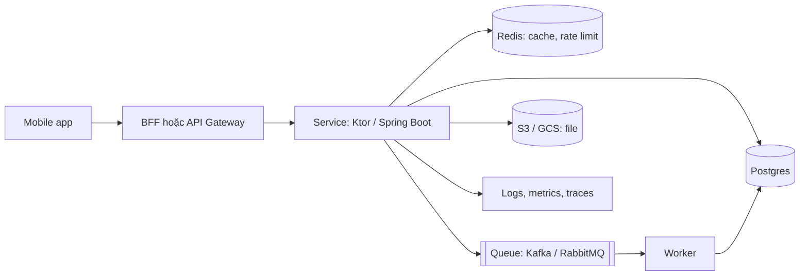

# 09. Backend và Fullstack cho Mobile Lead

> Mục tiêu: nói chuyện được với backend engineer như đồng nghiệp ngang hàng (API contract, DB, queue, cloud, observability), đọc được code Spring Boot/Ktor/Node của họ, và tự dựng được một backend nhỏ (Ktor hoặc Supabase) cho side project Ledger với cursor pagination, idempotency key, JWT, Postgres, Docker. Không phải trở thành backend specialist. | Mức cần đạt: Senior: hiểu REST đúng chuẩn từ góc client, giải thích được status code, pagination, idempotency, JWT; biết Postgres index và N+1 là gì. Staff: thiết kế contract-first với OpenAPI, chọn BFF/GraphQL/gRPC có lý do, hiểu eventual consistency và ảnh hưởng tới UI, nói được trade-off Supabase vs tự viết. Lead: điều phối backward compatibility, deprecation, feature flag xuyên tầng, incident với backend; ước lượng và nói chuyện cost/SLO với backend lead. | Thời gian gợi ý: tuần 8, ~12 giờ (đọc 5h, hands-on 7h)

Ghi chú: JD mobile 2026 ghi "REST" ở 10/15 JD, "translate tech to business" và "Sev1/Sev2 incident" ở phần lead. Interviewer backend-side thường hỏi mobile lead để xem bạn có "biết điều" khi đòi API không. Bạn tự nhận network chưa sâu; mục 1 ở đây bổ sung góc API design, phần HTTP/TLS/OkHttp sâu nằm trong `07-Network.md`. Code Ktor viết cho Ktor 3.x; chỗ nào tác giả không chắc 100% cú pháp hiện hành đã ghi "cần kiểm tra tại https://ktor.io/docs".

## 0. Bản đồ chủ đề



Interviewer hỏi gì ở mảng này (theo JD và kinh nghiệm phỏng vấn bank/product):
- Senior: "Design the API for the transaction list" (pagination, error, auth), "What is idempotency and why do we need it for payments?", "What is N+1?".
- Staff: "How would you version this API?", "GraphQL or REST for our mobile app?", "What breaks on mobile when the backend is eventually consistent?".
- Lead: "A backend change broke the old app version in production; what is your process?", "How do you coordinate a Sev1 with backend?", "Contract-first or code-first?".

Bạn phải tự trả lời được gì: mục 1 và 6 không cần nhìn tài liệu; mục 2 ở mức dựng được backend nhỏ và đọc được code; mục 3-5 ở mức hội thoại có thuật ngữ đúng.

**Đọc thêm:**
- https://roadmap.sh/backend (bản đồ tổng, chọn nhánh cần)
- https://github.com/donnemartin/system-design-primer (khái niệm nền)

## 1. REST API design từ góc người tiêu thụ trên mobile

### 1.1 Resource, verb, status code, error envelope

- **Resource** là danh từ số nhiều: `/v1/transactions`, `/v1/transactions/{id}`. Hành động không phải CRUD thì dùng sub-resource hoặc verb rõ: `POST /v1/transactions/{id}/refund`.
- **Verb**: GET đọc (an toàn, cache được), POST tạo hoặc hành động, PUT thay toàn bộ, PATCH sửa một phần, DELETE xoá. GET/PUT/DELETE idempotent theo định nghĩa; POST thì không, nên cần Idempotency-Key (1.4).
- **Status code mobile cần phân biệt**: 200 OK, 201 Created (kèm body hoặc Location), 204 No Content, 304 Not Modified (ETag), 400 Bad Request (request sai cú pháp), 401 Unauthorized (thiếu/sai token: refresh hoặc logout), 403 Forbidden (có token nhưng không có quyền: không retry), 404, 409 Conflict (trùng, version mismatch), 422 Unprocessable Entity (sai nghiệp vụ, hiển thị lỗi theo field), 429 Too Many Requests (đọc `Retry-After`), 500/502/503/504 (retry có backoff). Quy tắc client: 4xx không retry (trừ 408, 429), 5xx retry có giới hạn.
- **Error envelope** thống nhất, machine-readable:

```json
{
  "error": {
    "code": "validation_failed",
    "message": "amountMinor must not be 0",
    "details": { "amountMinor": "must_not_be_zero" },
    "requestId": "req_01J..."
  }
}
```

Client map `code` sang hành động (hiển thị, logout, retry), không parse `message`. `requestId` để báo cho backend khi debug. Chuẩn tham khảo: RFC 9457 Problem Details (`application/problem+json`), cần kiểm tra tại https://www.rfc-editor.org.

**Lỗi hay gặp / trade-off**
- Trả 200 với `{"success": false}`: client phải parse body để biết lỗi; HTTP cache và interceptor không hoạt động đúng.
- 401 cho cả "hết hạn token" và "sai mật khẩu": client không biết refresh hay logout. Tách bằng `code`.

**Đọc thêm:**
- https://developer.mozilla.org/en-US/docs/Web/HTTP/Status
- https://www.rfc-editor.org (RFC 9110 HTTP Semantics, RFC 9457 Problem Details)

### 1.2 Versioning

- Ba cách: version trong path (`/v1/`), trong header (`Accept: application/vnd.ledger.v2+json`), hoặc không version và chỉ thay đổi tương thích ngược. Mobile team thích path vì dễ thấy trong log, dễ route ở gateway, dễ test.
- Nguyên tắc: version chỉ tăng khi có breaking change (bỏ field, đổi kiểu, đổi ngữ nghĩa). Thay đổi additive (thêm field optional, thêm endpoint) không tăng version. Client phải chịu được field lạ (`ignoreUnknownKeys = true`) và enum lạ (map sang `UNKNOWN`).
- Mobile khác web: app cũ sống nhiều tháng trên máy user. Backend phải giữ `v1` ít nhất tới khi tỷ lệ app cũ dưới ngưỡng (ví dụ 2%) và có forced update (xem 6.4).

**Lỗi hay gặp / trade-off**
- Tăng version cho mọi thay đổi: backend giữ 7 version.
- Client crash khi gặp enum mới: thiếu default trong deserialization.

**Đọc thêm:**
- https://cloud.google.com/apis/design (API design guide, mục versioning và compatibility)
- `07-Network.md` (serialization an toàn trên client)

### 1.3 Pagination: offset vs cursor; filtering

- **Offset** (`?page=3&size=20`): đơn giản, nhảy trang được, nhưng khi có insert/delete giữa chừng thì trùng hoặc mất item, và `OFFSET 100000` chậm trên DB lớn.
- **Cursor** (`?cursor=abc&limit=20`): cursor là token mờ (thường base64 của `(created_at, id)` của item cuối), query `WHERE (created_at, id) < (?, ?) ORDER BY created_at DESC, id DESC LIMIT n`. Ổn định khi dữ liệu đổi, nhanh với index, hợp với infinite scroll trên mobile. Không nhảy trang được. Đây là lựa chọn mặc định cho feed mobile.
- Response: `{ "items": [...], "nextCursor": "..." | null }`. Client coi `nextCursor == null` là hết. Cursor là mờ: client không parse, không tự tạo.
- **Filtering** qua query param rõ nghĩa: `?from=2026-10-01&to=2026-10-31&category=FOOD`. Sort: `?sort=-occurredAt`. Giới hạn `limit` tối đa phía server (ví dụ 100).

**Lỗi hay gặp / trade-off**
- Cursor chỉ theo `created_at`: hai item cùng timestamp bị bỏ sót. Luôn kèm `id` tie-breaker.
- Sort theo field không có index: chậm khi bảng lớn.

**Đọc thêm:**
- https://www.postgresql.org/docs (mục indexes, keyset pagination qua composite index)
- https://github.com/weeeBox/mobile-system-design (phần pagination)

### 1.4 Idempotency key cho POST

- Vấn đề: mobile gửi `POST /transactions`, mất mạng trước khi nhận response, retry, tạo bản ghi đôi. Với payment là mất tiền.
- Giải: client sinh `Idempotency-Key` (UUID) cho mỗi "ý định" tạo và gửi lại cùng key khi retry. Server lưu key theo user; nếu đã thấy key thì trả lại kết quả cũ (cùng status, cùng body) thay vì tạo mới. Key có TTL (ví dụ 24h). Nếu cùng key mà body khác: 422 (client bug).
- Trên client: key sinh lúc user bấm "Lưu", lưu trong outbox (Room) cùng payload; retry lấy key từ outbox. Đây là nền của offline-first trong `06-Mobile-System-Design.md`.
- Implement: unique index `(user_id, idempotency_key)` + `INSERT ... ON CONFLICT DO NOTHING` rồi đọc lại; hoặc bảng `idempotency_keys` lưu response (tổng quát hơn, dùng cho mọi endpoint). Code ở 2.4.

**Lỗi hay gặp / trade-off**
- Key sinh mỗi lần retry: vô nghĩa.
- Key không scope theo user: user A gửi key của user B đọc được dữ liệu B.

**Đọc thêm:**
- https://stripe.com/docs/api/idempotent_requests (mô hình được nhiều backend copy)
- `06-Mobile-System-Design.md` (outbox pattern)

### 1.5 ETag và conditional request

- Server trả `ETag: "abc"` cho GET. Client gửi lại `If-None-Match: "abc"`; nếu không đổi server trả 304 không body, tiết kiệm băng thông và thời gian parse. OkHttp cache xử lý tự động nếu backend trả header đúng (`Cache-Control`, `ETag`), xem `07-Network.md`.
- Dùng ETag cho update an toàn: `If-Match: "abc"` với PUT/PATCH; server trả 412 Precondition Failed nếu resource đã đổi (optimistic concurrency), tránh ghi đè mù.
- Tính ETag: hash của body hoặc từ `updated_at`/`version` column (rẻ hơn).

**Lỗi hay gặp / trade-off**
- ETag theo hash body nhưng body có timestamp "now": không bao giờ khớp.
- Dùng 304 nhưng client không có cache lớp HTTP: không có gì để hiển thị.

**Đọc thêm:**
- https://developer.mozilla.org/en-US/docs/Web/HTTP/Headers/ETag
- https://github.com/square/okhttp (cache)

### 1.6 Rate limiting headers

- Server trả `429` kèm `Retry-After: 30` (giây) và thường `X-RateLimit-Limit`, `X-RateLimit-Remaining`, `X-RateLimit-Reset` (tên header chưa có chuẩn chung, IETF có draft `RateLimit-*`, cần kiểm tra tại https://www.ietf.org). Client: đọc `Retry-After`, không retry trước đó, lùi hàng đợi, hiển thị trạng thái nhẹ nhàng.
- Scope rate limit: theo user (sau auth), theo IP (trước auth), theo endpoint nhạy cảm (login, OTP). Mobile lead cần biết limit để thiết kế sync (batch thay vì 200 call).

**Lỗi hay gặp / trade-off**
- Client retry ngay khi 429: bị chặn lâu hơn.
- Rate limit theo IP với user sau NAT nhà mạng Việt Nam: chặn oan hàng nghìn user. Ưu tiên theo user/device.

**Đọc thêm:**
- https://developer.mozilla.org/en-US/docs/Web/HTTP/Status/429
- https://ktor.io/docs (server rate limit plugin)

### 1.7 Auth: JWT access/refresh, PKCE

- **Access token** JWT ngắn hạn (5-15 phút), gửi `Authorization: Bearer`. Server verify chữ ký (HMAC secret dùng chung, hoặc RSA/ECDSA public key qua JWKS khi token do Identity Provider cấp), kiểm `exp`, `iss`, `aud`. Không gọi DB cho mỗi request: đó là lý do JWT tồn tại. Hệ quả: không thu hồi tức thì được; thu hồi bằng TTL ngắn + refresh token.
- **Refresh token** dài hạn, lưu trong storage bảo vệ bởi Keystore trên Android, chỉ gửi tới endpoint refresh, nên có rotation (mỗi lần dùng cấp refresh mới, cũ vô hiệu; dùng lại refresh cũ nghĩa là bị trộm: thu hồi cả chuỗi).
- **PKCE** (OAuth2 Authorization Code + Proof Key): app mở trình duyệt (Custom Tab) tới IdP, nhận `code` qua redirect, đổi `code` lấy token kèm `code_verifier`; không cần client secret trong app. Chuẩn cho mobile; Supabase Auth, Firebase Auth, Keycloak, Auth0 đều hỗ trợ. Chi tiết client-side xem `08-Security.md`.
- Backend side: endpoint của bạn chỉ **verify** token do IdP cấp; không tự cấp token trừ khi bạn là IdP. Trong Ktor dùng JWKS provider để verify RS256 (2.4).

**Lỗi hay gặp / trade-off**
- JWT chứa PII hoặc role nhạy cảm: JWT chỉ được ký, không mã hoá; ai có token đọc được payload.
- Access token 24 giờ "cho tiện": thu hồi không tác dụng cả ngày.

**Đọc thêm:**
- https://oauth.net/2/pkce
- https://jwt.io/introduction và `08-Security.md`

### 1.8 API docs: OpenAPI

- OpenAPI (YAML/JSON) mô tả endpoint, schema, response, auth. Là hợp đồng để: sinh client Kotlin (openapi-generator), sinh mock server, review thay đổi trong PR (diff của spec), kiểm tra breaking change tự động.
- Mobile lead nên đòi: spec là source of truth, nằm trong repo backend, có CI check backward compatibility, có ví dụ response thật cho mỗi endpoint.

```yaml
openapi: 3.0.3
info: { title: Ledger API, version: 1.0.0 }
paths:
  /v1/transactions:
    get:
      summary: List transactions (cursor pagination)
      parameters:
        - { name: cursor, in: query, schema: { type: string } }
        - { name: limit, in: query, schema: { type: integer, minimum: 1, maximum: 100, default: 20 } }
      responses:
        "200":
          content:
            application/json:
              schema:
                type: object
                required: [items]
                properties:
                  items: { type: array, items: { $ref: "#/components/schemas/Transaction" } }
                  nextCursor: { type: string, nullable: true }
    post:
      parameters:
        - { name: Idempotency-Key, in: header, required: true, schema: { type: string } }
      requestBody:
        required: true
        content: { application/json: { schema: { $ref: "#/components/schemas/CreateTransaction" } } }
      responses:
        "201": { description: Created }
        "422": { description: Validation failed }
components:
  securitySchemes:
    bearer: { type: http, scheme: bearer, bearerFormat: JWT }
  schemas:
    Transaction:
      type: object
      required: [id, amountMinor, currency, occurredAt, createdAt]
      properties:
        id: { type: string, format: uuid }
        amountMinor: { type: integer, format: int64 }
        currency: { type: string, minLength: 3, maxLength: 3 }
        note: { type: string, nullable: true }
        occurredAt: { type: string, format: date-time }
        createdAt: { type: string, format: date-time }
    CreateTransaction:
      type: object
      required: [amountMinor, currency, occurredAt]
      properties:
        amountMinor: { type: integer, format: int64 }
        currency: { type: string }
        note: { type: string }
        occurredAt: { type: string, format: date-time }
security: [ { bearer: [] } ]
```

**Lỗi hay gặp / trade-off**
- Spec sinh từ code sau khi code xong: spec luôn trễ, mobile không mock sớm được.
- Sinh client tự động rồi dùng thẳng trong domain layer: coupling với wire format; bọc lại bằng mapper.

**Đọc thêm:**
- https://spec.openapis.org
- https://openapi-generator.tech (sinh client Kotlin)

### 1.9 BFF pattern và vì sao mobile team thích

- **Backend for Frontend**: một lớp backend riêng cho mobile (hoặc cho mỗi client), gom nhiều service thành một response vừa với màn hình, cắt field thừa, xử lý version, cache, và che các service nội bộ. Team mobile thường sở hữu hoặc đồng sở hữu BFF.
- Lợi: ít round trip trên mạng di động, payload nhỏ, thay đổi màn hình không phải chờ nhiều team, nơi đặt feature flag và kill switch, nơi xử lý app version cũ.
- Hại: thêm một lớp phải vận hành; nếu mobile team sở hữu thì phải có kỹ năng backend (đây là lý do file này tồn tại). Logic nghiệp vụ không được nằm trong BFF (chỉ orchestration và shaping).

**Lỗi hay gặp / trade-off**
- BFF thành "mini-monolith" chứa nghiệp vụ: hai nơi có nghiệp vụ, lệch nhau.
- Một BFF chung cho web và mobile: lại thành gateway, mất lợi ích.

**Đọc thêm:**
- https://samnewman.io/patterns/architectural/bff (bài gốc của Sam Newman)
- `06-Mobile-System-Design.md` (bài feed, bài payment)

### 1.10 GraphQL và gRPC trong một đoạn mỗi thứ

- **GraphQL**: một endpoint, client gửi query mô tả đúng field cần, server trả đúng vậy; schema mạnh, introspection, subscription cho realtime. Hợp khi màn hình đa dạng, nhiều client, team frontend muốn tự chủ. Giá: caching HTTP khó (đa số là POST), N+1 phía server cần DataLoader, query phức tạp có thể nặng (cần depth/complexity limit), tooling Android (Apollo Kotlin) tốt nhưng thêm codegen. Với mobile, BFF + REST thường đủ; GraphQL khi có nhiều màn hình cần tổ hợp dữ liệu khác nhau và team backend đã có sẵn.
- **gRPC**: RPC trên HTTP/2 với Protobuf, nhanh, nhỏ, streaming hai chiều, codegen mạnh. Hợp cho service-to-service và cho mobile khi cần streaming hoặc payload nhỏ (chat, telemetry). Giá: không dùng trực tiếp từ trình duyệt (cần grpc-web), debug khó hơn JSON, proxy/CDN hỗ trợ kém hơn. Chi tiết HTTP/2 và so sánh wire-level: `07-Network.md`.

**Lỗi hay gặp / trade-off**
- Chọn GraphQL vì "client tự chọn field" rồi không giới hạn depth/complexity: một query nặng làm chậm cả hệ thống.
- Dùng gRPC cho mobile mà team không có người debug được Protobuf: lỗi wire-level mất nhiều ngày.

**Đọc thêm:**
- https://graphql.org/learn và https://www.apollographql.com/docs/kotlin
- https://grpc.io/docs và `07-Network.md`

## 2. Dựng backend nhỏ bằng Kotlin với Ktor 3.x

Mục tiêu: backend 3 endpoint cho Ledger (`GET /v1/transactions` cursor pagination + ETag, `POST /v1/transactions` idempotency, `GET /v1/transactions/{id}`), JWT verify, Postgres qua JDBC + HikariCP, Flyway migration, Docker compose, 2 test với `testApplication`. Code dưới đây viết cho Ktor 3.x. Version số cụ thể để trống có chú thích; lấy mới nhất tại https://ktor.io/docs và Maven Central.

### 2.1 Project layout và Gradle

```
ledger-api/
  build.gradle.kts
  settings.gradle.kts
  Dockerfile
  docker-compose.yml
  src/main/kotlin/com/ledger/
    Application.kt      // main, module wiring
    Plugins.kt          // ContentNegotiation, StatusPages, Auth, RateLimit
    Routing.kt          // routes
    Dto.kt              // request/response/error
    Jwt.kt              // JwtConfig
    Db.kt               // DataSource, Flyway
    TransactionRepository.kt
  src/main/resources/
    application.conf
    logback.xml
    db/migration/V1__init.sql
  src/test/kotlin/com/ledger/
    TransactionsRouteTest.kt
    InMemoryTransactionRepository.kt
```

```kotlin
// settings.gradle.kts
rootProject.name = "ledger-api"
```

```kotlin
// build.gradle.kts
plugins {
    kotlin("jvm") version "2.4.21"
    kotlin("plugin.serialization") version "2.4.21"
    application
}

group = "com.ledger"
repositories { mavenCentral() }

// Điền version thật: Ktor 3.x mới nhất tại https://ktor.io/docs, các lib khác tại Maven Central.
val ktorVersion = "3.x.y"
val postgresVersion = "42.7.x"
val hikariVersion = "6.x.y"
val flywayVersion = "11.x.y"
val logbackVersion = "1.5.x"

dependencies {
    implementation("io.ktor:ktor-server-core:$ktorVersion")
    implementation("io.ktor:ktor-server-netty:$ktorVersion")
    implementation("io.ktor:ktor-server-content-negotiation:$ktorVersion")
    implementation("io.ktor:ktor-serialization-kotlinx-json:$ktorVersion")
    implementation("io.ktor:ktor-server-auth:$ktorVersion")
    implementation("io.ktor:ktor-server-auth-jwt:$ktorVersion")
    implementation("io.ktor:ktor-server-status-pages:$ktorVersion")
    implementation("io.ktor:ktor-server-call-logging:$ktorVersion")
    implementation("io.ktor:ktor-server-rate-limit:$ktorVersion")
    implementation("org.postgresql:postgresql:$postgresVersion")
    implementation("com.zaxxer:HikariCP:$hikariVersion")
    implementation("org.flywaydb:flyway-core:$flywayVersion")
    implementation("org.flywaydb:flyway-database-postgresql:$flywayVersion")
    implementation("ch.qos.logback:logback-classic:$logbackVersion")

    testImplementation("io.ktor:ktor-server-test-host:$ktorVersion")
    testImplementation("io.ktor:ktor-client-content-negotiation:$ktorVersion")
    testImplementation(kotlin("test"))
}

kotlin { jvmToolchain(17) }
application { mainClass.set("com.ledger.ApplicationKt") }
tasks.test { useJUnitPlatform() }
```

```hocon
# src/main/resources/application.conf (HOCON; biến môi trường ghi đè qua ${?VAR})
ktor {
  deployment { port = 8080 }
  application { modules = [ com.ledger.ApplicationKt.module ] }
}
db {
  url = "jdbc:postgresql://localhost:5432/ledger"
  url = ${?DB_URL}
  user = "ledger"
  user = ${?DB_USER}
  password = "ledger"
  password = ${?DB_PASSWORD}
}
jwt {
  secret = "dev-secret-change-me"
  secret = ${?JWT_SECRET}
  issuer = "ledger-api"
  audience = "ledger-app"
}
```

**Lỗi hay gặp / trade-off**
- Để version dạng "3.x.y" trong build thật: Gradle không resolve. Điền version cụ thể trước khi build.
- Commit `application.conf` chứa secret thật: mọi giá trị nhạy cảm phải qua `${?VAR}` và biến môi trường.

**Đọc thêm:**
- https://ktor.io/docs (Creating a server, Configuration file)
- https://docs.gradle.org (application plugin)

### 2.2 Application, plugins, content negotiation, JWT auth

```kotlin
// Application.kt
package com.ledger

import io.ktor.server.application.Application
import io.ktor.server.netty.EngineMain

fun main(args: Array<String>) = EngineMain.main(args)

fun Application.module() {
    val cfg = environment.config
    val dataSource = createDataSource(
        url = cfg.property("db.url").getString(),
        user = cfg.property("db.user").getString(),
        password = cfg.property("db.password").getString(),
    )
    runMigrations(dataSource)
    val jwt = JwtConfig(
        secret = cfg.property("jwt.secret").getString(),
        issuer = cfg.property("jwt.issuer").getString(),
        audience = cfg.property("jwt.audience").getString(),
    )
    configurePlugins(jwt)
    configureRouting(PostgresTransactionRepository(dataSource), jwt)
}
```

```kotlin
// Jwt.kt
package com.ledger

import com.auth0.jwt.JWT
import com.auth0.jwt.JWTVerifier
import com.auth0.jwt.algorithms.Algorithm
import java.util.Date
import kotlin.time.Duration
import kotlin.time.Duration.Companion.minutes

// Dev/test: HMAC với secret chung. Production: token do IdP (Supabase/Firebase/Keycloak) cấp,
// verify bằng public key qua JWKS (JwkProvider), cần kiểm tra tại https://ktor.io/docs (JWT auth, JWKS).
class JwtConfig(private val secret: String, val issuer: String, val audience: String) {
    private val algorithm = Algorithm.HMAC256(secret)
    val verifier: JWTVerifier = JWT.require(algorithm).withIssuer(issuer).withAudience(audience).build()

    fun issue(userId: String, ttl: Duration = 15.minutes): String = JWT.create()
        .withIssuer(issuer)
        .withAudience(audience)
        .withSubject(userId)
        .withExpiresAt(Date(System.currentTimeMillis() + ttl.inWholeMilliseconds))
        .sign(algorithm)
}
```

```kotlin
// Plugins.kt
package com.ledger

import io.ktor.http.HttpStatusCode
import io.ktor.serialization.kotlinx.json.json
import io.ktor.server.application.Application
import io.ktor.server.application.install
import io.ktor.server.application.log
import io.ktor.server.auth.Authentication
import io.ktor.server.auth.jwt.JWTPrincipal
import io.ktor.server.auth.jwt.jwt
import io.ktor.server.plugins.BadRequestException
import io.ktor.server.plugins.calllogging.CallLogging
import io.ktor.server.plugins.contentnegotiation.ContentNegotiation
import io.ktor.server.plugins.origin
import io.ktor.server.plugins.ratelimit.RateLimit
import io.ktor.server.plugins.ratelimit.RateLimitName
import io.ktor.server.plugins.statuspages.StatusPages
import io.ktor.server.response.respond
import kotlinx.serialization.json.Json
import kotlin.time.Duration.Companion.seconds

fun Application.configurePlugins(jwt: JwtConfig) {
    install(ContentNegotiation) {
        json(Json { ignoreUnknownKeys = true; explicitNulls = false })
    }
    install(CallLogging)
    install(StatusPages) {
        exception<BadRequestException> { call, cause ->
            call.respond(HttpStatusCode.BadRequest, ApiError("bad_request", cause.message ?: "Malformed request"))
        }
        exception<IllegalArgumentException> { call, cause ->
            call.respond(HttpStatusCode.UnprocessableEntity, ApiError("validation_failed", cause.message ?: "Invalid value"))
        }
        exception<Throwable> { call, cause ->
            call.application.log.error("Unhandled error", cause)
            call.respond(HttpStatusCode.InternalServerError, ApiError("internal_error", "Unexpected error"))
        }
    }
    install(RateLimit) {
        register(RateLimitName("api")) {
            rateLimiter(limit = 120, refillPeriod = 60.seconds)
            // Theo IP cho đơn giản. Theo user cần lấy principal sau auth; cách làm cần kiểm tra tại ktor.io/docs.
            requestKey { call -> call.request.origin.remoteHost }
        }
    }
    install(Authentication) {
        jwt("user") {
            realm = "ledger"
            verifier(jwt.verifier)
            validate { credential ->
                credential.payload.subject?.takeIf { it.isNotBlank() }?.let { JWTPrincipal(credential.payload) }
            }
            challenge { _, _ ->
                call.respond(HttpStatusCode.Unauthorized, ApiError("unauthorized", "Missing or invalid token"))
            }
        }
    }
}
```

Giải thích cho người đọc backend lần đầu:
- `install(Plugin) { }` là cách Ktor thêm middleware. Thứ tự install ít quan trọng hơn Spring filter, nhưng `StatusPages` nên có sớm.
- `ContentNegotiation` + `json()` dùng kotlinx-serialization: cùng thư viện bạn dùng trên Android, cùng `@Serializable`.
- `Authentication` với `jwt("user")` định nghĩa một "provider" tên `user`; route dùng `authenticate("user") { }`. `validate` trả principal hoặc null (null nghĩa là 401 qua `challenge`).
- Lỗi parse body (JSON sai) Ktor ném `BadRequestException` → 400. Lỗi nghiệp vụ bạn ném `IllegalArgumentException` qua `require` → 422.

**Lỗi hay gặp / trade-off**
- Trả stack trace trong 500: lộ thông tin. Log server-side, trả message chung + requestId.
- Secret JWT hardcode trong `application.conf` commit lên Git: dùng `${?JWT_SECRET}` và secret manager.

**Đọc thêm:**
- https://ktor.io/docs (Plugins, Content negotiation, JWT authentication, Status pages, Rate limiting)
- https://github.com/auth0/java-jwt

### 2.3 DTO, cursor, repository interface

```kotlin
// Dto.kt
package com.ledger

import kotlinx.serialization.Serializable
import java.time.Instant
import java.util.Base64
import java.util.UUID

@Serializable
data class ApiError(val code: String, val message: String, val details: Map<String, String>? = null)

@Serializable
data class CreateTransactionRequest(
    val amountMinor: Long,
    val currency: String,
    val note: String? = null,
    val occurredAt: String,          // ISO-8601, ví dụ 2026-10-19T08:00:00Z
) {
    fun validate() {
        require(amountMinor != 0L) { "amountMinor must not be 0" }
        require(currency.length == 3) { "currency must be an ISO 4217 code" }
        require(runCatching { Instant.parse(occurredAt) }.isSuccess) { "occurredAt must be ISO-8601" }
        require((note?.length ?: 0) <= 500) { "note must be at most 500 characters" }
    }
}

@Serializable
data class TransactionDto(
    val id: String,
    val amountMinor: Long,
    val currency: String,
    val note: String?,
    val occurredAt: String,
    val createdAt: String,
)

@Serializable
data class Page<T>(val items: List<T>, val nextCursor: String?)

@Serializable data class DevTokenRequest(val userId: String)
@Serializable data class TokenResponse(val accessToken: String, val tokenType: String = "Bearer")

// Cursor mờ: base64url của "createdAt|id". Client không parse.
data class Cursor(val createdAt: Instant, val id: UUID) {
    fun encode(): String =
        Base64.getUrlEncoder().withoutPadding().encodeToString("$createdAt|$id".toByteArray())

    companion object {
        fun decode(raw: String): Cursor? = runCatching {
            val (ts, id) = String(Base64.getUrlDecoder().decode(raw)).split("|", limit = 2)
            Cursor(Instant.parse(ts), UUID.fromString(id))
        }.getOrNull()
    }
}
```

```kotlin
// TransactionRepository.kt (interface + Postgres impl)
package com.ledger

import java.sql.ResultSet
import java.sql.Timestamp
import java.time.Instant
import java.time.OffsetDateTime
import java.time.ZoneOffset
import java.util.UUID
import javax.sql.DataSource

sealed interface CreateOutcome {
    data class Created(val tx: TransactionDto) : CreateOutcome
    data class Replayed(val tx: TransactionDto) : CreateOutcome   // cùng Idempotency-Key, trả bản cũ
}

interface TransactionRepository {
    fun list(userId: String, limit: Int, cursor: Cursor?): Page<TransactionDto>
    fun get(userId: String, id: UUID): TransactionDto?
    fun create(userId: String, idempotencyKey: String, req: CreateTransactionRequest): CreateOutcome
}

private const val COLUMNS = "id, amount_minor, currency, note, occurred_at, created_at"

class PostgresTransactionRepository(private val ds: DataSource) : TransactionRepository {

    override fun list(userId: String, limit: Int, cursor: Cursor?): Page<TransactionDto> = ds.connection.use { c ->
        val sql = buildString {
            append("SELECT $COLUMNS FROM transactions WHERE user_id = ?")
            if (cursor != null) append(" AND (created_at, id) < (?, ?)")
            append(" ORDER BY created_at DESC, id DESC LIMIT ?")
        }
        c.prepareStatement(sql).use { ps ->
            var i = 1
            ps.setString(i++, userId)
            if (cursor != null) {
                ps.setTimestamp(i++, Timestamp.from(cursor.createdAt))
                ps.setObject(i++, cursor.id)
            }
            ps.setInt(i, limit + 1)                      // lấy dư 1 để biết còn trang sau không
            val rows = ps.executeQuery().use { rs -> generateSequence { if (rs.next()) rs.toDto() else null }.toList() }
            val items = rows.take(limit)
            val next = if (rows.size > limit) {
                val last = items.last()
                Cursor(Instant.parse(last.createdAt), UUID.fromString(last.id)).encode()
            } else null
            Page(items, next)
        }
    }

    override fun get(userId: String, id: UUID): TransactionDto? = ds.connection.use { c ->
        c.prepareStatement("SELECT $COLUMNS FROM transactions WHERE user_id = ? AND id = ?").use { ps ->
            ps.setString(1, userId); ps.setObject(2, id)
            ps.executeQuery().use { rs -> if (rs.next()) rs.toDto() else null }
        }
    }

    override fun create(userId: String, idempotencyKey: String, req: CreateTransactionRequest): CreateOutcome =
        ds.connection.use { c ->
            val insert = """
                INSERT INTO transactions (id, user_id, amount_minor, currency, note, occurred_at, idempotency_key)
                VALUES (?, ?, ?, ?, ?, ?, ?)
                ON CONFLICT (user_id, idempotency_key) DO NOTHING
                RETURNING $COLUMNS
            """.trimIndent()
            val created = c.prepareStatement(insert).use { ps ->
                ps.setObject(1, UUID.randomUUID())
                ps.setString(2, userId)
                ps.setLong(3, req.amountMinor)
                ps.setString(4, req.currency)
                ps.setString(5, req.note)
                ps.setObject(6, OffsetDateTime.ofInstant(Instant.parse(req.occurredAt), ZoneOffset.UTC))
                ps.setString(7, idempotencyKey)
                ps.executeQuery().use { rs -> if (rs.next()) rs.toDto() else null }
            }
            if (created != null) return@use CreateOutcome.Created(created)

            // Trùng key: trả lại bản ghi đã tạo trước đó (cùng user). Kiểm tra body khác nhau là bài tập.
            val existing = c.prepareStatement(
                "SELECT $COLUMNS FROM transactions WHERE user_id = ? AND idempotency_key = ?"
            ).use { ps ->
                ps.setString(1, userId); ps.setString(2, idempotencyKey)
                ps.executeQuery().use { rs -> if (rs.next()) rs.toDto() else null }
            }
            CreateOutcome.Replayed(existing ?: error("idempotency conflict without row"))
        }

    private fun ResultSet.toDto() = TransactionDto(
        id = getObject("id", UUID::class.java).toString(),
        amountMinor = getLong("amount_minor"),
        currency = getString("currency"),
        note = getString("note"),
        occurredAt = getObject("occurred_at", OffsetDateTime::class.java).toInstant().toString(),
        createdAt = getObject("created_at", OffsetDateTime::class.java).toInstant().toString(),
    )
}
```

```kotlin
// Db.kt
package com.ledger

import com.zaxxer.hikari.HikariConfig
import com.zaxxer.hikari.HikariDataSource
import org.flywaydb.core.Flyway
import javax.sql.DataSource

fun createDataSource(url: String, user: String, password: String): DataSource =
    HikariDataSource(HikariConfig().apply {
        jdbcUrl = url
        username = user
        this.password = password
        maximumPoolSize = 10
    })

fun runMigrations(ds: DataSource) {
    Flyway.configure().dataSource(ds).load().migrate()
}
```

```sql
-- src/main/resources/db/migration/V1__init.sql
CREATE TABLE transactions (
    id              UUID PRIMARY KEY,
    user_id         TEXT NOT NULL,
    amount_minor    BIGINT NOT NULL,
    currency        CHAR(3) NOT NULL,
    note            TEXT,
    occurred_at     TIMESTAMPTZ NOT NULL,
    created_at      TIMESTAMPTZ NOT NULL DEFAULT now(),
    idempotency_key TEXT NOT NULL,
    CONSTRAINT uq_transactions_user_idem UNIQUE (user_id, idempotency_key)
);

-- Index cho keyset pagination: WHERE user_id = ? AND (created_at, id) < (?, ?) ORDER BY created_at DESC, id DESC
CREATE INDEX idx_transactions_user_created ON transactions (user_id, created_at DESC, id DESC);
```

Vì sao JDBC thuần thay vì ORM: ba endpoint, SQL rõ ràng, bạn thấy đúng câu query chạy, dễ giải thích trong phỏng vấn. Khi project lớn, cân nhắc Exposed (DSL/DAO Kotlin của JetBrains; API và package đã đổi qua các bản lớn, cần kiểm tra tại https://github.com/JetBrains/Exposed) hoặc jOOQ. JDBC là blocking: trong route handler bọc bằng `withContext(Dispatchers.IO)` để không chiếm thread của Netty event loop.

**Lỗi hay gặp / trade-off**
- `LIMIT` không có `+1`: không biết có trang sau, phải query count (đắt).
- Quên `user_id` trong `WHERE` của `get`: user A đọc được giao dịch của B (OWASP API1 BOLA).
- Mở connection mỗi query không có pool: cạn connection Postgres dưới tải.

**Đọc thêm:**
- https://www.postgresql.org/docs (INSERT ... ON CONFLICT, row comparison)
- https://flywaydb.org/documentation và https://github.com/brettwooldridge/HikariCP

### 2.4 Routing: 3 endpoint với cursor, ETag, idempotency

```kotlin
// Routing.kt
package com.ledger

import io.ktor.http.HttpHeaders
import io.ktor.http.HttpStatusCode
import io.ktor.server.application.Application
import io.ktor.server.application.ApplicationCall
import io.ktor.server.auth.authenticate
import io.ktor.server.auth.jwt.JWTPrincipal
import io.ktor.server.auth.principal
import io.ktor.server.plugins.ratelimit.RateLimitName
import io.ktor.server.plugins.ratelimit.rateLimit
import io.ktor.server.request.header
import io.ktor.server.request.receive
import io.ktor.server.response.header
import io.ktor.server.response.respond
import io.ktor.server.response.respondText
import io.ktor.server.routing.get
import io.ktor.server.routing.post
import io.ktor.server.routing.route
import io.ktor.server.routing.routing
import kotlinx.coroutines.Dispatchers
import kotlinx.coroutines.withContext
import java.util.UUID

fun Application.configureRouting(repo: TransactionRepository, jwt: JwtConfig) {
    routing {
        get("/health") { call.respondText("ok") }

        // Chỉ cho dev/test. Production: IdP cấp token, API chỉ verify. Xoá endpoint này trước khi deploy.
        post("/v1/dev/token") {
            val req = call.receive<DevTokenRequest>()
            call.respond(TokenResponse(accessToken = jwt.issue(req.userId)))
        }

        rateLimit(RateLimitName("api")) {
            authenticate("user") {
                route("/v1/transactions") {
                    get {
                        val userId = call.userId()
                        val limit = (call.request.queryParameters["limit"]?.toIntOrNull() ?: 20).coerceIn(1, 100)
                        val cursor = call.request.queryParameters["cursor"]?.let {
                            Cursor.decode(it) ?: throw IllegalArgumentException("cursor is invalid")
                        }
                        val page = withContext(Dispatchers.IO) { repo.list(userId, limit, cursor) }

                        // ETag rẻ: hash của (id, createdAt) các item. Production: dùng version/updated_at.
                        val etag = "\"" + page.items.joinToString(",") { it.id + ":" + it.createdAt }.hashCode().toUInt().toString(16) + "\""
                        if (call.request.header(HttpHeaders.IfNoneMatch) == etag) {
                            call.respond(HttpStatusCode.NotModified)
                            return@get
                        }
                        call.response.header(HttpHeaders.ETag, etag)
                        call.respond(page)
                    }

                    post {
                        val userId = call.userId()
                        val key = call.request.header("Idempotency-Key")
                            ?: return@post call.respond(
                                HttpStatusCode.BadRequest,
                                ApiError("missing_idempotency_key", "Idempotency-Key header is required"),
                            )
                        val body = call.receive<CreateTransactionRequest>().also { it.validate() }
                        when (val outcome = withContext(Dispatchers.IO) { repo.create(userId, key, body) }) {
                            is CreateOutcome.Created -> call.respond(HttpStatusCode.Created, outcome.tx)
                            is CreateOutcome.Replayed -> call.respond(HttpStatusCode.OK, outcome.tx)
                        }
                    }

                    get("{id}") {
                        val userId = call.userId()
                        val id = call.parameters["id"]?.let { runCatching { UUID.fromString(it) }.getOrNull() }
                            ?: return@get call.respond(HttpStatusCode.NotFound, ApiError("not_found", "Transaction not found"))
                        val tx = withContext(Dispatchers.IO) { repo.get(userId, id) }
                            ?: return@get call.respond(HttpStatusCode.NotFound, ApiError("not_found", "Transaction not found"))
                        call.respond(tx)
                    }
                }
            }
        }
    }
}

private fun ApplicationCall.userId(): String =
    principal<JWTPrincipal>()?.payload?.subject ?: error("No principal; route must be inside authenticate()")
```

Điểm nói trong phỏng vấn: (1) `Replayed` trả 200 thay vì 201 để client phân biệt nếu cần, body giống hệt; (2) 404 cho cả "không tồn tại" và "của user khác" để không lộ sự tồn tại; (3) `limit` bị kẹp server-side; (4) cursor không hợp lệ là 422 chứ không phải 500.

**Lỗi hay gặp / trade-off**
- `receive` ngoài `try`: body sai định dạng thành 500 nếu không có StatusPages.
- Trả 201 cho cả replay: client retry thấy "tạo mới" lần nữa, dù không sao về dữ liệu nhưng log sai.

**Đọc thêm:**
- https://ktor.io/docs (Routing, Requests, Responses)
- https://stripe.com/docs/api/idempotent_requests

### 2.5 Test với testApplication

```kotlin
// src/test/kotlin/com/ledger/InMemoryTransactionRepository.kt
package com.ledger

import java.time.Instant
import java.util.UUID

class InMemoryTransactionRepository : TransactionRepository {
    private data class Row(val userId: String, val key: String, val dto: TransactionDto)
    private val rows = mutableListOf<Row>()
    private var clock = Instant.parse("2026-10-19T00:00:00Z")

    override fun list(userId: String, limit: Int, cursor: Cursor?): Page<TransactionDto> {
        val sorted = rows.filter { it.userId == userId }.map { it.dto }
            .sortedWith(compareByDescending<TransactionDto> { it.createdAt }.thenByDescending { it.id })
        val after = if (cursor == null) sorted else sorted.filter {
            val t = Instant.parse(it.createdAt)
            t < cursor.createdAt || (t == cursor.createdAt && it.id < cursor.id.toString())
        }
        val items = after.take(limit)
        val next = if (after.size > limit) items.last().let { Cursor(Instant.parse(it.createdAt), UUID.fromString(it.id)).encode() } else null
        return Page(items, next)
    }

    override fun get(userId: String, id: UUID): TransactionDto? =
        rows.firstOrNull { it.userId == userId && it.dto.id == id.toString() }?.dto

    override fun create(userId: String, idempotencyKey: String, req: CreateTransactionRequest): CreateOutcome {
        rows.firstOrNull { it.userId == userId && it.key == idempotencyKey }?.let { return CreateOutcome.Replayed(it.dto) }
        clock = clock.plusSeconds(1)
        val dto = TransactionDto(UUID.randomUUID().toString(), req.amountMinor, req.currency, req.note, req.occurredAt, clock.toString())
        rows += Row(userId, idempotencyKey, dto)
        return CreateOutcome.Created(dto)
    }
}
```

```kotlin
// src/test/kotlin/com/ledger/TransactionsRouteTest.kt
package com.ledger

import io.ktor.client.call.body
import io.ktor.client.plugins.contentnegotiation.ContentNegotiation as ClientContentNegotiation
import io.ktor.client.request.bearerAuth
import io.ktor.client.request.get
import io.ktor.client.request.header
import io.ktor.client.request.post
import io.ktor.client.request.setBody
import io.ktor.http.ContentType
import io.ktor.http.HttpStatusCode
import io.ktor.http.contentType
import io.ktor.serialization.kotlinx.json.json
import io.ktor.server.config.MapApplicationConfig
import io.ktor.server.testing.testApplication
import kotlin.test.Test
import kotlin.test.assertEquals
import kotlin.test.assertNotNull
import kotlin.test.assertNull

class TransactionsRouteTest {
    private val jwt = JwtConfig(secret = "test-secret", issuer = "ledger-api", audience = "ledger-app")

    @Test
    fun `GET without token returns 401`() = testApplication {
        // Config rỗng để testApplication không load application.conf và không cố kết nối DB.
        // Cú pháp environment/config: cần kiểm tra tại https://ktor.io/docs (Testing).
        environment { config = MapApplicationConfig() }
        application {
            configurePlugins(jwt)
            configureRouting(InMemoryTransactionRepository(), jwt)
        }
        val response = client.get("/v1/transactions")
        assertEquals(HttpStatusCode.Unauthorized, response.status)
    }

    @Test
    fun `POST with same Idempotency-Key returns the same transaction, and cursor pagination has no overlap`() = testApplication {
        environment { config = MapApplicationConfig() }
        application {
            configurePlugins(jwt)
            configureRouting(InMemoryTransactionRepository(), jwt)
        }
        val client = createClient { install(ClientContentNegotiation) { json() } }
        val token = jwt.issue(userId = "u1")

        suspend fun create(key: String, amount: Long) = client.post("/v1/transactions") {
            bearerAuth(token)
            header("Idempotency-Key", key)
            contentType(ContentType.Application.Json)
            setBody(CreateTransactionRequest(amountMinor = amount, currency = "VND", note = "coffee", occurredAt = "2026-10-19T08:00:00Z"))
        }

        // Idempotency
        val first = create("k-1", 45000)
        val replay = create("k-1", 45000)
        assertEquals(HttpStatusCode.Created, first.status)
        assertEquals(HttpStatusCode.OK, replay.status)
        assertEquals(first.body<TransactionDto>().id, replay.body<TransactionDto>().id)

        // Pagination: 3 bản ghi, limit 2, trang 2 không trùng trang 1
        create("k-2", 12000); create("k-3", 99000)
        val page1 = client.get("/v1/transactions?limit=2") { bearerAuth(token) }.body<Page<TransactionDto>>()
        assertEquals(2, page1.items.size)
        assertNotNull(page1.nextCursor)
        val page2 = client.get("/v1/transactions?limit=2&cursor=${page1.nextCursor}") { bearerAuth(token) }.body<Page<TransactionDto>>()
        assertEquals(1, page2.items.size)
        assertNull(page2.nextCursor)
        assertEquals(emptySet<String>(), page1.items.map { it.id }.intersect(page2.items.map { it.id }.toSet()))
    }
}
```

Giải thích: `testApplication` chạy app trong process, không mở port; `client` mặc định không có JSON nên tạo `createClient` với ContentNegotiation phía client (import alias để không nhầm với plugin server). Repository được thay bằng in-memory: test route logic, không test Postgres. Test Postgres thật thì dùng Testcontainers (cần Docker; https://testcontainers.com).

**Lỗi hay gặp / trade-off**
- Test gọi DB thật qua `module()`: chậm, phụ thuộc môi trường. Tách wiring (`module`) khỏi cấu hình (`configurePlugins`, `configureRouting`).
- Assert theo thứ tự list không có clock cố định: flaky. In-memory repo trên dùng clock tăng dần.

**Đọc thêm:**
- https://ktor.io/docs (Testing)
- https://testcontainers.com (Postgres trong test)

### 2.6 Docker image và docker-compose với Postgres

```dockerfile
# Dockerfile (multi-stage). Tag image: kiểm tra tại https://hub.docker.com cho gradle và eclipse-temurin.
FROM gradle:8-jdk17 AS build
WORKDIR /app
COPY . .
RUN gradle installDist --no-daemon

FROM eclipse-temurin:17-jre
WORKDIR /app
COPY --from=build /app/build/install/ledger-api /app
EXPOSE 8080
CMD ["/app/bin/ledger-api"]
```

```yaml
# docker-compose.yml
services:
  db:
    image: postgres:16
    environment:
      POSTGRES_USER: ledger
      POSTGRES_PASSWORD: ledger
      POSTGRES_DB: ledger
    ports: ["5432:5432"]
    volumes: ["pgdata:/var/lib/postgresql/data"]
    healthcheck:
      test: ["CMD-SHELL", "pg_isready -U ledger -d ledger"]
      interval: 5s
      timeout: 3s
      retries: 10
  api:
    build: .
    environment:
      DB_URL: jdbc:postgresql://db:5432/ledger
      DB_USER: ledger
      DB_PASSWORD: ledger
      JWT_SECRET: dev-secret-change-me
    ports: ["8080:8080"]
    depends_on:
      db:
        condition: service_healthy
volumes:
  pgdata: {}
```

Chạy: `docker compose up --build`, rồi:

```bash
TOKEN=$(curl -s -X POST localhost:8080/v1/dev/token -H 'Content-Type: application/json' -d '{"userId":"u1"}' | sed 's/.*"accessToken":"\([^"]*\)".*/\1/')
curl -s -X POST localhost:8080/v1/transactions -H "Authorization: Bearer $TOKEN" -H 'Idempotency-Key: k-1' \
  -H 'Content-Type: application/json' -d '{"amountMinor":45000,"currency":"VND","note":"coffee","occurredAt":"2026-10-19T08:00:00Z"}'
curl -s "localhost:8080/v1/transactions?limit=20" -H "Authorization: Bearer $TOKEN" -i
```

Từ Android emulator, backend local là `http://10.0.2.2:8080` (cần `usesCleartextTraffic` cho debug hoặc Network Security Config cho domain debug; production luôn HTTPS, xem `07-Network.md`).

**Lỗi hay gặp / trade-off**
- `depends_on` không có `condition: service_healthy`: API khởi động trước DB, Flyway fail.
- Image chứa JDK đầy đủ và source: to, chậm. Multi-stage với JRE.

**Đọc thêm:**
- https://docs.docker.com (Dockerfile best practices, Compose)
- https://hub.docker.com/_/postgres

### 2.7 Lựa chọn thay thế: Supabase và Firebase (bảng quyết định)

**Supabase**: Postgres thật được host, kèm Auth (OAuth/PKCE, email, phone), REST tự sinh từ schema (PostgREST), Realtime, Storage, Edge Functions (TypeScript trên Deno). Bảo mật bằng **Row Level Security**: policy SQL quyết định user nào thấy dòng nào; anon key trong app là công khai theo thiết kế, RLS mới là hàng rào.

```sql
-- Bảng dùng auth.users của Supabase làm chủ sở hữu
create table transactions (
  id uuid primary key default gen_random_uuid(),
  user_id uuid not null references auth.users(id),
  amount_minor bigint not null,
  currency char(3) not null,
  note text,
  occurred_at timestamptz not null,
  created_at timestamptz not null default now(),
  idempotency_key text not null,
  unique (user_id, idempotency_key)
);
alter table transactions enable row level security;
create policy "read own" on transactions for select using (auth.uid() = user_id);
create policy "insert own" on transactions for insert with check (auth.uid() = user_id);
create policy "update own" on transactions for update using (auth.uid() = user_id);
```

Client KMP: thư viện `supabase-kt` (Auth, Postgrest, Realtime, Storage) hỗ trợ Android và iOS; cú pháp `createSupabaseClient` và query builder cần kiểm tra tại https://supabase.com/docs/reference/kotlin. Cursor pagination qua PostgREST: filter `created_at < cursor` + order + limit; idempotency: unique constraint + bắt lỗi 409/23505 rồi đọc lại; logic phức tạp hơn đặt trong Edge Function hoặc Postgres function (RPC).

**Firebase**: Auth (nhiều provider), Firestore (document DB, realtime listener, offline cache sẵn trên client), Cloud Functions (Node/TypeScript, hoặc Python). Bảo mật bằng Security Rules. Hợp khi dữ liệu dạng document, cần realtime và offline sẵn, team không muốn SQL. Giá: query hạn chế (không join, aggregate giới hạn), cost theo read/write, khó export, vendor lock-in.

| Tiêu chí | Ktor tự viết | Supabase | Firebase |
|---|---|---|---|
| Thời gian tới 3 endpoint | 1-2 ngày (có Docker) | nửa ngày | nửa ngày |
| SQL, join, index, transaction | Toàn quyền | Toàn quyền (Postgres) | Không (Firestore) |
| Auth PKCE | Tự tích hợp IdP | Có sẵn | Có sẵn |
| Offline client | Tự làm (Room + outbox) | Tự làm (Room + outbox) | Firestore cache sẵn |
| Logic phức tạp | Kotlin, test được | Edge Function (TS) hoặc SQL | Cloud Functions |
| Vận hành | Bạn (Docker, DB, backup) | Supabase | Google |
| Lock-in | Thấp | Thấp (Postgres export) | Cao |
| Điểm trong phỏng vấn | Chứng minh hiểu backend | Chứng minh biết RLS, tốc độ | Chứng minh biết Firebase (6/15 JD) |
| Chọn cho Ledger | Nếu còn thời gian tuần 8 | Phương án rút gọn (`16` mục 9) | Chỉ nếu đã quen |

**Lỗi hay gặp / trade-off**
- Supabase không bật RLS: anon key công khai nghĩa là ai cũng đọc được cả bảng.
- Firestore cấu trúc như SQL (nhiều collection join bằng client): chậm và đắt.

**Đọc thêm:**
- https://supabase.com/docs (Auth, RLS, Edge Functions, Kotlin client)
- https://firebase.google.com/docs (Auth, Firestore, Functions, Security Rules)

### 2.8 Spring Boot trong một trang: đọc được code backend của bank

Đa số bank Việt Nam chạy Java Spring Boot. Bạn không cần viết, nhưng phải đọc được ba lớp:

```java
// Controller: nhận HTTP, validate, gọi service. Không có nghiệp vụ.
@RestController
@RequestMapping("/v1/transactions")
public class TransactionController {
    private final TransactionService service;
    public TransactionController(TransactionService service) { this.service = service; }

    @GetMapping
    public PageResponse<TransactionDto> list(@AuthenticationPrincipal Jwt jwt,
                                             @RequestParam(required = false) String cursor,
                                             @RequestParam(defaultValue = "20") int limit) {
        return service.list(jwt.getSubject(), cursor, Math.min(limit, 100));
    }

    @PostMapping
    @ResponseStatus(HttpStatus.CREATED)
    public TransactionDto create(@AuthenticationPrincipal Jwt jwt,
                                 @RequestHeader("Idempotency-Key") String key,
                                 @Valid @RequestBody CreateTransactionRequest req) {
        return service.create(jwt.getSubject(), key, req);
    }
}

// Service: nghiệp vụ, transaction boundary.
@Service
public class TransactionService {
    private final TransactionRepository repo;
    public TransactionService(TransactionRepository repo) { this.repo = repo; }

    @Transactional
    public TransactionDto create(String userId, String key, CreateTransactionRequest req) {
        return repo.findByUserIdAndIdempotencyKey(userId, key)
                .map(TransactionMapper::toDto)
                .orElseGet(() -> TransactionMapper.toDto(repo.save(TransactionMapper.toEntity(userId, key, req))));
    }
    // list(...) tương tự, dùng Pageable hoặc query keyset tự viết
}

// Repository: Spring Data JPA sinh query từ tên method.
public interface TransactionRepository extends JpaRepository<TransactionEntity, UUID> {
    Optional<TransactionEntity> findByUserIdAndIdempotencyKey(String userId, String idempotencyKey);
}
```

Từ khoá để đọc: `@RestController`/`@RequestMapping` (route), `@RequestParam`/`@PathVariable`/`@RequestBody`/`@RequestHeader` (binding), `@Valid` + Bean Validation (`@NotNull`, `@Size`), `@Service`/`@Component` (bean, DI qua constructor), `@Transactional` (mở/commit transaction quanh method; rollback khi exception runtime), `JpaRepository` (CRUD sẵn, query theo tên method, `@Query` cho JPQL/SQL), `@Entity`/`@Id`/`@Column` (mapping bảng), `application.yml` (config), Spring Security filter chain (JWT resource server: `spring-boot-starter-oauth2-resource-server`), `@ControllerAdvice` + `@ExceptionHandler` (error envelope toàn cục), Actuator (`/actuator/health`, metrics). Khi backend nói "N+1 do lazy loading" là nói về JPA (3.1).

**Lỗi hay gặp / trade-off**
- `@Transactional` trên method private hoặc gọi nội bộ cùng class: không có tác dụng (proxy). Backend hay bị, bạn biết thì ghi điểm.
- Entity trả thẳng ra JSON: lộ field, vòng lặp lazy. Luôn qua DTO.

**Đọc thêm:**
- https://spring.io/guides (Building a RESTful Web Service, Accessing Data with JPA)
- https://docs.spring.io/spring-boot/docs/current/reference/html

## 3. Databases ở mức hội thoại có thuật ngữ đúng

### 3.1 Postgres cơ bản: schema, key, index, EXPLAIN, transaction, N+1

- **Schema**: bảng, cột có kiểu, `PRIMARY KEY` (duy nhất, không null, tự có index), `FOREIGN KEY` (tham chiếu bảng khác, đảm bảo toàn vẹn, có thể `ON DELETE CASCADE`), `UNIQUE`, `NOT NULL`, `CHECK`. Tiền lưu `BIGINT` theo đơn vị nhỏ nhất (minor unit), không `FLOAT`. Thời gian lưu `TIMESTAMPTZ` (UTC), không `TIMESTAMP` không múi giờ.
- **Index** là cấu trúc (B-tree mặc định) giúp tìm theo cột nhanh thay vì quét cả bảng. Giúp khi: cột trong `WHERE`, `JOIN`, `ORDER BY` với bảng lớn và truy vấn chọn ít dòng. Không giúp (hoặc hại) khi: bảng nhỏ, truy vấn trả phần lớn bảng, cột có ít giá trị khác nhau (boolean), và mỗi index làm `INSERT`/`UPDATE` chậm hơn. Composite index `(user_id, created_at DESC, id DESC)` phục vụ đúng query keyset ở 2.3; thứ tự cột quan trọng (cột `=` trước, cột range/sort sau).
- **EXPLAIN / EXPLAIN ANALYZE**: xem kế hoạch thực thi. Từ khoá: `Seq Scan` (quét cả bảng, xấu nếu bảng lớn), `Index Scan`/`Index Only Scan` (tốt), `Nested Loop`/`Hash Join`, `rows` ước lượng vs thực tế, `actual time`. Hỏi backend "EXPLAIN của query feed ra sao" là câu hỏi đồng nghiệp ngang hàng.

```sql
EXPLAIN ANALYZE
SELECT id, amount_minor, created_at FROM transactions
WHERE user_id = 'u1' AND (created_at, id) < ('2026-10-19T00:00:00Z', '00000000-0000-0000-0000-000000000000')
ORDER BY created_at DESC, id DESC LIMIT 20;
-- Mong đợi: Index Scan using idx_transactions_user_created ... rows=20
```

- **Transaction**: nhóm thao tác ACID; `BEGIN ... COMMIT/ROLLBACK`. **Isolation level** trong Postgres: `READ COMMITTED` (mặc định: mỗi câu lệnh thấy dữ liệu đã commit tới lúc đó), `REPEATABLE READ` (snapshot cố định cả transaction), `SERIALIZABLE` (như chạy tuần tự; có thể fail với serialization error, phải retry). Chuyển tiền giữa hai tài khoản: một transaction, kiểm tra số dư và trừ trong cùng câu `UPDATE ... WHERE balance >= ?` hoặc `SELECT ... FOR UPDATE` để khoá dòng. Deadlock xảy ra khi hai transaction khoá chéo; Postgres phát hiện và huỷ một bên; code phải retry.
- **N+1**: lấy 20 giao dịch (1 query) rồi với mỗi giao dịch lấy category (20 query). Sửa bằng `JOIN` hoặc `WHERE id IN (...)` một lần, hoặc trong ORM dùng fetch join / batch size. Mobile cũng có N+1 với Room (query trong vòng lặp): cùng tư duy.

**Lỗi hay gặp / trade-off**
- Index cho mọi cột "cho chắc": ghi chậm, dung lượng tăng, không ai dùng.
- `SELECT *` trong API: thay đổi schema làm payload đổi ngoài ý muốn.
- `OFFSET` lớn: Postgres vẫn đọc và bỏ các dòng trước đó.

**Đọc thêm:**
- https://www.postgresql.org/docs (Indexes, EXPLAIN, Transaction Isolation)
- https://use-the-index-luke.com (sách online miễn phí về index, rất đáng đọc 2 chương đầu)

### 3.2 Khi nào NoSQL (Firestore, DynamoDB) hợp

- Document/key-value DB hợp khi: truy cập theo key hoặc theo một vài pattern biết trước, cần scale ghi lớn theo partition, schema linh hoạt theo document, realtime listener (Firestore), hoặc offline cache sẵn trên client (Firestore).
- Không hợp khi: cần join, aggregate tuỳ ý, transaction nhiều thực thể phức tạp, báo cáo ad-hoc. Khi đó Postgres (có cả JSONB cho phần linh hoạt).
- Quy tắc thiết kế NoSQL: thiết kế theo query, không theo thực thể; chấp nhận duplicate dữ liệu (denormalize) và tự giữ nhất quán khi ghi.
- Với mobile: Firestore cho chat/presence/realtime tiện; dữ liệu tài chính cần Postgres.

**Lỗi hay gặp / trade-off**
- Chọn NoSQL vì "scale", trong khi 50k user Postgres một node dư sức.
- Firestore query cần composite index mà chưa tạo: fail lúc runtime.

**Đọc thêm:**
- DDIA 2nd ed (Kleppmann & Riccomini, 2026), chương về data models và storage
- https://firebase.google.com/docs/firestore (data model, indexes)

### 3.3 Redis cho cache và rate limit

- Redis là in-memory key-value với cấu trúc dữ liệu (string, hash, list, set, sorted set), TTL theo key, rất nhanh. Dùng cho: cache-aside (đọc cache, miss thì đọc DB rồi ghi cache với TTL), session, rate limit, lock phân tán ngắn, pub/sub nhẹ, hàng đợi đơn giản.
- Cache-aside: vấn đề là invalidation; cách đơn giản là TTL ngắn + xoá key khi ghi. Cache stampede (nhiều request cùng miss) giải bằng lock hoặc "early refresh".
- Rate limit token bucket/fixed window: `INCR key` + `EXPIRE key 60` lần đầu; nếu > limit thì 429. Sliding window dùng sorted set. Với mobile: backend thường limit theo `user_id` hoặc `device_id`.
- Ảnh hưởng tới mobile: dữ liệu từ cache có thể cũ vài giây; UI "vừa tạo xong mà list chưa có" là do cache hoặc replica, không phải bug client. Thiết kế optimistic UI: thêm item local ngay, sync sau.

**Lỗi hay gặp / trade-off**
- Cache không có TTL: dữ liệu cũ mãi.
- Redis là nguồn sự thật: mất dữ liệu khi restart nếu không cấu hình persistence.

**Đọc thêm:**
- https://redis.io/docs
- system-design-primer (mục caching)

### 3.4 Message queue (Kafka, RabbitMQ) và eventual consistency cho mobile

- **Vì sao queue**: tách người gửi và người xử lý; hấp thụ đỉnh tải; retry và dead-letter; nhiều consumer cho một sự kiện (gửi push, cập nhật báo cáo, tính thưởng).
- **RabbitMQ**: broker truyền thống, message bị xoá sau khi ack, routing linh hoạt, hợp task queue. **Kafka**: log phân tán theo partition, giữ message theo thời gian, consumer tự giữ offset, throughput lớn, hợp event streaming và replay. Chọn theo: cần replay/nhiều consumer độc lập thì Kafka; cần task queue đơn giản thì RabbitMQ (hoặc SQS/Pub/Sub trên cloud).
- **Hệ quả cho mobile**: API trả 202 Accepted "đã nhận", kết quả đến sau (eventual consistency). UI phải có trạng thái `PENDING`, `PROCESSING`, `DONE`, `FAILED`; cập nhật bằng push (FCM) hoặc polling có backoff; idempotent khi nhận trùng sự kiện (at-least-once delivery là bình thường); thứ tự sự kiện không đảm bảo giữa partition: dùng `version`/timestamp để bỏ sự kiện cũ.
- Ví dụ Ledger: tạo giao dịch ghi Postgres ngay (strong) nhưng tính "tổng tháng" và gợi ý AI qua worker (eventual); UI hiển thị tổng tính local trước.

**Lỗi hay gặp / trade-off**
- Client coi 202 như 201 và kỳ vọng dữ liệu có ngay trong GET tiếp theo.
- Consumer không idempotent: push notification gửi hai lần.

**Đọc thêm:**
- DDIA 2nd ed, chương về stream processing
- https://kafka.apache.org/documentation và https://www.rabbitmq.com/docs

### 3.5 File storage: S3/GCS, signed URL, resumable upload

- Không upload file qua API server; server cấp **signed URL** (pre-signed, có hạn vài phút, giới hạn method và content-type) để client PUT thẳng lên S3/GCS, rồi client báo server "đã upload key X" (hoặc bucket bắn event). Download tương tự với signed GET hoặc qua CDN (CloudFront/Cloud CDN) với URL ký.
- **Resumable upload** cho file lớn trên mạng di động: S3 multipart upload (chia part, upload lại part hỏng, complete), GCS resumable upload session (một URL session, gửi theo byte range, hỏi lại offset khi đứt). Client lưu session/uploadId trong Room để tiếp tục sau khi app bị kill (WorkManager).
- Bảo mật: bucket private, không public-read; signed URL ngắn hạn; validate content-type và size server-side; quét virus nếu nhận file từ user; không để client tự đặt key tuỳ ý (path traversal, ghi đè).

**Lỗi hay gặp / trade-off**
- Upload qua API server: server thành bottleneck, timeout trên 4G.
- Signed URL hạn 24h gửi trong chat: ai có link cũng tải được.

**Đọc thêm:**
- https://docs.aws.amazon.com/AmazonS3 (presigned URLs, multipart upload)
- https://cloud.google.com/storage/docs (signed URLs, resumable uploads)

## 4. Cloud và ops ở mức hội thoại

### 4.1 AWS, GCP, Firebase: bảng ánh xạ

| Nhu cầu | AWS | GCP | Firebase/khác |
|---|---|---|---|
| API edge, auth, throttle | API Gateway | API Gateway / Cloud Endpoints | Firebase Hosting rewrite tới Functions |
| Serverless function | Lambda | Cloud Functions / Cloud Run (container) | Cloud Functions for Firebase |
| Container service | ECS (Fargate) / EKS (Kubernetes) | Cloud Run / GKE | |
| Postgres managed | RDS / Aurora | Cloud SQL / AlloyDB | Supabase |
| Object storage | S3 | GCS | Firebase Storage (trên GCS) |
| CDN | CloudFront | Cloud CDN | Firebase Hosting CDN |
| Logs, metrics, alarms | CloudWatch | Cloud Logging / Monitoring | Crashlytics (client), Performance Monitoring |
| Queue / pub-sub | SQS / SNS / MSK (Kafka) | Pub/Sub | |
| Secrets | Secrets Manager / Parameter Store | Secret Manager | |
| Push | SNS (mobile push) | FCM | FCM |

Cách nói: "Our mobile API runs on ECS behind API Gateway with RDS Postgres; files go to S3 via presigned URLs through CloudFront; CloudWatch alarms page the on-call." Nói được một câu như vậy là đủ để backend tin bạn hiểu hệ thống.

**Lỗi hay gặp / trade-off**
- Lambda cho API nhạy latency: cold start vài trăm ms trên JVM; cân nhắc container (Fargate/Cloud Run) hoặc giữ ấm.
- Mỗi dịch vụ một kiểu log/metric: không nối được request từ app tới DB; chuẩn hoá request id và OpenTelemetry.

**Đọc thêm:**
- https://docs.aws.amazon.com và https://cloud.google.com/docs
- https://firebase.google.com/docs

### 4.2 Docker vì sao, Kubernetes trong 10 dòng

- **Docker**: đóng gói app + runtime + dependency thành image chạy giống nhau ở mọi nơi (máy dev, CI, production). Mobile lead cần vì: chạy backend local để test app (2.6), chạy Postgres/Redis không cài vào máy, CI build backend. Khái niệm: image (bản mẫu bất biến, có tag), container (tiến trình từ image), Dockerfile (công thức), volume (dữ liệu bền), network, compose (nhiều container).
- **Kubernetes** trong 10 dòng: (1) nền tảng điều phối container trên nhiều máy; (2) **Pod** là đơn vị chạy (1+ container); (3) **Deployment** giữ N replica Pod và rolling update; (4) **Service** cho Pod một địa chỉ ổn định và load balance; (5) **Ingress** đưa HTTP từ ngoài vào Service; (6) **ConfigMap/Secret** cấu hình và bí mật; (7) **HPA** tự scale theo CPU/metric; (8) liveness/readiness probe để K8s biết Pod sống và sẵn sàng; (9) **namespace** tách môi trường; (10) bạn mô tả trạng thái mong muốn bằng YAML, K8s làm cho khớp. Với side project: không cần K8s; Cloud Run/ECS Fargate/Fly.io đủ.

**Lỗi hay gặp / trade-off**
- K8s cho 1 service 3 endpoint: tốn thời gian vận hành hơn viết code.
- Image dùng tag `latest`: deploy không reproducible.

**Đọc thêm:**
- https://docs.docker.com/get-started
- https://kubernetes.io/docs/concepts

### 4.3 CI/CD cho backend, observability, SLO/SLA, cost, security basics

- **CI/CD backend**: build image, test (unit + Testcontainers), scan (dependency, container), push image theo SHA, deploy staging, smoke test, deploy production có rollback. Pipeline mobile tương tự ở `20-Git-CICD.md`. Điểm phối hợp: backend deploy trước app release; contract test chạy ở cả hai phía.
- **Observability** ba trụ: **logs** (có `requestId`, structured JSON, không PII), **metrics** (RED: rate, errors, duration theo endpoint; USE cho tài nguyên), **traces** (một request đi qua gateway, service, DB; OpenTelemetry; `traceparent` header). Client gửi `X-Request-Id`/trace header để backend nối log với crash trên mobile. Tool: Datadog, CloudWatch, Grafana + Prometheus + Loki + Tempo, Sentry.
- **SLO/SLA**: SLI là chỉ số đo (p95 latency, tỷ lệ 5xx, availability). SLO là mục tiêu nội bộ (ví dụ 99.9% request thành công, p95 < 300 ms). SLA là cam kết hợp đồng có phạt. Error budget = 1 - SLO; hết budget thì ưu tiên ổn định hơn feature. Mobile lead dùng ngôn ngữ này khi đòi "API feed p95 dưới 300 ms trên 4G" và khi thương lượng release.
- **Cost awareness**: hỏi được "endpoint này tốn gì": compute (request x thời gian), DB (IOPS, storage), egress (băng thông ra ngoài, payload mobile tính tiền), third-party (push, SMS OTP, AI tokens). Mobile ảnh hưởng cost: polling mỗi 10 giây x 50k user, ảnh không nén, sync full thay vì delta.
- **Security basics backend**: secret trong secrets manager (không env file commit), least privilege (IAM role theo service, DB user chỉ quyền cần), TLS mọi nơi, input validation, audit log. **OWASP API Security Top 10 (2023)** để nói chuyện với security team: API1 Broken Object Level Authorization (BOLA: đọc được resource của user khác qua id), API2 Broken Authentication, API3 Broken Object Property Level Authorization (lộ/ghi field thừa), API4 Unrestricted Resource Consumption (thiếu rate limit, size limit), API5 Broken Function Level Authorization (user gọi được endpoint admin), API6 Unrestricted Access to Sensitive Business Flows (bot lạm dụng flow), API7 Server Side Request Forgery, API8 Security Misconfiguration, API9 Improper Inventory Management (API cũ quên tắt), API10 Unsafe Consumption of APIs (tin API bên thứ ba). Với mobile, API1 và API4 là hai cái gặp nhiều nhất.

**Lỗi hay gặp / trade-off**
- Log có token hoặc số thẻ "để debug": vi phạm nghiêm trọng ở bank.
- SLO đặt 99.99% cho side project: không đo được và không cần.

**Đọc thêm:**
- https://owasp.org/API-Security (OWASP API Security Top 10)
- https://sre.google/sre-book/table-of-contents (chương SLO, monitoring); https://opentelemetry.io/docs

## 5. Web cơ bản để nói chuyện với web team

### 5.1 React/Next.js vs Compose: cùng mô hình, khác tên

| Khái niệm | Compose | React | Ghi chú |
|---|---|---|---|
| Đơn vị UI | `@Composable fun` | function component | Cả hai là hàm thuần nhận input trả UI |
| Input | parameters | props | Immutable, top-down |
| State cục bộ | `remember { mutableStateOf() }` | `useState` | Đổi state → re-render/recomposition |
| Side effect theo key | `LaunchedEffect(key)` | `useEffect(fn, [deps])` | Chạy lại khi key/deps đổi |
| Dọn dẹp | `DisposableEffect` `onDispose` | cleanup function trong `useEffect` | |
| Giá trị ổn định | `remember`, `derivedStateOf` | `useMemo`, `useCallback` | Tránh tính lại/recreate |
| Dữ liệu xuyên cây | `CompositionLocal` | Context | Dùng ít |
| State hoisting | truyền state + lambda xuống | lifting state up | Cùng tên khác ngôn ngữ |
| List | `LazyColumn` + `key` | `map` + `key` prop | Key để reconcile/diff |
| Quản lý state app | ViewModel + StateFlow | Redux/Zustand/React Query | React Query giống repository + cache |
| Navigation | Nav3 `NavDisplay` | React Router / Next.js App Router | |
| Render ở server | Không có | SSR/SSG/RSC (Next.js) | HTML sẵn từ server, hydrate ở client |

- **Next.js**: framework trên React: routing theo thư mục, Server Components (chạy trên server, không gửi JS xuống client), Server Actions, SSR/SSG cho SEO và first paint nhanh, API routes (có thể làm BFF nhỏ). Khi web team nói "component này là server component" nghĩa là nó không có state/effect phía client.
- **Quy tắc hook** ("chỉ gọi ở top-level, không trong điều kiện") giống quy tắc gọi `remember` trong Compose: cả hai dựa vào thứ tự gọi ổn định.

**Lỗi hay gặp / trade-off**
- Coi `useEffect` là `LaunchedEffect(Unit)`: thiếu deps làm effect chạy mỗi render, thừa deps làm vòng lặp; cả hai phía đều phải nêu key đúng.
- Để state và nghiệp vụ trong component client: tương đương nhét nghiệp vụ vào composable; cả hai đều khó test.

**Đọc thêm:**
- https://react.dev/learn (Thinking in React, Managing State)
- https://nextjs.org/docs (App Router, Server Components)

### 5.2 TypeScript cơ bản trong 20 dòng

```typescript
// Kiểu và interface: giống data class + interface Kotlin. Optional bằng ?, union thay sealed class.
interface Transaction { id: string; amountMinor: number; currency: string; note?: string; occurredAt: string }
type LoadState = { kind: "loading" } | { kind: "ready"; items: Transaction[] } | { kind: "error"; message: string };

// Generic + async/await: Promise<T> tương đương suspend fun trả T.
async function fetchPage(cursor?: string): Promise<{ items: Transaction[]; nextCursor: string | null }> {
  const res = await fetch(`/api/v1/transactions?limit=20${cursor ? `&cursor=${cursor}` : ""}`, {
    headers: { Authorization: `Bearer ${getToken()}` },
  });
  if (!res.ok) throw new Error(`HTTP ${res.status}`);
  return res.json();
}

// Narrowing: switch trên kind giống when trên sealed class.
function render(state: LoadState): string {
  switch (state.kind) {
    case "loading": return "Loading";
    case "ready": return `${state.items.length} items`;
    case "error": return state.message;
  }
}
```

Ánh xạ nhanh: `number` (không phân biệt int/long, cẩn thận với `amountMinor` lớn: JSON number an toàn tới 2^53), `string | null | undefined` (hai loại "không có"), `interface` vs `type`, `enum` (ít dùng, thường union string), `Promise` = Deferred, `async/await` = suspend, `npm/pnpm` = Gradle dependency, `tsconfig` = compiler options, `zod` = validate JSON runtime (TS không check runtime, giống kotlinx-serialization vẫn cần validate nghiệp vụ).

**Lỗi hay gặp / trade-off**
- `number` cho tiền lớn: vượt 2^53 mất chính xác; dùng string hoặc BigInt cho `amountMinor` nếu có thể vượt.
- Tin kiểu TS lúc runtime: JSON sai schema vẫn qua compiler; cần validate (zod) như client Kotlin vẫn phải validate nghiệp vụ.

**Đọc thêm:**
- https://www.typescriptlang.org/docs/handbook
- https://developer.mozilla.org/en-US/docs/Web/JavaScript (fetch, Promise)

### 5.3 Web và mobile dùng chung BFF thế nào

- Thường có hai BFF (web, mobile) trước cùng các service, hoặc một API chung + mỗi client tự tổ hợp. Dùng chung được: OpenAPI contract, auth (cùng IdP, cùng JWT), error envelope, feature flag service, analytics event taxonomy.
- Khác nhau cần tôn trọng: web có SSR nên BFF có thể trả HTML/fragment; mobile cần payload nhỏ, cursor pagination, hỗ trợ app version cũ nhiều tháng; web deploy nhiều lần/ngày, mobile theo release train.
- Lead mobile và lead web nên cùng sở hữu: contract review, deprecation calendar, incident channel.

**Lỗi hay gặp / trade-off**
- Một BFF chung cho web và mobile: lại thành gateway, mất lợi ích shaping theo client.
- Web deploy ngày vài lần kéo contract đổi theo: mobile cần quy tắc backward compatibility (6.3) được cả hai lead ký.

**Đọc thêm:**
- https://samnewman.io/patterns/architectural/bff
- `06-Mobile-System-Design.md`

## 6. Mobile lead làm việc với backend

### 6.1 Contract-first với OpenAPI và mock server

- Quy trình: (1) mobile + backend viết spec cùng nhau trong PR vào repo contract; (2) CI lint spec (Spectral) và check breaking change (so với main); (3) mobile sinh client hoặc viết DTO từ spec; (4) mobile chạy **mock server** từ spec (Prism, WireMock) hoặc `MockWebServer` trong test; (5) backend implement, contract test (Pact hoặc test từ spec) ở cả hai phía; (6) tích hợp trên staging.
- Lợi: mobile không chờ backend; thay đổi API được review như code; spec là tài liệu sống.
- Trong Android test: `MockWebServer` (OkHttp) trả JSON mẫu từ spec để test repository; xem `19-Testing-Deep-Dive.md`.

**Lỗi hay gặp / trade-off**
- Spec và implementation lệch: cần contract test, không tin lời hứa.
- Mock quá "đẹp": không có 429, 500, latency; thêm case lỗi vào mock.

**Đọc thêm:**
- https://stoplight.io/open-source/prism và https://wiremock.org
- https://docs.pact.io (contract testing)

### 6.2 Feature flag xuyên tầng

- Một flag, ba nơi đọc: backend (bật logic/endpoint), BFF (shape response), mobile (hiển thị UI). Quy tắc: backend bật trước và tương thích cả hai trạng thái; mobile đọc flag từ Remote Config/LaunchDarkly có default an toàn (tắt); kill switch tắt được từ server trong vài phút không cần release.
- Rollout: theo % user, theo app version, theo country; đo bằng analytics cùng event taxonomy (`22-Product-Metrics-Compliance.md`).
- Dọn flag: mỗi flag có owner và ngày hết hạn; flag cũ là nợ kỹ thuật.

**Lỗi hay gặp / trade-off**
- Default của flag trên mobile là "bật": khi Remote Config chưa tải kịp, user thấy feature mà backend chưa sẵn sàng.
- Flag không có owner và hạn: sau một năm không ai dám xoá.

**Đọc thêm:**
- https://firebase.google.com/docs/remote-config
- https://martinfowler.com/articles/feature-toggles.html

### 6.3 Backward compatibility rules

Quy tắc thoả thuận với backend, dán trong repo contract:
1. Không bao giờ xoá hoặc đổi tên field, không đổi kiểu, không đổi ngữ nghĩa trong cùng version.
2. Chỉ thêm field mới dạng optional, có default phía client.
3. Thêm giá trị enum mới phải báo trước; client map giá trị lạ sang `UNKNOWN` và không crash.
4. Ngày giờ ISO-8601 UTC; tiền minor unit integer; id là string.
5. Endpoint mới có thể thêm bất kỳ lúc nào; endpoint cũ giữ tới khi deprecation hoàn tất (6.4).
6. Thay đổi hành vi lỗi (status code mới) là breaking.
7. Mọi thay đổi có mục "mobile impact" trong PR và tag người review mobile.

Phía client: `ignoreUnknownKeys = true`, `coerceInputValues = true`, enum với default, không dùng `!!` trên field từ mạng, và test deserialization với JSON thiếu/thừa field.

**Lỗi hay gặp / trade-off**
- "Chỉ đổi kiểu id từ int sang string": là breaking với mọi app đã phát hành.
- Client dùng `!!` hoặc enum không có default: một field thiếu làm crash cả màn hình.

**Đọc thêm:**
- https://cloud.google.com/apis/design/compatibility
- `07-Network.md` (serialization an toàn)

### 6.4 Deprecation policy

- Thông báo: header `Deprecation`/`Sunset` (IETF, cần kiểm tra trạng thái RFC tại https://www.ietf.org), changelog, email cho team client, dashboard tỷ lệ app version còn gọi endpoint cũ.
- Thời hạn: tối thiểu 2-3 release train mobile (thường 3-6 tháng), và chỉ tắt khi lưu lượng app cũ dưới ngưỡng thoả thuận (ví dụ 1-2%).
- Forced update: app có cơ chế "min supported version" đọc từ server (Remote Config hoặc response header); dưới ngưỡng hiển thị màn hình cập nhật (Play In-App Updates). Đây là van an toàn để tắt API cũ.
- Lead mobile chịu trách nhiệm: biết phân bố version, đẩy update, và nói "không" khi backend muốn tắt sớm.

**Lỗi hay gặp / trade-off**
- Tắt endpoint theo lịch mà không nhìn dashboard lưu lượng theo version: user ở nơi cập nhật chậm mất tính năng.
- Forced update quá dễ dùng: team lạm dụng thay vì giữ tương thích; user bỏ app sau vài lần bị ép.

**Đọc thêm:**
- https://developer.android.com/guide/playcore/in-app-updates
- https://cloud.google.com/apis/design/versioning

### 6.5 Incident coordination

- Mobile không hot-fix được: bản vá cần giờ tới ngày để tới user. Vì vậy mọi incident liên quan mobile có ba đòn bẩy: kill switch/flag từ server, backend sửa tương thích với app đang chạy, forced update (cuối cùng).
- Quy trình: Sev level theo tác động (Sev1: thanh toán/đăng nhập hỏng diện rộng), một incident commander, một kênh, cập nhật theo nhịp (15-30 phút), mobile lead cung cấp: tỷ lệ crash/ lỗi theo version từ Crashlytics, request lỗi theo endpoint từ client telemetry, khả năng tắt feature. Sau đó postmortem blameless với action item (thêm flag, thêm contract test, thêm alert).
- Chuẩn bị trước: runbook "tắt feature X" trong 5 phút, dashboard client-side error rate theo endpoint, on-call rotation có cả mobile (ít nhất giờ hành chính).

**Lỗi hay gặp / trade-off**
- Backend "fix nhanh" bằng cách đổi response: làm app cũ crash thêm.
- Mobile không có kill switch: chỉ còn forced update, mất ngày.

**Đọc thêm:**
- https://sre.google/sre-book/managing-incidents
- `11-Leadership-Management.md` (Sev1/Sev2, postmortem) và `12-Behavioral-STAR-Bank.md`

## Interview Q&A (English)

### Q1. Design the REST API for a transaction list consumed by a mobile app.
**A:** GET /v1/transactions with cursor pagination: limit capped server-side at 100, an opaque cursor encoding the last item's created time and id, a response with items and nextCursor null at the end. Filters as explicit query parameters, sort via a sort parameter backed by an index. JWT bearer auth, scoped to the user so the where clause always includes the user id. ETag on the list so the client can send If-None-Match and get a 304. Errors in a consistent envelope with a machine-readable code and a request id. All of this is written in an OpenAPI spec before the implementation so the mobile team can mock it.
**Follow-ups:** Why cursor instead of offset? How would you add a since parameter for delta sync?
**Điểm interviewer muốn nghe:** Cursor + tie-breaker, limit kẹp, scope theo user, ETag, error envelope, contract-first.

### Q2. Offset versus cursor pagination: when does each one break?
**A:** Offset breaks in two ways on a live feed: inserts or deletes between pages cause duplicates or gaps, and large offsets are slow because the database still reads and discards the skipped rows. Cursor pagination uses the last row's sort key, typically created time plus id as a tie-breaker, in a where clause backed by a composite index, so it is stable under changes and constant-time per page. It cannot jump to page N, which mobile feeds rarely need. I keep the cursor opaque so the client never builds one.
**Follow-ups:** What happens if two rows share the same timestamp? How do you paginate a sort by amount?
**Điểm interviewer muốn nghe:** Hiểu cả hai lỗi của offset; tie-breaker; index composite.

### Q3. What is an idempotency key and how do you implement it for a payment POST?
**A:** The client generates a unique key per intent, stores it with the pending request in its outbox, and sends it on every retry of that intent. The server stores the key per user; the first request creates the resource and the later ones return the stored result with the same status and body instead of creating again. Implementation is a unique index on user id and key with insert on conflict do nothing, then a read of the existing row, or a dedicated table that stores the full response for generic endpoints. Keys expire after about a day, and the same key with a different body is rejected as a client bug.
**Follow-ups:** Why scope the key by user? What if the first request is still in flight when the retry arrives?
**Điểm interviewer muốn nghe:** Key theo ý định, outbox client, unique index server, scope user.

### Q4. Explain the status codes a mobile client must handle differently.
**A:** 401 means the token is missing or expired: refresh once, then log out. 403 means authenticated but not allowed: do not retry, show a message. 404 for missing or not-yours resources, so existence is not leaked. 409 for conflicts like version mismatch, which triggers a reload and merge. 422 for validation errors with per-field details shown in the form. 429 with Retry-After, which the client honours before retrying. 5xx and timeouts retry with exponential backoff and a cap. 304 means use the cached copy. The client maps the envelope's error code to an action and never parses the message text.
**Follow-ups:** How does your OkHttp interceptor handle 401 refresh without stampeding? Would you retry a POST on 503?
**Điểm interviewer muốn nghe:** Phân loại rõ, hành động cụ thể, không retry 4xx.

### Q5. How do you version a mobile API, and what counts as a breaking change?
**A:** Version in the path, incremented only for breaking changes: removing or renaming a field, changing a type or meaning, changing error behaviour. Additive changes, new optional fields and new endpoints, stay within the version, and the client tolerates unknown fields and unknown enum values. Because old app versions live for months, the old version stays until its traffic is below an agreed threshold and a forced-update floor exists. I prefer to avoid breaking changes entirely by adding new fields next to old ones.
**Follow-ups:** How do you know the traffic share per app version? What about header-based versioning?
**Điểm interviewer muốn nghe:** Breaking vs additive; app cũ sống lâu; forced update.

### Q6. How do JWT access and refresh tokens work, and why is PKCE used on mobile?
**A:** The access token is a short-lived signed JWT verified statelessly by the API: signature, expiry, issuer, audience, no database call per request. Because it cannot be revoked instantly, it lives minutes and a long-lived refresh token, stored behind the Keystore, obtains new ones, with rotation so a reused refresh token reveals theft and revokes the family. PKCE is the OAuth2 authorization code flow for public clients: the app opens a browser tab to the identity provider, gets a code, and exchanges it with a code verifier instead of a client secret, which an app cannot keep secret.
**Follow-ups:** What is in a JWT payload and why must it not contain PII? How do you verify a token issued by Firebase or Supabase in your own backend?
**Điểm interviewer muốn nghe:** Stateless verify, TTL ngắn + refresh rotation, PKCE không cần secret.

### Q7. What is a BFF and why do mobile teams like it?
**A:** A backend for frontend is a thin backend owned by or with the client team that aggregates several services into one response shaped for a screen, trims payload, handles old app versions, and hosts feature flags and kill switches. Mobile likes it because it cuts round trips on cellular networks, shrinks payload, and lets the mobile team change screen data without waiting for several teams. The discipline is that business logic stays in the services; the BFF only orchestrates and shapes. The cost is one more thing to operate, which means the mobile team needs backend skills.
**Follow-ups:** One BFF for web and mobile or two? How do you keep logic out of the BFF?
**Điểm interviewer muốn nghe:** Lợi ích cụ thể trên mobile, ranh giới nghiệp vụ, chi phí vận hành.

### Q8. REST, GraphQL or gRPC for our mobile app?
**A:** Default REST behind a BFF: HTTP caching, simple tooling, easy debugging, CDN friendly. GraphQL when many screens need different compositions of the same data and the backend already runs it; the client gets exactly the fields it asks for, but HTTP caching is harder, the server needs DataLoader to avoid N+1, and queries need complexity limits. gRPC for streaming or very small payloads, such as chat or telemetry, with Protobuf and HTTP/2, at the cost of harder debugging and weaker proxy support. I decide by team capability and existing infrastructure before protocol features.
**Follow-ups:** How does Apollo Kotlin cache? When does gRPC not work from a browser?
**Điểm interviewer muốn nghe:** Mặc định có lý do; điều kiện chuyển; trade-off thực tế.

### Q9. How do ETag and conditional requests reduce mobile traffic?
**A:** The server returns an ETag for a response; the client sends If-None-Match on the next request and receives 304 with no body if nothing changed, saving bandwidth and parsing time. OkHttp's cache does this automatically when the backend returns proper cache headers. For writes, If-Match with the ETag gives optimistic concurrency: the server returns 412 if the resource changed, so the client reloads instead of overwriting. The ETag should come from a version or updated-at column rather than hashing a body that contains a timestamp.
**Follow-ups:** What does a 304 need on the client side to be useful? How do you handle ETags with pagination?
**Điểm interviewer muốn nghe:** 304 + cache, If-Match cho concurrency, nguồn ETag ổn định.

### Q10. Walk me through a Ktor server for three endpoints.
**A:** An Application module installs ContentNegotiation with kotlinx-serialization, StatusPages mapping parse errors to 400 and validation to 422, RateLimit, and Authentication with a JWT provider that verifies issuer, audience and signature. Routing wraps the transactions routes in authenticate; GET lists with cursor pagination and an ETag, POST requires an Idempotency-Key header, validates the body and returns 201 or replays with 200, GET by id returns 404 when not found or not owned. The repository uses JDBC with HikariCP inside withContext on the IO dispatcher so blocking calls do not occupy the event loop; Flyway runs migrations at startup; config comes from HOCON with environment overrides. Tests use testApplication with an in-memory repository.
**Follow-ups:** Why withContext IO for JDBC? How would you verify tokens issued by an identity provider?
**Điểm interviewer muốn nghe:** Plugin, routing, auth, IO dispatcher, migration, test tách DB.

### Q11. When would you pick Supabase over writing your own backend?
**A:** When the data is relational, auth with PKCE and a hosted Postgres with row level security get me to a working backend in half a day, and the product logic fits in SQL, RPC functions or a few edge functions. Row level security is the key: the anon key in the app is public by design and policies enforce that users only see their rows. I write my own Ktor backend when I need custom logic in Kotlin that must be unit tested, specific infrastructure, or when the company's platform team requires it. Firebase fits when data is document-shaped and realtime with offline cache matters more than queries.
**Follow-ups:** What goes wrong if RLS is off? How do you do idempotent inserts through PostgREST?
**Điểm interviewer muốn nghe:** RLS hiểu đúng, tiêu chí chọn, không chê cũng không thần thánh.

### Q12. Read this Spring Boot controller and tell me what it does.
**A:** A RestController with a RequestMapping prefix defines routes; GetMapping and PostMapping bind query parameters, headers and the JSON body, with Valid triggering Bean Validation. The controller delegates to a Service, which holds business rules and the Transactional boundary, and the Service calls a JpaRepository whose query is derived from the method name. ControllerAdvice maps exceptions to the error envelope, and Spring Security's resource server filter validates the JWT before the controller runs. If I see lazy-loaded relations used in a loop I would ask about N+1, and if Transactional sits on a private method I would point out the proxy does not apply it.
**Follow-ups:** What does Transactional do on a runtime exception? How is the JWT validated?
**Điểm interviewer muốn nghe:** Ba lớp, binding, transaction boundary, hai lỗi kinh điển.

### Q13. When does a database index help, and when does it hurt?
**A:** An index helps when a query filters, joins or sorts on the indexed columns and selects a small fraction of a large table; the planner switches from a sequential scan to an index scan. It hurts when the table is small, when the query returns most rows, when the column has low cardinality, and always on writes because every insert and update maintains it. Column order in a composite index matters: equality columns first, then the range or sort column, which is why the feed index is user id, created at, id. I confirm with EXPLAIN ANALYZE rather than guess.
**Follow-ups:** What is an index-only scan? How would you index a search by note text?
**Điểm interviewer muốn nghe:** Khi nào giúp, khi nào hại, thứ tự cột, EXPLAIN.

### Q14. What is N+1 and how do you fix it on the backend and in a mobile app?
**A:** N+1 is one query to load a list followed by one query per item for a related entity, so twenty items cost twenty-one round trips. On the backend the fix is a join, a single in-clause query, or in JPA a fetch join or batch size; the symptom shows up in EXPLAIN counts and traces. On mobile the same mistake happens with Room queries inside a loop or a Flow per item; the fix is a relation query or a single query with a map built in memory. The general rule is to load collections in one shot and join in the database, not in application code.
**Follow-ups:** How would you detect N+1 in production? What about N+1 over the network from the app?
**Điểm interviewer muốn nghe:** Định nghĩa, cách sửa ở hai phía, cách phát hiện.

### Q15. Explain transactions and isolation levels in Postgres with a money transfer.
**A:** A transfer debits one account and credits another inside one transaction so both happen or neither. Under the default read committed level each statement sees data committed before it, which is enough if the debit is a conditional update such as set balance equals balance minus amount where balance is at least amount, or if I lock the row with select for update. Repeatable read gives a fixed snapshot; serializable behaves as if transactions ran one after another and may abort with a serialization error that the code must retry. Deadlocks between two transfers locking rows in opposite orders are detected by Postgres, which aborts one, so I lock in a consistent order and retry.
**Follow-ups:** Why not check the balance then update in two statements? When would you use serializable?
**Điểm interviewer muốn nghe:** ACID, mức cô lập mặc định, conditional update hoặc lock, retry.

### Q16. When does NoSQL fit better than Postgres?
**A:** When access is by key or by a few known patterns, writes must scale across partitions, the data is naturally document-shaped, or the product needs realtime listeners and a client offline cache, which Firestore gives for free. It does not fit when I need joins, ad hoc aggregates, multi-entity transactions or reporting, which is most financial data. NoSQL design starts from the queries, denormalises on purpose, and accepts that the application keeps copies consistent. For most products at Vietnamese scale a single Postgres with JSONB covers the flexible parts.
**Follow-ups:** How do you model a one-to-many in Firestore? What breaks when you join in the client?
**Điểm interviewer muốn nghe:** Tiêu chí, denormalize có chủ đích, không chọn vì "scale".

### Q17. How is Redis used for caching and rate limiting, and what does that mean for the app?
**A:** Cache-aside: read Redis, on a miss read the database and write back with a TTL; invalidate by deleting keys on writes and by keeping TTLs short; protect against stampedes with a lock or early refresh. Rate limiting: increment a counter per user per window with an expiry, or a sorted set for a sliding window, and return 429 with Retry-After above the limit. For the app it means reads can be seconds stale, so a freshly created item may not appear in the next list call; I design optimistic UI with local insertion and reconcile on sync rather than treating it as a bug.
**Follow-ups:** How do you invalidate a list cache after an insert? Where is the limit enforced for unauthenticated calls?
**Điểm interviewer muốn nghe:** Cache-aside, TTL, stampede, 429, hệ quả trên UI.

### Q18. What does eventual consistency through a message queue mean for the mobile UI?
**A:** The API accepts the request, often with 202, and the result is produced later by a worker consuming from Kafka or RabbitMQ. The UI needs explicit states, pending, processing, done, failed, and learns about transitions via push or polling with backoff. Delivery is at least once, so the client must handle duplicate events idempotently, and ordering is not guaranteed across partitions, so each event carries a version or timestamp and older ones are ignored. In the expense app the transaction write is immediate, but monthly totals and AI suggestions arrive eventually, and the UI shows locally computed totals meanwhile.
**Follow-ups:** How do you reconcile a failed async job in the UI? Push or poll?
**Điểm interviewer muốn nghe:** Trạng thái tường minh, idempotent, thứ tự, ví dụ cụ thể.

### Q19. How should a mobile app upload a large file?
**A:** Never through the API server. The server issues a short-lived signed URL restricted to method and content type; the client uploads directly to S3 or GCS, then notifies the server with the object key, or the bucket emits an event. For large files on cellular I use resumable uploads: S3 multipart with per-part retries or a GCS resumable session, persisting the session id in Room and driving it with WorkManager so it survives process death. Buckets stay private, downloads use signed URLs or a CDN with signed access, and the server validates size and type.
**Follow-ups:** How long should a signed URL live? How do you resume after the app is killed?
**Điểm interviewer muốn nghe:** Signed URL, resumable, persist session, bucket private.

### Q20. Describe a typical AWS setup for a mobile backend and the GCP equivalents.
**A:** API Gateway in front for auth, throttling and routing; services on ECS Fargate or Lambda for small functions; RDS Postgres with read replicas if needed; S3 behind CloudFront for files; SQS for async work; Secrets Manager for credentials; CloudWatch for logs, metrics and alarms that page on-call. On GCP the equivalents are API Gateway or Endpoints, Cloud Run, Cloud SQL, GCS behind Cloud CDN, Pub/Sub, Secret Manager, and Cloud Logging and Monitoring. For a side project Cloud Run or Fargate with a managed Postgres is enough; Kubernetes is not.
**Follow-ups:** Lambda or containers for a latency-sensitive API? What costs money that mobile behaviour drives?
**Điểm interviewer muốn nghe:** Nói trôi một câu kiến trúc; biết ánh xạ; không K8s cho việc nhỏ.

### Q21. Why Docker, and what is Kubernetes in a few sentences?
**A:** Docker packages the app with its runtime so it runs the same on my laptop, in CI and in production; for a mobile lead it also means running the backend and Postgres locally to test the app without installing anything. Kubernetes schedules containers across machines: pods run containers, deployments keep replicas and roll updates, services give stable addresses, ingress routes HTTP in, config maps and secrets hold configuration, probes tell it when a pod is healthy, autoscalers adjust replicas, and everything is declared in YAML as desired state. It is worth it for many services with a platform team; for three endpoints it is overhead.
**Follow-ups:** What is a readiness probe for? What is wrong with the latest tag?
**Điểm interviewer muốn nghe:** Vì sao Docker với mobile; K8s đúng khái niệm; biết khi không cần.

### Q22. What are logs, metrics and traces, and how does the mobile app participate?
**A:** Logs are structured events with a request id and no PII; metrics are aggregated numbers per endpoint, rate, errors, duration, plus resource usage; traces follow one request across gateway, services and database using a trace context header. The app participates by sending a request id or trace header on every call so a crash or a slow screen can be matched to the backend trace, and by reporting client-side error rates and latency per endpoint, which often detect backend regressions before server alarms do. Tools vary, Datadog, CloudWatch, Grafana stack, Sentry; the shape is the same.
**Follow-ups:** What should never be in logs? How do you alert on client-side error rate?
**Điểm interviewer muốn nghe:** Ba trụ, request id xuyên tầng, client telemetry là tín hiệu sớm.

### Q23. What is the difference between SLI, SLO and SLA, and how do you use them as a mobile lead?
**A:** An SLI is a measurement, such as p95 latency or success rate. An SLO is the internal target for it, such as 99.9% successful requests and p95 under 300 milliseconds on the feed. An SLA is a contractual commitment with penalties. The error budget is what remains below the SLO and decides whether the team ships features or stabilises. As a mobile lead I negotiate SLOs with backend in those terms, measure them from the client side on real networks, and use the budget to argue for or against a risky release.
**Follow-ups:** How do you measure p95 from the client? What happens when the budget is exhausted?
**Điểm interviewer muốn nghe:** Ba khái niệm rõ, error budget, đo từ client.

### Q24. Which OWASP API Top 10 items do mobile apps trigger most, and how do you prevent them?
**A:** Broken object level authorization, where an endpoint returns another user's resource by id, prevented by scoping every query to the authenticated user and returning 404 rather than 403. Unrestricted resource consumption, prevented by rate limits per user, payload size limits and pagination caps. Broken authentication, prevented by short-lived tokens, refresh rotation and PKCE. Excessive data exposure through object properties, prevented by DTOs instead of entities. Improper inventory, old API versions left alive, prevented by the deprecation process with traffic dashboards.
**Follow-ups:** How would you test for BOLA? Where do you enforce size limits?
**Điểm interviewer muốn nghe:** Tên đúng, ví dụ mobile, biện pháp cụ thể.

### Q25. Compare React's mental model with Compose for a web colleague.
**A:** Both are functions from state to UI with unidirectional data flow. A composable is a component, parameters are props, remember with mutableStateOf is useState, LaunchedEffect with a key is useEffect with dependencies, DisposableEffect is the cleanup function, derivedStateOf and remember are useMemo and useCallback, CompositionLocal is Context, and both require stable call order, which is the hook rule. Differences: React has server-side rendering and server components in Next.js, which have no Compose equivalent, and app state on web usually lives in React Query or a store rather than a ViewModel.
**Follow-ups:** What is a server component? How does React Query map to a repository?
**Điểm interviewer muốn nghe:** Ánh xạ chính xác, nêu khác biệt SSR.

### Q26. How do you run contract-first development with a backend team?
**A:** The OpenAPI spec lives in a shared repo and changes through pull requests reviewed by both teams; CI lints it and flags breaking changes against main. Mobile generates or hand-writes DTOs from it and runs a mock server from the spec, including error and latency cases, so screens are built before the backend ships. Contract tests on both sides catch drift, and staging integration is the last step, not the first. Every PR has a mobile impact note, and the spec doubles as documentation.
**Follow-ups:** What tooling do you use for mocks? How do you handle a spec change mid-sprint?
**Điểm interviewer muốn nghe:** Quy trình có CI, mock có case lỗi, contract test.

### Q27. A backend deploy broke the previous app version in production. What do you do?
**A:** First contain: find the change, usually a removed field or a new enum value, and ask backend to restore compatibility, because a mobile fix takes days to reach users. Meanwhile use the kill switch or feature flag to disable the affected feature, and check Crashlytics by version to size the impact. Communicate in the incident channel on a fixed cadence. After recovery, a blameless postmortem adds a contract test for the field, a lint for unknown enum handling in the client, and a backward compatibility rule in the shared contract repo. If an app version cannot be saved, the forced update floor is the last resort.
**Follow-ups:** How do you know which app versions are affected? What rules prevent this?
**Điểm interviewer muốn nghe:** Backend sửa trước, flag, dữ liệu theo version, postmortem có action.

### Q28. How do you deprecate an endpoint that old app versions still call?
**A:** Announce with Deprecation and Sunset headers, a changelog and direct notice to client teams; build a dashboard of traffic per app version on the endpoint; keep it for at least two or three mobile release trains and until traffic falls below an agreed threshold; raise the minimum supported app version so that remaining users get the in-app update prompt; then turn it off with a short grace period and an alert. The mobile lead owns the version distribution and the update push, and says no when backend wants to cut earlier.
**Follow-ups:** How do you implement the minimum version check in the app? What if a bank regulator requires longer support?
**Điểm interviewer muốn nghe:** Quy trình có thời hạn, dashboard, forced update, quyền nói không.

## Hands-on / Bài tập

### Bài 1: Backend 3 endpoint cho Ledger (tuần 8, 3 ngày theo `03`)
1. Tạo project `ledger-api` theo layout 2.1. Điền version thật cho Ktor 3.x và các lib (kiểm tra ktor.io/docs và Maven Central). Build xanh với `./gradlew build`.
2. Copy code 2.2-2.4, chạy `docker compose up --build`, kiểm tra bằng 3 lệnh curl ở 2.6. Xem log Flyway tạo bảng.
3. Chạy `EXPLAIN ANALYZE` cho query list với 1,000 dòng seed (viết script SQL seed) và xác nhận Index Scan.
4. Viết 2 test ở 2.5 và chạy `./gradlew test`. Thêm test thứ 3: cùng Idempotency-Key với body khác trả 422 (phải thêm cột `request_hash` và so sánh).
5. Thay dev token bằng verify token thật từ Supabase Auth hoặc Firebase Auth qua JWKS (cú pháp JwkProvider cần kiểm tra tại ktor.io/docs). Xoá endpoint `/v1/dev/token`.
6. Nối client Ktor trong `kmp-template-impl`: gọi list với cursor, gửi Idempotency-Key từ outbox khi tạo, xử lý 304 với ETag.
7. Deploy một nơi miễn phí nếu tiện (Cloud Run, Fly.io, Railway; kiểm tra điều kiện free tier hiện hành).

### Bài 2 (thay thế nếu thiếu thời gian): Supabase trong nửa ngày
1. Tạo project Supabase, chạy SQL ở 2.7 (bảng + RLS). Thử đọc bằng anon key không đăng nhập: phải trống.
2. Đăng nhập PKCE từ app bằng `supabase-kt`, insert một giao dịch, đọc lại với filter cursor.
3. Viết 1 Edge Function `summary` trả tổng tháng cho user hiện tại (đọc `auth.uid()` từ JWT).

### Bài 3: Contract và mock (2 giờ)
1. Viết OpenAPI spec đầy đủ cho 3 endpoint (mở rộng từ 1.8), lint bằng Spectral.
2. Chạy Prism mock từ spec, trỏ app vào mock, thêm case 429 và 500 trong mock, xem app xử lý.

### Bài 4: Đọc code Spring Boot (1 giờ)
- Mở một project mẫu Spring Boot REST + JPA trên GitHub (spring.io/guides), tìm: nơi validate request, nơi mở transaction, nơi map exception sang response, nơi verify JWT. Viết 10 dòng ghi chú.

### Drill "Own your own code"
1. Ktor client trong `kmp-template-impl`: interceptor nào gắn token, refresh ở đâu, retry điều kiện gì? Nếu backend trả 429 với Retry-After thì client làm gì?
2. Giải thích vì sao cursor pagination của bạn không trùng item khi có insert mới ở đầu list.
3. Idempotency-Key trong outbox của bạn sinh lúc nào và lưu ở đâu? Điều gì xảy ra khi app bị kill giữa chừng?
4. Chỉ ra query nào trong backend của bạn dùng index nào. Đọc EXPLAIN.
5. Nếu backend thêm giá trị enum mới cho category, app của bạn có crash không? Chỉ ra dòng code bảo vệ.

## Checklist tự đánh giá

- [ ] Tôi thiết kế được REST endpoint cho list và create với status code, error envelope, cursor pagination, idempotency key, ETag
- [ ] Tôi giải thích được JWT access/refresh, rotation, PKCE và vì sao backend chỉ verify
- [ ] Tôi nói được BFF là gì, lợi hại, và so sánh REST/GraphQL/gRPC trong 1 phút
- [ ] Tôi viết được OpenAPI cho 3 endpoint và chạy được mock server từ spec
- [ ] Tôi dựng được backend Ktor 3 endpoint chạy trong Docker compose với Postgres và 2 test pass
- [ ] Tôi giải thích được Supabase RLS và chọn được giữa Ktor/Supabase/Firebase có lý do
- [ ] Tôi đọc được controller/service/repository Spring Boot và chỉ ra 2 lỗi kinh điển
- [ ] Tôi nói đúng index giúp khi nào, đọc được EXPLAIN, giải thích N+1 và isolation level
- [ ] Tôi mô tả được queue và eventual consistency, và thiết kế UI trạng thái tương ứng
- [ ] Tôi giải thích được signed URL và resumable upload cho mobile
- [ ] Tôi nói trôi một câu kiến trúc AWS và ánh xạ sang GCP/Firebase
- [ ] Tôi phân biệt SLI/SLO/SLA, error budget, và ba trụ observability
- [ ] Tôi kể được 5 mục OWASP API Top 10 liên quan mobile và cách phòng
- [ ] Tôi có bộ quy tắc backward compatibility và deprecation policy để đưa cho backend
- [ ] Tôi có quy trình incident với backend: kill switch, dữ liệu theo version, postmortem

## Đọc thêm tổng hợp

1. https://ktor.io/docs (server: routing, plugins, auth JWT, testing, rate limit)
2. https://supabase.com/docs (Auth, RLS, Edge Functions, Kotlin client)
3. https://www.postgresql.org/docs (indexes, EXPLAIN, transactions, INSERT ON CONFLICT)
4. https://use-the-index-luke.com (index và pagination, 2-3 chương đầu)
5. https://docs.docker.com (get started, Dockerfile, Compose)
6. https://roadmap.sh/backend (bản đồ, chọn nhánh)
7. https://github.com/donnemartin/system-design-primer (cache, queue, CAP, scaling)
8. https://owasp.org/API-Security (API Security Top 10)
9. https://spec.openapis.org và https://openapi-generator.tech
10. https://samnewman.io/patterns/architectural/bff
11. https://sre.google/sre-book/table-of-contents (SLO, monitoring, incident)
12. DDIA 2nd ed (Kleppmann & Riccomini, 2026): chương data models, storage, replication, stream processing
13. System Design Interview vol 1 (Alex Xu): chương rate limiter, key-value store, notification system
14. https://spring.io/guides (đọc để hiểu code bank)
15. `07-Network.md`, `06-Mobile-System-Design.md`, `08-Security.md`, `20-Git-CICD.md`
