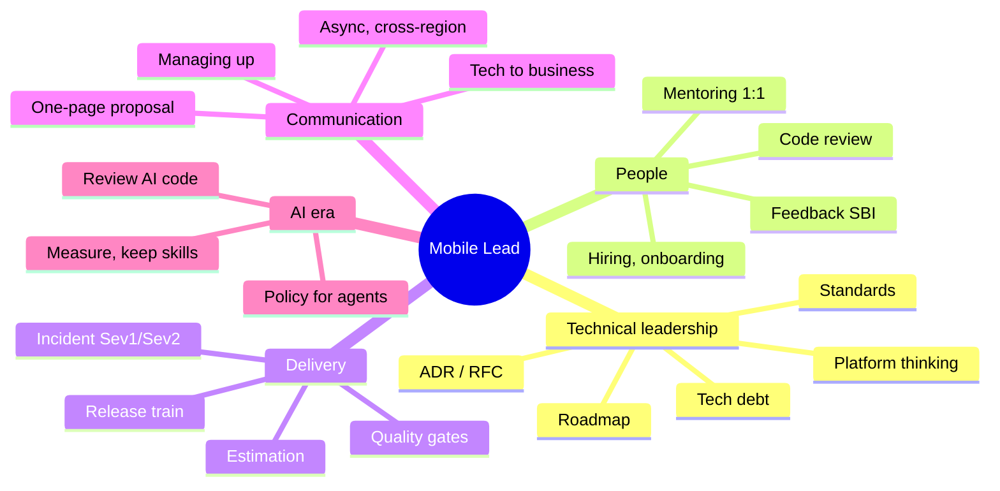
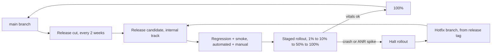

# 11. Leadership và Management cho Mobile Tech Lead / Staff

> Mục tiêu: trả lời được mọi câu hỏi "how would you lead", "tell me about a time you led" ở vòng hiring manager và vòng leadership, bằng ví dụ thật từ `kmp-template-impl`, thư viện template đã publish, quy trình 11 pha và cách bạn dùng Claude Code có review. | Mức cần đạt: Senior: mentor được junior, review code tử tế, ước lượng được việc của mình, nói được trade-off. Staff: ra quyết định kiến trúc có ADR, dẫn dự án nhiều người, ảnh hưởng không cần chức danh, nói chuyện được với PM và business. Lead: xây team, lập roadmap, chạy incident, hiring, quản lý underperformer, dẫn team dùng AI agent có đo lường. | Thời gian gợi ý: tuần 11, ~10 giờ (đọc 4h, viết ADR/RFC/90-day plan 4h, mock 2h)

Ghi chú trước khi đọc: thị trường VN 2026 gần như không còn JD "Android Lead" riêng (xem `01-Market-Research-2026.md`). Bạn apply vào JD Senior/Staff/Architect và phải **thể hiện lead trong phỏng vấn**. Vì vậy file này không dạy quản lý con người chung chung; nó dạy cách kể và cách làm những việc mà JD Staff/Architect liệt kê: mentoring, code review, architecture decisions, roadmap, estimation, hiring, "translate tech to business", Sev1/Sev2, release automation, và vẫn 40-50% hands-on.

## 0. Bản đồ chủ đề

JD Staff/Architect mobile ở VN (15 JD, `01`) lặp lại đúng một bộ yêu cầu lead: mentoring, code review, architecture decisions và standards, roadmap, estimation, hiring, "translate tech to business", xử lý Sev1/Sev2, release automation, và ghi rõ Architect vẫn 40-50% hands-on. Interviewer ở vòng leadership sẽ hỏi theo ba lớp:

1. **Bạn đã làm chưa?** ("Tell me about a time you...") Cần story thật, có số, có việc bạn tự tay làm.
2. **Bạn sẽ làm thế nào ở đây?** ("How would you...") Cần framework ngắn + điều kiện áp dụng + trade-off.
3. **Bạn hiểu vai trò tới đâu?** (Tech Lead khác Staff khác EM chỗ nào, khi nào bạn code, khi nào bạn không code.)



### 0.1 Tech Lead vs Staff Engineer vs Engineering Manager

| | Tech Lead | Staff Engineer | Engineering Manager |
|---|---|---|---|
| Trách nhiệm chính | Dẫn kỹ thuật cho một team, một codebase; quyết định thiết kế trong phạm vi team; vẫn code (The Manager's Path, ch. 3) | Ảnh hưởng kỹ thuật xuyên team; đặt hướng, giải bài toán không ai nhận, gỡ tắc cho tổ chức (The Staff Engineer's Path, Part 1) | Con người và kết quả của team: hiring, performance, growth, process, ngân sách (The Manager's Path, ch. 4-5) |
| Code bao nhiêu | 40-70% | 20-50%, thường prototype, review, unblock | Ít hoặc không |
| Được đo bằng | Team ship đúng, chất lượng, kiến trúc không nợ xấu | Quyết định đúng ở quy mô lớn, nâng mặt bằng kỹ thuật, dự án lớn về đích | Team khoẻ, giữ người, delivery đều, người lên cấp |
| Interviewer hỏi gì | "Walk me through a design you drove", "how do you review", "how do you estimate", "how do you handle a disagreement with a senior" | "Tell me about a cross-team problem you solved without authority", "how do you decide what not to do", "how do you write a proposal executives read" | "How do you handle an underperformer", "how do you grow people", "how do you measure your team", "tell me about firing or PIP" |
| Bạn nên định vị | Mặc định cho JD Senior/Staff ở VN | Khi JD ghi Staff/Principal/Architect | Chỉ khi JD là EM; bạn vẫn nên trả lời được 5 câu EM kinh điển vì bank hay hỏi |

Fournier (ch. 3) nhấn hai điểm bạn nên nói ra trong phỏng vấn: Tech Lead là **vai trò**, không phải cấp bậc, và sai lầm lớn nhất của Tech Lead mới là tiếp tục là người code giỏi nhất thay vì làm team ship được. Reilly (ch. 1) nói Staff có ba trục: **big-picture thinking, execution, levelling up** người khác. Will Larson (staffeng.com) chia Staff thành bốn archetype: Tech Lead, Architect, Solver, Right Hand; với nền của bạn, Tech Lead và Architect là hai archetype dễ chứng minh nhất.

**Đọc thêm:**
- The Manager's Path (Camille Fournier), ch. 3 "Tech Lead" và ch. 2 "Mentoring"
- The Staff Engineer's Path (Tanya Reilly), ch. 1 "What would you say you do here?"
- https://staffeng.com/guides/staff-archetypes/
- https://lethain.com/tech-lead-managers/

## 1. Technical leadership

### 1.1 Architecture Decision Record (ADR)

ADR là một trang ngắn ghi lại **một** quyết định kiến trúc: bối cảnh, lựa chọn, lý do, hệ quả. Mục đích không phải để "xin phép" mà để 6 tháng sau người mới (hoặc chính bạn) hiểu vì sao code như vậy. Interviewer Staff gần như chắc chắn hỏi "how do you document architecture decisions"; câu trả lời tốt nhất là mở repo và chỉ vào `docs/adr/`.

Template (Michael Nygard, rút gọn):

```markdown
# ADR-000X: <Quyết định, viết ở thì khẳng định>

- Status: Proposed | Accepted | Deprecated | Superseded by ADR-00Y
- Date: YYYY-MM-DD
- Deciders: <tên>
- Tags: di, kmp, build

## Context
Bài toán gì, ràng buộc gì (platform, team, deadline, kỹ năng hiện có).

## Decision
Chọn gì. Một câu.

## Options considered
| Option | Pros | Cons |
|---|---|---|

## Consequences
Tốt: ... Xấu: ... Việc phải làm thêm: ...

## Revisit when
Điều kiện nào thì xem lại quyết định này.
```

Ví dụ điền sẵn, từ repo của bạn (bạn phải tự kể được bằng lời, không nhìn giấy):

```markdown
# ADR-0001: Use Koin instead of Hilt for dependency injection in the KMP template

- Status: Accepted
- Date: [điền ngày thật]
- Deciders: [bạn]
- Tags: di, kmp

## Context
The template targets Android and iOS from one codebase (Compose Multiplatform).
Hilt is Android-only: it generates code against Android components
(Application, Activity, ViewModel) and does not run in commonMain.
We want ViewModels, repositories and use cases defined once in commonMain.
The team has Hilt experience from older projects (compose-template).

## Decision
Use Koin (currently 4.x) as the DI container for all KMP modules.
Define modules in commonMain; platform-specific bindings (database driver,
HTTP engine, file paths) are provided in androidMain / iosMain modules.

## Options considered
| Option | Pros | Cons |
|---|---|---|
| Hilt | Compile-time graph, team knows it, great Android tooling | Android only; iOS would need a second DI, two graphs to keep in sync |
| Koin | Kotlin DSL, works in commonMain, no codegen, easy to read, Koin Annotations optional | Runtime resolution: a missing binding fails at runtime, not at compile; needs `verify()` tests and a startup smoke test |
| kotlin-inject / Metro | Compile-time, KMP | Smaller community at the time; team had no experience (cần kiểm tra trạng thái hiện tại) |

## Consequences
Good: one DI graph for both platforms; feature modules declare their own Koin module;
iOS entry point calls `initKoin()` from Swift.
Bad: lost compile-time safety. Mitigation: `koinApplication { modules(...) }.checkModules()`
style verification in unit tests, plus an instrumented startup test that resolves
every ViewModel.
Follow-up: a convention plugin wires Koin modules per feature; document the
pattern in docs/engineering.

## Revisit when
A compile-time KMP DI becomes mainstream in the libraries we depend on,
or the Koin startup cost shows up in the cold-start benchmark.
```

Cách kể trong 60 giây (EN): "We needed one DI graph for Android and iOS. Hilt is Android-only, so I chose Koin: DSL in commonMain, platform bindings in androidMain and iosMain. The trade-off is runtime resolution, so I added module verification tests and a startup test that resolves every ViewModel. I wrote it down as an ADR so the next person does not reopen the debate without new facts."

**Lỗi hay gặp / trade-off:**
- ADR viết sau khi code xong 3 tháng thành "tài liệu hậu kiểm", mất tác dụng. Viết trước hoặc cùng lúc với PR đầu tiên.
- ADR quá dài, thành design doc. Giữ dưới 1 trang; design doc để riêng.
- Không có "Revisit when": quyết định đúng hôm nay thành dogma.
- Không ghi option bị loại: người sau sẽ đề xuất lại đúng option đó.

**Đọc thêm:**
- https://adr.github.io/
- https://github.com/joelparkerhenderson/architecture-decision-record
- The Staff Engineer's Path, ch. 3 "Creating the big picture" (phần viết decision)

### 1.2 RFC process

RFC (Request for Comments) dùng cho thay đổi **lớn hơn một module**: đổi kiến trúc navigation, adopt KMP cho một feature, đổi CI. Khác ADR: RFC là tài liệu để **thu ý kiến trước khi quyết**, ADR là **kết quả** sau khi quyết.

Quy trình nhẹ cho team mobile 5-10 người:
1. Tác giả viết RFC (1-3 trang), đặt deadline comment 5 ngày làm việc.
2. Gửi link async (Slack/Confluence/PR vào `docs/rfc/`), tag 2-3 reviewer bắt buộc.
3. Comment inline. Tác giả trả lời mọi comment, kể cả "no change".
4. Một buổi 30 phút nếu còn bất đồng. Người quyết (DRI) là tech lead, không phải đa số phiếu.
5. Đóng RFC bằng một ADR. Link hai chiều.

Template RFC:

```markdown
# RFC-00X: <Tiêu đề>
- Author, Reviewers, DRI, Status (Draft / In review / Accepted / Rejected), Comment deadline

## Summary (3 câu)
## Motivation: vấn đề hôm nay, số liệu nếu có (build time, crash, lead time)
## Proposal: thay đổi gì, kiến trúc mới, diagram
## Alternatives: ít nhất 2, vì sao không chọn
## Risks and mitigations
## Rollout plan: pha, feature flag, cách rollback, ai làm gì
## Cost: người-tuần, tiền, ảnh hưởng roadmap
## Open questions
## Decision log (điền khi đóng)
```

**Lỗi hay gặp / trade-off:**
- RFC cho mọi thứ: team ngừng ship. Ngưỡng: ảnh hưởng > 1 module hoặc > 2 tuần công hoặc khó rollback.
- Không có DRI: bàn mãi. Tech lead quyết, ghi lý do, ai bất đồng được ghi vào log.
- RFC viết xong rồi họp đọc chung: lãng phí. Comment async trước, họp chỉ để chốt.

**Đọc thêm:**
- https://lethain.com/scaling-consistency/ (Will Larson về RFC và architecture review)
- https://github.com/rust-lang/rfcs (ví dụ process trưởng thành, đọc README)

### 1.3 Tech radar

Tech radar (Thoughtworks) là bảng phân loại công nghệ theo bốn vòng: **Adopt** (dùng mặc định), **Trial** (dùng trong dự án có kiểm soát), **Assess** (tìm hiểu, chưa dùng production), **Hold** (không dùng cho việc mới). Với team mobile nhỏ, một trang markdown cập nhật mỗi quý là đủ. Giá trị: trả lời "được dùng cái này không" mà không cần hỏi lead; và cho interviewer thấy bạn nghĩ ở mức platform.

Ví dụ radar cho team bạn (cập nhật theo `01` và FACTS trong brief):

| Ring | Mục |
|---|---|
| Adopt | Kotlin 2.4, Jetpack Compose 1.12, Navigation 3, Koin, Room KMP, Ktor/OkHttp, GitHub Actions, Crashlytics, Baseline Profiles |
| Trial | Compose Multiplatform cho iOS (đã ship một app), Roborazzi screenshot test, Claude Code trong SDLC có review, ML Kit GenAI on-device |
| Assess | Metro/kotlin-inject (compile-time DI cho KMP), Compose Hot Reload trong CI, Android CLI với agent |
| Hold | XML View mới, Fragment mới, RxJava cho code mới, reflection vào `MessageQueue` (vỡ trên Android 17) |

**Đọc thêm:**
- https://www.thoughtworks.com/radar
- https://github.com/zalando/tech-radar (tự dựng radar)

### 1.4 Standards và conventions: đưa vào mà không gây ma sát

Nguyên tắc: **tool enforce, không phải người**. Mỗi rule phải có một trong ba: lint/detekt rule, convention plugin, hoặc template. Rule chỉ nằm trong wiki sẽ chết sau 2 tuần.

Thứ tự đưa vào:
1. Chọn 3 rule đau nhất (ví dụ: không `GlobalScope`, module không được import module ngang hàng, mọi ViewModel expose một `StateFlow<UiState>`).
2. Viết rule dưới dạng kiểm tra tự động: detekt custom rule, Konsist test cho dependency rule, convention plugin trong `build-logic`.
3. Chạy ở chế độ **warning** 2 tuần, báo số vi phạm hiện có.
4. Fix nợ cũ theo lô (hoặc baseline file), sau đó bật **error** trên CI cho code mới.
5. Ghi vào `CLAUDE.md`/`AGENTS.md` để agent cũng tuân theo (xem `10-AI-for-Mobile-Lead.md`).

Ví dụ Konsist test cho dependency rule (chạy như unit test):

```kotlin
class ArchitectureRulesTest {
    @Test
    fun `feature modules do not depend on each other`() {
        Konsist.scopeFromProject()
            .files
            .filter { it.moduleName.startsWith("feature") }
            .assertFalse { file ->
                file.imports.any { import ->
                    import.name.contains(".feature.") &&
                        !import.name.contains(".${file.moduleName}.")
                }
            }
    }
}
```

Bạn đã có convention plugins trong `build-logic`: đó là ví dụ thật để kể. Interviewer hỏi tiếp: "làm sao biết standard có tác dụng?" Trả lời bằng số: số vi phạm giảm, thời gian review giảm, số comment "style" trong PR về gần 0.

**Lỗi hay gặp / trade-off:**
- Đưa 20 rule một lúc: team coi là trò chơi của lead.
- Rule không giải thích "vì sao": người ta làm theo cho qua CI rồi tìm cách lách.
- Standard khác nhau giữa app cũ (Hilt, XML) và app mới (KMP): ghi rõ scope áp dụng.

**Đọc thêm:**
- https://detekt.dev/docs/introduction/extensions/
- https://docs.konsist.lemonappdev.com/
- https://developer.android.com/build/gradle-tips (convention plugins pointer, xem thêm `04-Android-Kotlin-Deep-Dive.md`)

### 1.5 Technical roadmap theo quý, gắn với mục tiêu sản phẩm

Roadmap kỹ thuật tốt có ba cột: **mục tiêu sản phẩm** (từ PM), **việc kỹ thuật phục vụ mục tiêu đó**, và **việc bắt buộc** (compliance, platform deadline). Không có cột "việc tôi thích".

Ví dụ một quý cho team app KMP:

| Mục tiêu sản phẩm (PM) | Việc kỹ thuật | Bắt buộc / deadline bên ngoài |
|---|---|---|
| Tăng D7 retention lên [điền số] | Giảm cold start, offline content pack, push đúng lúc | Target API 36 trước 31/8/2026 (gia hạn 1/11/2026, xem brief) |
| Mở thị trường iOS | Port 2 feature còn lại sang commonMain, CI iOS | Xcode 26 / iOS 26 SDK để upload (từ 28/4/2026) |
| Giảm chi phí support | Crashlytics triage SLA, kill switch Remote Config | 16 KB page size cho native libs (chặn update từ 1/2/2027 theo Play) |

Cách làm: 1 buổi với PM lấy mục tiêu quý; bạn đề xuất tối đa 3 technical bet; mỗi bet có metric; 20% capacity cho nợ kỹ thuật và việc bắt buộc; review giữa quý.

**Đọc thêm:**
- The Staff Engineer's Path, ch. 3 (technical vision và strategy)
- https://lethain.com/good-engineering-strategy-is-boring/

### 1.6 Tech debt management

Cách nói với business: nợ kỹ thuật có **gốc** (việc phải sửa) và **lãi** (thời gian mất thêm mỗi sprint vì chưa sửa). Chỉ trả nợ có lãi cao.

Quy trình:
1. **Inventory**: một bảng, mỗi dòng một món nợ: mô tả, ai chịu ảnh hưởng, lãi ước tính (giờ/sprint), rủi ro (crash, security, compliance), chi phí trả (ngày công).
2. **Xếp hạng** theo lãi/chi phí. Nợ không ai trả lãi thì bỏ khỏi bảng.
3. **Trả nợ kèm feature**: khi feature chạm module nào thì trả nợ module đó (boy scout rule) và ghi vào estimate của feature. Nợ lớn (đổi DI, đổi navigation) thì thành RFC và vào roadmap.
4. **Báo cáo**: mỗi quý 1 slide: nợ trả được, nợ mới, lãi tiết kiệm.

Ví dụ thật bạn có thể kể: migrate `compose-template` từ Hilt sang Koin không làm một lần, mà theo từng module khi module đó chuyển sang KMP; module không chuyển thì giữ Hilt. Đó là trả nợ theo lãi.

**Lỗi hay gặp / trade-off:**
- "Sprint trả nợ" riêng: PM cắt ngay khi có việc gấp. Gắn nợ vào feature thì không cắt được.
- Gọi mọi thứ là nợ: mất uy tín. Code cũ chạy ổn, không ai đụng, không phải nợ.

**Đọc thêm:**
- https://martinfowler.com/bliki/TechnicalDebt.html
- https://martinfowler.com/bliki/TechnicalDebtQuadrant.html

### 1.7 Platform thinking: template, library, design system

Bạn đã làm: `YammyDelivery` publish 9 library `io.github.ltthuc.template:*`, `compose-template` consume qua version catalog, convention plugins. Đây là câu chuyện "platform" tốt nhất bạn có; kể theo khung:

- **Vấn đề**: mỗi app mới mất ~2 tuần setup (network, datastore, ads, billing, rating, update, navigation, settings). [điền số thật]
- **Quyết định**: tách thành library có API ổn định, publish Maven, semver, changelog.
- **Chi phí**: maintain, breaking change, phải viết docs; một người phải "own" platform.
- **Kết quả**: bootstrap còn ~2 ngày [điền số thật]; N app dùng; bug fix một chỗ.
- **Bài học**: versioning (semver, deprecate trước 1 minor rồi mới remove), không để app phụ thuộc internal API, test contract.

Design system: `core/ui` của bạn là design system ở mức tokens + components. Nói được: tokens (color, type, spacing) tách khỏi component; component có preview và screenshot test; versioning tách khỏi app (xem `21-UI-UX-Design-Adaptive.md`).

**Đọc thêm:**
- Team Topologies (Skelton, Pais), ch. 5 "platform team"
- https://developer.android.com/kotlin/multiplatform (pointer tới cấu trúc module share, xem `05-Cross-Platform-iOS-KMP-Flutter.md`)

### 1.8 Build vs buy và SDK evaluation

Khung 5 câu hỏi khi chọn build hay buy một thành phần (analytics, billing, feature flag, crash reporting, chat):

1. Có phải lõi sản phẩm không? Lõi thì build. Billing, crash, analytics thì mua/dùng OSS.
2. Chi phí 3 năm: license + người maintain + chi phí khi vendor đổi giá hoặc ngừng.
3. Rủi ro khoá vendor: data export được không, có abstraction layer không.
4. Ảnh hưởng app: size, permission, startup, Data safety, privacy, SDK nằm trong Play SDK Index không.
5. Thời gian ra thị trường: buy để ship nhanh rồi build sau khi có số.

Checklist đánh giá SDK chi tiết nằm ở `22-Product-Metrics-Compliance.md` mục 5. Ví dụ thật: bạn chọn RevenueCat thay vì tự viết billing server-side verification, trade-off là phí theo revenue và lock-in; mitigation là bọc bằng interface `BillingGateway` trong `core/billing`.

**Đọc thêm:**
- https://play.google.com/sdks (Google Play SDK Index)
- https://developer.android.com/quality (app quality hub; SDK guidance nằm trong Play policy center)

## 2. Code review culture

### 2.1 Mục tiêu và nguyên tắc

Code review có ba mục tiêu theo thứ tự: (1) không đưa bug, lỗ hổng, nợ xấu vào main; (2) truyền kiến thức hai chiều; (3) giữ codebase nhất quán. Google eng-practices tóm tắt thành một câu: approve khi PR làm code health **tốt hơn**, không cần hoàn hảo.

Nguyên tắc cho team mobile:
- PR nhỏ: dưới ~400 dòng thay đổi, một mục đích. PR lớn thì chia theo stack.
- Mô tả PR có: vì sao, làm gì, cách test, screenshot/video nếu UI, link ticket, nhãn `ai-assisted` nếu có.
- Reviewer trả lời trong **1 ngày làm việc**; PR hotfix trong 2 giờ. Đây là SLA ghi rõ, đo được.
- Tác giả không tự merge khi còn comment "issue" chưa resolve.
- Tối thiểu 1 approve; module nhạy cảm (billing, auth, security) cần 2, trong đó 1 là code owner (`CODEOWNERS`).

### 2.2 Review checklist (mobile)

```markdown
- [ ] Đúng yêu cầu? Có case rỗng, lỗi mạng, offline, rotate, process death?
- [ ] Coroutines: scope đúng (viewModelScope / lifecycle), cancel được, không chạy IO trên Main, không nuốt CancellationException
- [ ] Compose: state hoisting, không side effect trong composition, key đúng trong LazyColumn, không tạo object mới mỗi recomposition ở hot path
- [ ] Security: không secret trong code, input validate, component export đúng, log không in PII
- [ ] Performance: không IO trên main, không parse JSON lớn trên main, image size đúng
- [ ] Test: có test cho logic mới, test có ý nghĩa (không chỉ assert not null)
- [ ] Module boundary: không import ngang feature, API public tối thiểu
- [ ] Backward compatibility: schema Room migration, DataStore key, deep link
- [ ] Observability: event analytics, log, crash key nếu feature quan trọng
- [ ] Docs: ADR nếu là quyết định, CHANGELOG nếu library
```

### 2.3 Comment tốt và comment xấu

Dùng nhãn kiểu Conventional Comments để người đọc biết mức độ: `praise:`, `nitpick:`, `suggestion:`, `issue:`, `question:`, `thought:`. Chỉ `issue:` chặn merge.

| Xấu | Tốt |
|---|---|
| "This is wrong." | "issue: `collect` here runs on Main and the repository does disk IO. Suggest `flowOn(Dispatchers.IO)` in the repository, not here, so callers do not need to know." |
| "Why didn't you use a sealed class?" | "suggestion (non-blocking): a sealed `UiState` would let the compiler catch the missing `Error` branch in `when`. Fine to do in a follow-up." |
| "LGTM" trên PR 800 dòng | "Reviewed the ViewModel and repository in detail; skimmed the UI. Tested the offline path on a Pixel emulator. Approving." |
| "Nit: rename" | "nitpick: `data` is vague here; `cachedStories` would match the rest of the module." |

Nhận comment: trả lời mọi comment; nếu không đồng ý, nêu lý do kỹ thuật và đề xuất cách kiểm chứng (benchmark, test); không bảo vệ code vì tự ái; nếu 2 vòng không xong thì gọi 10 phút.

### 2.4 Review code AI sinh ra

Bar giống hệt code người viết, cộng thêm ba điểm: (1) tác giả phải giải thích được từng dòng khi được hỏi; (2) kiểm tra "ảo giác API" (hàm không tồn tại, tham số sai version); (3) kiểm tra test có test thật không hay chỉ mirror implementation. Prompt review P8 và quy trình đầy đủ ở `10-AI-for-Mobile-Lead.md` và `18-AI-Study-Workflow.md`.

### 2.5 Pair và mob programming: khi nào đáng

- Pair khi: onboarding, bug khó, thiết kế API public của module, review PR lớn (pair-review nhanh hơn 3 vòng comment).
- Mob (3-5 người) khi: quyết định convention mới, debug incident, học công nghệ mới cùng nhau (ví dụ buổi đầu dùng Nav3).
- Không pair cả ngày: mệt, và hai người làm một việc thì throughput giảm nếu việc đó đơn giản.

**Lỗi hay gặp / trade-off:**
- Review để "bắt lỗi style": tốn người, không bắt được bug. Style để tool.
- Review chậm vì reviewer bận: đặt SLA và theo dõi "time to first review".
- Lead review mọi PR: nghẽn. Tạo code owner theo module, lead chỉ review module cốt lõi và PR có ADR.

**Đọc thêm:**
- https://google.github.io/eng-practices/review/
- https://conventionalcomments.org/
- https://github.com/thoughtbot/guides/tree/main/code-review

## 3. Mentoring và coaching

### 3.1 Hai framework trong 10 dòng

**Situational leadership** (Hersey, Blanchard): chọn cách dẫn theo mức sẵn sàng của người đó với **việc cụ thể**, không phải theo thâm niên.
- Mới, chưa biết làm: **Directing** (chỉ rõ việc, cách làm, kiểm tra sớm).
- Biết một chút, dễ nản: **Coaching** (vẫn chỉ cách, nhưng giải thích và hỏi ý).
- Làm được nhưng thiếu tự tin: **Supporting** (hỏi họ định làm sao, bạn gỡ rào).
- Làm tốt, tự chủ: **Delegating** (giao mục tiêu, không giao cách).
Một senior Android chuyển sang KMP có thể ở mức Directing cho iOS build nhưng Delegating cho Compose. Nói được ví dụ này là điểm cộng.

**GROW** (cho buổi coaching): **Goal** (muốn đạt gì), **Reality** (đang ở đâu, bằng chứng), **Options** (có những cách nào, ít nhất 3), **Will** (sẽ làm gì, khi nào, bạn hỗ trợ gì). Bạn hỏi nhiều hơn nói.

### 3.2 1:1: cấu trúc và nhịp

- Nhịp: hằng tuần 30 phút với người bạn mentor trực tiếp; 2 tuần/lần với người khác trong team nếu bạn là lead kỹ thuật, không phải manager.
- Agenda là của họ. Bạn có 3 câu dự phòng: "What is blocking you?", "What are you learning?", "What should I do differently?"
- Không phải status report. Status để standup hoặc Slack.
- Ghi chú riêng sau mỗi buổi: cam kết hai bên, chủ đề lặp lại.
- Mỗi quý một buổi "career": họ muốn đi đâu, cần bằng chứng gì để lên cấp.

Script mẫu (EN) cho 1:1 với một mid-level developer mới dùng AI agent nhiều:

```
Lead: What is on your mind this week?
Dev: The sync feature is done, waiting for review.
Lead: Good. I looked at the PR. Before I comment, walk me through how the outbox drain handles a 409 conflict.
Dev: Hmm, I think the agent used last-write-wins...
Lead: Let's check together. [opens code] Here it overwrites without comparing updatedAt. Is that what we want?
Dev: No, that would lose edits from the other device.
Lead: Right. Two things from me. One: for any PR that touches data integrity, I want you to be able to explain each branch without opening the diff. Two: you found the bug yourself in 30 seconds once you read it, which tells me your judgement is fine, you just need to read before you push. How can we make that routine?
Dev: I can add a self-review step: read the diff top to bottom, write the PR description by hand.
Lead: Deal. Try it this week; tell me next 1:1 whether it slowed you down.
```

### 3.3 Growth plan

Một trang, mỗi quý:
- Mục tiêu cấp bậc (ví dụ: Senior trong 2 quý).
- 3 năng lực còn thiếu, mỗi cái có **bằng chứng** sẽ tạo ra (ví dụ: "own release của feature X end-to-end, viết postmortem nếu có sự cố").
- Cơ hội bạn tạo ra: giao feature, cho present ở tech talk, cho review PR của người khác.
- Checkpoint mỗi tháng.

### 3.4 Feedback trực tiếp: mô hình SBI

**Situation, Behavior, Impact**: nêu tình huống cụ thể, hành vi quan sát được (không phải tính cách), tác động. Sau đó hỏi và cùng tìm hướng.

Script khen (EN): "In Tuesday's incident call (S), you paused the rollout within five minutes and posted a clear status update before anyone asked (B). That cut the number of affected users and the PM told me it made her job easy (I). Keep doing that."

Script góp ý (EN): "In the last two sprints (S), three of your PRs were opened at 1,000+ lines with a one-line description (B). Reviews took four days and we missed the release train once (I). What is making the PRs that large?" Rồi im lặng, nghe.

Quy tắc: góp ý trong 48 giờ, riêng tư, cụ thể, một việc mỗi lần, hỏi trước khi kết luận. Khen công khai được.

### 3.5 Underperformance

Thứ tự:
1. **Chẩn đoán** trước khi kết luận: thiếu kỹ năng, thiếu rõ ràng về kỳ vọng, thiếu động lực, hay môi trường (việc nhà, tooling, bị giao việc lung tung)? Hỏi trong 1:1.
2. **Kỳ vọng rõ, bằng văn bản**: 2-3 mục tiêu cụ thể, thời hạn 4-6 tuần, cách đo.
3. **Hỗ trợ**: pair, giảm phạm vi, bỏ việc gây nhiễu, check-in hằng tuần.
4. **Ghi chép** mọi cuộc nói chuyện (ngày, nội dung, cam kết).
5. Không cải thiện: kéo manager và HR vào, PIP chính thức. Tech lead không tự PIP ai; bạn cung cấp bằng chứng kỹ thuật.
6. Trong suốt quá trình: giữ thể diện cho họ với team, không nói sau lưng.

Trong phỏng vấn, câu "tell me about an underperformer" muốn nghe: bạn hành động sớm, cụ thể, công bằng, và có kết quả (cải thiện hoặc chia tay tử tế). Xem Q&A bên dưới.

### 3.6 Mentoring junior trong thời AI

Rủi ro: junior dùng agent sinh code chạy được nhưng không hiểu; 1 năm sau vẫn không debug được. Quy tắc bạn có thể đặt (và kể):
- Tuần đầu mỗi feature mới: viết tay, không agent. Sau đó dùng agent để refactor và so sánh.
- "Explain-your-PR": trước khi review, junior giải thích miệng 5 phút. Không giải thích được thì PR chưa sẵn sàng.
- Agent chỉ được dùng để sinh test sau khi junior viết 2 test đầu tiên bằng tay.
- Mỗi tuần một buổi 30 phút đọc code cũ không có AI (code reading club).
- Đo: tỷ lệ PR bị trả lại vì "không giải thích được", thời gian fix bug tự thân.

### 3.7 Sponsorship vs mentorship

Mentor cho lời khuyên. Sponsor **dùng uy tín của mình** để tạo cơ hội: đề cử vào dự án lớn, nhắc tên trong họp promotion, giao present trước exec. Lead mới thường chỉ mentor; Staff phải sponsor. Khi kể, dùng động từ: "I put her name forward for...", "I gave him the release owner role for...".

**Lỗi hay gặp / trade-off:**
- 1:1 thành status meeting: họ không nói việc thật.
- Feedback chung chung ("be more proactive"): không thay đổi được gì.
- Giữ underperformer quá lâu vì ngại: team mất niềm tin vào lead.

**Đọc thêm:**
- The Manager's Path, ch. 2 "Mentoring" và ch. 4 "Managing People" (1:1 types, feedback)
- https://www.ccl.org/articles/leading-effectively-articles/closing-the-gap-between-intent-vs-impact-sbii/
- https://rework.withgoogle.com/ (Google re:Work, phần managers và 1:1)

## 4. Planning và estimation

### 4.1 Chia việc

Một feature mobile chia theo lớp hay theo luồng? Theo **luồng dọc** (vertical slice): một slice gồm UI + ViewModel + repo + API cho một hành vi người dùng nhỏ nhất, ship được sau feature flag. Chia theo lớp (làm hết UI rồi mới làm data) khiến không có gì chạy được tới tuần cuối.

Ví dụ "Content pack tải về cho app phonics":
1. Slice 1: manifest API + tải 1 pack + cache local, UI tạm.
2. Slice 2: version pack, so sánh, tải delta.
3. Slice 3: UI tiến trình, retry, offline.
4. Slice 4: metrics + kill switch.

### 4.2 Kỹ thuật ước lượng

| Kỹ thuật | Dùng khi | Ghi chú |
|---|---|---|
| T-shirt (S/M/L/XL) | Roadmap quý, so sánh tương đối | Nhanh, đủ cho ưu tiên |
| Story point (planning poker) | Sprint | Đo capacity theo velocity của team, không so giữa team |
| Three-point (PERT) | Việc có rủi ro | E = (O + 4M + P) / 6; nêu P để lộ rủi ro |
| Reference class | Việc giống việc đã làm | "Lần port feature tương tự mất 3 tuần, có 1 tuần bất ngờ từ iOS build" |

Buffer: 20-30% cho việc chưa biết; riêng mobile thêm thời gian review store, device fragmentation, và API backend chậm. Nói rõ buffer là gì, không giấu trong số.

### 4.3 Nói "không" bằng trade-off

Công thức: "Yes, if..." hoặc "We can do A by date X, or A+B by date Y; A+B by X means cutting tests on B, which I don't recommend because [risk]. Which do you want?" Không bao giờ "no" trần. Ghi lại quyết định (email 3 dòng) để sau này không ai nhớ khác.

### 4.4 Ưu tiên: RICE/ICE lite

RICE = Reach x Impact x Confidence / Effort. Cho team nhỏ, dùng ICE (Impact, Confidence, Ease, mỗi cái 1-5) đủ để xếp hạng và tranh luận có cấu trúc. Cái quan trọng không phải số mà là **cùng một thang** giữa PM và engineering.

### 4.5 Agile/Scrum như thực hành

Ritual đáng giữ: planning ngắn (1h/2 tuần), daily 10 phút (hoặc async trên Slack), retro có action item có owner, refinement trước planning. Ritual hay bị hình thức: sprint review để demo cho chính mình, daily thành report cho lead. Nếu không ai dùng velocity để quyết định thì bỏ story point.

### 4.6 Kanban cho release train mobile

Mobile khác web: không deploy liên tục được tới user vì có store review và tỷ lệ update. Nên dùng **release train**: tàu chạy đúng giờ (ví dụ 2 tuần), feature nào xong (sau flag) thì lên, chưa xong thì đợi chuyến sau. Kanban với WIP limit cho luồng: Ready -> In dev -> In review -> QA -> Ready for train. Lead theo dõi cycle time từ In dev tới Ready for train.

### 4.7 Làm việc với PM, Design, QA, Backend

- PM: thống nhất "definition of done" có metric; bạn mang trade-off kỹ thuật, PM mang trade-off thị trường.
- Design: tham gia sớm để tránh thiết kế không làm được trên Android (edge-to-edge, predictive back, large screen theo Android 16 đều ảnh hưởng design).
- QA: QA viết test plan từ ticket; engineer viết automated test; thống nhất cái gì automate, cái gì manual.
- Backend: contract-first (OpenAPI), mock server để mobile không đợi; versioning API; cùng on-call cho feature.

**Lỗi hay gặp / trade-off:**
- Ước lượng do lead làm một mình rồi giao: team không cam kết.
- Không ghi assumption: khi trượt thì cãi nhau về quá khứ.
- Scrum "by the book" cho team 4 người: overhead ăn hết thời gian.

**Đọc thêm:**
- https://www.atlassian.com/agile/project-management/estimation
- https://www.intercom.com/blog/rice-simple-prioritization-for-product-managers/
- Accelerate (Forsgren, Humble, Kim), ch. 4 (technical practices), ch. 8 (product development)

## 5. Stakeholder communication

### 5.1 Dịch rủi ro kỹ thuật sang tác động business

Công thức: **Nếu không làm X thì [hậu quả cho user/doanh thu/pháp lý] vào [ngày]; làm X tốn [chi phí]; phương án rẻ hơn là Y với rủi ro Z.**

| Nói kiểu engineer | Nói kiểu lead |
|---|---|
| "We must migrate to target SDK 36." | "Google blocks new app updates that don't target API 36 after 31 Aug 2026 (extended to 1 Nov). If we miss it, no bug fixes reach users. It is about two weeks of work; I propose doing it in sprint 14." |
| "Native libs need 16 KB page support." | "From Feb 2027 Play will reject updates of apps with native libraries not built for 16 KB pages. Our PDF SDK is affected. Vendor has a fix; we need one sprint to upgrade and test." |
| "Crash rate is high." | "Crash-free users dropped from [X]% to [Y]% after 4.2. Support tickets doubled. I have paused the rollout at 20% and the fix ships tomorrow." |
| "We should add tests." | "Last quarter 3 of 5 hotfixes were regressions in billing. Adding a billing test suite costs one week and would have caught two of them." |

### 5.2 One-page proposal

```markdown
# <Đề xuất>  (1 trang)
Problem (2 câu, có số)
Proposal (3 câu)
Options (bảng: option, cost, time, risk; option được chọn in đậm)
What I need from you (quyết định, người, tiền, deadline)
Risks and how we handle them
Success metric and when we review
```

### 5.3 Trình bày trade-off cho executive

Kết luận trước, ba lựa chọn, đề xuất một, rủi ro, câu hỏi cần họ quyết. 5 phút. Không giải thích Koin là gì. Chuẩn bị một "appendix" cho ai hỏi sâu.

### 5.4 Status update mà lãnh đạo đọc

Mỗi tuần, 5 dòng: **On track / At risk / Off track** cho mỗi mục tiêu; thay đổi so với tuần trước; quyết định cần ai; rủi ro mới; con số chính (crash-free, release date). Màu đỏ sớm thì không ai giận; đỏ muộn thì mất tin.

### 5.5 Managing up

Manager của bạn cần: không bất ngờ, biết sớm rủi ro, có đề xuất kèm vấn đề. Hỏi họ: "What does your manager measure you on?" rồi căn việc của team theo đó. Khi bất đồng: nêu bằng số, đề xuất thử nghiệm giới hạn, rồi disagree-and-commit (mục 8).

### 5.6 Team đa vùng (HQ Singapore/Nhật, dev ở VN)

- Viết trước, họp sau. Mọi quyết định có một tài liệu nguồn.
- Giờ chồng lấn: cố định 2-3 giờ/ngày cho đồng bộ; còn lại async.
- Văn hoá: HQ Nhật thường cần "nemawashi" (thăm dò trước khi họp), tránh bất ngờ trong họp; HQ Singapore thẳng hơn nhưng cần số liệu.
- Timezone trong incident: ghi rõ ai on-call giờ nào, handoff có ghi chú.

### 5.7 Giao tiếp viết async

Cấu trúc một message quyết định: bối cảnh 2 câu, đề xuất, deadline trả lời, "nếu không ai phản hồi tới X thì mặc định làm Y". Dùng thread, một chủ đề một thread, cập nhật kết luận ở đầu thread.

**Lỗi hay gặp / trade-off:**
- Giải thích cơ chế thay vì tác động: exec ngắt lời sau 30 giây.
- Chỉ mang vấn đề, không mang phương án.
- Báo đỏ quá muộn vì hy vọng kịp.

**Đọc thêm:**
- The Manager's Path, ch. 5 (managing up, communicating with stakeholders)
- https://lethain.com/ (tìm bài "writing engineering strategy")
- https://www.leaddev.com/ (series về communication for tech leads)

## 6. Delivery và operations

### 6.1 Release strategy



- **Release train**: cắt từ `main` mỗi 2 tuần; feature chưa xong ở sau feature flag, tắt mặc định.
- **Staged rollout**: tăng theo bậc, mỗi bậc chờ đủ mẫu (ví dụ 24-48 giờ) và so vitals với bản trước. Có thể halt nhưng **không rollback** được client đã cài: cần kill switch phía server (Remote Config) cho feature nguy hiểm.
- **Hotfix flow**: branch từ tag release, fix nhỏ nhất, chạy đủ gate, cherry-pick về main. Hotfix phải có postmortem nhẹ: vì sao không bắt được.
- **Forced update**: Play In-App Update (immediate) chỉ cho lỗi nghiêm trọng (security, data corruption); dùng thường xuyên thì user bỏ.

### 6.2 Quality gates

| Gate | Chạy ở | Chặn khi |
|---|---|---|
| Lint, detekt, Konsist | PR | Có error mới |
| Unit test + coverage | PR | Fail, hoặc coverage module core giảm |
| Compose UI/screenshot test | PR (nightly nếu chậm) | Diff không được approve |
| Build AAB + size report | PR | Size tăng > ngưỡng team đặt |
| Macrobenchmark startup | Nightly | Regression > ngưỡng |
| Regression manual | Release cut | Blocker |
| Vitals so với bản trước | Mỗi bậc rollout | Crash hoặc ANR tăng |

Chi tiết CI ở `20-Git-CICD.md`, test ở `19-Testing-Deep-Dive.md`.

### 6.3 On-call cho mobile

Mobile on-call khác backend: không restart được, nhưng có thể halt rollout, bật kill switch, đẩy hotfix, và liên hệ backend. On-call rotation 1 tuần, có runbook: cách halt rollout trên Play Console, cách bật flag, ai ở backend, template thông báo. Lead on-call cùng để biết đau.

### 6.4 Incident management

Sev levels (team tự định nghĩa, ví dụ):
- **Sev1**: user không dùng được chức năng chính, mất tiền/mất dữ liệu, lỗ hổng bảo mật đang bị khai thác, hoặc ảnh hưởng > X% user. All hands, cập nhật mỗi 30 phút.
- **Sev2**: chức năng quan trọng lỗi với một nhóm user, có workaround, hoặc crash tăng mạnh ở một bậc rollout. Xử lý trong giờ làm việc kéo dài, cập nhật mỗi 2 giờ.
- **Sev3**: lỗi nhỏ, chờ release train.

Vai trò trong Sev1 (theo mô hình PagerDuty/Google SRE):
- **Incident Commander (IC)**: điều phối, quyết định, không tự debug. Tech lead thường là IC lần đầu, sau đó luân phiên.
- **Ops/Tech lead**: người sửa.
- **Comms lead**: cập nhật stakeholder, support, status page.
- **Scribe**: timeline trong channel incident.

Quy trình: khai báo -> mở channel `#inc-YYYYMMDD-tên` -> IC nêu tình trạng, ảnh hưởng, hành động kế -> giảm thiệt hại trước (halt rollout, kill switch) rồi mới tìm root cause -> cập nhật đúng nhịp -> đóng incident -> postmortem trong 5 ngày.

Mẫu update (EN): "Status: investigating. Impact: ~[N]% of users on 4.2.0 see a crash on checkout. Actions: rollout halted at 10:40, kill switch for new checkout enabled at 10:52. Next update: 11:30. IC: [name]."

### 6.5 Blameless postmortem template

```markdown
# Postmortem: <tên sự cố> (Sev1/Sev2)
- Date, duration, author, reviewers
## Summary (3 câu: gì, ảnh hưởng, đã sửa sao)
## Impact (số user, số phiên, tiền, SLA)
## Timeline (giờ: sự kiện; gồm lúc phát hiện, lúc giảm thiệt hại, lúc hết)
## Root cause (kỹ thuật) và contributing factors (quy trình, tooling)
## What went well / What went poorly / Where we got lucky
## Action items (mỗi mục: owner, deadline, loại: prevent / detect / mitigate)
## Lessons (1-3 câu, cho người ngoài team)
```

Blameless: viết "the release was shipped without the billing test suite" thay vì "X quên chạy test". Lỗi cá nhân là triệu chứng của hệ thống cho phép lỗi đó.

### 6.6 Reliability metrics và DORA cho mobile

- **Crash-free users** và **crash-free sessions** (Crashlytics), theo version. Theo dõi khác biệt giữa bản mới và bản cũ ở cùng bậc rollout.
- **ANR rate**, **user-perceived crash rate** (Android vitals; ngưỡng Play đặt, cần kiểm tra tại developer.android.com/topic/performance/vitals).
- **Startup time** (cold/warm/hot) từ vitals và Macrobenchmark.
- **Adoption**: % user lên bản mới sau 7 ngày (cho biết bao lâu hotfix mới hiệu lực).

DORA (Accelerate) áp vào mobile:

| DORA | Mobile |
|---|---|
| Deployment frequency | Số release train đúng giờ / tháng; số bản internal/day |
| Lead time for changes | Từ merge tới 100% rollout |
| Change failure rate | % release phải halt hoặc hotfix |
| Time to restore | Từ phát hiện tới kill switch bật hoặc hotfix đạt [X]% adoption |

Chi tiết metric sản phẩm và vitals ở `22-Product-Metrics-Compliance.md`.

**Lỗi hay gặp / trade-off:**
- Rollout 100% ngay vì "đã test kỹ": không có đường lùi.
- Không có kill switch cho feature đụng tiền.
- Postmortem đổ lỗi: lần sau không ai báo sự cố sớm.

**Đọc thêm:**
- https://sre.google/sre-book/managing-incidents/
- https://sre.google/sre-book/postmortem-culture/
- https://response.pagerduty.com/
- https://dora.dev/

## 7. Hiring và team building

### 7.1 Viết JD

Cấu trúc: 1 đoạn về team và sản phẩm thật; 5-7 trách nhiệm (động từ, kết quả); 5 yêu cầu bắt buộc (ít thôi); 3-5 điểm cộng; quy trình phỏng vấn và thời gian; lương range nếu được. Bỏ "rockstar", "10 năm Kotlin". Viết yêu cầu theo năng lực kiểm chứng được: "đã ship app lên Play với staged rollout" thay vì "giàu kinh nghiệm".

### 7.2 Interview loop

| Vòng | Thời gian | Đo gì | Ai |
|---|---|---|---|
| Recruiter screen | 30' | Động lực, lương, logistics | Recruiter |
| Hiring manager | 45' | Phù hợp vai trò, kể project, câu hỏi lead | Lead |
| Coding | 60' | Kotlin, cấu trúc dữ liệu, debug; cho dùng AI hay không phải ghi rõ | 1 senior |
| Android/KMP deep-dive | 60' | Compose, coroutines, architecture, performance, security | 1 senior + 1 staff |
| System design | 60' | Mobile system design (xem `06`) | Staff |
| Behavioral/culture | 45' | Collaboration, ownership, growth | Lead + người khác team |

Mỗi vòng có **rubric** 1-4 cho 3-4 signal, viết ví dụ cho mức 2 và 4. Interviewer nộp điểm **trước** khi đọc điểm người khác. Debrief 30 phút, hiring manager quyết.

### 7.3 Structured interview và giảm bias

- Cùng bộ câu hỏi cho mọi ứng viên của một vị trí; cùng rubric.
- Ghi chép hành vi, không ghi cảm giác ("ứng viên nêu được 2 trade-off của Koin" thay vì "có vẻ ok").
- Bias thường gặp: halo (một câu hay kéo cả buổi), similarity (giống mình), anchoring (CV hoặc lương cũ), recency.
- Google re:Work: structured interviewing tăng độ tin cậy; work sample tốt hơn brain teaser.
- Cho ứng viên biết trước format và được dùng AI hay không ở vòng coding.

### 7.4 Onboarding 30/60/90

- **30 ngày**: build và chạy được mọi app, đọc ADR, ship 2-3 PR nhỏ, có buddy, 1:1 hằng tuần, hiểu release process.
- **60 ngày**: own một feature nhỏ end-to-end (từ ticket tới rollout), review PR của người khác, on-call shadow.
- **90 ngày**: own một module, trình bày một tech talk nội bộ, nhận on-call thật. Đánh giá hai chiều.

### 7.5 Team topology cho mobile

- **Feature team** (stream-aligned): Android + iOS + backend + QA cho một luồng sản phẩm. Ship nhanh, nhưng dễ mỗi team một kiểu code.
- **Platform team** (mobile platform): build, CI, template, design system, SDK chung, release train. Phục vụ feature team như sản phẩm nội bộ.
- Team 5-8 người: không tách, nhưng 1 người giữ "platform hat" 20-30% thời gian. Đó chính là việc bạn đã làm với template libs.
- KMP đổi topology: một team làm cả Android và iOS cho feature; cần ít nhất 1 người đọc Swift để xử lý phần native.

### 7.6 Attrition

Phòng: stay interview mỗi quý ("what would make you leave?"), lương theo thị trường, việc có ý nghĩa, lộ trình rõ. Giảm thiệt hại: bus factor >= 2 cho mỗi module (docs, pair, rotation), handover checklist 2 tuần, exit interview thật. Khi senior nghỉ: ưu tiên giữ kiến thức (ghi ADR, record walkthrough) hơn giữ code.

**Lỗi hay gặp / trade-off:**
- Loop 7 vòng cho vị trí senior ở VN: ứng viên tốt nhận offer khác.
- Interviewer không được training: điểm phụ thuộc người hỏi.
- Hire nhanh cho đủ headcount, trả giá bằng 6 tháng.

**Đọc thêm:**
- https://rework.withgoogle.com/ (Hiring: structured interviewing, rubrics)
- https://github.com/kaushikb9/em-interviews
- Team Topologies (Skelton, Pais), ch. 4-5
- The Manager's Path, ch. 5 (hiring, onboarding)

## 8. Conflict và influence

### 8.1 Các bước giải quyết xung đột

1. Tách người khỏi vấn đề: nói về code, deadline, dữ liệu, không nói về tính cách.
2. Lấy facts: mỗi bên nêu điều quan sát được và điều lo ngại.
3. Tìm mục tiêu chung (ship đúng hạn, không crash, user không mất tiền).
4. Liệt kê option, tiêu chí đánh giá chung.
5. Quyết (DRI) hoặc thử nghiệm nhỏ để lấy dữ liệu (benchmark, spike 2 ngày).
6. Ghi lại quyết định và lý do; hẹn ngày xem lại.

### 8.2 Disagree and commit

Bạn nêu bất đồng đầy đủ **trước** khi quyết; sau khi quyết, bạn làm hết sức như thể đó là ý bạn, và không nói "tôi đã bảo mà" khi gặp khó. Nếu có dữ liệu mới thì mở lại đúng cách (RFC), không âm thầm làm khác. Trong phỏng vấn: kể một lần bạn commit với quyết định bạn không thích và nó hoá ra ổn, hoặc không ổn nhưng bạn giúp sửa sớm.

### 8.3 Influence without authority

- Mang dữ liệu: prototype 2 ngày, benchmark, bug count. Số thuyết phục hơn chức danh.
- Làm trước, nhỏ: tự áp dụng convention trong module của mình, cho thấy kết quả, rồi đề xuất.
- Hiểu động lực người kia: PM cần ship, backend cần ổn định, QA cần ít regression. Đóng gói đề xuất theo lợi ích của họ.
- Tìm đồng minh trước buổi họp (nemawashi).
- Viết: một tài liệu tốt tồn tại lâu hơn một cuộc họp.

### 8.4 Senior cứng đầu

Thường là người giỏi và có lý do. Cách làm: 1:1 riêng, hỏi điều họ lo; giao họ **own** phần họ phản đối nếu họ nhận được trách nhiệm; đặt tiêu chí kiểm chứng và deadline; nếu cản trở có hệ thống (chặn PR, nói xấu quyết định) thì feedback SBI thẳng, rồi escalate nếu lặp lại.

### 8.5 Khi nào escalate

Escalate khi: quyết định ngoài quyền bạn (ngân sách, headcount), rủi ro pháp lý/bảo mật/tiền, hai bên không có DRI chung, hoặc đã thử 2 lần không ra. Escalate **cùng nhau** nếu được: hai bên viết chung một trang nêu bất đồng và option, đưa lên cấp trên quyết. Không escalate sau lưng.

**Đọc thêm:**
- Crucial Conversations (Patterson và cộng sự), ch. 3-5
- https://www.amazon.jobs/content/en/our-workplace/leadership-principles ("Have Backbone; Disagree and Commit")
- The Staff Engineer's Path, ch. 7-8 (role model, good influence at scale)

## 9. Dẫn team dùng AI agent

Đây là câu hỏi mới nhưng gần như chắc chắn ở JD 2026 (UPLIVE, DatVietVAC "AI Native Engineer", OCB "AI-SDLC", GoTymeX; xem `01`). Bạn có bằng chứng thật: `CLAUDE.md`, skills, commands, FAILURE_FIRST_PLAYBOOK, 11 pha. Khung 4 phần, chi tiết và prompt ở `10-AI-for-Mobile-Lead.md`:

1. **Policy**: agent được dùng ở đâu (code, test, docs, review), không được ở đâu (secret, dữ liệu khách hàng thật, code có license không rõ); dữ liệu nào được gửi lên model; PR có nhãn `ai-assisted`; tác giả chịu trách nhiệm 100%.
2. **Review**: cùng bar với code người; checklist riêng cho rủi ro AI (API bịa, test giả, security mặc định yếu); "explain-your-PR".
3. **Đo lường**: PR cycle time, defect escape rate, tỷ lệ PR bị trả lại, rework rate, thời gian onboarding; so trước/sau; không đo "số dòng code".
4. **Giữ kỹ năng**: việc không-AI luân phiên, code reading club, junior viết tay trước, lead tự code 40-50% để còn review được.

Kể bằng story thật: bug nào sinh ra rule nào trong playbook của bạn (ví dụ: agent tự thêm dependency không có trong version catalog, nên có rule "mọi dependency qua `libs.versions.toml` và PR phải nêu lý do thêm").

**Đọc thêm:**
- `10-AI-for-Mobile-Lead.md`, `18-AI-Study-Workflow.md` (P8)
- https://docs.anthropic.com/ (Claude Code docs: CLAUDE.md, hooks, permissions; cần kiểm tra đường dẫn hiện tại)

## 10. First 90 days as a Tech Lead

### 10.1 Template

| Giai đoạn | Việc | Deliverable |
|---|---|---|
| Ngày 1-30: Listen | 1:1 với mọi người trong team và 5 stakeholder (PM, design, QA, backend lead, support); đọc code, ADR, postmortem cũ; shadow release; ghi "what hurts" list; không đổi gì | Bản đồ hệ thống (module, owner, nợ), bản đồ người (ai giỏi gì, ai muốn gì), danh sách 10 điểm đau có xếp hạng |
| Ngày 31-60: Quick win + standards | Chọn 1 quick win có số (ví dụ giảm CI time, bật staged rollout, kill switch cho billing); đề xuất 3 standard đầu tiên kèm tool; bắt đầu ADR; thiết lập review SLA | Quick win đo được; ADR-0001..3; review checklist; incident process v1 |
| Ngày 61-90: Roadmap | Roadmap quý cùng PM; tech debt inventory; growth plan cho từng người; on-call rotation; trình bày với lãnh đạo | Roadmap 1 trang; debt register; 90-day review với manager |

### 10.2 Nói trong phỏng vấn (EN, 90 giây)

"My first month is listening: one-on-ones with everyone, including PM, QA and backend, reading the ADRs and the last few postmortems, and shadowing a release. I do not change anything yet; I build a map of the systems and a map of the people, and a ranked list of what hurts. In the second month I pick one quick win that has a number attached, something like cutting CI time or adding a kill switch for the payment flow, and I introduce the first three standards with tooling behind them, not a wiki page. In the third month I work with the PM on a quarterly technical roadmap tied to product goals, set up a tech debt register, and write a growth plan with each engineer. By day 90 the team should know how decisions get made here, and my manager should have a one-page roadmap with metrics."

**Lỗi hay gặp / trade-off:**
- Đổi kiến trúc trong tháng đầu để "ghi dấu": team chưa tin, bạn chưa hiểu lý do code hiện tại.
- Quick win không có số: không ai nhớ.
- Roadmap viết một mình rồi gửi: PM và team không cam kết.

**Đọc thêm:**
- The First 90 Days (Michael Watkins), ch. 1-3 (learning plan, early wins)
- The Manager's Path, ch. 3 (Tech Lead: tháng đầu nên làm gì)
- https://lethain.com/first-ninety-days-cto-vpe/ (Will Larson về 90 ngày đầu, áp dụng được cho tech lead)

## Interview Q&A (English)

### Q1. What is the difference between a Tech Lead, a Staff Engineer and an Engineering Manager, and which one are you?
**A:** A Tech Lead owns the technical direction and delivery of one team and still writes code; the role is about making the team ship well, not being the best coder. A Staff Engineer works across teams: sets technical direction, solves problems nobody owns, and influences without a reporting line. An Engineering Manager owns people and outcomes: hiring, growth, performance, process. I operate as a Tech Lead with Staff-style scope: I own architecture end to end for a Kotlin Multiplatform codebase, I wrote the delivery workflow and the review process the team uses, I mentor, and I still spend roughly half my time hands-on. I am not looking to move away from code.
**Follow-ups:** What percentage of your week is coding? What would you stop doing if you became a manager? How do you decide when to delegate a technical decision?
**Điểm interviewer muốn nghe:** Bạn hiểu vai trò là trách nhiệm, không phải chức danh; vẫn hands-on 40-50% như JD Architect yêu cầu.

### Q2. How do you make and document architecture decisions?
**A:** Small decisions inside a module are made by the owner in the PR. Anything that crosses modules or is hard to undo goes through a short RFC with a comment deadline and a named decider, then is recorded as an ADR: context, options with pros and cons, decision, consequences, and when to revisit. Example: choosing Koin over Hilt for the KMP template. Hilt is Android-only; we needed one DI graph in commonMain. The cost is runtime resolution, so the ADR also records the mitigation: module verification tests and a startup test that resolves every ViewModel. The ADR lives in the repo next to the code, so the next engineer, or an AI agent reading CLAUDE.md, sees the reasoning.
**Follow-ups:** How do you handle a decision that turned out wrong? Who gets to veto? How many ADRs does a team realistically need?
**Điểm interviewer muốn nghe:** Có quy trình nhẹ, có ví dụ thật với trade-off, có cơ chế xem lại.

### Q3. Tell me about a time you introduced a standard the team resisted.
**A:** When I introduced module dependency rules in the template (feature modules cannot import each other, only core), two seniors pushed back because it blocked a shortcut they used. Instead of arguing, I wrote the rule as a Konsist test in warning mode, showed the 14 current violations [điền số thật], and explained the concrete cost: a change in one feature had broken another feature's build twice that quarter. We agreed on a two-week window to fix violations, then switched the test to failing on CI. The resistance dropped once the rule was a test, not my opinion, and once people saw the build breaks stop.
**Follow-ups:** What if the seniors still disagreed after the data? How do you pick which standards to enforce first? What standards did you decide not to enforce?
**Điểm interviewer muốn nghe:** Tool enforce, dữ liệu thay vì quyền lực, có kết quả.

### Q4. How do you manage technical debt alongside feature work?
**A:** I keep a debt register with an estimated "interest" for each item: hours lost per sprint, plus risk. Items with high interest get paid down when a feature touches that area, and the cost goes into the feature estimate, so there is no separate debt sprint that a PM can cancel. Large items, like replacing a DI framework, become RFCs on the quarterly roadmap with a product reason attached. I report quarterly: debt retired, debt added, hours saved. In the template migration from Hilt to Koin, we migrated module by module as each moved to KMP, and left non-KMP modules on Hilt; that was the interest-based choice.
**Follow-ups:** How do you convince a PM to fund debt? What debt would you never pay? How do you prevent new debt?
**Điểm interviewer muốn nghe:** Nợ có lãi, trả nợ kèm feature, báo cáo được bằng số.

### Q5. How do you build a technical roadmap?
**A:** I start from the product goals for the quarter and from external deadlines: platform requirements like target SDK and the 16 KB page-size requirement, store rules, compliance. Then I propose at most three technical bets that serve those goals, each with a metric, and reserve about 20% capacity for debt and mandatory work. I review it mid-quarter with the PM. The roadmap is one page with three columns: product goal, technical work, and hard deadline. Anything that is not in one of those columns is not on the roadmap.
**Follow-ups:** What happens when priorities change mid-quarter? How do you say no to a stakeholder's pet project? How do you measure roadmap success?
**Điểm interviewer muốn nghe:** Gắn với mục tiêu sản phẩm, có deadline bên ngoài, có metric.

### Q6. How do you run code review in your team?
**A:** Small PRs with a description that says why, what and how it was tested. One business day to first review, two hours for hotfixes, and I track it. Comments use labels so the author knows what is blocking: issue, suggestion, nitpick, question. Sensitive modules, billing, auth and security, need two approvals including a code owner. Style is enforced by tools, not reviewers. For AI-assisted PRs, the author must be able to explain every line, and we check for invented APIs and tests that only mirror the implementation. I review the core modules and anything with an ADR; module owners review the rest, so I am not a bottleneck.
**Follow-ups:** What do you do when review time keeps growing? How do you handle a reviewer who is too harsh? Do you require tests in every PR?
**Điểm interviewer muốn nghe:** SLA đo được, phân quyền review, bar riêng cho AI code.

### Q7. Give an example of a good review comment and a bad one.
**A:** Bad: "This is wrong, use IO dispatcher." It is not specific, not explained, and sounds personal. Good: "issue: this collect runs on Main and the repository reads from disk, so the UI will jank on low-end devices. Suggest flowOn(Dispatchers.IO) inside the repository so every caller benefits. Happy to pair if useful." It names the problem, the impact, a fix at the right layer, and the severity. On the receiving side, I answer every comment, and when I disagree I propose a way to check, like a benchmark, instead of defending the code.
**Follow-ups:** How do you give review feedback to a senior who outranks you? How do you handle nitpick wars? Do you let authors self-merge?
**Điểm interviewer muốn nghe:** Cụ thể, có tác động, có mức độ, có hướng xử lý.

### Q8. How do you mentor engineers?
**A:** Weekly 30-minute one-on-ones where the agenda is theirs, not a status report. Each person has a one-page growth plan per quarter: target level, three capabilities to prove, and the opportunities I will create, such as owning a release or giving a tech talk. I adapt style to the task: a senior Android engineer moving to iOS builds gets directing and pairing; the same person on Compose gets full delegation. Feedback is specific and quick, in the SBI format, within 48 hours. For juniors in the AI era I add rules: write the first version by hand, explain the PR verbally before review, and write the first tests manually before letting an agent generate more.
**Follow-ups:** How do you mentor someone more experienced than you in some area? How do you measure mentoring? What do you do when a mentee is not improving?
**Điểm interviewer muốn nghe:** Có cấu trúc, có kế hoạch, điều chỉnh theo người, có quy tắc cho AI.

### Q9. Tell me about a time you had to handle an underperformer.
**A:** Situation: a mid-level engineer on the team shipped three late features in a row and the PRs needed multiple rounds. Task: as tech lead I needed to find out why and fix it without losing the person. Action: in a one-on-one I asked what was going on before judging; it turned out the engineer was being pulled into support tickets by another team and was afraid to say no. We wrote down two clear goals for the next four weeks, I removed the support duty by talking to the other lead, we paired on the first PR, and I checked in weekly with notes. Result: the next two features shipped on time with one review round each, and six months later the engineer became a release owner. Learned: diagnose before concluding; half of "underperformance" is unclear expectations or environment. If it had not improved, I would have escalated to the manager with documented evidence; a tech lead does not run a PIP alone.
**Follow-ups:** What if the cause had been skill, not environment? How long do you give someone? How do you protect the rest of the team meanwhile?
**Điểm interviewer muốn nghe:** Hành động sớm, chẩn đoán, kỳ vọng rõ, ghi chép, công bằng, có kết quả.

### Q10. Tell me about a time you disagreed with your manager.
**A:** My manager wanted to ship a billing change directly to 100% to hit a marketing date. I disagreed because we had no server-side kill switch for the new flow and could not roll back a client. I did not say "no"; I brought two options: ship on the date at 100% with a kill switch built in two extra days, or ship on the date to 20% with monitoring and ramp up over three days. I wrote it as a half-page with the risk in money terms: a refund wave if the flow double-charged. He chose the kill-switch option, we slipped two days, and the flag was used two weeks later for an unrelated backend issue. If he had overruled me, I would have committed and made the 100% launch as safe as possible. Numbers in this story need to be real: [điền số thật].
**Follow-ups:** What if he had said no to both options? How do you disagree in front of the team? When do you escalate above your manager?
**Điểm interviewer muốn nghe:** Nêu bất đồng bằng dữ liệu và phương án, không chống đối, disagree-and-commit.

### Q11. Tell me about a missed deadline.
**A:** We missed a release train for the iOS port of the phonics app by two weeks. The root cause was my estimate: I assumed the shared UI would be 95% reusable and did not budget for platform work, mainly audio playback and file storage through expect/actual, plus the Xcode toolchain setup on CI. What I did: as soon as it was clear in week two that we were off, I told the PM with a new date and a reduced scope for the first iOS release, put the two risky areas on a spike with a time box, and wrote a reference-class note so the next port estimate starts from the real number. Result: the reduced scope shipped on the new date; the second feature port was estimated from the first and landed on time. Learned: for anything new to the team, estimate from a spike, not from a guess, and announce red early.
**Follow-ups:** How did the stakeholders react? What would you do differently? How do you estimate now?
**Điểm interviewer muốn nghe:** Nhận trách nhiệm, báo sớm, giảm scope có chủ đích, học được cách ước lượng.

### Q12. How do you handle conflicting priorities from multiple stakeholders?
**A:** I make the trade-off visible rather than absorbing it. I put the requests on one list with impact, confidence and effort scores, show capacity, and ask the stakeholders to agree on an order in one meeting with the PM as the owner of product priority. If it is still contested, I propose a time-boxed split or a sequence and record the decision in writing with the date. What I do not do is quietly overcommit the team; that creates the missed deadlines that destroy trust. Hard constraints, like a store deadline or a security fix, go first regardless.
**Follow-ups:** What if two VPs disagree? How do you protect the team from constant reprioritisation? How do you communicate the decision?
**Điểm interviewer muốn nghe:** Làm trade-off minh bạch, có owner ưu tiên, ghi lại quyết định.

### Q13. Tech debt versus features: how do you decide?
**A:** By interest rate. If a piece of debt costs the team hours every sprint or creates risk to money or compliance, it is worth paying, and I attach it to the next feature in that area so the cost is visible in the estimate. If nobody touches that code and it works, it is not debt, it is old code. I keep a short register, I show it quarterly, and I ask for one explicit bet per quarter for large items, with a product reason: faster onboarding, fewer hotfixes, enabling iOS. I avoid the phrase "refactoring sprint" because it is the first thing cut.
**Follow-ups:** Give an example of debt you chose not to pay. How do you measure the benefit after paying it? How do you stop AI-generated code from adding debt?
**Điểm interviewer muốn nghe:** Tiêu chí rõ, gắn với giá trị sản phẩm, có đo lường.

### Q14. How would you scale the team from 4 to 10 engineers?
**A:** First make the system ready, then add people. Before hiring: module ownership, a release train with gates, written standards enforced by tooling, onboarding docs and a template so a new engineer ships a small PR in week one. Then hire in pairs, senior first, each with a buddy, and keep the interview loop under four rounds with rubrics so we move fast without lowering the bar. At around eight people I would split into two feature streams with one person wearing the platform hat for build, CI and shared libraries. I would watch three numbers: time to first PR for new hires, review turnaround, and release train hit rate; if those degrade, I slow hiring.
**Follow-ups:** How do you keep culture while doubling? When do you add a second lead? What do you do about the people who liked the small team?
**Điểm interviewer muốn nghe:** Hệ thống trước người, metric theo dõi, cấu trúc team thay đổi theo quy mô.

### Q15. How do you lead a remote or cross-region team?
**A:** Write first, meet second. Every decision has a source document; meetings are for resolving disagreement, not for broadcasting. I fix two to three overlap hours per day for synchronous work and keep the rest async with clear "reply by" deadlines and a default if nobody replies. Incident handoffs are written. For a Japanese or Singapore headquarters, I pre-align with key people before a meeting so there are no surprises in the room. I also protect social time: a weekly optional call with no agenda, because trust is what makes async work.
**Follow-ups:** How do you run retros remotely? How do you spot someone struggling remotely? How do you handle time-zone unfairness?
**Điểm interviewer muốn nghe:** Async có kỷ luật, tài liệu nguồn, nhạy với văn hoá HQ.

### Q16. How do you measure your success as a tech lead?
**A:** Delivery: release train hit rate, lead time from merge to 100% rollout, change failure rate (releases halted or hotfixed). Quality: crash-free users and ANR rate against the Play thresholds, defect escape rate. Team: review turnaround, time to first PR for new hires, retention, number of people who can own a release. And a qualitative one: does the team make good decisions when I am not in the room? If I am the bottleneck for every decision, I am failing even if the numbers look fine.
**Follow-ups:** Which single metric would you pick? How do you avoid gaming the metrics? How do you report this upward?
**Điểm interviewer muốn nghe:** Kết hợp delivery, chất lượng, con người, và tự chủ của team.

### Q17. How do you estimate a large feature?
**A:** I split it into vertical slices that each ship behind a flag, estimate each slice with the people who will build it, and use three-point estimates for the risky ones so the pessimistic case is visible. Where we have done something similar, I use the real number from last time. I add an explicit buffer of 20-30% for unknowns and mobile-specific delays like store review and device fragmentation, and I state the assumptions in writing. Then I report progress against slices, not percentages, so slippage shows early.
**Follow-ups:** How do you handle a PM who halves your estimate? What is your accuracy historically? Do you use story points?
**Điểm interviewer muốn nghe:** Chia nhỏ, ước lượng cùng người làm, buffer minh bạch, assumption ghi rõ.

### Q18. Tell me about a time you had to say no.
**A:** A stakeholder asked for a referral feature in two weeks before a campaign. I did not say no; I said what two weeks could buy: a deep-link based referral with manual reward via support, or the full automated flow in five weeks. I put the risk of the fast version in plain terms: fraud risk without server-side validation and support load. They chose the simple version for the campaign and we built the full flow after, with real data on which referral channels mattered. The key is to offer the trade-off and let the business owner choose.
**Follow-ups:** What if they insisted on everything in two weeks? How do you say no to your own manager? How do you say no to an engineer's idea?
**Điểm interviewer muốn nghe:** "Yes, if" với trade-off, business quyết, không hy sinh an toàn.

### Q19. How do you translate a technical risk into business terms?
**A:** I use a fixed sentence: if we do not do X by date, this happens to users or revenue or compliance; doing X costs this; the cheaper alternative is Y with risk Z. Example: "After 1 Feb 2027 Play will reject updates of apps whose native libraries do not support 16 KB pages. Our PDF SDK is affected, so no bug fixes would reach users. Upgrading the vendor SDK is one sprint; the alternative is removing the PDF feature." Executives can decide that in a minute. I keep the mechanism for an appendix in case someone asks.
**Follow-ups:** How do you handle an executive who wants the technical detail? What if the business says the risk is acceptable? How do you follow up?
**Điểm interviewer muốn nghe:** Tác động, ngày, chi phí, phương án; không giải thích cơ chế.

### Q20. Walk me through how you would run a Sev1 incident for a mobile app.
**A:** Declare it, open an incident channel, and take or assign the incident commander role; the IC coordinates and does not debug. First reduce impact: halt the staged rollout, flip the server-side kill switch for the feature if we have one, and tell support what to say. Then investigate with one engineer leading, a scribe keeping the timeline, and a comms owner posting updates every 30 minutes in a fixed format: status, impact, actions, next update time. Since you cannot roll back a client, decide early whether a hotfix is needed and start it in parallel; the hotfix branches from the release tag and goes through the full gates. Close the incident when impact is gone, then a blameless postmortem within five days with owned action items.
**Follow-ups:** What if there is no kill switch? How do you decide Sev1 versus Sev2? How do you handle a money-impacting incident in a banking app?
**Điểm interviewer muốn nghe:** Giảm thiệt hại trước, vai trò rõ, nhịp cập nhật, postmortem.

### Q21. Describe a postmortem you ran and what changed afterwards.
**A:** After a release where a Room migration crashed on upgrade for users coming from a version two releases back, we ran a blameless postmortem. The timeline showed we detected it 40 minutes after rollout from Crashlytics, halted at 10%, and shipped a hotfix in a day. Root cause: migration tests only covered N-1 to N. Contributing factor: no gate for migrations. Actions: a migration test matrix from the three previous schemas, owned by me with a deadline; a crash alert on new-version crash rate; and a rule that any PR touching the schema needs two reviews. We measured: zero migration crashes in the next [điền số] releases. The write-up avoided names and focused on what the system allowed. Numbers must be replaced with real ones from your incident.
**Follow-ups:** How do you keep postmortems blameless in practice? How do you track action items? What if the same incident repeats?
**Điểm interviewer muốn nghe:** Timeline, root cause và contributing factor, action item có owner, đo kết quả.

### Q22. How do you design a mobile release process?
**A:** Two-week release train cut from main, features behind flags by default. Gates on every PR: lint, static analysis, unit tests, screenshot tests, size report. On release cut: regression suite and manual smoke on a device matrix. Staged rollout 1 to 10 to 50 to 100% with a hold at each step long enough to compare crash-free and ANR with the previous version. Server-side kill switches for anything touching money or data. Hotfix branch from the tag, cherry-pick back. Forced update only for security or data-corruption issues. And a release owner rotation so the knowledge is not in one head.
**Follow-ups:** How do you handle a feature that is not ready when the train leaves? What about iOS review time? How do you measure release health?
**Điểm interviewer muốn nghe:** Train + flags + staged rollout + kill switch + rotation.

### Q23. How do you decide on-call for a mobile team?
**A:** Mobile on-call is mostly about deciding fast: halt rollout, flip a flag, start a hotfix, or escalate to backend. One-week rotations, a runbook with exact steps for each of those, alert thresholds on new-version crash rate and ANR, and a shadow period for new people. The lead takes a slot too; you cannot improve what you do not feel. Compensation and quiet hours are agreed with the manager up front.
**Follow-ups:** What alerts page you at night? How do you avoid alert fatigue? What if backend on-call is in another timezone?
**Điểm interviewer muốn nghe:** On-call mobile tập trung vào hành động giảm thiệt hại, có runbook.

### Q24. How do you hire a senior Android engineer?
**A:** A clear JD with verifiable requirements, a loop of at most five rounds: recruiter screen, hiring manager, coding, Android deep-dive, system design, and a behavioral round that can be merged with the hiring manager conversation. Each round has a rubric with 1-4 scores on named signals and example answers for levels 2 and 4; interviewers submit scores before the debrief. We tell candidates the format and whether AI is allowed in the coding round. I look for evidence of shipping: staged rollout, a postmortem they ran, a design decision with a trade-off they can defend. I decide within 48 hours of the last round.
**Follow-ups:** How do you reduce bias? What question gives you the most signal? What is a red flag?
**Điểm interviewer muốn nghe:** Structured, rubric, nhanh, tìm bằng chứng ship thật.

### Q25. How do you onboard a new engineer?
**A:** A 30/60/90 plan written before they start. Day one they can build and run every app from the template; week one they ship a small PR with a buddy; by day 30 they have read the ADRs and shadowed a release. By day 60 they own a small feature end to end and review others' PRs. By day 90 they own a module, give an internal talk, and join the on-call rotation. Weekly one-on-ones throughout, and a two-way review at 90 days where I ask what confused them, because that is the cheapest way to fix onboarding docs.
**Follow-ups:** How do you onboard remotely? What if they are struggling at day 60? How do you onboard someone into a KMP codebase who only knows Android?
**Điểm interviewer muốn nghe:** Kế hoạch có mốc, buddy, bằng chứng ở mỗi mốc, hai chiều.

### Q26. How do you handle a strong-willed senior who disagrees with your direction?
**A:** Privately first. I ask what they are worried about, because usually there is a real risk under the pushback. If the concern is valid, I change the plan and say so publicly. If it is a matter of preference, I set a decision criterion and a time-boxed experiment, and I often give them ownership of the part they are worried about. If the behavior becomes blocking, like stalling PRs or undermining the decision with the team, I give direct feedback with specific situations and impact, and if it continues I involve the manager. Most of the time the first conversation ends it.
**Follow-ups:** What if they are right and you are wrong? What if they are more senior than you? How do you keep the rest of the team out of it?
**Điểm interviewer muốn nghe:** Tôn trọng, tìm lý do, tiêu chí kiểm chứng, giao quyền, feedback thẳng khi cần.

### Q27. Tell me about a time you influenced a decision without authority.
**A:** Our apps each re-implemented billing, ads consent, in-app review and update prompts. I had no mandate to change other teams' code. I extracted those into libraries in my own app first, published them to Maven with semver and a changelog, and measured that bootstrapping a new app went from about two weeks to about two days [điền số thật]. Then I brought the numbers to the other leads, offered to migrate one of their apps myself, and wrote a migration guide. Within [điền số] months N apps were on the shared libraries. The lever was a working result plus making adoption cheap, not a mandate.
**Follow-ups:** What was the pushback? How do you handle breaking changes in a shared library? What would you do if nobody adopted it?
**Điểm interviewer muốn nghe:** Làm trước, số liệu, giảm chi phí adoption, không dùng quyền.

### Q28. What does disagree-and-commit mean to you?
**A:** I state my disagreement fully, with data, before the decision; after the decision I execute as if it were mine and I do not relitigate it in hallway conversations. If new facts appear, I reopen it through the proper channel, an RFC or a conversation with the decider, not by quietly doing something else. The team watches how the lead handles losing an argument; if I sulk, they will too.
**Follow-ups:** Give an example where you committed to something you disagreed with. What if the decision creates a security risk? When is it acceptable not to commit?
**Điểm interviewer muốn nghe:** Có giới hạn (an toàn, pháp lý), nhưng cam kết thật sau khi quyết.

### Q29. How do you lead a team that uses AI coding agents?
**A:** Four parts. Policy: where agents may be used, what data may be sent, no secrets or customer data, PRs labeled ai-assisted, author fully accountable. Review: the same bar as human code plus checks for invented APIs, weak security defaults and tests that mirror the implementation, and the author must explain the PR verbally. Measurement: PR cycle time, defect escape rate, rework rate, before and after; never lines of code. Skill retention: juniors write first versions by hand, a weekly code-reading session without AI, and I keep coding myself so I can still review. In my own repo this is concrete: a CLAUDE.md with the architecture rules, skills for scaffolding, and a failure-first playbook where each rule traces back to a real bug the agent introduced.
**Follow-ups:** What bug caused which rule? How do you measure whether AI is actually helping? What would you ban?
**Điểm interviewer muốn nghe:** Policy, review, đo lường, giữ kỹ năng; bằng chứng thật từ repo.

### Q30. How do you keep the team's skills from eroding when agents write most of the code?
**A:** I treat it like any other automation: you keep the manual skill where failure is expensive. Rules I use: the first implementation of any new pattern is written by a human and becomes the reference; every PR author explains the change without the diff; tests for data integrity and money paths are written by hand first; a weekly session where we read and debug code without AI; and rotation so nobody only prompts. I also watch a leading indicator: how long it takes someone to debug a production issue in code they "wrote" with an agent. If that number grows, we have a problem even if velocity looks great.
**Follow-ups:** Is that not slower? How do juniors react? How do you evaluate a junior's real skill in review?
**Điểm interviewer muốn nghe:** Có chỉ số cảnh báo sớm, quy tắc cụ thể, không chống AI.

### Q31. What would you do in your first 90 days as tech lead here?
**A:** Month one is listening: one-on-ones with the team and with PM, design, QA and backend; reading ADRs, postmortems and the release process; shadowing a release; building a map of systems, owners and debt, and a ranked list of what hurts. I change nothing in month one. Month two: one quick win with a number, such as CI time or a kill switch for the payment flow, the first three standards backed by tooling, a review SLA, and an incident process v1. Month three: a one-page quarterly roadmap with the PM, a debt register, growth plans per engineer, and a 90-day review with my manager. The test at day 90 is whether the team knows how decisions get made.
**Follow-ups:** What if you find a serious problem in week one? How do you earn trust with the senior engineers? What is your first quick win likely to be?
**Điểm interviewer muốn nghe:** Nghe trước, quick win có số, standard có tool, roadmap gắn sản phẩm.

### Q32. How do you give difficult feedback?
**A:** Quickly, privately, and specifically, using situation, behavior, impact. "In the last two sprints, three PRs went up at over a thousand lines with one-line descriptions; reviews took four days and we missed a train. What is driving the size?" Then I stop talking. The question matters because often the cause is upstream: unclear tickets or pressure from someone else. We agree on one change and a date to check. I do not bundle five issues into one talk, and I do not wait for the performance review.
**Follow-ups:** How do you give feedback to a peer or your manager? What if the person gets defensive? How do you follow up?
**Điểm interviewer muốn nghe:** SBI, nhanh, riêng tư, một việc, hỏi trước khi kết luận.

### Q33. How do you handle a conflict between two engineers on your team?
**A:** I talk to each separately to get facts and concerns, then bring them together with one rule: we discuss the problem, not each other. We write down the shared goal, the options and the criteria, and either I decide as the DRI or we run a small experiment to get data. I document the outcome and set a date to review. If the conflict is personal rather than technical, I handle it as a behavior issue with direct feedback, and I involve the manager if it affects the team.
**Follow-ups:** What if one of them is clearly right? How do you prevent the same conflict from recurring? When do you escalate?
**Điểm interviewer muốn nghe:** Tách người khỏi vấn đề, tiêu chí chung, DRI, ghi lại.

### Q34. How do you work with product managers who keep changing requirements?
**A:** I make change visible and priced. Every change mid-sprint goes through a short conversation: what is dropped or what date moves. I also reduce the cost of change by shipping in vertical slices behind flags, so a change affects one slice, not a half-built feature. And I look for the cause: often requirements change because discovery happened too late, so I push to involve engineering in discovery, with a spike or a prototype before commitment.
**Follow-ups:** What if the PM is right to change often in a fast market? How do you handle it in a bank with fixed scopes? How do you keep the team motivated?
**Điểm interviewer muốn nghe:** Làm chi phí thay đổi rõ, giảm chi phí thay đổi bằng kỹ thuật, tham gia sớm.

### Q35. Tell me about a time you had to deliver bad news to leadership.
**A:** During the KMP migration I found that a vendor SDK we depended on had no iOS version, which meant the iOS launch would miss a feature or need a replacement. I told leadership the same day with three options: launch iOS without the feature, replace the SDK on both platforms at a cost of [điền số] weeks, or delay the iOS launch. I recommended launching without it and replacing later, with data on how many users used that feature. They took the recommendation. The lesson is that bad news with options and a recommendation is a decision; bad news alone is a complaint.
**Follow-ups:** How early did you know? How did you verify the options? What did you change to find such issues earlier?
**Điểm interviewer muốn nghe:** Báo sớm, có phương án, có đề xuất, có bài học quy trình.

### Q36. How do you decide build versus buy?
**A:** Five questions: is it core to the product; what is the three-year cost including maintenance and vendor changes; how locked in are we and can we abstract it; what does it do to the app in size, permissions, privacy declarations and startup; and how much time to market do we gain. For billing I chose RevenueCat over building server-side verification, wrapped behind a BillingGateway interface so we could swap, and accepted the fee as the cost of shipping faster. For the content delivery pipeline I built it on Firebase Storage because the logic was product-specific and simple.
**Follow-ups:** When would you reverse a buy decision? How do you evaluate an SDK's privacy impact? How do you handle vendor price increases?
**Điểm interviewer muốn nghe:** Khung rõ, ví dụ thật cả hai hướng, có abstraction chống lock-in.

### Q37. How do you ensure quality without slowing the team down?
**A:** Shift the checks left and automate them: tooling on PRs, screenshot tests for UI, migration tests for the database, a size budget, and benchmarks nightly. Keep manual regression short and focused on money and auth paths. Use staged rollout and kill switches so a defect costs less. And measure the cost of defects, hotfixes and halted rollouts, so the team sees that quality is speed over a quarter. What I avoid is a QA gate at the end that becomes the bottleneck.
**Follow-ups:** What is your coverage target? How do you handle flaky tests? What do you not test?
**Điểm interviewer muốn nghe:** Gate tự động, test đúng chỗ, giảm chi phí lỗi, đo lường.

### Q38. How do you plan a sprint for a mobile team?
**A:** Refinement before planning so stories are sliced and estimated. Planning in one hour: capacity minus on-call and release duties, pull from the ordered backlog, each story has a done definition including tests and analytics events. Daily standup in ten minutes or async. The release train runs independently of the sprint; whatever is done behind a flag goes on the next train. Retro produces one or two action items with owners, and I follow up on them in the next retro.
**Follow-ups:** Do you use story points? What happens to unfinished stories? How do you handle a hotfix mid-sprint?
**Điểm interviewer muốn nghe:** Ritual gọn, release tách khỏi sprint, done có test và metric.

### Q39. How do you build psychological safety in a team?
**A:** By how I react to bad news. When someone reports a bug they caused, the first response is thanks and "what do we do now", never blame. Blameless postmortems. I admit my own mistakes in public, including a wrong estimate or a bad call in an ADR. In reviews, we critique code, not people. And I ask the quiet people first in meetings. Google's Project Aristotle found psychological safety was the strongest predictor of team effectiveness; in practice it shows up as how early people tell you something is wrong.
**Follow-ups:** How do you measure it? What do you do with someone who punishes mistakes? How do you balance safety with accountability?
**Điểm interviewer muốn nghe:** Hành vi cụ thể của lead, blameless, dấu hiệu đo được.

### Q40. How do you communicate status to executives?
**A:** Weekly, five lines: each goal with on track, at risk or off track; what changed since last week; decisions I need from them with a deadline; new risks; and the key numbers, such as release date and crash-free. I go red early, because early red is a plan and late red is a failure. I keep a one-page appendix for anyone who wants the detail.
**Follow-ups:** How do you handle an executive who dives into technical details? What if your manager wants a different format? How do you present a slip?
**Điểm interviewer muốn nghe:** Ngắn, nhất quán, màu rõ, báo sớm.

### Q41. Tell me about a time you made a wrong technical decision.
**A:** In an early version of the template I bundled all audio content in the APK to keep things simple. It made the app large, slowed Play installs, and every content fix required a release. I owned it in an ADR update: superseded by a downloadable content pack with versioning and a CDN on Firebase Storage. The migration took [điền số] weeks and cut the initial download size by [điền số]. What I learned: write the "revisit when" condition in the first ADR; I would have caught it at the first content update instead of the fifth.
**Follow-ups:** How did you detect it was wrong? How did you convince the team to redo it? How do you make decisions reversible?
**Điểm interviewer muốn nghe:** Nhận sai, sửa có quy trình, số liệu, bài học cụ thể.

### Q42. How do you balance hands-on coding with leadership duties?
**A:** I keep roughly 40-50% hands-on but I choose what I code: the risky or foundational pieces, like the DI setup for KMP, the release tooling, prototypes for an RFC, and anything I need to understand to review well. I do not take critical-path features with a deadline, because when leadership work spikes the feature slips. I block coding time in the calendar in the morning and keep meetings in the afternoon. If I notice I have not written code in two weeks, I treat it as a signal that I am becoming a bottleneck elsewhere.
**Follow-ups:** What happens when the team needs you to take a critical feature? How do you stay technically credible? Do you review every PR?
**Điểm interviewer muốn nghe:** Có tỷ lệ, chọn việc code có chủ đích, không ôm critical path.

### Q43. How do you introduce a new technology, for example Kotlin Multiplatform, to a team?
**A:** With an RFC and a bounded pilot. The RFC states the product reason, iOS from one codebase, the cost, the risks, and a rollback plan. The pilot is one feature with a time box, measured on share of code reused, build time and defects. I pair with the team on the first module, write the conventions into the template and the agent rules so the second feature is cheaper, and I bring in training for the iOS-specific parts. Only after the pilot do we decide to expand, and we write the ADR. I also put it on the tech radar as Trial, not Adopt, until two features ship.
**Follow-ups:** How do you handle people who do not want to learn it? What was the real cost in your case? When would you stop?
**Điểm interviewer muốn nghe:** RFC, pilot có giới hạn và số, rollback, tech radar.

### Q44. A senior engineer wants to rewrite a module from scratch. How do you respond?
**A:** I ask for the problem statement in numbers: bug rate, time per change, onboarding time. If the numbers justify it, I prefer a strangler approach: new module behind an interface, migrate callers incrementally, keep both working, delete the old one when traffic is zero. A big-bang rewrite freezes features and usually rediscovers edge cases the old code handled. If they still want a rewrite, I ask for a two-day spike and an RFC with a rollback plan. I have been that engineer; the question "what number improves" is what I wish someone had asked me.
**Follow-ups:** When is a rewrite the right call? How do you keep motivation if you say no? How do you handle rewrites proposed by AI agents?
**Điểm interviewer muốn nghe:** Yêu cầu số, strangler pattern, RFC, không bác bỏ thẳng.

### Q45. How do you handle a production incident involving money in a banking app?
**A:** Money changes the priorities: stop the bleeding first even if it means disabling the feature for everyone. Flip the server-side kill switch for the transfer or payment flow, halt the rollout, and notify compliance and the business owner immediately because there may be regulatory reporting duties. Preserve evidence: logs with masked PII, transaction IDs, the exact app versions affected. Reconcile affected transactions with the backend team before any client fix, since the client cannot be rolled back. Communicate to customers through official channels with legal review. Then the postmortem includes a control review: why did the client allow it and why did the server accept it. Mobile should never be the only line of defense for money.
**Follow-ups:** What if the kill switch does not exist? How do you prove to an auditor what happened? How do you test money flows before release?
**Điểm interviewer muốn nghe:** Kill switch, báo compliance, bằng chứng, đối soát, server là chốt chặn cuối.

### Q46. How do you decide when to escalate an issue?
**A:** When the decision is outside my authority, such as budget or headcount; when there is legal, security or money risk; when two teams have no common decider; or when I have tried twice and we are stuck. I escalate with the other party when possible: a joint half-page that states the disagreement and the options, so the person above us decides on facts, not on who got there first. Escalating is not failure; escalating late is.
**Follow-ups:** Give an example. How do you keep the relationship after escalating? How do you avoid being seen as the person who always escalates?
**Điểm interviewer muốn nghe:** Tiêu chí rõ, escalate chung, sớm chứ không muộn.

### Q47. How do you keep yourself and the team learning?
**A:** A small budget of time, not just money: one tech talk a month by a team member, a code-reading session a week, and a learning goal in each growth plan tied to a real deliverable, like "ship the first screenshot test". I share what I learn in writing. I also keep a tech radar so learning is aimed at what we will use. For myself, I keep a study plan and I time-box it; this year it was Navigation 3 and the Android 16 and 17 behavior changes, because they affect our roadmap.
**Follow-ups:** How do you protect learning time under deadline pressure? What did you learn last quarter? How do you evaluate whether a new tool is worth it?
**Điểm interviewer muốn nghe:** Có cơ chế, gắn với việc thật, bản thân cũng học.

### Q48. Why do you want to be a tech lead rather than a senior IC?
**A:** Because the problems I enjoy most now are the ones one person cannot solve: a release process that holds under pressure, a team that makes good decisions without me, a codebase that a new engineer can ship to in a week. I still want to code, roughly half my time, and I want to stay close enough to review well. I am not asking for a management track; I want the scope where architecture, process and people meet.
**Follow-ups:** What would make you go back to IC? How do you handle the loss of individual output? What part of leading do you dislike?
**Điểm interviewer muốn nghe:** Động lực thật, không chạy trốn code, hiểu cái giá.

## Hands-on / Bài tập

### Bài 1: Viết 1 ADR thật cho `kmp-template-impl` (60 phút)
1. Tạo `docs/adr/0001-koin-over-hilt.md` theo template mục 1.1. Điền ngày thật, deciders thật.
2. Viết thêm ADR-0002 cho một quyết định khác bạn đã làm: Room KMP thay SQLDelight, hoặc content pack tải về thay bundle.
3. Đọc to phần "Decision" và "Consequences" bằng tiếng Anh trong 60 giây, ghi âm.

### Bài 2: Viết 1 RFC cho side project (60 phút)
Đề xuất: "RFC-001: Adopt a downloadable content pack with versioning for Ledger (or ABC Phonics)". Theo template 1.2, có bảng alternatives, rollout plan có flag, cost theo người-tuần, 3 open questions.

### Bài 3: 90-day plan 1 trang (45 phút)
Viết cho tình huống: bạn vào một team 6 người làm app ngân hàng, Android + iOS native, chưa có ADR, release thủ công. Dùng bảng 10.1. Điền quick win cụ thể và metric.

### Bài 4: Mock 1:1 (30 phút)
Dùng Claude Code (`18-AI-Study-Workflow.md`, P2) đóng vai một mid-level developer đang dùng agent sinh PR 1,200 dòng không giải thích được. Bạn chạy 1:1 theo script mục 3.2, tiếng Anh, ghi âm. Tự chấm: có hỏi trước khi kết luận không, có SBI không, có cam kết cụ thể không.

### Bài 5: Postmortem cho một sự cố thật (45 phút)
Chọn một sự cố bạn từng gặp (crash migration, billing lỗi, content pack sai version). Viết theo template 6.5, blameless, 3 action item có owner. Sau đó kể lại trong 2 phút theo STAR (`12-Behavioral-STAR-Bank.md`).

### Drill "Own your own code" (lead)
1. Trong `kmp-template-impl`, quyết định nào bạn sẽ bảo vệ tới cùng, quyết định nào bạn sẽ đổi nếu làm lại? Vì sao?
2. Nếu một junior hỏi "tại sao feature module không được import nhau", bạn chỉ vào đâu trong repo để chứng minh rule được enforce?
3. Rule nào trong FAILURE_FIRST_PLAYBOOK sinh ra từ bug nào? Kể 3 cặp.
4. Nếu Crashlytics báo crash tăng ở 10% rollout vào 9h tối, bạn làm gì trong 15 phút đầu, bằng công cụ nào?
5. Thư viện `io.github.ltthuc.template:billing` đổi API: bạn deprecate thế nào, thông báo ai, bao lâu?

## Checklist tự đánh giá

- [ ] Tôi phân biệt được Tech Lead, Staff, EM và nói được tôi đang ở đâu, vì sao.
- [ ] Tôi viết được một ADR trong 20 phút và kể được ADR Koin/Hilt trong 60 giây không nhìn giấy.
- [ ] Tôi mô tả được quy trình RFC của mình: ngưỡng, deadline, DRI, cách đóng.
- [ ] Tôi có tech radar 4 vòng cho stack của mình và lý do cho mỗi mục Hold.
- [ ] Tôi đưa standard vào team theo thứ tự: rule có tool, warning, fix nợ, error.
- [ ] Tôi giải thích được nợ kỹ thuật bằng "gốc và lãi" và có ví dụ thật đã trả nợ kèm feature.
- [ ] Tôi có review checklist, SLA review và cách phân quyền review theo module.
- [ ] Tôi viết được comment review theo nhãn, và viết lại được một comment xấu thành tốt.
- [ ] Tôi chạy 1:1 theo agenda của người kia, có growth plan, có script SBI cho khen và góp ý.
- [ ] Tôi kể được một câu chuyện underperformer theo thứ tự chẩn đoán, kỳ vọng, hỗ trợ, ghi chép, kết quả.
- [ ] Tôi ước lượng bằng slice + three-point + reference class và nêu buffer minh bạch.
- [ ] Tôi dịch được 3 rủi ro kỹ thuật (target SDK, 16 KB, crash) sang câu business có ngày và chi phí.
- [ ] Tôi mô tả được release train, staged rollout, kill switch, hotfix flow và vì sao client không rollback được.
- [ ] Tôi chạy được Sev1 theo vai trò IC, có mẫu update, và viết được postmortem blameless.
- [ ] Tôi thiết kế được interview loop 5 vòng có rubric và kế hoạch 30/60/90.
- [ ] Tôi trả lời được "how do you lead a team using AI agents" bằng 4 phần và bằng chứng thật từ repo.
- [ ] Tôi có bản 90-day plan 1 trang và nói được trong 90 giây.

## Đọc thêm tổng hợp

1. The Manager's Path (Camille Fournier), ch. 2 Mentoring, ch. 3 Tech Lead, ch. 4 Managing People, ch. 5 Managing a Team. Đọc ch. 3 trước.
2. The Staff Engineer's Path (Tanya Reilly), Part 1 (ch. 1-3) về big picture và decision; ch. 7-8 về ảnh hưởng.
3. https://staffeng.com/guides/ (Will Larson): archetypes, "work on what matters", "writing engineering strategy".
4. https://lethain.com/ (Will Larson): engineering strategy, scaling consistency, tech lead vs manager.
5. https://www.leaddev.com/ : bài về code review, 1:1, incident, communication cho tech lead.
6. https://github.com/kaushikb9/em-interviews : bộ câu hỏi EM/TL để luyện.
7. https://rework.withgoogle.com/ : structured interviewing, Project Oxygen (managers), Project Aristotle (psychological safety).
8. https://google.github.io/eng-practices/review/ : chuẩn code review của Google.
9. https://adr.github.io/ và https://github.com/joelparkerhenderson/architecture-decision-record : ADR template và ví dụ.
10. https://sre.google/sre-book/managing-incidents/ và https://sre.google/sre-book/postmortem-culture/ : incident và postmortem.
11. https://response.pagerduty.com/ : vai trò IC, comms, severity.
12. https://dora.dev/ và sách Accelerate (Forsgren, Humble, Kim): 4 metric và cách dùng.
13. Team Topologies (Skelton, Pais): stream-aligned vs platform team.
14. https://www.thoughtworks.com/radar : cách đọc và tự dựng tech radar.
15. https://www.amazon.jobs/content/en/our-workplace/leadership-principles : nguồn câu hỏi behavioral cho lead (xem `12-Behavioral-STAR-Bank.md`).
