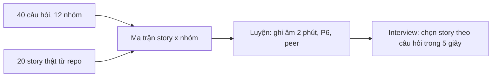

# 12. Behavioral Interview: ngân hàng 40 câu hỏi và 20 STAR story template

> Mục tiêu: có sẵn 20 câu chuyện thật, mỗi câu 2 phút tiếng Anh, phủ hết 40 câu behavioral hay gặp ở vòng hiring manager, culture fit (Grab-style) và vòng lead của bank/fintech. | Mức cần đạt: Senior: 10 story kể trôi, có số. Staff: 20 story, mỗi story trả lời được 3 follow-up, chuyển được một story sang nhiều câu hỏi. Lead: thêm story về người (underperformer, conflict, hiring) và story về tiền (incident liên quan tiền). | Thời gian gợi ý: tuần 11, ~8 giờ (viết 20 story 5h, ghi âm và chấm 3h); ôn lại mỗi tuần 30 phút tới khi phỏng vấn

Ghi chú trước khi đọc: file này không có mục Q&A dạng `### Qn.` như các file kỹ thuật. Thay vào đó là danh sách 40 câu hỏi có đánh số và 20 template story. Mọi story đều lấy từ 5 câu chuyện thật trong `02-Gap-Analysis-Positioning.md` mục 4 (app KMP phonics, thư viện template đã publish, monetization, quy trình 11 pha + failure-first playbook, app trẻ em COPPA) cộng câu chuyện 6 (port iOS). Chỗ nào cần số, ghi `[điền số thật]`. **Không bịa số**: interviewer giỏi sẽ hỏi lại đúng con số đó.

## 0. Bản đồ chủ đề

Behavioral round xuất hiện ở ít nhất hai chỗ trong mọi loop: vòng hiring manager (45 phút, 4-6 câu "tell me about a time") và vòng culture fit cuối (Grab, Agoda, bank nước ngoài). Ở VN, bank và công ty Nhật/Singapore thường thêm câu về "làm việc với stakeholder khó", "xử lý sự cố production", "làm việc với HQ". Với JD Staff/Lead, hơn nửa số câu là về người và quyết định, không phải code.



## 1. Vòng behavioral được chấm thế nào

### 1.1 Năm tín hiệu interviewer chấm

| Tín hiệu | Họ tìm gì trong câu chuyện | Dấu hiệu điểm thấp |
|---|---|---|
| Ownership | Bạn tự nhận việc, tự đi tới cùng, kể cả việc không ai giao | "Team quyết định", "được giao" suốt |
| Impact | Kết quả đo được, cho user hoặc business, không chỉ cho code | Kết quả là "code sạch hơn" |
| Collaboration | Làm việc với PM, backend, QA, HQ; ghi nhận người khác đúng chỗ | Chỉ có bạn và kẻ sai |
| Growth | Bạn học gì, lần sau làm khác gì; nhận sai thật | "Nếu làm lại tôi cũng làm vậy" |
| Judgement | Quyết định trong điều kiện thiếu thông tin, nêu trade-off, biết khi nào escalate | Không có lựa chọn nào bị loại |

Bank/fintech thêm: **risk awareness** (bạn nghĩ tới tiền, dữ liệu, compliance trước khi ship), **process discipline** (làm theo quy trình nhưng biết khi nào quy trình sai).

### 1.2 STAR và CAR

- **STAR**: Situation (bối cảnh, 2 câu), Task (bạn phải làm gì, 1 câu), Action (bạn làm gì, 4-5 câu, động từ "I"), Result (kết quả có số, 1-2 câu). Thêm **L** (Learned, 1 câu) cho câu hỏi về failure và growth.
- **CAR**: Context, Action, Result. Ngắn hơn, dùng khi interviewer hỏi dồn hoặc câu hỏi nhỏ.
- Tỷ lệ thời gian: S+T 20%, A 60%, R+L 20%. Lỗi phổ biến nhất: S chiếm 60%.

### 1.3 Độ dài: 2 phút

Khoảng 250-300 từ nói. Quá 3 phút, interviewer mất tập trung và mất thời gian hỏi follow-up (follow-up là nơi họ chấm bạn). Kết thúc bằng Result rồi dừng; đừng kể thêm "và sau đó...". Nếu họ muốn biết thêm họ sẽ hỏi.

### 1.4 "I" không phải "we"

Interviewer chấm **bạn**. "We decided" làm họ không biết bạn đóng vai gì. Dùng "I proposed, I wrote, I measured, I asked"; với việc của người khác dùng "my teammate X built the backend side". Một story tốt có 70% "I", 30% ghi nhận người khác.

### 1.5 Số

Mỗi story cần ít nhất một con số: thời gian, % crash, số user, số module, số ngày bootstrap, số PR, số tiền tiết kiệm. Số gần đúng cũng được nếu bạn nói rõ "roughly" và biết nguồn. Số bịa thì interviewer hỏi "how did you measure that?" là lộ. Danh sách số bạn cần đo lại trước phỏng vấn: số module trong `kmp-template-impl`, số app dùng template libs, ngày bootstrap trước/sau, crash-free của app, số user hoặc lượt tải, số rule trong playbook, số pha trong workflow (11), số story/audio file trong content pipeline.

### 1.6 Khi không có câu chuyện

1. Đừng bịa. Nói: "I have not been in exactly that situation. The closest is..." rồi kể story gần nhất.
2. Hoặc: "I have not faced that as a lead, but here is how I would approach it, and here is a smaller example where I did part of it."
3. Lưu câu hỏi đó vào `PROGRESS.md`, tìm hoặc tạo tình huống thật ở side project (ví dụ: tự chạy một incident giả lập để có story incident).

### 1.7 Một câu trả lời xấu và một câu trả lời tốt (cùng một story)

Câu hỏi: "Tell me about a bug you shipped to production."

Xấu (EN): "We had a release where some users saw ads even though they paid. The team looked at it and we found a caching issue. We fixed it quickly and it was fine. We learned to test more." Vì sao xấu: toàn "we", không biết bạn làm gì, không có timeline, không có số, bài học chung chung.

Tốt (EN): "In release [x.y] of our kids app, paying users started seeing ads again. I was the release owner. Within [N] minutes of the first tickets I halted the rollout at [N]% and checked the entitlement event in analytics; the purchase cache was being reset on upgrade. I turned on a Remote Config flag that hid ads for anyone with a purchase token, shipped a hotfix the next day, and gave support a reply template. About [N] users were affected and we issued [N] refunds. In the postmortem I added an upgrade test for purchase state and a permanent kill switch for ads. What I took away is that for anything touching money, the kill switch is built before the feature." Vì sao tốt: vai trò rõ, hành động theo thứ tự, số, bài học cụ thể, dừng đúng chỗ.

### 1.8 Bank/fintech và Grab-style: họ nghe thêm gì

Bank và fintech VN (OCB, Techcombank, Tyme, Timo, Payoo, One Mount) chấm thêm ba thứ trong story:
- **Thứ tự hành động khi có sự cố**: dừng thiệt hại, thông báo (compliance, business owner), giữ bằng chứng, rồi mới sửa. Kể sai thứ tự (sửa trước, báo sau) là điểm trừ nặng.
- **Hiểu "server là chốt chặn cuối"**: mobile không bao giờ là nơi duy nhất kiểm tra tiền. Story nào về tiền cũng nên có một câu về kiểm soát phía backend.
- **Kỷ luật quy trình**: bạn làm theo quy trình (change request, release window, segregation of duties) và biết khi quy trình sai thì đề xuất sửa qua kênh chính thức, không lách.

Grab-style culture fit (và các công ty có bộ nguyên tắc tương tự như Agoda, Shopee):
- Họ hỏi theo nguyên tắc: "Heart" (khách hàng), "Hunger" (ownership, vượt kỳ vọng), "Honour" (làm đúng dù khó), "Humility" (nhận sai, học). Mỗi nguyên tắc chuẩn bị 1 story; T20, T3, T8, T10 tương ứng.
- Họ thường hỏi "tell me about a time you failed" hai lần theo hai cách khác nhau để xem bạn có thật sự nhận sai không. Chuẩn bị 2 story failure (T10, T16) với bài học khác nhau.
- Họ hay hỏi "what would your teammates say is your weakness?". Trả lời bằng một điểm yếu thật có bằng chứng bạn đang sửa (ví dụ: ước lượng lạc quan, đã chuyển sang spike-first; hoặc tự code quá nhiều thay vì delegate, đã đặt giới hạn 50%).

**Đọc thêm:**
- https://rework.withgoogle.com/ (structured interviewing: cách interviewer chấm bằng rubric)
- https://www.amazon.jobs/content/en/our-workplace/leadership-principles (nguồn gốc của phần lớn câu hỏi behavioral kiểu "tell me about a time")
- `23-English-for-Tech-Interviews.md` (mẫu câu mở đầu và kết thúc story)

## 2. 40 câu hỏi behavioral hay gặp (EN)

### Nhóm A: Ownership và impact
1. Tell me about the project you are most proud of. What was your role?
2. Tell me about a time you took ownership of something outside your job description.
3. Describe a time you delivered significant impact with limited resources.
4. Tell me about a time you noticed a problem nobody owned and fixed it.

### Nhóm B: Conflict
5. Tell me about a time you disagreed with your manager. What happened?
6. Tell me about a conflict with a teammate and how you resolved it.
7. Describe a time you had to push back on a product or business decision.
8. Tell me about a time you were wrong in a disagreement.

### Nhóm C: Failure và mistake
9. Tell me about your biggest professional failure.
10. Describe a technical decision you made that turned out to be wrong.
11. Tell me about a bug you shipped to production and what you did.
12. Tell me about a time you missed a deadline.

### Nhóm D: Influence và persuasion
13. Tell me about a time you convinced a team to adopt something without having authority over them.
14. Describe a time you changed a process across teams.
15. Tell me about a time you had to influence a senior stakeholder.

### Nhóm E: Mentoring và leadership
16. Tell me about someone you mentored and how they grew.
17. Tell me about a time you had to handle an underperforming team member.
18. Describe how you gave difficult feedback to someone.
19. Tell me about a time you led a project without being the manager.

### Nhóm F: Ambiguity và priorities
20. Tell me about a time you had to make a decision without enough information.
21. Describe a situation with conflicting priorities from different stakeholders.
22. Tell me about a time you had to say no.

### Nhóm G: Deadline và pressure
23. Tell me about a time you worked under intense pressure. What did you do?
24. Describe a time you had to cut scope to ship.
25. Tell me about a time you had to deliver bad news.

### Nhóm H: Technical decision
26. Walk me through a significant architecture decision you made and its trade-offs.
27. Tell me about a time you chose a simpler solution over a more elegant one.
28. Describe a time you had to decide between building and buying.

### Nhóm I: Learning
29. Tell me about a time you had to learn something quickly to deliver.
30. What is a skill you learned in the last year and how did you apply it?
31. Tell me about a time you received feedback that changed how you work.

### Nhóm J: AI-era questions
32. Tell me about a time you decided not to use AI for a task. Why?
33. Tell me about a bug introduced by an AI tool that you caught. How did you catch it?
34. Tell me about a teammate who was over-relying on AI. What did you do?
35. How have you changed your engineering process because of AI coding agents? Give a concrete example.

### Nhóm K: Culture fit (Grab-style và tương tự)
36. Tell me about a time you went above and beyond for a customer.
37. Tell me about a time you had to work with a team in another country or timezone.
38. Describe a time you did the right thing even though it was unpopular or costly.

### Nhóm L: Bank/fintech
39. Tell me about a time you handled a production incident involving money or sensitive data.
40. Describe a time you had to balance compliance or security requirements against delivery speed.

Câu 36 là câu kinh điển của Grab ("Heart" trong 4H: Heart, Hunger, Honour, Humility; xem trang nguyên tắc của Grab, cần kiểm tra bản hiện tại). Câu 5, 7, 38 bám Amazon "Have Backbone; Disagree and Commit". Câu 39-40 gần như chắc chắn ở OCB, Techcombank, Tyme, Timo, Payoo (xem `01-Market-Research-2026.md`).

### 2.1 Tra ngược: câu hỏi nào dùng template nào

Dùng bảng này trong lúc luyện để chọn story trong 5 giây. Template đầu tiên là lựa chọn chính, các template sau là dự phòng khi story chính đã kể ở vòng trước.

| Câu | Template chính | Dự phòng |
|---|---|---|
| 1 | T1 | T4, T9 |
| 2 | T3 | T20, T18 |
| 3 | T9 | T1, T3 |
| 4 | T3 | T20, T6 |
| 5 | T17 | T10 |
| 6 | T13 | T17 (biến thể với đồng nghiệp), T21 nếu bạn viết |
| 7 | T17 | T8, T19 |
| 8 | T10 | T16 |
| 9 | T10 | T16, T7 |
| 10 | T10 | T2 |
| 11 | T5 | T12, T10 |
| 12 | T16 | T5 |
| 13 | T3 | T11 |
| 14 | T6 | T11 |
| 15 | T17 | T8 |
| 16 | T18 | T13 |
| 17 | T13 | T18 (biến thể underperformer, xem `11` Q9) |
| 18 | T13 | T18 |
| 19 | T6 | T1, T11 |
| 20 | T2 | T8, T14 |
| 21 | T19 | T8 |
| 22 | T19 | T8, T17 |
| 23 | T5 | T16 |
| 24 | T16 | T19 |
| 25 | T16 | T17 |
| 26 | T2 | T1, T10 |
| 27 | T10 (bản đầu bundle là "simpler") | T4 (RevenueCat) |
| 28 | T4 | T9 |
| 29 | T15 | T1 |
| 30 | T15 | T11 |
| 31 | T7 | T13 (nếu bạn là người nhận feedback) |
| 32 | T14 | T4 |
| 33 | T12 | T7 |
| 34 | T13 | T11 |
| 35 | T11 | T6, T7 |
| 36 | T20 | T4 |
| 37 | T15 hoặc story HQ thật nếu có | T19 |
| 38 | T8 | T17 |
| 39 | T5 | T4 |
| 40 | T8 | T4, T14 |

Câu 37 (team khác nước) chưa có template riêng vì phụ thuộc vào lịch sử làm việc thật của bạn. Nếu bạn từng làm với HQ Singapore/Nhật hoặc khách outsourcing nước ngoài, viết T22 theo khung ở mục 3 và dùng gợi ý ở `11-Leadership-Management.md` mục 5.6.

**Đọc thêm:**
- https://github.com/kaushikb9/em-interviews (thêm câu hỏi cho nhóm E, F, G)
- https://www.grab.com/ (nguyên tắc Grab cho nhóm K; cần kiểm tra đường dẫn trang nguyên tắc hiện tại)
- `01-Market-Research-2026.md` (công ty nào hỏi nhóm L)

## 3. 20 STAR story template

Cách dùng: mỗi template có câu hỏi nó trả lời, story gợi ý từ repo của bạn, skeleton tiếng Anh có chỗ trống, 3 follow-up, và một dòng red flag. Điền skeleton bằng sự thật của bạn, rồi chạy prompt P6 trong `18-AI-Study-Workflow.md` để siết về 2 phút.

### T1. Ship app KMP + Compose Multiplatform lên Android và iOS
**Trả lời cho:** Q1, Q3, Q19, Q26
**Story gợi ý:** ABC Phonics Kids trên `kmp-template-impl`: 9 core module, 7 feature module, Room KMP, Koin, Nav/Lifecycle KMP, target iOS.
**Skeleton (EN):**
- S: "Our team had an Android phonics app for kids and a request to launch on iOS with [điền số] engineers and no iOS specialist."
- T: "I owned the architecture and the delivery for both platforms."
- A: "I designed a KMP template with [9] core and [7] feature modules; chose Koin for a single DI graph in commonMain; put Room, navigation and ViewModels in shared code; kept platform code behind expect/actual for audio and storage; wrote the build-logic convention plugins so each feature module took minutes to add; set up the iOS entry point and CI for both targets."
- R: "We shipped to Android and iOS from one codebase with roughly [điền số]% of UI code shared; iOS went live [điền số] weeks after Android. [Lượt tải / rating nếu có]."
- L: "The platform work (audio, files, Xcode toolchain) is the part to estimate carefully; shared UI is the easy part."
**Follow-ups:** Why Koin and not Hilt? What broke on iOS that worked on Android? How long is the build, and how did you keep it down?
**Red flags cần tránh:** Kể như bạn chỉ "dùng" KMP; không nói được trade-off; không có số.

### T2. Quyết định Koin thay Hilt cho KMP
**Trả lời cho:** Q26, Q20, Q27
**Story gợi ý:** ADR Koin/Hilt (mẫu điền sẵn ở `11-Leadership-Management.md` mục 1.1).
**Skeleton (EN):**
- S: "We needed one dependency graph for Android and iOS. The team knew Hilt from older projects."
- T: "I had to choose a DI approach that worked in commonMain without slowing the team."
- A: "I listed three options: Hilt (Android only, would mean two graphs), Koin (Kotlin DSL, runtime resolution), and compile-time KMP options the team had not used. I prototyped Koin in two days, measured startup impact [điền số], and wrote an ADR with the risk: missing bindings fail at runtime. I mitigated with module verification tests and a startup test that resolves every ViewModel."
- R: "One DI graph; feature modules register their own Koin module; no DI-related production crash in [điền số] releases."
- L: "Write the mitigation in the same ADR as the decision; it is what makes a runtime-checked choice acceptable."
**Follow-ups:** What would make you switch to a compile-time DI? How do you catch a missing binding before release? How does Swift call into Koin?
**Red flags cần tránh:** Chê Hilt; không có mitigation; không có "revisit when".

### T3. Xây và publish bộ thư viện template dùng chung
**Trả lời cho:** Q13, Q14, Q2, Q4
**Story gợi ý:** `io.github.ltthuc.template:ui/network/datastore/ads/billing/rating/app-update/navigation/settings-common` publish từ `YammyDelivery`, consume bởi `compose-template` qua version catalog.
**Skeleton (EN):**
- S: "Every new app re-implemented billing, ads consent, in-app review, update prompts and settings. A new app took about [2 tuần, điền số thật] to bootstrap."
- T: "Nobody asked me to fix it; I decided to make it a platform problem."
- A: "I extracted the shared parts into [9] libraries with stable interfaces, published them to Maven with semver and a changelog, wired them through a version catalog and convention plugins, and migrated one app myself as the proof. Then I wrote a migration guide and offered to pair with the other app owners."
- R: "New apps bootstrap in about [2 ngày, điền số thật]; [N] apps share the libraries; a billing bug now gets fixed once."
- L: "Adoption came from a working example and a cheap migration, not from a mandate."
**Follow-ups:** How do you handle a breaking change in a shared library? How do you test a library without an app? What was the hardest thing to extract?
**Red flags cần tránh:** Không có số trước/sau; không nói về versioning và breaking change.

### T4. Monetization end-to-end
**Trả lời cho:** Q1, Q28, Q36 (biến thể), Q40
**Story gợi ý:** `core/billing`, `feature/billing`, RevenueCat/Play Billing, AdMob + AppLovin, UMP consent, Remove-Ads SKU, `SecretsModule`, BuildKonfig.
**Skeleton (EN):**
- S: "The kids app needed revenue: subscriptions, a remove-ads purchase, and ads that comply with Families policy and consent rules."
- T: "I owned the whole flow from SDK choice to release."
- A: "I chose RevenueCat over building server-side receipt validation, wrapped it behind a BillingGateway interface to avoid lock-in; integrated AdMob with AppLovin mediation and UMP consent; kept secrets out of the APK with BuildKonfig; wrote a test plan for purchase, restore, cancel and grace-period cases using license testers; added analytics events for each funnel step."
- R: "[Conversion / revenue / refund rate, điền số thật hoặc bỏ]; zero billing-related crashes in [điền số] releases; passed Families policy review on the first submission [nếu đúng]."
- L: "Billing bugs are expensive in support time, so the test matrix is worth more than the code."
**Follow-ups:** How did you test restore purchases across devices? What happens if RevenueCat is down? How do you handle a user charged twice?
**Red flags cần tránh:** Không biết các case cancel/grace/restore; không nói compliance cho ads trong app trẻ em.

### T5. Sự cố production liên quan tới tiền (billing entitlement)
**Trả lời cho:** Q39, Q11, Q23
**Story gợi ý:** Biến thể hợp lý từ story 3: một release làm user đã mua Remove-Ads vẫn thấy ads (hoặc entitlement không restore). Chỉ dùng nếu bạn thực sự gặp; nếu không, dùng story crash migration ở T10 cho Q11 và nói rõ với interviewer đây là sự cố gần nhất với "money".
**Skeleton (EN):**
- S: "After release [x.y], support tickets came in from paying users who were seeing ads again."
- T: "I was the release owner; I had to stop the damage, fix it, and keep users' trust."
- A: "Within [điền số] minutes I halted the staged rollout at [điền số]%, checked Crashlytics and analytics for the entitlement event, and found the cache for the entitlement was reset on upgrade. I enabled a Remote Config flag that disabled ads for users with a purchase token present, shipped a hotfix the next day, and wrote a reply template for support. I then ran a blameless postmortem."
- R: "[Số user ảnh hưởng] users affected, [số] refunds, hotfix adoption reached [số]% in [số] days. Postmortem added a purchase-state test on upgrade and a kill switch for ads."
- L: "For anything touching money, build the kill switch before the feature."
**Follow-ups:** How did you know how many users were affected? Why was the entitlement cache reset? What did the postmortem change in process?
**Red flags cần tránh:** Đổ lỗi cho SDK; không có timeline; không có action item.

### T6. Quy trình delivery 11 pha có cổng chặn
**Trả lời cho:** Q14, Q19, Q35, Q40
**Story gợi ý:** `docs/engineering/*`, 11 pha từ plan tới publish, quality gates, CONTENT_PACK_OPERATIONS, skill `/grabee`, command `/scaffold-unit`.
**Skeleton (EN):**
- S: "Releases were inconsistent: some went out without tests, content updates broke the app, and when an AI agent generated code nobody could say which checks it had passed."
- T: "I decided to define the process rather than fix each release."
- A: "I wrote an 11-phase workflow from planning to publish with an explicit gate at each phase: design review, implementation with scaffolding commands, tests, static analysis, screenshot tests, content pack validation, staged rollout, and post-release review. I encoded what I could as commands and skills so humans and agents follow the same path, and I documented the rest in the repo."
- R: "[Số release] releases on the process; [số] rollouts halted by a gate before users were affected; new contributors ship on the process from day one."
- L: "A process only survives if it is executable; the parts that stayed as prose were the parts people skipped."
**Follow-ups:** Which phase is skipped most and why? How long does the full pipeline take? What did you remove from the process after using it?
**Red flags cần tránh:** Liệt kê 11 pha như đọc thuộc; không nói được pha nào sinh ra từ sự cố nào.

### T7. Failure-first playbook: từ bug thành rule
**Trả lời cho:** Q9, Q31, Q35, Q33
**Story gợi ý:** FAILURE_FIRST_PLAYBOOK trong repo: mỗi rule gắn với một lỗi thật (ví dụ agent thêm dependency ngoài version catalog, agent sinh test chỉ assert not-null, agent dùng API không tồn tại ở version đang dùng). Chọn 1-2 rule bạn nhớ rõ nhất.
**Skeleton (EN):**
- S: "After adopting an AI coding agent, we hit the same class of mistakes repeatedly: [ví dụ thật]."
- T: "I wanted the fixes to outlive the people who found them."
- A: "I started a failure-first playbook: every time a bug reached review or production, I wrote the rule that would have prevented it, with the bug as the example, and added it to CLAUDE.md so the agent reads it. Where possible the rule became a lint or a test instead of text."
- R: "[Số] rules; the top three bug classes dropped to near zero in review comments [điền số]; onboarding uses the playbook as the reading list."
- L: "Rules without the original bug attached get ignored; the story is what makes people follow them."
**Follow-ups:** Give me one rule and the bug behind it. How do you prune rules that no longer apply? Did the agent actually follow them?
**Red flags cần tránh:** Nói chung chung "AI hay sai"; không có ví dụ bug cụ thể.

### T8. Tuân thủ COPPA/Families cho app trẻ em
**Trả lời cho:** Q40, Q22, Q38, Q20
**Story gợi ý:** `references/coppa.md`, Families policy, ads SDK certified, không thu thập dữ liệu trẻ em, consent cha mẹ.
**Skeleton (EN):**
- S: "The app targets children under 13, so COPPA in the US and Play's Families policy apply, and the business wanted ads and analytics like any other app."
- T: "I had to define what we could and could not do, and say no to part of the plan."
- A: "I read the policy and wrote a one-page constraints doc: no behavioral ads, only Families-certified ad SDKs, no advertising ID, no precise location, minimal analytics with no personal data, a parental gate for external links and purchases. I reviewed every SDK's data collection against the Play Data safety form. I pushed back on a personalized-ads request with the numbers: policy rejection would cost the whole app."
- R: "The app passed Families review [điền: lần đầu hoặc sau N lần]; the data safety form matched what the app does; no policy strikes in [điền số] releases."
- L: "In regulated products, the constraints doc comes before the feature list."
**Follow-ups:** What is a parental gate and how did you implement it? How do you keep the Data safety form accurate when SDKs update? What changed in COPPA recently (cần kiểm tra)?
**Red flags cần tránh:** Bịa ngưỡng luật; không biết Data safety form là gì.

### T9. Pipeline audio sinh bằng Gemini và CDN Firebase Storage
**Trả lời cho:** Q3, Q27, Q28, Q35
**Story gợi ý:** GeminiGenerator audio project, content pack theo level/story, `FIREBASE_STORAGE_BUCKET`, versioning content pack, cache, fallback.
**Skeleton (EN):**
- S: "The app needed hundreds of audio clips per level [điền số] and recording them manually was too slow and expensive."
- T: "I owned the content pipeline end to end: generation, quality check, packaging, delivery."
- A: "I built a generator around Gemini for text and TTS output, with a review step for pronunciation; packed clips into versioned content packs with a manifest; hosted them on Firebase Storage behind a CDN; and implemented download, cache and fallback in the app so a missing clip never blocks a lesson. I tracked cost per pack [điền số] and set a cap."
- R: "[Số] clips across [số] stories generated in [số] days; initial app download reduced by [số] MB; content fixes ship without a release."
- L: "The review step is the real product; generation is cheap, wrong pronunciation for a kids app is not."
**Follow-ups:** How do you version a pack without breaking old clients? What happens offline on first launch? What did the pipeline cost per month?
**Red flags cần tránh:** Không có bước kiểm tra chất lượng; không nói chi phí.

### T10. Quyết định sai và sửa: bundle content trong APK, sau đổi sang content pack
**Trả lời cho:** Q10, Q9, Q8
**Story gợi ý:** Bản đầu bundle audio trong APK, app nặng, mọi sửa content phải release; sau chuyển sang content pack tải về (xem T9). Dùng nếu đúng với lịch sử repo của bạn; nếu không, dùng quyết định sai thật khác (ví dụ migration Room).
**Skeleton (EN):**
- S: "In the first version I bundled all audio content in the APK to keep things simple."
- T: "After [điền số] content updates it was clearly wrong: app size [điền số] MB, install conversion down, every typo fix meant a store release."
- A: "I owned the mistake in the ADR, superseded it with a downloadable, versioned content pack, planned the migration so existing users kept working, and added a 'revisit when' condition to every ADR after that."
- R: "Initial download reduced by [điền số]; content updates without release; migration took [điền số] weeks."
- L: "The first decision was fine for an MVP; the mistake was not writing down when to revisit it."
**Follow-ups:** How did you know it was wrong? Why not fix it earlier? What did the migration risk?
**Red flags cần tránh:** Bào chữa; không có bài học quy trình; "if I did it again I'd do the same".

### T11. Đưa Claude Code vào team có policy và review
**Trả lời cho:** Q35, Q14, Q19, Q13
**Story gợi ý:** `CLAUDE.md`, skills, commands, nhãn PR, review checklist cho code AI, đo lường. Xem `10-AI-for-Mobile-Lead.md`.
**Skeleton (EN):**
- S: "The team started using AI coding agents informally; quality varied and nobody could say which PRs were agent-generated."
- T: "I set up the way we use agents so speed did not cost quality."
- A: "I wrote the repo rules in CLAUDE.md (architecture, module boundaries, testing rules), created skills and commands for scaffolding so output matched our structure, required an ai-assisted label and an author who can explain every line, added a review checklist for AI-specific risks, and measured PR cycle time and defect escape rate before and after."
- R: "[Cycle time trước/sau, điền số]; defect escape rate [điền số]; the rules file is now the onboarding doc."
- L: "The agent is only as good as the repo's written rules; most of the gain came from writing down what we already believed."
**Follow-ups:** What did you measure and what moved? What is banned? How do you keep juniors learning?
**Red flags cần tránh:** Nói AI "tăng năng suất 10 lần" không có số; không có policy về dữ liệu/secret.

### T12. Bắt được bug do AI sinh ra trong review
**Trả lời cho:** Q33, Q11
**Story gợi ý:** Một PR agent sinh, ví dụ: coroutine collect trên Main với IO; sync dùng last-write-wins bỏ qua `updatedAt`; test chỉ mirror implementation; API không tồn tại ở version đang dùng. Chọn cái bạn thực sự gặp.
**Skeleton (EN):**
- S: "A PR generated with an agent implemented [ví dụ: the outbox sync] and all checks were green."
- T: "I was the reviewer for data-integrity changes."
- A: "I read the conflict branch instead of trusting the green tests; the code overwrote the server record without comparing updatedAt, and the test asserted only that sync completed. I reproduced it with two devices, wrote the failing test first, then asked the author to fix it and explain the branch verbally. I added the case to the playbook."
- R: "Caught before release; the playbook rule 'tests must assert the conflict outcome, not completion' prevented [điền số] similar cases later."
- L: "Green tests from an agent tell you the tests pass, not that the tests are right."
**Follow-ups:** How do you review AI PRs differently? Would a human have made the same mistake? What tool support would catch it?
**Red flags cần tránh:** Kể mơ hồ "AI sinh bug"; không có cách bạn phát hiện.

### T13. Đồng nghiệp lạm dụng AI
**Trả lời cho:** Q34, Q18, Q16
**Story gợi ý:** Mid-level dev đẩy PR 1,000+ dòng không giải thích được (script 1:1 ở `11` mục 3.2).
**Skeleton (EN):**
- S: "A mid-level engineer started shipping large agent-generated PRs; reviews took days and in one review he could not explain how a branch worked."
- T: "I wanted to fix the behavior without discouraging the tool."
- A: "In a one-on-one I used a specific example (situation, behavior, impact), asked what was driving it, and we agreed on two rules: PRs under [điền số] lines, and a verbal walkthrough before review. I paired with him on the next PR, and I added 'explain-your-PR' to the team's review norms so it was not about him."
- R: "Next PRs were [điền số] lines with one review round; he later wrote one of the playbook rules himself."
- L: "Make the norm team-wide; individual rules feel like punishment."
**Follow-ups:** What if he had pushed back? How do you tell over-reliance from efficiency? How do you evaluate his real skill now?
**Red flags cần tránh:** Cấm AI; nói xấu đồng nghiệp; không có cơ chế team-wide.

### T14. Lần bạn chọn không dùng AI
**Trả lời cho:** Q32, Q20
**Story gợi ý:** Logic xác minh purchase/entitlement, xử lý secrets (`SecretsModule`), code liên quan COPPA, hoặc thiết kế API public cho library. Chọn thứ bạn thực sự tự viết tay.
**Skeleton (EN):**
- S: "When building [the entitlement logic / the secrets handling / the public API of the billing library], I had the agent available."
- T: "I had to decide whether to generate it."
- A: "I wrote it by hand because [the failure cost is money and the agent cannot see the business rules / it touches secrets I do not want in a prompt / a public API is a long-term contract that needs taste]. I used the agent only afterwards to generate edge-case tests against my implementation and to review it as a second reader."
- R: "The module has had [zero, điền số] production defects; the tests the agent generated found [điền số] edge cases I had missed."
- L: "Use the agent where mistakes are cheap and reversible; keep humans where the cost is money, privacy, or a contract."
**Follow-ups:** How do you decide in general? Would you use it for the same task today? What data do you never send to a model?
**Red flags cần tránh:** "I always use AI" hoặc "I never trust AI".

### T15. Port app iOS bằng cách đọc Swift
**Trả lời cho:** Q29, Q30, Q20
**Story gợi ý:** Skill `ios-app-port`, `swift-compose-mapping.md`: port SwiftUI app sang Compose; chứng minh đọc Swift được.
**Skeleton (EN):**
- S: "We needed to port a SwiftUI app to Android in [điền số] weeks; I was not an iOS developer."
- T: "I had to understand the Swift codebase well enough to reproduce behavior, not just screens."
- A: "I built a SwiftUI-to-Compose mapping document as I went (state, navigation, lifecycle, async), used it to port screen by screen, wrote parity tests for business logic, and turned the mapping into a reusable skill so the next port is faster. Where Swift semantics differed (structs, optionals, Combine), I wrote down the Kotlin equivalent and the trap."
- R: "Feature parity in [điền số] weeks; the mapping doc was reused for [điền số] later ports."
- L: "Learning a platform for a port means learning its lifecycle and concurrency model first; syntax is the easy part."
**Follow-ups:** What was the hardest Swift concept to map? What did you get wrong at first? Could you review a Swift PR today?
**Red flags cần tránh:** Nói "biết iOS" quá mức; không nêu được một khác biệt ngữ nghĩa cụ thể.

### T16. Trễ deadline port iOS
**Trả lời cho:** Q12, Q23, Q25
**Story gợi ý:** Trễ release train iOS vì ước lượng sai phần native (audio, file storage, Xcode CI).
**Skeleton (EN):**
- S: "The iOS launch of the phonics app was planned for [điền ngày]; I estimated it from the shared UI percentage."
- T: "By week two it was clear we would miss it; I owned the estimate and the recovery."
- A: "I told the PM the same day with a new date and a reduced first scope, time-boxed spikes for audio and storage, moved Xcode CI setup to a parallel track, and wrote a reference-class note so the next estimate starts from real numbers."
- R: "Shipped the reduced scope on the new date, [điền số] weeks late; the second feature port was estimated from the first and landed on time."
- L: "For anything new to the team, estimate from a spike, and go red early."
**Follow-ups:** How did stakeholders react? What was cut and did it come back? How do you estimate ports now?
**Red flags cần tránh:** Đổ lỗi cho Apple/toolchain; báo trễ muộn.

### T17. Bất đồng với manager về rollout 100%
**Trả lời cho:** Q5, Q7, Q38
**Story gợi ý:** Billing change, marketing date, không có kill switch (xem `11` Q10). Dùng nếu thật; nếu không có, đổi sang bất đồng thật khác (ví dụ về việc bundle content, về việc bỏ test để kịp hạn).
**Skeleton (EN):**
- S: "My manager wanted a billing change at 100% rollout on a marketing date; we had no server-side kill switch."
- T: "I had to disagree without blocking the launch."
- A: "I wrote half a page with two options and the risk in money terms (a refund wave if the flow double-charged): ship on the date with a kill switch built in two days, or ship on the date to 20% and ramp. I recommended the first. I said I would commit to whichever he chose."
- R: "He chose the kill-switch option; we slipped [điền số] days; the flag was used [điền số] weeks later for an unrelated backend issue."
- L: "Disagreement with options and a number is a decision; disagreement alone is friction."
**Follow-ups:** What if he had said no to both? How do you disagree in front of the team? When would you escalate above him?
**Red flags cần tránh:** Kể như bạn thắng; không nói "I would have committed".

### T18. Mentor một junior tới khi own release
**Trả lời cho:** Q16, Q19, Q2
**Story gợi ý:** Một junior/mid trong team hoặc một cộng tác viên side project; bạn giao dần: PR nhỏ, review PR người khác, own một module, own một release train. Nếu không có người thật, dùng câu chuyện onboarding bạn đã làm cho người khác với template (migration guide, docs).
**Skeleton (EN):**
- S: "[Name/role] joined with Android experience but had never released an app or worked in a modular codebase."
- T: "I set a goal with them: own a release end to end within [điền số] months."
- A: "Weekly one-on-ones with a growth plan; first PRs in one module with pairing; then reviewing others' PRs; then owning the content-pack feature; then shadowing a release; then running one with me as backup. Feedback was specific and quick."
- R: "They ran the [điền số] release on their own, including a halted rollout they handled correctly; later they [promotion / own module]."
- L: "Growth needs a visible ladder of ownership, not just advice."
**Follow-ups:** What did they struggle with most? How did you adapt your style? What would you do differently?
**Red flags cần tránh:** Mentoring = "I answered their questions"; không có kết quả cho người đó.

### T19. Ưu tiên xung đột và nói không có trade-off
**Trả lời cho:** Q21, Q22, Q24
**Story gợi ý:** Referral feature trước campaign (xem `11` Q18) hoặc xung đột thật giữa platform deadline (target API 36, 16 KB) và feature request.
**Skeleton (EN):**
- S: "Marketing wanted a referral feature in two weeks for a campaign; at the same time we had the target API deadline for Play."
- T: "I had to give a clear answer without overcommitting the team."
- A: "I put both on one list with effort and risk, showed capacity, and offered two options: a deep-link referral with manual reward in two weeks, or the full automated flow in five. I explained the fraud risk of the fast version. I did not move the Play deadline because missing it blocks all updates."
- R: "They chose the simple version; the campaign ran; the full flow shipped later with data on which channels mattered; the API deadline was met."
- L: "'Yes, if' with a trade-off lets the business own the choice."
**Follow-ups:** What if they insisted on everything? How did you communicate the decision? How do you handle the person who lost?
**Red flags cần tránh:** Nói "no" trần; hy sinh deadline bắt buộc.

### T20. Vượt kỳ vọng vì khách hàng (culture fit)
**Trả lời cho:** Q36, Q38, Q4
**Story gợi ý:** Phản hồi từ phụ huynh (app trẻ em): audio không tải trên thiết bị yếu/offline, restore purchase khi đổi máy, nội dung phát âm sai. Bạn tự xử lý ngoài scope: trả lời trực tiếp, sửa trong hotfix, thêm fallback. Chọn một case thật từ review/support.
**Skeleton (EN):**
- S: "A parent wrote that their child lost access to purchased content after switching phones [hoặc case thật khác]."
- T: "It was a support ticket, not my job, but it was a paying user with a child in front of a broken app."
- A: "I replied the same day, reproduced the issue (restore depended on a cached token), added a restore-purchases path on first launch and a clear button in settings, and shipped it in the next train. I also searched reviews for the same complaint and replied to each."
- R: "[Số] users with the same issue recovered; the rating for that version went from [điền số] to [điền số]; restore-related tickets dropped to [điền số]."
- L: "One support ticket read carefully is worth more than a dashboard."
**Follow-ups:** How do you decide which tickets to handle yourself? How did you measure the impact? What process change came from it?
**Red flags cần tránh:** Vượt kỳ vọng = làm thêm giờ; không có kết quả cho khách hàng.

### 3.1 Ba story viết đầy đủ ở dạng nói 2 phút (EN)

Đây là mẫu "thành phẩm" để bạn thấy độ dài và nhịp. Số trong ngoặc vuông phải thay bằng số thật của bạn trước khi dùng.

**T1 viết đầy đủ, cho Q1 "the project you are most proud of":**

"The project I'm most proud of is a children's phonics app that we ship to Android and iOS from one Kotlin Multiplatform codebase. The situation: we had an Android app, a request to launch on iOS, [N] engineers and no iOS specialist. My task was to own the architecture and the delivery on both platforms. What I did: I designed a KMP template with nine core modules and seven feature modules, and chose Koin so we have a single DI graph in common code, because Hilt is Android-only. ViewModels, Room and navigation live in shared code; audio and file storage sit behind expect/actual. I wrote convention plugins in build-logic so adding a feature module takes minutes, and I set up CI for both targets, including the Xcode toolchain. The result: we shipped to both stores with roughly [N] percent of UI code shared, and iOS went live [N] weeks after Android. One thing I learned: the shared UI is the easy part; the platform pieces, audio, files, the toolchain, are what you have to estimate carefully."

**T12 viết đầy đủ, cho Q33 "a bug introduced by an AI tool that you caught":**

"We had a PR for the offline sync engine that was generated with an agent. Everything was green: build, lint, tests. I was the reviewer because it touched data integrity. Instead of trusting the green tests I read the conflict branch, and it overwrote the server record on a 409 without comparing updatedAt, which would silently lose edits from a second device. The test only asserted that sync completed. I reproduced it with two emulators, wrote the failing test first, then asked the author to fix it and walk me through the branch verbally. I added the case to our playbook as a rule: tests for conflicts must assert the outcome, not completion. We caught it before release, and that rule has caught [N] similar cases since. The lesson I repeat to the team is that green tests from an agent tell you the tests pass, not that the tests are right."

**T20 viết đầy đủ, cho Q36 "went above and beyond for a customer":**

"A parent wrote to support saying their child had lost access to purchased content after they switched phones. It was a support ticket, not my job, but it was a paying user with a child in front of a broken app. I replied the same day, asked two questions, and reproduced it: restore depended on a cached token that did not exist on the new device. I added an automatic restore-purchases check on first launch and a clear restore button in settings, and shipped it on the next release train. I also searched our reviews for the same complaint and replied to each one with the fix date. The result: [N] users with the same issue recovered, the rating for that version went from [N] to [N], and restore-related tickets dropped to [N] a month. What I took from it is that one support ticket read carefully is worth more than a dashboard."

### 3.2 Khung trống cho T21 (conflict với đồng nghiệp ngang cấp) và T22 (team khác nước)

Hai nhóm này ma trận ở mục 4 còn mỏng. Điền bằng sự thật của bạn; nếu không có, nói thẳng với interviewer và dùng dự phòng ở bảng 2.1.

```markdown
T21. <Tên story>
**Trả lời cho:** Q6, Q8
**Story:** <ai, bất đồng về gì, ở dự án nào>
- S: "<bối cảnh 2 câu: hai bên muốn gì khác nhau và vì sao>"
- T: "<bạn phải đạt gì: quyết định, giữ quan hệ, giữ deadline>"
- A: "I talked to [X] privately first... I wrote down the shared goal... We agreed on a criterion... I proposed a two-day experiment... I documented the decision..."
- R: "<quyết định cuối, số nếu có, quan hệ sau đó>"
- L: "<một câu>"
**Follow-ups:** "What if the experiment had proven you wrong?" "How is your relationship with X now?" "Would you escalate earlier next time?"
**Red flags:** kể như bạn thắng; không nêu lý do hợp lý của bên kia.

T22. <Tên story>
**Trả lời cho:** Q37, Q21
**Story:** <HQ hoặc khách ở nước nào, lệch múi giờ bao nhiêu, vấn đề gì>
- S: "<bối cảnh: lệch giờ, văn hoá, kênh giao tiếp>"
- T: "<bạn phải làm gì để việc chạy async được>"
- A: "I moved decisions to written proposals... I set overlap hours... I pre-aligned with [X] before the meeting... I wrote the incident handoff..."
- R: "<lead time, số vòng họp giảm, một quyết định đã đi qua được>"
- L: "<một câu>"
**Follow-ups:** "What did you misunderstand about their culture at first?" "How did you handle urgent issues outside overlap hours?" "What would you set up on day one next time?"
**Red flags:** kể về khác biệt văn hoá như định kiến; không có cơ chế cụ thể.
```

**Đọc thêm:**
- `02-Gap-Analysis-Positioning.md` mục 4 (bảng 5 câu chuyện và "cần bổ sung trước khi kể")
- `11-Leadership-Management.md` mục 1.1, 3.2, 6.5 (ADR Koin/Hilt, script 1:1, postmortem template: nguồn chi tiết cho T2, T13, T5)
- `18-AI-Study-Workflow.md` P6 (siết story về 2 phút)

## 4. Ma trận story x nhóm câu hỏi

Cột là 12 nhóm ở mục 2. `X` = story trả lời tốt; `o` = trả lời được nếu nhấn đúng chỗ.

| Story | A Own | B Conf | C Fail | D Infl | E Ment | F Ambig | G Deadl | H Tech | I Learn | J AI | K Cult | L Bank |
|---|---|---|---|---|---|---|---|---|---|---|---|---|
| T1 KMP ship | X | | | | o | | o | X | o | | | |
| T2 Koin/Hilt | | | | o | | X | | X | | | | |
| T3 Template libs | X | | | X | | | | o | | | | |
| T4 Monetization | X | | | | | | | X | | | o | X |
| T5 Money incident | o | | X | | | | X | | | | | X |
| T6 11-phase workflow | o | | | X | X | | | | | X | | X |
| T7 Failure-first playbook | | | X | | | | | | X | X | | |
| T8 COPPA/Families | | o | | | | X | | | | | X | X |
| T9 Gemini pipeline | X | | | | | | | X | | X | | |
| T10 Wrong decision | | X | X | | | | | X | | | | |
| T11 Claude Code policy | | | | X | X | | | | | X | | |
| T12 Caught AI bug | | | X | | | | | | | X | | |
| T13 AI over-reliance | | | | | X | | | | | X | | |
| T14 Not using AI | | | | | | X | | | | X | | o |
| T15 iOS port | | | | | | o | | | X | | | |
| T16 Missed deadline | | | X | | | | X | | | | | |
| T17 Disagree manager | | X | | | | | | | | | X | |
| T18 Mentor junior | X | | | | X | | | | | | | |
| T19 Priorities / no | | | | | | X | X | | | | | |
| T20 Customer | X | | | | | | | | | | X | |

Đọc ma trận: nhóm nào ít `X` nhất là lỗ hổng. Hiện tại nhóm B (Conflict) chỉ có T10, T17 và nhóm D (Influence) có T3, T6, T11. Nếu bạn có story conflict với đồng nghiệp ngang cấp (Q6), thêm vào T17 dạng biến thể hoặc viết T21. Mỗi nhóm nên có ít nhất 2 story để không kể lặp khi hai interviewer hỏi cùng nhóm.

Quy tắc chọn story trong 5 giây: nghe câu hỏi, xác định nhóm, chọn story có `X` chưa kể trong loop này. Ghi nhớ story nào đã kể ở vòng nào (interviewer cùng loop có so ghi chú).

**Đọc thêm:**
- https://rework.withgoogle.com/ (vì sao interviewer trong cùng loop so ghi chú và chấm theo rubric)
- The Manager's Path (Fournier), ch. 3-4 (tình huống tech lead thật để nhận ra lỗ hổng story của bạn)
- `PROGRESS.md` (nơi ghi câu hỏi mới sau mỗi phỏng vấn để cập nhật ma trận)

## 5. Cách luyện

1. **Viết trước, nói sau.** Điền 20 skeleton bằng sự thật. Chỗ nào là `[điền số thật]` thì đo lại từ repo, Play Console, Crashlytics, RevenueCat. Chỗ không có số, bỏ con số thay vì bịa.
2. **Chạy P6.** Dán từng story vào prompt P6 trong `18-AI-Study-Workflow.md` để siết về 2 phút và nhận 3 follow-up. Không cho AI thêm số.
3. **Ghi âm với đồng hồ 2 phút.** Điện thoại, nói tiếng Anh, không nhìn giấy. Nghe lại, đếm số "we", đếm số "um", đo thời gian từng phần S/T/A/R.
4. **Follow-up drill.** Với mỗi story, trả lời 3 follow-up trong 30 giây mỗi câu. Đây là phần interviewer chấm thật.
5. **Peer feedback.** Nhờ một người (đồng nghiệp, bạn, hoặc Claude Code đóng vai interviewer với P2) hỏi ngẫu nhiên 5 câu trong 40 câu, chấm theo 5 tín hiệu ở mục 1.1 thang 1-4.
6. **Xoay vòng.** Mỗi tuần kể lại 5 story, không nhìn giấy. Tới tuần phỏng vấn, 20 story đều kể được trong 2 phút.
7. **Sau mỗi phỏng vấn thật**, ghi câu hỏi mới vào `PROGRESS.md` và map vào ma trận.

### 5.1 Ngân hàng follow-up theo nhóm

Interviewer giỏi không chấm story; họ chấm follow-up. Dưới đây là các câu đào sâu hay gặp cho từng nhóm. Luyện trả lời mỗi câu trong 30 giây.

| Nhóm | Follow-up thường gặp |
|---|---|
| A Ownership | "What exactly was your part versus the team's?" "What would have happened if you had not done it?" "How did you measure the impact?" |
| B Conflict | "What did the other person say when you pushed back?" "Did your relationship change afterwards?" "Looking back, were you right?" |
| C Failure | "When did you first realize?" "Why did it take that long?" "What did you personally change, not the team?" |
| D Influence | "Who resisted and why?" "What did you give up to get agreement?" "What if they had still said no?" |
| E Mentoring | "How did you know your approach worked?" "What did you do when they pushed back?" "How did you adapt to that person?" |
| F Ambiguity | "What information did you not have?" "How did you decide you had enough?" "What would have changed your decision?" |
| G Deadline | "Who decided what to cut?" "How did you communicate the slip?" "Did the cut scope come back?" |
| H Technical decision | "What did you reject and why?" "What has gone wrong with that choice since?" "When would you reverse it?" |
| I Learning | "How long did it take?" "What did you get wrong at first?" "How do you keep that skill current?" |
| J AI-era | "Which rule came from which bug?" "What do you measure?" "What would you never let an agent do?" |
| K Culture | "Why did you care about that user?" "What did it cost you or the team?" "Would you do it again at a bigger scale?" |
| L Bank | "Who did you notify and when?" "How did you prove what happened?" "What control was missing on the server side?" |

### 5.2 Câu hỏi ngược cuối vòng behavioral

Vòng behavioral thường kết thúc bằng "Do you have questions for me?". Chuẩn bị 3 câu cho thấy bạn nghĩ như lead. Ví dụ:
- "How are technical decisions made here when the tech lead and the PM disagree?"
- "What does the last postmortem look like, and what changed after it?"
- "How does the team use AI coding agents today, and what has gone wrong with it?"
- "What would make someone succeed in this role in the first six months, and what has made people fail?"
Tránh hỏi về lương và nghỉ phép ở vòng này; để dành cho recruiter (`15-Company-Playbook-Job-Search.md`).

### 5.3 Lịch luyện 4 tuần (bám `03-Roadmap-12-Weeks.md` tuần 11-12 và sau đó)

| Tuần | Việc | Đầu ra |
|---|---|---|
| 1 | Điền T1, T3, T6, T11, T17; đo lại số trong repo và Play Console; chạy P6 | 5 story 2 phút, có số |
| 2 | Điền T2, T4, T5, T7, T8, T9, T10; ghi âm 5 story tuần 1 | 12 story, 5 bản ghi âm |
| 3 | Điền T12-T20; ghi âm 7 story tuần 2; peer chấm 5 câu ngẫu nhiên | 20 story, bảng điểm peer |
| 4 | Follow-up drill toàn bộ; mock 60 phút với P2; sửa 3 story yếu nhất | Mock có điểm, ma trận không còn nhóm trống |

Sau tuần 4: mỗi tuần 30 phút kể lại 5 story ngẫu nhiên không nhìn giấy, tới khi phỏng vấn.

### 5.4 Lỗi hay gặp khi kể story

- Mở đầu bằng lịch sử công ty 1 phút. Vào thẳng: "In [năm], at [công ty], I was the [vai trò] for [sản phẩm]."
- Kể hai story trong một câu trả lời. Chọn một.
- Kết quả là cảm giác ("the team was happy"). Kết quả phải là thứ đo được hoặc quan sát được.
- Dùng từ nội bộ ("grabee", "scaffold-unit", "pha 7") mà không giải thích. Interviewer không biết repo của bạn.
- Trả lời follow-up bằng cách kể lại story. Follow-up cần chi tiết mới.
- Nói xấu công ty cũ, manager cũ, đồng nghiệp cũ. Kể hành vi, không kể tính cách.
- Khi không nhớ số, bịa số tròn. Nói "roughly" và nguồn, hoặc bỏ số.
- Quên "L" ở câu hỏi failure. Với nhóm C, bài học là phần được chấm.

Bảng chấm cho peer:

| Tiêu chí | 1 | 2 | 3 | 4 |
|---|---|---|---|---|
| Cấu trúc | Lan man | Có S/A/R nhưng mất cân đối | STAR rõ, 2 phút | STAR rõ, có L, dưới 2 phút, dừng đúng chỗ |
| "I" | Toàn "we" | Lẫn lộn | Chủ yếu "I" | "I" rõ, ghi nhận người khác đúng chỗ |
| Số | Không có | Có nhưng mơ hồ | Có 1 số đo được | Có số trước/sau và cách đo |
| Judgement | Không có lựa chọn | Có lựa chọn, không trade-off | Trade-off rõ | Trade-off + điều kiện xem lại |
| Follow-up | Lúng túng | Trả lời chung | Trả lời đúng | Trả lời có thêm chi tiết mới |

**Đọc thêm:**
- `18-AI-Study-Workflow.md` P2 (mock interviewer) và P6 (STAR polisher)
- `14-Mock-Interview-Scripts.md` (script vòng behavioral đầy đủ để luyện theo)
- `03-Roadmap-12-Weeks.md` tuần 11-12 (Mock 4 và full loop)

## Hands-on / Bài tập

1. Điền T1, T3, T6, T11, T17 trước (5 story nền). Chạy P6. Ghi âm. Tuần sau làm 5 story tiếp.
2. Với T5 và T10: nếu bạn chưa có sự cố thật, tạo một sự cố giả lập trên side project (`16-Side-Project-Portfolio.md`): cố tình ship một migration lỗi lên internal track, chạy quy trình halt + hotfix + postmortem, rồi kể như story thật (nói rõ là side project).
3. Viết T21 cho Q6 (conflict với đồng nghiệp ngang cấp) từ kinh nghiệm thật của bạn, dùng đúng khung skeleton.
4. Drill "Own your own story": với mỗi story, tự hỏi: số này tôi đo ở đâu? Người nào khác trong story sẽ kể khác tôi ở điểm nào? Nếu interviewer hỏi "what would you do differently", tôi trả lời gì?

## Checklist tự đánh giá

- [ ] Tôi có 20 story đã điền số thật hoặc đã bỏ con số không đo được.
- [ ] Mỗi story tôi kể được trong 2 phút tiếng Anh, không nhìn giấy, dừng ở Result.
- [ ] Mỗi story tôi trả lời được 3 follow-up trong 30 giây mỗi câu.
- [ ] Tôi dùng "I" cho việc tôi làm và ghi nhận người khác đúng chỗ.
- [ ] Tôi có ít nhất 2 story cho mỗi nhóm trong 12 nhóm, hoặc biết nhóm nào còn thiếu.
- [ ] Tôi có story về tiền (T5) và story về compliance (T8) cho bank/fintech.
- [ ] Tôi có 4 story AI-era (T11-T14) với bug và rule cụ thể.
- [ ] Tôi có story về sai lầm thật với bài học quy trình (T10, T16).
- [ ] Tôi biết nói gì khi không có story cho câu hỏi.
- [ ] Tôi đã ghi âm ít nhất 10 story và nghe lại.
- [ ] Tôi đã được một người khác chấm theo bảng 5 tiêu chí.

## Đọc thêm tổng hợp

1. https://www.amazon.jobs/content/en/our-workplace/leadership-principles : 16 nguyên tắc, mỗi nguyên tắc là một nguồn câu hỏi behavioral; dùng để sinh thêm câu hỏi luyện.
2. https://www.grab.com/ : trang nguyên tắc "The Grab Way" (4H: Heart, Hunger, Honour, Humility; cần kiểm tra đường dẫn hiện tại) cho vòng culture fit Grab.
3. https://rework.withgoogle.com/ : structured interviewing, cách interviewer chấm theo rubric; đọc để hiểu bạn bị chấm thế nào.
4. https://github.com/kaushikb9/em-interviews : câu hỏi EM/TL, dùng cho nhóm E và F.
5. The Manager's Path (Fournier), ch. 3-4: nguồn story mẫu cho tech lead và 1:1.
6. `11-Leadership-Management.md`: Q&A lead có nhiều story mẫu trùng với template ở đây.
7. `18-AI-Study-Workflow.md`: P2 (mock interviewer), P6 (STAR polisher).
8. `23-English-for-Tech-Interviews.md`: mẫu câu mở đầu, chuyển ý, kết thúc story bằng tiếng Anh.
9. `02-Gap-Analysis-Positioning.md` mục 4 và 7: nguồn facts và drill "own your own code" để làm chắc story.
