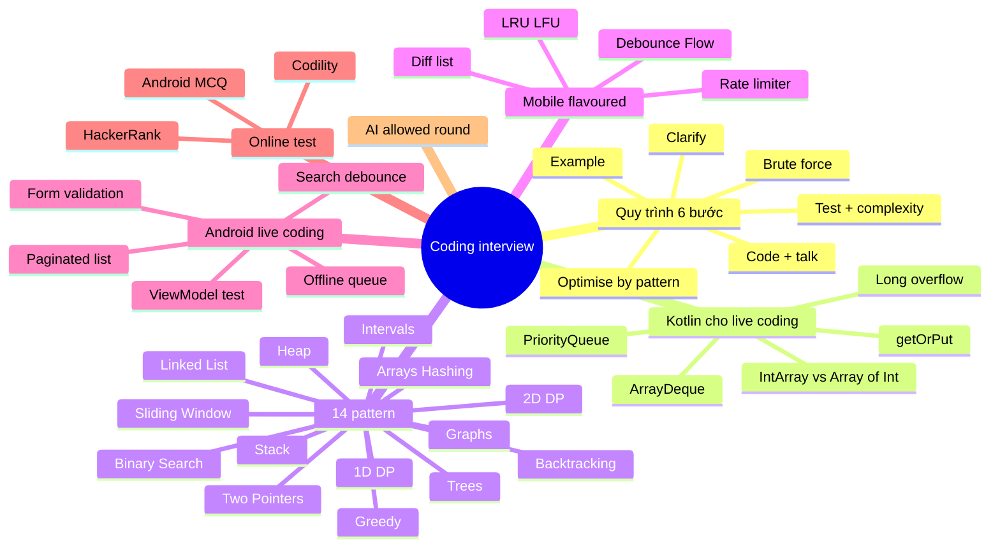

# 13. Coding Interview: DSA bằng Kotlin, live coding Android, online test

> Mục tiêu: giải được LeetCode Medium bằng Kotlin trong 25-30 phút vừa làm vừa nói tiếng Anh, Easy trong 10 phút, không cần Hard; qua được online test HackerRank/Codility (2 Medium trong 60-90 phút + Android MCQ); làm được bài live-coding Android 45-60 phút với Compose + StateFlow + test. | Mức cần đạt: Senior: 14 pattern nhận ra trong 2 phút, code sạch, test edge case không cần nhắc. Staff: giải thích trade-off giữa 2 cách giải, ước lượng độ phức tạp đúng, dùng được AI trong vòng cho phép mà vẫn tự thiết kế thuật toán. Lead: thêm phần "mobile-flavoured" (LRU, debounce, rate limiter, diff) và nói được vì sao thuật toán đó xuất hiện trong app thật. | Thời gian gợi ý: chạy song song 12 tuần, ~3-4 giờ/tuần (5-8 bài/tuần), tuần 10-12 tăng lên 5 giờ cho mock.

Ghi chú trước khi đọc: file này không có phần Q&A `### Qn.` như các file khác. Bài tập là chính. Mỗi pattern có 1 bài giải trọn vẹn bằng Kotlin, có giải thích. Code trong file đã được compile kiểm tra bằng Kotlin 2.3 trên JVM (trừ các block đánh dấu `// android-only`, cần project Android). Lịch 12 tuần ở mục 4 khớp với `03-Roadmap-12-Weeks.md`. Ghi tiến độ vào `PROGRESS.md`.

## 0. Bản đồ chủ đề

Vòng coding ở công ty nước ngoài và một số công ty product lớn tại Việt Nam (Grab, Agoda, Shopee, các ngân hàng số như Tyme/GoTymeX) vẫn là LeetCode-style. Theo `01-Market-Research-2026.md`: Grab VN cho 2 bài Medium trong khoảng 60 phút; Agoda hỏi linked list, array, BST và có thêm vòng "fix & refactor codebase"; nhiều công ty nước ngoài sàng lọc bằng HackerRank/Codility (Android MCQ + 2 bài); ngân hàng Việt Nam hỏi nhẹ hơn (1 bài Easy/Medium, hoặc chỉ hỏi độ phức tạp); Meta và Canva cho dùng AI trong vòng coding. Mục tiêu thực tế cho một người 10 năm Android: không cần Hard, cần Medium chắc tay, nói tiếng Anh trôi khi code.

Interviewer sẽ đào tới đâu: họ không cần bạn nhớ thuật toán lạ. Họ xem (1) bạn có hỏi làm rõ đề không, (2) có nói brute force trước rồi mới tối ưu không, (3) code có sạch và đúng edge case không, (4) có tự test không, (5) độ phức tạp nói đúng không. Với Android dev họ còn hay chuyển sang "mobile-flavoured": LRU cache, debounce, rate limiter, diff list, merge interval cho lịch. Mục 5 có 12 bài như vậy.



## 1. Ai hỏi gì, và quy trình 6 bước

### 1.1 Ai hỏi gì (theo research 10/2026)

| Nơi | Format | Mức bài | Ghi chú |
|---|---|---|---|
| Grab VN | Recruiter 30 phút, rồi 2 bài LeetCode Medium (thường 60 phút, CoderPad hoặc HackerRank live), rồi system design không gợi ý, rồi culture fit | Medium | Bài 1 thường array/hashing/sliding window, bài 2 tree/graph hoặc DP nhẹ. Nói tiếng Anh suốt |
| Agoda | Online test rồi 2 vòng onsite: 1 vòng DSA (linked list, array, BST), 1 vòng "fix & refactor codebase" 45-60 phút | Easy-Medium | Vòng refactor chấm cách đọc code lạ và ưu tiên. Xem `14-Mock-Interview-Scripts.md` mục 4 và `samples/review-exercise` |
| Công ty nước ngoài tuyển remote (Úc, Singapore, EU) | HackerRank hoặc Codility: Android MCQ 15-25 câu + 2 bài code, 60-90 phút | Easy-Medium | Codility chấm cả correctness và performance (test ẩn với n lớn). Mục 7 |
| Ngân hàng, fintech VN (Techcombank, OCB, Timo, Tyme) | 1 bài Easy/Medium trên màn hình chia sẻ, hoặc hỏi miệng độ phức tạp, hoặc bài Android nhỏ | Easy | Họ quan tâm Android deep-dive hơn, nhưng vẫn có thể hỏi "reverse linked list" để lọc |
| Outsourcing lớn (FPT, NashTech, KMS) | Thường không DSA, thay bằng bài Android take-home hoặc live coding Compose | Không | Mục 6 |
| Meta, Canva, Atlassian (remote/global) | Coding round cho dùng AI (Copilot/Claude) có giám sát; chấm cách bạn chỉ đạo AI và kiểm chứng | Medium | Mục 8 |

### 1.2 Quy trình 6 bước (30 phút cho 1 bài Medium)

| Bước | Phút | Làm gì | Nói gì (EN) |
|---|---|---|---|
| 1. Clarify | 0-2 | Hỏi input size, giá trị âm, trùng lặp, sorted chưa, output format, có được sửa input không | "Can I assume the array fits in memory? Are the numbers unique? Can the input be empty?" |
| 2. Example | 2-4 | Tự viết 1 example nhỏ và 1 edge case, tính tay kết quả | "Let me walk through a small example to make sure I understand." |
| 3. Brute force + complexity | 4-6 | Nói cách thô nhất và độ phức tạp, không code | "The brute force is O(n squared) by checking every pair. That works but I think we can do better." |
| 4. Optimise by pattern | 6-10 | Nhận ra pattern (mục 3), nói ý tưởng, xác nhận với interviewer trước khi code | "Since we need pairs that sum to a target, a hash map gives O(1) lookup, so one pass is O(n)." |
| 5. Code while talking | 10-22 | Viết code, đặt tên rõ, nói từng khối, không im lặng quá 30 giây | "I will keep a map from value to index. For each element I check whether target minus it is already in the map." |
| 6. Test edge cases, final complexity | 22-28 | Chạy tay với example, rồi empty, 1 phần tử, trùng, âm, overflow. Kết luận time/space | "Let me trace through with the example. Edge cases: empty input returns empty list. Time is O(n), space is O(n)." |
| Buffer | 28-30 | Hỏi follow-up, nói cách tối ưu thêm nếu có | "If the input were sorted we could use two pointers and get O(1) extra space." |

Lỗi hay gặp:
- Nhảy vào code ở phút 1. Interviewer đánh giá thấp dù code đúng.
- Im lặng 2-3 phút để nghĩ. Phải nói "Let me think for a moment" rồi nói ý tưởng dở dang cũng được.
- Không tự test. Cuối giờ interviewer hỏi "are you confident?" và bạn nói "yes" là mất điểm nếu có bug.
- Nói sai độ phức tạp vì quên sort O(n log n) hay quên string concat O(n).
- Viết code Kotlin kiểu Java (vòng for index khắp nơi) hoặc ngược lại quá "clever" (chain 6 operator) khiến interviewer khó đọc.

### 1.3 Hai mươi câu tiếng Anh dùng khi code

Học thuộc. Mỗi câu ngắn, nói được khi tay đang gõ. Xem thêm `23-English-for-Tech-Interviews.md`.

1. "Before I start, let me make sure I understand the problem correctly."
2. "Can I assume the input is non-empty and fits in memory?"
3. "Let me take a small example and work through it by hand."
4. "The brute force approach would be O(n squared). Let me see if we can do better."
5. "This looks like a sliding window problem because we need a contiguous range."
6. "I will use a hash map to get constant-time lookups."
7. "Let me define the state first, then write the loop."
8. "I will name this variable `left` because it marks the left edge of the window."
9. "I am going to write a helper function to keep the main logic readable."
10. "Let me handle the base case before the recursion."
11. "Give me a second to think about the off-by-one here."
12. "I will use a `Long` here to avoid integer overflow."
13. "Let me trace through the example to verify."
14. "Edge cases I want to check: empty input, one element, all duplicates, negative numbers."
15. "The time complexity is O(n log n) because of the sort, and space is O(n) for the map."
16. "I realize there is a bug on this line. Let me fix it."
17. "If we had more time, I would optimise the space by reusing the input array."
18. "One trade-off: this is faster but uses more memory. In a mobile app I would prefer the memory-friendly version."
19. "I am done with the implementation. Shall I write a couple of test cases?"
20. "Is there a follow-up variation you would like me to handle?"

**Đọc thêm:**
- https://neetcode.io/roadmap (thứ tự pattern chuẩn, có video từng bài)
- https://leetcode.com/explore/ (Explore cards theo chủ đề)
- https://github.com/amitshekhariitbhu/android-interview-questions (DSA + Android trong cùng một repo)

## 2. Kotlin cho live coding

Kotlin là lợi thế khi phỏng vấn Android: ngắn, có stdlib tốt. Nhưng có vài bẫy về hiệu năng và API khiến bài sai hoặc TLE trên Codility. Mỗi mục dưới là một thứ bạn phải tự giải thích được khi interviewer hỏi "why did you use that?".

### 2.1 `IntArray` vs `Array<Int>` vs `List<Int>` (boxing)

`Array<Int>` và `List<Int>` chứa `Integer` object trên JVM (boxing), tốn 16 byte mỗi phần tử và cache miss. `IntArray` là `int[]` thật. Với n = 10^6, chênh lệch có thể vài lần. Codility và HackerRank chấm thời gian, nên:

```kotlin
val n = 8
val rows = 3
val cols = 4
val a = IntArray(n)                 // int[], mặc định 0
val b = IntArray(n) { it * 2 }      // init theo index
val c = Array<Int>(n) { 0 }         // Integer[], tránh khi n lớn
val d = intArrayOf(1, 2, 3)
val e = LongArray(n)                // khi tổng có thể vượt Int
val f = BooleanArray(n)             // visited[]
val grid = Array(rows) { IntArray(cols) }   // 2-D
```

Trong signature LeetCode, Kotlin dùng `IntArray` cho `int[]` và `Array<IntArray>` cho `int[][]`. `List<Int>` khi đề cho `List<Integer>`. Khi trả về, `toIntArray()`, `toList()`, `toTypedArray()`.

### 2.2 `ArrayDeque` làm stack và queue

Không dùng `java.util.Stack` (synchronized, cũ) và không dùng `LinkedList`. `kotlin.collections.ArrayDeque` có `addLast/removeLast` (stack) và `addFirst/removeFirst` (queue), đều O(1) amortized.

```kotlin
fun stackAndQueueDemo() {
    val stack = ArrayDeque<Int>()
    stack.addLast(1)
    stack.addLast(2)
    val top = stack.last()          // peek, 2
    val popped = stack.removeLast() // 2
    val empty = stack.isEmpty()

    val queue = ArrayDeque<Int>()
    queue.addLast(1)
    queue.addLast(2)
    val head = queue.removeFirst()  // 1
    val peekHead = queue.firstOrNull()
    println("$top $popped $empty $head $peekHead")
}
```

Lưu ý: `removeLast()` trên queue rỗng ném `NoSuchElementException`. Dùng `removeLastOrNull()` khi không chắc.

### 2.3 `PriorityQueue` với `compareBy`

Kotlin stdlib không có heap, dùng `java.util.PriorityQueue`. Mặc định là min-heap theo `Comparable`. Luôn viết type param để tránh lỗi inference.

```kotlin
import java.util.PriorityQueue

fun heapDemo() {
    val minHeap = PriorityQueue<Int>()
    val maxHeap = PriorityQueue<Int>(compareByDescending<Int> { it })
    val byDistance = PriorityQueue<IntArray>(compareBy<IntArray> { it[0] * it[0] + it[1] * it[1] })
    val byTwoKeys = PriorityQueue<Pair<String, Int>>(
        compareBy<Pair<String, Int>>({ it.second }, { it.first })
    )
    minHeap.add(5)
    maxHeap.add(5)
    byDistance.add(intArrayOf(1, 2))
    byTwoKeys.add("a" to 1)
    val smallest = minHeap.peek()   // không remove
    val removed = minHeap.poll()    // remove, null nếu rỗng
    println("$smallest $removed")
}
```

`add/poll` là O(log n), `peek` O(1). Xây heap từ collection có sẵn: `PriorityQueue(list)` là O(n). Không có `decreaseKey`; với Dijkstra, thêm entry mới và bỏ qua entry cũ khi poll.

### 2.4 `HashMap.getOrPut`, `getOrDefault`, `merge`

```kotlin
fun mapDemo() {
    val count = HashMap<Char, Int>()
    for (c in "hello") count[c] = (count[c] ?: 0) + 1
    for (c in "hello") count.merge(c, 1, Int::plus)        // tương đương, ngắn hơn

    val groups = HashMap<Int, MutableList<String>>()
    groups.getOrPut(3) { mutableListOf() }.add("abc")

    val safe = count.getOrDefault('z', 0)
    println("$count $groups $safe")
}
```

`getOrPut` chỉ chạy lambda khi key chưa có, nên không tạo list thừa. Với key là `Int` nhỏ (0..26) thì `IntArray(26)` nhanh hơn map.

### 2.5 `buildList`, `buildString`, `StringBuilder`

Nối string trong vòng lặp bằng `+` là O(n^2). Dùng `StringBuilder` hoặc `buildString`.

```kotlin
fun builderDemo() {
    val s = buildString {
        for (i in 0 until 5) append(i).append(',')
        setLength(length - 1)       // bỏ dấu phẩy cuối
    }

    val list = buildList {
        add(1)
        addAll(listOf(2, 3))
    }

    val sb = StringBuilder()
    sb.append("a")
    sb.insert(0, "b")
    sb.deleteCharAt(sb.lastIndex)
    sb.reverse()
    val str = sb.toString()
    println("$s $list $str")
}
```

### 2.6 `sortedWith(compareBy(...))`, `sortBy`, `sortWith`

- `sort()` / `sortBy {}` / `sortWith()` sắp xếp tại chỗ trên `MutableList`, `IntArray`, `Array`.
- `sorted()` / `sortedBy {}` / `sortedWith()` trả về list mới (tốn O(n) memory).
- `compareBy({ it.first }, { -it.second })` nhiều khóa. `thenBy`, `thenByDescending` để chain.

```kotlin
fun sortDemo() {
    val intervals = arrayOf(intArrayOf(5, 8), intArrayOf(1, 3), intArrayOf(2, 6))
    intervals.sortBy { it[0] }                     // tại chỗ, theo start
    val people = listOf("bob" to 25, "ann" to 25, "cat" to 20)
    val ordered = people.sortedWith(compareBy<Pair<String, Int>> { it.second }.thenBy { it.first })
    println("${intervals.map { it.toList() }} $ordered")
}
```

Sort của Kotlin/JVM là stable (TimSort cho object, dual-pivot quicksort cho primitive array). Độ phức tạp O(n log n). Nhớ nói điều này khi tính complexity.

### 2.7 `tailrec`, recursion depth, chuyển sang vòng lặp

JVM stack mặc định khoảng 512KB-1MB cho thread main; đệ quy sâu 10^4-10^5 (linked list dài, DFS trên đường thẳng) có thể `StackOverflowError`. Trên LeetCode thường qua được với 10^4. Trên Codility, n có thể 10^5 nên ưu tiên vòng lặp hoặc stack tường minh. `tailrec` chỉ hoạt động khi lời gọi đệ quy là biểu thức cuối cùng.

```kotlin
tailrec fun gcd(a: Int, b: Int): Int = if (b == 0) a else gcd(b, a % b)

tailrec fun sumList(items: List<Int>, index: Int = 0, acc: Long = 0L): Long =
    if (index == items.size) acc else sumList(items, index + 1, acc + items[index])
```

Nếu interviewer hỏi "what if the tree is very deep?", trả lời: "I would convert to an iterative DFS with an explicit stack" và viết được ngay (template ở mục 3.7).

### 2.8 Destructuring

```kotlin
fun destructuringDemo() {
    val (a, b) = intArrayOf(1, 2)              // componentN có sẵn cho array
    for ((index, value) in listOf(10, 20).withIndex()) println("$index=$value")
    for ((key, value) in mapOf("a" to 1)) println("$key=$value")
    val (first, rest) = listOf(1, 2, 3).let { it.first() to it.drop(1) }
    println("$a $b $first $rest")
}
```

Pair và Triple đủ dùng khi phỏng vấn, nhưng nếu có hơn 2 trường thì viết `data class` cho dễ đọc: `data class Cell(val r: Int, val c: Int, val dist: Int)`.

### 2.9 Ranges: `until`, `downTo`, `step`, `..<`

```kotlin
fun rangeDemo(n: Int, nums: IntArray, x: Int) {
    for (i in 0 until n) print(i)         // 0..n-1
    for (i in 0..<n) print(i)             // Kotlin 1.9+, giống until
    for (i in n - 1 downTo 0) print(i)    // ngược
    for (i in 0 until n step 2) print(i)
    for (i in nums.indices) print(i)      // 0..lastIndex
    for (i in nums.indices.reversed()) print(i)
    val inRange = x in 0 until n          // kiểm tra biên gọn
    println(inRange)
}
```

`a..b` là inclusive, dễ lỗi off-by-one khi chuyển từ Java `i < n`. Trong phỏng vấn, nói to "zero until n, so n is exclusive".

### 2.10 `withIndex`, `windowed`, `zipWithNext`, `groupingBy`

```kotlin
fun collectionOpsDemo() {
    val nums = listOf(1, 3, 2, 6, 4)
    val maxIndex = nums.withIndex().maxByOrNull { it.value }?.index   // index của max
    val windows = nums.windowed(size = 3, step = 1)                    // [[1,3,2],[3,2,6],[2,6,4]]
    val windowSums = nums.windowed(3) { it.sum() }                     // tổng từng cửa sổ, O(n*k)
    val diffs = nums.zipWithNext { a, b -> b - a }                     // hiệu liên tiếp
    val letters = "hello".groupingBy { it }.eachCount()                // {h=1, e=1, l=2, o=1}
    val chunks = nums.chunked(2)                                       // [[1,3],[2,6],[4]]
    val prefix = nums.runningFold(0) { acc, x -> acc + x }             // prefix sum, có phần tử 0 đầu
    println("$maxIndex $windows $windowSums $diffs $letters $chunks $prefix")
}
```

`windowed` tạo list con mỗi bước, O(n*k) memory nếu không dùng transform. Trong bài sliding window thực sự, viết vòng lặp tay (mục 3.3) để đạt O(n).

### 2.11 Tránh `List.removeAt(0)` và `remove(Int)` trên `MutableList<Int>`

`ArrayList.removeAt(0)` là O(n) vì dịch toàn bộ mảng. Trong vòng lặp thành O(n^2). Dùng `ArrayDeque.removeFirst()`. Bẫy thứ hai: `MutableList<Int>.remove(3)` xóa phần tử có giá trị 3 (vì `remove(element)`), còn `removeAt(3)` xóa theo index.

```kotlin
fun removeDemo() {
    val bad = mutableListOf(1, 2, 3)
    bad.remove(2)        // xóa giá trị 2, list còn [1, 3]
    bad.removeAt(0)      // xóa index 0, list còn [3]
    println(bad)
}
```

### 2.12 `Int` overflow và `Long`

`Int` là 32-bit, tối đa 2_147_483_647. Tổng của 10^5 số tới 10^5 là 10^10, tràn. Tích hai số 10^5 tràn. Prefix sum, tổng khoảng, nhân tọa độ: dùng `Long`. Mid của binary search: `lo + (hi - lo) / 2` thay vì `(lo + hi) / 2`.

```kotlin
fun overflowDemo(lo: Int, hi: Int, r: Int, c: Int) {
    val big = 100_000 * 100_000           // tràn, ra 1410065408 (compiler cảnh báo)
    val ok = 100_000L * 100_000           // 10000000000
    val mid = lo + (hi - lo) / 2
    val hashKey = (r.toLong() shl 32) or c.toLong()   // gộp 2 Int thành 1 Long key
    println("$big $ok $mid $hashKey")
}
```

Comparator kiểu `a - b` cũng tràn với số âm lớn: dùng `compareBy` hoặc `Int.compare(a, b)` (Kotlin: `a.compareTo(b)`).

### 2.13 Đọc input kiểu HackerRank / Codility

Codility cho sẵn signature `fun solution(A: IntArray): Int`, không cần đọc stdin. HackerRank thường phải tự đọc. Mẫu an toàn:

```kotlin
import java.io.BufferedReader
import java.io.InputStreamReader

fun main() {
    val reader = BufferedReader(InputStreamReader(System.`in`))
    val n = reader.readLine().trim().toInt()
    val nums = reader.readLine().trim().split(" ").filter { it.isNotEmpty() }.map { it.toInt() }
    val q = reader.readLine()?.trim()?.toIntOrNull() ?: 0
    val out = StringBuilder()
    repeat(q) {
        val (a, b) = reader.readLine().trim().split(" ").map { it.toInt() }
        out.append(a + b).append('\n')
    }
    print(out)
    println("n=$n size=${nums.size}")
}
```

Chú ý: `readLine()` trả về `String?`; `readln()` (Kotlin 1.6+) trả về non-null nhưng HackerRank có thể dùng Kotlin cũ, nên `readLine()!!` hoặc `?: ""` an toàn hơn. In nhiều dòng thì gom vào `StringBuilder` rồi `print` một lần. Kiểm tra version Kotlin của platform trước khi thi (thường ghi trong dropdown ngôn ngữ).

### 2.14 Nếu interviewer yêu cầu Java

Một số công ty (ngân hàng, Agoda với team backend) vẫn hỏi Java. Khác biệt cần nhớ:

| Kotlin | Java |
|---|---|
| `IntArray(n)` | `int[] a = new int[n];` |
| `ArrayDeque<Int>()` + `addLast/removeLast` | `Deque<Integer> st = new ArrayDeque<>(); st.push(x); st.pop();` (push/pop ở đầu) |
| `PriorityQueue<Int>(compareByDescending { it })` | `new PriorityQueue<>(Collections.reverseOrder())` hoặc `(a, b) -> Integer.compare(b, a)` |
| `map.getOrPut(k) { ArrayList() }` | `map.computeIfAbsent(k, x -> new ArrayList<>())` |
| `map[k] ?: 0` | `map.getOrDefault(k, 0)` |
| `nums.sort()` | `Arrays.sort(nums)` (primitive) / `Collections.sort(list)` |
| `data class Point(val x: Int, val y: Int)` | `record Point(int x, int y) {}` (Java 16+) |
| `Pair(a, b)` | `int[]{a, b}` hoặc `Map.entry(a, b)` |
| `for (i in 0 until n)` | `for (int i = 0; i < n; i++)` |
| `s.length`, `s[i]` | `s.length()`, `s.charAt(i)` |

Java không có `Int?`, null check tường minh. `Integer == Integer` so sánh reference ngoài khoảng -128..127, dùng `equals` hoặc `intValue()`.

### 2.15 Checklist "code Kotlin sạch khi phỏng vấn"

- Tên biến có nghĩa: `left/right`, `slow/fast`, `indegree`, `visited`.
- `val` mặc định, `var` khi thực sự đổi.
- Không `!!` trong code phỏng vấn, trừ khi vừa kiểm tra null ngay trên dòng trước. Dùng `?: return`, `?.let`.
- Hàm chính 20-30 dòng, tách helper (`fun dfs(...)` local function được phép trong Kotlin).
- Không `println` debug để quên.
- Nói rõ khi dùng API Java (`PriorityQueue`, `TreeMap`) vì Kotlin stdlib không có.

**Đọc thêm:**
- https://kotlinlang.org/api/core/kotlin-stdlib/ (stdlib reference, tra `ArrayDeque`, `windowed`, `groupingBy`)
- https://kotlinlang.org/docs/collections-overview.html (hệ thống collection, mutable vs read-only)
- Sách Kotlin in Action 2nd ed (Manning 2024), chương 6 Collections và chương 8 Basic types (boxing, arrays)
- Sách Effective Kotlin 2nd ed, mục "Consider Arrays with primitives for performance-critical processing"
## 3. Mười bốn pattern, mỗi pattern một bài giải trọn vẹn

Cách dùng mục này: đọc ý tưởng và dấu hiệu nhận biết, chép template vào file scratch, tự giải bài "giải trọn vẹn" trước khi đọc lời giải, rồi làm 4-6 bài trong danh sách theo lịch ở mục 4. Mọi bài đều có trên LeetCode miễn phí trừ chỗ ghi "Premium".

### 3.1 Arrays & Hashing

**Ý tưởng:** đổi O(n^2) tìm kiếm thành O(1) lookup bằng `HashMap`/`HashSet`; đếm tần suất; prefix sum để trả lời tổng đoạn trong O(1).

**Nhận ra khi:** đề hỏi "có tồn tại cặp/nhóm", "đếm số lần", "anagram", "subarray có tổng bằng k", "phần tử xuất hiện nhiều nhất".

**Độ phức tạp:** thường O(n) time, O(n) space. Sort trước sẽ thành O(n log n).

**Template:**

```kotlin
fun countFrequency(nums: IntArray): Map<Int, Int> {
    val freq = HashMap<Int, Int>()
    for (x in nums) freq[x] = (freq[x] ?: 0) + 1
    return freq
}

fun prefixSums(nums: IntArray): LongArray {
    val prefix = LongArray(nums.size + 1)
    for (i in nums.indices) prefix[i + 1] = prefix[i] + nums[i]
    return prefix                      // sum(l..r) = prefix[r + 1] - prefix[l]
}

fun countSubarraysWithSum(nums: IntArray, k: Int): Int {
    val seen = HashMap<Long, Int>()    // prefix sum -> số lần gặp
    seen[0L] = 1
    var sum = 0L
    var count = 0
    for (x in nums) {
        sum += x
        count += seen[sum - k] ?: 0
        seen[sum] = (seen[sum] ?: 0) + 1
    }
    return count
}
```

**Bài luyện:**
- Two Sum: https://leetcode.com/problems/two-sum/
- Contains Duplicate: https://leetcode.com/problems/contains-duplicate/
- Valid Anagram: https://leetcode.com/problems/valid-anagram/
- Group Anagrams: https://leetcode.com/problems/group-anagrams/
- Top K Frequent Elements: https://leetcode.com/problems/top-k-frequent-elements/
- Product of Array Except Self: https://leetcode.com/problems/product-of-array-except-self/
- Longest Consecutive Sequence: https://leetcode.com/problems/longest-consecutive-sequence/

**Bài giải trọn vẹn: Group Anagrams (49, Medium)**

Đề: cho mảng string, gộp các string là anagram của nhau.

Clarify: chỉ chữ thường a-z? Có string rỗng? Thứ tự nhóm có quan trọng không? (Thường: chỉ a-z, có thể rỗng, thứ tự không quan trọng.)

Brute force: so từng cặp bằng sort, O(n^2 * k log k). Tối ưu: mỗi string sinh một "chữ ký" (sorted string hoặc mảng đếm 26 ký tự) làm key của map.

```kotlin
fun groupAnagrams(strs: Array<String>): List<List<String>> {
    val groups = HashMap<String, MutableList<String>>()
    for (s in strs) {
        val counts = IntArray(26)
        for (c in s) counts[c - 'a']++
        val key = counts.joinToString(",")
        groups.getOrPut(key) { mutableListOf() }.add(s)
    }
    return groups.values.toList()
}
```

Giải thích khi nói: "Instead of sorting each word, which is O(k log k), I build a 26-slot count array, which is O(k), and use it as the map key. Two words are anagrams if and only if their counts match." Time O(n * k), space O(n * k). Edge: string rỗng cho key toàn 0, vẫn gộp đúng. Nếu interviewer hỏi Unicode: dùng `s.toCharArray().sorted().joinToString("")` làm key, O(k log k).

Lỗi hay gặp: dùng `IntArray` trực tiếp làm key (array không có `equals` theo nội dung). Phải chuyển sang String hoặc `List<Int>`.

**Đọc thêm:**
- https://neetcode.io/roadmap (mục Arrays & Hashing)
- https://leetcode.com/explore/learn/card/hash-table/

### 3.2 Two Pointers

**Ý tưởng:** hai con trỏ chạy từ hai đầu (mảng đã sort, palindrome) hoặc cùng chiều (slow/fast để loại bỏ, nén tại chỗ). Mỗi bước loại được một phần không gian tìm kiếm.

**Nhận ra khi:** mảng đã sort hoặc có thể sort, "cặp có tổng", "xóa tại chỗ", "palindrome", "container nước".

**Độ phức tạp:** O(n) sau khi sort (O(n log n) nếu phải sort), O(1) space.

**Template:**

```kotlin
fun twoSumSorted(nums: IntArray, target: Int): IntArray {
    var left = 0
    var right = nums.lastIndex
    while (left < right) {
        val sum = nums[left] + nums[right]
        when {
            sum == target -> return intArrayOf(left, right)
            sum < target -> left++
            else -> right--
        }
    }
    return intArrayOf(-1, -1)
}

fun removeDuplicatesInPlace(nums: IntArray): Int {
    if (nums.isEmpty()) return 0
    var write = 1
    for (read in 1 until nums.size) {
        if (nums[read] != nums[read - 1]) {
            nums[write] = nums[read]
            write++
        }
    }
    return write
}
```

**Bài luyện:**
- Valid Palindrome: https://leetcode.com/problems/valid-palindrome/
- Two Sum II - Input Array Is Sorted: https://leetcode.com/problems/two-sum-ii-input-array-is-sorted/
- 3Sum: https://leetcode.com/problems/3sum/
- Container With Most Water: https://leetcode.com/problems/container-with-most-water/
- Move Zeroes: https://leetcode.com/problems/move-zeroes/
- Trapping Rain Water (Hard, chỉ đọc lời giải): https://leetcode.com/problems/trapping-rain-water/

**Bài giải trọn vẹn: 3Sum (15, Medium)**

Đề: tìm mọi bộ ba không trùng có tổng 0.

Clarify: kết quả không được trùng bộ (theo giá trị), thứ tự trong bộ không quan trọng, n tới 3000.

Brute force O(n^3). Tối ưu: sort, cố định phần tử i, two pointers cho phần còn lại, bỏ qua trùng.

```kotlin
fun threeSum(nums: IntArray): List<List<Int>> {
    nums.sort()
    val result = mutableListOf<List<Int>>()
    for (i in nums.indices) {
        if (nums[i] > 0) break                                  // đã sort, không thể về 0
        if (i > 0 && nums[i] == nums[i - 1]) continue           // bỏ trùng cho i
        var left = i + 1
        var right = nums.lastIndex
        while (left < right) {
            val sum = nums[i] + nums[left] + nums[right]
            when {
                sum < 0 -> left++
                sum > 0 -> right--
                else -> {
                    result.add(listOf(nums[i], nums[left], nums[right]))
                    left++
                    right--
                    while (left < right && nums[left] == nums[left - 1]) left++
                    while (left < right && nums[right] == nums[right + 1]) right--
                }
            }
        }
    }
    return result
}
```

Nói: "Sorting lets me skip duplicates and move pointers deterministically. For each anchor I run the two-pointer scan, which is O(n), so total O(n squared), with O(1) extra space ignoring the output." Edge: `[0,0,0]` cho một bộ; mảng < 3 phần tử trả rỗng; toàn số dương trả rỗng nhờ `break`.

Lỗi hay gặp: quên bỏ trùng ở `left`/`right` sau khi tìm thấy; sort `List<Int>` thành list mới mà vẫn dùng mảng cũ.

**Đọc thêm:**
- https://leetcode.com/explore/learn/card/array-and-string/ (mục Two-pointer technique)
- https://neetcode.io/roadmap (mục Two Pointers)

### 3.3 Sliding Window

**Ý tưởng:** duy trì một cửa sổ `[left, right]` và một cấu trúc đếm trạng thái cửa sổ; mở rộng `right`, co `left` khi vi phạm điều kiện. Mỗi phần tử vào và ra tối đa một lần.

**Nhận ra khi:** "substring/subarray dài nhất/ngắn nhất thỏa điều kiện", "có đúng k phần tử khác nhau", "cửa sổ kích thước k".

**Độ phức tạp:** O(n) time, O(k) hoặc O(bảng chữ cái) space.

**Template:**

```kotlin
fun maxSumWindow(nums: IntArray, k: Int): Int {       // cửa sổ cố định
    var sum = 0
    var best = Int.MIN_VALUE
    for (i in nums.indices) {
        sum += nums[i]
        if (i >= k) sum -= nums[i - k]
        if (i >= k - 1) best = maxOf(best, sum)
    }
    return best
}

fun longestWithAtMostKDistinct(s: String, k: Int): Int {   // cửa sổ co giãn
    val count = HashMap<Char, Int>()
    var left = 0
    var best = 0
    for (right in s.indices) {
        val c = s[right]
        count[c] = (count[c] ?: 0) + 1
        while (count.size > k) {
            val l = s[left]
            val n = count.getValue(l) - 1
            if (n == 0) count.remove(l) else count[l] = n
            left++
        }
        best = maxOf(best, right - left + 1)
    }
    return best
}
```

**Bài luyện:**
- Best Time to Buy and Sell Stock: https://leetcode.com/problems/best-time-to-buy-and-sell-stock/
- Longest Substring Without Repeating Characters: https://leetcode.com/problems/longest-substring-without-repeating-characters/
- Longest Repeating Character Replacement: https://leetcode.com/problems/longest-repeating-character-replacement/
- Permutation in String: https://leetcode.com/problems/permutation-in-string/
- Max Consecutive Ones III: https://leetcode.com/problems/max-consecutive-ones-iii/
- Minimum Window Substring (Hard, đọc lời giải): https://leetcode.com/problems/minimum-window-substring/

**Bài giải trọn vẹn: Longest Substring Without Repeating Characters (3, Medium)**

Clarify: ASCII hay Unicode? String rỗng trả 0.

Brute force: mọi substring rồi kiểm tra, O(n^3) hoặc O(n^2) với set. Tối ưu: map ký tự -> index lần cuối thấy; khi gặp ký tự đã nằm trong cửa sổ, nhảy `left` qua vị trí đó.

```kotlin
fun lengthOfLongestSubstring(s: String): Int {
    val lastSeen = HashMap<Char, Int>()
    var left = 0
    var best = 0
    for (right in s.indices) {
        val c = s[right]
        val prev = lastSeen[c]
        if (prev != null && prev >= left) left = prev + 1
        lastSeen[c] = right
        best = maxOf(best, right - left + 1)
    }
    return best
}
```

Nói: "I keep the last index of every character. If the current character was seen inside the window, I jump `left` past that index instead of shrinking one by one. Each index is visited once, so O(n) time and O(min(n, alphabet)) space." Trace "abba": right=2 gặp 'b' prev=1 >= left=0 nên left=2; right=3 gặp 'a' prev=0 < left=2 nên không nhảy lùi (điều kiện `prev >= left` tránh lùi `left`). Kết quả 2.

Lỗi hay gặp: không kiểm tra `prev >= left` làm `left` lùi; dùng `windowed` tạo O(n^2).

**Đọc thêm:**
- https://leetcode.com/explore/learn/card/array-and-string/ (mục Sliding window)
- https://neetcode.io/roadmap (mục Sliding Window)

### 3.4 Stack và Monotonic Stack

**Ý tưởng:** stack giữ thứ cần "quay lại" sau (ngoặc, biểu thức). Monotonic stack giữ các index với giá trị tăng hoặc giảm dần để trả lời "phần tử lớn hơn tiếp theo" trong O(n).

**Nhận ra khi:** ngoặc hợp lệ, biểu thức hậu tố, "next greater element", "bao nhiêu ngày tới khi ấm hơn", "hình chữ nhật lớn nhất trong histogram", undo/redo, duyệt cây không đệ quy.

**Độ phức tạp:** O(n) time, O(n) space. Mỗi phần tử push và pop tối đa một lần.

**Template:**

```kotlin
fun isValidParentheses(s: String): Boolean {
    val stack = ArrayDeque<Char>()
    val pairs = mapOf(')' to '(', ']' to '[', '}' to '{')
    for (c in s) {
        if (c in pairs.values) {
            stack.addLast(c)
        } else {
            val open = pairs[c] ?: return false
            if (stack.isEmpty() || stack.removeLast() != open) return false
        }
    }
    return stack.isEmpty()
}

fun nextGreaterIndex(nums: IntArray): IntArray {         // -1 nếu không có
    val result = IntArray(nums.size) { -1 }
    val stack = ArrayDeque<Int>()                         // index, giá trị giảm dần
    for (i in nums.indices) {
        while (stack.isNotEmpty() && nums[stack.last()] < nums[i]) {
            result[stack.removeLast()] = i
        }
        stack.addLast(i)
    }
    return result
}
```

**Bài luyện:**
- Valid Parentheses: https://leetcode.com/problems/valid-parentheses/
- Min Stack: https://leetcode.com/problems/min-stack/
- Evaluate Reverse Polish Notation: https://leetcode.com/problems/evaluate-reverse-polish-notation/
- Daily Temperatures: https://leetcode.com/problems/daily-temperatures/
- Car Fleet: https://leetcode.com/problems/car-fleet/
- Largest Rectangle in Histogram (Hard, đọc lời giải): https://leetcode.com/problems/largest-rectangle-in-histogram/

**Bài giải trọn vẹn: Daily Temperatures (739, Medium)**

Đề: với mỗi ngày, bao nhiêu ngày nữa thì nhiệt độ cao hơn; 0 nếu không có.

Brute force O(n^2). Tối ưu: monotonic stack giảm dần chứa index chưa có câu trả lời.

```kotlin
fun dailyTemperatures(temperatures: IntArray): IntArray {
    val result = IntArray(temperatures.size)
    val stack = ArrayDeque<Int>()
    for (i in temperatures.indices) {
        while (stack.isNotEmpty() && temperatures[stack.last()] < temperatures[i]) {
            val j = stack.removeLast()
            result[j] = i - j
        }
        stack.addLast(i)
    }
    return result
}
```

Nói: "The stack holds indices of days that have not found a warmer day yet, with temperatures decreasing from bottom to top. When a warmer day arrives it answers every colder day on top of the stack. Each index is pushed and popped at most once, so it is amortised O(n)." Edge: mảng giảm dần cho toàn 0; mảng 1 phần tử.

Lỗi hay gặp: push giá trị thay vì index (mất khoảng cách); dùng `<=` làm sai khi nhiệt độ bằng nhau.

**Đọc thêm:**
- https://leetcode.com/explore/learn/card/queue-stack/
- https://neetcode.io/roadmap (mục Stack)

### 3.5 Binary Search

**Ý tưởng:** không gian tìm kiếm đơn điệu (sorted, hoặc hàm "có thể làm được với x?" đúng từ một điểm trở đi) thì chia đôi. Ba dạng: tìm giá trị chính xác; tìm biên (lower bound); binary search trên đáp án.

**Nhận ra khi:** mảng sorted, "mảng xoay", "nhỏ nhất thỏa điều kiện", "tốc độ tối thiểu để hoàn thành trong h giờ", "phân chia để max nhỏ nhất".

**Độ phức tạp:** O(log n) cho tìm kiếm; O(n log(range)) khi search trên đáp án với hàm kiểm tra O(n).

**Template:**

```kotlin
fun binarySearch(nums: IntArray, target: Int): Int {
    var lo = 0
    var hi = nums.lastIndex
    while (lo <= hi) {
        val mid = lo + (hi - lo) / 2
        when {
            nums[mid] == target -> return mid
            nums[mid] < target -> lo = mid + 1
            else -> hi = mid - 1
        }
    }
    return -1
}

fun lowerBound(nums: IntArray, target: Int): Int {        // index đầu tiên >= target
    var lo = 0
    var hi = nums.size
    while (lo < hi) {
        val mid = lo + (hi - lo) / 2
        if (nums[mid] < target) lo = mid + 1 else hi = mid
    }
    return lo
}

fun minFeasible(lo0: Int, hi0: Int, feasible: (Int) -> Boolean): Int {   // search trên đáp án
    var lo = lo0
    var hi = hi0
    while (lo < hi) {
        val mid = lo + (hi - lo) / 2
        if (feasible(mid)) hi = mid else lo = mid + 1
    }
    return lo
}
```

**Bài luyện:**
- Binary Search: https://leetcode.com/problems/binary-search/
- Search a 2D Matrix: https://leetcode.com/problems/search-a-2d-matrix/
- Koko Eating Bananas: https://leetcode.com/problems/koko-eating-bananas/
- Find Minimum in Rotated Sorted Array: https://leetcode.com/problems/find-minimum-in-rotated-sorted-array/
- Search in Rotated Sorted Array: https://leetcode.com/problems/search-in-rotated-sorted-array/
- Time Based Key-Value Store: https://leetcode.com/problems/time-based-key-value-store/

**Bài giải trọn vẹn: Koko Eating Bananas (875, Medium)**

Đề: `piles` đống chuối, h giờ, mỗi giờ ăn k quả từ một đống. Tìm k nhỏ nhất để ăn hết trong h giờ.

Nhận ra: nếu k đủ thì k+1 cũng đủ (đơn điệu). Search k trong [1, max(piles)].

```kotlin
fun minEatingSpeed(piles: IntArray, h: Int): Int {
    var lo = 1
    var hi = piles.max()
    while (lo < hi) {
        val mid = lo + (hi - lo) / 2
        var hours = 0L
        for (p in piles) hours += (p + mid - 1) / mid      // ceil(p / mid)
        if (hours <= h) hi = mid else lo = mid + 1
    }
    return lo
}
```

Nói: "The predicate 'can Koko finish at speed k' is monotonic, so I binary search on k. Each check is O(n), and the range is up to 10^9, so O(n log max)." `hours` là `Long` vì tổng có thể vượt Int. `(p + mid - 1) / mid` là ceil không dùng số thực. Edge: `h == piles.size` thì đáp án là max.

Lỗi hay gặp: `hi = mid - 1` khi đang tìm lower bound (bỏ mất đáp án); dùng `(lo + hi) / 2` với giá trị lớn.

**Đọc thêm:**
- https://leetcode.com/explore/learn/card/binary-search/
- https://neetcode.io/roadmap (mục Binary Search)

### 3.6 Linked List

**Ý tưởng:** ba kỹ thuật cơ bản: đảo ngược tại chỗ (prev/cur/next), slow/fast pointer (tìm giữa, phát hiện vòng), dummy head để tránh xử lý riêng phần đầu.

**Nhận ra khi:** đề cho `ListNode`. Agoda thích dạng này vì không có thư viện cứu.

**Độ phức tạp:** O(n) time, O(1) space với lặp; O(n) stack nếu đệ quy.

**Template:**

```kotlin
class ListNode(var `val`: Int) {
    var next: ListNode? = null
}

fun reverseList(head: ListNode?): ListNode? {
    var prev: ListNode? = null
    var cur = head
    while (cur != null) {
        val next = cur.next
        cur.next = prev
        prev = cur
        cur = next
    }
    return prev
}

fun middle(head: ListNode?): ListNode? {                  // node giữa (thứ hai nếu chẵn)
    var slow = head
    var fast = head
    while (fast?.next != null) {
        slow = slow?.next
        fast = fast.next?.next
    }
    return slow
}

fun hasCycle(head: ListNode?): Boolean {
    var slow = head
    var fast = head
    while (fast?.next != null) {
        slow = slow?.next
        fast = fast.next?.next
        if (slow === fast) return true
    }
    return false
}

fun mergeTwoLists(a: ListNode?, b: ListNode?): ListNode? {
    val dummy = ListNode(0)
    var tail = dummy
    var p = a
    var q = b
    while (p != null && q != null) {
        if (p.`val` <= q.`val`) { tail.next = p; p = p.next } else { tail.next = q; q = q.next }
        tail = tail.next!!
    }
    tail.next = p ?: q
    return dummy.next
}
```

**Bài luyện:**
- Reverse Linked List: https://leetcode.com/problems/reverse-linked-list/
- Merge Two Sorted Lists: https://leetcode.com/problems/merge-two-sorted-lists/
- Linked List Cycle: https://leetcode.com/problems/linked-list-cycle/
- Reorder List: https://leetcode.com/problems/reorder-list/
- Remove Nth Node From End of List: https://leetcode.com/problems/remove-nth-node-from-end-of-list/
- Add Two Numbers: https://leetcode.com/problems/add-two-numbers/
- Copy List with Random Pointer: https://leetcode.com/problems/copy-list-with-random-pointer/

**Bài giải trọn vẹn: Reorder List (143, Medium)**

Đề: L0 -> L1 -> ... -> Ln thành L0 -> Ln -> L1 -> Ln-1 -> ... tại chỗ.

Kế hoạch (nói trước khi code): tìm giữa, đảo nửa sau, merge xen kẽ. Gộp cả ba template.

```kotlin
class ListNode(var `val`: Int) {
    var next: ListNode? = null
}

fun reorderList(head: ListNode?) {
    if (head?.next == null) return
    var slow: ListNode? = head
    var fast: ListNode? = head
    while (fast?.next != null && fast.next?.next != null) {
        slow = slow?.next
        fast = fast.next?.next
    }
    var second = slow?.next
    slow?.next = null                                  // cắt đôi
    var prev: ListNode? = null
    while (second != null) {                           // đảo nửa sau
        val next = second.next
        second.next = prev
        prev = second
        second = next
    }
    var first: ListNode? = head
    second = prev
    while (second != null) {                           // merge xen kẽ
        val tmp1 = first?.next
        val tmp2 = second.next
        first?.next = second
        second.next = tmp1
        first = tmp1
        second = tmp2
    }
}
```

Nói: "Three steps: find the middle with slow and fast pointers, reverse the second half in place, then weave the two halves. Each step is O(n) and uses O(1) extra space." Trace với 1-2-3-4: giữa là 2, nửa sau 3-4 đảo thành 4-3, merge: 1-4-2-3. Với 1-2-3-4-5: giữa 3, nửa sau 4-5 thành 5-4, merge: 1-5-2-4-3.

Lỗi hay gặp: không cắt `slow.next = null` gây vòng lặp vô hạn; điều kiện tìm giữa sai một node làm nửa sau dài hơn nửa trước (merge vẫn chạy nhưng kết quả sai).

**Đọc thêm:**
- https://leetcode.com/explore/learn/card/linked-list/
- https://neetcode.io/roadmap (mục Linked List)

### 3.7 Trees: DFS, BFS, BST

**Ý tưởng:** DFS đệ quy (preorder/inorder/postorder) cho bài "tính toán theo cây con"; BFS với queue cho bài "theo tầng"; BST có tính chất inorder tăng dần và có thể validate bằng khoảng (low, high).

**Nhận ra khi:** đề cho `TreeNode`; "độ sâu", "đường kính", "level order", "view từ bên phải", "kth smallest trong BST", "LCA".

**Độ phức tạp:** O(n) time; O(h) space với DFS (h = chiều cao, xấu nhất n), O(w) với BFS (w = chiều rộng lớn nhất).

**Template:**

```kotlin
class TreeNode(var `val`: Int) {
    var left: TreeNode? = null
    var right: TreeNode? = null
}

fun maxDepth(root: TreeNode?): Int =
    if (root == null) 0 else 1 + maxOf(maxDepth(root.left), maxDepth(root.right))

fun levelOrder(root: TreeNode?): List<List<Int>> {
    val result = mutableListOf<List<Int>>()
    if (root == null) return result
    val queue = ArrayDeque<TreeNode>()
    queue.addLast(root)
    while (queue.isNotEmpty()) {
        val size = queue.size
        val level = ArrayList<Int>(size)
        repeat(size) {
            val node = queue.removeFirst()
            level.add(node.`val`)
            node.left?.let { queue.addLast(it) }
            node.right?.let { queue.addLast(it) }
        }
        result.add(level)
    }
    return result
}

fun inorderIterative(root: TreeNode?): List<Int> {       // khi cây sâu, tránh StackOverflow
    val result = mutableListOf<Int>()
    val stack = ArrayDeque<TreeNode>()
    var cur = root
    while (cur != null || stack.isNotEmpty()) {
        while (cur != null) {
            stack.addLast(cur)
            cur = cur.left
        }
        val node = stack.removeLast()
        result.add(node.`val`)
        cur = node.right
    }
    return result
}

fun lowestCommonAncestorBst(root: TreeNode?, p: Int, q: Int): TreeNode? {
    var cur = root
    while (cur != null) {
        cur = when {
            p < cur.`val` && q < cur.`val` -> cur.left
            p > cur.`val` && q > cur.`val` -> cur.right
            else -> return cur
        }
    }
    return null
}
```

**Bài luyện:**
- Invert Binary Tree: https://leetcode.com/problems/invert-binary-tree/
- Maximum Depth of Binary Tree: https://leetcode.com/problems/maximum-depth-of-binary-tree/
- Diameter of Binary Tree: https://leetcode.com/problems/diameter-of-binary-tree/
- Balanced Binary Tree: https://leetcode.com/problems/balanced-binary-tree/
- Same Tree: https://leetcode.com/problems/same-tree/
- Subtree of Another Tree: https://leetcode.com/problems/subtree-of-another-tree/
- Lowest Common Ancestor of a Binary Search Tree: https://leetcode.com/problems/lowest-common-ancestor-of-a-binary-search-tree/
- Binary Tree Level Order Traversal: https://leetcode.com/problems/binary-tree-level-order-traversal/
- Binary Tree Right Side View: https://leetcode.com/problems/binary-tree-right-side-view/
- Validate Binary Search Tree: https://leetcode.com/problems/validate-binary-search-tree/
- Kth Smallest Element in a BST: https://leetcode.com/problems/kth-smallest-element-in-a-bst/
- Construct Binary Tree from Preorder and Inorder Traversal: https://leetcode.com/problems/construct-binary-tree-from-preorder-and-inorder-traversal/

**Bài giải trọn vẹn: Validate Binary Search Tree (98, Medium)**

Đề: kiểm tra cây có phải BST (mọi node bên trái < node < mọi node bên phải, không có giá trị bằng).

Bẫy: chỉ so với cha trực tiếp là sai. Phải truyền khoảng (low, high) xuống. Giá trị node có thể bằng `Int.MIN_VALUE`/`Int.MAX_VALUE` nên dùng `Long` cho biên.

```kotlin
class TreeNode(var `val`: Int) {
    var left: TreeNode? = null
    var right: TreeNode? = null
}

fun isValidBST(root: TreeNode?): Boolean {
    fun valid(node: TreeNode?, low: Long, high: Long): Boolean {
        if (node == null) return true
        val v = node.`val`.toLong()
        if (v <= low || v >= high) return false
        return valid(node.left, low, v) && valid(node.right, v, high)
    }
    return valid(root, Long.MIN_VALUE, Long.MAX_VALUE)
}
```

Nói: "Every node must lie strictly inside an open interval inherited from its ancestors. Going left tightens the upper bound, going right tightens the lower bound. O(n) time, O(h) stack." Cách hai: inorder traversal phải tăng ngặt (dùng template `inorderIterative`, so với phần tử trước). Nếu interviewer hỏi "duplicates allowed on the right?", đổi `>=` thành `>` ở biên phải.

Follow-up Agoda hay hỏi: "insert vào BST", "xóa node khỏi BST" (3 trường hợp: lá, một con, hai con thay bằng min của cây phải), "kth smallest" (inorder đếm tới k).

Lỗi hay gặp: dùng `Int.MIN_VALUE` làm biên rồi fail test có node bằng đúng giá trị đó; so với cha thay vì với khoảng.

**Đọc thêm:**
- https://leetcode.com/explore/learn/card/data-structure-tree/
- https://neetcode.io/roadmap (mục Trees)
### 3.8 Heap / Top-K

**Ý tưởng:** cần "k phần tử lớn nhất/nhỏ nhất/gần nhất" hoặc "phần tử min hiện tại trong dòng dữ liệu thay đổi" thì dùng heap. Top-k lớn nhất: giữ min-heap kích thước k. Median động: hai heap.

**Nhận ra khi:** "k largest", "k closest", "most frequent k", "merge k sorted", "median of stream", "schedule tasks by priority".

**Độ phức tạp:** O(n log k) cho top-k (tốt hơn sort O(n log n) khi k nhỏ). Build heap từ n phần tử: O(n).

**Template:**

```kotlin
import java.util.PriorityQueue

fun kLargest(nums: IntArray, k: Int): List<Int> {
    val heap = PriorityQueue<Int>()                         // min-heap giữ k phần tử lớn nhất
    for (x in nums) {
        heap.add(x)
        if (heap.size > k) heap.poll()
    }
    return heap.toList()
}

fun topKFrequent(nums: IntArray, k: Int): IntArray {
    val freq = HashMap<Int, Int>()
    for (x in nums) freq[x] = (freq[x] ?: 0) + 1
    val heap = PriorityQueue<Map.Entry<Int, Int>>(compareBy<Map.Entry<Int, Int>> { it.value })
    for (entry in freq.entries) {
        heap.add(entry)
        if (heap.size > k) heap.poll()
    }
    return IntArray(heap.size) { heap.poll().key }
}

class MedianFinder {
    private val low = PriorityQueue<Int>(compareByDescending<Int> { it })   // max-heap nửa nhỏ
    private val high = PriorityQueue<Int>()                                 // min-heap nửa lớn

    fun addNum(num: Int) {
        low.add(num)
        high.add(low.poll())
        if (high.size > low.size) low.add(high.poll())
    }

    fun findMedian(): Double =
        if (low.size > high.size) low.peek().toDouble() else (low.peek() + high.peek()) / 2.0
}
```

**Bài luyện:**
- Kth Largest Element in a Stream: https://leetcode.com/problems/kth-largest-element-in-a-stream/
- Last Stone Weight: https://leetcode.com/problems/last-stone-weight/
- K Closest Points to Origin: https://leetcode.com/problems/k-closest-points-to-origin/
- Kth Largest Element in an Array: https://leetcode.com/problems/kth-largest-element-in-an-array/
- Task Scheduler: https://leetcode.com/problems/task-scheduler/
- Find Median from Data Stream (Hard, template ở trên): https://leetcode.com/problems/find-median-from-data-stream/

**Bài giải trọn vẹn: K Closest Points to Origin (973, Medium)**

Đề: cho mảng điểm, trả về k điểm gần gốc tọa độ nhất.

Clarify: khoảng cách Euclid, không cần căn bậc hai vì chỉ so sánh. Thứ tự output không quan trọng. Tọa độ tới 10^4 nên bình phương tổng tới 2*10^8, vừa `Int`.

```kotlin
import java.util.PriorityQueue

fun kClosest(points: Array<IntArray>, k: Int): Array<IntArray> {
    val heap = PriorityQueue<IntArray>(compareByDescending<IntArray> { it[0] * it[0] + it[1] * it[1] })
    for (p in points) {
        heap.add(p)
        if (heap.size > k) heap.poll()                       // bỏ điểm xa nhất
    }
    return heap.toTypedArray()
}
```

Nói: "I keep a max-heap of size k ordered by squared distance. Whenever the heap grows past k, I pop the farthest point. That is O(n log k) time and O(k) space, better than sorting all points when k is much smaller than n." Follow-up: "What if k is close to n?" thì sort O(n log n) đơn giản hơn; "What if the stream is infinite?" thì heap vẫn đúng vì không giữ hết input; "Quickselect?" cho O(n) trung bình nhưng sửa input và code dài hơn.

Lỗi hay gặp: dùng min-heap rồi poll ra k phần tử (O(n log n) vì heap chứa n); quên đổi chiều comparator.

**Đọc thêm:**
- https://leetcode.com/explore/learn/card/heap/
- https://neetcode.io/roadmap (mục Heap / Priority Queue)

### 3.9 Backtracking

**Ý tưởng:** liệt kê mọi cấu hình bằng đệ quy "chọn - đi sâu - bỏ chọn". Cắt nhánh sớm khi biết không thể thành công. Dùng một `path` chung và chỉ copy khi ghi kết quả.

**Nhận ra khi:** "tất cả tập con/hoán vị/tổ hợp", "mọi cách chia", "tìm từ trong lưới", "N-Queens". Kích thước input nhỏ (n <= 20).

**Độ phức tạp:** theo số kết quả: subsets O(n * 2^n), permutations O(n * n!), combination sum theo số nghiệm.

**Template:**

```kotlin
fun subsets(nums: IntArray): List<List<Int>> {
    val result = mutableListOf<List<Int>>()
    val path = ArrayList<Int>()
    fun backtrack(start: Int) {
        result.add(path.toList())
        for (i in start until nums.size) {
            path.add(nums[i])
            backtrack(i + 1)
            path.removeAt(path.lastIndex)
        }
    }
    backtrack(0)
    return result
}

fun permutations(nums: IntArray): List<List<Int>> {
    val result = mutableListOf<List<Int>>()
    val used = BooleanArray(nums.size)
    val path = ArrayList<Int>()
    fun backtrack() {
        if (path.size == nums.size) {
            result.add(path.toList())
            return
        }
        for (i in nums.indices) {
            if (used[i]) continue
            used[i] = true
            path.add(nums[i])
            backtrack()
            path.removeAt(path.lastIndex)
            used[i] = false
        }
    }
    backtrack()
    return result
}
```

Ghi chú: dùng `removeAt(lastIndex)` thay vì `removeLast()` trên `MutableList`: từ JDK 21 `List.removeLast()` là member của Java, trên Android chưa có nên có thể `NoSuchMethodError` lúc chạy tùy cách compile. `ArrayDeque.removeLast()` là member Kotlin, an toàn.

**Bài luyện:**
- Subsets: https://leetcode.com/problems/subsets/
- Combination Sum: https://leetcode.com/problems/combination-sum/
- Permutations: https://leetcode.com/problems/permutations/
- Subsets II: https://leetcode.com/problems/subsets-ii/
- Word Search: https://leetcode.com/problems/word-search/
- Letter Combinations of a Phone Number: https://leetcode.com/problems/letter-combinations-of-a-phone-number/
- Palindrome Partitioning: https://leetcode.com/problems/palindrome-partitioning/

**Bài giải trọn vẹn: Combination Sum (39, Medium)**

Đề: chọn các số từ `candidates` (được lặp lại) có tổng bằng `target`, liệt kê mọi tổ hợp không trùng.

Clarify: candidates dương và phân biệt; target <= 40 nên cây đệ quy nhỏ.

Ý tưởng: duyệt từ index `start` để tránh trùng (chỉ đi "tới", không quay lại số nhỏ hơn). Cho phép lặp bằng cách gọi lại với cùng `i`.

```kotlin
fun combinationSum(candidates: IntArray, target: Int): List<List<Int>> {
    val result = mutableListOf<List<Int>>()
    val path = ArrayDeque<Int>()
    fun backtrack(start: Int, remaining: Int) {
        if (remaining == 0) {
            result.add(path.toList())
            return
        }
        for (i in start until candidates.size) {
            val c = candidates[i]
            if (c > remaining) continue                      // cắt nhánh
            path.addLast(c)
            backtrack(i, remaining - c)                      // i, không phải i + 1: được dùng lại
            path.removeLast()
        }
    }
    backtrack(0, target)
    return result
}
```

Nói: "I iterate from `start` so combinations are generated in non-decreasing order, which removes duplicates like [2,3] and [3,2]. Passing `i` instead of `i + 1` allows reuse. Sorting candidates first lets me `break` instead of `continue` when a candidate exceeds the remainder." Độ phức tạp phụ thuộc số nghiệm, nói "exponential in the worst case, bounded by target / min(candidates) depth".

Lỗi hay gặp: `result.add(path)` không copy (mọi nghiệm trỏ cùng list rỗng); quên `removeLast` sau đệ quy.

**Đọc thêm:**
- https://leetcode.com/explore/learn/card/recursion-ii/ (Backtracking)
- https://neetcode.io/roadmap (mục Backtracking)

### 3.10 Graphs: BFS/DFS, topological sort, union-find

**Ý tưởng:** biểu diễn bằng adjacency list (`Array<MutableList<Int>>`) hoặc lưới. BFS cho đường đi ngắn nhất không trọng số và lan theo tầng; DFS cho thành phần liên thông và phát hiện chu trình; Kahn (BFS theo indegree) cho thứ tự phụ thuộc; union-find cho "cùng nhóm không" khi thêm cạnh dần.

**Nhận ra khi:** "đảo", "lan truyền sau t phút", "môn học tiên quyết", "cạnh thừa", "có thể đi từ A tới B", "số thành phần liên thông".

**Độ phức tạp:** BFS/DFS O(V + E); lưới O(rows * cols); union-find gần O(1) mỗi thao tác với path compression + union by rank.

**Template:**

```kotlin
fun buildAdjacency(n: Int, edges: Array<IntArray>): Array<MutableList<Int>> {
    val adj = Array(n) { mutableListOf<Int>() }
    for ((a, b) in edges) {
        adj[a].add(b)
        adj[b].add(a)                                           // bỏ dòng này nếu có hướng
    }
    return adj
}

fun bfsDistances(adj: Array<MutableList<Int>>, source: Int): IntArray {
    val dist = IntArray(adj.size) { -1 }
    val queue = ArrayDeque<Int>()
    dist[source] = 0
    queue.addLast(source)
    while (queue.isNotEmpty()) {
        val u = queue.removeFirst()
        for (v in adj[u]) {
            if (dist[v] == -1) {
                dist[v] = dist[u] + 1
                queue.addLast(v)
            }
        }
    }
    return dist
}

fun numIslands(grid: Array<CharArray>): Int {
    val rows = grid.size
    val cols = grid[0].size
    fun sink(r: Int, c: Int) {
        if (r < 0 || c < 0 || r >= rows || c >= cols || grid[r][c] != '1') return
        grid[r][c] = '0'
        sink(r + 1, c)
        sink(r - 1, c)
        sink(r, c + 1)
        sink(r, c - 1)
    }
    var count = 0
    for (r in 0 until rows) {
        for (c in 0 until cols) {
            if (grid[r][c] == '1') {
                count++
                sink(r, c)
            }
        }
    }
    return count
}

class UnionFind(n: Int) {
    private val parent = IntArray(n) { it }
    private val rank = IntArray(n)
    var components = n
        private set

    fun find(x: Int): Int {
        var root = x
        while (parent[root] != root) root = parent[root]
        var cur = x
        while (parent[cur] != root) {                           // path compression
            val next = parent[cur]
            parent[cur] = root
            cur = next
        }
        return root
    }

    fun union(a: Int, b: Int): Boolean {
        val ra = find(a)
        val rb = find(b)
        if (ra == rb) return false
        when {
            rank[ra] < rank[rb] -> parent[ra] = rb
            rank[ra] > rank[rb] -> parent[rb] = ra
            else -> {
                parent[rb] = ra
                rank[ra]++
            }
        }
        components--
        return true
    }
}

fun findRedundantConnection(edges: Array<IntArray>): IntArray {
    val uf = UnionFind(edges.size + 1)
    for (edge in edges) {
        if (!uf.union(edge[0], edge[1])) return edge
    }
    return intArrayOf()
}
```

**Bài luyện:**
- Number of Islands: https://leetcode.com/problems/number-of-islands/
- Clone Graph: https://leetcode.com/problems/clone-graph/
- Max Area of Island: https://leetcode.com/problems/max-area-of-island/
- Rotting Oranges: https://leetcode.com/problems/rotting-oranges/
- Pacific Atlantic Water Flow: https://leetcode.com/problems/pacific-atlantic-water-flow/
- Course Schedule: https://leetcode.com/problems/course-schedule/
- Course Schedule II: https://leetcode.com/problems/course-schedule-ii/
- Redundant Connection: https://leetcode.com/problems/redundant-connection/

**Bài giải trọn vẹn: Course Schedule (207, Medium)**

Đề: n môn, mảng `[a, b]` nghĩa là phải học b trước a. Có thể học hết không (đồ thị có chu trình không)?

Ý tưởng: Kahn's algorithm. Đếm indegree, đưa node indegree 0 vào queue, lấy ra và giảm indegree hàng xóm. Nếu số node lấy ra bằng n thì không có chu trình.

```kotlin
fun canFinish(numCourses: Int, prerequisites: Array<IntArray>): Boolean {
    val adj = Array(numCourses) { mutableListOf<Int>() }
    val indegree = IntArray(numCourses)
    for ((course, pre) in prerequisites) {
        adj[pre].add(course)
        indegree[course]++
    }
    val queue = ArrayDeque<Int>()
    for (i in 0 until numCourses) if (indegree[i] == 0) queue.addLast(i)
    var taken = 0
    while (queue.isNotEmpty()) {
        val node = queue.removeFirst()
        taken++
        for (next in adj[node]) {
            indegree[next]--
            if (indegree[next] == 0) queue.addLast(next)
        }
    }
    return taken == numCourses
}
```

Nói: "This is cycle detection in a directed graph. I use Kahn's algorithm: repeatedly remove nodes with no remaining prerequisites. If a cycle exists, those nodes never reach indegree zero, so the count stays below n. O(V + E) time and space." Course Schedule II chỉ cần ghi lại thứ tự lấy ra khỏi queue. Nếu interviewer muốn DFS: ba màu (0 chưa thăm, 1 đang thăm, 2 xong); gặp node màu 1 là có chu trình.

Lỗi hay gặp: đảo chiều cạnh (`adj[course].add(pre)`) vẫn phát hiện chu trình đúng nhưng cho thứ tự ngược ở bài II; quên node cô lập (indegree 0 ngay từ đầu).

**Đọc thêm:**
- https://leetcode.com/explore/learn/card/graph/
- https://neetcode.io/roadmap (mục Graphs và Advanced Graphs)
- Sách Grokking Algorithms (Bhargava), chương 6 Breadth-first search

### 3.11 1-D Dynamic Programming

**Ý tưởng:** bài toán tối ưu/đếm có cấu trúc con tối ưu và bài con lặp lại. Định nghĩa `dp[i]` bằng lời trước khi viết công thức. Thường giảm được xuống O(1) space khi `dp[i]` chỉ phụ thuộc vài phần tử trước.

**Nhận ra khi:** "số cách", "ít nhất bao nhiêu", "có thể hay không", với quyết định tuần tự; input là mảng/string; n tới 10^4-10^5.

**Độ phức tạp:** O(n) hoặc O(n * m) (m = số lựa chọn, ví dụ số loại coin). LIS O(n log n) với patience sorting.

**Template:**

```kotlin
fun climbStairs(n: Int): Int {
    if (n <= 2) return n
    var a = 1
    var b = 2
    for (i in 3..n) {
        val c = a + b
        a = b
        b = c
    }
    return b
}

fun rob(nums: IntArray): Int {
    var prev2 = 0
    var prev1 = 0
    for (x in nums) {
        val cur = maxOf(prev1, prev2 + x)
        prev2 = prev1
        prev1 = cur
    }
    return prev1
}

fun lengthOfLIS(nums: IntArray): Int {                 // O(n log n)
    val tails = ArrayList<Int>()
    for (x in nums) {
        var lo = 0
        var hi = tails.size
        while (lo < hi) {
            val mid = lo + (hi - lo) / 2
            if (tails[mid] < x) lo = mid + 1 else hi = mid
        }
        if (lo == tails.size) tails.add(x) else tails[lo] = x
    }
    return tails.size
}

fun wordBreak(s: String, wordDict: List<String>): Boolean {
    val words = wordDict.toHashSet()
    val dp = BooleanArray(s.length + 1)
    dp[0] = true
    for (i in 1..s.length) {
        for (j in 0 until i) {
            if (dp[j] && s.substring(j, i) in words) {
                dp[i] = true
                break
            }
        }
    }
    return dp[s.length]
}
```

**Bài luyện:**
- Climbing Stairs: https://leetcode.com/problems/climbing-stairs/
- Min Cost Climbing Stairs: https://leetcode.com/problems/min-cost-climbing-stairs/
- House Robber: https://leetcode.com/problems/house-robber/
- House Robber II: https://leetcode.com/problems/house-robber-ii/
- Coin Change: https://leetcode.com/problems/coin-change/
- Longest Increasing Subsequence: https://leetcode.com/problems/longest-increasing-subsequence/
- Word Break: https://leetcode.com/problems/word-break/
- Decode Ways: https://leetcode.com/problems/decode-ways/
- Longest Palindromic Substring: https://leetcode.com/problems/longest-palindromic-substring/

**Bài giải trọn vẹn: Coin Change (322, Medium)**

Đề: số coin ít nhất để tạo `amount`; -1 nếu không thể. Coin dùng không giới hạn.

Định nghĩa: `dp[a]` = số coin ít nhất tạo ra a. `dp[0] = 0`. `dp[a] = min(dp[a - c] + 1)` với mọi coin c <= a.

```kotlin
fun coinChange(coins: IntArray, amount: Int): Int {
    val unreachable = amount + 1
    val dp = IntArray(amount + 1) { unreachable }
    dp[0] = 0
    for (a in 1..amount) {
        for (c in coins) {
            if (c <= a && dp[a - c] + 1 < dp[a]) dp[a] = dp[a - c] + 1
        }
    }
    return if (dp[amount] == unreachable) -1 else dp[amount]
}
```

Nói: "Greedy by largest coin fails for coins like [1, 3, 4] and amount 6, so I use bottom-up DP. `amount + 1` acts as infinity because no answer can use more than `amount` coins. O(amount * coins) time, O(amount) space." Follow-up: "count the number of ways" là Coin Change II, đổi vòng lặp ra ngoài theo coin để không đếm trùng thứ tự.

Lỗi hay gặp: dùng `Int.MAX_VALUE` làm vô cực rồi `+ 1` tràn; vòng lặp coin ngoài/amount trong cho bài đếm cách mà lại dùng cho bài min (bài min thì thứ tự vòng lặp nào cũng đúng).

**Đọc thêm:**
- https://leetcode.com/explore/learn/card/dynamic-programming/
- https://neetcode.io/roadmap (mục 1-D DP)

### 3.12 2-D Dynamic Programming (cơ bản)

**Ý tưởng:** trạng thái hai chiều `dp[i][j]`: hai string (LCS, edit distance), lưới (đường đi), hoặc (index, dung lượng) cho knapsack. Thường chỉ cần hàng trước nên giảm được xuống một hàng.

**Nhận ra khi:** hai chuỗi so sánh nhau, lưới m x n, "chọn mỗi phần tử tối đa một lần với tổng cho trước".

**Độ phức tạp:** O(m * n) time; O(m * n) hoặc O(n) space.

**Template:**

```kotlin
fun uniquePaths(m: Int, n: Int): Int {
    val row = IntArray(n) { 1 }
    for (i in 1 until m) {
        for (j in 1 until n) row[j] += row[j - 1]
    }
    return row[n - 1]
}

fun minPathSum(grid: Array<IntArray>): Int {
    val m = grid.size
    val n = grid[0].size
    val dp = Array(m) { IntArray(n) }
    for (i in 0 until m) {
        for (j in 0 until n) {
            dp[i][j] = grid[i][j] + when {
                i == 0 && j == 0 -> 0
                i == 0 -> dp[i][j - 1]
                j == 0 -> dp[i - 1][j]
                else -> minOf(dp[i - 1][j], dp[i][j - 1])
            }
        }
    }
    return dp[m - 1][n - 1]
}

fun canPartition(nums: IntArray): Boolean {               // 0/1 knapsack, 1-D rolling
    val total = nums.sum()
    if (total % 2 != 0) return false
    val target = total / 2
    val dp = BooleanArray(target + 1)
    dp[0] = true
    for (x in nums) {
        for (s in target downTo x) {                        // duyệt ngược để mỗi x dùng 1 lần
            if (dp[s - x]) dp[s] = true
        }
    }
    return dp[target]
}
```

**Bài luyện:**
- Unique Paths: https://leetcode.com/problems/unique-paths/
- Longest Common Subsequence: https://leetcode.com/problems/longest-common-subsequence/
- Minimum Path Sum: https://leetcode.com/problems/minimum-path-sum/
- Partition Equal Subset Sum: https://leetcode.com/problems/partition-equal-subset-sum/
- Coin Change II: https://leetcode.com/problems/coin-change-ii/
- Edit Distance: https://leetcode.com/problems/edit-distance/

**Bài giải trọn vẹn: Longest Common Subsequence (1143, Medium)**

Đề: độ dài dãy con chung dài nhất của hai string (không cần liên tiếp).

Định nghĩa: `dp[i][j]` = LCS của `text1[0..i)` và `text2[0..j)`. Nếu ký tự cuối bằng nhau: `dp[i-1][j-1] + 1`; không thì `max(dp[i-1][j], dp[i][j-1])`.

```kotlin
fun longestCommonSubsequence(text1: String, text2: String): Int {
    val m = text1.length
    val n = text2.length
    val dp = Array(m + 1) { IntArray(n + 1) }
    for (i in 1..m) {
        for (j in 1..n) {
            dp[i][j] = if (text1[i - 1] == text2[j - 1]) {
                dp[i - 1][j - 1] + 1
            } else {
                maxOf(dp[i - 1][j], dp[i][j - 1])
            }
        }
    }
    return dp[m][n]
}
```

Nói: "I pad the table with an extra row and column so the base case is just zeros. Each cell depends on three neighbours, so O(m * n) time; space can drop to O(n) by keeping two rows." Đây cũng là nền của `DiffUtil` (mục 5.12): LCS cho biết phần giữ lại, phần còn lại là insert/delete.

Lỗi hay gặp: index lệch giữa `dp[i]` và `text1[i - 1]`; khởi tạo `Array(m + 1) { IntArray(n + 1) }` nhầm chiều.

**Đọc thêm:**
- https://leetcode.com/explore/learn/card/dynamic-programming/
- https://neetcode.io/roadmap (mục 2-D DP)

### 3.13 Intervals

**Ý tưởng:** sort theo start, duyệt một lần và gộp/đếm. Hai khoảng giao nhau khi `a.start <= b.end && b.start <= a.end`. Bài "chọn nhiều khoảng không chồng nhất" sort theo end (greedy).

**Nhận ra khi:** lịch họp, khoảng thời gian, "merge", "insert", "số phòng họp tối thiểu", "bắn mũi tên".

**Độ phức tạp:** O(n log n) vì sort, O(n) hoặc O(1) thêm.

**Template:**

```kotlin
fun insertInterval(intervals: Array<IntArray>, newInterval: IntArray): Array<IntArray> {
    val result = mutableListOf<IntArray>()
    var cur = newInterval
    var i = 0
    while (i < intervals.size && intervals[i][1] < cur[0]) result.add(intervals[i++])      // trước, không giao
    while (i < intervals.size && intervals[i][0] <= cur[1]) {                                 // giao, gộp
        cur = intervalOf(minOf(cur[0], intervals[i][0]), maxOf(cur[1], intervals[i][1]))
        i++
    }
    result.add(cur)
    while (i < intervals.size) result.add(intervals[i++])                                     // sau
    return result.toTypedArray()
}

private fun intervalOf(start: Int, end: Int): IntArray = intArrayOf(start, end)

fun eraseOverlapIntervals(intervals: Array<IntArray>): Int {      // số khoảng phải bỏ để không chồng
    intervals.sortBy { it[1] }
    var removed = 0
    var lastEnd = Int.MIN_VALUE
    for (iv in intervals) {
        if (iv[0] >= lastEnd) lastEnd = iv[1] else removed++
    }
    return removed
}
```

**Bài luyện:**
- Insert Interval: https://leetcode.com/problems/insert-interval/
- Merge Intervals: https://leetcode.com/problems/merge-intervals/
- Non-overlapping Intervals: https://leetcode.com/problems/non-overlapping-intervals/
- Minimum Number of Arrows to Burst Balloons: https://leetcode.com/problems/minimum-number-of-arrows-to-burst-balloons/
- Interval List Intersections: https://leetcode.com/problems/interval-list-intersections/
- Meeting Rooms II (Premium; bản miễn phí tương đương: https://leetcode.com/problems/meeting-rooms-ii/ chỉ xem đề, giải bằng heap hoặc sweep line)

**Bài giải trọn vẹn: Merge Intervals (56, Medium)**

```kotlin
fun merge(intervals: Array<IntArray>): Array<IntArray> {
    if (intervals.size <= 1) return intervals
    intervals.sortBy { it[0] }
    val merged = mutableListOf(intervals[0])
    for (i in 1 until intervals.size) {
        val last = merged.last()
        val cur = intervals[i]
        if (cur[0] <= last[1]) {
            last[1] = maxOf(last[1], cur[1])                 // gộp vào khoảng cuối
        } else {
            merged.add(cur)
        }
    }
    return merged.toTypedArray()
}
```

Nói: "After sorting by start, any interval that overlaps must overlap the most recently merged one, so a single pass is enough. O(n log n) for the sort, O(n) for output." Edge: khoảng chạm nhau `[1,4],[4,5]` thì gộp vì `<=`; khoảng lồng nhau `[1,10],[2,3]` thì `maxOf` giữ 10.

Lỗi hay gặp: so `cur[0] < last[1]` làm tách khoảng chạm nhau; sửa `last[1]` nhưng quên `maxOf` khi khoảng sau nằm trong khoảng trước.

**Đọc thêm:**
- https://neetcode.io/roadmap (mục Intervals)
- https://leetcode.com/problem-list/intervals/ (danh sách bài theo tag; cần đăng nhập)

### 3.14 Greedy

**Ý tưởng:** chọn lựa tốt nhất tại mỗi bước và chứng minh (hoặc tin bằng phản chứng ngắn) rằng không cần quay lui. Dấu hiệu: bài có cấu trúc "exchange argument" (đổi hai lựa chọn không làm xấu hơn).

**Nhận ra khi:** "có thể tới cuối không", "số bước ít nhất để tới cuối", "chia nhãn", "trạm xăng", "tổng con lớn nhất" (Kadane cũng là greedy/DP).

**Độ phức tạp:** thường O(n) hoặc O(n log n) nếu sort.

**Template:**

```kotlin
fun maxSubArray(nums: IntArray): Int {                 // Kadane
    var best = nums[0]
    var cur = nums[0]
    for (i in 1 until nums.size) {
        cur = maxOf(nums[i], cur + nums[i])
        best = maxOf(best, cur)
    }
    return best
}

fun jump(nums: IntArray): Int {                        // Jump Game II: số bước ít nhất
    var jumps = 0
    var currentEnd = 0
    var farthest = 0
    for (i in 0 until nums.size - 1) {
        farthest = maxOf(farthest, i + nums[i])
        if (i == currentEnd) {
            jumps++
            currentEnd = farthest
        }
    }
    return jumps
}

fun partitionLabels(s: String): List<Int> {
    val last = IntArray(26)
    for (i in s.indices) last[s[i] - 'a'] = i
    val sizes = mutableListOf<Int>()
    var start = 0
    var end = 0
    for (i in s.indices) {
        end = maxOf(end, last[s[i] - 'a'])
        if (i == end) {
            sizes.add(end - start + 1)
            start = i + 1
        }
    }
    return sizes
}

fun canCompleteCircuit(gas: IntArray, cost: IntArray): Int {
    var total = 0
    var tank = 0
    var start = 0
    for (i in gas.indices) {
        val diff = gas[i] - cost[i]
        total += diff
        tank += diff
        if (tank < 0) {                                 // không tới được i+1 từ start, thử lại từ i+1
            start = i + 1
            tank = 0
        }
    }
    return if (total >= 0) start else -1
}
```

**Bài luyện:**
- Maximum Subarray: https://leetcode.com/problems/maximum-subarray/
- Jump Game: https://leetcode.com/problems/jump-game/
- Jump Game II: https://leetcode.com/problems/jump-game-ii/
- Gas Station: https://leetcode.com/problems/gas-station/
- Partition Labels: https://leetcode.com/problems/partition-labels/
- Hand of Straights: https://leetcode.com/problems/hand-of-straights/
- Valid Parenthesis String: https://leetcode.com/problems/valid-parenthesis-string/

**Bài giải trọn vẹn: Jump Game (55, Medium)**

Đề: `nums[i]` là bước nhảy tối đa từ i. Có tới được index cuối không?

Ý tưởng: duy trì `farthest` = index xa nhất tới được. Nếu tới index i mà `i > farthest` thì kẹt.

```kotlin
fun canJump(nums: IntArray): Boolean {
    var farthest = 0
    for (i in nums.indices) {
        if (i > farthest) return false
        farthest = maxOf(farthest, i + nums[i])
        if (farthest >= nums.lastIndex) return true
    }
    return true
}
```

Nói: "I only need to know the farthest index reachable so far. If the current index is beyond it, I am stuck. This is greedy because extending the reach never hurts. O(n) time, O(1) space." Phản chứng ngắn: nếu có cách tới cuối, thì tại mỗi bước reach thật <= `farthest`, nên `farthest` không bao giờ nhỏ hơn vị trí cần.

Lỗi hay gặp: viết DP O(n^2) khi chưa nghĩ tới greedy (vẫn được chấp nhận nhưng mất điểm "optimal"); quên trường hợp mảng một phần tử.

**Đọc thêm:**
- https://neetcode.io/roadmap (mục Greedy)
- Sách Grokking Algorithms (Bhargava), chương 8 Greedy algorithms

### 3.15 Ghi chú ngắn: Trie

Khi nào: autocomplete, prefix search, word search nhiều từ trong lưới. Node có mảng 26 con (nhanh, tốn bộ nhớ) hoặc `HashMap<Char, Node>` (Unicode). Insert/search O(L) với L là độ dài từ.

```kotlin
class Trie {
    private class Node {
        val children = arrayOfNulls<Node>(26)
        var isWord = false
    }

    private val root = Node()

    fun insert(word: String) {
        var node = root
        for (c in word) {
            val i = c - 'a'
            node = node.children[i] ?: Node().also { node.children[i] = it }
        }
        node.isWord = true
    }

    fun search(word: String): Boolean = find(word)?.isWord == true

    fun startsWith(prefix: String): Boolean = find(prefix) != null

    private fun find(s: String): Node? {
        var node = root
        for (c in s) node = node.children[c - 'a'] ?: return null
        return node
    }
}
```

Bài: Implement Trie: https://leetcode.com/problems/implement-trie-prefix-tree/ ; Design Add and Search Words: https://leetcode.com/problems/design-add-and-search-words-data-structure/ ; Word Search II (Hard): https://leetcode.com/problems/word-search-ii/

### 3.16 Ghi chú ngắn: Bit manipulation

Hay gặp trong MCQ và bài Easy. Nhớ: `xor` tự triệt tiêu, `n and (n - 1)` xóa bit 1 thấp nhất, `shl/shr/ushr`, `countOneBits()`.

```kotlin
fun singleNumber(nums: IntArray): Int = nums.fold(0) { acc, x -> acc xor x }

fun hammingWeight(n: Int): Int = n.countOneBits()

fun countBits(n: Int): IntArray {
    val dp = IntArray(n + 1)
    for (i in 1..n) dp[i] = dp[i shr 1] + (i and 1)
    return dp
}

fun missingNumber(nums: IntArray): Int {
    var x = nums.size
    for (i in nums.indices) x = x xor i xor nums[i]
    return x
}

fun isPowerOfTwo(n: Int): Boolean = n > 0 && n and (n - 1) == 0

fun reverseBits(n: Int): Int {
    var result = 0
    var x = n
    repeat(32) {
        result = (result shl 1) or (x and 1)
        x = x ushr 1
    }
    return result
}
```

Bài: Single Number: https://leetcode.com/problems/single-number/ ; Number of 1 Bits: https://leetcode.com/problems/number-of-1-bits/ ; Counting Bits: https://leetcode.com/problems/counting-bits/ ; Reverse Bits: https://leetcode.com/problems/reverse-bits/ ; Missing Number: https://leetcode.com/problems/missing-number/

**Đọc thêm (cho 3.15-3.16):**
- https://leetcode.com/explore/learn/card/trie/
- https://kotlinlang.org/docs/numbers.html (bitwise operations trên Int/Long)

## 4. Lịch 12 tuần, 80 bài

Khớp với cột DSA trong `03-Roadmap-12-Weeks.md`. Mỗi bài: 25-30 phút tự giải (bấm giờ), 10 phút đọc lời giải tốt nhất, 5 phút ghi lại pattern vào Anki (`tools/make_anki.py` đọc được dòng dạng `- Tên bài: link`). Bài nào quá 40 phút không ra thì đọc lời giải, đánh dấu, làm lại sau 3 ngày. Tuần 10-12 làm theo cặp 2 bài/60 phút để mô phỏng Grab.

| Tuần | Pattern | Bài (link LeetCode) |
|---|---|---|
| 1 | Arrays & Hashing (6) | [Two Sum](https://leetcode.com/problems/two-sum/), [Contains Duplicate](https://leetcode.com/problems/contains-duplicate/), [Valid Anagram](https://leetcode.com/problems/valid-anagram/), [Group Anagrams](https://leetcode.com/problems/group-anagrams/), [Top K Frequent Elements](https://leetcode.com/problems/top-k-frequent-elements/), [Product of Array Except Self](https://leetcode.com/problems/product-of-array-except-self/) |
| 2 | Two Pointers + Sliding Window (8) | [Valid Palindrome](https://leetcode.com/problems/valid-palindrome/), [Two Sum II](https://leetcode.com/problems/two-sum-ii-input-array-is-sorted/), [3Sum](https://leetcode.com/problems/3sum/), [Container With Most Water](https://leetcode.com/problems/container-with-most-water/), [Best Time to Buy and Sell Stock](https://leetcode.com/problems/best-time-to-buy-and-sell-stock/), [Longest Substring Without Repeating Characters](https://leetcode.com/problems/longest-substring-without-repeating-characters/), [Longest Repeating Character Replacement](https://leetcode.com/problems/longest-repeating-character-replacement/), [Permutation in String](https://leetcode.com/problems/permutation-in-string/) |
| 3 | Stack + Binary Search (8) | [Valid Parentheses](https://leetcode.com/problems/valid-parentheses/), [Min Stack](https://leetcode.com/problems/min-stack/), [Evaluate Reverse Polish Notation](https://leetcode.com/problems/evaluate-reverse-polish-notation/), [Daily Temperatures](https://leetcode.com/problems/daily-temperatures/), [Binary Search](https://leetcode.com/problems/binary-search/), [Search a 2D Matrix](https://leetcode.com/problems/search-a-2d-matrix/), [Koko Eating Bananas](https://leetcode.com/problems/koko-eating-bananas/), [Find Minimum in Rotated Sorted Array](https://leetcode.com/problems/find-minimum-in-rotated-sorted-array/) |
| 4 | Linked List + Trees 1 (8) | [Reverse Linked List](https://leetcode.com/problems/reverse-linked-list/), [Merge Two Sorted Lists](https://leetcode.com/problems/merge-two-sorted-lists/), [Linked List Cycle](https://leetcode.com/problems/linked-list-cycle/), [Reorder List](https://leetcode.com/problems/reorder-list/), [Remove Nth Node From End of List](https://leetcode.com/problems/remove-nth-node-from-end-of-list/), [Invert Binary Tree](https://leetcode.com/problems/invert-binary-tree/), [Maximum Depth of Binary Tree](https://leetcode.com/problems/maximum-depth-of-binary-tree/), [Diameter of Binary Tree](https://leetcode.com/problems/diameter-of-binary-tree/) |
| 5 | Trees 2 + Heap (7) | [Binary Tree Level Order Traversal](https://leetcode.com/problems/binary-tree-level-order-traversal/), [Validate Binary Search Tree](https://leetcode.com/problems/validate-binary-search-tree/), [Kth Smallest Element in a BST](https://leetcode.com/problems/kth-smallest-element-in-a-bst/), [Lowest Common Ancestor of a BST](https://leetcode.com/problems/lowest-common-ancestor-of-a-binary-search-tree/), [Kth Largest Element in a Stream](https://leetcode.com/problems/kth-largest-element-in-a-stream/), [K Closest Points to Origin](https://leetcode.com/problems/k-closest-points-to-origin/), [Kth Largest Element in an Array](https://leetcode.com/problems/kth-largest-element-in-an-array/) |
| 6 | Graphs (7) | [Number of Islands](https://leetcode.com/problems/number-of-islands/), [Clone Graph](https://leetcode.com/problems/clone-graph/), [Max Area of Island](https://leetcode.com/problems/max-area-of-island/), [Rotting Oranges](https://leetcode.com/problems/rotting-oranges/), [Course Schedule](https://leetcode.com/problems/course-schedule/), [Course Schedule II](https://leetcode.com/problems/course-schedule-ii/), [Redundant Connection](https://leetcode.com/problems/redundant-connection/) |
| 7 | Backtracking + Intervals (7) | [Subsets](https://leetcode.com/problems/subsets/), [Combination Sum](https://leetcode.com/problems/combination-sum/), [Permutations](https://leetcode.com/problems/permutations/), [Word Search](https://leetcode.com/problems/word-search/), [Insert Interval](https://leetcode.com/problems/insert-interval/), [Merge Intervals](https://leetcode.com/problems/merge-intervals/), [Non-overlapping Intervals](https://leetcode.com/problems/non-overlapping-intervals/) |
| 8 | 1-D DP (7) | [Climbing Stairs](https://leetcode.com/problems/climbing-stairs/), [Min Cost Climbing Stairs](https://leetcode.com/problems/min-cost-climbing-stairs/), [House Robber](https://leetcode.com/problems/house-robber/), [House Robber II](https://leetcode.com/problems/house-robber-ii/), [Coin Change](https://leetcode.com/problems/coin-change/), [Longest Increasing Subsequence](https://leetcode.com/problems/longest-increasing-subsequence/), [Word Break](https://leetcode.com/problems/word-break/) |
| 9 | 2-D DP + Greedy (6) | [Unique Paths](https://leetcode.com/problems/unique-paths/), [Longest Common Subsequence](https://leetcode.com/problems/longest-common-subsequence/), [Minimum Path Sum](https://leetcode.com/problems/minimum-path-sum/), [Maximum Subarray](https://leetcode.com/problems/maximum-subarray/), [Jump Game](https://leetcode.com/problems/jump-game/), [Partition Labels](https://leetcode.com/problems/partition-labels/) |
| 10 | Mixed, bấm giờ 2 bài/60 phút (6) | [Longest Consecutive Sequence](https://leetcode.com/problems/longest-consecutive-sequence/), [Max Consecutive Ones III](https://leetcode.com/problems/max-consecutive-ones-iii/), [Car Fleet](https://leetcode.com/problems/car-fleet/), [Search in Rotated Sorted Array](https://leetcode.com/problems/search-in-rotated-sorted-array/), [Add Two Numbers](https://leetcode.com/problems/add-two-numbers/), [Binary Tree Right Side View](https://leetcode.com/problems/binary-tree-right-side-view/) |
| 11 | Mixed (6) + Android MCQ mục 7 | [Time Based Key-Value Store](https://leetcode.com/problems/time-based-key-value-store/), [Copy List with Random Pointer](https://leetcode.com/problems/copy-list-with-random-pointer/), [Task Scheduler](https://leetcode.com/problems/task-scheduler/), [Pacific Atlantic Water Flow](https://leetcode.com/problems/pacific-atlantic-water-flow/), [Decode Ways](https://leetcode.com/problems/decode-ways/), [Implement Trie](https://leetcode.com/problems/implement-trie-prefix-tree/) |
| 12 | 2 mock coding round (4 bài, 2 bài/60 phút, nói EN, ghi âm) | [Longest Palindromic Substring](https://leetcode.com/problems/longest-palindromic-substring/), [Subsets II](https://leetcode.com/problems/subsets-ii/), [Gas Station](https://leetcode.com/problems/gas-station/), [Construct Binary Tree from Preorder and Inorder Traversal](https://leetcode.com/problems/construct-binary-tree-from-preorder-and-inorder-traversal/) |

Cách chấm mock tuần 12 (mỗi bài 0-4): clarify (hỏi đủ chưa), approach (brute force rồi tối ưu), code (chạy đúng mọi edge case), communication (nói liên tục, tiếng Anh rõ), complexity (đúng và giải thích). Tổng >= 16/20 mỗi bài là đạt. Ghi vào `PROGRESS.md`.

**Đọc thêm:**
- https://neetcode.io/practice (bộ NeetCode 150, lịch trên là tập con có sắp xếp lại)
- https://leetcode.com/studyplan/top-interview-150/ (Top Interview 150, dùng khi còn thời gian)
## 5. Mười hai bài "mobile-flavoured" với lời giải Kotlin đầy đủ

Interviewer Android thường chuyển từ LeetCode sang bài có bối cảnh app, vì họ muốn thấy bạn nối thuật toán với thứ bạn làm hằng ngày. Với mỗi bài: nói pattern gốc, viết code, rồi nói "where this shows up in a real app". Code dùng coroutines ở chỗ tự nhiên, không có Android import, compile được trên JVM với kotlinx-coroutines 1.11.

### 5.1 LRU cache (và LFU outline)

Pattern gốc: HashMap + doubly linked list. Xuất hiện ở: image memory cache (Coil/Glide), `LruCache` trong Android SDK, cache response.

Cách 1 (nhanh khi phỏng vấn, nói rõ bạn biết nội bộ): `LinkedHashMap` với `accessOrder = true`.

```kotlin
class LruCache<K, V>(private val capacity: Int) {
    private val map = object : LinkedHashMap<K, V>(16, 0.75f, true) {
        override fun removeEldestEntry(eldest: MutableMap.MutableEntry<K, V>): Boolean = size > capacity
    }

    fun get(key: K): V? = map[key]

    fun put(key: K, value: V) {
        map[key] = value
    }

    val size: Int get() = map.size
}
```

Cách 2 (LeetCode 146, interviewer thường yêu cầu): tự viết doubly linked list.

```kotlin
class LRUCache(private val capacity: Int) {
    private class Node(val key: Int, var value: Int) {
        var prev: Node? = null
        var next: Node? = null
    }

    private val map = HashMap<Int, Node>()
    private val head = Node(0, 0)                      // sentinel: head.next là mới nhất
    private val tail = Node(0, 0)                      // sentinel: tail.prev là cũ nhất

    init {
        head.next = tail
        tail.prev = head
    }

    private fun unlink(node: Node) {
        node.prev?.next = node.next
        node.next?.prev = node.prev
    }

    private fun insertFront(node: Node) {
        node.next = head.next
        node.prev = head
        head.next?.prev = node
        head.next = node
    }

    fun get(key: Int): Int {
        val node = map[key] ?: return -1
        unlink(node)
        insertFront(node)
        return node.value
    }

    fun put(key: Int, value: Int) {
        map[key]?.let { existing ->
            unlink(existing)
            map.remove(key)
        }
        val node = Node(key, value)
        map[key] = node
        insertFront(node)
        if (map.size > capacity) {
            val lru = tail.prev ?: return
            unlink(lru)
            map.remove(lru.key)
        }
    }
}
```

Nói: "Both get and put are O(1): the map finds the node, the list reorders it. Sentinel nodes remove null checks at the ends." Trên Android: `android.util.LruCache` tính size theo byte qua `sizeOf`, thread-safe bằng `synchronized`; Coil dùng `MemoryCache` với strong + weak reference.

LFU outline (LeetCode 460): `HashMap<key, Node(value, freq)>` + `HashMap<freq, LinkedHashSet<key>>` + `minFreq`. `get`: tăng freq, chuyển key sang set của freq mới, nếu set của `minFreq` rỗng thì `minFreq++`. `put` khi đầy: xóa phần tử đầu tiên (cũ nhất) của set `minFreq`; thêm key mới với freq 1, `minFreq = 1`. Vẫn O(1).

### 5.2 Debounce và throttle cho ô search với Flow

Pattern gốc: thời gian + hủy việc cũ. Xuất hiện ở: search-as-you-type, chống double tap, gửi analytics.

```kotlin
import kotlinx.coroutines.ExperimentalCoroutinesApi
import kotlinx.coroutines.FlowPreview
import kotlinx.coroutines.flow.Flow
import kotlinx.coroutines.flow.debounce
import kotlinx.coroutines.flow.distinctUntilChanged
import kotlinx.coroutines.flow.flatMapLatest
import kotlinx.coroutines.flow.flow
import kotlinx.coroutines.flow.map

@OptIn(FlowPreview::class, ExperimentalCoroutinesApi::class)
fun searchResults(
    queries: Flow<String>,
    api: suspend (String) -> List<String>,
): Flow<List<String>> =
    queries
        .map { it.trim() }
        .debounce(300)                       // chờ user ngừng gõ 300ms
        .distinctUntilChanged()              // cùng query thì không gọi lại
        .flatMapLatest { q ->                // query mới hủy request cũ
            flow { emit(if (q.length < 2) emptyList() else api(q)) }
        }

fun <T> Flow<T>.throttleFirst(windowMillis: Long, now: () -> Long = System::currentTimeMillis): Flow<T> = flow {
    var lastEmitAt = Long.MIN_VALUE
    collect { value ->
        val t = now()
        if (lastEmitAt == Long.MIN_VALUE || t - lastEmitAt >= windowMillis) {
            lastEmitAt = t
            emit(value)
        }
    }
}
```

Nói: "Debounce waits for silence, throttle lets the first event through and drops the rest of the window. For search I debounce then `flatMapLatest` so a stale response can never overwrite a newer query. `distinctUntilChanged` prevents a re-query when the user types and deletes the same character." Follow-up: test với `runTest` và `advanceTimeBy(300)`; inject `now` để test throttle. Xem `19-Testing-Deep-Dive.md`.

### 5.3 Token-bucket rate limiter

Pattern gốc: đếm theo thời gian. Xuất hiện ở: giới hạn gọi API, retry storm, log sampling, chống spam tap.

```kotlin
import kotlinx.coroutines.sync.Mutex
import kotlinx.coroutines.sync.withLock

class TokenBucket(
    private val capacity: Int,
    private val refillPerSecond: Double,
    private val nanoTime: () -> Long = System::nanoTime,
) {
    private var tokens = capacity.toDouble()
    private var lastRefill = nanoTime()
    private val mutex = Mutex()

    suspend fun tryAcquire(n: Int = 1): Boolean = mutex.withLock {
        refill()
        if (tokens >= n) {
            tokens -= n
            true
        } else {
            false
        }
    }

    private fun refill() {
        val now = nanoTime()
        val elapsedSeconds = (now - lastRefill) / 1_000_000_000.0
        tokens = minOf(capacity.toDouble(), tokens + elapsedSeconds * refillPerSecond)
        lastRefill = now
    }
}
```

Nói: "Tokens refill continuously at a fixed rate up to the capacity, so bursts up to `capacity` are allowed and the long-run rate is bounded. Refill is computed lazily on each call, so there is no background timer. The mutex keeps it safe across coroutines." Follow-up: "sliding window log" (deque timestamp) chính xác hơn nhưng tốn O(k) memory; "leaky bucket" làm mượt output; chọn token bucket cho client vì rẻ.

### 5.4 Top-K trong log stream

Pattern gốc: hashing + heap. Xuất hiện ở: dashboard crash top-k, màn hình "most used features", sampling log trước khi upload.

```kotlin
import java.util.PriorityQueue

class TopKCounter(private val k: Int) {
    private val counts = HashMap<String, Int>()

    fun record(key: String) {
        counts[key] = (counts[key] ?: 0) + 1
    }

    fun topK(): List<Pair<String, Int>> {
        val heap = PriorityQueue<Pair<String, Int>>(compareBy<Pair<String, Int>> { it.second })
        for ((key, count) in counts) {
            heap.add(key to count)
            if (heap.size > k) heap.poll()
        }
        return heap.sortedByDescending { it.second }
    }
}
```

Nói: "Counting is O(1) per event. Reporting is O(m log k) for m distinct keys, which is fine because reporting is rare. If memory is the constraint, I would mention Count-Min Sketch or Space-Saving as approximate alternatives." Follow-up: "stream vô hạn, không giữ hết key?" thì Space-Saving (giữ k counter, thay counter nhỏ nhất) cho top-k xấp xỉ.

### 5.5 Merge intervals cho lịch (tìm khoảng rảnh)

Pattern gốc: Intervals. Xuất hiện ở: app đặt lịch, chọn giờ giao hàng, hiển thị "busy" trên calendar.

```kotlin
data class Slot(val start: Int, val end: Int)          // phút kể từ 0h, end exclusive

fun mergeBusy(slots: List<Slot>): List<Slot> {
    if (slots.isEmpty()) return emptyList()
    val sorted = slots.sortedBy { it.start }
    val merged = ArrayList<Slot>()
    var cur = sorted[0]
    for (i in 1 until sorted.size) {
        val next = sorted[i]
        cur = if (next.start <= cur.end) {
            cur.copy(end = maxOf(cur.end, next.end))
        } else {
            merged.add(cur)
            next
        }
    }
    merged.add(cur)
    return merged
}

fun freeSlots(busy: List<Slot>, dayStart: Int, dayEnd: Int, minLengthMinutes: Int): List<Slot> {
    val free = ArrayList<Slot>()
    var cursor = dayStart
    for (b in mergeBusy(busy)) {
        if (b.start - cursor >= minLengthMinutes) free.add(Slot(cursor, b.start))
        cursor = maxOf(cursor, b.end)
    }
    if (dayEnd - cursor >= minLengthMinutes) free.add(Slot(cursor, dayEnd))
    return free
}
```

Nói: "Merge the busy intervals first, then walk the day with a cursor and emit every gap at least `minLength` long. O(n log n) for the sort. For multiple people, concatenate everyone's busy slots before merging." Follow-up: timezone (chuyển về UTC trước), sự kiện qua đêm (cắt tại 0h), khoảng rỗng khi `busy` phủ hết ngày.

### 5.6 BFS trên lưới cho map routing

Pattern gốc: Graph BFS. Xuất hiện ở: tìm đường trong indoor map, game, "khu vực giao hàng được không".

```kotlin
fun shortestPath(grid: Array<IntArray>, start: Pair<Int, Int>, goal: Pair<Int, Int>): List<Pair<Int, Int>> {
    val rows = grid.size
    val cols = grid[0].size
    val parent = Array(rows) { IntArray(cols) { -1 } }          // mã hóa r * cols + c
    val visited = Array(rows) { BooleanArray(cols) }
    val queue = ArrayDeque<Pair<Int, Int>>()
    queue.addLast(start)
    visited[start.first][start.second] = true
    val dirs = arrayOf(intArrayOf(1, 0), intArrayOf(-1, 0), intArrayOf(0, 1), intArrayOf(0, -1))
    while (queue.isNotEmpty()) {
        val (r, c) = queue.removeFirst()
        if (r == goal.first && c == goal.second) {
            val path = ArrayList<Pair<Int, Int>>()
            var cur = r * cols + c
            while (cur != -1) {
                path.add(cur / cols to cur % cols)
                cur = parent[cur / cols][cur % cols]
            }
            return path.reversed()
        }
        for (d in dirs) {
            val nr = r + d[0]
            val nc = c + d[1]
            if (nr !in 0 until rows || nc !in 0 until cols) continue
            if (grid[nr][nc] == 1 || visited[nr][nc]) continue
            visited[nr][nc] = true
            parent[nr][nc] = r * cols + c
            queue.addLast(nr to nc)
        }
    }
    return emptyList()
}
```

Nói: "BFS gives the shortest path in an unweighted grid because it explores in rings of equal distance. I store the parent of each cell to rebuild the path. O(rows * cols) time and space." Follow-up: trọng số (đường chậm/nhanh) thì Dijkstra với `PriorityQueue`; bản đồ lớn thì A* với heuristic Manhattan; `Pair` boxing nhiều thì mã hóa `Int` như `parent`.

### 5.7 Trie autocomplete có xếp hạng

Pattern gốc: Trie + DFS + top-k. Xuất hiện ở: gợi ý địa chỉ, tên món ăn, lịch sử tìm kiếm.

```kotlin
class Autocomplete {
    private class Node {
        val children = HashMap<Char, Node>()
        var isWord = false
        var frequency = 0
    }

    private val root = Node()

    fun insert(word: String, frequency: Int = 1) {
        var node = root
        for (c in word) node = node.children.getOrPut(c) { Node() }
        node.isWord = true
        node.frequency += frequency
    }

    fun suggest(prefix: String, limit: Int = 5): List<String> {
        var node = root
        for (c in prefix) node = node.children[c] ?: return emptyList()
        val results = ArrayList<Pair<String, Int>>()
        fun dfs(n: Node, sb: StringBuilder) {
            if (n.isWord) results.add(sb.toString() to n.frequency)
            for ((c, child) in n.children) {
                sb.append(c)
                dfs(child, sb)
                sb.setLength(sb.length - 1)
            }
        }
        dfs(node, StringBuilder(prefix))
        return results.sortedByDescending { it.second }.take(limit).map { it.first }
    }
}
```

Nói: "Walk to the prefix node in O(p), then DFS the subtree collecting words with their frequency and return the top `limit`. For a large dictionary I would cache the top-k at each node on insert so suggest becomes O(p + k)." Follow-up: Unicode tiếng Việt (HashMap thay mảng 26, chuẩn hóa dấu), fuzzy (edit distance 1 bằng DFS có nhánh lỗi), memory (compressed trie / DAWG).

### 5.8 Producer-consumer với Channel (upload ảnh song song có giới hạn)

Pattern gốc: queue + worker pool. Xuất hiện ở: upload nhiều ảnh, xử lý sync batch, prefetch.

```kotlin
import kotlinx.coroutines.channels.Channel
import kotlinx.coroutines.coroutineScope
import kotlinx.coroutines.launch

suspend fun uploadAll(
    photos: List<String>,
    workers: Int = 3,
    upload: suspend (String) -> Unit,
) = coroutineScope {
    val channel = Channel<String>(capacity = 16)
    launch {
        for (p in photos) channel.send(p)              // suspend khi buffer đầy: backpressure
        channel.close()                                // worker thoát khi hết
    }
    repeat(workers) {
        launch {
            for (p in channel) upload(p)               // nhiều consumer chia việc, mỗi item 1 lần
        }
    }
}
```

Nói: "A bounded channel gives backpressure: the producer suspends when the buffer is full. Multiple consumers read from the same channel, and each item is delivered exactly once. `coroutineScope` waits for all workers and cancels everything if one fails." Follow-up: lỗi một ảnh không được hủy cả batch thì bọc `upload` trong `runCatching` và gửi kết quả qua channel thứ hai; cần kết quả theo thứ tự thì dùng `Flow.flatMapMerge(concurrency = 3)` rồi gom theo index; so với `Semaphore(3)` + `async` (đơn giản hơn khi list nhỏ, không có backpressure).

### 5.9 Cache thread-safe với Mutex, gộp request trùng (in-flight dedup)

Pattern gốc: memoization + lock. Xuất hiện ở: nhiều màn hình cùng xin một profile, token refresh chỉ chạy một lần khi 5 request cùng 401.

```kotlin
import kotlinx.coroutines.CoroutineScope
import kotlinx.coroutines.Deferred
import kotlinx.coroutines.async
import kotlinx.coroutines.sync.Mutex
import kotlinx.coroutines.sync.withLock

class SuspendCache<K, V>(
    private val scope: CoroutineScope,
    private val loader: suspend (K) -> V,
) {
    private val values = HashMap<K, V>()
    private val inFlight = HashMap<K, Deferred<V>>()
    private val mutex = Mutex()

    suspend fun get(key: K): V {
        val deferred = mutex.withLock {
            values[key]?.let { return it }
            inFlight.getOrPut(key) {
                scope.async {
                    try {
                        val v = loader(key)
                        mutex.withLock { values[key] = v }
                        v
                    } finally {
                        mutex.withLock { inFlight.remove(key) }
                    }
                }
            }
        }
        return deferred.await()
    }

    suspend fun invalidate(key: K) {
        mutex.withLock { values.remove(key) }
    }
}
```

Nói: "Two maps under one mutex: finished values and in-flight loads. The second caller for the same key awaits the same `Deferred` instead of starting another network call. The load runs in an external scope so that if the first caller is cancelled, the second still gets the result." Follow-up: vì sao không `synchronized` (không được suspend bên trong); vì sao không giữ mutex trong lúc `loader` chạy (chặn mọi key khác); TTL (lưu timestamp cạnh value); so với `Flow.shareIn` + `replay = 1` cho stream.

### 5.10 Retry với exponential backoff và jitter

Pattern gốc: vòng lặp có điều kiện dừng. Xuất hiện ở: mọi network layer; interviewer hỏi vì code sai rất phổ biến (xem `samples/review-exercise`).

```kotlin
import kotlinx.coroutines.CancellationException
import kotlinx.coroutines.delay
import java.io.IOException
import kotlin.random.Random

suspend fun <T> retryWithBackoff(
    maxAttempts: Int = 5,
    initialDelayMillis: Long = 500L,
    maxDelayMillis: Long = 10_000L,
    factor: Double = 2.0,
    shouldRetry: (Throwable) -> Boolean = { it is IOException },
    block: suspend (attempt: Int) -> T,
): T {
    require(maxAttempts >= 1)
    var delayMillis = initialDelayMillis
    repeat(maxAttempts - 1) { attempt ->
        try {
            return block(attempt)
        } catch (e: CancellationException) {
            throw e                                   // không bao giờ nuốt cancel
        } catch (e: Exception) {
            if (!shouldRetry(e)) throw e
        }
        val jitter = Random.nextLong(0L, delayMillis / 2 + 1)
        delay(delayMillis + jitter)
        delayMillis = (delayMillis * factor).toLong().coerceAtMost(maxDelayMillis)
    }
    return block(maxAttempts - 1)                     // lần cuối: lỗi thì ném ra ngoài
}
```

Nói: "Four rules: bounded attempts, rethrow `CancellationException`, only retry errors that can succeed later, and add jitter so thousands of clients do not retry in lockstep after an outage. The delay is capped so the user never waits minutes." Follow-up: `Retry-After` header thì tôn trọng; POST không idempotent thì cần idempotency key trước khi retry; test bằng `runTest` với `advanceUntilIdle()` và kiểm tra số lần gọi.

### 5.11 Gộp cursor pagination từ hai nguồn đã sort

Pattern gốc: merge hai list đã sort (k-way merge) với lazy loading. Xuất hiện ở: feed gộp "đơn hàng" + "khuyến mãi", timeline gộp local + remote, inbox nhiều account.

```kotlin
data class FeedItem(val id: String, val timestamp: Long)

data class PageResult(val items: List<FeedItem>, val nextCursor: String?)

interface PagedSource {
    suspend fun load(cursor: String?, limit: Int): PageResult
}

class MergedFeed(sourceA: PagedSource, sourceB: PagedSource, private val pageSize: Int) {

    private class Side(val source: PagedSource) {
        val buffer = ArrayDeque<FeedItem>()
        var cursor: String? = null
        var exhausted = false

        suspend fun fill(limit: Int) {
            if (buffer.isNotEmpty() || exhausted) return
            val page = source.load(cursor, limit)
            buffer.addAll(page.items)
            cursor = page.nextCursor
            if (cursor == null || page.items.isEmpty()) exhausted = true
        }
    }

    private val a = Side(sourceA)
    private val b = Side(sourceB)

    suspend fun nextPage(): List<FeedItem> {
        val out = ArrayList<FeedItem>(pageSize)
        while (out.size < pageSize) {
            a.fill(pageSize)
            b.fill(pageSize)
            val headA = a.buffer.firstOrNull()
            val headB = b.buffer.firstOrNull()
            if (headA == null && headB == null) break
            val pick = if (headB == null || (headA != null && headA.timestamp >= headB.timestamp)) {
                a.buffer.removeFirst()
            } else {
                b.buffer.removeFirst()
            }
            out.add(pick)
        }
        return out
    }

    fun hasMore(): Boolean = !(a.exhausted && b.exhausted && a.buffer.isEmpty() && b.buffer.isEmpty())
}
```

Nói: "Each source keeps its own cursor and a small buffer. To build a merged page I compare the heads and take the newer one, refilling a buffer only when it runs empty. Items are consumed in global timestamp order, so pagination stays stable. The merged page costs O(pageSize) plus at most one load per source." Follow-up: hai nguồn tie-break theo id để ổn định; nguồn lỗi thì trả phần còn lại và báo partial; với n nguồn thì `PriorityQueue` của head.

### 5.12 List diff kiểu DiffUtil (LCS) và outline Myers

Pattern gốc: 2-D DP (LCS). Xuất hiện ở: `DiffUtil` cho RecyclerView, `LazyColumn` với key (Compose tự diff theo key), đồng bộ danh sách local/remote.

```kotlin
sealed interface DiffOp<out T> {
    data class Delete(val oldIndex: Int) : DiffOp<Nothing>
    data class Insert<T>(val newIndex: Int, val item: T) : DiffOp<T>
}

fun <T> diff(old: List<T>, new: List<T>): List<DiffOp<T>> {
    val m = old.size
    val n = new.size
    val lcs = Array(m + 1) { IntArray(n + 1) }                 // lcs[i][j] = LCS của old[i..], new[j..]
    for (i in m - 1 downTo 0) {
        for (j in n - 1 downTo 0) {
            lcs[i][j] = if (old[i] == new[j]) lcs[i + 1][j + 1] + 1 else maxOf(lcs[i + 1][j], lcs[i][j + 1])
        }
    }
    val ops = ArrayList<DiffOp<T>>()
    var i = 0
    var j = 0
    while (i < m && j < n) {
        when {
            old[i] == new[j] -> { i++; j++ }
            lcs[i + 1][j] >= lcs[i][j + 1] -> { ops.add(DiffOp.Delete(i)); i++ }
            else -> { ops.add(DiffOp.Insert(j, new[j])); j++ }
        }
    }
    while (i < m) { ops.add(DiffOp.Delete(i)); i++ }
    while (j < n) { ops.add(DiffOp.Insert(j, new[j])); j++ }
    return ops
}
```

Nói: "I compute the LCS table from the end so I can walk it forward and emit deletes and inserts for everything outside the common subsequence. O(m * n) time and space, which is fine for a few hundred list items but not for thousands." Myers outline (thuật toán DiffUtil dùng): tìm "snake" (đoạn chéo bằng nhau) dài nhất với số chỉnh sửa d tăng dần, O((m + n) * d) với d là số khác biệt, nên rất nhanh khi hai list gần giống nhau; dùng divide and conquer để O(m + n) memory. `DiffUtil` còn tách `areItemsTheSame` (id) và `areContentsTheSame` (nội dung) để sinh thêm `Change` thay vì delete + insert. Trong Compose, `LazyColumn(items, key = { it.id })` để framework tái sử dụng state theo key; không cần tự diff.

**Đọc thêm (mục 5):**
- https://kotlinlang.org/docs/coroutines-guide.html (Channel, Flow, Mutex, cancellation)
- https://developer.android.com/reference/androidx/recyclerview/widget/DiffUtil (mô tả Myers, giới hạn kích thước)
- https://developer.android.com/develop/ui/compose/lists (key trong LazyColumn)
- Sách Kotlin Coroutines: Deep Dive (Moskała), phần Channel, Flow operators, Shared state
## 6. Năm bài live-coding Android (45-60 phút mỗi bài)

Khác với DSA, vòng này chấm cách bạn tổ chức state, xử lý lifecycle, lỗi, và nói chuyện khi code. Thường làm trên Android Studio chia sẻ màn hình, có sẵn project skeleton hoặc bạn tự tạo. Các block code dưới đây đánh dấu `// android-only` vì cần dependency Android; logic Flow/StateFlow thì giống mục 5. Chuẩn bị sẵn một project trống (`compose-template` của bạn) để không mất 10 phút tạo project.

Cách mở đầu mọi bài (EN): "Let me restate the requirements and list the states the screen can be in. Then I will write the ViewModel first because it holds the logic, then the composable, then a test if time allows."

### 6.1 Danh sách phân trang có pull-to-refresh và error state (Compose)

**Yêu cầu:** load trang đầu khi mở; cuộn gần cuối thì load thêm; kéo xuống để refresh (reset về trang 1); lỗi lần đầu hiện full-screen với nút retry; lỗi khi load thêm hiện inline ở cuối list; không load trùng; giữ vị trí cuộn khi xoay màn hình.

**Outline lời giải:**

```kotlin
// android-only
data class FeedUiState(
    val items: List<FeedItem> = emptyList(),
    val isInitialLoading: Boolean = false,
    val isRefreshing: Boolean = false,
    val isLoadingMore: Boolean = false,
    val endReached: Boolean = false,
    val error: String? = null,
)

class FeedViewModel(private val repo: FeedRepository) : ViewModel() {
    private val _state = MutableStateFlow(FeedUiState())
    val state: StateFlow<FeedUiState> = _state.asStateFlow()
    private var nextCursor: String? = null
    private var loadJob: Job? = null

    init { loadInitial() }

    fun loadInitial() = load(reset = true, refreshing = false)

    fun refresh() = load(reset = true, refreshing = true)

    fun loadMore() {
        val s = _state.value
        if (s.isLoadingMore || s.endReached || s.isInitialLoading || s.isRefreshing) return
        load(reset = false, refreshing = false)
    }

    private fun load(reset: Boolean, refreshing: Boolean) {
        loadJob?.cancel()
        loadJob = viewModelScope.launch {
            _state.update {
                it.copy(
                    isInitialLoading = reset && !refreshing && it.items.isEmpty(),
                    isRefreshing = refreshing,
                    isLoadingMore = !reset,
                    error = null,
                )
            }
            val cursor = if (reset) null else nextCursor
            repo.page(cursor)
                .onSuccess { page ->
                    nextCursor = page.nextCursor
                    _state.update {
                        it.copy(
                            items = if (reset) page.items else it.items + page.items,
                            endReached = page.nextCursor == null,
                            isInitialLoading = false, isRefreshing = false, isLoadingMore = false,
                        )
                    }
                }
                .onFailure { e ->
                    _state.update {
                        it.copy(isInitialLoading = false, isRefreshing = false, isLoadingMore = false, error = e.message ?: "Unknown error")
                    }
                }
        }
    }
}
```

```kotlin
// android-only
@OptIn(ExperimentalMaterial3Api::class)
@Composable
fun FeedScreen(viewModel: FeedViewModel) {
    val state by viewModel.state.collectAsStateWithLifecycle()
    val listState = rememberLazyListState()
    val shouldLoadMore by remember {
        derivedStateOf {
            val info = listState.layoutInfo
            val lastVisible = info.visibleItemsInfo.lastOrNull()?.index ?: 0
            info.totalItemsCount > 0 && lastVisible >= info.totalItemsCount - 3
        }
    }
    LaunchedEffect(shouldLoadMore) { if (shouldLoadMore) viewModel.loadMore() }

    PullToRefreshBox(isRefreshing = state.isRefreshing, onRefresh = viewModel::refresh) {
        val error = state.error
        when {
            state.isInitialLoading -> FullScreenLoading()
            error != null && state.items.isEmpty() -> FullScreenError(error, onRetry = viewModel::loadInitial)
            else -> LazyColumn(state = listState, modifier = Modifier.fillMaxSize()) {
                items(state.items, key = { it.id }) { item -> FeedRow(item) }
                if (state.isLoadingMore) item("loading") { RowLoading() }
                if (error != null && state.items.isNotEmpty()) item("error") { InlineError(error, onRetry = viewModel::loadMore) }
            }
        }
    }
}
```

`repo.page(cursor)` trả `Result<Page>`; repository bọc `runCatching` nhưng phải rethrow `CancellationException` (xem 5.10). `rememberLazyListState` tự lưu vị trí qua config change vì `rememberSaveable` bên trong. `PullToRefreshBox` là Material3 1.3+; nếu project cũ hơn, dùng `pullToRefresh` modifier; nói rõ "I will check the exact API in the docs".

**Interviewer chấm:** state là một `data class` duy nhất (không 5 `MutableStateFlow` rời); không load trùng (guard trong `loadMore`); phân biệt 3 loại loading; lỗi có retry; `key` trong `items`; `derivedStateOf` để không recompose mỗi pixel cuộn; nói trước khi code.

**Lỗi hay gặp:** gọi `loadMore` trong `LaunchedEffect(listState.firstVisibleItemIndex)` gây gọi liên tục; refresh không reset cursor; `items` không có key nên mất animation và state; nuốt `CancellationException` trong `runCatching`; để `MutableStateFlow` public.

### 6.2 Search có debounce gọi API

**Yêu cầu:** gõ vào ô search, chờ 300ms sau khi ngừng gõ mới gọi API; query dưới 2 ký tự không gọi; request cũ bị hủy khi có query mới; hiện Loading, Empty ("No results"), Error có retry; xoay màn hình không gọi lại API.

**Outline lời giải:**

```kotlin
// android-only
sealed interface SearchUiState {
    data object Idle : SearchUiState
    data object Loading : SearchUiState
    data object Empty : SearchUiState
    data class Success(val items: List<Place>) : SearchUiState
    data class Error(val message: String) : SearchUiState
}

class SearchViewModel(private val api: SearchApi) : ViewModel() {
    private val query = MutableStateFlow("")
    private val retryTick = MutableStateFlow(0)

    fun onQueryChange(value: String) { query.value = value }
    fun retry() { retryTick.update { it + 1 } }

    @OptIn(FlowPreview::class, ExperimentalCoroutinesApi::class)
    val state: StateFlow<SearchUiState> = combine(query.map { it.trim() }, retryTick) { q, _ -> q }
        .debounce(300)
        .distinctUntilChanged()
        .flatMapLatest { q ->
            if (q.length < 2) flowOf(SearchUiState.Idle)
            else flow {
                emit(SearchUiState.Loading)
                val result = try {
                    val items = api.search(q)
                    if (items.isEmpty()) SearchUiState.Empty else SearchUiState.Success(items)
                } catch (e: CancellationException) {
                    throw e
                } catch (e: IOException) {
                    SearchUiState.Error("Network error")
                }
                emit(result)
            }
        }
        .stateIn(viewModelScope, SharingStarted.WhileSubscribed(5_000), SearchUiState.Idle)
}
```

Lưu ý `distinctUntilChanged` sau `combine` với `retryTick`: retry phải đổi giá trị nên dùng `Pair(q, tick)` làm key nếu muốn retry cùng query; ở trên `combine` trả `q` nên retry cùng query sẽ bị lọc. Nói ra điểm này là điểm cộng ("I would key on the pair so retry re-triggers"). Composable: `OutlinedTextField(value = text, onValueChange = { text = it; viewModel.onQueryChange(it) })` với `text` giữ bằng `rememberSaveable` để không mất khi xoay; `WhileSubscribed(5_000)` giữ kết quả qua rotation.

**Interviewer chấm:** đúng thứ tự operator (`debounce` trước `distinctUntilChanged`, `flatMapLatest` để hủy), xử lý đủ 5 state, không gọi API trong composable, `stateIn` thay vì collect tay, tách `CancellationException`.

**Lỗi hay gặp:** `collectLatest` trong `init` rồi gán `_state` (chạy được nhưng khó test, không hủy khi không có subscriber); `delay(300)` thủ công trong `onQueryChange` với `Job` cancel (được nhưng dài); giữ query trong `MutableState` của composable và không có `rememberSaveable`.

### 6.3 Offline queue gửi lại khi có mạng

**Yêu cầu:** user tạo "note" khi offline; lưu local, hiện ngay trong list với trạng thái Pending; khi có mạng gửi lên server theo thứ tự tạo; gửi thành công thì đánh dấu Synced; lỗi 4xx thì đánh dấu Failed và không retry; lỗi mạng thì dừng, chờ lần online sau; mở lại app vẫn gửi tiếp; không gửi trùng.

**Outline lời giải:** Room bảng `outbox(id TEXT PK, type, payloadJson, createdAt, attempts, status)`; `id` là UUID sinh ở client và gửi làm `Idempotency-Key`. Observer mạng bằng `callbackFlow`. Drainer có `Mutex` để hai sự kiện online liên tiếp không chạy song song. WorkManager với constraint `NetworkType.CONNECTED` để gửi khi app không mở.

```kotlin
// android-only
fun ConnectivityManager.isOnlineFlow(): Flow<Boolean> = callbackFlow {
    val callback = object : ConnectivityManager.NetworkCallback() {
        override fun onAvailable(network: Network) { trySend(true) }
        override fun onLost(network: Network) { trySend(false) }
    }
    val request = NetworkRequest.Builder()
        .addCapability(NetworkCapabilities.NET_CAPABILITY_INTERNET)
        .build()
    registerNetworkCallback(request, callback)
    val now = activeNetwork?.let { getNetworkCapabilities(it) }
        ?.hasCapability(NetworkCapabilities.NET_CAPABILITY_INTERNET) ?: false
    trySend(now)
    awaitClose { unregisterNetworkCallback(callback) }
}.distinctUntilChanged()

class OutboxDrainer(
    private val dao: OutboxDao,
    private val api: NotesApi,
    private val isOnline: Flow<Boolean>,
    private val scope: CoroutineScope,
) {
    private val mutex = Mutex()

    fun start() {
        scope.launch { isOnline.filter { it }.collect { drain() } }
    }

    suspend fun drain() = mutex.withLock {
        for (row in dao.pendingOrderedByCreatedAt()) {
            try {
                api.send(row.type, row.payloadJson, idempotencyKey = row.id)
                dao.markSynced(row.id)
            } catch (e: CancellationException) {
                throw e
            } catch (e: HttpException) {
                if (e.code() in 400..499 && e.code() != 429) dao.markFailed(row.id) else { dao.incrementAttempts(row.id); break }
            } catch (e: IOException) {
                dao.incrementAttempts(row.id)
                break                                   // mất mạng giữa chừng: chờ lần online sau
            }
        }
    }
}
```

UI: `LazyColumn` đọc `dao.observeAll()` (Flow từ Room) nên Pending/Synced tự cập nhật. `drain()` cũng gọi khi app vào foreground (`Lifecycle.repeatOnLifecycle(STARTED)`), và trong `CoroutineWorker.doWork()`.

**Interviewer chấm:** nguồn sự thật là DB (UI không đợi network); idempotency key; thứ tự gửi; phân loại lỗi retryable/non-retryable; mutex chống drain song song; gỡ callback trong `awaitClose`; nói được WorkManager vs foreground loop.

**Lỗi hay gặp:** gửi trong `onAvailable` trực tiếp (callback thread, không có scope); giữ queue trong memory nên mất khi kill app; retry 4xx vô hạn; không `break` khi mất mạng nên lặp hết hàng đợi với lỗi; quên `unregisterNetworkCallback`.

### 6.4 Form validation với StateFlow

**Yêu cầu:** form đăng ký email, password, confirm; lỗi chỉ hiện sau khi user rời ô (touched) hoặc bấm submit; nút submit chỉ bật khi hợp lệ; submit hiện loading, lỗi server hiện snackbar; không mất dữ liệu khi xoay.

```kotlin
// android-only
enum class Field { EMAIL, PASSWORD, CONFIRM }

data class FormState(
    val email: String = "",
    val password: String = "",
    val confirm: String = "",
    val emailError: String? = null,
    val passwordError: String? = null,
    val confirmError: String? = null,
    val canSubmit: Boolean = false,
    val isSubmitting: Boolean = false,
)

class SignUpViewModel(private val repo: AuthRepository) : ViewModel() {
    private val email = MutableStateFlow("")
    private val password = MutableStateFlow("")
    private val confirm = MutableStateFlow("")
    private val touched = MutableStateFlow(emptySet<Field>())
    private val submitting = MutableStateFlow(false)

    val state: StateFlow<FormState> = combine(email, password, confirm, touched, submitting) { e, p, c, t, s ->
        val emailError = validateEmail(e)
        val passwordError = validatePassword(p)
        val confirmError = if (c != p) "Passwords do not match" else null
        FormState(
            email = e, password = p, confirm = c,
            emailError = emailError.takeIf { Field.EMAIL in t },
            passwordError = passwordError.takeIf { Field.PASSWORD in t },
            confirmError = confirmError.takeIf { Field.CONFIRM in t },
            canSubmit = !s && emailError == null && passwordError == null && confirmError == null,
            isSubmitting = s,
        )
    }.stateIn(viewModelScope, SharingStarted.WhileSubscribed(5_000), FormState())

    fun onEmail(v: String) { email.value = v }
    fun onPassword(v: String) { password.value = v }
    fun onConfirm(v: String) { confirm.value = v }
    fun onBlur(field: Field) { touched.update { it + field } }

    fun submit() {
        touched.value = Field.entries.toSet()
        if (!state.value.canSubmit) return
        viewModelScope.launch {
            submitting.value = true
            try {
                repo.signUp(email.value, password.value)
            } finally {
                submitting.value = false
            }
        }
    }

    private fun validateEmail(v: String): String? = when {
        v.isBlank() -> "Email is required"
        !v.contains('@') || v.startsWith('@') || v.endsWith('@') -> "Invalid email"
        else -> null
    }

    private fun validatePassword(v: String): String? = when {
        v.length < 8 -> "At least 8 characters"
        v.none { it.isDigit() } -> "Must contain a digit"
        else -> null
    }
}
```

Composable: mỗi `OutlinedTextField` có `isError = state.emailError != null`, `supportingText` hiện lỗi, `Modifier.onFocusChanged { if (!it.isFocused) viewModel.onBlur(Field.EMAIL) }`. Lỗi server qua `Channel<String>` hoặc `SharedFlow` one-shot event, không để trong state (tránh hiện lại khi xoay).

**Interviewer chấm:** validation là hàm thuần test được; state dẫn xuất bằng `combine` (một nguồn sự thật mỗi field); logic "touched"; không có lỗi hiển thị ngay khi mở form; `Field.entries` (Kotlin 1.9+) thay `values()`.

**Lỗi hay gặp:** validate trong composable; `canSubmit` tính bằng tay ở nhiều chỗ; dùng regex email phức tạp sai; quên `finally` cho `isSubmitting`; dùng `combine` với 6+ flow mà không gom thành data class (giới hạn vararg thì vẫn được nhưng khó đọc).

### 6.5 Unit test cho ViewModel với Turbine

**Yêu cầu:** cho `FeedViewModel` ở 6.1 (hoặc `SearchViewModel` ở 6.2), viết test: load thành công phát Loading rồi Success; lỗi phát Error; loadMore nối thêm; debounce chỉ gọi API một lần cho nhiều lần gõ nhanh. Dùng `kotlinx-coroutines-test`, Turbine, fake repository (không mock).

```kotlin
// android-only
class MainDispatcherRule(private val dispatcher: TestDispatcher = StandardTestDispatcher()) : TestWatcher() {
    override fun starting(description: Description) = Dispatchers.setMain(dispatcher)
    override fun finished(description: Description) = Dispatchers.resetMain()
}

class FakeFeedRepository : FeedRepository {
    var pages = ArrayDeque<Result<Page>>()
    var calls = 0
    override suspend fun page(cursor: String?): Result<Page> {
        calls++
        return pages.removeFirstOrNull() ?: Result.failure(IllegalStateException("no more pages"))
    }
}

class FeedViewModelTest {
    @get:Rule val mainDispatcherRule = MainDispatcherRule()

    @Test
    fun `initial load emits loading then items`() = runTest {
        val repo = FakeFeedRepository().apply {
            pages.addLast(Result.success(Page(items = listOf(FeedItem("1")), nextCursor = "c2")))
        }
        val viewModel = FeedViewModel(repo)
        viewModel.state.test {
            assertEquals(FeedUiState(), awaitItem())                       // giá trị khởi tạo
            assertTrue(awaitItem().isInitialLoading)
            val loaded = awaitItem()
            assertEquals(listOf(FeedItem("1")), loaded.items)
            assertFalse(loaded.isInitialLoading)
            cancelAndIgnoreRemainingEvents()
        }
    }

    @Test
    fun `failure emits error and keeps items empty`() = runTest {
        val repo = FakeFeedRepository().apply { pages.addLast(Result.failure(IOException("offline"))) }
        val viewModel = FeedViewModel(repo)
        viewModel.state.test {
            skipItems(2)
            val error = awaitItem()
            assertEquals("offline", error.error)
            assertTrue(error.items.isEmpty())
            cancelAndIgnoreRemainingEvents()
        }
    }

    @Test
    fun `typing fast calls the api once`() = runTest {
        val api = FakeSearchApi()
        val viewModel = SearchViewModel(api)
        viewModel.state.test {
            viewModel.onQueryChange("p")
            viewModel.onQueryChange("ph")
            viewModel.onQueryChange("pho")
            advanceTimeBy(301)
            runCurrent()
            assertEquals(1, api.calls)
            assertEquals(listOf("pho"), api.queries)
            cancelAndIgnoreRemainingEvents()
        }
    }
}
```

Giải thích khi test: `StandardTestDispatcher` không chạy coroutine cho tới khi `advanceUntilIdle`/`runCurrent`, nên bạn quan sát được Loading trước Success; với `UnconfinedTestDispatcher` thì có thể mất state trung gian (StateFlow conflate). `viewModelScope` dùng `Dispatchers.Main.immediate`, nên phải `setMain`. Turbine `test {}` thu thập mọi emission và fail nếu còn event chưa tiêu thụ (`cancelAndIgnoreRemainingEvents` để bỏ qua). Chi tiết từ zero trong `19-Testing-Deep-Dive.md`.

**Interviewer chấm:** fake thay mock, inject dispatcher, test cả nhánh lỗi, assert thứ tự state, biết vì sao test không flaky, đặt tên test theo hành vi.

**Lỗi hay gặp:** `Thread.sleep` trong test; không `setMain` nên crash "Module with the Main dispatcher is missing"; assert sau `advanceUntilIdle` mà quên StateFlow conflate; `mockk` relaxed cho repository rồi không verify gì.

**Đọc thêm (mục 6):**
- https://developer.android.com/develop/ui/compose/state (state hoisting, `rememberSaveable`)
- https://developer.android.com/topic/architecture/ui-layer/stateholders (UiState, `stateIn`, events)
- https://developer.android.com/kotlin/coroutines/test (kotlinx-coroutines-test, `StandardTestDispatcher`)
- https://github.com/cashapp/turbine
- https://developer.android.com/develop/ui/compose/components/pull-to-refresh (PullToRefreshBox)

## 7. Online test: HackerRank, Codility, Android MCQ

### 7.1 HackerRank và Codility hoạt động thế nào

| | HackerRank | Codility |
|---|---|---|
| Format | Nhiều câu trong một test: MCQ + coding; có thể chuyển qua lại giữa câu | Mỗi task một trang, chuyển task được; có "report" sau khi nộp |
| Chấm | Test case ẩn, có điểm từng case; đôi khi có partial credit | Correctness (test nhỏ, edge) + Performance (test lớn, timeout); tổng điểm % |
| Input | Thường phải tự đọc stdin (xem 2.13); một số bài có hàm cho sẵn | Luôn là hàm `solution(...)` có signature sẵn, không stdin |
| Run vs Submit | "Run code" chạy sample; "Submit" chạy test ẩn, có thể submit nhiều lần tới khi hết giờ | "Run" với test tự nhập; nộp một lần duy nhất mỗi task, không sửa sau khi nộp |
| Giám sát | Có thể bật webcam, khóa tab, ghi lại paste; báo "plagiarism" nếu code giống trên mạng | Ghi lại timeline chỉnh sửa; recruiter xem được bạn sửa gì lúc nào |
| Kotlin | Có, version tùy test (kiểm tra `readln` có không) | Có Kotlin, thường version mới |
| Thời gian | 60-120 phút | 60-150 phút, mỗi task có giới hạn riêng hoặc chung |

Thực hành trước ở https://www.hackerrank.com/domains/algorithms và https://app.codility.com/programmers/lessons/ để quen giao diện (tự viết test, bấm run, đọc lỗi compile). Đừng để lần đầu thấy editor là lúc thi.

### 7.2 Quản lý thời gian cho đề 2 Medium + MCQ trong 90 phút

| Phút | Làm |
|---|---|
| 0-3 | Đọc lướt tất cả: số câu, điểm mỗi câu, bài nào quen pattern |
| 3-18 | MCQ (15-25 câu): câu nào không chắc chọn tạm và đánh dấu, không quá 45 giây/câu |
| 18-48 | Bài coding dễ hơn: đọc kỹ constraint (n tối đa, giá trị âm, kết quả `Long`?), viết, chạy sample, tự thêm test edge (rỗng, 1 phần tử, n lớn nhất), submit |
| 48-83 | Bài khó hơn: nếu 15 phút chưa có hướng O(n log n), viết brute force đúng để lấy điểm correctness rồi mới tối ưu |
| 83-90 | Quay lại MCQ đánh dấu; kiểm tra bài 1 có `Long` chưa |

Nguyên tắc: điểm correctness dễ lấy hơn performance; một bài 100% + một bài 60% tốt hơn một bài 100% + một bài 0%. Codility: đọc "expected worst-case time complexity" ghi ngay trong đề, đó là gợi ý pattern.

### 7.3 Đọc input/output format

- Input có thể có khoảng trắng thừa, dòng trống cuối: `trim()`, `filter { it.isNotEmpty() }`.
- n tới 10^5-10^6 dòng: `BufferedReader`, không `readLine()` thuần trong vòng lặp lớn với `split` tốn bộ nhớ; với ma trận lớn đọc bằng `StreamTokenizer` hoặc tách tay.
- Output: đúng từng dòng, không in thừa ("Result: "), không in debug. Gom bằng `StringBuilder` rồi in một lần.
- Số thực: `"%.2f".format(x)` phụ thuộc Locale (có thể in dấu phẩy); dùng `String.format(java.util.Locale.US, "%.2f", x)`.
- Kết quả lớn: đề nói "modulo 10^9+7" thì tính trong `Long` và mod mỗi bước.
- Codility trả về `IntArray`/`Int`/`Boolean` theo signature; không in gì.

### 7.4 Danh sách Codility Lessons (làm 1-2 bài mỗi lesson, đủ để quen "style Codility")

1. Iterations: BinaryGap
2. Arrays: CyclicRotation, OddOccurrencesInArray
3. Time Complexity: FrogJmp, PermMissingElem, TapeEquilibrium
4. Counting Elements: FrogRiverOne, MaxCounters, MissingInteger, PermCheck
5. Prefix Sums: CountDiv, GenomicRangeQuery, MinAvgTwoSlice, PassingCars
6. Sorting: Distinct, MaxProductOfThree, NumberOfDiscIntersections, Triangle
7. Stacks and Queues: Brackets, Fish, Nesting, StoneWall
8. Leader: Dominator, EquiLeader
9. Maximum slice problem: MaxDoubleSliceSum, MaxProfit, MaxSliceSum
10. Prime and composite numbers: CountFactors, Flags, MinPerimeterRectangle, Peaks
11. Sieve of Eratosthenes: CountNonDivisible, CountSemiprimes
12. Euclidean algorithm: ChocolatesByNumbers, CommonPrimeDivisors
13. Fibonacci numbers: FibFrog, Ladder
14. Binary search algorithm: MinMaxDivision, NailingPlanks
15. Caterpillar method: AbsDistinct, CountDistinctSlices, CountTriangles, MinAbsSumOfTwo
16. Greedy algorithms: MaxNonoverlappingSegments, TieRopes
17. Dynamic programming: MinAbsSum, NumberSolitaire

Ưu tiên lesson 1-9 và 14-16 (xuất hiện nhiều nhất trong test tuyển dụng). Đặc trưng Codility: `MaxCounters`, `PassingCars`, `MinAvgTwoSlice`, `Fish`, `StoneWall`, `Dominator` là các bài được tái sử dụng dưới tên khác.

### 7.5 Android MCQ: chủ đề và 20 câu mẫu

Chủ đề thường gặp: Activity/Fragment lifecycle, config change, process death, Intent và task/back stack, threading (main thread, Handler/Looper, coroutines dispatchers), memory leak, Compose (recomposition, remember, side effects), permissions, Service/WorkManager, Room, Android 16/17 behavior changes (xem `04-Android-Kotlin-Deep-Dive.md`). Mỗi câu nên trả lời trong 30-45 giây.

1. Khi user bấm Home trong lúc Activity đang hiển thị, chuỗi lifecycle callback nào được gọi? A. Chỉ `onPause` B. `onPause` rồi `onStop` C. `onPause`, `onStop`, `onDestroy` D. Chỉ `onStop`. **Đáp án: B.** (`onDestroy` không gọi vì Activity còn trong back stack. `onSaveInstanceState` được gọi sau `onStop` trên API 28 trở lên, và trước `onStop` ở bản cũ hơn.)
2. Xoay màn hình với cấu hình mặc định, điều gì xảy ra? A. Activity giữ nguyên B. Activity bị destroy và tạo lại, ViewModel giữ nguyên C. ViewModel bị tạo lại D. Chỉ `onResume` gọi lại. **Đáp án: B.**
3. Implicit Intent được resolve dựa vào? A. Tên class B. `intent-filter` (action, category, data) C. Package name D. Request code. **Đáp án: B.**
4. API thay thế `startActivityForResult`? A. `registerForActivityResult` B. `startActivity` với flag C. `setResult` D. `Intent.createChooser`. **Đáp án: A.**
5. Phương thức nào chạy trên background thread mặc định? A. `Activity.onCreate` B. `BroadcastReceiver.onReceive` C. `Worker.doWork` D. `View.onDraw`. **Đáp án: C.**
6. Nguyên nhân memory leak phổ biến nhất trong Activity? A. Dùng `ViewModel` B. Giữ reference Activity/Context trong static field hoặc singleton sống lâu hơn Activity C. Dùng `LiveData` D. Dùng `lateinit`. **Đáp án: B.**
7. `viewModelScope` bị cancel khi nào? A. `onPause` B. `onStop` C. `onCleared` D. Khi xoay màn hình. **Đáp án: C.**
8. Khác biệt `remember` và `rememberSaveable`? A. Giống nhau B. `rememberSaveable` sống qua config change và process death (qua Bundle), `remember` chỉ sống qua recomposition C. `remember` nhanh hơn D. `rememberSaveable` chỉ dùng cho String. **Đáp án: B.**
9. Compose bỏ qua recomposition của một composable khi? A. Nó có nhiều tham số B. Mọi tham số stable và không đổi (equals) C. Nó dùng `LaunchedEffect` D. Không bao giờ bỏ qua. **Đáp án: B.**
10. `LaunchedEffect(key)` chạy lại khi? A. Mỗi recomposition B. Khi `key` đổi (và lần đầu vào composition) C. Chỉ khi `onResume` D. Khi dispose. **Đáp án: B.**
11. Permission nào là runtime permission từ Android 13 (API 33)? A. `INTERNET` B. `POST_NOTIFICATIONS` C. `ACCESS_NETWORK_STATE` D. `VIBRATE`. **Đáp án: B.**
12. `Dispatchers.Main.immediate` khác `Dispatchers.Main`? A. Chạy trên IO B. Nếu đang ở main thread thì chạy ngay không dispatch lại C. Ưu tiên cao hơn D. Không khác. **Đáp án: B.**
13. `StateFlow` khác `SharedFlow`? A. `StateFlow` luôn có giá trị hiện tại, conflated, bỏ qua giá trị bằng nhau B. `SharedFlow` không thể có replay C. `StateFlow` là cold D. `SharedFlow` chỉ dùng trong ViewModel. **Đáp án: A.**
14. Việc nền dài, user nhìn thấy (nghe nhạc, upload lớn) nên dùng? A. `Thread` trong Activity B. Foreground Service có notification (và `foregroundServiceType` từ Android 14) C. `AsyncTask` D. `BroadcastReceiver`. **Đáp án: B.**
15. Sau process death, dữ liệu nào còn? A. Field trong ViewModel B. `SavedStateHandle` / `onSaveInstanceState` Bundle C. Biến static D. `remember`. **Đáp án: B.**
16. Ngưỡng ANR cho input dispatch? A. 1 giây B. 5 giây C. 10 giây D. 20 giây. **Đáp án: B.** (BroadcastReceiver foreground là 10 giây.)
17. `derivedStateOf` dùng để? A. Lưu state qua rotation B. Giảm recomposition khi giá trị dẫn xuất đổi ít hơn input (ví dụ "đã cuộn qua item 3" từ scroll offset) C. Chạy side effect D. Thay `ViewModel`. **Đáp án: B.**
18. `FLAG_ACTIVITY_CLEAR_TOP` làm gì khi Activity đích đã có trong task? A. Tạo instance mới trên cùng B. Xóa mọi Activity phía trên nó và đưa nó lên đầu (gọi `onNewIntent` nếu `singleTop`) C. Xóa toàn bộ task D. Không làm gì. **Đáp án: B.**
19. App target Android 16 (API 36) thì về back navigation? A. Không đổi B. Predictive back bật mặc định, `onBackPressed` không được gọi, phải dùng `OnBackPressedCallback`/`BackHandler` C. Back bị tắt D. Chỉ ảnh hưởng tablet. **Đáp án: B.** (Xem `04-Android-Kotlin-Deep-Dive.md` và https://developer.android.com/about/versions/16/behavior-changes-16.)
20. `lateinit var` khác `by lazy`? A. Giống nhau B. `lateinit` cho `var` không null, gán sau, không thread-safe; `lazy` cho `val`, tính khi dùng lần đầu, mặc định synchronized C. `lazy` chỉ cho primitive D. `lateinit` cho primitive. **Đáp án: B.**

Câu thêm hay gặp (tự trả lời, kiểm tra trong `04`): `SupervisorJob` khác `Job`; `Room` `@Transaction` để làm gì; `ProGuard/R8` `-keep` khi nào; `Hilt` `@Singleton` vs `@ActivityRetainedScoped`; `Fragment` `viewLifecycleOwner` vs `this`; vì sao không `GlobalScope`; `WorkManager` `ExistingWorkPolicy`; edge-to-edge bắt buộc từ API 36.

**Đọc thêm (mục 7):**
- https://app.codility.com/programmers/lessons/
- https://www.hackerrank.com/domains/algorithms
- https://github.com/Kirchhoff-/Android-Interview-Questions (MCQ-style theo chủ đề)
- https://developer.android.com/guide/components/activities/activity-lifecycle

## 8. Vòng coding cho phép dùng AI (Meta, Canva style)

Từ 2025 một số công ty cho dùng AI assistant (Copilot, Claude, Cursor) trong coding round, có giám sát. Họ không chấm "có gõ ra đáp án không" mà chấm cách bạn làm việc với AI. Theo JD trong `01-Market-Research-2026.md`, kỹ năng này cũng được hỏi ở vòng Android (DatVietVAC "AI Native Engineer", OCB "AI-SDLC").

### 8.1 Chiến lược

1. Thiết kế thuật toán tự mình, nói to trước khi gõ prompt: "I will use a sliding window. Let me first write the signature and the invariant, then ask the assistant for the boilerplate."
2. Giao cho AI phần tốn thời gian ít rủi ro: test case, edge case list, chuyển đổi input, docstring, đổi tên biến. Không giao phần "core loop" nếu chưa nói rõ invariant.
3. Narrate mỗi lần delegate: "I am asking it to generate ten test cases including empty input and the maximum size. I will review them before running."
4. Đọc code AI sinh ra như code review: chỉ ra ít nhất một chỗ bạn sửa hoặc nghi ngờ ("This uses `removeAt(0)`, I will change it to `ArrayDeque`"). Interviewer muốn thấy bạn không chấp nhận mù.
5. Chạy test. Nếu sai, debug bằng lý luận trước, hỏi AI sau.
6. Kết thúc bằng tóm tắt bạn tự nói: thuật toán, độ phức tạp, phần AI làm, phần bạn kiểm chứng.

Prompt mẫu ngắn (gõ nhanh, interviewer đọc được): "Write JUnit5 tests for `fun lengthOfLongestSubstring(s: String): Int`: empty, single char, all same, no repeats, repeats at ends, unicode. Only tests, no implementation."

### 8.2 Họ chấm gì

| Tiêu chí | Tốt | Kém |
|---|---|---|
| Decomposition | Chia bài thành bước, biết bước nào nên tự làm | Paste cả đề vào AI, chờ |
| Prompt precision | Prompt có signature, constraint, format output | "solve this" |
| Verification | Chạy test, đọc diff, chỉ ra lỗi của AI | Chấp nhận output sai, không chạy |
| Ownership | Giải thích được mọi dòng, kể cả dòng AI viết | "the AI wrote it" khi bị hỏi |
| Judgement | Biết khi nào không dùng AI (bài 10 dòng thì tự gõ nhanh hơn) | Hỏi AI cả `for` loop |
| Communication | Nói liên tục, kể cả khi chờ AI | Im lặng đọc màn hình |

Red flag: dùng AI mà không bật screen share đúng cửa sổ; copy code có license lạ; không biết tại sao test pass. Xem thêm `10-AI-for-Mobile-Lead.md` (AI workflow, review AI code) và `18-AI-Study-Workflow.md`.

**Đọc thêm (mục 8):**
- https://survey.stackoverflow.co/ (Developer Survey, phần AI tools; số liệu 2026 trong `01`)
- https://www.anthropic.com/engineering (bài về cách dùng coding agent hiệu quả; chọn bài mới nhất)
- https://github.com/kaushikb9/em-interviews (góc nhìn hiring manager khi chấm)

## Checklist tự đánh giá

- [ ] Tôi nói được 6 bước của quy trình coding interview và làm theo mà không cần nhìn giấy.
- [ ] Tôi giải được 1 bài Medium quen pattern trong 25 phút, vừa nói tiếng Anh vừa code, có tự test edge case.
- [ ] Tôi nhận ra pattern của một bài LeetCode mới trong 2-3 phút và nói được vì sao.
- [ ] Tôi giải thích được boxing (`IntArray` vs `Array<Int>`), vì sao không `removeAt(0)` trong loop, và khi nào cần `Long`.
- [ ] Tôi viết được từ trí nhớ: binary search (3 dạng), BFS trên lưới, reverse linked list, DFS cây với stack tường minh, union-find.
- [ ] Tôi viết được LRU cache bằng HashMap + doubly linked list trong 10 phút.
- [ ] Tôi viết được retry có backoff đúng 4 quy tắc, và chỉ ra lỗi trong `samples/review-exercise/HttpClient.kt` mà không nhìn ANSWERS.
- [ ] Tôi viết được search debounce bằng Flow và giải thích thứ tự operator.
- [ ] Tôi làm được bài live-coding Compose "paginated list" trong 45 phút với state class, error, retry.
- [ ] Tôi viết được test ViewModel với Turbine và giải thích `StandardTestDispatcher` vs `Unconfined`.
- [ ] Tôi trả lời đúng ít nhất 17/20 MCQ ở mục 7.5 trong 12 phút.
- [ ] Tôi đã làm 2 mock "2 bài/60 phút" có ghi âm và tự chấm bằng rubric mục 4.
- [ ] Tôi có chiến lược rõ cho vòng AI-allowed: tự thiết kế, delegate test, narrate, verify.
- [ ] Tôi đã làm ít nhất 60/80 bài trong lịch 12 tuần và ghi pattern vào Anki.

## Đọc thêm tổng hợp

1. https://neetcode.io/roadmap (thứ tự pattern, video giải từng bài; nguồn chính của lịch mục 4)
2. https://neetcode.io/practice (NeetCode 150, theo dõi tiến độ)
3. https://leetcode.com/ (làm bài; dùng tag và difficulty filter)
4. https://leetcode.com/studyplan/top-interview-150/ (bộ thứ hai khi dư thời gian)
5. https://app.codility.com/programmers/lessons/ (17 lessons, PDF lý thuyết đi kèm mỗi lesson)
6. https://www.hackerrank.com/domains/algorithms (làm quen editor và stdin)
7. https://kotlinlang.org/api/core/kotlin-stdlib/ (tra API stdlib)
8. https://kotlinlang.org/docs/coroutines-guide.html (Channel, Flow, Mutex cho mục 5)
9. https://github.com/amitshekhariitbhu/android-interview-questions (DSA + Android trong cùng repo)
10. https://github.com/Kirchhoff-/Android-Interview-Questions (câu hỏi Android theo chủ đề, ôn MCQ)
11. https://developer.android.com/kotlin/coroutines/test và https://github.com/cashapp/turbine (test ViewModel)
12. Sách Grokking Algorithms (Aditya Bhargava, Manning), chương 1-11: đọc nhanh trong tuần 1-2 nếu lâu không đụng DSA
13. Sách Kotlin in Action 2nd ed (Manning 2024), chương 6 Collections, chương 8 Basic types
14. Sách Kotlin Coroutines: Deep Dive (Marcin Moskała), phần Channel, Flow, Shared state
15. Sách Cracking the Coding Interview (McDowell), chương "Technical Questions" cho quy trình, không cần làm bài trong sách
