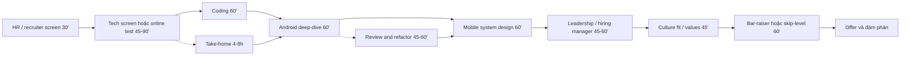

# 14. Mock Interview Scripts: kịch bản từng vòng, take-home, review round, đàm phán lương

> Mục tiêu: có kịch bản sẵn cho mọi vòng trong một interview loop Senior/Staff Android hoặc Mobile Lead (HR screen, tech screen, coding, Android deep-dive, system design, leadership, culture fit, bar-raiser), biết mở đầu, trả lời, kết thúc, và tự chấm bằng rubric; làm được take-home trong 4-8 giờ và vòng "review & refactor" trong 45 phút; đàm phán được lương ở Việt Nam và remote với số liệu thật. | Mức cần đạt: Senior: qua từng vòng với điểm rubric >= 3/4, không bị bất ngờ bởi format. Staff: dẫn dắt cuộc nói chuyện, hỏi ngược có chủ đích, chuyển câu hỏi kỹ thuật thành trade-off và quyết định. Lead: trình bày được quan điểm về team, quy trình, hiring, và đàm phán gói tổng (base, bonus, equity, title, scope). | Thời gian gợi ý: đọc tuần 1 (2 giờ, để biết cả loop), dùng mỗi mock từ tuần 4, full mock loop tuần 12 (~8 giờ).

Ghi chú: file này không chứa câu trả lời đầy đủ. Mỗi câu hỏi có gợi ý một dòng và chỉ tới file có câu trả lời mẫu (`04`, `05`, `06`, `07`, `08`, `09`, `10`, `11`, `12`, `13`). Mục đích là kịch bản: bạn mở file này 15 phút trước mỗi vòng, đọc phần "Cách mở đầu", lướt câu hỏi, rồi đóng lại. Sau vòng, chấm rubric và ghi câu hỏi thật vào `PROGRESS.md`.

## 0. Bản đồ chủ đề

Một loop đầy đủ ở công ty product nước ngoài có 5-7 vòng trong 2-5 tuần. Ngân hàng Việt Nam thường 3-4 vòng trong 2 tuần. Outsourcing 2-3 vòng, có vòng với khách hàng bằng tiếng Anh. Mỗi vòng chấm một thứ khác nhau và người phỏng vấn khác nhau, nên cách nói cũng khác: với recruiter nói ngắn và tích cực, với engineer nói cơ chế và trade-off, với hiring manager nói kết quả và con người, với bar-raiser nói bằng chứng.



Interviewer sẽ đào tới đâu: ở mỗi vòng họ có 1-2 câu "signal" quyết định. Tech screen: "giải thích cơ chế X" (coroutine cancel, recomposition, back stack). Coding: "có tự test không". Deep-dive: "code của bạn trong repo của bạn, vì sao làm thế". System design: "đổi yêu cầu thì đổi thiết kế thế nào". Leadership: "lần bạn sai và sửa". Culture: "lần bạn không đồng ý với sếp". Bar-raiser: "bằng chứng cụ thể, số liệu, tên người". Bạn phải tự trả lời được tất cả bằng tiếng Anh, không có AI bên cạnh.

## 1. Tổng quan interview loop

### 1.1 Các vòng, ai hỏi, chấm gì

| Vòng | Ai phỏng vấn | Thời gian | Chấm gì | Ghi chú theo loại công ty |
|---|---|---|---|---|
| HR / recruiter screen | Recruiter hoặc talent partner | 20-30 phút, call | Động lực, phù hợp JD, kỳ vọng lương, notice period, tiếng Anh cơ bản, red flag | Mọi công ty. Bank VN có thể tiếng Việt; foreign/remote tiếng Anh |
| Technical phone screen | 1 engineer senior | 45-60 phút | Kiến thức Android/Kotlin rộng, trả lời nhanh, độ sâu vừa | Grab, Agoda, remote thường thay bằng online test (HackerRank/Codility) |
| Online test | Tự động | 60-120 phút | 2 bài coding + Android MCQ | Foreign company, một số bank (Techcombank, Tyme dùng vendor) |
| Coding round | 1-2 engineer | 45-60 phút | Thuật toán, code sạch, test, nói khi code | Grab 2 bài Medium; Agoda 1 bài linked list/array/BST; bank 1 bài Easy hoặc không có |
| Take-home | Tự làm, 2-7 ngày | 4-8 giờ thực làm | Architecture, test, README, commit history, error handling | Nhiều công ty remote và outsourcing; thay cho coding round hoặc thêm vào |
| Android deep-dive | 1-2 Android engineer, thường là lead | 60 phút | Cơ chế nội bộ, quyết định thiết kế trong project của bạn, Compose, coroutines, performance, security | Vòng quyết định cho Senior/Staff. Bank hỏi thêm security |
| Review & refactor | 1 engineer | 45-60 phút | Đọc code lạ, tìm lỗi, ưu tiên, giải thích | Agoda và một số công ty product; mục 4 |
| Mobile system design | 1 senior/staff hoặc architect | 45-60 phút | Phân tích yêu cầu, thiết kế client, trade-off, mở rộng, offline, security | Grab không gợi ý; nhiều công ty hỏi "design feed/chat/payment"; `06` |
| Leadership / hiring manager | Engineering manager hoặc head of mobile | 45-60 phút | Kết quả, ownership, mentoring, xử lý xung đột, quyết định kỹ thuật, phù hợp team | Bắt buộc cho Lead; Senior cũng có |
| Culture fit / values | HR senior hoặc manager khác team | 30-45 phút | Giá trị công ty (Grab 4H), hành vi trong tình huống, động lực dài hạn | Grab, Shopee, Tyme, Agoda; bank VN thường gộp vào vòng manager |
| Bar-raiser / skip-level | Senior không thuộc team, được đào tạo chấm | 60 phút | Bằng chứng cho "nâng mặt bằng", hỏi đi hỏi lại chi tiết | Amazon-style; Grab, Agoda, một số remote có vòng tương đương |

### 1.2 Loop điển hình theo loại công ty

| Loại | Loop | Tổng thời gian |
|---|---|---|
| Bank/fintech VN (Techcombank, OCB, Timo, Tyme) | HR screen (VI) → bài test online hoặc take-home nhỏ → technical interview 60-90' (Android + 1 bài code + security) → manager/director 45' → offer | 2-3 tuần |
| Foreign product tại VN (Grab, Agoda, Shopee) | Recruiter 30' → online test hoặc phone screen → onsite 3-4 vòng trong 1 ngày (coding, deep-dive hoặc refactor, system design, culture/hiring manager) → có thể thêm bar-raiser → offer | 3-5 tuần |
| Outsourcing (FPT Software, NashTech, KMS, Savvycom) | HR → technical 60' (Android, có thể tiếng Anh) → client interview 30-60' (EN, behavioral + vài câu kỹ thuật) → offer | 1-2 tuần |
| Remote/global (EU, Úc, Singapore, US startup) | Recruiter 30' → take-home hoặc live coding → system design → hiring manager → values/culture → reference check → offer | 3-6 tuần, lệch múi giờ |

Hỏi recruiter ngay ở vòng đầu: "Could you walk me through the full process and the format of each round?" Ghi lại vào `PROGRESS.md`. Nếu họ nói "pair programming" thì chuẩn bị mục 6 của `13`; nếu "refactor exercise" thì mục 4 file này.

**Đọc thêm:**
- https://github.com/kaushikb9/em-interviews (cách engineering manager thiết kế loop và chấm)
- https://www.levels.fyi/ (so sánh level giữa công ty khi đọc JD, không có nhiều data VN)
- Sách The Staff Engineer's Path (Tanya Reilly), chương 1-2 (định nghĩa Staff, kỳ vọng theo level)

## 2. Kịch bản từng vòng

Mỗi vòng có: cách mở đầu (EN), câu hỏi hay gặp với gợi ý một dòng, cách kết thúc, rubric 0-4, timeline. Rubric dùng chung: 0 = không trả lời được; 1 = trả lời mơ hồ hoặc sai; 2 = đúng nhưng nông, không ví dụ; 3 = đúng, có cơ chế và ví dụ thật; 4 = như 3 cộng trade-off, số liệu, hoặc bài học. Mục tiêu: trung bình >= 3.

### 2.1 HR / recruiter screen (20-30 phút)

**Mục đích của họ:** lọc nhanh: bạn có hiểu JD, có lý do chuyển việc hợp lý, lương trong band, notice period chấp nhận được, tiếng Anh đủ cho các vòng sau. Họ không chấm kỹ thuật nhưng ghi chú "communication" và chuyển cho hiring manager.

**Cách mở đầu (EN):** "Thanks for reaching out. Before we start, could you tell me a bit about the team and what this role will own? That helps me tailor what I share." (Hỏi trước để biết họ cần gì, rồi mới giới thiệu.)

Tự giới thiệu 60-90 giây (khung): tên, số năm, stack chính, 1-2 kết quả có số, lý do quan tâm vị trí. Bản mẫu trong `23-English-for-Tech-Interviews.md` mục giới thiệu; bản STAR trong `12-Behavioral-STAR-Bank.md`.

**Câu hỏi hay gặp (EN) và gợi ý:**

1. "Tell me about yourself." Khung 60-90 giây, kết bằng lý do ứng tuyển.
2. "Why are you looking to move?" Hướng tới (scope, product, team) chứ không chạy khỏi; không nói xấu công ty cũ.
3. "What do you know about us?" 2 câu về product, 1 câu về tech (đọc `15-Company-Playbook-Job-Search.md`).
4. "What is your current and expected salary?" Mục 6: hỏi band trước, nêu range có nghiên cứu; không nói lương hiện tại nếu không bắt buộc.
5. "What is your notice period?" Nói đúng (30 ngày là phổ biến ở VN); có thể thương lượng với công ty hiện tại.
6. "Are you interviewing elsewhere?" Trung thực ngắn: "Yes, I am in a couple of processes, but this role is a priority for me because ..."
7. "Are you open to hybrid / onsite / relocation?" Trả lời rõ, hỏi lại chính sách.
8. "How comfortable are you working in English every day?" Trả lời bằng ví dụ: "I have been working with an Australian client in English for two years, including daily standups and design reviews."
9. "What level are you targeting: Senior or Lead?" Nói cả hai nếu mở, nêu điều kiện: "I am happy with a Senior IC role with ownership of a product area; I would also take a lead role if the team is 3-6 people."
10. "Tell me about your most recent project." 2 phút, có số: user, crash-free, release cadence (`12` story bank).
11. "Have you worked with iOS or KMP?" `05`: đã port app sang iOS với CMP, nói thẳng mức độ.
12. "How do you use AI tools in your work?" `10` và `18`: Claude Code hằng ngày, review code AI, viết rules; nhấn vẫn tự giải thích được code.
13. "When could you start?" Notice + 1-2 tuần nghỉ nếu cần.
14. "Why a bank / why fintech?" Hệ quả thật của lỗi, security, scale; `12` chủ đề bank.
15. "What are you looking for in your next role?" 3 điều cụ thể (ownership, mentoring, product impact).
16. "Do you have any questions for me?" Mục 5: 3 câu dành cho recruiter.
17. "Is there anything on your CV you want to clarify?" Khoảng trống thời gian, nhảy việc ngắn: nói trước, 1 câu, không biện hộ.
18. "What is your biggest achievement?" Một story STAR 90 giây với số.
19. "How do you handle working with remote teams across time zones?" Ví dụ overlap hours, async doc, decision log.
20. "Are you okay with a take-home assignment?" "Yes, if it is scoped to a few hours. Could you share the expected time budget?"

**Cách kết thúc (EN):** "Thank you. To summarise, I am interested because of X and Y. What are the next steps and the timeline? Is there anything else you need from me, such as a portfolio link or references?" Gửi email cảm ơn trong 24 giờ với link GitHub và 2 dòng tóm tắt.

**Rubric tự chấm:**

| Tiêu chí | 0-4 | Ghi chú |
|---|---|---|
| Giới thiệu 90 giây có số và lý do | | |
| Lý do chuyển việc tích cực, nhất quán với CV | | |
| Trả lời lương theo kịch bản mục 6, không lộ giá sàn | | |
| Tiếng Anh: trôi, không ngập ngừng quá 3 giây | | |
| Hỏi ngược 2-3 câu có giá trị | | |
| Logistics rõ: notice, start date, hybrid | | |

**Timeline 30 phút:** 0-3 chào hỏi và họ giới thiệu; 3-8 bạn tự giới thiệu; 8-20 câu hỏi của họ; 20-26 lương/notice/logistics; 26-30 câu hỏi của bạn và next steps.

**Đọc thêm:**
- `15-Company-Playbook-Job-Search.md` (chuẩn bị theo công ty), `23-English-for-Tech-Interviews.md` (mẫu giới thiệu)
- https://www.themuse.com/advice (tìm "tell me about yourself") (khung "present, past, future")

### 2.2 Technical phone screen (45-60 phút, rapid-fire Android/Kotlin)

**Mục đích của họ:** kiểm tra chiều rộng trong 45 phút với 15-25 câu ngắn, mỗi câu 1-3 phút. Họ muốn câu trả lời đúng, có cơ chế, không lan man. Nếu bạn nói dài, họ cắt và điểm giảm.

**Cách mở đầu (EN):** "Happy to go through these. I will keep answers short and you can ask me to go deeper on any of them."

Kỹ thuật trả lời: định nghĩa 1 câu, cơ chế 2 câu, ví dụ 1 câu, dừng. Nếu không biết: "I have not used that directly. My understanding is ... I would verify in the docs."

**Câu hỏi hay gặp (EN) và gợi ý (câu trả lời đầy đủ ở `04-Android-Kotlin-Deep-Dive.md` trừ chỗ ghi khác):**

1. "What happens when a coroutine is cancelled?" `CancellationException`, cooperative, `isActive`/`ensureActive`, `finally` + `NonCancellable`.
2. "Difference between `launch` and `async`?" Job vs Deferred, exception propagation khác nhau.
3. "What is `SupervisorJob` for?" Lỗi con không hủy anh em; `supervisorScope`; viewModelScope dùng nó.
4. "StateFlow vs SharedFlow vs LiveData?" Hot, giá trị hiện tại, conflation, replay, lifecycle-aware hay không.
5. "What triggers recomposition and how does Compose skip it?" State read, stability, strong skipping, `@Stable`/`@Immutable`.
6. "`remember` vs `rememberSaveable` vs ViewModel?" Recomposition vs config change vs process death.
7. "`LaunchedEffect`, `DisposableEffect`, `SideEffect`: when?" Key-based coroutine; cleanup; mỗi recomposition thành công.
8. "How does Navigation 3 differ from Navigation 2?" Bạn sở hữu back stack (`NavKey`, `rememberNavBackStack`), `NavDisplay`, `entryProvider`, Scenes.
9. "Explain the Activity lifecycle on rotation and on process death." `onSaveInstanceState`, ViewModel sống qua rotation, `SavedStateHandle` cho process death.
10. "What changed for back navigation in Android 16?" Predictive back mặc định, `onBackPressed` không được gọi, `OnBackPressedCallback`/`BackHandler`.
11. "What is edge-to-edge and why is it mandatory now?" API 36 không opt-out, `WindowInsets`, `enableEdgeToEdge`.
12. "How do you make a `data class` safe to put in a `StateFlow`?" Bất biến, `List` không phải `MutableList`, `copy`.
13. "What is the difference between `Dispatchers.IO` and `Dispatchers.Default`?" Pool size, `limitedParallelism`, blocking IO.
14. "How does Hilt differ from Koin?" Compile-time graph vs runtime DSL; `05`/`04` DI section; lý do dùng Koin trong KMP.
15. "What does Room's `Flow` return actually observe?" Invalidation tracker theo bảng; `@Transaction`; Room 3 Kotlin-only + KSP.
16. "How do you detect and fix a memory leak?" LeakCanary, heap dump, Activity trong singleton, callback chưa gỡ.
17. "What is R8 doing and why does reflection break?" Shrink, obfuscate, optimise; `-keep`; `04` Build section.
18. "How do you secure a token on device?" Keystore, EncryptedSharedPreferences đã deprecated thì thay bằng gì; `08-Security.md`.
19. "What is certificate pinning and what is the risk?" `07-Network.md`/`08`: pin set, rotation, backup pin, break khi đổi CA.
20. "How does OkHttp handle connection reuse and retries?" `07`: connection pool, interceptor chain, `retryOnConnectionFailure`.
21. "How do you test a ViewModel with a Flow?" `19`: `runTest`, `StandardTestDispatcher`, Turbine, fake repo.
22. "What is a baseline profile?" `04` Performance: pre-compiled hot paths, Macrobenchmark, 16 KB page size liên quan native.
23. "KMP: what is `expect`/`actual` and when do you avoid it?" `05`: interface + DI thay vì expect/actual cho logic lớn.
24. "What is the difference between `inline`, `crossinline`, `reified`?" Lambda inlining, non-local return, type erasure.
25. "What are context parameters in Kotlin 2.4?" Stable từ 2.4.0, thay context receivers; dùng cho DSL/logging scope; nói mức "đã đọc, chưa dùng rộng" nếu đúng vậy.

**Cách kết thúc (EN):** "Is there any area you would like me to go deeper on? I am happy to walk through how we handle X in my current project." Rồi hỏi 1-2 câu kỹ thuật về team (mục 5).

**Rubric tự chấm:**

| Tiêu chí | 0-4 |
|---|---|
| Đúng cơ chế ở >= 80% câu | |
| Mỗi câu <= 2 phút, có cấu trúc định nghĩa/cơ chế/ví dụ | |
| Nói "I don't know, here is how I would find out" thay vì bịa | |
| Nhắc được ít nhất 3 thay đổi nền tảng 2025-2026 (Android 16/17, Nav3, Room 3, Kotlin 2.4) | |
| Nối được câu trả lời với project thật của bạn | |

**Timeline 45 phút:** 0-5 giới thiệu nhanh; 5-40 câu hỏi (15-20 câu); 40-45 câu hỏi của bạn.

**Đọc thêm:**
- `04-Android-Kotlin-Deep-Dive.md` (70+ Q&A), `07-Network.md`, `08-Security.md`, `19-Testing-Deep-Dive.md`
- https://developer.android.com/about/versions/16/behavior-changes-16 và https://developer.android.com/about/versions/17/behavior-changes-17

### 2.3 Coding round (45-60 phút)

**Mục đích của họ:** xem bạn giải quyết vấn đề thế nào, không chỉ đáp án. Chi tiết, pattern, và 20 câu tiếng Anh ở `13-Coding-Interview.md` mục 1-3. Phần này chỉ là kịch bản nói.

**Cách mở đầu (EN):** "Before I code, let me make sure I understand the problem. [Nhắc lại đề bằng lời mình.] A few questions: [input size, duplicates, empty input, output format]. Let me write a small example."

**Những câu phải nói trong vòng (theo thứ tự):**

1. Nhắc lại đề và hỏi 2-3 câu làm rõ (phút 0-3).
2. "The brute force would be ... which is O(...). I think we can do better with ..." (phút 3-6).
3. "Let me confirm the approach before coding: ..." và chờ gật đầu (phút 6-8).
4. Code và nói từng khối, đặt tên rõ (phút 8-22). Im lặng tối đa 30 giây; nếu kẹt: "Let me think about this edge for a moment."
5. "Let me trace through the example." rồi edge cases (phút 22-27).
6. "Time is O(...), space is O(...). If we needed to optimise further, I would ..." (phút 27-29).
7. "Is there a follow-up you would like me to handle?" (phút 29-30).

Khi interviewer chỉ ra bug: "You are right, thanks. The issue is ... let me fix it." Không tranh luận, không xin lỗi dài.

Khi không nghĩ ra cách tối ưu sau 10 phút: viết brute force đúng, nói rõ "I will implement the straightforward version first so we have a working baseline, then optimise." Điểm "có code chạy đúng" cao hơn "ý tưởng hay nhưng không code xong".

Grab (2 bài trong 60 phút): bài 1 phải xong trong 25 phút để còn 30 phút cho bài 2. Nếu bài 1 kéo dài quá 30 phút, nói với interviewer: "I would like to make sure we have time for the second problem. Shall I summarise the remaining edge cases verbally?"

**Cách kết thúc (EN):** "Thanks, that was a good problem. In production I would add unit tests for the edge cases we discussed and consider [memory/streaming] if the input were larger."

**Rubric tự chấm (mỗi bài):**

| Tiêu chí | 0-4 |
|---|---|
| Clarify: hỏi đủ, viết example | |
| Approach: brute force rồi tối ưu, xác nhận trước khi code | |
| Code: đúng, sạch, chạy qua mọi edge case | |
| Communication: nói liên tục, tiếng Anh rõ, phản ứng tốt với gợi ý | |
| Complexity: đúng, giải thích được | |

**Timeline 60 phút cho 2 bài:** 0-2 chào; 2-27 bài 1; 27-30 chuyển; 30-55 bài 2; 55-60 câu hỏi của bạn.

**Đọc thêm:**
- `13-Coding-Interview.md` mục 1.2 (6 bước), 1.3 (20 câu), 4 (lịch), 8 (AI-allowed)
- https://neetcode.io/roadmap

### 2.4 Android deep-dive (60 phút)

**Mục đích của họ:** đo độ sâu thật. Với bạn, vòng này có rủi ro riêng: project KMP/CMP được build phần lớn bằng Claude Code. Interviewer sẽ mở GitHub của bạn hoặc hỏi "walk me through your architecture" rồi đào vào một file. Bạn phải giải thích được từng quyết định như thể tự tay viết. Drill "Own your own code" trong `04`, `05`, `19` là để chuẩn bị cho vòng này.

**Cách mở đầu (EN):** "Let me give you a two-minute overview of the architecture of my most recent project, then you can pick any area to go deeper." Vẽ nhanh: modules (`build-logic`, `core`, `features`), data flow (UI state, ViewModel, repository, Room/Ktor), DI (Koin), platform (CMP iOS).

**Câu hỏi hay gặp (EN) và gợi ý:**

1. "Walk me through the architecture of your app and why you chose it." Module hóa, UDF, trade-off so với single module; `04` Architecture.
2. "Why Koin and not Hilt for this project?" KMP support, runtime DSL, startup cost, verify graph bằng test; `04`/`05`.
3. "Show me how a screen gets its data from the network to the UI." Ktor/Retrofit → repository → Flow → ViewModel `stateIn` → `collectAsStateWithLifecycle`.
4. "What happens on this screen when the user rotates the device?" `rememberSaveable`, ViewModel, `WhileSubscribed(5_000)`.
5. "How do you handle errors across layers?" Sealed result, mapping ở repository, UI error state có retry; không nuốt `CancellationException`.
6. "Where could this code leak?" Scope, listener, Context trong singleton; chỉ ra cách bạn kiểm tra (LeakCanary, test).
7. "How does your convention plugin work?" `build-logic`, `Plugin<Project>`, version catalog, lý do; `04` Build.
8. "How do you keep the UI from recomposing too much?" Stability, `derivedStateOf`, lambda ổn định, Layout Inspector counts; `04` Compose.
9. "How did you port the app to iOS and what broke?" `05`: CMP 1.10+, expect/actual, iOS lifecycle, Xcode 26, hot reload.
10. "How do you test this ViewModel? Show me a test." `19`: viết live với Turbine nếu được yêu cầu.
11. "How does your app behave offline?" Room là source of truth, outbox, sync; `06` offline.
12. "What is your release process?" `20-Git-CICD.md`: branch, CI, signing, staged rollout, rollback.
13. "What did you change for Android 16 and 17?" Edge-to-edge, predictive back, 16 KB page size, large screen orientation; `04`.
14. "How do you handle secrets and tokens?" `08`: Keystore, không hard-code, pinning, R8; bank sẽ hỏi Play Integrity, root detection.
15. "How do you measure performance?" Macrobenchmark, baseline profile, startup, jank; `04` Performance.
16. "What would you refactor first in this codebase and why?" Nêu 2 thứ cụ thể với lý do; cho thấy bạn biết nợ kỹ thuật của mình.
17. "How much of this code did AI write and how do you make sure it is right?" Trung thực: tỷ lệ, quy trình review, test, rules file; `10`/`18`.
18. "Explain `stateIn` parameters you used." `SharingStarted`, timeout, initial value, vì sao 5 giây.
19. "How does Nav3 manage the back stack in your app?" `NavKey` list bạn sở hữu, `rememberNavBackStack`, deep link, save/restore.
20. "How do you handle Play Billing / in-app review / in-app update?" `04` hoặc `22`: flow, edge (pending purchase, acknowledge), test.
21. "What does your Room schema migration look like?" Room 3 (`androidx.room3`), `AutoMigration`, test migration; `04`.
22. "How do you structure a feature module so it can be reused?" API/impl split, không phụ thuộc chéo, DI module riêng.
23. "What is the hardest bug you fixed in this app?" STAR 2 phút với cơ chế thật; `12`.
24. "If I gave you a 2x traffic spike in the API, what breaks in the client?" Retry storm, backoff/jitter, cache, rate limiter; `13` mục 5, `07`.
25. "How would you add an on-device AI feature here?" `10`: ML Kit GenAI / Gemini Nano, fallback cloud, privacy, cost.

**Cách kết thúc (EN):** "If you were to join a team working on this codebase, what would you look at first?" (hỏi ngược, cho thấy bạn muốn nghe góc nhìn của họ) hoặc "What does the current team struggle with most technically?"

**Rubric tự chấm:**

| Tiêu chí | 0-4 |
|---|---|
| Giải thích được architecture của chính mình trong 2 phút, có lý do | |
| Trả lời "why" cho ít nhất 5 quyết định (DI, module, state, nav, test) | |
| Nói được cơ chế (không chỉ API) ở coroutines, Compose, Room | |
| Nêu được điểm yếu/nợ kỹ thuật của code mình và cách sửa | |
| Minh bạch về AI và chứng minh ownership bằng chi tiết | |
| Nối được với Android 16/17, Nav3, Room 3, KMP hiện tại | |

**Timeline 60 phút:** 0-5 giới thiệu; 5-15 tổng quan architecture (bạn dẫn); 15-50 đào sâu 4-6 chủ đề; 50-55 câu khó nhất hoặc bug story; 55-60 câu hỏi của bạn.

**Đọc thêm:**
- `04-Android-Kotlin-Deep-Dive.md`, `05-Cross-Platform-iOS-KMP-Flutter.md`, `19-Testing-Deep-Dive.md`, `20-Git-CICD.md`
- https://developer.android.com/topic/architecture (guide chính thức để so với cách bạn làm)
### 2.5 Mobile system design (45-60 phút)

**Mục đích của họ:** xem bạn biến yêu cầu mơ hồ thành thiết kế client có lý do, biết trade-off, biết mở rộng. 11 bài đầy đủ và rubric chi tiết ở `06-Mobile-System-Design.md`; phần này là kịch bản dẫn dắt, nhất là khi interviewer không gợi ý (Grab).

**Cách mở đầu (EN):** "Let me start by clarifying the scope and the constraints, then I will propose a high-level design, and we can go deep into whichever part you care about most. I will think out loud, so please interrupt me anytime."

**Timeline 45 phút (tự dẫn, không chờ gợi ý):**

| Phút | Bước | Nói gì |
|---|---|---|
| 0-5 | Clarify | "Who are the users? Which platforms? Online-only or offline-first? What scale: DAU, items per user, update frequency? Any hard constraint: battery, data cost, security?" |
| 5-10 | Requirements + success metrics | Functional (3-5 bullet), non-functional (latency, offline, battery, security), out of scope. "I will measure success by ..." |
| 10-20 | High-level design | Vẽ: UI layer, ViewModel/state, repository, local DB, network, sync/background; API contract tóm tắt (endpoint, pagination, auth) |
| 20-35 | Deep dive 2 phần | Chọn phần khó nhất (ví dụ sync/conflict, pagination, caching, realtime) và phần họ hỏi |
| 35-42 | Trade-offs, failure modes, scaling | "What if the network is flaky? What if 10x items? How do we roll out safely?" |
| 42-45 | Tóm tắt + câu hỏi | 3 câu tóm tắt, 1 câu hỏi về hệ thống thật của họ |

**Prompt hay gặp (EN) và gợi ý (chi tiết trong `06`):**

1. "Design a news feed / timeline." Cursor pagination, cache + DB, prefetch, image loading, like/unlike optimistic update.
2. "Design a chat screen with offline support." Outbox, message state (sending/sent/failed), ordering, websocket + fallback polling, dedup theo client id.
3. "Design the rider tracking map for a ride-hailing app." Location update frequency, batching, battery, websocket, interpolation, backgrounding rules (foreground service, Android 17 background restrictions).
4. "Design a money transfer flow for a banking app." Idempotency key, 2FA/biometric, pending state, reconciliation, security (pinning, Keystore, Play Integrity), audit log; `08`.
5. "Design an image loading library." Memory LRU + disk cache, request dedup, lifecycle cancel, downsampling, placeholder, thread pools; `13` mục 5.1, 5.9.
6. "Design offline-first notes with sync." Local-first DB, change log, last-write-wins vs merge, conflict UI, background sync constraints.
7. "Design push notification handling." Token lifecycle, deep link routing, permission (API 33+), notification channels, dedup, analytics.
8. "Design an analytics / event tracking SDK." Batching, persistence queue, retry, size caps, privacy consent, sampling; `22-Product-Metrics-Compliance.md`.
9. "Design a large file upload (video) with resume." Chunking, resumable protocol, WorkManager, progress, network constraints, integrity hash.
10. "Design search with autocomplete." Debounce, cancel, cache, trie on device vs server, ranking, telemetry; `13` 5.2 và 5.7.
11. "Design feature flags and remote config." Fetch strategy, cache, default values, kill switch, staged rollout, evaluation at startup.
12. "Design app startup to be fast." Lazy init, DI graph cost, baseline profile, splash rules, measure with Macrobenchmark; `04`.
13. "Design a payment SDK used by other apps." Public API surface, versioning, security boundary, size, backward compatibility; `09-Backend-Fullstack.md` cho API.
14. "Design deep linking across the app." URI scheme + App Links, Nav3 back stack construction, auth gating, analytics attribution.
15. "Design a KMP shared module for iOS and Android." What to share, DI, concurrency on iOS, binary size, release process; `05`.

Khi interviewer không gợi ý: cứ 5 phút tự hỏi "Have I covered: data model, API, local storage, state, error, offline, security, scale?" và nói ra "Next, I will cover X". Khi họ im lặng, đó là bài test: bạn có tự dẫn được không.

**Cách kết thúc (EN):** "To summarise: the core decisions are A, B, C; the main risk is D and we mitigate it with E. If I had another week I would prototype F. How does your current system handle this?"

**Rubric tự chấm:**

| Tiêu chí | 0-4 |
|---|---|
| Clarify yêu cầu và constraint trước khi vẽ | |
| Thiết kế có đủ layer, API contract, data model | |
| Deep dive có cơ chế thật (không chỉ tên công nghệ) | |
| Trade-off nói được cho ít nhất 3 quyết định | |
| Failure modes: offline, retry, conflict, security | |
| Tự dẫn thời gian, không bị im lặng | |

**Đọc thêm:**
- `06-Mobile-System-Design.md` (11 bài, rubric), `07-Network.md`, `08-Security.md`
- https://github.com/weeeBox/mobile-system-design (framework phỏng vấn mobile system design)
- Sách Mobile System Design Interview (Manuel Vivo, ByteByteGo 2025)

### 2.6 Leadership / hiring manager (45-60 phút)

**Mục đích của họ:** quyết định "tôi có muốn người này trong team không". Họ tìm: ownership, kết quả có số, cách làm việc với người khác, cách ra quyết định, cách xử lý khi sai, và với vai trò Lead: mentoring, planning, hiring, nói chuyện với business. Câu trả lời đầy đủ trong `11-Leadership-Management.md` và story bank trong `12-Behavioral-STAR-Bank.md`.

**Cách mở đầu (EN):** "Could you tell me what success looks like for this role in the first six months? I will use that to pick the most relevant examples." Sau đó giới thiệu 60 giây hướng tới vai trò (không lặp lại CV).

Khung trả lời: STAR, 2 phút, kết thúc bằng kết quả có số và bài học. Chuẩn bị 8-10 story dùng được cho nhiều câu (`12`).

**Câu hỏi hay gặp (EN) và gợi ý:**

1. "Tell me about a project you owned end to end." Story có scope, quyết định, kết quả, số.
2. "Tell me about a time you disagreed with a product or engineering decision." Nói cách bạn nêu ý kiến với dữ liệu, rồi commit dù không được chọn.
3. "Describe a technical decision that turned out wrong. What did you do?" Nhận trách nhiệm, sửa, thay đổi quy trình.
4. "How do you mentor junior engineers?" Pairing, code review có giải thích, giao việc tăng dần, 1:1; ví dụ người cụ thể đã lên level.
5. "How do you handle a teammate who is underperforming?" Quan sát, 1:1 thẳng thắn, kỳ vọng rõ, hỗ trợ, timeline, escalate đúng lúc; `11`.
6. "How do you prioritise tech debt against features?" Lượng hóa (crash, lead time), đề xuất % capacity, gắn với mục tiêu business.
7. "Tell me about a production incident you handled." Sev1/Sev2: phát hiện, mitigate, communicate, postmortem không đổ lỗi, action items.
8. "How do you estimate a large feature?" Chia nhỏ, spike, khoảng (range) không điểm, cập nhật khi biết thêm, nói rõ rủi ro.
9. "How do you run code review in your team?" Tiêu chí, SLA, nhỏ và thường xuyên, automation (detekt, CI), tone.
10. "How do you decide between building in-house and using a library?" Tiêu chí: maintenance, size, security, lock-in; ví dụ thật.
11. "How do you work with backend, design, QA?" API contract sớm, design handoff, test plan chung; ví dụ xung đột đã giải quyết.
12. "How would you onboard yourself in the first 30/60/90 days?" Học codebase, gặp người, ship nhỏ, rồi đề xuất; `11`.
13. "What is your leadership style?" Mô tả ngắn, ví dụ, biết khi nào directive khi nào coaching.
14. "How do you keep the team motivated during a long migration?" Milestone nhỏ, visible wins, rotate việc chán, celebrate.
15. "How do you hire? What do you look for?" Tiêu chí, rubric, giảm bias, ví dụ đã phỏng vấn/tuyển ai.
16. "How do you communicate a delay to stakeholders?" Sớm, có lựa chọn (scope/time/quality), không đổ lỗi.
17. "Tell me about influencing without authority." Thuyết phục team khác bằng dữ liệu/prototype.
18. "How do you use AI tools in your team and what rules do you set?" `10`: rules file, review AI code về security/perf, không paste secret, đo lường.
19. "What would you do if you inherit a codebase with no tests?" Characterisation tests ở chỗ hay đổi, CI chặn regress, không rewrite; `19`.
20. "Why should we hire you for Lead instead of promoting internally?" Khiêm tốn, nêu điều bạn mang lại (KMP, release process, mentoring), muốn hợp tác với người nội bộ.
21. "What do you need from me as your manager?" Context, feedback thẳng, quyền quyết định trong phạm vi.
22. "Where do you want to be in three years?" Staff IC hoặc Lead, nhất quán với vị trí.

**Cách kết thúc (EN):** "Based on what we discussed, is there any concern about my fit that I could address now?" Câu này cho bạn cơ hội sửa ấn tượng trước khi họ viết feedback. Rồi hỏi 2 câu mục 5 nhóm hiring manager.

**Rubric tự chấm:**

| Tiêu chí | 0-4 |
|---|---|
| Mỗi story có kết quả đo được và bài học | |
| Có ví dụ về mentoring, xung đột, incident, sai lầm | |
| Nói "I" đúng chỗ (việc bạn làm) và "we" đúng chỗ | |
| Không đổ lỗi, không nói xấu công ty cũ | |
| Nối được với vai trò và team họ mô tả | |
| Trả lời câu "concern" một cách bình tĩnh | |

**Timeline 60 phút:** 0-5 họ giới thiệu role; 5-10 bạn giới thiệu; 10-45 6-8 câu behavioral; 45-52 câu về cách làm việc/AI/team; 52-60 câu hỏi của bạn.

**Đọc thêm:**
- `11-Leadership-Management.md`, `12-Behavioral-STAR-Bank.md`
- Sách The Manager's Path (Camille Fournier), chương 3 Tech Lead, chương 4 Managing People
- https://github.com/kaushikb9/em-interviews

### 2.7 Culture fit / values (30-45 phút, Grab-style)

**Mục đích của họ:** kiểm tra hành vi của bạn có khớp giá trị công bố không. Grab công bố 4 giá trị "4H": Heart, Hunger, Honour, Humility (kiểm tra lại trên trang careers của Grab trước khi phỏng vấn vì cách diễn đạt có thể đổi). Công ty khác có bộ riêng (Agoda, Shopee, Tyme đều đăng trên trang careers). Cách chuẩn bị: với mỗi giá trị, có 1-2 story.

**Cách mở đầu (EN):** "I read your values before this call. Shall I share examples against them, or would you prefer to drive with questions?"

**Câu hỏi hay gặp (EN) và gợi ý (map theo 4H, dùng được cho công ty khác):**

Heart (vì người dùng, vì đồng nghiệp):
1. "Tell me about a time you went out of your way for a user." Bug ảnh hưởng nhóm nhỏ nhưng bạn vẫn ưu tiên; a11y; số liệu.
2. "Describe a time you supported a colleague who was struggling." Cụ thể, không kể công.
3. "How do you make sure accessibility and inclusion are considered?" `21-UI-UX-Design-Adaptive.md`: TalkBack, contrast, font scale.

Hunger (chủ động, học, vượt kỳ vọng):
4. "Tell me about something you learned recently on your own." KMP/CMP port, AI workflow, testing từ zero (nói thật, có bằng chứng).
5. "Describe a time you took on something outside your job description."
6. "What is a goal you set and missed?" Thật, bài học, điều chỉnh.
7. "How do you stay current with Android?" Nguồn cụ thể (release notes, blog JetBrains, podcast), thời gian cố định mỗi tuần.

Honour (chính trực, giữ lời, dữ liệu thật):
8. "Tell me about a time you had to deliver bad news." Sớm, thẳng, có phương án.
9. "Have you ever been asked to do something you thought was wrong? What did you do?" Ví dụ: tracking không có consent, bỏ qua lỗi bảo mật; cách từ chối lịch sự có dữ liệu.
10. "Describe a mistake you made that no one would have noticed." Bạn tự khai và sửa.
11. "How do you handle a deadline you cannot meet?" Không cắt test âm thầm; thương lượng scope.

Humility (lắng nghe, nhận sai, cùng thắng):
12. "Tell me about feedback that was hard to hear." Nội dung, cảm xúc ngắn, hành động, kết quả.
13. "Describe a time a junior colleague was right and you were wrong."
14. "How do you react when your design is rejected in review?"
15. "Who do you credit for your biggest success?"

Chung:
16. "Why Grab / why this company specifically?" Product dùng hằng ngày, scale SEA, tech blog cụ thể; không nói "big company".
17. "What kind of team environment do you do your best work in?" Trả lời thật và khớp với những gì bạn biết về họ.
18. "Tell me about a time you had a conflict with your manager." Cách bạn nêu vấn đề riêng, nghe, thỏa hiệp, giữ quan hệ.

**Cách kết thúc (EN):** "What is one thing the team is currently working to improve about how it works together?" Câu này vừa là hỏi ngược vừa cho bạn dữ liệu để quyết định.

**Rubric tự chấm:**

| Tiêu chí | 0-4 |
|---|---|
| Mỗi giá trị có ít nhất một story thật | |
| Story có chi tiết kiểm chứng được (tên dự án, số, thời gian) | |
| Nhận sai thoải mái, không phòng thủ | |
| Không "quá hoàn hảo", có bài học thật | |
| Lý do chọn công ty cụ thể, không chung chung | |

**Timeline 45 phút:** 0-5 giới thiệu; 5-35 6-8 câu behavioral; 35-40 lý do chọn công ty; 40-45 câu hỏi của bạn.

**Đọc thêm:**
- `12-Behavioral-STAR-Bank.md` (40 câu behavioral, 20 story template)
- https://grab.careers/ (giá trị và quy trình tuyển dụng; kiểm tra lại trước khi phỏng vấn)

### 2.8 Bar-raiser style (60 phút)

**Đây là gì:** vòng do một senior ngoài team, được đào tạo riêng, phỏng vấn để bảo đảm người được tuyển "nâng mặt bằng" của công ty chứ không chỉ lấp chỗ trống. Nguồn gốc Amazon; Grab, Agoda và nhiều công ty remote có vòng tương đương (gọi là "hiring committee", "skip-level", "values interview with veto"). Đặc điểm: họ hỏi behavioral nhưng đào rất sâu bằng follow-up: "What exactly did you do, not the team?", "What was the number before and after?", "What would you do differently?", "Who disagreed and what did they say?". Họ ghi chép gần như nguyên văn.

**Cách mở đầu (EN):** "I understand this round focuses on how I work and the impact I have had. I will give specific examples with numbers where I can, and please push me for more detail anywhere."

**Cách chuẩn bị:** 8 story (từ `12`) mỗi story có: bối cảnh 2 câu, việc bạn làm (không phải team) 4-5 câu, số trước/sau, người liên quan, điều bạn làm sai, điều bạn sẽ làm khác. Luyện trả lời follow-up 3 tầng cho mỗi story.

**Câu hỏi hay gặp (EN) và gợi ý:**

1. "Tell me about the most impactful thing you shipped. What was your specific contribution?" Tách "I" khỏi "we".
2. "Walk me through a decision you made with incomplete data." Giả định, cách giảm rủi ro, kết quả, cập nhật khi có data.
3. "Tell me about a time you raised the bar on quality for your team." Test policy, CI gate, review checklist; số: crash-free, lead time.
4. "Describe the biggest technical risk you identified before others did." Ví dụ 16 KB page size, Android 16 edge-to-edge, deprecation.
5. "Tell me about a time you pushed back on a deadline or scope." Dữ liệu, phương án thay thế, kết quả.
6. "Give me an example of simplifying something complex." Xóa code, gộp module, giảm bước release.
7. "Tell me about a failure where you were clearly responsible." Không chia sẻ trách nhiệm với team ở câu này.
8. "How did you grow someone else's career?" Tên (có thể ẩn), hành động, kết quả (promotion, ownership).
9. "Tell me about a time you had to learn something fast to deliver." KMP iOS port với deadline; cách học, kết quả, nợ để lại.
10. "Describe a time you changed your mind because of someone more junior."
11. "What is the hardest feedback you have given?" Nội dung, cách nói, theo dõi sau đó.
12. "Tell me about a time you delivered under significant ambiguity." Bạn tự định nghĩa yêu cầu thế nào.
13. "What did you do when you saw something broken that was not your responsibility?"
14. "Tell me about a long-term bet you made." KMP, Compose sớm, convention plugin; chi phí, lợi ích thực tế.
15. "If I asked your last manager about your biggest weakness, what would they say?" Thật, có hành động cải thiện, không "I work too hard".

Follow-up họ sẽ dùng cho mọi câu: "What was the alternative?", "How did you measure it?", "What happened six months later?", "Who else was involved and what did they do?", "What would you do differently?". Chuẩn bị sẵn cho từng story.

**Cách kết thúc (EN):** "Is there any example you would like me to expand on, or an area where you did not hear enough detail?"

**Rubric tự chấm:**

| Tiêu chí | 0-4 |
|---|---|
| Mỗi story chịu được 3 tầng follow-up mà không mơ hồ | |
| Số liệu trước/sau có trong >= 5 story | |
| Phân biệt rõ đóng góp cá nhân và của team | |
| Có ít nhất 2 story về thất bại thật với bài học | |
| Nhất quán với những gì đã nói ở vòng khác (họ so feedback) | |

**Timeline 60 phút:** 0-3 mở đầu; 3-50 5-6 story với follow-up sâu (8-9 phút mỗi story); 50-55 câu weakness/khác; 55-60 câu hỏi của bạn.

**Đọc thêm:**
- https://www.amazon.jobs/content/en/how-we-hire/interviewing-at-amazon (mô tả vòng bar raiser và leadership principles, dùng làm chuẩn so sánh)
- `12-Behavioral-STAR-Bank.md`, `11-Leadership-Management.md`

## 3. Take-home assignment playbook

### 3.1 Scope trong 4-8 giờ

Take-home phổ biến: "Build an app that lists X from API Y with detail screen, offline cache, tests". Công ty nói "4 hours" thường chấm như 8 giờ. Quy tắc: làm đúng những gì đề yêu cầu ở chất lượng production, thêm tối đa 1-2 thứ "nice to have" nếu còn giờ, và viết rõ trong README những gì không làm và vì sao.

Bước 1 (30 phút, trước khi code): đọc đề 2 lần, viết vào README nháp:
- Must: từng yêu cầu trong đề, mỗi dòng một checkbox.
- Should: thứ grader kỳ vọng dù không ghi (error state, loading, rotation, test).
- Won't: thứ bạn chủ động bỏ (login, analytics, animation) với lý do.
- Câu hỏi chưa rõ: gửi email cho recruiter ngay nếu ảnh hưởng thiết kế; nếu không, tự giả định và ghi vào README.

Bước 2: chọn kiến trúc nhỏ nhất đủ dùng: 1 module app (hoặc 2-3 module nếu đề nhấn "modular"), UDF với ViewModel + StateFlow, repository, Room nếu cần offline, Retrofit/Ktor, Koin hoặc Hilt (cái bạn nhanh nhất). Không KMP trừ khi đề yêu cầu.

### 3.2 Dùng `compose-template` làm nền

Template của bạn có giá trị ở: convention plugins (`build-logic`), detekt, theme, cấu trúc feature module, test deps sẵn. Nhưng có một vấn đề phải xử lý trước khi dùng cho take-home: `settings.gradle.kts` của template lấy version catalog từ `io.github.ltthuc.template:version-catalog:1.0.0` qua `mavenLocal()` (publish từ `YammyDelivery`). Máy grader không có artifact đó, build sẽ fail ngay. Vì vậy:

1. Tạo branch hoặc repo `take-home-starter` từ `compose-template`: thay `from("io.github.ltthuc.template:version-catalog:1.0.0")` bằng file `gradle/libs.versions.toml` nội bộ chứa đúng các alias đang dùng; bỏ mọi dependency `io.github.ltthuc.template:*` (ads, billing, settings-common, template-ui) hoặc copy phần theme tối thiểu vào `core/ui` của starter.
2. Xóa: `security.properties`, `keystore/`, `app-catalog/`, module settings/ads/billing, `SecretsModule`, `.claude/` (hoặc giữ `CLAUDE.md` rút gọn nếu bạn muốn thể hiện AI workflow; cân nhắc theo công ty).
3. Giữ: `build-logic` với 2-3 convention plugin đang dùng, detekt config, Gradle wrapper (take-home phải có wrapper, khác với `samples/review-exercise`), `.github/workflows` tối thiểu (build + unit test + detekt).
4. Kiểm tra bằng cách clone vào thư mục mới trên máy khác hoặc xóa `~/.m2/repository/io/github/ltthuc` tạm thời, chạy `./gradlew build` sạch. Nếu không qua, grader cũng không qua.
5. Làm việc này một lần trong tuần 2-3 của roadmap, không phải tối trước hạn nộp.

Ghi trong README: "Project is bootstrapped from my own Compose template (link); the convention plugins and detekt config are reused, everything in `features/` is written for this assignment."

### 3.3 Grader nhìn gì

| Hạng mục | Trọng số thường thấy | Họ kiểm tra |
|---|---|---|
| Chạy được | Điều kiện tiên quyết | Clone, `./gradlew build`, cài, mở app. Fail là loại |
| README | 15% | Cách chạy, quyết định, giả định, cái chưa làm, thời gian đã dùng, screenshot/GIF |
| Architecture | 25% | Tách layer, UDF, state bất biến, DI hợp lý, không over-engineer cho đề nhỏ |
| Code quality | 15% | Tên, hàm ngắn, không `!!`, không TODO lạc, lint sạch |
| Error handling | 15% | Loading/empty/error/retry, offline, cancel đúng, không crash khi xoay |
| Tests | 15% | Unit test ViewModel + repository (fake), 1 UI test nếu kịp; test chạy xanh trong CI |
| CI | 5% | GitHub Actions chạy build + test + lint, badge trong README |
| Commit history | 10% | 8-20 commit có message rõ, theo thứ tự hợp lý, không "fix", "wip" |

### 3.4 Time-boxing cho ngân sách 6 giờ

| Giờ | Làm | Dừng khi |
|---|---|---|
| 0:00-0:30 | Đọc đề, README nháp (must/should/won't), tạo repo từ starter, CI chạy xanh với app trống | Commit "chore: bootstrap project and CI" |
| 0:30-1:30 | Data layer: DTO, API, repository, mapping, Room nếu cần; 2-3 unit test repository với fake | Commit "feat: data layer with tests" |
| 1:30-3:00 | List screen: ViewModel + UiState + Compose, loading/empty/error/retry, pagination nếu đề yêu cầu | Commit "feat: list screen" |
| 3:00-3:45 | Detail screen + navigation | Commit |
| 3:45-4:30 | Test ViewModel (Turbine), sửa lint, xoay màn hình, tắt mạng thử | Commit "test: viewmodel tests" |
| 4:30-5:15 | Offline cache hoặc 1 nice-to-have duy nhất | Commit |
| 5:15-6:00 | README hoàn chỉnh, screenshot, "what I would do next", kiểm tra clone sạch build được | Tag `v1.0` |

Nếu lố giờ: cắt nice-to-have trước, cắt UI test trước unit test, không bao giờ cắt README và error handling.

### 3.5 README template

```markdown
# <App name>

Take-home for <Company>, <role>. Time spent: ~6h (log at the bottom).

## How to run
- Android Studio <version> or `./gradlew installDebug`
- Min SDK 26, target 36, Kotlin 2.x, Compose <version>
- No API key needed (or: put `API_KEY=...` in `local.properties`)

## What it does
- [x] Requirement 1 from the brief
- [x] Requirement 2
- [x] Offline cache (bonus)
- [ ] Not done: X (reason)

## Architecture
One-paragraph description + a small diagram. UDF: Compose -> ViewModel (StateFlow<UiState>) -> Repository -> Retrofit/Room.
Modules: `app`, `core/network`, `core/database`, `feature/list`, `feature/detail`.
Key decisions and why: DI choice, pagination approach, error model.

## Testing
- Unit: ViewModel (Turbine), Repository (fake API + in-memory Room)
- Run: `./gradlew test`
- CI: GitHub Actions on every push (badge)

## Assumptions
- The API returns at most N items per page; cursor is opaque.
- ...

## What I would do next
- 3 bullets, concrete.

## Time log
- 0.5h setup, 1h data layer, 1.5h list, ...
```

### 3.6 Trình bày trong buổi follow-up (30-45 phút)

Họ thường mở code của bạn và hỏi. Chuẩn bị walkthrough 8-10 phút theo thứ tự: yêu cầu và giả định; demo 1 phút (video sẵn phòng khi emulator lỗi); kiến trúc với diagram; 2 quyết định khó nhất và trade-off; test và CI; những gì bạn sẽ làm tiếp. Rồi mời câu hỏi.

Câu hỏi hay gặp: "Why this architecture for such a small app?", "How would this scale to 20 screens?", "What happens when the API fails on page 3?", "Why Koin/Hilt?", "Show me the test that gives you the most confidence", "What did you use AI for?" (trả lời thật, nói phần bạn kiểm chứng), "If you had two more days?".

Mở đầu (EN): "Thanks for reviewing it. Let me spend eight minutes walking through the decisions, then I would love your feedback, including what you would have done differently."

### 3.7 Red flags khiến take-home bị loại

- Không build được từ clone sạch (thiếu wrapper, phụ thuộc mavenLocal, secret thiếu).
- README một dòng hoặc không có hướng dẫn chạy.
- Crash khi xoay, khi mất mạng, khi list rỗng.
- Không có test nào, hoặc test có nhưng đỏ.
- Over-engineering: 10 module, clean architecture 5 tầng cho 2 màn hình, use case rỗng.
- Một commit duy nhất "initial commit" hoặc commit history lộn xộn.
- Copy nguyên template có ads/billing/analytics không liên quan.
- Không nói AI đã dùng ở đâu khi họ hỏi thẳng, hoặc không giải thích được code trong buổi follow-up.
- Nộp trễ mà không báo trước.

**Đọc thêm:**
- `16-Side-Project-Portfolio.md` (cấu trúc repo mẫu), `20-Git-CICD.md` (workflow GitHub Actions tối thiểu), `19-Testing-Deep-Dive.md`
- https://developer.android.com/topic/architecture/recommendations (checklist grader hay dựa vào)
- https://github.com/android/nowinandroid (tham chiếu cấu trúc module, không copy)

## 4. Vòng "Review & refactor this codebase" (Agoda-style)

### 4.1 Format

Bạn được đưa một project nhỏ (thường 5-15 file, chạy được hoặc gần chạy được) có lỗi và mùi code cố ý. 45-60 phút: đọc, tìm lỗi, ưu tiên, sửa vài chỗ, giải thích. Interviewer ngồi cùng (hoặc chia sẻ màn hình) và nghe bạn nói. Họ chấm: đọc code lạ nhanh không, phân biệt nghiêm trọng/không nghiêm trọng không, sửa có an toàn không, có giải thích được cho người khác không. Không ai kỳ vọng bạn tìm hết; họ kỳ vọng bạn tìm đúng thứ quan trọng trước.

### 4.2 Checklist 10 điểm (đọc theo thứ tự này)

1. **Luồng dữ liệu và entry point:** ai gọi ai, scope nào tạo ở đâu, có `main`/Activity không. Vẽ 1 sơ đồ 5 ô trong 3 phút.
2. **Tiền và dữ liệu người dùng:** POST không idempotent có retry không; PII/token có bị log, lưu plain text, gửi qua query string không; secret hard-code.
3. **Coroutines:** `GlobalScope`, scope tự tạo không cancel, `catch (e: Exception)`/`Throwable` nuốt `CancellationException`, `runBlocking` trong code thư viện, `Thread.sleep`, dispatcher sai, `launch` trong `init` của ViewModel không SupervisorJob.
4. **Concurrency:** `HashMap`/`ArrayList`/`var` dùng chung giữa nhiều coroutine hoặc thread; `count++`; iterate rồi remove.
5. **Null và cast:** `!!`, `as` không `as?`, `lateinit` không được gán, platform type từ Java.
6. **Logic:** off-by-one (0-based vs 1-based, `..` vs `until`), đơn vị (giây vs mili giây, cents vs đồng), so sánh `==` giữa reference, `equals/hashCode` thiếu hoặc `var` trong data class dùng làm key.
7. **Lỗi bị nuốt:** `catch {}` rỗng, lỗi bị map thành message chung mất cause, không log.
8. **Hiệu năng:** `removeAt(0)` trong vòng lặp, string concat trong loop, O(n^2) ẩn, đọc file trên main, cache không hit do key sai.
9. **Thiết kế:** singleton mutable, `MutableStateFlow` lộ ra ngoài, mutable list lọt vào state, dispatcher hard-code không test được, module phụ thuộc vòng.
10. **Test:** test không assert, test chỉ happy path, test phụ thuộc global state, không có test cho bug vừa tìm.

### 4.3 Ưu tiên

Xếp theo tác động trước, công sức sau:

| Mức | Tiêu chí | Ví dụ | Làm gì trong 45 phút |
|---|---|---|---|
| Critical | Mất tiền, lộ dữ liệu, treo/crash hàng loạt, vòng lặp vô hạn | Retry POST không idempotent, secret trong code, nuốt cancel trong loop | Sửa ngay hoặc ít nhất sửa 1-2 cái và nói cách sửa các cái còn lại |
| High | Crash hoặc sai dữ liệu cho một nhóm user | `!!`, cast sai, off-by-one trang đầu, race | Sửa cái 1 dòng; ghi TODO cho cái cần refactor |
| Medium | Hiệu năng, bảo trì, test không bắt được lỗi | `removeAt(0)`, cache miss, test yếu | Nêu, ước lượng, để PR sau |
| Low | Quy ước, đặt tên, log | Tên biến, format | Nêu nếu còn giờ |

Nói ra tiêu chí này ở phút 5: "I will classify findings by impact: money and data first, crashes second, performance and maintainability third."

### 4.4 Cách narrate (EN)

- Mở đầu: "Give me three minutes to map the data flow before I comment on anything."
- Khi tìm thấy: "Here is a problem: this retry wraps a non-idempotent POST, so a timeout after the server committed will charge twice. Severity: critical. Fix: idempotency key per intent, and only retry on network errors."
- Khi không chắc: "I suspect this map is accessed from multiple threads. Let me check who calls it ... yes, from IO and from the caller thread. That is a race."
- Khi sửa: "I will make the smallest safe change: rethrow CancellationException and cap the attempts. A fuller fix would inject the policy, which I would do in a follow-up."
- Khi hết giờ: "Summary: four critical issues, I fixed two, the other two are documented with the fix. Then six high and medium ones in priority order. If this were a real PR I would also add tests for the pagination and retry behaviour."

### 4.5 Kế hoạch 45 phút

| Phút | Làm |
|---|---|
| 0-3 | Đọc README/đề, chạy project nếu chạy được, ghi output lạ |
| 3-8 | Map luồng: entry → ViewModel → repository → network/DB → background. Nói to |
| 8-25 | Quét theo checklist 2-7 (tiền, coroutines, concurrency, null, logic, lỗi). Ghi mỗi lỗi một dòng với mức |
| 25-30 | Quét nhanh 8-10 (hiệu năng, thiết kế, test) |
| 30-40 | Sửa 2-3 Critical/High nhỏ nhất, chạy lại test/`run` |
| 40-45 | Tóm tắt theo mức, nói việc để lại, hỏi họ "what did I miss?" |

### 4.6 Bài tập mẫu: `samples/review-exercise`

Project Kotlin/JVM thuần (không cần Android SDK), build bằng Gradle đã cài hoặc mở trong IntelliJ/Android Studio. Có `TransactionRepository`, `SyncService`, `SessionManager`, ViewModel-like với `StateFlow`, `HttpClient` + `retry`, `Cache`, và hơn 15 lỗi cố ý thuộc đủ loại trong checklist 4.2 (coroutine scope leak, nuốt `CancellationException`, blocking IO sai dispatcher, race, retry vô hạn, secret, PII trong log, `!!`, equals/hashCode, `removeAt(0)`, off-by-one phân trang, nuốt exception, singleton mutable, cast không an toàn, POST thiếu idempotency).

Cách làm:
1. Đọc `samples/review-exercise/README.md`. Chạy `gradle run` (hoặc Run `Main.kt`), đọc output và đoán có gì lạ.
2. Bấm giờ 45 phút, làm theo 4.5, nói tiếng Anh thành tiếng, ghi âm.
3. Ghi danh sách lỗi `file:line, loại, mức, vì sao, sửa` vào một file nháp.
4. Hết giờ mới mở `samples/review-exercise/ANSWERS.md`. Chấm: số lỗi tìm được, số Critical tìm được, mức độ ưu tiên có khớp không.
5. Ghi vào `PROGRESS.md`: điểm, 3 loại lỗi bạn bỏ sót, ngày làm lại (sau 2 tuần, lần này mục tiêu tìm 20+ trong 35 phút).
6. Làm thêm với code của chính bạn: mở một module cũ trong `YammyDelivery` hoặc một file do Claude Code sinh trong `kmp-template-impl`, chạy checklist 10 điểm. Đây là drill "Own your own code" hiệu quả nhất vì bạn sẽ tìm thấy lỗi thật.

**Đọc thêm:**
- `04-Android-Kotlin-Deep-Dive.md` (Coroutines, cancellation, dispatcher), `08-Security.md` (secret, log, PII), `19-Testing-Deep-Dive.md` (test bắt lỗi)
- Sách Kotlin Coroutines: Deep Dive (Moskała), chương về Cancellation và Exception handling
- https://kotlinlang.org/docs/cancellation-and-timeouts.html và https://kotlinlang.org/docs/exception-handling.html
## 5. Câu hỏi để hỏi interviewer (30 câu) và câu không nên hỏi

Hỏi ngược là một phần được chấm. Mỗi vòng chuẩn bị 3 câu, chọn theo người đối diện. Câu tốt: cho bạn thông tin để quyết định, và cho họ thấy bạn nghĩ như người trong team. Ghi câu trả lời vào `PROGRESS.md` để so sánh offer.

### 5.1 Với recruiter (vòng HR)

1. "Could you walk me through the full interview process and the timeline?"
2. "What is the level and the salary band for this role?" (hỏi sớm, mục 6)
3. "Why is the position open: growth, backfill, or a new team?"
4. "How many people are on the mobile team today, and what is the Android/iOS split?"
5. "What does the working arrangement look like: remote days, core hours, time zone overlap?"

### 5.2 Với engineer (tech screen, coding, deep-dive)

6. "What does the architecture look like today, and what is the biggest piece of tech debt?"
7. "How long does it take from merging a PR to users having it?"
8. "What is your test strategy and what is the current crash-free rate?"
9. "Are you on Compose fully, and how did the migration go?"
10. "How do you handle Android platform changes like Android 16 and 17: who owns it?"
11. "How does the team use AI coding tools, and are there rules?"

### 5.3 Với hiring manager

12. "What would a successful first six months look like for this role?"
13. "How does the team decide what to build: who writes the roadmap?"
14. "How are engineers evaluated and promoted here?"
15. "What is the biggest challenge the team faced this year, and how was it handled?"
16. "How much time does the team spend on maintenance versus new features?"
17. "Who would I work with most closely outside the mobile team?"
18. "What made the last person who succeeded in this role succeed?"

### 5.4 Với architect / system design interviewer

19. "How do you share code between Android and iOS today, if at all, and what is the plan?"
20. "What is the release cadence and how do you roll back a bad release?"
21. "How do you observe the app in production: crashes, performance, business metrics?"
22. "What is the hardest scaling problem the client side has had?"

### 5.5 Với culture / values interviewer

23. "What is one thing the team is actively trying to improve about how it works?"
24. "How do people give each other feedback here, in practice?"
25. "Can you tell me about a decision where the company chose a harder path because of its values?"
26. "What do people who leave usually say the reason was?"

### 5.6 Riêng cho startup / remote / global

27. "What is the runway, and when was the last funding round?" (startup)
28. "How is pay structured for people in Vietnam: local band, global band, or contractor?" (remote)
29. "How many people are in my time zone, and how are decisions documented for async work?" (remote)
30. "What does the on-call or incident process look like for mobile?" (product company)

### 5.7 Không nên hỏi

- Thứ có trên website hoặc JD ("What does your company do?").
- Lương, phép, WFH ngay câu đầu tiên của vòng kỹ thuật (để dành cho recruiter hoặc cuối loop).
- "Did I pass?" hoặc "How did I do?" ngay trong vòng.
- Câu hỏi tiêu cực về đối thủ hoặc về người phỏng vấn trước.
- "How quickly can I get promoted?" (hỏi về tiêu chí thay vì tốc độ).
- Câu hỏi quá dài, nhiều ý; hỏi một ý, nghe, hỏi tiếp.
- Hỏi chỉ để thể hiện ("Have you considered KMP?" khi họ vừa nói không).

**Đọc thêm:**
- https://github.com/viraptor/reverse-interview (danh sách câu hỏi ngược dài, chọn lọc theo công ty)
- `15-Company-Playbook-Job-Search.md`

## 6. Đàm phán lương: Việt Nam và remote

### 6.1 Số neo (anchor) có nguồn

Dữ liệu ITviec (báo cáo lương, tổng hợp 19/10/2026 trong `01-Market-Research-2026.md`), đơn vị triệu VND/tháng gross:

| Vị trí | Median theo ITviec | Ghi chú |
|---|---|---|
| Mobile developer > 8 năm | 45.7 | Median, nghĩa là một nửa cao hơn. Senior ở bank/product thường trên median |
| Tech Lead > 8 năm | 68.45 | Lead có quản lý người |
| IT Manager | 50.25 | Thấp hơn Tech Lead: title "manager" ở VN không đồng nghĩa lương cao hơn |

Ước lượng của vendor tuyển dụng (chưa kiểm chứng, dùng làm trần khi đàm phán, không dùng làm sàn):

| Vị trí | Khoảng vendor | Ghi chú |
|---|---|---|
| Android Senior | 50-75 | Bank/fintech và foreign product ở phần trên |
| Android Lead / Mobile Architect | 75-120 | Phần trên chỉ ở công ty nước ngoài, scope cả iOS, hoặc 12-14 năm |

Remote/global: không có số công khai đáng tin cho VN. Hỏi thẳng band ("Is the band location-based or global?"), tham khảo levels.fyi và Glassdoor cho công ty cụ thể, và so sánh bằng net sau thuế (6.2). Với contractor cho công ty nước ngoài, gross thường cao hơn nhưng không có bảo hiểm, 13th month, phép theo luật VN.

Cách dùng số: nếu bạn đang ở mức median, mục tiêu hợp lý khi chuyển việc là +20-30%; nếu đã cao hơn median, +10-20% và đàm phán scope/title. Không nói lương hiện tại nếu không bắt buộc; nói kỳ vọng dưới dạng khoảng có lý do.

### 6.2 Gross và net ở Việt Nam

Người lao động đóng từ lương gross: bảo hiểm xã hội 8%, bảo hiểm y tế 1.5%, bảo hiểm thất nghiệp 1% (có trần đóng theo lương cơ sở và lương tối thiểu vùng). Sau bảo hiểm và giảm trừ gia cảnh (bản thân và người phụ thuộc; mức giảm trừ được điều chỉnh từ kỳ tính thuế 2026, cần kiểm tra lại con số hiện hành tại https://thuvienphapluat.vn hoặc https://www.gdt.gov.vn), thu nhập chịu thuế tính thuế TNCN lũy tiến 7 bậc từ 5% tới 35%. Ở mức 50-100 triệu gross, net thường vào khoảng 75-82% gross tùy người phụ thuộc. Dùng máy tính gross-net trên các trang tuyển dụng (ITviec, TopDev, VietnamWorks có sẵn) và kiểm tra lại với HR trước khi ký.

Những điểm phải hỏi HR bằng văn bản:
- Lương ghi trong hợp đồng là gross hay net; có phần "phụ cấp" nào không đóng bảo hiểm không (ảnh hưởng tới lương hưu và trợ cấp thất nghiệp).
- Lương đóng bảo hiểm bằng full gross hay một phần.
- Thử việc: 85% hay 100%, bao lâu (luật VN tối đa 60 ngày cho vị trí cần trình độ cao đẳng trở lên; nhiều công ty tốt trả 100%).
- Remote contractor: ai khai thuế, có hỗ trợ kế toán không, trả bằng USD qua kênh nào, phí chuyển ai chịu.

### 6.3 Bonus, lương tháng 13, equity

- Lương tháng 13: phổ biến ở VN, nhưng hỏi rõ "guaranteed" hay "performance-based" và pro-rata theo thời gian làm trong năm.
- Performance bonus: bank/fintech thường 1-3 tháng, phụ thuộc kết quả công ty và cá nhân; hỏi tỷ lệ người đạt mức "target" năm ngoái.
- Equity: ESOP ở startup VN thường vesting 4 năm, cliff 1 năm, giá trị phụ thuộc exit; RSU ở công ty niêm yết (Grab, Sea) có giá trị thật nhưng chịu thuế; hỏi: số lượng, giá, vesting, điều gì xảy ra khi nghỉ, có refresh hằng năm không.
- Khi so sánh: tính "total cash năm 1 chắc chắn" (base x 12 + 13th month guaranteed + sign-on) riêng, "có thể có" (bonus target, equity) riêng. Không cộng gộp khi quyết định.
- Lợi ích khác có giá trị tiền: bảo hiểm sức khỏe cho gia đình, ngân sách học, thiết bị, số ngày phép, remote days (tiết kiệm 2-3 giờ/ngày), overtime policy.

### 6.4 Kịch bản (EN và VI)

**Hỏi band trước khi nói số (vòng HR):**
- EN: "To make sure we are aligned, could you share the salary band for this level? I am flexible within a reasonable range and more interested in the scope of the role."
- VI: "Để hai bên đỡ mất thời gian, chị có thể chia sẻ band lương cho level này không? Em linh hoạt trong khoảng hợp lý và quan tâm hơn tới phạm vi công việc."
- Nếu họ ép nói trước: "Based on my research for Senior Android roles at product companies in Ho Chi Minh City, I am targeting the range of X to Y gross, depending on the full package and the scope. Does that fit your band?" (X là số bạn hài lòng, Y là số bạn rất vui; không nói sàn.)

**Khi nhận offer thấp hơn kỳ vọng (counter):**
- EN: "Thank you, I am excited about the role. The base is below what I was targeting. Given [the scope includes iOS / the on-call / my experience with KMP], I would be comfortable at Z. Is there room to move on base, or alternatively on a sign-on bonus or an earlier review?"
- VI: "Em cảm ơn, em rất muốn tham gia. Mức base thấp hơn kỳ vọng của em một chút. Với phạm vi công việc gồm cả iOS và kinh nghiệm KMP của em, mức Z sẽ hợp lý hơn. Mình có thể điều chỉnh base, hoặc nếu không thì sign-on bonus hoặc review sớm sau 6 tháng được không ạ?"
- Luôn đưa một con số cụ thể, một lý do, và một lựa chọn thay thế. Không nói "I need more".

**Khi base không đổi được:** xin lần lượt: sign-on bonus; review lương sau 6 tháng có tiêu chí viết ra; title (Senior → Staff/Lead) đi với scope; remote days; ngân sách học; ngày phép; thiết bị. Mỗi thứ có giá trị tiền thật.

**Exploding offer (phải trả lời trong 24-48 giờ):**
- EN: "I appreciate the offer and the timeline. I have one other process finishing next week. Could I have until [date] to give you a considered answer? I want to be sure I can commit fully." Hầu hết công ty tốt cho thêm 3-7 ngày. Nếu họ từ chối gia hạn và ép, đó là tín hiệu về văn hóa.
- VI: "Em cảm ơn offer. Em đang có một quy trình khác kết thúc tuần sau. Em xin tới [ngày] để trả lời chắc chắn, vì em muốn khi nhận là cam kết trọn vẹn."

**Có nhiều offer:**
- EN: "I have received another offer at [range or just 'higher base']. Your role is my preference because of [specific reason]. If you could match on base or bring the total closer, I would sign this week."
- Không bịa offer. Thị trường mobile VN nhỏ, HR các công ty biết nhau.

**Chấp nhận:**
- EN: "I am happy to accept. Could you send the offer letter with base, bonus structure, start date, and the probation terms so I can give notice?"

### 6.5 So sánh offer: 5 cột

| Offer | Tiền năm 1 chắc chắn (net) | Scope và title | Học và phát triển | Ổn định và quy trình | Cuộc sống |
|---|---|---|---|---|---|
| A (bank) | base net x 12 + 13th | Senior Android, 1 app, security nặng | Stack cũ hơn, nhiều compliance | Rất ổn định, release chậm, nhiều họp | Onsite 5 ngày, 45 phút đi lại |
| B (foreign product) | ... | Staff IC, cả iOS qua KMP | Stack mới, mentor giỏi | Ổn định vừa, layoff từng có | Hybrid 2 ngày, EN hằng ngày |
| C (remote) | USD quy đổi, tự khai thuế | Senior, team 4 người | Học từ global team | Startup series A, runway 18 tháng | Overlap 14h-22h, không đi lại |

Chấm mỗi cột 1-5, nhân trọng số bạn tự đặt (ví dụ tiền 30%, scope 25%, học 20%, ổn định 15%, cuộc sống 10%). Nếu hai offer cách nhau dưới 10% điểm, chọn theo người quản lý trực tiếp (bạn đã gặp họ ở vòng hiring manager; đó là yếu tố dự đoán tốt nhất cho 2 năm tới).

### 6.6 Khi nào bỏ qua

- Lương dưới mức bạn đã nói rõ từ vòng HR mà không có lý do mới.
- Ép ký trong 24 giờ, từ chối gia hạn, hoặc đổi điều khoản so với lời nói.
- Hợp đồng ghi "net" mơ hồ, bảo hiểm đóng trên lương thấp hơn nhiều so với thực nhận, phạt khi nghỉ việc trái luật.
- Vòng phỏng vấn thiếu tôn trọng (trễ không báo, hỏi đời tư, không cho hỏi ngược).
- Scope thực tế khác JD (JD "Lead" nhưng không có team, hoặc "Senior" nhưng yêu cầu làm cả QA/backend không trả thêm).
- Bạn nhận thấy mình chỉ đang chạy khỏi chỗ cũ chứ không chạy tới chỗ mới.

**Đọc thêm:**
- https://itviec.com/blog/ (báo cáo lương IT hằng năm; số 2026 trong `01`)
- https://www.levels.fyi/ (band theo công ty cho remote/global)
- https://thuvienphapluat.vn (Bộ luật Lao động: thử việc, nghỉ việc, lương; Luật thuế TNCN: biểu thuế, giảm trừ)
- Sách Never Split the Difference (Chris Voss), chương về "calibrated questions" (dùng câu hỏi "How can we..." thay vì yêu cầu)

## 7. Logistics: trước, trong, sau phỏng vấn

### 7.1 Remote interview setup

- Camera ngang mắt, ánh sáng từ phía trước, nền gọn. Thử trước bằng Google Meet/Zoom/Teams với chính mình; biết nút share screen ở mỗi app.
- Mic: tai nghe có mic tốt hơn mic laptop; tắt notification (Do Not Disturb), tắt Slack/Zalo/Telegram.
- Mạng: cắm dây nếu được; có 4G dự phòng; biết cách chuyển trong 30 giây.
- CoderPad/HackerRank/CodeSignal: vào https://coderpad.io/ hoặc https://www.hackerrank.com/ chạy thử Kotlin trước 1 ngày: biết chọn ngôn ngữ, chạy code, xem stdout, có autocomplete không (thường không, nên luyện gõ không gợi ý trong tuần 10-12).
- Share screen: chia sẻ đúng cửa sổ (Android Studio hoặc trình duyệt), ẩn bookmark/tab cá nhân, font 14-16pt, theme sáng cho dễ nhìn qua video nén.
- Android Studio: project trống đã build sẵn, emulator đã bật, Gradle daemon nóng, dependency cache có sẵn (không chờ download 5 phút).
- Giấy bút cạnh bàn để vẽ nhanh; nếu họ cần, giơ lên camera hoặc dùng Excalidraw.

### 7.2 Whiteboard vật lý và virtual whiteboard

- Onsite: viết to, trái sang phải, trên xuống dưới; đặt tên biến ngắn; để chỗ trống bên phải cho test case. Nói khi viết. Không xóa code đã viết khi sửa, gạch nhẹ và viết lại ở bên.
- Virtual (Excalidraw, Miro, Google Jamboard thay thế, tldraw): luyện vẽ hộp và mũi tên bằng chuột trong 5 phút trước; dùng text box thay vì vẽ tay chữ; với system design, có sẵn template 4 ô (UI, state, data, network) để kéo nhanh.
- CoderPad cho system design: họ có thể cho tab "Drawing"; thử trước.

### 7.3 Tối hôm trước

- Đọc lại `PROGRESS.md` phần công ty này và `15` playbook: tên người phỏng vấn (LinkedIn 2 phút mỗi người), format vòng, câu hỏi dự kiến.
- Đọc lại 3 story STAR chính và 20 câu tiếng Anh của `13` 1.3 thành tiếng, 10 phút.
- Chuẩn bị 3 câu hỏi ngược cho từng vòng ngày mai (mục 5).
- Kiểm tra link họp, múi giờ (ghi rõ "10:00 ICT" khi xác nhận), thời lượng, ai gọi ai.
- Sạc laptop, tai nghe, điện thoại; chuẩn bị nước.
- Ngủ đủ. Không học thêm pattern mới sau 21h.

### 7.4 Checklist ngày phỏng vấn

- [ ] 60 phút trước: ăn nhẹ, không cà phê quá nhiều.
- [ ] 30 phút trước: mở Android Studio, project trống, emulator; mở CoderPad thử; đóng mọi app khác.
- [ ] 15 phút trước: đọc "Cách mở đầu" của vòng sắp tới trong file này; nói to tự giới thiệu 60 giây một lần.
- [ ] 5 phút trước: vào phòng họp, kiểm tra camera/mic, giấy bút, nước.
- [ ] Trong vòng: ghi nhanh câu hỏi họ hỏi (1-2 từ) để điền `PROGRESS.md` sau.
- [ ] Kết thúc: hỏi next steps và timeline; cảm ơn bằng tên.
- [ ] Trong 30 phút sau: điền template 7.5 khi còn nhớ.
- [ ] Trong 24 giờ: email cảm ơn ngắn (3-4 câu) nếu có địa chỉ, nhắc một điểm thú vị trong buổi nói chuyện.

### 7.5 Template ghi chú sau phỏng vấn (chép vào `PROGRESS.md`)

```markdown
## <Công ty> - <Vòng> - <Ngày>
Người phỏng vấn: <tên, vai trò>
Format thực tế: <ví dụ: 2 bài coding 25' mỗi bài, CoderPad, không chạy được code>
Câu hỏi thật (ghi nguyên văn nếu nhớ):
1. ...
2. ...
Tôi trả lời thế nào: <tóm tắt, chỗ nào lúng túng>
Tự chấm rubric: <điểm từng tiêu chí, trung bình>
Cần sửa trong tài liệu: <file nào, thêm Q&A nào> (nhờ Claude Code bổ sung bằng prompt P7 trong `18`)
Tín hiệu về công ty: <điều tốt, điều lo>
Next step và deadline: <...>
```

Bảng "Câu hỏi gặp thật khi phỏng vấn" trong `PROGRESS.md` là nơi tổng hợp; mỗi dòng một câu hỏi thật. Sau 3-4 loop, bảng này sẽ cho bạn biết câu nào lặp lại và chuẩn bị tốt hơn bất kỳ tài liệu nào.

**Đọc thêm:**
- https://coderpad.io/ (thử sandbox Kotlin), https://www.hackerrank.com/ (thử editor)
- https://excalidraw.com/ (vẽ nhanh cho system design)

## 8. Full mock loop tuần 12: một ngày, 6 vòng

Mục tiêu: trải nghiệm mệt như thật, đo khả năng giữ chất lượng ở vòng 5-6 (nơi nhiều người rớt), và có một bộ điểm tổng để quyết định apply hay luyện thêm. Người phỏng vấn: Claude Code với prompt mock trong `18-AI-Study-Workflow.md` (P2, P4), hoặc một người bạn senior cho 1-2 vòng (ưu tiên deep-dive và leadership để có phản ứng thật). Ghi âm toàn bộ. Làm vào thứ Bảy tuần 12.

### 8.1 Lịch

| Giờ | Vòng | Thời gian | Nguồn đề | Ghi chú |
|---|---|---|---|---|
| 08:45 | Chuẩn bị | 15' | 7.4 | Setup như thật, tắt notification |
| 09:00 | HR screen | 30' | 2.1, Claude Code đóng vai recruiter công ty cụ thể từ `15` | Có phần lương, dùng kịch bản 6.4 |
| 09:45 | Coding | 60' | 2 bài từ tuần 12 trong `13` mục 4 (chưa làm trước) | Nói EN liên tục, bấm giờ 25' mỗi bài |
| 11:00 | Android deep-dive | 60' | 2.4, 8-10 câu từ `04`/`05` + đào vào repo `kmp-template-impl` | Share screen repo của mình |
| 12:00 | Nghỉ | 60' | | Ăn, đi bộ, không xem lại |
| 13:00 | Mobile system design | 60' | 1 bài từ `06` chưa làm, không gợi ý | Vẽ trên Excalidraw |
| 14:15 | Leadership / hiring manager | 60' | 2.6, 7 câu + follow-up | Dùng story bank `12` |
| 15:30 | Culture + bar-raiser gộp | 45' | 2.7 và 2.8, 5 story với follow-up 3 tầng | Kiểm tra nhất quán với vòng trước |
| 16:30 | Tự chấm và ghi | 45' | Bảng 8.2 | Nghe lại 2 đoạn yếu nhất |

### 8.2 Bảng điểm

Chấm 0-4 mỗi tiêu chí theo rubric của từng vòng ở mục 2; ghi trung bình vòng; ghi 1 điểm mạnh và 1 điểm yếu cụ thể.

| Vòng | Tiêu chí 1 | 2 | 3 | 4 | 5 | 6 | TB | Mạnh nhất | Yếu nhất |
|---|---|---|---|---|---|---|---|---|---|
| HR screen | | | | | | | | | |
| Coding bài 1 | | | | | | | | | |
| Coding bài 2 | | | | | | | | | |
| Android deep-dive | | | | | | | | | |
| System design | | | | | | | | | |
| Leadership | | | | | | | | | |
| Culture + bar-raiser | | | | | | | | | |
| **Toàn loop** | | | | | | | | | |

Đánh giá:
- Trung bình toàn loop >= 3.0 và không vòng nào dưới 2.5: sẵn sàng apply công ty mục tiêu nhóm 1 trong `15`.
- 2.5-3.0: apply nhóm 2 trước để lấy kinh nghiệm thật, luyện thêm 2 tuần vòng yếu nhất.
- Dưới 2.5 ở coding hoặc deep-dive: thêm 2-3 tuần tập trung (`13` mục 4 tuần 10-12 lặp lại, drill "Own your own code").
- Điểm giảm rõ ở vòng 5-6 so với vòng 1-2: luyện thể lực phỏng vấn, chia loop thật thành 2 ngày nếu công ty cho phép.

### 8.3 Sau mock

1. Nghe lại ghi âm 2 vòng yếu nhất, ghi 5 câu bạn trả lời kém, viết lại câu trả lời tốt hơn bằng EN, đọc to 3 lần.
2. Nhờ Claude Code chấm lại transcript bằng rubric (prompt P4 trong `18`) và so với tự chấm; chỗ lệch > 1 điểm là chỗ bạn tự đánh giá sai.
3. Cập nhật `PROGRESS.md` tuần 12: điểm, quyết định apply, danh sách công ty và ngày gửi CV.
4. Giữ nhịp: 2 bài coding/tuần và 1 story/tuần cho tới khi có offer.

**Đọc thêm:**
- `03-Roadmap-12-Weeks.md` tuần 12, `18-AI-Study-Workflow.md` (prompt mock và chấm)
- `15-Company-Playbook-Job-Search.md` (nhóm công ty mục tiêu)

## Checklist tự đánh giá

- [ ] Tôi vẽ được loop của 4 loại công ty (bank VN, foreign product, outsourcing, remote) và biết mỗi vòng chấm gì.
- [ ] Tôi có câu mở đầu và câu kết thúc tiếng Anh cho cả 8 vòng, nói không cần nhìn.
- [ ] Tôi có 8-10 story STAR với số liệu, mỗi story chịu được 3 tầng follow-up kiểu bar-raiser.
- [ ] Tôi trả lời được 25 câu rapid-fire ở 2.2 trong 2 phút mỗi câu với cơ chế.
- [ ] Tôi giải thích được architecture của `kmp-template-impl` trong 2 phút và trả lời "why" cho 5 quyết định.
- [ ] Tôi tự dẫn được một buổi system design 45 phút không cần gợi ý.
- [ ] Tôi có repo `take-home-starter` build được từ clone sạch (không phụ thuộc mavenLocal), có CI xanh.
- [ ] Tôi viết được README take-home theo template trong 20 phút.
- [ ] Tôi làm `samples/review-exercise` trong 45 phút, tìm >= 12 lỗi trong đó đủ 4 Critical.
- [ ] Tôi có 3 câu hỏi ngược cho mỗi vòng và biết câu nào không nên hỏi.
- [ ] Tôi nói được số neo lương (median ITviec, trần vendor), biết gross/net, và có kịch bản counter EN và VI.
- [ ] Tôi có bảng so sánh offer 5 cột với trọng số của riêng mình.
- [ ] Tôi đã thử CoderPad/HackerRank với Kotlin và share screen Android Studio trước ngày phỏng vấn.
- [ ] Tôi điền template ghi chú sau phỏng vấn vào `PROGRESS.md` trong 30 phút sau mỗi vòng.
- [ ] Tôi đã làm full mock loop tuần 12, có bảng điểm và quyết định apply.

## Đọc thêm tổng hợp

1. `12-Behavioral-STAR-Bank.md`, `11-Leadership-Management.md`, `06-Mobile-System-Design.md`, `13-Coding-Interview.md`, `15-Company-Playbook-Job-Search.md`, `18-AI-Study-Workflow.md` (các file nguồn cho từng vòng)
2. https://github.com/kaushikb9/em-interviews (góc nhìn hiring manager: cách thiết kế loop, rubric, red flags)
3. https://github.com/weeeBox/mobile-system-design (framework cho vòng system design)
4. https://github.com/viraptor/reverse-interview (câu hỏi ngược)
5. https://www.amazon.jobs/content/en/how-we-hire/interviewing-at-amazon (bar raiser và cách trả lời behavioral có bằng chứng)
6. https://grab.careers/ (giá trị 4H và quy trình, kiểm tra trước khi phỏng vấn Grab)
7. https://itviec.com/blog/ (báo cáo lương IT Việt Nam hằng năm)
8. https://www.levels.fyi/ (band lương công ty global)
9. https://thuvienphapluat.vn (luật lao động và thuế TNCN hiện hành)
10. https://developer.android.com/topic/architecture/recommendations (chuẩn grader take-home hay dựa vào)
11. https://coderpad.io/ và https://www.hackerrank.com/ (làm quen công cụ)
12. Sách The Manager's Path (Fournier), chương 3-4; The Staff Engineer's Path (Reilly), chương 1-2
13. Sách Mobile System Design Interview (Manuel Vivo, ByteByteGo 2025)
14. Sách Never Split the Difference (Chris Voss), các chương về mirroring và calibrated questions cho đàm phán
15. Sách Cracking the Coding Interview (McDowell), phần "Behavioral Questions" và "Before the Interview"
