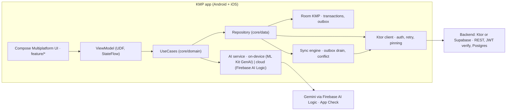

# 16. Side Project Portfolio: một dự án chứng minh được mọi thứ bạn nói

> Vì sao cần: JD đòi KMP/iOS, security, CI/CD, performance, AI coding agent, và vài JD đòi AI trong sản phẩm. CV chỉ nói; repo chứng minh. Một project 12 tuần, build bằng Claude Code **có quy trình**, vừa là bằng chứng vừa là sân luyện cho mọi file chủ đề. Nếu thiếu thời gian, xem mục 9 (phương án rút gọn).

## 1. Chọn đề: "Ledger", sổ chi tiêu offline-first có AI phân loại

Lý do chọn: domain gần bank/fintech (6/15 JD senior là bank/fintech), có đủ bài toán kinh điển của mobile system design (feed pagination, offline sync, auth, security), và có chỗ cho AI hybrid hợp lý (phân loại và tóm tắt chi tiêu). Bạn có thể đổi tên và domain, nhưng giữ **danh sách năng lực cần chứng minh** ở mục 2.

Tính năng tối thiểu (MVP):
1. Đăng nhập OAuth2 PKCE (Supabase Auth hoặc Firebase Auth), mở khoá bằng biometrics.
2. Danh sách giao dịch (feed) có cursor pagination, pull-to-refresh, offline đọc được.
3. Thêm/sửa giao dịch offline, đồng bộ lên backend khi có mạng (outbox + idempotency key).
4. AI: phân loại giao dịch và tóm tắt tháng; on-device (ML Kit GenAI Prompt API, Gemini Nano) nếu device hỗ trợ, fallback cloud (Firebase AI Logic hybrid inference); stream kết quả vào UI.
5. Biểu đồ chi tiêu theo tháng (adaptive: phone 1 cột, tablet list-detail).
6. Settings: ngôn ngữ (VI/EN), dark mode, xoá dữ liệu.

## 2. Năng lực cần chứng minh và nơi chứng minh

| Năng lực (từ JD) | Trong project | File ôn |
|---|---|---|
| KMP + Compose Multiplatform, chạy Android + iOS | `shared` module: domain, data, UI chung; iOS app chạy trên simulator, có video | 05 |
| Architecture, modularization, convention plugins | `core/*`, `feature/*`, `build-logic`, dependency rules | 04 |
| Offline-first, sync, conflict | Room KMP + outbox table + sync engine + WorkManager (Android) / BGTask (iOS, khái niệm) | 06 |
| REST/API design, network | Ktor client; backend Ktor hoặc Supabase; cursor pagination, idempotency key, ETag | 07, 09 |
| Security | PKCE, Keystore-backed token, pinning (NSC), Play Integrity, R8 full mode, không secret trong APK, App Check cho AI | 08 |
| Testing | Unit (MockK, Turbine, runTest), Compose UI test, screenshot test (Roborazzi), coverage Kover | 19 |
| CI/CD | GitHub Actions: lint, test, build AAB, upload internal; CircleCI config tương đương; badge | 20 |
| Performance | Baseline Profile, Macrobenchmark startup và scroll, Compose compiler metrics | 04 |
| AI trong sản phẩm | Hybrid on-device/cloud, streaming, cancel, eval 10 case, cost log | 10 |
| AI trong workflow | `CLAUDE.md`/`AGENTS.md`, skills, review checklist, PR có nhãn "ai-assisted" | 10, 18 |
| Adaptive, a11y, i18n | WindowSizeClass, list-detail, TalkBack pass, VI/EN, pseudo-locale | 21 |
| Product metrics | Firebase Analytics 10 event, Crashlytics, 1 Remote Config flag | 22 |
| Docs, ADR | `docs/adr/*.md` ≥ 3 ADR, README có kiến trúc và decision log | 11 |

## 3. Kiến trúc



Quyết định cần có ADR (viết trong `docs/adr/`):
1. Koin thay Hilt (KMP).
2. Room KMP thay SQLDelight (bạn đã quen Room; nêu trade-off).
3. Supabase thay tự viết Ktor server (hoặc ngược lại; nêu lý do thời gian và kỹ năng).
4. Chiến lược conflict: last-write-wins theo `updatedAt` server + client id; nêu khi nào không đủ.
5. Hybrid AI: điều kiện chọn on-device, fallback, giới hạn token, privacy.

## 4. Milestone theo tuần (bám `03`)

| Tuần | Milestone | Định nghĩa xong |
|---|---|---|
| 1 | Skeleton KMP từ template của bạn, module graph, `CLAUDE.md` với rule kiến trúc, màn hình hello trên Android (iOS nếu có máy) | Build xanh local |
| 2 | Feed giao dịch (fake data), Nav3, list-detail adaptive, ADR #1 | Màn feed + detail chạy, compiler metrics sạch |
| 3 | Test: ViewModel (Turbine), repository (fake), 1 UI test; Git branch strategy, PR template | Coverage có số, PR đầu tiên qua checklist |
| 4 | CI GitHub Actions xanh (lint, test, build), CircleCI config, Baseline Profile, R8 full mode | Badge xanh, startup có số |
| 5 | Ktor client thật (timeout, retry interceptor, logging), offline banner, ETag cache | Gọi được backend mock |
| 6 | Auth PKCE + biometrics + Keystore token + pinning + Play Integrity (server verify mock) | Login thật, MobSF sạch finding critical |
| 7 | Offline add/edit + outbox + sync engine + conflict LWW; ADR #4 | Tắt mạng thêm 5 giao dịch, bật mạng sync đúng |
| 8 | Backend thật: 3 endpoint, cursor pagination, idempotency, Postgres, Docker compose | Client chạy với backend thật |
| 9 | AI hybrid: phân loại + tóm tắt, streaming, cancel, App Check, 10 eval case, cost log; ADR #5 | Demo video 1 phút |
| 10 | iOS: chạy trên simulator, 1 UIKitView interop; a11y audit; VI/EN | Video iOS, TalkBack pass |
| 11 | Analytics 10 event, Crashlytics, Remote Config flag, README kiến trúc + decision log | README đọc 3 phút hiểu |
| 12 | Polish: screenshot test, tag v1.0, demo GIF, Play internal link (nếu có), bài viết 800 từ | v1.0 |

## 5. Quy trình build bằng Claude Code (chính là câu chuyện AI-SDLC)

1. **Rule trước, code sau:** `CLAUDE.md` ghi module rules, naming, "no secret in code", "every PR has tests", "explain before merge". Copy ý từ `compose-template/CLAUDE.md` của bạn.
2. **Issue nhỏ, PR nhỏ:** mỗi milestone chia thành issue 2-4 giờ; 1 PR/issue; nhãn `ai-assisted` nếu agent viết > 50%.
3. **Review mọi PR bằng checklist** (`18` P8): correctness, concurrency, security, performance, tests, rules. Không merge code bạn không giải thích được; nếu không giải thích được thì làm drill own-your-code trước.
4. **AI-off re-implementation:** mỗi tuần chọn 1 mảnh agent viết (ví dụ sync engine) và viết lại bằng tay trong branch riêng, so sánh.
5. **Ghi lại:** `docs/ai-log.md`: tuần, việc agent làm tốt, việc agent sai, cách bắt được. Đây là nguyên liệu cho câu hỏi "what did the agent get wrong".
6. **Đo:** số PR, tỷ lệ PR cần rework, thời gian từ issue tới merge. Ghi vào README mục "Process".

## 6. README template (viết tuần 11)

```markdown
# Ledger (KMP)
One-line: offline-first expense tracker for Android and iOS with on-device/cloud AI categorisation.

## Demo
GIF Android | GIF iOS | Play internal link

## What this demonstrates
- Kotlin Multiplatform + Compose Multiplatform, 1 codebase, 2 platforms
- Offline-first sync with outbox and idempotent API
- Security: PKCE, Keystore, pinning, Play Integrity, R8 full mode
- CI/CD: GitHub Actions (lint, test, build, upload), CircleCI equivalent
- Performance: Baseline Profile, startup X ms -> Y ms
- AI: hybrid Gemini Nano / Firebase AI Logic, streaming, eval
- Built with Claude Code under a documented review process (docs/ai-log.md)

## Architecture
diagram + module graph + link to ADRs

## Decisions (ADR)
1. Koin over Hilt ...
## Run
## Tests and coverage
## Process (AI-assisted engineering)
## Roadmap / known limits
```

## 7. Demo video 60 giây (script)
0-10s: mở app Android và iOS cạnh nhau. 10-25s: tắt mạng, thêm 2 giao dịch, bật mạng, thấy sync. 25-40s: bấm "Summarize month", thấy stream kết quả, badge "on-device" hoặc "cloud". 40-50s: xoay tablet, list-detail. 50-60s: CI badge xanh, coverage, Baseline Profile số. Không giọng nói, chỉ caption.

## 8. Kể project này trong phỏng vấn

- **Tell me about a project:** 60 giây theo cấu trúc: bài toán → 3 quyết định khó (Koin, LWW conflict, hybrid AI) → kết quả có số (startup, coverage, 2 nền tảng) → điều sẽ làm khác.
- **Câu hỏi sẽ gặp:** "Why LWW and not CRDT?" (đơn giản, đủ cho single-user; nêu khi nào cần hơn), "How do you test sync?" (fake clock, fake network, Turbine trên state), "How do you keep the API key safe?" (App Check, proxy, không có key trong client), "What did the agent get wrong?" (lấy từ `docs/ai-log.md`).
- **Không nói:** "AI viết hết". Nói: "AI viết nhanh, tôi review và viết lại phần quan trọng; đây là log".

## 9. Phương án rút gọn (nếu thiếu thời gian)
- **Rút gọn 1 (6 tuần):** bỏ backend tự viết (dùng Supabase hoàn toàn), bỏ iOS interop (chỉ chạy simulator), bỏ screenshot test. Giữ: offline sync, security, CI, AI hybrid, README.
- **Rút gọn 2 (3 tuần):** thêm vào app ABC Phonics Kids hiện có: 1 AI feature hybrid + CI GitHub Actions + Baseline Profile + 15 test + README kiến trúc. Vẫn có bằng chứng AI, CI, test, performance trên app production.
- Không bao giờ bỏ: README có decision log, CI xanh, ít nhất 1 feature bạn giải thích được từng dòng.

## 10. Checklist
- [ ] Repo tạo, `CLAUDE.md` có rule, milestone tuần 1 xong
- [ ] ≥ 3 ADR
- [ ] CI xanh, badge
- [ ] Offline sync demo được
- [ ] Security: 5 hạng mục mục 2 có
- [ ] AI hybrid demo video
- [ ] iOS chạy simulator, video
- [ ] README theo template, `docs/ai-log.md` ≥ 8 entry
- [ ] Bài viết 800 từ đăng (Medium/viblo/LinkedIn)
