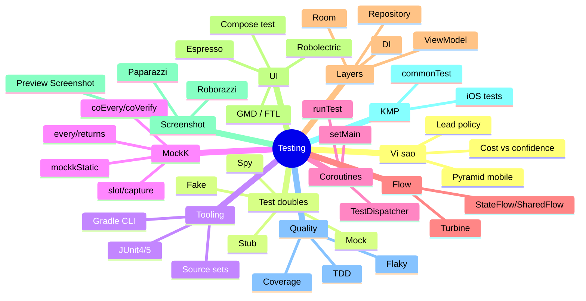
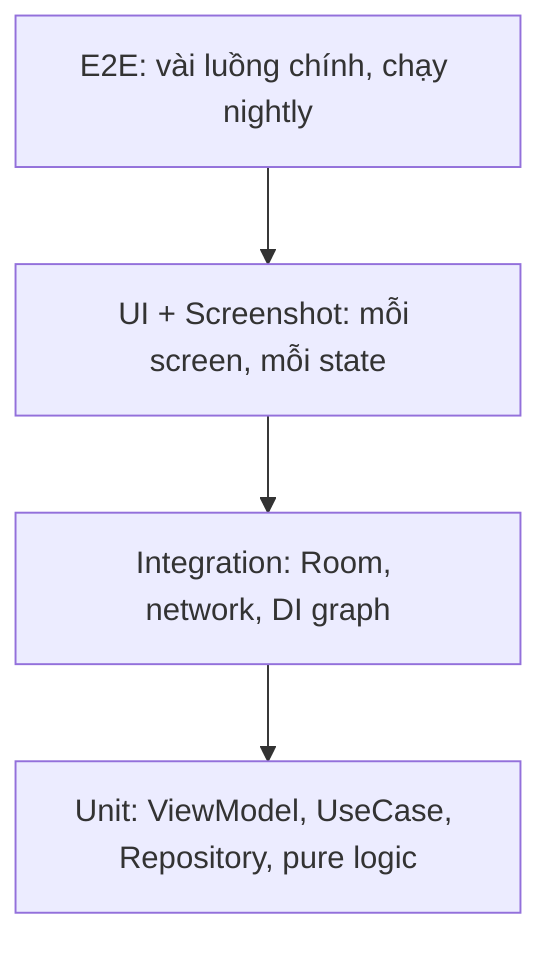

# 19. Testing Deep Dive (từ zero tới Lead)

> Mục tiêu: tự viết, tự đọc, tự review được unit test / Flow test / Compose UI test / screenshot test cho chính code trong `kmp-template-impl` và `compose-template`, và trả lời được câu hỏi "team bạn test thế nào, vì sao" ở mức Lead. | Mức cần đạt: Senior: viết đúng test ViewModel + Repository với coroutines/Flow, biết test double nào dùng khi nào. Staff: thiết kế code để test được (inject dispatcher, fake thay mock), xử lý flaky test, chọn tool screenshot test, giải thích trade-off. Lead: đặt policy coverage, CI gating, review checklist cho test, quyết định "không test gì". | Thời gian gợi ý: tuần 3, ~14 giờ (đọc 6h, làm hands-on 8h)

Ghi chú trước khi đọc: bạn tự nhận "chưa rành unit test". File này viết từ zero. Mỗi khái niệm có một đoạn code chạy được. Đọc tuần tự, không nhảy mục 5-6 trước mục 2-4. Code trong file dùng JUnit4 + MockK + Turbine + kotlinx-coroutines-test, là bộ bạn đã có trong các project cũ; phần KMP dùng `kotlin.test` như `kmp-template-impl` đang dùng.

## 0. Bản đồ chủ đề

Testing trong JD mobile 2026 (9/15 JD nhắc "Testing", xem `01-Market-Research-2026.md`) thường được hỏi theo ba tầng:

1. Senior: "Bạn test ViewModel thế nào? Mock hay fake? Test coroutine ra sao?" (câu hỏi kỹ thuật, họ muốn thấy code).
2. Staff: "Code thế nào để test được? Flaky test xử lý sao? Screenshot test chọn tool nào?" (thiết kế + trade-off).
3. Lead: "Coverage bao nhiêu là đủ? CI chặn gì? Team không chịu viết test thì làm sao?" (policy + con người).

Interviewer sẽ đào tới đâu: họ hay yêu cầu viết live một test cho ViewModel có `StateFlow` và một suspend call. Bạn phải tự tay viết được từ `runTest` tới `advanceUntilIdle` mà không nhìn tài liệu. Với project build bằng Claude Code, họ sẽ hỏi "test nào trong repo của bạn mà bạn tự tin nhất, vì sao nó không flaky". Phải chỉ được tên file.



## 1. Vì sao test và test gì

### 1.1 Unit test là gì (từ zero)

Unit test là một hàm nhỏ, chạy tự động, gọi một "đơn vị" code (một hàm, một class) với input cố định và kiểm tra output có đúng như mong đợi không. Nó chạy trên JVM máy bạn hoặc CI, không cần emulator, mất vài mili giây.

Ba phần của một test, gọi là Given / When / Then (hoặc Arrange / Act / Assert):

- Given: chuẩn bị dữ liệu và đối tượng.
- When: gọi hàm cần test.
- Then: khẳng định (assert) kết quả.

Ví dụ chạy được ngay. Tạo hai file trong một module Kotlin/Android bất kỳ:

```kotlin
// src/main/kotlin/com/example/price/PriceCalculator.kt
package com.example.price

class PriceCalculator {
    /** Tổng tiền sau khi giảm [discountPercent] phần trăm. */
    fun total(prices: List<Int>, discountPercent: Int): Int {
        require(discountPercent in 0..100) { "discount must be 0..100" }
        val sum = prices.sum()
        return sum - sum * discountPercent / 100
    }
}
```

```kotlin
// src/test/kotlin/com/example/price/PriceCalculatorTest.kt
package com.example.price

import org.junit.Assert.assertEquals
import org.junit.Test

class PriceCalculatorTest {

    private val calculator = PriceCalculator()

    @Test
    fun `total applies percent discount`() {
        // Given
        val prices = listOf(100, 200)

        // When
        val result = calculator.total(prices, discountPercent = 10)

        // Then
        assertEquals(270, result)
    }

    @Test
    fun `empty list gives zero`() {
        assertEquals(0, calculator.total(emptyList(), discountPercent = 50))
    }

    @Test(expected = IllegalArgumentException::class)
    fun `discount above 100 is rejected`() {
        calculator.total(listOf(100), discountPercent = 101)
    }
}
```

Chạy: `./gradlew :core:domain:testDebugUnitTest` (Android module) hoặc `./gradlew :core:domain:test` (module JVM thuần). Kết quả: `BUILD SUCCESSFUL` và file HTML báo cáo trong `build/reports/tests/`.

Những từ bạn sẽ gặp liên tục:

- `@Test`: đánh dấu hàm là một test case. JUnit tìm và chạy mọi hàm có annotation này.
- Assertion: hàm kiểm tra điều kiện, ném exception nếu sai (`assertEquals`, `assertTrue`, `assertNull`, `assertFailsWith`).
- Test fixture: dữ liệu và đối tượng chuẩn bị sẵn cho test (ở trên là `calculator`).
- Red / green: test fail (đỏ) rồi pass (xanh).
- Tên test trong dấu backtick có khoảng trắng chạy tốt với JVM unit test, nhưng instrumented test (androidTest) trên device cũ có thể lỗi "method name contains spaces". Với androidTest dùng kiểu `total_appliesDiscount`.

### 1.2 Test pyramid cho mobile

Pyramid là cách sắp xếp các loại test theo số lượng và chi phí. Dưới nhiều, nhanh, rẻ; trên ít, chậm, đắt nhưng gần thực tế hơn.

| Tầng | Chạy ở đâu | Tốc độ | Test gì | Tool |
|---|---|---|---|---|
| Unit | JVM | ms | Hàm thuần, UseCase, ViewModel, Repository với fake | JUnit, kotlin.test, MockK, Turbine, coroutines-test |
| Integration | JVM hoặc device | 100ms-s | Repository + Room thật (in-memory), network layer + MockWebServer/MockEngine, DI graph | Room in-memory, Robolectric, Ktor MockEngine |
| UI (component) | JVM (Robolectric) hoặc device | s | Một screen Compose với state giả, click, nhập text | Compose test, Espresso |
| Screenshot | JVM | s | Pixel của một composable với nhiều state/theme/font scale | Preview Screenshot Testing, Roborazzi, Paparazzi |
| E2E | Device/emulator, backend thật hoặc staging | phút | Luồng người dùng: login, mua, thanh toán | Compose test + Hilt/Koin test, Firebase Test Lab, Journeys |

Mobile khác backend ở hai điểm: (1) UI chiếm tỉ lệ lớn nên screenshot test có giá trị cao; (2) chạy trên device đắt và chậm, nên đẩy càng nhiều xuống JVM càng tốt (Robolectric, Paparazzi, Roborazzi đều chạy JVM).



### 1.3 Cost vs confidence

Mỗi tầng trả lời một câu hỏi khác nhau:

- Unit: "logic đúng chưa?" Rẻ, chạy mỗi PR, nhưng không biết UI có vẽ đúng không.
- UI/screenshot: "nhìn đúng chưa, bấm được chưa?" Trung bình.
- E2E: "cả hệ thống ghép lại có chạy không?" Đắt, flaky, nhưng là thứ duy nhất bắt được lỗi tích hợp (sai base URL, thiếu permission).

Quy tắc đơn giản: viết test ở tầng thấp nhất có thể bắt được bug đó. Bug "tính sai giảm giá" là unit. Bug "nút bị che bởi keyboard" là UI/screenshot. Bug "token refresh không chạy khi 401" là integration với MockWebServer.

### 1.4 Lead quyết định gì

- Coverage policy: không đặt con số toàn cục kiểu "80%". Đặt theo module: `core/domain`, `core/repository` cao (70-80%), `feature/*` ViewModel bắt buộc có test state machine, UI composable không đếm vào coverage (dùng screenshot test). Coverage là chỉ báo thiếu test, không phải chỉ báo chất lượng.
- CI gating: PR bắt buộc pass unit test + lint/detekt + screenshot verify. Instrumented test chạy nightly hoặc trước release, không chặn PR (quá chậm, quá flaky). Xem `20-Git-CICD.md` mục 14.
- Định nghĩa "done": feature có test cho happy path + ít nhất một error path.
- Flaky test policy: test flaky bị cách ly (quarantine) trong 1 tuần, có owner; quá hạn thì xoá.
- Chọn tool một lần cho cả team, viết vào `CONTRIBUTING.md`, có template test.

**Lỗi hay gặp / trade-off**
- Đặt KPI coverage 80% toàn repo: team viết test vô nghĩa cho getter, tốn thời gian, không bắt bug.
- Dồn hết vào E2E vì "nó test thật": pipeline 40 phút, flaky 20%, mọi người bỏ qua kết quả.
- Không test gì vì "app nhỏ": app lớn dần, refactor không dám làm.
- Test private function: dấu hiệu class quá lớn; test qua public API hoặc tách class.

**Đọc thêm:**
- https://developer.android.com/training/testing/fundamentals (Fundamentals of testing Android apps)
- https://developer.android.com/training/testing/fundamentals/strategies (test strategy, pyramid, cost)
- Sách: Working Effectively with Legacy Code (Feathers), chương 1-4 về "seam" và vì sao code khó test

## 2. Test doubles: fake, stub, mock, spy

### 2.1 Vì sao cần test double

ViewModel của bạn phụ thuộc Repository, Repository phụ thuộc network và database. Khi unit test ViewModel, bạn không muốn gọi network thật. "Test double" (như diễn viên đóng thế) là đối tượng thay thế dependency thật trong test. Có 5 loại theo Gerard Meszaros (xUnit Test Patterns):

| Loại | Là gì | Dùng khi |
|---|---|---|
| Dummy | Object truyền cho đủ tham số, không bao giờ được gọi | Constructor cần tham số mà test không quan tâm |
| Stub | Trả về giá trị cố định khi được gọi | Cần input cho code under test ("repo trả về user X") |
| Fake | Implementation thật nhưng đơn giản (in-memory thay DB) | Test hành vi phức tạp, nhiều test dùng chung |
| Mock | Object ghi lại lời gọi để verify ("hàm X được gọi với Y") | Kiểm tra side effect: analytics, logger, navigation |
| Spy | Object thật nhưng có ghi lại lời gọi, có thể stub một phần | Cần giữ hành vi thật, chỉ thay một hàm |

Trong thực tế Android, "mock" hay bị dùng để chỉ cả stub lẫn mock (MockK làm được cả hai). Interviewer giỏi sẽ hỏi bạn phân biệt.

### 2.2 Ví dụ từng loại, chạy được

Domain dùng xuyên suốt file này:

```kotlin
// commonMain hoặc main
data class User(val id: String, val name: String, val isPremium: Boolean = false)

interface UserRepository {
    suspend fun getUser(id: String): User
    fun observeUser(id: String): Flow<User>
    suspend fun save(user: User)
}

interface Analytics {
    fun track(event: String, params: Map<String, String> = emptyMap())
}
```

Fake: tự viết, không cần thư viện.

```kotlin
// src/test (hoặc commonTest)
class FakeUserRepository : UserRepository {
    private val users = MutableStateFlow<Map<String, User>>(emptyMap())

    /** Gán để mô phỏng lỗi ở lần gọi getUser tiếp theo. */
    var failWith: Throwable? = null

    /** Đếm số lần gọi để assert caching. */
    var getUserCalls = 0
        private set

    fun seed(vararg list: User) {
        users.value = list.associateBy { it.id }
    }

    override suspend fun getUser(id: String): User {
        getUserCalls++
        failWith?.let { throw it }
        return users.value[id] ?: throw NoSuchElementException("no user $id")
    }

    override fun observeUser(id: String): Flow<User> =
        users.mapNotNull { it[id] }

    override suspend fun save(user: User) {
        users.value = users.value + (user.id to user)
    }
}
```

Stub bằng MockK (trả giá trị cố định):

```kotlin
val repo = mockk<UserRepository>()
coEvery { repo.getUser("1") } returns User("1", "An")
```

Mock bằng MockK (verify lời gọi):

```kotlin
val analytics = mockk<Analytics>(relaxUnitFun = true)
vm.onLoginClicked()
verify(exactly = 1) { analytics.track("login_clicked", any()) }
```

Spy bằng MockK:

```kotlin
class Greeter {
    fun now(): Long = System.currentTimeMillis()
    fun greet(name: String) = if (now() % 2 == 0L) "Hi $name" else "Hello $name"
}

val greeter = spyk(Greeter())
every { greeter.now() } returns 2L   // chỉ stub now(), greet() chạy code thật
assertEquals("Hi An", greeter.greet("An"))
verify { greeter.greet("An") }
```

Dummy:

```kotlin
val vm = ProfileViewModel(repo = FakeUserRepository(), analytics = mockk()) // analytics không được gọi trong test này
```

### 2.3 Khi nào dùng loại nào

- Repository, DataSource, Preferences: viết Fake. Lý do: nhiều test dùng chung, mô phỏng được trạng thái (đã cache, chưa cache), không gãy khi đổi chữ ký hàm nội bộ, đọc dễ hơn 10 dòng `coEvery`.
- Analytics, Logger, Navigator, Crashlytics: Mock với `verify`. Bạn chỉ quan tâm "có gọi không, gọi với gì".
- Clock, Random, UUID: Fake đơn giản (`FakeClock(fixed = 1_000L)`) hoặc inject lambda `() -> Long`.
- Thư viện bên thứ ba (OkHttp, Play Billing): không mock interface của họ. Bọc bằng interface của bạn (`BillingClientWrapper`) rồi fake interface đó. Với network dùng MockWebServer (OkHttp) hoặc MockEngine (Ktor).
- Class thật nhỏ, thuần (`PriceCalculator`): không cần double, dùng luôn.

Quy tắc của Google trong Android testing docs: "prefer fakes over mocks". Lý do: mock gắn chặt vào implementation (bạn stub từng hàm theo đúng thứ tự code gọi), refactor nội bộ là test đỏ dù hành vi không đổi.

Trong `kmp-template-impl`, file `core/content/src/commonTest/.../TestDoubles.kt` đã có `FakePackFiles` và `FakeManifestSource`. Đó chính là pattern fake. Mở ra đọc, đó là code của bạn.

**Lỗi hay gặp / trade-off**
- Mock mọi thứ: test dài, giòn, chỉ kiểm tra "code gọi đúng hàm" chứ không kiểm tra hành vi.
- Fake quá thông minh: fake có bug riêng. Giữ fake đơn giản, có thể viết 2-3 test cho chính fake (file `FakeBillingDataSourceTest.kt` trong repo bạn làm đúng việc này).
- Fake không giống thật về contract (thật ném exception, fake trả null): dẫn tới test xanh, production đỏ. Viết "contract test" chạy cùng bộ test cho cả thật và fake nếu quan trọng.

**Đọc thêm:**
- https://developer.android.com/training/testing/fundamentals/test-doubles (Google khuyến nghị fake)
- https://martinfowler.com/articles/mocksArentStubs.html (bài gốc phân biệt mock và stub)
- Sách: xUnit Test Patterns (Meszaros), chương "Test Double"

## 3. Tooling setup

### 3.1 JUnit4 vs JUnit5 trên Android

- JUnit4: `org.junit.Test`, `@Before`, `@After`, `@Rule`, `@RunWith`. Android instrumented test (`androidTest`) chính thức chỉ hỗ trợ JUnit4 qua `AndroidJUnitRunner`. Compose test rule `createComposeRule()` là JUnit4 rule.
- JUnit5 (Jupiter): `org.junit.jupiter.api.Test`, `@BeforeEach`, `@ParameterizedTest`, `@Nested`, extension thay cho rule. Chạy tốt cho local unit test nếu bật `useJUnitPlatform()`. Cho androidTest cần plugin bên thứ ba `de.mannodermaus.android-junit5`.
- `kotlin.test`: lớp mỏng chung cho KMP (`kotlin.test.Test`, `assertEquals`, `assertFailsWith`), trên JVM map sang JUnit4 hoặc JUnit5 tuỳ cấu hình. `kmp-template-impl` dùng cái này trong `commonTest`.

Khuyến nghị: Android app thuần dùng JUnit4 cho đồng nhất với androidTest và Compose; KMP dùng `kotlin.test`. Đừng trộn JUnit4 và 5 trong một module.

### 3.2 Source sets

| Source set | Chạy ở đâu | Task Gradle | Dùng cho |
|---|---|---|---|
| `src/test` | JVM local | `testDebugUnitTest`, `testReleaseUnitTest` | Unit test, Robolectric, Paparazzi/Roborazzi |
| `src/androidTest` | Device/emulator | `connectedDebugAndroidTest` | Compose UI test, Espresso, Room thật |
| `src/screenshotTest` | JVM (AGP plugin) | `validateDebugScreenshotTest` | Compose Preview Screenshot Testing |
| KMP `commonTest` | Mọi target | `allTests` | Test logic chung với `kotlin.test` |
| KMP `androidUnitTest` | JVM | `testDebugUnitTest` | Test cần MockK, Robolectric |
| KMP `androidInstrumentedTest` | Device | `connectedDebugAndroidTest` | UI test trên Android |
| KMP `iosTest` / `iosSimulatorArm64Test` | iOS simulator | `iosSimulatorArm64Test` | Test code iOS-specific |
| KMP `jvmTest`, `desktopTest` | JVM | `jvmTest`, `desktopTest` | Target desktop |

### 3.3 Khai báo dependency trong `libs.versions.toml`

Version dưới đây đúng theo trí nhớ tại thời điểm viết; luôn kiểm tra trang release trước khi copy.

```toml
[versions]
junit4 = "4.13.2"
mockk = "1.14.2"            # kiểm tra: github.com/mockk/mockk/releases
turbine = "1.2.1"           # kiểm tra: github.com/cashapp/turbine/releases
kotlinxCoroutines = "1.11.0"
androidxTestExt = "1.2.1"
androidxTestRunner = "1.6.2"
espresso = "3.6.1"
robolectric = "4.14.1"      # kiểm tra: robolectric.org
kover = "0.9.1"             # kiểm tra: github.com/Kotlin/kotlinx-kover/releases

[libraries]
junit4 = { module = "junit:junit", version.ref = "junit4" }
kotlin-test = { module = "org.jetbrains.kotlin:kotlin-test" }   # version theo Kotlin plugin
mockk = { module = "io.mockk:mockk", version.ref = "mockk" }
mockk-android = { module = "io.mockk:mockk-android", version.ref = "mockk" }
turbine = { module = "app.cash.turbine:turbine", version.ref = "turbine" }
kotlinx-coroutines-test = { module = "org.jetbrains.kotlinx:kotlinx-coroutines-test", version.ref = "kotlinxCoroutines" }
androidx-test-ext-junit = { module = "androidx.test.ext:junit", version.ref = "androidxTestExt" }
androidx-test-runner = { module = "androidx.test:runner", version.ref = "androidxTestRunner" }
androidx-espresso-core = { module = "androidx.test.espresso:espresso-core", version.ref = "espresso" }
compose-ui-test-junit4 = { module = "androidx.compose.ui:ui-test-junit4" }    # version theo compose BOM
compose-ui-test-manifest = { module = "androidx.compose.ui:ui-test-manifest" }
robolectric = { module = "org.robolectric:robolectric", version.ref = "robolectric" }

[plugins]
kover = { id = "org.jetbrains.kotlinx.kover", version.ref = "kover" }
```

Android module (`build.gradle.kts`):

```kotlin
dependencies {
    testImplementation(libs.junit4)
    testImplementation(libs.mockk)
    testImplementation(libs.turbine)
    testImplementation(libs.kotlinx.coroutines.test)

    androidTestImplementation(libs.androidx.test.ext.junit)
    androidTestImplementation(libs.androidx.espresso.core)
    androidTestImplementation(libs.compose.ui.test.junit4)
    debugImplementation(libs.compose.ui.test.manifest)   // để createComposeRule có Activity
}
```

KMP module:

```kotlin
kotlin {
    sourceSets {
        commonTest.dependencies {
            implementation(kotlin("test"))
            implementation(libs.kotlinx.coroutines.test)   // multiplatform
            implementation(libs.turbine)                    // multiplatform
        }
        androidUnitTest.dependencies {
            implementation(libs.mockk)                      // MockK chỉ chạy JVM
        }
    }
}
```

Điểm quan trọng cho `kmp-template-impl`: catalog hiện có `kotlinx-coroutines-test` nhưng chưa có `turbine` và `mockk`. Turbine thêm được vào `commonTest`. MockK không chạy trên iOS, nên test trong `commonTest` phải dùng fake (đúng hướng mục 2.3). Nếu thật sự cần mock đa nền tảng, có thư viện Mokkery (KSP) nhưng cần kiểm tra tính tương thích với Kotlin 2.3 trước khi thêm.

Với `compose-template`: catalog nằm bên YammyDelivery (`settings.gradle.kts` import catalog từ đó), nên muốn thêm alias test phải sửa ở YammyDelivery rồi publish lại.

### 3.4 Chạy test từ CLI

```bash
# Toàn bộ unit test variant debug của mọi module
./gradlew testDebugUnitTest

# Một module
./gradlew :feature:setting:testDebugUnitTest

# Một class hoặc một hàm
./gradlew :feature:setting:testDebugUnitTest --tests "me.ltthuc.kmp.feature.setting.SettingViewModelTest"
./gradlew :feature:setting:testDebugUnitTest --tests "*SettingViewModelTest.setTheme*"

# KMP: mọi target (JVM, Android unit, iOS simulator)
./gradlew :core:repository:allTests
./gradlew :core:repository:iosSimulatorArm64Test

# Instrumented trên device đang cắm / emulator đang chạy
./gradlew :composeApp:connectedDebugAndroidTest

# Chạy tiếp dù có module fail, và ép chạy lại dù cache up-to-date
./gradlew testDebugUnitTest --continue --rerun-tasks
```

Gradle cache kết quả test: nếu code và test không đổi, task báo `UP-TO-DATE` và không chạy lại. Đó là lý do đôi khi "sửa test mà không thấy chạy" là do bạn sửa file ngoài source set.

### 3.5 Đọc báo cáo

- HTML: `<module>/build/reports/tests/testDebugUnitTest/index.html`. Mở bằng browser, có danh sách class, thời gian, stack trace của test fail.
- XML (JUnit format): `<module>/build/test-results/testDebugUnitTest/TEST-*.xml`. CI (GitHub Actions, CircleCI) đọc file này để hiển thị test fail và tính thời gian cho test splitting.
- Console: thêm vào `build.gradle.kts` để thấy tên test khi chạy:

```kotlin
tasks.withType<Test>().configureEach {
    testLogging {
        events("passed", "skipped", "failed")
        exceptionFormat = org.gradle.api.tasks.testing.logging.TestExceptionFormat.FULL
        showStandardStreams = false
    }
}
```

Trong Android Studio: click chuột phải vào class test, Run. Cửa sổ Run hiển thị cây test; click vào test đỏ thấy diff expected/actual.

**Lỗi hay gặp / trade-off**
- `Method ... not mocked` khi unit test gọi `android.util.Log`: unit test chạy JVM với `android.jar` rỗng. Fix: `testOptions.unitTests.isReturnDefaultValues = true` (che lỗi) hoặc `mockkStatic(Log::class)`, hoặc tốt nhất không để domain code gọi Log trực tiếp (inject `Logger`).
- Chạy `./gradlew test` ở KMP chỉ chạy JVM; `allTests` mới chạy iOS.
- Không có `ui-test-manifest` ở debug: `createComposeRule()` fail vì thiếu `ComponentActivity` trong manifest.

**Đọc thêm:**
- https://developer.android.com/studio/test/command-line (chạy test từ CLI, task names)
- https://docs.gradle.org/current/userguide/java_testing.html (Gradle test task, filter, report)
- https://kotlinlang.org/docs/multiplatform-run-tests.html (chạy test KMP theo target)

## 4. MockK từ zero

MockK là thư viện tạo mock/stub/spy cho Kotlin. Nó hiểu `suspend`, `object`, extension function, final class (mặc định Kotlin class là final, Mockito cổ điển không mock được nếu không bật inline mock maker; MockK làm được ngay).

### 4.1 `mockk`, `every`, `returns`

```kotlin
import io.mockk.every
import io.mockk.mockk
import io.mockk.verify
import org.junit.Assert.assertEquals
import org.junit.Test

interface PriceFormatter {
    fun format(amount: Int): String
}

class ReceiptPrinter(private val formatter: PriceFormatter) {
    fun line(label: String, amount: Int) = "$label: ${formatter.format(amount)}"
}

class ReceiptPrinterTest {

    private val formatter = mockk<PriceFormatter>()
    private val printer = ReceiptPrinter(formatter)

    @Test
    fun `line uses formatter`() {
        every { formatter.format(100) } returns "100 d"

        val result = printer.line("Coffee", 100)

        assertEquals("Coffee: 100 d", result)
    }
}
```

Giải nghĩa:

- `mockk<PriceFormatter>()`: tạo object giả. Mặc định là "strict": gọi hàm chưa stub sẽ ném `MockKException: no answer found`.
- `every { formatter.format(100) }`: mô tả lời gọi. Bên trong block là "recording", không thực sự gọi.
- `returns "100 d"`: giá trị trả về khi lời gọi khớp.

Các biến thể hay dùng:

```kotlin
every { formatter.format(any()) } returns "?"                       // matcher bất kỳ
every { formatter.format(more(1000)) } returns "nhieu"              // matcher số
every { formatter.format(match { it % 2 == 0 }) } returns "chan"    // matcher tuỳ ý
every { formatter.format(any()) } returnsMany listOf("a", "b")      // lần 1 "a", lần 2 "b", sau đó "b"
every { formatter.format(any()) } throws IllegalStateException("boom")
every { formatter.format(any()) } answers { "${firstArg<Int>()} d" } // tính từ tham số
every { logger.log(any()) } just Runs                               // hàm trả Unit
```

Thứ tự ưu tiên: khi nhiều stub cùng khớp một lời gọi, MockK dùng stub khai báo sau cùng. Matcher cụ thể (`format(100)`) không tự động thắng `any()`. Vì vậy khai báo `any()` trước, trường hợp cụ thể sau.

### 4.2 `coEvery` cho suspend function

`every { }` nhận lambda thường, nên không gọi được `suspend fun` bên trong (lỗi compile "Suspend function can be called only within a coroutine body"). Dùng `coEvery`:

```kotlin
val repo = mockk<UserRepository>()
coEvery { repo.getUser("1") } returns User("1", "An")
coEvery { repo.getUser("404") } throws NoSuchElementException("not found")
coEvery { repo.getUser(any()) } coAnswers {
    delay(100)                       // được phép dùng suspend trong coAnswers
    User(firstArg(), "lazy")
}
```

Quy tắc nhớ: hàm có `suspend` thì mọi thứ thêm tiền tố `co`: `coEvery`, `coAnswers`, `coVerify`, `coJustRun`.

### 4.3 `verify`, `coVerify`

Verify kiểm tra lời gọi đã xảy ra (đây là nghĩa "mock" thật sự).

```kotlin
val analytics = mockk<Analytics>(relaxUnitFun = true)   // mọi hàm trả Unit tự động just Runs

analytics.track("open_settings")
analytics.track("open_settings")

verify { analytics.track("open_settings") }                 // ít nhất 1 lần
verify(exactly = 2) { analytics.track("open_settings") }
verify(exactly = 0) { analytics.track("purchase", any()) }
verify(atLeast = 1, atMost = 3) { analytics.track(any(), any()) }
verify { analytics wasNot Called }                          // không gọi gì (sẽ fail ở ví dụ này)

verifyOrder {                                               // thứ tự tương đối, cho phép lời gọi khác xen giữa
    analytics.track("open_settings")
    analytics.track("open_settings")
}
verifySequence {                                            // chính xác toàn bộ chuỗi lời gọi
    analytics.track("open_settings")
    analytics.track("open_settings")
}
confirmVerified(analytics)                                  // mọi lời gọi đều đã được verify
```

Với suspend: `coVerify { repo.getUser("1") }`, `coVerify(exactly = 1) { repo.save(any()) }`.

### 4.4 `slot` và `capture`

Khi bạn cần xem tham số thực tế truyền vào (ví dụ object được build bên trong code under test):

```kotlin
@Test
fun `rename saves updated user`() = runTest {
    val repo = mockk<UserRepository>()
    val saved = slot<User>()
    coEvery { repo.getUser("1") } returns User("1", "An")
    coEvery { repo.save(capture(saved)) } just Runs

    val useCase = RenameUserUseCase(repo)
    useCase("1", newName = "Binh")

    assertEquals("Binh", saved.captured.name)
    assertEquals("1", saved.captured.id)
}
```

`slot` giữ một giá trị (lần gọi cuối). Muốn giữ nhiều lần gọi dùng `MutableList`:

```kotlin
val events = mutableListOf<String>()
every { analytics.track(capture(events), any()) } just Runs
vm.onScreenOpened(); vm.onButtonClicked()
assertEquals(listOf("screen_open", "button_click"), events)
```

### 4.5 `relaxed`

```kotlin
val repo = mockk<UserRepository>(relaxed = true)
```

Relaxed mock trả về giá trị mặc định cho mọi hàm chưa stub: 0, false, "", `Unit`, và với kiểu object thì trả về một mock lồng nhau. Tiện khi constructor cần 6 dependency mà test chỉ quan tâm 1. Nguy hiểm vì:

- `Flow` trả về mock Flow: collect không bao giờ emit, test treo hoặc pass vô nghĩa.
- `suspend fun getUser()` trả về mock `User` với `name == ""`: bug logic bị che.

`relaxUnitFun = true` an toàn hơn: chỉ relax hàm trả `Unit` (logger, analytics).

### 4.6 `spyk`

Spy bọc object thật. Mặc định mọi hàm chạy code thật, bạn stub chọn lọc.

```kotlin
val vm = spyk(SettingsViewModel(repo))
every { vm.isDebugBuild() } returns true
vm.onToggleDeveloperMode()
verify { vm.showDeveloperSection() }
```

Dùng spy khi: muốn verify một hàm của chính class under test được gọi (dấu hiệu nên tách class), hoặc stub một hàm phụ thuộc platform (`now()`, `isDebugBuild()`). Lạm dụng spy = test gắn chặt implementation.

### 4.7 `mockkObject`, `mockkStatic`, `unmockkAll`

Kotlin `object` và top-level function (extension) là static trên JVM. MockK mock được nhưng đây là mock toàn cục, ảnh hưởng mọi test chạy sau nếu không gỡ.

```kotlin
object Clock {
    fun now(): Long = System.currentTimeMillis()
}

class TokenExpiryTest {
    @Before
    fun setUp() {
        mockkObject(Clock)
        every { Clock.now() } returns 1_000L
    }

    @After
    fun tearDown() = unmockkAll()    // gỡ mọi mockkObject/mockkStatic/mockkConstructor

    @Test
    fun `token expired when now past expiry`() {
        assertTrue(Token(expiresAt = 999L).isExpired())
    }
}
```

Static Java và extension function:

```kotlin
// android.util.Log trong local unit test
mockkStatic(android.util.Log::class)
every { android.util.Log.d(any(), any()) } returns 0

// Extension function top-level trong file StringExt.kt, package com.example.util
mockkStatic("com.example.util.StringExtKt")
every { "abc".slugify() } returns "x"
```

Tên class của file Kotlin là `<TênFile>Kt`. Sai tên là `ClassNotFoundException`.

Luôn có `unmockkAll()` trong `@After` khi dùng object/static. Nếu không, test B fail chỉ vì test A chạy trước.

### 4.8 Pitfalls thường gặp

| Triệu chứng | Nguyên nhân | Cách sửa |
|---|---|---|
| `no answer found for: UserRepository(#1).getUser(2)` | Chưa stub hoặc matcher không khớp (truyền "2" nhưng stub "1") | Stub đúng tham số hoặc `any()`; kiểm tra `equals` của data class |
| Lỗi compile khi `every { repo.getUser() }` | Hàm suspend | `coEvery` |
| Test chạy lần đầu chậm 1-3s | MockK khởi động agent (ByteBuddy) | Chấp nhận, hoặc dùng fake cho test nhiều |
| Mock trả `null` cho `String` | Dùng `relaxed` | Stub tường minh |
| Verify pass dù logic sai | `verify { x.foo(any()) }` quá lỏng | Verify tham số cụ thể hoặc dùng slot |
| Flow từ relaxed mock không emit | Mock Flow không phải Flow thật | Trả `flowOf(...)` hoặc `MutableStateFlow` |
| Test lệ thuộc thứ tự | `mockkStatic` không gỡ | `unmockkAll()` trong `@After` |
| Không mock được `inline fun` | Inline được copy vào call site lúc compile | Bọc bằng hàm thường hoặc test qua hành vi |
| `MockKException` trên androidTest với final class | `mockk-android` cần inline instrumentation, phụ thuộc API level | Kiểm tra tại mockk.io mục Android; ưu tiên fake |
| Mock `data class` rồi so sánh equals | Mock không có equals thật | Dùng instance thật cho data class |

Nguyên tắc chốt: MockK cho boundary (analytics, logger, platform API); fake cho data layer; không bao giờ mock `Flow`, `data class`, hay class mình có thể tạo thật.

**Đọc thêm:**
- https://mockk.io (trang chính, mục Examples và Android)
- https://github.com/mockk/mockk (README với toàn bộ DSL: every, verify, slot, static)
- https://developer.android.com/training/testing/local-tests (local unit test setup)

## 5. Coroutines testing

### 5.1 Vấn đề cần giải

Code production chạy `viewModelScope.launch { delay(5_000); retry() }`. Test không thể chờ 5 giây thật. Và `viewModelScope` dùng `Dispatchers.Main`, thứ không tồn tại trên JVM (test sẽ ném `Module with the Main dispatcher is missing`). `kotlinx-coroutines-test` giải cả hai: thời gian ảo và dispatcher thay thế.

### 5.2 `runTest` và thời gian ảo

```kotlin
import kotlinx.coroutines.delay
import kotlinx.coroutines.test.runTest
import kotlin.test.Test
import kotlin.test.assertEquals

class VirtualTimeTest {
    @Test
    fun `delay does not wait in real time`() = runTest {
        delay(10_000)                    // trả về ngay lập tức
        assertEquals(10_000, currentTime) // currentTime là extension của TestScope, tính bằng ms ảo
    }
}
```

`runTest { }` tạo một `TestScope`, chạy block như một coroutine, tự động bỏ qua `delay` bằng cách tua đồng hồ ảo tới mốc kế tiếp. Nó có timeout thật (tham số `timeout`, mặc định xem docs kotlinx-coroutines-test, có thể truyền `runTest(timeout = 10.seconds)`), để test treo vẫn kết thúc. Khi block xong, `runTest` kiểm tra không còn coroutine con nào đang chạy trong `TestScope`; nếu còn, fail với `UncompletedCoroutinesError`. Coroutine cần chạy nền suốt test thì launch trong `backgroundScope` (bị huỷ tự động khi test xong).

### 5.3 `StandardTestDispatcher` vs `UnconfinedTestDispatcher`

Cả hai là `TestDispatcher`, dùng chung một `TestCoroutineScheduler` (bộ lập lịch điều khiển thời gian ảo). Khác nhau ở thời điểm chạy coroutine mới launch:

```kotlin
@Test
fun `standard dispatcher queues new coroutines`() = runTest {   // mặc định là StandardTestDispatcher
    var done = false
    launch { done = true }
    assertFalse(done)         // chưa chạy, mới nằm trong hàng đợi
    advanceUntilIdle()        // chạy mọi task đang đợi
    assertTrue(done)
}

@OptIn(ExperimentalCoroutinesApi::class)
@Test
fun `unconfined dispatcher runs eagerly`() = runTest(UnconfinedTestDispatcher()) {
    var done = false
    launch { done = true }
    assertTrue(done)          // chạy ngay tới điểm suspend đầu tiên
}
```

Chọn cái nào:

- Standard: giống production hơn (launch không chạy ngay), test được trạng thái trung gian như `Loading`. Phải gọi `advanceUntilIdle()` / `runCurrent()` hoặc để test body suspend (ví dụ `awaitItem()` của Turbine) thì scheduler mới chạy.
- Unconfined: ít phải gọi `advance*`, test ngắn hơn, nhưng dễ bỏ sót state trung gian và không phản ánh thứ tự thật.

Hai hàm điều khiển:

- `runCurrent()`: chạy mọi task đang chờ tại thời điểm hiện tại, không tua đồng hồ.
- `advanceUntilIdle()`: chạy và tua đồng hồ cho tới khi không còn task nào.
- `advanceTimeBy(ms)`: tua tới `currentTime + ms`, chạy task có mốc nhỏ hơn mốc đích; task đúng tại mốc đích chưa chạy, cần thêm `runCurrent()`.

```kotlin
@Test
fun `polling ticks every second`() = runTest {
    val ticks = mutableListOf<Int>()
    val job = launch {
        var i = 0
        while (true) {
            delay(1_000)
            ticks += ++i
        }
    }

    advanceTimeBy(3_000)      // chạy tick tại 1000 và 2000, chưa chạy tick tại 3000
    assertEquals(listOf(1, 2), ticks)
    runCurrent()              // chạy tick tại 3000
    assertEquals(listOf(1, 2, 3), ticks)

    job.cancel()              // nếu không cancel, runTest fail vì còn coroutine sống
}
```

### 5.4 Main dispatcher: `Dispatchers.setMain`

`viewModelScope` dùng `Dispatchers.Main.immediate`. Trên JVM không có Main. Trước mỗi test phải thay Main bằng TestDispatcher, sau test trả lại.

JUnit4 rule, viết một lần dùng mọi nơi:

```kotlin
import kotlinx.coroutines.Dispatchers
import kotlinx.coroutines.ExperimentalCoroutinesApi
import kotlinx.coroutines.test.StandardTestDispatcher
import kotlinx.coroutines.test.TestDispatcher
import kotlinx.coroutines.test.resetMain
import kotlinx.coroutines.test.setMain
import org.junit.rules.TestWatcher
import org.junit.runner.Description

@OptIn(ExperimentalCoroutinesApi::class)
class MainDispatcherRule(
    val testDispatcher: TestDispatcher = StandardTestDispatcher(),
) : TestWatcher() {
    override fun starting(description: Description) {
        Dispatchers.setMain(testDispatcher)
    }

    override fun finished(description: Description) {
        Dispatchers.resetMain()
    }
}
```

Dùng:

```kotlin
class ProfileViewModelTest {
    @get:Rule
    val mainRule = MainDispatcherRule()
    // ...
}
```

`kotlin.test` trong `commonTest` không có rule, dùng `@BeforeTest` / `@AfterTest`:

```kotlin
class SettingViewModelTest {
    private val dispatcher = StandardTestDispatcher()

    @BeforeTest
    fun setUp() = Dispatchers.setMain(dispatcher)

    @AfterTest
    fun tearDown() = Dispatchers.resetMain()
}
```

Điểm hay bị hỏi: khi Main đã được `setMain` bằng một TestDispatcher, `runTest()` gọi không tham số sẽ tự dùng chung scheduler với Main. Nhờ vậy `advanceUntilIdle()` trong test cũng tua các coroutine của `viewModelScope`. Nếu bạn tạo `StandardTestDispatcher()` riêng cho `runTest` mà quên share scheduler, hai đồng hồ ảo không khớp nhau và test treo hoặc assert sai.

### 5.5 Inject dispatchers

Code production viết `withContext(Dispatchers.IO)` cứng là không test được: IO thật không nghe lời scheduler ảo, `delay` trong đó là delay thật. Giải pháp: inject.

```kotlin
// commonMain. Dispatchers.IO có trong common cho JVM và Native từ kotlinx.coroutines 1.7.
class AppDispatchers(
    val io: CoroutineDispatcher = Dispatchers.IO,
    val default: CoroutineDispatcher = Dispatchers.Default,
    val main: CoroutineDispatcher = Dispatchers.Main,
)

class UserRepositoryImpl(
    private val remote: UserRemoteDataSource,
    private val dispatchers: AppDispatchers,
) : UserRepository {
    override suspend fun getUser(id: String): User = withContext(dispatchers.io) {
        remote.fetch(id)
    }
}
```

Koin: `single { AppDispatchers() }`. Trong test:

```kotlin
val testDispatcher = StandardTestDispatcher()
val dispatchers = AppDispatchers(io = testDispatcher, default = testDispatcher, main = testDispatcher)
```

Với Hilt: `@Qualifier annotation class IoDispatcher` và module cung cấp `Dispatchers.IO`, test thay bằng `@TestInstallIn`.

### 5.6 Test `viewModelScope`: state machine Loading / Success / Error

ViewModel mẫu:

```kotlin
sealed interface ProfileUiState {
    data object Loading : ProfileUiState
    data class Success(val user: User) : ProfileUiState
    data class Error(val message: String) : ProfileUiState
}

class ProfileViewModel(
    private val repo: UserRepository,
    private val userId: String,
) : ViewModel() {

    private val _state = MutableStateFlow<ProfileUiState>(ProfileUiState.Loading)
    val state: StateFlow<ProfileUiState> = _state.asStateFlow()

    init {
        load()
    }

    fun load() {
        viewModelScope.launch {
            _state.value = ProfileUiState.Loading
            _state.value = try {
                ProfileUiState.Success(repo.getUser(userId))
            } catch (e: CancellationException) {
                throw e                                  // không nuốt cancellation
            } catch (e: Exception) {
                ProfileUiState.Error(e.message ?: "unknown")
            }
        }
    }
}
```

Test với fake và Standard dispatcher:

```kotlin
class ProfileViewModelTest {

    @get:Rule
    val mainRule = MainDispatcherRule()

    private val repo = FakeUserRepository()

    @Test
    fun `starts in loading then success`() = runTest {
        repo.seed(User("1", "An"))

        val vm = ProfileViewModel(repo, userId = "1")

        assertEquals(ProfileUiState.Loading, vm.state.value)   // launch trong init chưa chạy
        advanceUntilIdle()
        assertEquals(ProfileUiState.Success(User("1", "An")), vm.state.value)
    }

    @Test
    fun `error when repository fails`() = runTest {
        repo.failWith = IOException("offline")

        val vm = ProfileViewModel(repo, userId = "1")
        advanceUntilIdle()

        assertEquals(ProfileUiState.Error("offline"), vm.state.value)
    }

    @Test
    fun `reload after error hits repository again`() = runTest {
        repo.failWith = IOException("offline")
        val vm = ProfileViewModel(repo, userId = "1")
        advanceUntilIdle()

        repo.failWith = null
        repo.seed(User("1", "An"))
        vm.load()
        advanceUntilIdle()

        assertEquals(2, repo.getUserCalls)
        assertTrue(vm.state.value is ProfileUiState.Success)
    }
}
```

Lưu ý `runCatching` trong production code: nó bắt cả `CancellationException`, làm coroutine bị huỷ vẫn tiếp tục set state. Trong `SettingViewModel` của bạn có `runCatching { billingRepository.getLevelPrices() }.getOrDefault(emptyMap())`; nếu interviewer hỏi, hãy nói bạn biết rủi ro này và cách xử lý (rethrow `CancellationException` hoặc dùng helper `suspendRunCatching`).

### 5.7 Test timeout và retry

```kotlin
suspend fun <T> retryWithBackoff(
    times: Int,
    initialDelayMs: Long = 1_000,
    block: suspend () -> T,
): T {
    var delayMs = initialDelayMs
    repeat(times - 1) {
        try {
            return block()
        } catch (e: IOException) {
            // thử lại
        }
        delay(delayMs)
        delayMs *= 2
    }
    return block()
}

class RetryTest {
    @Test
    fun `retries with exponential backoff`() = runTest {
        var calls = 0

        val result = retryWithBackoff(times = 3) {
            calls++
            if (calls < 3) throw IOException("fail $calls") else "ok"
        }

        assertEquals("ok", result)
        assertEquals(3, calls)
        assertEquals(3_000, currentTime)   // 1000 + 2000, không chờ thật
    }

    @Test
    fun `gives up after last attempt`() = runTest {
        assertFailsWith<IOException> {
            retryWithBackoff(times = 2) { throw IOException("always") }
        }
    }

    @Test
    fun `withTimeout cancels slow work`() = runTest {
        assertFailsWith<TimeoutCancellationException> {
            withTimeout(5_000) { delay(10_000) }
        }
        assertEquals(5_000, currentTime)
    }
}
```

**Lỗi hay gặp / trade-off**
- Quên `advanceUntilIdle()` với Standard dispatcher: assert ngay sau `vm.load()` thấy state cũ.
- Dùng `Dispatchers.IO` cứng trong repo: test "chạy xong" nhưng assert trước khi IO xong, hoặc delay thật làm test chậm.
- `runBlocking` thay `runTest`: delay thật, không có scheduler ảo.
- Lỗi `UncompletedCoroutinesError`: còn `while(true)` hoặc `collect` chưa huỷ. Cancel job hoặc dùng `backgroundScope`.
- Test pass trên máy nhưng fail trên CI vì `GlobalScope` hoặc `CoroutineScope(Dispatchers.Default)` tự tạo trong class, không inject được.

**Đọc thêm:**
- https://developer.android.com/kotlin/coroutines/test (Testing Kotlin coroutines on Android: runTest, dispatchers, setMain)
- https://github.com/Kotlin/kotlinx.coroutines/tree/master/kotlinx-coroutines-test (README của kotlinx-coroutines-test, cập nhật nhất)
- Sách: Kotlin Coroutines: Deep Dive (Moskała), chương "Testing Kotlin Coroutines"

## 6. Flow testing với Turbine

### 6.1 Vì sao cần Turbine

Test Flow bằng tay phải `launch { flow.collect { list += it } }`, rồi `advance`, rồi cancel. Dài và dễ sai. Turbine (Cash App) cung cấp `flow.test { }` với các hàm chờ từng item.

```kotlin
import app.cash.turbine.test

@Test
fun `cold flow emits then completes`() = runTest {
    flowOf(1, 2, 3).test {
        assertEquals(1, awaitItem())
        assertEquals(2, awaitItem())
        assertEquals(3, awaitItem())
        awaitComplete()
    }
}

@Test
fun `flow error is observable`() = runTest {
    flow<Int> { throw IllegalStateException("boom") }.test {
        assertEquals("boom", awaitError().message)
    }
}
```

API chính:

- `awaitItem()`: chờ item kế tiếp, trả về nó.
- `awaitComplete()`, `awaitError()`: chờ kết thúc hoặc lỗi.
- `expectNoEvents()`: khẳng định không có gì xảy ra ngay lúc này.
- `expectMostRecentItem()`: bỏ qua các item trung gian, lấy item cuối.
- `skipItems(n)`.
- `cancelAndIgnoreRemainingEvents()`: kết thúc sớm với hot flow, bỏ qua item còn lại.
- `cancelAndConsumeRemainingEvents()`: trả về list event còn lại.
- `ensureAllEventsConsumed()`: Turbine tự gọi ở cuối block; nếu còn item chưa `awaitItem` thì fail. Đây là lý do với hot flow (StateFlow) bạn hay phải `cancelAndIgnoreRemainingEvents()`.
- Timeout: mặc định 3 giây thời gian thật (wall clock), không phải thời gian ảo. Đổi bằng `test(timeout = 10.seconds) { }`.

### 6.2 StateFlow: luôn có item đầu tiên

StateFlow phát ngay giá trị hiện tại cho subscriber mới. Nên `awaitItem()` đầu tiên là trạng thái hiện tại, không phải "trạng thái sau hành động".

```kotlin
@Test
fun `profile emits loading then success`() = runTest {
    repo.seed(User("1", "An"))
    val vm = ProfileViewModel(repo, userId = "1")

    vm.state.test {
        assertEquals(ProfileUiState.Loading, awaitItem())                  // giá trị hiện tại
        assertEquals(ProfileUiState.Success(User("1", "An")), awaitItem()) // sau khi launch chạy
        cancelAndIgnoreRemainingEvents()
    }
}

@Test
fun `setting same value does not emit`() = runTest {
    val flow = MutableStateFlow(1)
    flow.test {
        assertEquals(1, awaitItem())
        flow.value = 1          // StateFlow bỏ qua giá trị trùng (distinctUntilChanged tích hợp)
        expectNoEvents()
        flow.value = 2
        assertEquals(2, awaitItem())
    }
}
```

Vì sao `awaitItem()` thứ hai không treo dù dùng Standard dispatcher: khi test body suspend ở `awaitItem()`, `runTest` thấy coroutine chính đang chờ nên chạy các task trong hàng đợi (coroutine `launch` của ViewModel). Đây là điểm khiến Turbine + Standard dispatcher hợp nhau.

Pitfall conflation: StateFlow gộp giá trị khi collector chậm. Nếu ViewModel set `Loading` rồi `Success` trong cùng một lượt chạy trước khi collector kịp đọc, collector có thể chỉ thấy `Success`. Nếu bạn cần kiểm tra từng bước, bắt đầu `test { }` trước khi gọi hành động, hoặc dùng `UnconfinedTestDispatcher`, hoặc chấp nhận `expectMostRecentItem()`.

### 6.3 SharedFlow: event một lần

```kotlin
sealed interface UiEvent {
    data class Toast(val message: String) : UiEvent
    data object NavigateBack : UiEvent
}

class EventsViewModel : ViewModel() {
    private val _events = MutableSharedFlow<UiEvent>()
    val events: SharedFlow<UiEvent> = _events.asSharedFlow()

    fun showToast(message: String) {
        viewModelScope.launch { _events.emit(UiEvent.Toast(message)) }
    }
}

@Test
fun `toast event is delivered once`() = runTest {
    val vm = EventsViewModel()
    vm.events.test {
        vm.showToast("saved")                      // subscribe trước, emit sau (replay = 0)
        assertEquals(UiEvent.Toast("saved"), awaitItem())
        expectNoEvents()
    }
}
```

Thứ tự quan trọng: với `replay = 0`, emit trước khi có subscriber sẽ mất. Turbine bắt đầu collect ngay khi vào block `test`, nên gọi hành động bên trong block.

### 6.4 `stateIn` với `WhileSubscribed`

Pattern phổ biến trong repo của bạn (`SettingViewModel.levels`):

```kotlin
class LevelsViewModel(levelRepo: LevelRepository) : ViewModel() {
    val levels: StateFlow<List<Level>> = levelRepo.observeLevels()
        .map { list -> list.filterNot { it.comingSoon } }
        .stateIn(viewModelScope, SharingStarted.WhileSubscribed(5_000), emptyList())
}

class FakeLevelRepository : LevelRepository {
    private val levels = MutableStateFlow<List<Level>>(emptyList())
    fun emit(list: List<Level>) { levels.value = list }
    override fun observeLevels(): Flow<List<Level>> = levels
}

@Test
fun `coming soon levels are filtered`() = runTest {
    val repo = FakeLevelRepository().apply {
        emit(listOf(Level("L1", comingSoon = false), Level("L2", comingSoon = true)))
    }
    val vm = LevelsViewModel(repo)

    vm.levels.test {
        assertEquals(emptyList<Level>(), awaitItem())               // initialValue, upstream chưa chạy
        assertEquals(listOf(Level("L1", comingSoon = false)), awaitItem())
        cancelAndIgnoreRemainingEvents()
    }
}
```

Hai điều cần hiểu để trả lời interviewer:

1. `WhileSubscribed` chỉ bắt đầu collect upstream khi có subscriber đầu tiên. Không có `test { }` thì `vm.levels.value` mãi là `emptyList()`. Nhiều người assert `vm.levels.value` sau `advanceUntilIdle()` rồi thắc mắc vì sao sai.
2. `5_000` là thời gian chờ trước khi ngừng upstream sau khi subscriber cuối rời đi (xoay màn hình không mất subscription). Trong test, timer đó chạy trên scheduler ảo nên không làm test chậm.

### 6.5 Test `combine`

```kotlin
class SearchViewModel(items: Flow<List<String>>) : ViewModel() {
    val query = MutableStateFlow("")
    val results: StateFlow<List<String>> = combine(query, items) { q, list ->
        list.filter { it.contains(q, ignoreCase = true) }
    }.stateIn(viewModelScope, SharingStarted.Eagerly, emptyList())
}

@Test
fun `results follow both query and items`() = runTest {
    val items = MutableStateFlow(listOf("apple", "banana"))
    val vm = SearchViewModel(items)

    vm.results.test {
        skipItems(1)                                            // bỏ initialValue emptyList
        assertEquals(listOf("apple", "banana"), awaitItem())

        vm.query.value = "ban"
        assertEquals(listOf("banana"), awaitItem())

        items.value = listOf("bandana")
        assertEquals(listOf("bandana"), awaitItem())

        cancelAndIgnoreRemainingEvents()
    }
}
```

`combine` chỉ emit sau khi mọi nguồn có ít nhất một giá trị. Với `Eagerly`, upstream chạy ngay khi ViewModel tạo (vẫn cần scheduler chạy). Đôi khi `skipItems(1)` không đúng nếu upstream đã kịp chạy và StateFlow conflate; khi đó thay bằng `expectMostRecentItem()` cho bước đầu.

### 6.6 Nhiều flow cùng lúc: `turbineScope` + `testIn`

```kotlin
import app.cash.turbine.turbineScope

@Test
fun `state and events are both observable`() = runTest {
    turbineScope {
        val vm = CheckoutViewModel(FakePaymentRepository())
        val states = vm.state.testIn(backgroundScope)
        val events = vm.events.testIn(backgroundScope)

        vm.pay()

        assertEquals(CheckoutState.Paid, states.expectMostRecentItem())
        assertEquals(UiEvent.NavigateBack, events.awaitItem())

        states.cancel()
        events.cancel()
    }
}
```

**Lỗi hay gặp / trade-off**
- `Unconsumed events found`: quên `cancelAndIgnoreRemainingEvents()` với hot flow, hoặc có item bạn không ngờ (ví dụ `Loading` emit hai lần vì không phải cùng instance).
- `No value produced in 3s`: upstream chạy trên dispatcher thật (IO cứng) hoặc `WhileSubscribed` không được subscribe; hoặc scheduler khác nhau giữa Main và runTest.
- Assert `vm.state.value` sau `stateIn(WhileSubscribed)` mà không collect.
- Test SharedFlow bằng cách gọi hành động trước `test { }`: event đã mất.

**Đọc thêm:**
- https://github.com/cashapp/turbine (README: toàn bộ API, timeout, turbineScope)
- https://developer.android.com/kotlin/flow/test (Testing Kotlin flows on Android, có phần StateFlow và Turbine)
- https://developer.android.com/kotlin/flow/stateflow-and-sharedflow (hiểu replay, conflation trước khi test)

## 7. Test theo từng layer

### 7.1 ViewModel

Đã có ở 5.6 và 6.2. Checklist test cho mỗi ViewModel:

- Initial state đúng.
- Happy path: hành động → state cuối đúng.
- Error path: repo ném exception → state Error, không crash.
- Loading hiển thị trong lúc chờ (nếu UI cần).
- Side effect (analytics, navigation event) được phát đúng một lần.
- Không gọi repo thừa (ví dụ hai lần load liên tiếp chỉ gọi một lần nếu có dedupe).
- `SavedStateHandle` khôi phục đúng (test bằng `SavedStateHandle(mapOf("id" to "1"))`).

### 7.2 UseCase

UseCase thuần logic, không Android, test nhanh nhất:

```kotlin
class CanUnlockLevelUseCase(
    private val settings: AppSettingRepositoryContract,
) {
    suspend operator fun invoke(levelId: String): Boolean {
        val s = settings.current()
        return s.developerMode || levelId in s.ownedLevelIds || levelId in s.adUnlockedLevelIds
    }
}

class CanUnlockLevelUseCaseTest {
    private val settings = FakeAppSettingRepository()
    private val useCase = CanUnlockLevelUseCase(settings)

    @Test
    fun `developer mode unlocks everything`() = runTest {
        settings.update { it.copy(developerMode = true) }
        assertTrue(useCase("L5"))
    }

    @Test
    fun `owned level unlocks`() = runTest {
        settings.update { it.copy(ownedLevelIds = setOf("L2")) }
        assertTrue(useCase("L2"))
        assertFalse(useCase("L3"))
    }
}
```

### 7.3 Repository với fake data source

```kotlin
interface UserRemoteDataSource { suspend fun fetch(id: String): User }
interface UserLocalDataSource {
    suspend fun get(id: String): User?
    suspend fun save(user: User)
    fun observe(id: String): Flow<User?>
}

class UserRepositoryImpl(
    private val remote: UserRemoteDataSource,
    private val local: UserLocalDataSource,
) : UserRepository {
    override suspend fun getUser(id: String): User {
        local.get(id)?.let { return it }
        return remote.fetch(id).also { local.save(it) }
    }
    override fun observeUser(id: String): Flow<User> = local.observe(id).filterNotNull()
    override suspend fun save(user: User) = local.save(user)
}

class FakeRemote : UserRemoteDataSource {
    var fetchCount = 0
    var response: User = User("1", "An")
    override suspend fun fetch(id: String): User { fetchCount++; return response }
}

class FakeLocal : UserLocalDataSource {
    private val store = MutableStateFlow<Map<String, User>>(emptyMap())
    override suspend fun get(id: String) = store.value[id]
    override suspend fun save(user: User) { store.value = store.value + (user.id to user) }
    override fun observe(id: String) = store.map { it[id] }
}

class UserRepositoryImplTest {
    private val remote = FakeRemote()
    private val local = FakeLocal()
    private val repo = UserRepositoryImpl(remote, local)

    @Test
    fun `second call is served from cache`() = runTest {
        repo.getUser("1")
        repo.getUser("1")
        assertEquals(1, remote.fetchCount)
    }

    @Test
    fun `observe reflects remote result after first load`() = runTest {
        repo.observeUser("1").test {
            repo.getUser("1")
            assertEquals(User("1", "An"), awaitItem())
            cancelAndIgnoreRemainingEvents()
        }
    }
}
```

Network layer thật thì test với server giả, không mock interface của OkHttp/Ktor:

```kotlin
// Ktor (kmp-template-impl đang dùng cách này trong ContentPackDownloaderTest)
val engine = MockEngine { request ->
    respond(
        content = """{"id":"1","name":"An"}""",
        status = HttpStatusCode.OK,
        headers = headersOf(HttpHeaders.ContentType, "application/json"),
    )
}
val client = HttpClient(engine) { install(ContentNegotiation) { json() } }

// OkHttp/Retrofit
val server = MockWebServer().apply { start() }
server.enqueue(MockResponse().setResponseCode(200).setBody("""{"id":"1","name":"An"}"""))
val api = Retrofit.Builder()
    .baseUrl(server.url("/"))
    .addConverterFactory(MoshiConverterFactory.create())
    .build()
    .create(UserApi::class.java)
```

### 7.4 Room in-memory

Android (androidTest hoặc Robolectric trong `test`):

```kotlin
@RunWith(AndroidJUnit4::class)
class UserDaoTest {
    private lateinit var db: AppDatabase
    private lateinit var dao: UserDao

    @Before
    fun setUp() {
        val context = ApplicationProvider.getApplicationContext<Context>()
        db = Room.inMemoryDatabaseBuilder(context, AppDatabase::class.java)
            .allowMainThreadQueries()
            .build()
        dao = db.userDao()
    }

    @After
    fun tearDown() = db.close()

    @Test
    fun insertThenReadBack() = runTest {
        dao.insert(UserEntity(id = "1", name = "An"))
        assertEquals("An", dao.getById("1")?.name)
    }

    @Test
    fun observeEmitsOnInsert() = runTest {
        dao.observeAll().test {
            assertEquals(emptyList<UserEntity>(), awaitItem())
            dao.insert(UserEntity("1", "An"))
            assertEquals(1, awaitItem().size)
            cancelAndIgnoreRemainingEvents()
        }
    }
}
```

Room KMP (2.7+, repo bạn dùng 2.8.4 với `sqlite-bundled`): builder khác nhau theo platform, Android cần `Context`, JVM/native không. Trong `commonTest` không gọi trực tiếp được cả hai, nên dùng `expect/actual`:

```kotlin
// commonTest
expect fun inMemoryTestDatabaseBuilder(): RoomDatabase.Builder<AppDatabase>

// jvmTest / iosTest
actual fun inMemoryTestDatabaseBuilder(): RoomDatabase.Builder<AppDatabase> =
    Room.inMemoryDatabaseBuilder<AppDatabase>()

// androidUnitTest (Robolectric) hoặc androidInstrumentedTest
actual fun inMemoryTestDatabaseBuilder(): RoomDatabase.Builder<AppDatabase> =
    Room.inMemoryDatabaseBuilder<AppDatabase>(ApplicationProvider.getApplicationContext())

// dùng chung
val db = inMemoryTestDatabaseBuilder()
    .setDriver(BundledSQLiteDriver())
    .setQueryCoroutineContext(Dispatchers.Default)
    .build()
```

Chữ ký chính xác cần kiểm tra lại tại https://developer.android.com/kotlin/multiplatform/room vì Room 3.0 (`androidx.room3`) đổi package và breaking (xem brief ecosystem). Migration test dùng `MigrationTestHelper` (androidTest).

### 7.5 Paging

Hai mức:

```kotlin
// 1. Test PagingSource trực tiếp
@Test
fun `first page loads 20 items`() = runTest {
    val source = UserPagingSource(FakeUserApi(total = 50))
    val result = source.load(
        PagingSource.LoadParams.Refresh(key = null, loadSize = 20, placeholdersEnabled = false),
    )
    val page = assertIs<PagingSource.LoadResult.Page<Int, User>>(result)
    assertEquals(20, page.data.size)
    assertEquals(2, page.nextKey)
}

// 2. Test Flow<PagingData> từ ViewModel bằng androidx.paging:paging-testing
@Test
fun `viewmodel exposes paged users`() = runTest {
    val vm = UsersViewModel(FakeUserRepository(total = 50))
    val snapshot: List<User> = vm.pagedUsers.asSnapshot()   // tải trang đầu theo config
    assertTrue(snapshot.isNotEmpty())
}
```

### 7.6 DI trong test

Koin (`koin-test`, `koin-test-junit4`):

```kotlin
// Kiểm tra graph đủ dependency, không cần chạy app. JVM only.
class KoinGraphTest {
    @Test
    fun `app modules resolve`() {
        appModule.verify(
            extraTypes = listOf(SavedStateHandle::class),   // type được inject lúc runtime
        )
    }
}

// Lấy instance từ Koin trong test, override bằng fake
class SettingFlowKoinTest : KoinTest {
    @get:Rule
    val koinRule = KoinTestRule.create {
        modules(
            appModule,
            module {
                single<AppSettingDataSource> { FakeAppSettingDataSource() }   // override, Koin cho phép ghi đè mặc định
            },
        )
    }

    private val vm: SettingViewModel by inject()

    @Test
    fun `theme change is persisted`() = runTest { /* ... */ }
}
```

`checkModules()` là API cũ, Koin 4 khuyến nghị `verify()`. Kiểm tra lại tại https://insert-koin.io/docs/reference/koin-test/verify.

Hilt (project cũ):

```kotlin
// 1. Runner
class HiltTestRunner : AndroidJUnitRunner() {
    override fun newApplication(cl: ClassLoader?, name: String?, context: Context?): Application =
        super.newApplication(cl, HiltTestApplication::class.java.name, context)
}
// build.gradle.kts: testInstrumentationRunner = "com.example.HiltTestRunner"

// 2. Test
@HiltAndroidTest
@RunWith(AndroidJUnit4::class)
class HomeScreenTest {
    @get:Rule(order = 0)
    val hiltRule = HiltAndroidRule(this)

    @get:Rule(order = 1)
    val composeRule = createAndroidComposeRule<MainActivity>()

    @BindValue
    @JvmField
    val repo: UserRepository = FakeUserRepository().apply { seed(User("1", "An")) }

    @Before
    fun setUp() = hiltRule.inject()

    @Test
    fun showsUserName() {
        composeRule.onNodeWithText("An").assertIsDisplayed()
    }
}
```

Thay cả module: `@UninstallModules(RepositoryModule::class)` trên test class, hoặc `@TestInstallIn(components = [SingletonComponent::class], replaces = [RepositoryModule::class])` cho module test dùng chung.

**Lỗi hay gặp / trade-off**
- Repository test gọi Room thật trên JVM không có Robolectric: `RuntimeException: Method ... not mocked`. Dùng Robolectric hoặc fake DAO.
- `verify()` của Koin fail vì type cung cấp lúc runtime (Context, SavedStateHandle): thêm `extraTypes`.
- Hilt test chậm vì build graph đầy đủ: chỉ dùng cho E2E, còn ViewModel test thì khởi tạo tay.
- Fake DAO khác hành vi DAO thật (REPLACE conflict, foreign key): dùng Room in-memory cho test DAO, fake cho tầng trên.

**Đọc thêm:**
- https://developer.android.com/training/data-storage/room/testing-db (Room test, migration test)
- https://developer.android.com/topic/libraries/architecture/paging/test (Paging test, `asSnapshot`)
- https://insert-koin.io/docs/reference/koin-test/testing (Koin test)
- https://developer.android.com/training/dependency-injection/hilt-testing (Hilt test)

## 8. Compose UI test từ zero

### 8.1 Semantics tree

Compose không có View hierarchy; test "nhìn" UI qua semantics tree: cây các node mang thuộc tính (text, content description, test tag, clickable, enabled...). Mỗi `Text`, `Button` góp node. Node có thể được gộp (merged) vào node cha: `Button { Text("Sign in") }` thành một node có text "Sign in" và click action. Khi cần truy cập node con riêng, dùng `useUnmergedTree = true`.

Xem cây: `rule.onRoot().printToLog("UI")` rồi đọc Logcat/console.

### 8.2 Setup và test đầu tiên

```kotlin
// Screen "ngu" (stateless): nhận state và callback, không biết ViewModel. Dễ test nhất.
data class LoginState(
    val email: String = "",
    val canSubmit: Boolean = false,
    val isLoading: Boolean = false,
    val error: String? = null,
)

@Composable
fun LoginScreen(
    state: LoginState,
    onEmailChange: (String) -> Unit,
    onSubmit: () -> Unit,
) {
    Column {
        OutlinedTextField(
            value = state.email,
            onValueChange = onEmailChange,
            modifier = Modifier.testTag("email"),
        )
        Button(
            onClick = onSubmit,
            enabled = state.canSubmit && !state.isLoading,
            modifier = Modifier.testTag("submit"),
        ) {
            Text("Sign in")
        }
        if (state.isLoading) {
            CircularProgressIndicator(Modifier.testTag("loading"))
        }
        state.error?.let { Text(it, modifier = Modifier.testTag("error")) }
    }
}
```

Test trong `androidTest` (chạy trên device) hoặc `test` với Robolectric (xem 9.2):

```kotlin
class LoginScreenTest {

    @get:Rule
    val rule = createComposeRule()

    @Test
    fun submitIsDisabledUntilEmailIsValid() {
        var state by mutableStateOf(LoginState())

        rule.setContent {
            LoginScreen(
                state = state,
                onEmailChange = { state = state.copy(email = it, canSubmit = it.contains("@")) },
                onSubmit = {},
            )
        }

        rule.onNodeWithTag("submit").assertIsNotEnabled()
        rule.onNodeWithTag("email").performTextInput("an@example.com")
        rule.onNodeWithTag("submit").assertIsEnabled()
    }

    @Test
    fun clickingSubmitInvokesCallback() {
        var submitted = false
        rule.setContent {
            LoginScreen(
                state = LoginState(email = "an@example.com", canSubmit = true),
                onEmailChange = {},
                onSubmit = { submitted = true },
            )
        }

        rule.onNodeWithText("Sign in").performClick()

        assertTrue(submitted)
    }

    @Test
    fun loadingHidesButtonAction() {
        rule.setContent {
            LoginScreen(LoginState(canSubmit = true, isLoading = true), {}, {})
        }
        rule.onNodeWithTag("loading").assertIsDisplayed()
        rule.onNodeWithTag("submit").assertIsNotEnabled()
    }

    @Test
    fun errorTextIsShown() {
        rule.setContent { LoginScreen(LoginState(error = "Wrong password"), {}, {}) }
        rule.onNodeWithTag("error").assertTextEquals("Wrong password")
    }
}
```

Giải nghĩa:

- `createComposeRule()`: rule tạo một Activity trống (từ `ui-test-manifest`) và cho phép `setContent`. `createAndroidComposeRule<MainActivity>()` khởi chạy Activity thật của app, dùng khi test cần DI, theme, navigation thật; có `rule.activity` để lấy string resource.
- Finder: `onNodeWithTag`, `onNodeWithText`, `onNodeWithContentDescription`, `onAllNodesWithTag(...)[0]`, `onNode(hasText("a") and hasClickAction())`.
- Action: `performClick`, `performTextInput`, `performTextClearance`, `performScrollTo`, `performTouchInput { swipeLeft() }`.
- Assertion: `assertIsDisplayed`, `assertExists`, `assertDoesNotExist`, `assertIsEnabled`, `assertTextEquals`, `assertTextContains`, `assertHasClickAction`, `assertCountEquals(n)` (cho collection).
- `testTag` chỉ dành cho test; không có ý nghĩa accessibility. Dùng `contentDescription` khi node cần cả a11y lẫn test.

### 8.3 Đồng bộ: idling, `waitUntil`, `mainClock`

Compose test tự chờ recomposition và layout xong trước mỗi finder/assert (gọi là idle). Nhưng nó không biết coroutine của ViewModel trên IO thật đang chạy. Khi UI phụ thuộc công việc bất đồng bộ thật:

```kotlin
rule.waitUntil(timeoutMillis = 5_000) {
    rule.onAllNodesWithTag("loading").fetchSemanticsNodes().isEmpty()
}
rule.onNodeWithText("An").assertIsDisplayed()
```

Tốt hơn: không dùng IO thật trong UI test; inject fake repo trả ngay. Với animation:

```kotlin
rule.mainClock.autoAdvance = false        // dừng đồng hồ Compose
rule.onNodeWithTag("fab").performClick()
rule.mainClock.advanceTimeBy(300)         // tua đúng 300ms animation
rule.onNodeWithTag("sheet").assertIsDisplayed()
```

Mặc định `autoAdvance = true`: test tự tua animation tới khi idle, nên animation không làm test chậm nhưng bạn không thấy frame giữa.

### 8.4 Test với ViewModel giả

Cách ưu tiên: screen stateless như trên, test không cần ViewModel. Nếu screen gọi `koinViewModel()` bên trong, bạn có hai lựa chọn:

1. Tách thành `LoginRoute(viewModel)` (lấy VM) và `LoginScreen(state, callbacks)` (thuần). Test `LoginScreen`. Đây là pattern Google khuyến nghị và cũng là cách repo bạn nên theo.
2. Khởi động Koin test với module fake trước `setContent`:

```kotlin
@get:Rule
val koinRule = KoinTestRule.create {
    modules(module {
        single<UserRepository> { FakeUserRepository().apply { seed(User("1", "An")) } }
        viewModel { ProfileViewModel(get(), userId = "1") }
    })
}

@Test
fun showsUser() {
    rule.setContent { KoinContext { ProfileRoute() } }
    rule.onNodeWithText("An").assertIsDisplayed()
}
```

### 8.5 Test navigation

Nguyên tắc: test screen bằng callback (`onNavigateToDetail` được gọi với id đúng), test "đi tới đâu" ở mức NavHost riêng.

Navigation 2 (`navigation-compose`) có `TestNavHostController` từ `androidx.navigation:navigation-testing`:

```kotlin
@Test
fun tappingItemOpensDetail() {
    lateinit var nav: TestNavHostController
    rule.setContent {
        nav = TestNavHostController(LocalContext.current).apply {
            navigatorProvider.addNavigator(ComposeNavigator())
        }
        AppNavHost(navController = nav)
    }

    rule.onNodeWithText("Open item 1").performClick()

    assertEquals("detail/{id}", nav.currentBackStackEntry?.destination?.route)
}
```

Navigation 3 (repo bạn dùng `navigation3-ui` alpha): back stack là list thường (`rememberNavBackStack`). Hoist back stack ra khỏi `NavDisplay`, trong test giữ reference và assert `backStack.last()` là key mong đợi. Không có helper chính thức như `TestNavHostController`; cấu trúc này đơn giản hơn nên không cần.

### 8.6 Compose Multiplatform: UI test trong `commonTest`

CMP có API chung `runComposeUiTest` (`@OptIn(ExperimentalTestApi::class)`), chạy được trên desktop/JVM, iOS simulator và Android:

```kotlin
// commonTest
@OptIn(ExperimentalTestApi::class)
class LoginScreenCommonTest {
    @Test
    fun submitDisabledAtStart() = runComposeUiTest {
        setContent { LoginScreen(LoginState(), {}, {}) }
        onNodeWithTag("submit").assertIsNotEnabled()
    }
}
```

Dependency: `commonTest.dependencies { implementation(compose.uiTest) }`; Android cần thêm `ui-test-junit4` ở instrumented và `ui-test-manifest` ở debug, và cấu hình để `androidInstrumentedTest` kế thừa `commonTest`. Chi tiết DSL (`instrumentedTestVariant.sourceSetTree`) kiểm tra tại tài liệu "Test your Compose Multiplatform UI" của JetBrains vì nó thay đổi theo phiên bản plugin.

**Lỗi hay gặp / trade-off**
- `Expected exactly 1 node but found 2`: text trùng (title và button cùng chữ). Dùng testTag hoặc matcher kết hợp.
- `assertIsDisplayed` fail trong LazyColumn vì item ngoài viewport: `performScrollTo()` hoặc `onNodeWithTag("list").performScrollToNode(hasText("x"))`.
- Test phụ thuộc string tiếng Việt/Anh: lấy string qua `rule.activity.getString(R.string.x)` hoặc dùng testTag.
- Quên `ui-test-manifest`: `createComposeRule` không tìm thấy Activity.
- Test treo do `LaunchedEffect` với `while(true)` + `delay` thật: Compose idle không bao giờ đạt; tắt `autoAdvance` hoặc tránh loop vô hạn trong preview/test.

**Đọc thêm:**
- https://developer.android.com/develop/ui/compose/testing (Testing your Compose layout: semantics, finders, actions, sync)
- https://developer.android.com/develop/ui/compose/testing/apis (bảng cheat sheet API test)
- https://developer.android.com/guide/navigation/testing (test navigation)
- https://www.jetbrains.com/help/kotlin-multiplatform-dev/compose-test.html (UI test cho Compose Multiplatform)

## 9. Espresso, Robolectric, Gradle Managed Devices, Firebase Test Lab

### 9.1 Espresso: khi nào còn cần

Espresso test View-based UI trên device. "Compose First" (5/2026) đưa Views vào maintenance, nhưng project cũ (`YammyDelivery` phần legacy, app bank) còn nhiều Fragment/RecyclerView. Espresso còn cần khi: màn hình View, WebView (`espresso-web`), system dialog/permission (kết hợp UI Automator), interop màn hình lai Compose + View.

```kotlin
@RunWith(AndroidJUnit4::class)
class LegacyLoginTest {
    @get:Rule
    val activityRule = ActivityScenarioRule(LoginActivity::class.java)

    @Test
    fun loginShowsWelcome() {
        onView(withId(R.id.email)).perform(typeText("an@example.com"), closeSoftKeyboard())
        onView(withId(R.id.submit)).perform(click())
        onView(withText("Welcome")).check(matches(isDisplayed()))
    }
}
```

Espresso đồng bộ với main looper và `AsyncTask`, không biết coroutine. Dùng `IdlingResource` (`CountingIdlingResource` tăng khi bắt đầu công việc, giảm khi xong) hoặc inject fake. Trong cùng test có thể trộn `onView` (View) và `composeTestRule.onNodeWithText` (Compose).

### 9.2 Robolectric: chạy Android trên JVM

Robolectric giả lập framework Android (Context, resources, Looper) trên JVM. Compose test, Room, SharedPreferences đều chạy được trong `src/test`, nhanh hơn emulator nhiều, dùng được trên CI không KVM.

```kotlin
// build.gradle.kts
android {
    testOptions.unitTests.isIncludeAndroidResources = true
}
dependencies {
    testImplementation(libs.robolectric)
    testImplementation(libs.compose.ui.test.junit4)
    debugImplementation(libs.compose.ui.test.manifest)
}
```

```kotlin
@RunWith(AndroidJUnit4::class)      // androidx.test.ext.junit.runners
@Config(sdk = [34])                  // chọn SDK Robolectric đã hỗ trợ, xem robolectric.org
class SettingsScreenRobolectricTest {
    @get:Rule
    val rule = createComposeRule()

    @Test
    fun rendersTitle() {
        rule.setContent { AppTheme { SettingsScreen(SettingsState(), {}) } }
        rule.onNodeWithText("Settings").assertIsDisplayed()
    }
}
```

Hạn chế: không có GPU thật (render qua native graphics mode), hành vi khác device ở animation, font, một số API hệ thống; không thay thế được test trên device cho release.

### 9.3 Gradle Managed Devices (GMD)

GMD để Gradle tự tạo, khởi động, chạy test và tắt emulator theo cấu hình trong build file. Lợi ích: khai báo một lần, CI và local giống nhau, dùng được ATD image (Automated Test Device, bản rút gọn chạy nhanh).

```kotlin
// composeApp/build.gradle.kts
android {
    testOptions {
        managedDevices {
            localDevices {
                create("pixel6Api34") {
                    device = "Pixel 6"
                    apiLevel = 34
                    systemImageSource = "aosp-atd"
                }
            }
        }
    }
}
```

Chạy: `./gradlew pixel6Api34DebugAndroidTest`. Trên CI Linux không GPU: thêm `-Pandroid.testoptions.manageddevices.emulator.gpu=swiftshader_indirect`. DSL (`localDevices` vs `devices`) đổi theo AGP, kiểm tra tại https://developer.android.com/studio/test/gradle-managed-devices. Cấu hình CI runner (KVM) xem `20-Git-CICD.md` mục 12.

### 9.4 Firebase Test Lab (FTL)

Chạy test trên device thật/ảo của Google. Dùng khi cần nhiều model/API, hoặc không muốn nuôi emulator trên CI.

```bash
./gradlew :composeApp:assembleDebug :composeApp:assembleDebugAndroidTest

gcloud firebase test android run \
  --type instrumentation \
  --app composeApp/build/outputs/apk/debug/composeApp-debug.apk \
  --test composeApp/build/outputs/apk/androidTest/debug/composeApp-debug-androidTest.apk \
  --device model=MediumPhone.arm,version=33,locale=en,orientation=portrait \
  --use-orchestrator \
  --timeout 20m
```

`gcloud firebase test android models list` để chọn model. `--type robo` cho Robo test (crawler tự bấm, không cần viết test, tốt cho smoke). GMD cũng hỗ trợ FTL device qua `firebase-test-lab` plugin (`managedDevices { allDevices { create<ManagedVirtualDevice> ... } }` phần FTL cần kiểm tra docs).

**Lỗi hay gặp / trade-off**
- Emulator trên CI không KVM: chậm 10 lần hoặc không boot. Dùng runner có KVM, hoặc FTL, hoặc đẩy test xuống Robolectric.
- Instrumented test chia sẻ state giữa test (SharedPreferences, DB): bật Test Orchestrator với `clearPackageData`.
- Animation hệ thống làm Espresso/Compose test flaky: `testOptions.animationsDisabled = true` hoặc tắt animation scale trên device.
- Robolectric SDK không khớp `compileSdk`: chọn `@Config(sdk = [...])` được Robolectric hỗ trợ.

**Đọc thêm:**
- https://developer.android.com/training/testing/espresso (Espresso basics, idling resources)
- https://robolectric.org (Robolectric, bảng SDK hỗ trợ)
- https://developer.android.com/studio/test/gradle-managed-devices (GMD)
- https://firebase.google.com/docs/test-lab (Firebase Test Lab)

## 10. Screenshot testing

### 10.1 Khái niệm

Screenshot test (snapshot test) render một composable thành ảnh, so sánh pixel với ảnh chuẩn ("golden" / "reference") đã lưu. Khác nhau quá ngưỡng thì fail và sinh ảnh diff. Nó bắt được thứ unit test và Compose test không bắt: padding lệch, màu sai theme, text tràn khi font scale lớn, RTL hỏng, dark mode quên màu.

Ba lựa chọn hiện tại:

| Tool | Chạy ở đâu | Cách viết | Hỗ trợ | Ghi chú |
|---|---|---|---|---|
| Compose Preview Screenshot Testing (Google) | JVM, plugin AGP | Dùng luôn `@Preview` trong `src/screenshotTest` | Android | Chính thức, còn alpha, ít cấu hình nhất |
| Roborazzi | JVM qua Robolectric | Test thường + `captureRoboImage()` | Android, CMP (desktop, iOS) | Quay được cả interaction (click rồi chụp), hỗ trợ CMP |
| Paparazzi (Cash App) | JVM qua layoutlib | Rule + `snapshot { }` | Android library module | Nhanh, không Robolectric, không chạy chung với Robolectric trong một module |

### 10.2 Compose Preview Screenshot Testing

```properties
# gradle.properties
android.experimental.enableScreenshotTest=true
```

```kotlin
// composeApp/build.gradle.kts hoặc module feature
plugins {
    id("com.android.compose.screenshot")   // pin bản alpha mới nhất theo docs
}
android {
    experimentalProperties["android.experimental.enableScreenshotTest"] = true
}
dependencies {
    screenshotTestImplementation(libs.compose.ui.tooling)
}
```

```kotlin
// src/screenshotTest/kotlin/.../SettingsScreenshots.kt
class SettingsScreenshots {
    @Preview(showBackground = true)
    @Composable
    fun SettingsLight() {
        AppTheme { SettingsScreen(SettingsState.sample(), onAction = {}) }
    }

    @Preview(showBackground = true, uiMode = Configuration.UI_MODE_NIGHT_YES)
    @Composable
    fun SettingsDark() {
        AppTheme(darkTheme = true) { SettingsScreen(SettingsState.sample(), onAction = {}) }
    }

    @Preview(fontScale = 1.5f)
    @Composable
    fun SettingsLargeFont() {
        AppTheme { SettingsScreen(SettingsState.sample(), onAction = {}) }
    }
}
```

Lệnh: `./gradlew updateDebugScreenshotTest` ghi ảnh chuẩn vào `src/debug/screenshotTest/reference/`; `./gradlew validateDebugScreenshotTest` so sánh, báo cáo HTML trong `build/reports/screenshotTest/preview/debug/`. Vì còn alpha, tên task và đường dẫn có thể đổi; kiểm tra docs trước khi viết vào CI.

### 10.3 Roborazzi

```kotlin
// build.gradle.kts
plugins { id("io.github.takahirom.roborazzi") }   // pin version theo repo
dependencies {
    testImplementation(libs.robolectric)
    testImplementation("io.github.takahirom.roborazzi:roborazzi")
    testImplementation("io.github.takahirom.roborazzi:roborazzi-compose")
    testImplementation(libs.compose.ui.test.junit4)
    debugImplementation(libs.compose.ui.test.manifest)
}
android.testOptions.unitTests.isIncludeAndroidResources = true
```

```kotlin
@RunWith(AndroidJUnit4::class)
@GraphicsMode(GraphicsMode.Mode.NATIVE)
@Config(sdk = [34], qualifiers = RobolectricDeviceQualifiers.Pixel6)
class SettingsRoborazziTest {
    @get:Rule
    val rule = createComposeRule()

    @Test
    fun settingsDefault() {
        rule.setContent { AppTheme { SettingsScreen(SettingsState.sample(), onAction = {}) } }
        rule.onRoot().captureRoboImage()                 // file đặt theo tên test
    }

    @Test
    fun settingsAfterTogglingDarkMode() {
        rule.setContent { AppTheme { SettingsRoute() } }
        rule.onNodeWithTag("toggle_dark").performClick()  // chụp sau tương tác
        rule.onRoot().captureRoboImage()
    }
}
```

Lệnh: `recordRoborazziDebug` (ghi golden), `compareRoborazziDebug` (sinh diff, không fail), `verifyRoborazziDebug` (fail nếu khác). Roborazzi có hỗ trợ Compose Multiplatform desktop và iOS; với `kmp-template-impl` đây là ứng viên tốt nhất nếu muốn screenshot test chung.

### 10.4 Paparazzi

```kotlin
plugins { id("app.cash.paparazzi") }   // pin version theo repo

class ButtonPaparazziTest {
    @get:Rule
    val paparazzi = Paparazzi(
        deviceConfig = DeviceConfig.PIXEL_6,
        theme = "android:Theme.Material.Light.NoActionBar",
    )

    @Test
    fun primaryButton() {
        paparazzi.snapshot { AppTheme { PrimaryButton(text = "Continue", onClick = {}) } }
    }
}
```

Lệnh: `recordPaparazziDebug`, `verifyPaparazziDebug`. Paparazzi dùng layoutlib (engine của Preview trong Studio), không có Robolectric, nên không test được interaction; đổi lại rất nhanh và ổn định. Hạn chế module application: kiểm tra README của repo trước khi áp vào `composeApp`.

### 10.5 Khi nào dùng, và CI lưu golden thế nào

- Design system / component library: screenshot test mọi component theo light/dark/font scale. Giá trị cao nhất, ít thay đổi.
- Screen: chụp 2-3 state chính (empty, loaded, error). Đừng chụp mọi state, maintenance cao.
- Không screenshot test màn hình có dữ liệu động (thời gian, random) nếu chưa fake được.

Golden trong CI:

1. Commit ảnh PNG vào repo nếu tổng nhỏ (dưới vài chục MB). Đơn giản, review diff ngay trong PR.
2. Lớn hơn: Git LFS (xem `20-Git-CICD.md` mục 7) hoặc bucket riêng, tải về ở bước đầu pipeline.
3. Job `verify` chạy mỗi PR, upload thư mục diff làm artifact để reviewer xem.
4. Cập nhật golden qua job thủ công (`workflow_dispatch` chạy `record` rồi commit) hoặc label PR `update-screenshots`. Không để dev chạy record local rồi commit tự do nếu máy có font/OS khác, trừ khi tool chạy JVM thuần (Paparazzi/Roborazzi khá ổn định xuyên máy, nhưng vẫn nên record trên CI).
5. Đặt ngưỡng sai khác nhỏ (ví dụ 0.1%) để chống anti-aliasing khác nhau giữa máy, nếu tool hỗ trợ.

**Lỗi hay gặp / trade-off**
- Golden record trên macOS, verify trên Linux: lệch font rendering. Record ở nơi verify.
- Chụp cả LazyColumn dài: ảnh lớn, diff vô nghĩa. Chụp component.
- Thay đổi design system làm 200 ảnh fail: đây là tính năng, review một lần rồi record lại.
- Dùng screenshot test thay unit test logic: chậm, khó đọc vì sao fail.

**Đọc thêm:**
- https://developer.android.com/studio/preview/compose-screenshot-testing (Compose Preview Screenshot Testing)
- https://github.com/takahirom/roborazzi (Roborazzi)
- https://github.com/cashapp/paparazzi (Paparazzi)

## 11. Macrobenchmark như test, và Journeys

### 11.1 Macrobenchmark

Chi tiết nằm ở `04-Android-Kotlin-Deep-Dive.md` mục Performance. Ở góc nhìn testing:

- Macrobenchmark là test chạy trên device thật, đo startup, scroll jank, với `CompilationMode` khác nhau. Nó nằm trong module riêng (`:benchmark`), task `connectedBenchmarkReleaseAndroidTest`.
- Không chạy mỗi PR (chậm, cần device ổn định). Chạy nightly hoặc trước release, so sánh với baseline; cảnh báo khi startup chậm hơn X%.
- Baseline Profile generator cũng là một test (`BaselineProfileRule`), chạy để sinh file profile commit vào repo.

### 11.2 Journeys (Android Studio)

Journeys là tính năng E2E test trong Android Studio (Gemini Agent Mode, bản Rabbit theo brief ecosystem): bạn mô tả hành trình bằng ngôn ngữ tự nhiên ("mở Settings, bật dark mode, kiểm tra màn hình chuyển sang nền tối"), agent điều khiển app trên device/emulator và tự đánh giá kết quả.

Vị trí trong chiến lược test:

- Tốt cho: smoke test luồng chính, exploratory test, màn hình thay đổi nhiều (không cần sửa test khi đổi testTag).
- Không thay thế: test deterministic. Kết quả phụ thuộc model, có thể không lặp lại được; chậm; cần device.
- Trả lời interviewer: "Journeys dùng cho exploratory và regression ở mức hành trình; gate PR vẫn là unit + screenshot test."

Cách chạy trong CI và giới hạn hiện tại cần kiểm tra lại tại https://developer.android.com/studio/gemini/features vì tính năng đổi nhanh.

**Đọc thêm:**
- https://developer.android.com/topic/performance/benchmarking/macrobenchmark-overview
- https://developer.android.com/studio/gemini/features (Gemini in Android Studio, bao gồm Journeys)

## 12. Testing trong KMP

### 12.1 `commonTest` và `kotlin.test`

```kotlin
// core/repository/src/commonTest/kotlin/.../LevelGateTest.kt
import kotlin.test.Test
import kotlin.test.assertEquals
import kotlin.test.assertFailsWith
import kotlin.test.BeforeTest
import kotlin.test.AfterTest

class LevelGateTest {
    private lateinit var gate: LevelGate

    @BeforeTest
    fun setUp() { gate = LevelGate(owned = setOf("L1")) }

    @Test
    fun ownedLevelIsOpen() = assertEquals(true, gate.isOpen("L1"))

    @Test
    fun unknownLevelThrows() {
        assertFailsWith<IllegalArgumentException> { gate.isOpen("") }
    }
}
```

Test ở `commonTest` được compile và chạy cho mọi target của module: JVM/Android unit (`testDebugUnitTest`), iOS simulator (`iosSimulatorArm64Test`), desktop. Một test, ba lần chạy. Đây là cách bạn kiểm chứng `expect/actual` hoạt động giống nhau trên mọi nền tảng.

`kotlin.test` không có `@Rule`, không có `@ParameterizedTest`. Thay rule bằng `@BeforeTest/@AfterTest`; thay parameterized bằng vòng `for` trong một test hoặc một test mỗi case.

### 12.2 Chạy iOS test

```bash
./gradlew :core:repository:iosSimulatorArm64Test
```

Gradle dùng `xcrun simctl` để boot simulator mặc định. Chọn simulator cụ thể:

```kotlin
kotlin {
    iosSimulatorArm64 {
        testRuns["test"].executionTask.configure {
            device = "iPhone 16"    // tên trong `xcrun simctl list devices`
        }
    }
}
```

Trên CI cần runner macOS với Xcode (xem `20-Git-CICD.md` mục 13). Test iOS chậm hơn JVM nhiều (link binary), nên chạy trên PR chỉ cho module có `iosMain` thay đổi, còn lại nightly.

### 12.3 Test platform-specific

- `androidUnitTest`: Robolectric, MockK, Room Android.
- `iosTest`: test `actual` iOS (NSUserDefaults wrapper, file path). Dùng `kotlin.test` + API Foundation qua cinterop.
- Pattern: định nghĩa contract test trong `commonTest` dưới dạng `abstract class SettingsStoreContract { abstract fun create(): SettingsStore; @Test fun roundTrip() ... }`, rồi mỗi platform có class con `actual` khởi tạo implementation thật. Một bộ test, nhiều implementation.

### 12.4 Coroutines + Turbine trong common

`kotlinx-coroutines-test` và Turbine đều multiplatform. `Dispatchers.setMain` dùng được trong `commonTest`. Nên toàn bộ mục 5 và 6 áp dụng nguyên cho `commonTest` với `@BeforeTest` thay rule. Chỉ MockK là JVM-only.

**Lỗi hay gặp / trade-off**
- Test trong `commonTest` dùng `java.*` hoặc MockK: compile iOS fail. Chuyển sang `androidUnitTest`/`jvmTest`.
- iOS test fail vì simulator chưa có hoặc Xcode license chưa accept trên CI.
- Dùng `runBlocking` trong `commonTest`: có trên JVM/Native nhưng không có trên JS/Wasm; `runTest` an toàn hơn.

**Đọc thêm:**
- https://kotlinlang.org/docs/multiplatform-run-tests.html (chạy test theo target, chọn simulator)
- https://kotlinlang.org/api/latest/kotlin.test/ (API kotlin.test)
- https://github.com/cashapp/turbine (hỗ trợ multiplatform)

## 13. Coverage, flaky tests, TDD, mutation testing, naming, chiến lược

### 13.1 Coverage với Kover (và JaCoCo)

Coverage đo phần trăm dòng/nhánh được chạy khi test. Kover là plugin của JetBrains cho Kotlin (JVM + Android), hợp với KMP.

```kotlin
// root build.gradle.kts
plugins { alias(libs.plugins.kover) apply false }

// module build.gradle.kts
plugins { alias(libs.plugins.kover) }

kover {
    reports {
        filters {
            excludes {
                classes("*Module*", "*ComposableSingletons*", "*_Impl*", "*.di.*", "*.BuildConfig")
                annotatedBy("androidx.compose.runtime.Composable")   // UI đo bằng screenshot test
            }
        }
        verify {
            rule {
                minBound(60)   // fail build nếu dưới 60% dòng
            }
        }
    }
}
```

Gộp report nhiều module ở root:

```kotlin
dependencies {
    kover(project(":core:repository"))
    kover(project(":feature:setting"))
}
```

Lệnh: `./gradlew koverHtmlReport` (mở `build/reports/kover/html/index.html`), `koverXmlReport` (cho CI/SonarQube), `koverVerify`. DSL theo Kover 0.9; kiểm tra tại repo trước khi copy.

JaCoCo cho Android thuần: `buildTypes { debug { enableUnitTestCoverage = true } }` rồi `./gradlew createDebugUnitTestCoverageReport`. Kover đơn giản hơn với Kotlin và inline function.

Đọc số coverage thế nào: 60% ở `core/domain` nghĩa là 40% logic chưa có test nào chạm, đi xem phần đó. 95% không có nghĩa là không bug (test có thể không assert gì). Dùng coverage để tìm lỗ hổng, không dùng để khen.

### 13.2 Flaky test: nguyên nhân và cách sửa

Flaky = chạy lúc pass lúc fail mà code không đổi. Một test flaky làm cả team mất niềm tin vào CI. Bảng nguyên nhân:

| Nguyên nhân | Dấu hiệu | Cách sửa |
|---|---|---|
| Thời gian thật (`System.currentTimeMillis`, `delay` thật, `Thread.sleep`) | Fail khi CI chậm | Inject `Clock`/`() -> Long`; `runTest` + dispatcher ảo |
| Dispatcher cứng (`Dispatchers.IO`) | Assert trước khi job xong | Inject `AppDispatchers` |
| Shared state (object singleton, `mockkStatic`, static cache, Koin global) | Fail tuỳ thứ tự chạy | Reset trong `@After`, `unmockkAll`, `stopKoin()`, instance mới mỗi test |
| Animation / transition trong UI test | Fail ngẫu nhiên khi click | Tắt animation (`animationsDisabled`), `mainClock.autoAdvance`, chờ `waitUntil` |
| Network/DB thật | Fail khi mạng chậm | MockWebServer/MockEngine, in-memory DB |
| Thứ tự `Set`/`Map` không ổn định | Assert list sai thứ tự | So sánh `Set`, hoặc sort trước |
| Emulator thiếu tài nguyên | Timeout boot, ANR | ATD image, GMD, orchestrator, ít test hơn mỗi job |
| Race giữa emit và collect (SharedFlow replay 0) | Mất event | Subscribe trước khi emit (Turbine `test {}` trước hành động) |

Quy trình xử lý ở mức Lead: (1) tự động phát hiện (CI retry 1 lần và gắn nhãn flaky nếu lần 2 pass); (2) quarantine: đổi sang tag `@Flaky`, không chặn PR; (3) owner sửa trong 1 tuần; (4) nếu không ai sửa, xoá test. Không bật "retry 3 lần" mặc định cho toàn bộ bộ test; đó là cách giấu bug.

### 13.3 TDD trong thực tế

Test-Driven Development: viết test trước (đỏ), viết code tối thiểu cho pass (xanh), dọn code (refactor). Lặp.

Ví dụ ngắn, hàm `slugify` cho tên bài học:

```kotlin
// Bước 1: test đỏ (hàm chưa tồn tại hoặc trả "")
class SlugifyTest {
    @Test fun lowercases() = assertEquals("apple", slugify("Apple"))
    @Test fun replacesSpacesWithDash() = assertEquals("red-apple", slugify("Red Apple"))
    @Test fun stripsDiacritics() = assertEquals("qua-tao", slugify("Quả táo"))
    @Test fun collapsesRepeatedDashes() = assertEquals("a-b", slugify("a   b"))
}

// Bước 2: code tối thiểu
fun slugify(input: String): String =
    input.lowercase()
        .let { Normalizer.normalize(it, Normalizer.Form.NFD) }
        .replace(Regex("\\p{M}+"), "")
        .replace("đ", "d")
        .replace(Regex("[^a-z0-9]+"), "-")
        .trim('-')

// Bước 3: refactor, test vẫn xanh
```

Khi nào TDD có lợi: logic thuần có nhiều case biên (parser, formatter, state machine, pricing). Khi nào không: UI thử nghiệm, code glue, prototype. Trong phỏng vấn, nói "tôi dùng TDD cho domain logic và bug fix (viết test tái hiện bug trước)", đừng nói "luôn luôn".

Với Claude Code: đưa test cho agent trước, yêu cầu code pass test. Bạn giữ quyền viết test; đó là cách bạn vẫn hiểu code dù không gõ từng dòng. Xem `18-AI-Study-Workflow.md`.

### 13.4 Mutation testing (khái niệm)

Coverage trả lời "dòng này có chạy không", mutation testing trả lời "test có phát hiện khi dòng này sai không". Tool sửa code tự động (đổi `>` thành `>=`, xoá một dòng, đảo điều kiện), chạy lại test; nếu test vẫn xanh thì "mutant sống sót", tức test yếu. Tool JVM phổ biến: Pitest (`info.solidsoft.pitest` Gradle plugin), hoạt động với Kotlin JVM module, hạn chế với Android. Trong phỏng vấn chỉ cần nói được khái niệm và khi nào dùng (module domain quan trọng, chạy hàng tuần, không chạy mỗi PR vì chậm).

### 13.5 Đặt tên và cấu trúc test

Hai convention được chấp nhận rộng:

```kotlin
// 1. Backtick, câu mô tả hành vi (JVM unit test)
@Test fun `returns error state when repository throws`()

// 2. method_condition_expected (dùng được cho androidTest)
@Test fun load_whenRepositoryThrows_emitsError()
```

Cấu trúc trong thân test: Given / When / Then, cách nhau bằng dòng trống hoặc comment. Một test kiểm tra một hành vi. Tên test là tài liệu: đọc danh sách tên test phải hiểu class làm gì. Tránh `test1`, `testLoad`.

File test cùng package với class under test, tên `<Class>Test`. Fake đặt trong `TestDoubles.kt` hoặc `fakes/` của module, hoặc module `:core:testing` nếu nhiều module dùng chung (pattern của Now in Android).

### 13.6 Chiến lược test của một Lead

Không test:

- Code framework (Room sinh ra, Compose runtime), getter/setter, data class.
- `@Composable` thuần layout bằng unit test; dùng screenshot.
- Private function trực tiếp.
- Glue code DI (chỉ cần `verify()` graph).
- Màn hình sắp bỏ.

Checklist review một PR có test:

- [ ] Tên test nói rõ hành vi và điều kiện.
- [ ] Có ít nhất một error path.
- [ ] Không có `Thread.sleep`, `runBlocking`, dispatcher thật.
- [ ] Không mock `data class`, `Flow`, hay class có thể tạo thật.
- [ ] Assertion cụ thể (không chỉ `assertNotNull`).
- [ ] Không phụ thuộc thứ tự chạy; `@After` dọn mock/Koin.
- [ ] Fake dùng chung thay vì copy stub 10 dòng.
- [ ] Test chạy dưới 1s (unit) hoặc được đánh dấu là slow.
- [ ] Nếu sửa bug: có test tái hiện bug.

Định nghĩa với team (viết vào `CONTRIBUTING.md`): module nào bắt buộc test, tool nào, template test, lệnh chạy, cách debug flaky.

**Đọc thêm:**
- https://github.com/Kotlin/kotlinx-kover (Kover docs và DSL)
- https://developer.android.com/training/testing/instrumented-tests/androidx-test-libraries/runner (Orchestrator, clearPackageData chống flaky)
- https://martinfowler.com/articles/nonDeterminism.html (Eradicating Non-Determinism in Tests)
- https://github.com/android/nowinandroid (xem `core/testing`, cách tổ chức fake và test rule)

## Interview Q&A (English)

### Q1. How do you decide what to unit test in an Android app?
**A:** I test behavior that has branching logic or state transitions and that would be expensive to catch later: ViewModels (state machine, error handling), use cases, repositories (caching rules), mappers and parsers. I do not unit test pure layout composables, generated code, DI wiring or trivial data classes. For UI I rely on screenshot tests for appearance and a small set of Compose interaction tests for critical flows. The rule of thumb is to write the test at the lowest layer that can catch the bug: a pricing bug is a unit test, a clipped button is a screenshot test, a broken token refresh is an integration test with MockWebServer.
**Follow-ups:** What coverage target do you set? How do you handle a module with zero tests in a legacy project? When is a screenshot test better than a Compose test?
**Điểm interviewer muốn nghe:** Có tiêu chí chọn rõ ràng, không "test mọi thứ", biết đặt test ở tầng rẻ nhất bắt được bug.

### Q2. Explain the difference between a fake, a stub, a mock and a spy.
**A:** A stub returns canned values so the code under test has input. A mock records calls so you can verify interactions, for example that analytics was called once. A fake is a real but simplified implementation, like an in-memory repository, that behaves like production without network or database. A spy wraps a real object, runs the real code, and lets you stub or verify selected methods. In practice I use fakes for data layer dependencies because they survive refactors and express state, mocks for side-effect boundaries like analytics or navigation, and spies rarely because they couple tests to implementation. MockK can play all roles, but the tool does not change the design choice.
**Follow-ups:** Why does Google recommend fakes over mocks? How do you keep a fake from drifting from the real implementation? What is a contract test?
**Điểm interviewer muốn nghe:** Phân biệt được 4 loại, nói được lý do chọn fake cho repository.

### Q3. Why prefer fakes for repositories instead of MockK stubs?
**A:** Three reasons. First, a fake models state: I can seed data, flip a failure flag, count calls, and reuse it across dozens of tests, whereas stubs are rewritten per test. Second, fakes test behavior rather than call sequences, so an internal refactor of the ViewModel does not break tests. Third, fakes are multiplatform; MockK is JVM only, so in commonTest of a KMP module fakes are the only option. The cost is that a fake can have its own bugs, which I mitigate with a few tests for the fake itself and, for critical contracts, a shared contract test that runs against both the fake and the real implementation.
**Follow-ups:** Where do you put shared fakes in a multi-module project? How do you fake a Flow-based data source? Have you seen a fake hide a real bug?
**Điểm interviewer muốn nghe:** Trade-off hai chiều và cách giảm rủi ro fake sai.

### Q4. Walk me through testing a ViewModel that loads data with coroutines.
**A:** I replace Dispatchers.Main with a StandardTestDispatcher through a JUnit rule or BeforeTest, because viewModelScope uses Main. I inject a fake repository seeded with data. In runTest I create the ViewModel, assert the initial Loading state, call advanceUntilIdle to run the queued coroutine, then assert Success with the expected data. A second test sets the fake to throw and asserts the Error state with the message. If the state is exposed through stateIn with WhileSubscribed, I collect it with Turbine because the upstream only starts on subscription. I keep dispatchers injectable so withContext(IO) in the repository also runs on the test scheduler.
**Follow-ups:** What happens if you forget setMain? Why StandardTestDispatcher instead of Unconfined? How do you test the Loading state if it is replaced immediately?
**Điểm interviewer muốn nghe:** Nói được chuỗi setMain, fake, runTest, advanceUntilIdle, Turbine, và lý do mỗi bước.

### Q5. StandardTestDispatcher vs UnconfinedTestDispatcher: when do you use which?
**A:** Both share a virtual-time scheduler. StandardTestDispatcher queues newly launched coroutines until the scheduler runs, which mirrors production ordering and lets me assert intermediate states like Loading. UnconfinedTestDispatcher runs a launched coroutine eagerly until its first suspension, so tests need fewer advance calls but can skip intermediate states and hide ordering bugs. My default is Standard; I switch to Unconfined for simple tests where I only care about the final value or when a library collects flows eagerly and I want the setup to complete without manual advancing.
**Follow-ups:** What does advanceTimeBy do with a task scheduled exactly at the target time? What is runCurrent? What error do you get if a coroutine is still running when runTest ends?
**Điểm interviewer muốn nghe:** Hiểu hàng đợi vs eager, biết hệ quả lên state trung gian.

### Q6. How does runTest handle delay, and what is the role of the scheduler?
**A:** runTest creates a TestScope backed by a TestCoroutineScheduler. delay does not sleep; it registers a task at a future virtual time and the scheduler jumps the clock to the next task when the test body is idle. advanceTimeBy moves the clock explicitly, advanceUntilIdle runs everything. This makes a retry with exponential backoff of one plus two seconds test in milliseconds while asserting currentTime equals 3000. runTest also has a real wall-clock timeout to stop hung tests, and it fails if child coroutines of the TestScope are still active at the end, which catches leaked collectors.
**Follow-ups:** How do you test code that uses System.currentTimeMillis? How do you run a background collector during the test? Why would a test hang even with virtual time?
**Điểm interviewer muốn nghe:** Thời gian ảo, backgroundScope, lý do treo (dispatcher thật).

### Q7. How do you test a StateFlow exposed by a ViewModel with Turbine?
**A:** I call state.test inside runTest. The first awaitItem returns the current value because StateFlow replays, so I assert the initial state first. Then I trigger the action and call awaitItem again; while the test suspends there, runTest runs the ViewModel's coroutine and the new state arrives. At the end I call cancelAndIgnoreRemainingEvents because a StateFlow never completes. I watch for conflation: if the ViewModel sets Loading and Success before the collector reads, I only see Success, so for strict step-by-step assertions I subscribe before the action or use expectMostRecentItem when intermediate steps do not matter.
**Follow-ups:** What does Unconsumed events found mean? Why does expectNoEvents fail if you set the same value twice? What is turbineScope for?
**Điểm interviewer muốn nghe:** Replay của StateFlow, conflation, hot flow không complete.

### Q8. How do you test one-shot UI events using SharedFlow?
**A:** With replay zero, an event emitted before anyone subscribes is lost, so the test must subscribe first. In Turbine I open events.test, trigger the action inside the block, then awaitItem and assert the event, followed by expectNoEvents to prove it fired once. I also discuss the design: for navigation or toasts many teams now prefer modeling events as state that the UI consumes and clears, because SharedFlow events can be dropped when the collector is not in STARTED state. If the team keeps SharedFlow, I test the ViewModel with Turbine and the UI with a fake event source.
**Follow-ups:** What is the problem with Channel-based events during configuration change? How would you model a navigation event as state? What does extraBufferCapacity change?
**Điểm interviewer muốn nghe:** Thứ tự subscribe/emit và quan điểm thiết kế event vs state.

### Q9. How do you test stateIn with WhileSubscribed?
**A:** WhileSubscribed only starts the upstream when there is a subscriber, so reading state.value right after creating the ViewModel gives the initial value forever. I collect with Turbine: the first item is the initial value, the second is the mapped upstream value once the scheduler runs. The 5-second stop timeout runs on virtual time, so it does not slow the test, and I cancel at the end. I also explain why the timeout exists: it keeps the upstream alive across configuration changes without re-fetching, which is why it is five seconds and not zero.
**Follow-ups:** What would change with SharingStarted.Eagerly? Why not Lazily? How do you test that the upstream stops after the last subscriber leaves?
**Điểm interviewer muốn nghe:** Hiểu lifecycle của sharing và lý do test phải collect.

### Q10. What is MockK's relaxed mode and why is it dangerous?
**A:** A relaxed mock returns default values for any unstubbed call: zero, empty string, Unit, or a nested mock for object types. It is convenient when a constructor needs many dependencies the test ignores. It is dangerous because a relaxed Flow return is a mock Flow that never emits, so a collector hangs or a test passes vacuously, and a relaxed suspend function returns an empty object that hides logic errors. I use relaxUnitFun for loggers and analytics, explicit stubs for anything that returns data, and fakes where state matters.
**Follow-ups:** What is the difference between every and coEvery? How do you capture an argument? What does confirmVerified do?
**Điểm interviewer muốn nghe:** Biết giá trị mặc định che bug, chọn relaxUnitFun thay vì relaxed.

### Q11. How do you mock a Kotlin object or a top-level extension function with MockK, and what is the risk?
**A:** mockkObject replaces an object's functions, mockkStatic takes a class or the generated file class name such as com.example.util.StringExtKt for extensions. Both are global: they change behavior for every test running afterwards in the same JVM, so I pair them with unmockkAll in an After block. The risk is order-dependent flakiness and tests that pass only in isolation. Architecturally, needing mockkStatic is a hint that a static dependency should be injected, for example a Clock interface instead of System.currentTimeMillis.
**Follow-ups:** Can you mock an inline function? How do you handle android.util.Log in local tests? When would you use spyk?
**Điểm interviewer muốn nghe:** Global side effect, cleanup, và thiết kế để không cần mock static.

### Q12. What goes wrong when a repository hardcodes Dispatchers.IO and how do you fix it?
**A:** The test scheduler cannot control real IO threads, so withContext(IO) runs on a real pool: advanceUntilIdle returns before the work finishes, assertions see stale state, and any delay inside is real time. The fix is to inject dispatchers, for example an AppDispatchers holder with io, default and main, provided by Koin or Hilt, and in tests pass the same TestDispatcher for all three. This also documents which code is expected to be off the main thread. In KMP, Dispatchers.IO exists in common for JVM and Native since coroutines 1.7, so the holder works in commonMain.
**Follow-ups:** How do you provide dispatchers with Hilt qualifiers? Should the ViewModel or the repository own the withContext call? What about Room, which already runs queries off the main thread?
**Điểm interviewer muốn nghe:** Nguyên nhân kỹ thuật và pattern inject, biết Room đã tự chuyển thread.

### Q13. How do you structure Compose UI tests so they stay fast and stable?
**A:** I keep screens stateless: a Route composable obtains the ViewModel and a Screen composable receives state and callbacks. Tests call setContent with a state object and lambdas, assert through test tags or text, and verify callbacks were invoked, with no DI or network. Interaction tests cover a few critical flows; appearance is covered by screenshot tests. Where possible I run Compose tests on Robolectric so they execute on the JVM in CI without an emulator, and keep device tests for a nightly job. I disable animations and avoid real delays so the test clock stays deterministic.
**Follow-ups:** How does the Compose test rule know when the UI is idle? When do you need useUnmergedTree? How would you test a LazyColumn item that is off screen?
**Điểm interviewer muốn nghe:** State hoisting để test, Robolectric cho tốc độ, quy tắc đồng bộ.

### Q14. What is the semantics tree and how do finders use it?
**A:** Compose does not expose a View hierarchy; instead each composable contributes semantics nodes with properties such as text, content description, test tag, role, enabled, and actions like click or text input. Accessibility services and tests read the same tree. Finders like onNodeWithText or onNodeWithTag query it, actions call the node's semantic actions, and assertions read properties. Nodes are merged by default so a Button with a Text inside is one node; useUnmergedTree reveals the children when I need to assert on a specific child. printToLog dumps the tree when a finder fails.
**Follow-ups:** What is the difference between testTag and contentDescription? How does testTagsAsResourceId help UI Automator? Why might assertIsDisplayed fail while assertExists passes?
**Điểm interviewer muốn nghe:** Hiểu cây semantics phục vụ cả a11y và test, merged vs unmerged.

### Q15. How do you test navigation in a Compose app?
**A:** At the screen level I test callbacks: tapping an item calls onNavigateToDetail with the right id. At the graph level, with Navigation 2 I use TestNavHostController with a ComposeNavigator, drive the UI, and assert currentBackStackEntry's route. With Navigation 3 the back stack is a plain list I own, so I hoist it, interact with the UI, and assert the last key. I keep graph tests few, because they are slower and change often, and rely on screen-level tests for coverage.
**Follow-ups:** How do you test deep links? How do you handle a ViewModel scoped to a navigation entry in tests? What changed in Navigation 3 that makes this easier?
**Điểm interviewer muốn nghe:** Hai mức test, biết Nav3 back stack là list.

### Q16. When would you still write Espresso tests in 2026?
**A:** When the screen is View-based, which is common in older banking apps and in maintenance-mode modules now that Views are no longer the primary toolkit; for WebView content with espresso-web; and for system dialogs or permission prompts together with UI Automator. For hybrid screens I mix onView and the Compose test rule in one test. For new Compose screens I do not write Espresso. The synchronization story is also different: Espresso waits for the main looper and idling resources, Compose waits for recomposition, and neither knows about coroutines, so I inject fakes or register idling resources.
**Follow-ups:** How do IdlingResources work? What is the Test Orchestrator and why use clearPackageData? What are typical Espresso flakiness causes?
**Điểm interviewer muốn nghe:** Biết Espresso còn chỗ đứng cho legacy, hiểu cơ chế đồng bộ khác nhau.

### Q17. Robolectric vs instrumented tests: how do you choose?
**A:** Robolectric runs Android framework code on the JVM, so Compose rendering, Room and resources work in src/test without an emulator; it is fast, parallelizable and CI friendly. Instrumented tests run on a real device or emulator and are the only way to validate real rendering, hardware, permissions, and OS behavior. I put most screen tests and screenshot tests on Robolectric or Paparazzi, and keep a smaller instrumented suite on Gradle Managed Devices or Firebase Test Lab for release gating. The trade-off is fidelity: Robolectric shadows can differ from real behavior, so critical flows still run on devices.
**Follow-ups:** What are Robolectric shadows? How do you pick the SDK level for Robolectric? What does Gradle Managed Devices give you over a hand-started emulator?
**Điểm interviewer muốn nghe:** Tốc độ vs độ trung thực, chia bộ test theo mục đích.

### Q18. What are Gradle Managed Devices and why use them in CI?
**A:** GMD lets you declare emulators in the build file with device, API level and system image, and Gradle creates, boots, runs tests and tears them down with one task such as pixel6Api34DebugAndroidTest. Benefits are reproducibility between local and CI, ATD images that boot faster and skip unneeded services, device groups, and test sharding. On Linux CI you need KVM for acceptable speed and typically the swiftshader GPU option. For breadth across many real models I combine it with Firebase Test Lab rather than maintaining a device farm.
**Follow-ups:** What is an ATD image? How do you enable KVM on GitHub-hosted runners? How do you shard tests across devices?
**Điểm interviewer muốn nghe:** Khai báo trong build, ATD, KVM.

### Q19. Compare Compose Preview Screenshot Testing, Roborazzi and Paparazzi.
**A:** Preview Screenshot Testing is Google's official plugin: existing Preview functions in a screenshotTest source set become tests, record and validate tasks, minimal setup, still alpha. Roborazzi runs on Robolectric so it can capture after interactions and supports Compose Multiplatform targets including desktop and iOS, which matters for a KMP project. Paparazzi uses layoutlib without Robolectric, is fast and stable, but cannot drive interactions and has module-type constraints. For an Android-only app I start with the official plugin; for KMP with shared UI I choose Roborazzi; for a pure design-system library Paparazzi is the leanest.
**Follow-ups:** Where do you store golden images? How do you update them safely? How do you avoid font rendering differences between machines?
**Điểm interviewer muốn nghe:** Biết 3 tool và chọn theo bối cảnh KMP vs Android-only.

### Q20. How do you manage golden images in CI?
**A:** Small sets are committed to the repo so diffs are visible in the PR; larger sets go through Git LFS or a bucket fetched at pipeline start. Verification runs on every PR and uploads the diff folder as an artifact for reviewers. Recording happens on CI, triggered by a label or manual workflow, to avoid OS font differences, and the resulting commit is reviewed like code. I set a small pixel tolerance if the tool supports it, and I scope screenshots to components and key screen states so a design-system change produces a reviewable, not overwhelming, set of diffs.
**Follow-ups:** What happens when a designer changes the primary color? How do you handle dynamic content like dates? What size does the repo grow to over a year?
**Điểm interviewer muốn nghe:** Quy trình record/verify rõ ràng, chống lệch môi trường.

### Q21. How do you test a Room database?
**A:** For DAOs I use an in-memory database so each test starts empty and nothing touches disk; on Android that is Room.inMemoryDatabaseBuilder with a Context in an instrumented test or under Robolectric, and in Room KMP the JVM and Native builders take no context with the bundled SQLite driver. I test queries, conflict strategies and Flow emissions with Turbine. For migrations I use MigrationTestHelper with the exported schema JSON to validate each step. Repository tests above the DAO use fakes, because DAO behavior is already covered.
**Follow-ups:** Why export schemas? How do you test a destructive migration policy? How do you run Room tests in commonTest?
**Điểm interviewer muốn nghe:** In-memory, migration test, phân tầng DAO vs repository.

### Q22. How do you test your DI graph with Koin or Hilt?
**A:** With Koin I run module.verify in a JVM test to prove every definition's dependencies exist, passing extraTypes for runtime-provided types like SavedStateHandle; this catches missing bindings before the app starts. For integration tests I use KoinTestRule with an override module that swaps data sources for fakes. With Hilt I use HiltAndroidRule, a custom test runner with HiltTestApplication, and BindValue or TestInstallIn to replace modules. I keep ViewModel unit tests free of DI by constructing them manually; DI tests exist to catch wiring errors, not logic.
**Follow-ups:** What is the difference between checkModules and verify in Koin? Why is Hilt testing slower? How do you scope fakes to one test?
**Điểm interviewer muốn nghe:** Graph verification tách khỏi logic test.

### Q23. What does your test setup look like in a KMP module?
**A:** Shared logic lives in commonTest with kotlin.test, kotlinx-coroutines-test and Turbine, which are all multiplatform; those tests compile and run for Android unit, JVM and iOS simulator targets, so one test proves expect/actual behaves the same everywhere. Platform-specific tests go in androidUnitTest, where MockK and Robolectric are available, or iosTest for Foundation-backed actuals. I use fakes rather than mocks in common code because MockK is JVM only. CI runs the JVM tests on every PR and iOS tests on macOS runners for affected modules or nightly.
**Follow-ups:** How do you choose the iOS simulator for a test run? What is a contract test across platforms? How do you test Compose Multiplatform UI in common code?
**Điểm interviewer muốn nghe:** Biết giới hạn tool theo target, tổ chức source set.

### Q24. How would you add tests to a legacy module that has none?
**A:** I start with a characterization test: pin current behavior of the most-used public API with real inputs, even if the behavior is imperfect, so refactors are safe. Then I introduce seams: extract an interface for the hard dependency, inject dispatchers, move static calls behind a small wrapper. I add tests for each bug fix first, which builds coverage where it hurts. I do not aim for a coverage number; I aim for the risky paths, measured by incident history and churn. Screenshot tests are a cheap way to lock UI during a refactor.
**Follow-ups:** What is a seam? How do you convince the team to invest in this? How do you measure progress?
**Điểm interviewer muốn nghe:** Characterization test, seam, ưu tiên theo rủi ro.

### Q25. What is a flaky test and how do you eliminate flakiness as a lead?
**A:** A flaky test passes and fails without code changes. Technical causes are real time, hardcoded dispatchers, shared static state, animations, real network, unordered collections and resource-starved emulators; each has a known fix like injecting a clock, test dispatchers, cleanup in After, disabling animations, and fakes. As a lead I add a process: CI detects flakiness by a single retry and labels it, the test is quarantined so it does not block merges, an owner has one week to fix it, and unfixed tests are deleted. I never enable blanket retries because that hides real race conditions.
**Follow-ups:** How do you detect flaky tests automatically? What metrics do you track? Would you ever accept a flaky E2E test?
**Điểm interviewer muốn nghe:** Nguyên nhân cụ thể + quy trình có owner và deadline.

### Q26. What coverage target do you set and how do you enforce it?
**A:** I set targets per module rather than per repo: domain and repository layers around 70 to 80 percent lines, ViewModels require a state-machine test rather than a percentage, and composables are excluded from coverage because screenshot tests cover them. Kover enforces a minimum per module and reports in CI; the number only moves up, never down, and a drop blocks the PR. I treat coverage as a map of untested code, not a quality score, and I review assertions during code review to prevent empty tests written to satisfy the number.
**Follow-ups:** Why exclude composables? What about branch coverage? How do you handle generated code in the report?
**Điểm interviewer muốn nghe:** Theo module, ratchet, coverage là chỉ báo thiếu chứ không phải điểm chất lượng.

### Q27. What is mutation testing and would you use it?
**A:** Mutation testing changes the code automatically, flipping conditions, removing statements, altering constants, and reruns the tests; a mutant that survives means no test noticed the change, so the suite is weak there even if coverage is high. Tools like Pitest work on JVM Kotlin modules. I would run it weekly on the domain module of a payments or pricing feature, not on every PR, because it is slow. It is most useful for finding tests that execute code without asserting anything meaningful.
**Follow-ups:** How does it relate to coverage? What is a typical mutation score to aim for? Any constraints with Android modules?
**Điểm interviewer muốn nghe:** Hiểu khái niệm, biết giới hạn chi phí.

### Q28. Do you practice TDD? Be honest.
**A:** Selectively. For domain logic with many edge cases, such as a parser, pricing rules or a state machine, I write the tests first because they clarify the spec and the resulting API is cleaner. For every bug fix I write a failing test that reproduces the bug before fixing it. For exploratory UI work I write tests after the design settles. With AI coding agents, test-first is more important, not less: I write the tests, the agent writes the implementation, and the tests are how I keep ownership of behavior.
**Follow-ups:** Give an example where TDD changed your design. How do you keep AI-generated tests from being tautological? What is the red-green-refactor loop?
**Điểm interviewer muốn nghe:** Thành thật, có ví dụ, liên hệ tới cách dùng AI.

### Q29. How do you test retry and timeout logic?
**A:** With runTest, virtual time makes exponential backoff free: I count attempts with a lambda that fails twice and succeeds the third time, assert the result and that currentTime equals the sum of the delays. For timeouts I assert that withTimeout throws TimeoutCancellationException and that the clock advanced exactly to the timeout. I also test that cancellation propagates, by cancelling the job mid-retry and asserting no further attempts occur, and that CancellationException is not swallowed by a catch-all.
**Follow-ups:** What is wrong with catching Exception inside a coroutine? How do you test jitter? How do you test that a retry only applies to IOException?
**Điểm interviewer muốn nghe:** currentTime assertion, cancellation không bị nuốt.

### Q30. How do you make a Compose test deterministic when there are animations?
**A:** The test rule auto-advances the Compose clock until idle, so finite animations complete before assertions. For infinite animations or when I need a frame mid-transition I set mainClock.autoAdvance to false and advance explicitly. On devices I disable animation scales or set testOptions.animationsDisabled. I avoid real delays in LaunchedEffect for test builds by injecting dispatchers or a time source. If the UI waits on real IO I use waitUntil with a condition rather than sleep, but preferably inject a fake so the data is immediate.
**Follow-ups:** What does waitForIdle actually wait for? Why can an infinite transition hang a test? How does Compose's test clock differ from the coroutine test scheduler?
**Điểm interviewer muốn nghe:** Biết mainClock, animationsDisabled, không dùng sleep.

### Q31. How do you test a Paging 3 implementation?
**A:** I test the PagingSource directly by calling load with a Refresh LoadParams and asserting the page data and next key, plus error mapping when the data source fails. For the ViewModel I use paging-testing's asSnapshot on the PagingData flow to get a list and assert content and ordering. UI tests check that the list renders and loads the next page on scroll with a fake source, but I keep those few. RemoteMediator gets its own test with an in-memory Room database and a fake API.
**Follow-ups:** How do you simulate a network error on page two? What does prefetchDistance change in a test? How do you test RemoteMediator initialize?
**Điểm interviewer muốn nghe:** Hai mức test và tool chính thức paging-testing.

### Q32. How do you test network code without hitting the network?
**A:** I never mock OkHttp or Ktor interfaces. For Retrofit and OkHttp I use MockWebServer: enqueue responses, point the client at server.url, and assert the request path, headers and body. For Ktor I use MockEngine with a handler that returns responses per request, which is what my KMP project does for the content downloader tests. This tests serialization, interceptors and error mapping end to end on the JVM. Above that layer, repositories are tested with fakes of the data source interface.
**Follow-ups:** How do you test an authenticator that refreshes tokens on 401? How do you test certificate pinning? How do you simulate slow responses?
**Điểm interviewer muốn nghe:** Server giả thay vì mock client, test interceptor thật.

### Q33. How do you keep tests readable and maintainable across a team?
**A:** Naming that states behavior and condition, Given-When-Then structure, one behavior per test, and shared fakes in a test fixtures module rather than ad-hoc stubs. I provide templates for a ViewModel test, a repository test and a Compose screen test, plus a MainDispatcherRule, so new tests look alike. During review I check assertions are specific and that no test depends on order or real time. Slow tests are tagged and run separately. The contributing guide documents the tools and commands so onboarding does not depend on tribal knowledge.
**Follow-ups:** What is a test fixtures module in Gradle? How do you handle test data builders? How long should a unit test run?
**Điểm interviewer muốn nghe:** Convention + template + review.

### Q34. What should run on every PR and what should run nightly?
**A:** On every PR: lint and detekt, all JVM unit tests including Robolectric-based Compose tests, screenshot verification, and a debug build; target under 10 to 15 minutes with Gradle caching. Nightly or pre-release: instrumented tests on Gradle Managed Devices or Firebase Test Lab, macrobenchmarks, iOS simulator tests for KMP, mutation testing on the domain module. Release branches additionally run the full device matrix. The principle is that PR gates must be fast and deterministic; anything slow or flaky moves to a scheduled job with clear ownership of failures.
**Follow-ups:** How do you keep PR time under budget as the codebase grows? What do you do when the nightly job fails? How do you use path filters in a multi-module repo?
**Điểm interviewer muốn nghe:** Phân tầng theo tốc độ và độ tin cậy, có ngân sách thời gian.

### Q35. How do you test code that depends on time, like token expiry or rate limiting?
**A:** I inject a time source, either a small Clock interface or a lambda returning epoch millis, defaulting to the system clock in production and a fixed or manually advanced value in tests. For coroutine delays I rely on the test scheduler's virtual time. This removes the need for mockkStatic on System or mocking objects, and it makes expiry boundaries testable exactly, for example expiresAt equal to now should be expired or not according to the spec. Kotlin's kotlin.time.Clock or kotlinx-datetime Clock serve the same purpose in KMP.
**Follow-ups:** Where does the clock get injected in a Koin module? How do you test the boundary condition? What about TimeSource.Monotonic?
**Điểm interviewer muốn nghe:** Inject clock, test biên, tránh mock static.

### Q36. How do you test a Compose screen that gets its ViewModel from Koin?
**A:** Preferably I do not; I split the screen into a Route that resolves the ViewModel and a Screen that takes state and callbacks, then test the Screen with plain parameters. When the Route itself must be tested, I start Koin with a test module through KoinTestRule that binds fake repositories and the real ViewModel factory, wrap content in KoinContext if needed, and assert on the rendered state. This keeps DI out of most UI tests and makes the few that need it explicit.
**Follow-ups:** How do you reset Koin between tests? What about a ViewModel that needs SavedStateHandle? How does this compare to Hilt's BindValue?
**Điểm interviewer muốn nghe:** State hoisting trước, Koin test module sau.

### Q37. What is the Test Orchestrator and when do you enable it?
**A:** AndroidX Test Orchestrator runs each instrumented test in its own Instrumentation process, so a crash or leaked state in one test does not affect others, and with clearPackageData it wipes app storage between tests. I enable it for instrumented suites that touch persistent state like databases, preferences or login sessions, which is most E2E suites. The cost is slower execution because of process startup per test, so I do not use it for small, pure UI suites.
**Follow-ups:** How does it interact with Gradle Managed Devices? What is the testInstrumentationRunnerArguments setup? How do you share a logged-in state efficiently then?
**Điểm interviewer muốn nghe:** Cô lập process, trade-off tốc độ.

### Q38. Describe how you would test a billing or purchase flow.
**A:** I wrap the billing client behind my own interface with a fake implementation that models product queries, purchase results, pending and cancelled states, and ownership sync. ViewModel tests cover the state machine: loading prices, purchase success updates ownership, failure shows an error and does not unlock, restore reconciles ownership. The real client is exercised only in a manual QA checklist with license testers and internal track builds, because sandbox billing cannot be driven deterministically in CI. In my KMP project the FakeBillingDataSource even has its own tests to make sure the fake respects the contract.
**Follow-ups:** How do you handle pending transactions in tests? How do you verify entitlements server-side? What about subscription state changes?
**Điểm interviewer muốn nghe:** Interface của mình, fake có test, biết giới hạn sandbox.

### Q39. How do you review a pull request's tests?
**A:** I read the test names first: they should describe the behavior and condition so I can tell what the change does without reading the implementation. Then I check that error paths exist, assertions are specific, no real time or dispatchers, no mocks of data classes or Flows, and cleanup of global state. I look for a reproduction test when the PR is a bug fix. I check that the fake used is the shared one and that the test runs in under a second. If the test only verifies that functions were called in order, I ask for a behavior assertion instead.
**Follow-ups:** What is a tautological test? How do you give this feedback without blocking the team? What do you do with tests the author says are flaky?
**Điểm interviewer muốn nghe:** Checklist cụ thể, phân biệt test hành vi và test cấu trúc.

### Q40. How do you use AI coding agents for testing without losing understanding of the code?
**A:** I write or at least specify the tests myself, then let the agent implement to green; the tests are my contract. When the agent writes tests, I review for tautologies, such as stubbing a value and asserting the same value, and I ask it to add an error path and a boundary case. I run mutation testing occasionally to catch weak AI-generated tests. For my own KMP project built largely with Claude Code, I re-read every test file and can explain why each one is deterministic; that is also how I prepared for this interview.
**Follow-ups:** Give an example of a bad AI-generated test you caught. How do you prompt for better tests? Do you let the agent change tests to make them pass?
**Điểm interviewer muốn nghe:** Giữ quyền sở hữu test, biết nhận diện test rỗng.

### Q41. What is the difference between unit, integration and end-to-end tests in your mobile pyramid?
**A:** Unit tests isolate one class with fakes and run in milliseconds on the JVM. Integration tests combine real components such as repository plus in-memory Room or client plus MockWebServer, still on the JVM, to catch wiring and mapping errors. End-to-end tests run the app on a device against a fake or staging backend through real UI. Numbers follow the pyramid: many unit, fewer integration, a handful of E2E. Mobile adds screenshot tests as a wide layer because so much of the risk is visual. Each layer gates a different stage of CI.
**Follow-ups:** Where do Robolectric tests fit? What is a contract test? How do you prevent the ice-cream-cone anti-pattern?
**Điểm interviewer muốn nghe:** Định nghĩa rõ, số lượng theo tầng, screenshot là tầng riêng của mobile.

### Q42. Your project uses runCatching around a suspend call. What is the problem?
**A:** runCatching catches Throwable, including CancellationException, so when the coroutine is cancelled, for example because the ViewModel is cleared, the block treats cancellation as a failure, may update state after cancellation, and breaks structured concurrency. The fix is to rethrow CancellationException or use a helper that does so, and to catch specific exception types. I know this pattern exists in my settings ViewModel around billing price loading; it is harmless there because the fallback is an empty map, but I would still replace it to keep the convention consistent.
**Follow-ups:** How do you test that cancellation is respected? What about catching Exception in a Flow's catch operator? What is the difference between ensureActive and yield?
**Điểm interviewer muốn nghe:** Biết lỗi cụ thể trong code mình và cách sửa.

### Q43. How do you test a feature flag or remote config dependent behavior?
**A:** I put the flag behind an interface such as FeatureFlags with a fake that lets tests set values. ViewModel and use case tests run twice, flag on and off, asserting both branches. UI screenshot tests cover both variants for the affected screen. For integration with Firebase Remote Config, I test the mapping layer with a fake config source and rely on a single smoke test to verify the real fetch. This also lets QA toggle flags locally through a debug menu backed by the same interface.
**Follow-ups:** How do you clean up stale flags? How do you test the default when the remote fetch fails? Do you parameterize tests for flags?
**Điểm interviewer muốn nghe:** Interface + fake, test cả hai nhánh.

### Q44. How does testing differ between your Android-only template and your KMP template?
**A:** The Android template uses JUnit4, MockK, Turbine and Robolectric in src/test, and Compose test rules in androidTest; it can lean on JVM-only tools. The KMP template uses kotlin.test in commonTest with coroutines-test and Turbine, fakes instead of mocks because MockK cannot run on iOS, expect/actual for things like the Room in-memory builder, and runComposeUiTest for shared UI. CI differs too: KMP adds a macOS job for iOS simulator tests. The design pressure of KMP actually improves testability because fakes and injected dispatchers become mandatory rather than optional.
**Follow-ups:** How do you share fakes between Android and iOS tests? How do you run iOS tests on CI? Which tool would you pick for screenshot tests in KMP?
**Điểm interviewer muốn nghe:** Biết khác biệt tool theo target và điều đó ép thiết kế tốt hơn.

## Hands-on / Bài tập

Làm trên chính repo của bạn. Mỗi bài có đầu ra là một file test chạy xanh trên CLI.

### Bài 1: Thêm Turbine và test `SettingViewModel` (kmp-template-impl)

1. Thêm vào `gradle/libs.versions.toml`: `turbine = "1.2.1"` trong `[versions]` (kiểm tra bản mới nhất) và `turbine = { module = "app.cash.turbine:turbine", version.ref = "turbine" }` trong `[libraries]`.
2. Trong convention plugin hoặc `feature/setting/build.gradle.kts`, thêm `commonTest.dependencies { implementation(libs.turbine); implementation(libs.kotlinx.coroutines.test) }`.
3. Kiểm tra `AppSettingDataSource` là interface hay class. Nếu là interface, viết `FakeAppSettingDataSource` trong `feature/setting/src/commonTest/.../TestDoubles.kt` với `MutableStateFlow<AppSetting>` bên trong. Nếu là class, tách interface trước (đây là bài học về testability; ghi lại quyết định).
4. Viết `SettingViewModelTest` với `@BeforeTest Dispatchers.setMain(StandardTestDispatcher())`:
   - `setTheme` ghi xuống data source (assert `fake.setting.value.theme`).
   - `levels` chỉ chứa level không `ComingSoon` (fake `LevelRepository`, Turbine hai `awaitItem`).
   - `levelPrices` lấy từ `BillingRepository` fake, và khi fake ném exception thì `levelPrices` là `emptyMap()`.
5. Chạy `./gradlew :feature:setting:testDebugUnitTest --tests "*SettingViewModelTest"` rồi `./gradlew :feature:setting:iosSimulatorArm64Test` (nếu có Xcode). Ghi thời gian chạy.

### Bài 2: Repository với fake data source (kmp-template-impl)

1. Chọn `UserProgressRepository` hoặc `LessonProgressRepository` trong `core/repository`.
2. Đọc interface data source nó dùng. Viết fake trong `core/repository/src/commonTest/.../TestDoubles.kt` (đã có file `DownloadFailureTest.kt`, `UnitGatingTest.kt` ở đó, đọc để theo style).
3. Viết 4 test: đọc rỗng, ghi rồi đọc, ghi hai lần giữ giá trị cuối, Flow emit khi ghi (Turbine).
4. Thêm test cho chính fake nếu fake có logic (ví dụ merge).

### Bài 3: Compose screen test (compose-template)

1. Trong `features/settings`, tìm `SettingsContent` (theo `CLAUDE.md`, composable ở `<Feature>Content.kt`). Nếu nó lấy ViewModel bên trong, tách thành `SettingsRoute` + `SettingsContent(state, callbacks)`.
2. Thêm `testTag` cho 2-3 node chính (toggle, nút support).
3. Viết `SettingsContentTest` với Robolectric trong `src/test` (nhanh, không cần emulator): render với state mẫu, assert text, click toggle gọi callback.
4. Chạy `./gradlew :features:settings:testDebugUnitTest`.
5. Lặp lại một test tương đương trong `kmp-template-impl` với `runComposeUiTest` ở `commonTest` cho một screen nhỏ (onboarding).

### Bài 4: Coverage

1. Thêm Kover vào `kmp-template-impl` (root `apply false`, module `core/repository` và `feature/setting` apply).
2. Chạy `./gradlew koverHtmlReport`, mở report, ghi lại 3 class có coverage thấp nhất mà có logic thật.
3. Viết test cho 1 trong 3 class đó. Chạy lại, so sánh.
4. Đặt `minBound` cho `core/repository` bằng số hiện tại trừ 5 (ratchet). Commit.

### Bài 5: Screenshot test đầu tiên

1. Chọn một tool theo bảng 10.1 (gợi ý: Roborazzi cho KMP, Preview Screenshot Testing cho compose-template).
2. Chụp 1 component (ví dụ card level) ở light, dark, fontScale 1.5.
3. Record, cố ý đổi padding, verify fail, xem ảnh diff, hoàn tác.

### Drill "Own your own code"

Trả lời bằng tiếng Anh, ghi âm 2 phút mỗi câu, không nhìn code:

1. Which test file in `kmp-template-impl` am I most confident in, and why is it deterministic? (Gợi ý: `ContentPackDownloaderTest` dùng MockEngine, `FakeBillingDataSourceTest`.)
2. How does `SettingViewModel.levels` get its data, and what would a test need to do to see a non-empty value? (stateIn WhileSubscribed.)
3. Where in my code is `runCatching` used around suspend calls, and what is the cancellation risk?
4. Which dependencies in my ViewModels are hardcoded (dispatchers, clock, Napier logger) and would block testing?
5. If an interviewer asked me to add a Turbine test live for `PaywallViewModel`, what are the first three lines I would write?

## Checklist tự đánh giá

- [ ] Tôi viết được một unit test JUnit4 và một test `kotlin.test` từ file trống, chạy bằng CLI và đọc được report.
- [ ] Tôi phân biệt fake / stub / mock / spy và nói được vì sao repository nên là fake.
- [ ] Tôi dùng được `mockk`, `every`, `coEvery`, `verify`, `coVerify`, `slot`, `relaxUnitFun`, `mockkStatic` + `unmockkAll` mà không tra docs.
- [ ] Tôi giải thích được `runTest`, thời gian ảo, `StandardTestDispatcher` vs `UnconfinedTestDispatcher`, `advanceUntilIdle` vs `advanceTimeBy` + `runCurrent`.
- [ ] Tôi viết được `MainDispatcherRule` và biết vì sao `viewModelScope` cần nó.
- [ ] Tôi inject dispatcher vào repository và giải thích được hậu quả của `Dispatchers.IO` cứng.
- [ ] Tôi test được StateFlow, SharedFlow, `stateIn(WhileSubscribed)` và `combine` bằng Turbine, hiểu replay và conflation.
- [ ] Tôi viết được Compose test với `createComposeRule`, testTag, `performClick`, `assertIsDisplayed`, `waitUntil`, `mainClock`.
- [ ] Tôi chọn được giữa Robolectric, GMD, FTL cho một bộ test cụ thể và nói được trade-off.
- [ ] Tôi so sánh được Preview Screenshot Testing, Roborazzi, Paparazzi và có quy trình golden trên CI.
- [ ] Tôi biết cách test Room in-memory, Paging, Koin `verify()`, Hilt `@BindValue`.
- [ ] Tôi biết test trong KMP: `commonTest`, chạy iOS test, giới hạn MockK.
- [ ] Tôi liệt kê được 6 nguyên nhân flaky và cách sửa, cộng quy trình quarantine.
- [ ] Tôi đặt được coverage policy theo module và nói được coverage không phải chất lượng.
- [ ] Tôi có checklist review test và biết "không test gì".
- [ ] Tôi chỉ được tên 3 file test trong repo của mình và giải thích được chúng.

## Đọc thêm tổng hợp

1. https://developer.android.com/training/testing (cổng tài liệu testing Android: fundamentals, local, instrumented, strategies)
2. https://developer.android.com/kotlin/coroutines/test (test coroutines: runTest, dispatchers, setMain)
3. https://developer.android.com/kotlin/flow/test (test Flow, StateFlow, Turbine)
4. https://github.com/Kotlin/kotlinx.coroutines/tree/master/kotlinx-coroutines-test (README kotlinx-coroutines-test, nguồn chính xác nhất về API)
5. https://mockk.io (MockK docs, mục Android và Examples)
6. https://github.com/cashapp/turbine (Turbine README)
7. https://developer.android.com/develop/ui/compose/testing (Compose testing, semantics, cheat sheet)
8. https://developer.android.com/studio/preview/compose-screenshot-testing (Compose Preview Screenshot Testing)
9. https://github.com/takahirom/roborazzi và https://github.com/cashapp/paparazzi (screenshot tools)
10. https://developer.android.com/studio/test/gradle-managed-devices (GMD) và https://firebase.google.com/docs/test-lab (FTL)
11. https://kotlinlang.org/docs/multiplatform-run-tests.html (test KMP theo target)
12. https://github.com/Kotlin/kotlinx-kover (Kover)
13. https://insert-koin.io/docs/reference/koin-test/testing và https://developer.android.com/training/dependency-injection/hilt-testing (DI test)
14. https://github.com/android/nowinandroid (tham khảo tổ chức `core/testing`, fake, test rule, screenshot test với Roborazzi)
15. Sách: Kotlin Coroutines: Deep Dive (Moskała), chương Testing; Working Effectively with Legacy Code (Feathers), chương về seam; xUnit Test Patterns (Meszaros), phần Test Double.
