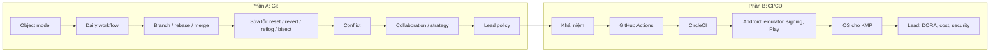
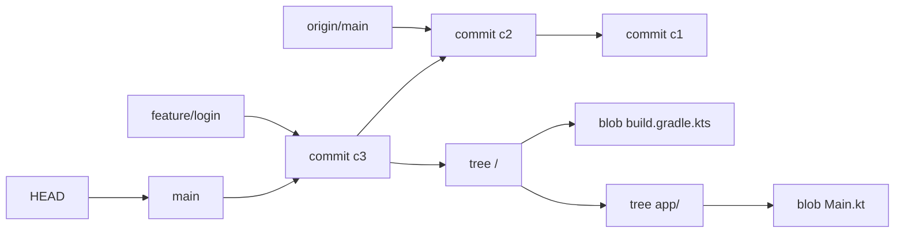
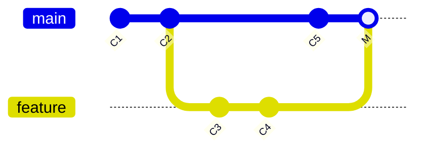
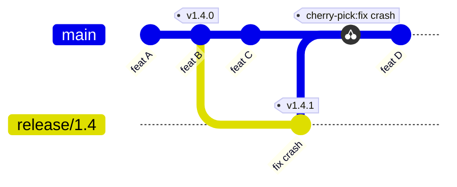
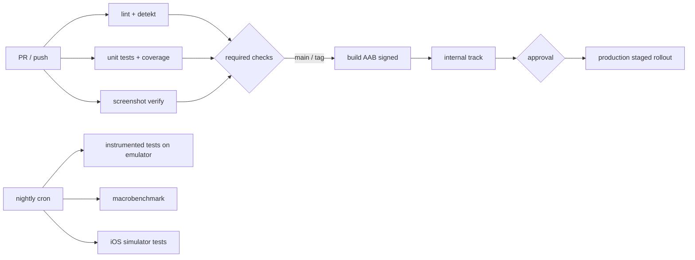

# 20. Git và CI/CD (từ zero tới Lead)

> Mục tiêu: dùng Git tự tin trong mọi tình huống hằng ngày và khi "lỡ tay", đọc và viết được pipeline GitHub Actions / CircleCI cho Android và KMP, và trả lời được câu hỏi "team bạn release thế nào" ở mức Lead. | Mức cần đạt: Senior: rebase/merge/cherry-pick/bisect thành thạo, sửa được mọi lỗi Git thường gặp, đọc hiểu pipeline. Staff: thiết kế pipeline (cache, matrix, gating, signing, upload Play), xử lý flaky và thời gian build. Lead: branching strategy, release train, branch protection, DORA, chi phí, bảo mật secret. | Thời gian gợi ý: tuần 3 (phần A, ~8 giờ) và tuần 4 (phần B, ~10 giờ)

Ghi chú: bạn tự nhận chưa rành Git và CI. Phần A viết từ zero với một repo nháp để gõ theo. Phần B viết từ zero với một pipeline hoàn chỉnh cho `kmp-template-impl`. Mọi lệnh trong file đều chạy được; làm theo thứ tự.

## 0. Bản đồ chủ đề

JD mobile 2026: CI/CD xuất hiện 7/15 JD, "release automation" là yêu cầu Lead (xem `01-Market-Research-2026.md`). Interviewer hỏi theo ba tầng:

1. Senior: "rebase khác merge thế nào", "lỡ commit secret thì làm gì", "pipeline của bạn có những job nào".
2. Staff: "pipeline mất 40 phút, bạn tối ưu thế nào", "ký app trên CI an toàn ra sao", "test splitting làm thế nào".
3. Lead: "trunk-based hay GitFlow, vì sao", "rollback trên Play làm sao", "DORA của team là bao nhiêu", "secret bị lộ thì quy trình là gì".

Với project build bằng Claude Code, họ sẽ hỏi: "repo của bạn có CI chưa, chạy gì, tại sao chọn như vậy". Hiện `kmp-template-impl` và `compose-template` chưa có thư mục `.github/workflows` hay `.circleci`. Sau hands-on của file này sẽ có.



## Phần A: Git từ zero

## 1. Mental model: Git lưu gì

### 1.1 Bốn loại object

Git không lưu "diff". Git lưu snapshot. Trong thư mục `.git/objects` có bốn loại object, mỗi object được đặt tên bằng hash SHA-1 của nội dung:

- blob: nội dung một file (không có tên file).
- tree: một thư mục; danh sách (tên, quyền, hash) trỏ tới blob hoặc tree con.
- commit: trỏ tới một tree (toàn bộ snapshot), một hoặc nhiều commit cha, tác giả, thời gian, message.
- tag (annotated): trỏ tới commit kèm tên, người tag, message.

Vì commit trỏ tới tree gốc của toàn bộ project, nên "commit" là ảnh chụp cả repo tại thời điểm đó. Hai commit liên tiếp chia sẻ blob của file không đổi (cùng hash), nên không tốn chỗ.



### 1.2 Refs, branch, HEAD

- Ref: một file nhỏ chứa hash commit. `refs/heads/main` là branch `main`. Branch chỉ là con trỏ tới commit, tạo branch mất 0 byte dữ liệu.
- HEAD: con trỏ tới branch hiện tại (thường), hoặc trực tiếp tới một commit ("detached HEAD").
- Commit mới: Git tạo commit có cha là commit HEAD đang trỏ, rồi dời branch hiện tại tới commit mới.
- Remote-tracking branch: `origin/main` là bản sao chỉ đọc của `main` trên server tại lần `fetch` cuối. Nó không tự cập nhật.

### 1.3 Ba vùng: working tree, index, repository

| Vùng | Là gì | Lệnh đưa vào | Lệnh xem |
|---|---|---|---|
| Working tree | File thật trên đĩa bạn đang sửa | (bạn sửa file) | `git status`, `git diff` |
| Index (staging area) | Bản nháp của commit kế tiếp | `git add` | `git diff --staged` |
| Repository (`.git`) | Lịch sử commit | `git commit` | `git log` |

`git diff` so working tree với index. `git diff --staged` so index với HEAD. `git diff HEAD` so working tree với HEAD. Hiểu ba vùng này là hiểu `reset --soft/--mixed/--hard` ở mục 4.

### 1.4 Thử ngay: repo nháp để nhìn object

```bash
mkdir -p ~/git-lab && cd ~/git-lab && git init demo && cd demo
echo "hello" > a.txt
git add a.txt
git commit -m "first"
git log --oneline            # thấy hash commit
git cat-file -p HEAD         # xem commit: tree, author, message
git cat-file -p HEAD^{tree}  # xem tree: blob a.txt
git cat-file -p HEAD:a.txt   # xem nội dung blob
cat .git/HEAD                # ref: refs/heads/main
cat .git/refs/heads/main     # hash commit
```

Giữ repo `~/git-lab/demo` này, mục 8 sẽ dùng để diễn tập 20 tình huống.

**Lỗi hay gặp / trade-off**
- Nghĩ branch là "bản copy thư mục": dẫn tới sợ tạo branch. Branch là con trỏ, tạo và xoá thoải mái.
- Nghĩ `origin/main` là main trên server hiện tại: nó là bản cache từ lần fetch cuối, phải `git fetch` trước khi so sánh.
- Nhầm `git add` là "lưu": chưa có gì trong lịch sử cho tới khi `commit`.

**Đọc thêm:**
- https://git-scm.com/book/en/v2/Git-Internals-Git-Objects (Pro Git, chương 10.2: blob, tree, commit)
- https://git-scm.com/book/en/v2/Git-Basics-Recording-Changes-to-the-Repository (Pro Git, chương 2.2: ba vùng)

## 2. Daily workflow

### 2.1 Clone, status, add, commit, push

```bash
git clone git@github.com:ltthuc1989/kmp-template-impl.git
cd kmp-template-impl
git status                          # branch nào, file nào thay đổi
git switch -c feature/settings-test # tạo và chuyển sang branch mới
# ... sửa code ...
git add -p                          # stage từng hunk, chọn y/n/s (split)/q
git status
git diff --staged                   # xem đúng cái sẽ commit
git commit -m "test(setting): add SettingViewModel turbine tests"
git push -u origin feature/settings-test   # -u để lần sau chỉ cần git push
```

`git add -p` là lệnh quan trọng nhất cho commit sạch: bạn chọn từng đoạn thay đổi, bỏ debug log, tách thành nhiều commit có ý nghĩa. `git add .` stage tất cả, kể cả file rác.

### 2.2 `fetch` vs `pull`

- `git fetch origin`: tải commit và cập nhật `origin/*`. Không đụng branch của bạn. Luôn an toàn.
- `git pull` = `fetch` + `merge origin/<branch>` vào branch hiện tại. Tạo merge commit nếu hai bên đều có commit mới.
- `git pull --rebase` = `fetch` + `rebase` branch của bạn lên `origin/<branch>`. Lịch sử thẳng, không merge commit rác.

Khuyến nghị cấu hình một lần:

```bash
git config --global pull.rebase true          # pull luôn rebase
git config --global rebase.autoStash true     # tự stash/unstash khi rebase có thay đổi chưa commit
git config --global fetch.prune true          # xoá origin/* đã bị xoá trên server
git config --global init.defaultBranch main
git config --global core.editor "code --wait" # hoặc vim/nano
git config --global merge.conflictstyle zdiff3 # hiển thị cả base khi conflict, xem mục 5
```

Thói quen tốt: `git fetch` rồi `git log --oneline main..origin/main` để xem có gì mới trước khi pull.

### 2.3 `.gitignore` cho Android / KMP

Những thứ không bao giờ được vào repo: output build, cấu hình máy cá nhân, secret.

```gitignore
# Build output
build/
.gradle/
.kotlin/
*.apk
*.aab
*.ap_
*.dex
.externalNativeBuild/
.cxx/
captures/
composeApp/release/
!gradle/wrapper/gradle-wrapper.jar

# IDE
.idea/
*.iml
.vscode/
.DS_Store

# Machine-local config
local.properties

# Signing and secrets
*.jks
*.keystore
!gradle/keystore/debug.keystore   # chỉ khi team cố ý chia sẻ debug keystore
keystore.properties
*.pepk
*.pem
secrets.properties

# KMP / iOS
iosApp/iosApp.xcodeproj/xcuserdata/
iosApp/iosApp.xcodeproj/project.xcworkspace/xcuserdata/
iosApp/Pods/
iosApp/build/
DerivedData/
*.xcuserstate

# AI tooling local overrides
.claude/settings.local.json
```

Hai quyết định phải nói rõ trong team:

- `google-services.json`: không phải secret theo Firebase (API key client được bảo vệ bởi App Check, restriction), nhiều team commit. `kmp-template-impl` đang commit file này. Chấp nhận được nếu repo private và có App Check; nếu repo public thì bỏ ra và nạp từ secret trên CI.
- Keystore: không bao giờ commit keystore release. `kmp-template-impl` đã ignore `gradle/keystore/release.keystore`, tốt. `compose-template` hiện đang track `keystore/keystore`, `keystore/keystore.properties`, `keystore/passkeystore.txt`, `keystore/private_key.pepk` (kiểm tra bằng `git ls-files keystore/`). Đây là template nội bộ, repo private, nhưng nếu clone thành app thật và push lên repo khác, mật khẩu keystore đi theo lịch sử. Xử lý ở mục 8, tình huống 7.

Kiểm tra một file có bị ignore không và bởi rule nào: `git check-ignore -v path/to/file`. File đã lỡ track thì `.gitignore` không có tác dụng, phải `git rm --cached`.

**Lỗi hay gặp / trade-off**
- `git add .` kéo theo `local.properties` có đường dẫn SDK cá nhân, hoặc file `.DS_Store`.
- `git pull` không rebase tạo merge commit "Merge branch 'main' into feature/x" làm lịch sử rối.
- Push với `-u` quên: lần sau `git push` báo "no upstream branch".

**Đọc thêm:**
- https://git-scm.com/book/en/v2/Git-Basics-Working-with-Remotes (fetch, pull, push, tracking branch)
- https://github.com/github/gitignore/blob/main/Android.gitignore (mẫu gitignore Android của GitHub)
- https://git-scm.com/docs/git-add (mục `-p`, interactive mode)

## 3. Branch, merge, rebase, cherry-pick, stash, tag, worktree

### 3.1 Tạo và chuyển branch

```bash
git branch                         # liệt kê local
git branch -a                      # cả remote-tracking
git switch -c feature/paywall      # tạo + chuyển (lệnh mới, thay checkout -b)
git switch main                    # chuyển
git branch -d feature/paywall      # xoá nếu đã merge; -D ép xoá
git push origin --delete feature/paywall   # xoá trên server
git branch -m old new              # đổi tên
```

Đặt tên branch có tiền tố: `feature/`, `fix/`, `hotfix/`, `release/`, `chore/`. Kèm mã ticket nếu có: `feature/PAY-123-paywall`.

### 3.2 Merge: fast-forward vs merge commit

Giả sử `main` ở C2, bạn tạo `feature` và commit C3, C4. Nếu `main` chưa có commit mới:

```bash
git switch main
git merge feature        # fast-forward: main chỉ dời con trỏ tới C4, không tạo commit mới
```

Nếu `main` đã có C5 do người khác push:

```bash
git merge feature        # tạo merge commit M có hai cha (C5 và C4)
git merge --no-ff feature  # luôn tạo merge commit dù có thể fast-forward (giữ dấu vết "đây là một feature")
```



### 3.3 Rebase vs merge: khi nào dùng gì

`git rebase main` (đứng ở `feature`): lấy các commit của `feature` kể từ điểm tách, "chép lại" từng commit lên đỉnh `main`. Kết quả là lịch sử thẳng, commit của bạn có hash mới.

```bash
git switch feature
git fetch origin
git rebase origin/main      # feature giờ nằm trên đỉnh origin/main
git push --force-with-lease # vì hash đổi, phải force; --force-with-lease từ chối nếu server có commit bạn chưa thấy
```

| | Merge | Rebase |
|---|---|---|
| Lịch sử | Giữ nguyên, có merge commit, có nhánh rẽ | Thẳng, như thể bạn viết code sau mọi người |
| An toàn | Không đổi commit cũ | Viết lại commit (hash mới) |
| Conflict | Giải một lần tại merge | Giải từng commit (có thể nhiều lần, dùng `rerere`) |
| Dùng khi | Đưa feature vào main (qua PR), lịch sử công khai | Cập nhật feature branch của riêng bạn với main; dọn commit trước khi PR |

Quy tắc vàng của rebase: không rebase branch mà người khác đã base công việc lên (branch chung, `main`, `release/*`). Rebase chỉ dành cho commit chưa ai khác dùng. Lý do: rebase tạo hash mới, người khác có hash cũ, hai lịch sử tách nhau, lần merge sau sẽ nhân đôi commit và conflict khó hiểu.

Trong PR workflow phổ biến hiện nay: dev rebase feature lên main (lịch sử sạch), rồi GitHub "Squash and merge" hoặc "Rebase and merge" vào main. `main` không bao giờ bị rebase.

### 3.4 Interactive rebase: dọn commit trước khi PR

```bash
git rebase -i HEAD~4        # mở editor với 4 commit gần nhất, cũ nhất ở trên
```

```
pick a1b2c3 feat(paywall): add PaywallViewModel
pick d4e5f6 wip
pick 789abc fix typo
pick 0a1b2c feat(paywall): wire screen

# Commands:
# p, pick   = dùng commit
# r, reword = dùng commit, sửa message
# e, edit   = dừng lại để sửa nội dung commit
# s, squash = gộp vào commit trên, gộp cả message
# f, fixup  = gộp vào commit trên, bỏ message này
# d, drop   = bỏ commit
# (đổi thứ tự dòng = đổi thứ tự commit)
```

Sửa thành:

```
pick a1b2c3 feat(paywall): add PaywallViewModel
fixup d4e5f6 wip
fixup 789abc fix typo
reword 0a1b2c feat(paywall): wire screen
```

Lưu, Git chạy; với `reword` nó mở editor để sửa message. Kết quả: 2 commit sạch.

Mẹo: trong lúc làm, commit sửa lỗi của commit cũ bằng `git commit --fixup=<hash>`; sau đó `git rebase -i --autosquash main` tự sắp fixup đúng chỗ.

Nếu rối: `git rebase --abort` quay về trạng thái trước rebase.

### 3.5 Cherry-pick

Lấy một commit từ branch khác đặt lên branch hiện tại (commit mới, hash mới, cùng diff):

```bash
git switch release/1.4
git cherry-pick 0a1b2c            # một commit
git cherry-pick -x 0a1b2c         # thêm dòng "(cherry picked from commit ...)" vào message, nên dùng cho hotfix
git cherry-pick a1b2c3^..0a1b2c   # một dải commit
git cherry-pick --abort           # nếu conflict muốn huỷ
```

Dùng cho hotfix: fix trên `main`, cherry-pick sang `release/1.4`. Hoặc ngược lại tuỳ chiến lược (mục 6.4).

### 3.6 Stash

Cất tạm thay đổi chưa commit để chuyển branch:

```bash
git stash push -m "wip paywall layout"      # cất tracked files đã sửa
git stash push -u -m "wip incl new files"   # -u cất cả untracked (file mới chưa add)
git stash list
git stash show -p stash@{0}                 # xem diff
git stash pop                               # lấy ra và xoá khỏi list (stash@{0})
git stash apply stash@{1}                   # lấy ra, giữ trong list
git stash drop stash@{1}
git stash branch fix/from-stash stash@{0}   # tạo branch từ stash nếu pop conflict
```

Với `rebase.autoStash true`, `git pull --rebase` tự stash/pop. Stash không được push, chỉ ở máy bạn.

### 3.7 Tag và semver

```bash
git tag                                   # liệt kê
git tag -a v1.4.0 -m "Release 1.4.0"      # annotated tag (có tác giả, message), dùng cho release
git tag v1.4.0-rc.1                       # lightweight tag, chỉ là con trỏ
git push origin v1.4.0                    # push một tag
git push origin --tags                    # push mọi tag (tránh, dễ đẩy tag nháp)
git tag -d v1.4.0 && git push origin :refs/tags/v1.4.0   # xoá tag local và remote
git describe --tags                       # tên tag gần nhất + số commit kể từ đó
```

Semantic Versioning `MAJOR.MINOR.PATCH`: MAJOR đổi khi breaking (với app: thay đổi lớn về sản phẩm), MINOR thêm tính năng, PATCH sửa lỗi. Pre-release: `1.4.0-rc.1`, `1.4.0-beta.2`. Với app mobile: `versionName` = tag bỏ chữ `v`; `versionCode` tăng đơn điệu (mục 12.7). Với library publish lên Maven (bạn đã làm): tag = version Maven, CI publish khi push tag.

### 3.8 Worktree

Làm hai branch cùng lúc ở hai thư mục, chung `.git`, không cần clone lại (tiết kiệm Gradle cache và thời gian sync):

```bash
git worktree add ../kmp-hotfix hotfix/1.4.1   # tạo thư mục ../kmp-hotfix checkout branch hotfix/1.4.1
git worktree list
git worktree remove ../kmp-hotfix
```

Hữu ích khi đang dở feature mà phải làm hotfix gấp, hoặc chạy hai agent AI song song trên hai branch (Claude Code có hỗ trợ worktree cho subagent).

**Lỗi hay gặp / trade-off**
- `git push --force` lên branch chung: mất commit người khác. Dùng `--force-with-lease` và chỉ trên branch của mình.
- Rebase branch đã có người khác checkout: nhân đôi commit. Thông báo trước hoặc merge thay vì rebase.
- Stash quá nhiều, quên: `git stash list` định kỳ, đặt message rõ.
- Tag lightweight cho release: thiếu thông tin ai tag, lúc nào. Dùng `-a`.

**Đọc thêm:**
- https://git-scm.com/book/en/v2/Git-Branching-Rebasing (Pro Git 3.6: rebase, "The Perils of Rebasing")
- https://git-scm.com/book/en/v2/Git-Tools-Rewriting-History (Pro Git 7.6: interactive rebase)
- https://git-scm.com/docs/git-worktree
- https://semver.org

## 4. Sửa lỗi: amend, reset, revert, reflog, bisect, rerere

### 4.1 `--amend`

Sửa commit gần nhất (chưa push, hoặc trên branch riêng):

```bash
git add forgotten-file.kt
git commit --amend --no-edit     # thêm file vào commit cuối, giữ message
git commit --amend -m "new message"
```

Amend tạo commit mới thay commit cũ (hash đổi). Đã push thì cần `--force-with-lease`.

### 4.2 `reset`: soft / mixed / hard

`git reset <mode> <commit>` dời branch hiện tại (và HEAD) về `<commit>`, rồi tuỳ mode mà đụng vào index và working tree:

| Mode | Branch/HEAD | Index | Working tree | Dùng khi |
|---|---|---|---|---|
| `--soft` | dời | giữ | giữ | Gộp vài commit cuối thành một: `reset --soft HEAD~3` rồi `commit` |
| `--mixed` (mặc định) | dời | reset theo commit | giữ | "Bỏ commit nhưng giữ code để add lại" |
| `--hard` | dời | reset | reset (mất thay đổi chưa commit) | Vứt bỏ hoàn toàn; nguy hiểm |

```bash
git reset --soft HEAD~1      # huỷ commit cuối, code vẫn staged
git reset HEAD~1             # huỷ commit cuối, code về working tree (unstaged)
git reset --hard HEAD~1      # huỷ commit cuối và mọi thay đổi
git reset --hard origin/main # ép branch local giống server
git restore --staged file.kt # bỏ stage một file (thay cho reset file)
git restore file.kt          # huỷ thay đổi working tree của một file (mất, cẩn thận)
```

`reset --hard` chỉ mất thay đổi chưa commit. Commit đã có thì tìm lại bằng reflog (4.4).

### 4.3 `revert`: huỷ bằng commit mới

Với commit đã push lên branch chung, không reset (viết lại lịch sử). Dùng revert tạo commit ngược:

```bash
git revert 0a1b2c              # tạo commit đảo ngược 0a1b2c
git revert --no-commit a..c    # revert nhiều, gộp một commit
git revert -m 1 <merge-commit> # revert merge commit, -m 1 giữ phía mainline (cha thứ nhất)
```

Revert merge commit có bẫy: sau này muốn merge lại branch đó, Git nghĩ đã merge rồi. Phải revert cái revert, hoặc rebase branch tạo commit mới.

### 4.4 `reflog`: lưới an toàn

Reflog ghi lại mọi vị trí HEAD và branch từng trỏ tới trong ~90 ngày, kể cả commit "đã mất" sau reset/rebase.

```bash
git reflog                       # HEAD@{0}: commit: ..., HEAD@{1}: reset: moving to ...
git reset --hard HEAD@{2}        # quay lại vị trí 2 bước trước
git branch rescue HEAD@{5}       # tạo branch từ vị trí cũ để xem
git reflog show feature/paywall  # reflog của một branch
```

Quy tắc: commit rồi thì gần như không mất, chỉ cần reflog. Chưa commit (working tree) thì `reset --hard` hoặc `restore` mới mất thật.

### 4.5 `bisect`: tìm commit gây regression

Bạn biết v1.3.0 tốt, HEAD lỗi, giữa có 200 commit. Bisect tìm nhị phân, ~8 bước.

```bash
git bisect start
git bisect bad                 # HEAD lỗi
git bisect good v1.3.0         # tag tốt
# Git checkout commit giữa; bạn build, test, rồi:
git bisect good   # hoặc
git bisect bad
# lặp cho tới khi Git in "xxx is the first bad commit"
git bisect reset               # về HEAD ban đầu
```

Tự động hoá với một lệnh trả exit code 0 (tốt) / khác 0 (lỗi):

```bash
git bisect start HEAD v1.3.0
git bisect run ./gradlew :core:domain:test --tests "*PriceCalculatorTest*" -q
git bisect reset
```

Với Android: viết một unit test tái hiện bug trước, rồi `bisect run` chạy test đó. Nếu bug chỉ hiện trên device, script có thể `installDebug` + chạy instrumented test. Mỗi bước build Gradle mất 1-2 phút, 8 bước là 15 phút, vẫn rẻ hơn đọc 200 commit.

### 4.6 `rerere`: nhớ cách giải conflict

Rebase 10 commit, cùng một conflict lặp lại ở nhiều commit. `rerere` (reuse recorded resolution) ghi nhớ cách bạn giải và tự áp dụng lần sau:

```bash
git config --global rerere.enabled true
```

Không có nhược điểm đáng kể. Bật một lần.

**Lỗi hay gặp / trade-off**
- `reset --hard` khi còn file mới chưa add: file mới không bị xoá (untracked), nhưng file đã sửa thì mất.
- `revert` trên branch riêng chưa push: tạo rác; dùng `reset`.
- Bisect với commit không build được: `git bisect skip`.
- Quên `git bisect reset`: ở lại detached HEAD, commit tiếp là vào hư không (tình huống 13 mục 8).

**Đọc thêm:**
- https://git-scm.com/book/en/v2/Git-Tools-Reset-Demystified (Pro Git 7.7: reset với ba vùng)
- https://git-scm.com/docs/git-bisect (có ví dụ `bisect run`)
- https://git-scm.com/book/en/v2/Git-Tools-Rerere

## 5. Conflict: đọc, giải, tránh

### 5.1 Đọc conflict marker

Khi merge/rebase/cherry-pick/stash pop gặp hai thay đổi cùng chỗ, Git dừng và ghi vào file:

```kotlin
<<<<<<< HEAD
val retryCount = 3
||||||| parent of 0a1b2c (base, chỉ hiện khi conflictstyle = diff3/zdiff3)
val retryCount = 2
=======
val retryCount = 5
>>>>>>> feature/retry
```

- Phần trên `=======` là "ours" (bên HEAD, bên bạn đang đứng).
- Phần dưới là "theirs" (bên đang đưa vào).
- Với `zdiff3` có thêm phần giữa: nội dung gốc trước khi cả hai sửa. Nhìn base là biết ai đổi gì, quyết định nhanh hơn nhiều. Bật bằng `git config --global merge.conflictstyle zdiff3`.

Bẫy quan trọng: khi rebase, "ours" và "theirs" đảo ngược so với merge. Lúc rebase, HEAD là commit của `main` đang được áp lên, nên "ours" = main, "theirs" = commit của bạn. `git checkout --ours file` lúc rebase lấy phía main. Luôn nhìn nội dung, đừng tin tên.

Quy trình giải:

```bash
git status                              # "both modified: ..."
git diff --name-only --diff-filter=U    # chỉ file conflict
# sửa file, xoá marker, giữ nội dung đúng
git add file.kt                         # đánh dấu đã giải
git merge --continue      # hoặc git rebase --continue / git cherry-pick --continue
# muốn huỷ: git merge --abort / git rebase --abort
```

Lấy nguyên một phía cho file nhị phân hoặc file sinh ra:

```bash
git checkout --ours path/to/golden.png
git checkout --theirs path/to/golden.png
git add path/to/golden.png
```

### 5.2 Giải trong Android Studio

Khi `git status` có conflict, Studio hiện dialog "Conflicts" hoặc vào menu Git > Resolve Conflicts. Cửa sổ 3 cột: trái là "Your version" (ours), phải là "Their version", giữa là kết quả. Nút mũi tên để chấp nhận từng hunk từ mỗi bên, nút X để bỏ. "Accept Yours" / "Accept Theirs" cho cả file. Nhấn Apply xong thì file đã được `git add`. Studio cũng hiện "Resolve" trong tab Git > Log khi rebase dừng. Giải xong thì nhấn "Continue Rebasing" trong popup, hoặc gõ `git rebase --continue` ở terminal.

Studio tốt cho code Kotlin; với file cấu hình (TOML, lockfile) terminal + hiểu nội dung nhanh hơn.

### 5.3 Conflict trong file hay gặp của Android

`gradle/libs.versions.toml`: hai PR cùng bump version một thư viện, hoặc cùng thêm alias ở cuối một mục.

```toml
<<<<<<< HEAD
koin = "4.2.2"
=======
koin = "4.2.1"
>>>>>>> feature/x
```

Giữ bản cao hơn (trừ khi có lý do pin). Với hai alias mới thêm cùng chỗ: giữ cả hai, xếp theo thứ tự chữ cái. Sau khi giải chạy `./gradlew help` để chắc TOML hợp lệ (lỗi cú pháp TOML làm Gradle fail ngay ở configuration).

Tránh: giữ catalog sắp xếp theo alphabet trong mỗi mục; thêm alias mới vào đúng vị trí chữ cái thay vì cuối file. Hai người thêm ở hai chỗ khác nhau thì không conflict.

`res/values/strings.xml` và `values-vi/strings.xml`: hai người thêm string ở cuối file. Giữ cả hai, đảm bảo không trùng `name` (lint "DuplicateDefinition" bắt được, build fail với "Found item String/x more than one time"). Tránh: mỗi feature một file `strings_<feature>.xml`, hoặc với KMP là `composeResources/values/strings.xml` tách theo feature module như `kmp-template-impl` đang làm với `core/resource`.

`settings.gradle.kts`: hai PR cùng `include(":feature:x")` ở cuối. Giữ cả hai. Tránh: sắp xếp include theo chữ cái; hoặc dùng cách tự động include theo thư mục nếu repo có convention.

Lockfile (`gradle.lockfile` nếu bật dependency locking, `Podfile.lock`, `package-lock.json` của web admin): không sửa tay. Lấy một phía rồi sinh lại:

```bash
git checkout --theirs gradle.lockfile
./gradlew dependencies --write-locks     # sinh lại từ catalog đã giải
git add gradle.lockfile
```

Với CocoaPods trong KMP: giải `Podfile`, rồi `pod install` sinh lại `Podfile.lock`.

Golden screenshot PNG: nhị phân, không merge được. Lấy một phía rồi chạy lại record trên CI.

### 5.4 Chiến lược tránh conflict

- PR nhỏ, merge nhanh (dưới 400 dòng, sống dưới 2 ngày).
- Rebase lên `main` mỗi sáng khi branch sống lâu.
- Tách file lớn theo feature (strings, DI module, navigation graph). File "trung tâm" mà ai cũng sửa là nguồn conflict chính.
- Format code tự động và thống nhất (ktlint/detekt formatting) để không conflict vì khoảng trắng.
- Không reformat cả file trong PR tính năng. Reformat là PR riêng.
- Bật `rerere`.
- Với tài nguyên sinh ra (golden, lockfile), quy ước "sinh lại, không merge".

**Lỗi hay gặp / trade-off**
- Giải conflict bằng cách "chọn bên mình" cho cả file: xoá luôn thay đổi của người khác. Review kỹ `git diff HEAD` sau khi giải.
- Quên xoá marker: Kotlin không compile; TOML/XML fail ở configuration. CI bắt được nhưng mất một vòng.
- Giải conflict xong không build/test local trước khi push.

**Đọc thêm:**
- https://git-scm.com/book/en/v2/Git-Tools-Advanced-Merging (Pro Git 7.8: conflict, ours/theirs, diff3)
- https://git-scm.com/docs/git-config (mục `merge.conflictStyle`)
- https://developer.android.com/studio/projects/version-control (Git trong Android Studio, resolve conflict)

## 6. Collaboration: PR, conventional commits, branching strategy

### 6.1 PR workflow trên GitHub

1. Tạo branch từ `main` mới nhất.
2. Commit nhỏ, message rõ. Push.
3. Mở Pull Request: tiêu đề theo conventional commit, mô tả theo template (mục 7.4): vấn đề, cách làm, cách test, screenshot nếu UI.
4. CI chạy (lint, test, build). Đỏ thì sửa trước khi xin review.
5. Reviewer đọc, comment. Author trả lời từng comment, push commit sửa (không force-push giữa chừng review để reviewer thấy diff tăng dần; force-push chỉ khi rebase lên main trước merge).
6. Approve + required checks xanh → merge. Cách merge: "Squash and merge" (một commit sạch trên main, phổ biến cho app), "Rebase and merge" (giữ từng commit, cần commit sạch), "Merge commit" (giữ lịch sử nhánh, ít dùng với trunk-based).
7. Xoá branch sau merge (bật "Automatically delete head branches").

Review etiquette, hai chiều:

- Author: PR nhỏ, tự review diff trước khi xin review, mô tả "vì sao" không chỉ "cái gì", không trộn refactor với feature.
- Reviewer: trả lời trong 1 ngày làm việc; phân biệt "blocking" và "nit"; comment vào code không vào người; đề xuất thay vì ra lệnh ("Có thể dùng fake ở đây để test ổn định hơn?"); khen điểm tốt; approve khi "đủ tốt" không phải "như tôi sẽ viết".

### 6.2 Conventional Commits

```
<type>(<scope>): <mô tả ngắn, thì hiện tại, không chấm cuối>

<body: vì sao, không phải cái gì>

<footer: BREAKING CHANGE: ..., Closes #123>
```

Type thường dùng: `feat`, `fix`, `refactor`, `test`, `docs`, `chore`, `build`, `ci`, `perf`, `style`. Scope là module hoặc feature: `feat(paywall): show localized prices`, `fix(audio): release player on stop`, `ci: cache gradle configuration`.

Lợi ích: đọc `git log --oneline` hiểu ngay; sinh changelog tự động; semantic-release tính version từ commit. Chi phí: cần tool enforce (commitlint, hoặc kiểm tra tiêu đề PR trong CI) nếu không sẽ trôi.

Commit hygiene: một commit = một thay đổi logic có thể build; message giải thích lý do; không commit "wip", "fix", "asdf" lên main (squash trước).

### 6.3 Branching strategy

| Chiến lược | Cách làm | Hợp với | Rủi ro |
|---|---|---|---|
| Trunk-based | Một `main`, feature branch sống 1-2 ngày, feature flag che tính năng dở, release cắt từ main bằng tag hoặc branch `release/x.y` ngắn hạn | Team có CI mạnh, release 1-2 tuần/lần, mobile hiện đại | Cần flag và test tốt; không có flag thì main hay vỡ |
| GitFlow | `develop` + `main` + `feature/*` + `release/*` + `hotfix/*`, merge chéo nhiều | Release theo lịch dài (tháng), nhiều version song song (enterprise, bank có nhiều môi trường) | Nặng, merge conflict giữa develop và main, chậm |
| GitHub Flow | Như trunk-based nhưng deploy từ branch sau review | Web deploy liên tục | Với mobile không "deploy từ branch" được vì phải qua store |
| Release branches | `main` + `release/1.4` tồn tại tới khi 1.4 ra production, hotfix vào release rồi merge về main | Mobile có giai đoạn staged rollout dài 1-2 tuần | Phải nhớ merge ngược; cherry-pick hai chiều |

Khuyến nghị cho mobile 2026: trunk-based + release branch ngắn hạn + feature flag. Lý do: store review và staged rollout kéo dài, cần nơi để hotfix bản đang rollout trong khi `main` đi tiếp.

### 6.4 Hotfix flow cho một bản mobile đang rollout



Các bước:

1. Crash xuất hiện ở 1.4.0 đang rollout 20%. Dừng rollout trên Play Console (halt).
2. `git switch -c release/1.4 v1.4.0` (nếu chưa có branch release).
3. Fix trên `release/1.4` (hoặc fix trên `main` rồi `cherry-pick -x` sang). Tăng `versionCode`, tag `v1.4.1`.
4. CI build từ tag, upload internal → QA xác nhận → promote production với rollout mới.
5. Đưa fix về `main`: `git switch main && git cherry-pick -x <fix>` hoặc merge `release/1.4` vào `main`. Phải có bước này, nếu không 1.5.0 lại có bug cũ.
6. Ghi post-mortem (xem `11-Leadership-Management.md`).

### 6.5 Monorepo, multi-module, submodule, composite build

`kmp-template-impl` là một repo nhiều Gradle module (multi-module), không phải monorepo nhiều app. Cân nhắc:

- CI theo module bị ảnh hưởng: path filter (`paths:` trong GHA) hoặc script tính module thay đổi từ `git diff --name-only origin/main...HEAD`; Gradle configuration cache và build cache giúp phần không đổi không build lại.
- CODEOWNERS theo thư mục module (mục 7.2).
- Chia sẻ code giữa repo (`compose-template` dùng lib của `YammyDelivery`): ba cách.
  - Publish artifact lên Maven (bạn đang làm): rõ ràng, có version, cần quy trình release lib; consumer không sửa lib tại chỗ được.
  - Composite build `includeBuild("../YammyDelivery")` trong `settings.gradle.kts`: sửa lib và app cùng lúc, Gradle thay artifact bằng project; tốt cho dev local, trên CI cần checkout cả hai repo.
  - Git submodule: ghim một commit của repo khác vào thư mục con; mọi người hay quên `git submodule update --init --recursive`, PR phải đổi pointer submodule; chỉ dùng khi bắt buộc (SDK nhị phân, asset chung).

**Lỗi hay gặp / trade-off**
- Squash merge làm mất lịch sử commit chi tiết; chấp nhận vì PR nhỏ, hoặc dùng rebase merge khi commit đã sạch.
- GitFlow trên team 5 người: 70% thời gian merge chéo.
- Trunk-based không có flag: tính năng dở lên production.
- Quên merge hotfix về main: bug tái xuất ở bản sau, rất hay gặp.

**Đọc thêm:**
- https://www.conventionalcommits.org
- https://trunkbaseddevelopment.com (trunk-based, release branch, feature flag)
- https://docs.github.com/en/pull-requests (PR workflow, merge methods)
- https://docs.gradle.org/current/userguide/composite_builds.html

## 7. Git ở vai trò Lead

### 7.1 Protected branches

Trên GitHub: Settings > Branches (hoặc Rules > Rulesets, cách mới). Bật cho `main` và `release/*`:

- Require a pull request before merging; required approvals ≥ 1 (2 cho module thanh toán/bảo mật).
- Dismiss stale approvals khi có commit mới.
- Require review from Code Owners.
- Require status checks to pass: chọn đúng tên job (ví dụ `unit-tests`, `lint`), bật "require branches to be up to date" nếu muốn chắc chắn (đổi lại phải rebase nhiều hơn; merge queue giải quyết).
- Require linear history (chặn merge commit, buộc squash/rebase).
- Block force pushes; block deletions.
- Require signed commits (nếu team đã setup ký).
- Áp cho admin (không có ngoại lệ, kể cả bạn).

### 7.2 CODEOWNERS

File `.github/CODEOWNERS`, dòng sau ghi đè dòng trước:

```
# Mặc định
*                         @ltthuc1989

# Module theo owner
/core/billing/            @ltthuc1989 @payments-team
/feature/learningpath/    @content-team
/build-logic/             @ltthuc1989
/.github/workflows/       @ltthuc1989
/gradle/libs.versions.toml @ltthuc1989
```

Kết hợp "Require review from Code Owners" thì PR đụng `core/billing` bắt buộc có owner approve. Đừng đặt owner là một người cho mọi thứ nếu team lớn hơn 3; đó là nút thắt.

### 7.3 Required status checks và tên job

Tên job trong workflow là thứ GitHub dùng để match. Đặt tên ổn định (`unit-tests`, không `Unit tests (ubuntu-latest, 17)` sinh ra từ matrix). Với matrix, thêm một job tổng hợp `ci-passed` phụ thuộc mọi job, và chỉ require job đó.

### 7.4 PR template

`.github/pull_request_template.md`:

```markdown
## Why
<!-- Vấn đề hoặc mục tiêu, link ticket -->

## What
<!-- Tóm tắt thay đổi; module nào -->

## How tested
- [ ] Unit tests added/updated
- [ ] Screenshot tests updated (attach diff if changed)
- [ ] Manual test on device: model / Android version
- [ ] iOS checked (if shared code changed)

## Screenshots / video
<!-- UI changes: before / after -->

## Checklist
- [ ] No secrets, keystores, or local.properties in diff
- [ ] versionCode / versionName untouched (release PRs only)
- [ ] Strings localized (en + vi)
```

### 7.5 Signed commits

Ký commit chứng minh tác giả thật (chống giả mạo `user.email`). Cách đơn giản nhất năm 2026 là ký bằng SSH key đã có:

```bash
git config --global gpg.format ssh
git config --global user.signingkey ~/.ssh/id_ed25519.pub
git config --global commit.gpgsign true
git config --global tag.gpgsign true
# Trên GitHub: Settings > SSH and GPG keys > New SSH key, chọn "Signing Key"
git commit -S -m "..."     # -S không cần nếu đã bật commit.gpgsign
git log --show-signature -1
```

Bank/fintech hay yêu cầu "Verified" badge trên mọi commit vào main. Nếu team dùng AI agent commit hộ, agent vẫn commit dưới key của dev (dev chịu trách nhiệm).

### 7.6 Release tagging policy

- Tag `vMAJOR.MINOR.PATCH` annotated, tạo bởi CI hoặc release manager, chỉ trên `main` hoặc `release/*`.
- `versionName` = tag bỏ `v`; `versionCode` tính tự động (mục 12.7); file `CHANGELOG.md` hoặc GitHub Release sinh từ conventional commits.
- Pre-release `v1.5.0-rc.1` cho closed testing; tag final khi promote production.
- Không xoá tag đã publish; sai thì tag mới.
- Với KMP: Android và iOS dùng chung tag; build number iOS tăng riêng.

### 7.7 Git LFS cho asset

Repo `kmp-template-impl` chứa audio trong `core/resource/src/commonMain/composeResources/files/audio`. Audio/ảnh lớn làm repo phình (mỗi lần đổi file nhị phân là thêm một blob nguyên vẹn). Git LFS thay file bằng con trỏ trong repo, lưu nội dung ở LFS storage, chỉ tải version đang checkout.

```bash
git lfs install
git lfs track "*.mp3" "*.wav" "*.png"   # ghi vào .gitattributes
git add .gitattributes
git add core/resource/.../audio/*.mp3
git commit -m "chore: move audio to LFS"
git lfs ls-files
```

Cân nhắc: GitHub LFS có hạn mức storage và bandwidth (gói free có hạn, trả thêm theo gói; kiểm tra docs.github.com cho con số hiện tại), CI clone phải `lfs: true` (actions/checkout) tốn bandwidth mỗi lần build; chuyển file đã có trong lịch sử sang LFS cần rewrite history (`git lfs migrate import`). Với asset được sinh từ pipeline riêng (như `GeminiGenerator` của bạn), cách khác là không commit asset vào repo app mà tải từ bucket lúc build hoặc runtime (content pack, đúng như `ContentPackDownloader` đang làm).

**Lỗi hay gặp / trade-off**
- Bật "require branches up to date" mà không có merge queue: team xếp hàng rebase cả ngày.
- CODEOWNERS một người: mọi PR chờ bạn.
- LFS bật sau khi repo đã 2GB: phải migrate history, mọi người clone lại.
- Required check tên đổi theo matrix: rule không match, PR merge không cần test.

**Đọc thêm:**
- https://docs.github.com/en/repositories/configuring-branches-and-merges-in-your-repository (branch protection, rulesets, merge queue)
- https://docs.github.com/en/repositories/managing-your-repositorys-settings-and-features/customizing-your-repository/about-code-owners
- https://docs.github.com/en/authentication/managing-commit-signature-verification
- https://git-lfs.com và https://docs.github.com/en/repositories/working-with-files/managing-large-files

## 8. 20 tình huống lỡ tay và cách sửa

Diễn tập trong `~/git-lab/demo` (mục 1.4). Mỗi tình huống: hiện tượng, lệnh, giải thích. Quy tắc chung trước khi làm bất cứ gì: `git status` và `git log --oneline -5`; nếu hoảng, `git reflog` là bạn.

### Tình huống 1: Commit nhầm vào `main` thay vì branch mới (chưa push)

```bash
git branch feature/x          # tạo branch tại commit hiện tại (giữ commit nhầm)
git reset --hard origin/main  # kéo main về như server
git switch feature/x          # commit của bạn ở đây
```

Giải thích: branch là con trỏ; tạo con trỏ mới giữ commit, rồi dời `main` về.

### Tình huống 2: Quên thêm một file vào commit vừa rồi

```bash
git add path/to/File.kt
git commit --amend --no-edit
```

Đã push rồi và branch là của riêng bạn: thêm `git push --force-with-lease`. Branch chung: commit mới, đừng amend.

### Tình huống 3: Message commit sai chính tả hoặc sai scope

```bash
git commit --amend -m "fix(audio): release player on stop"
# Commit cũ hơn: git rebase -i HEAD~3, đổi pick thành reword ở dòng đó
```

### Tình huống 4: Commit đã push lên `main` chứa bug, cần huỷ

```bash
git revert <hash>
git push
```

Giải thích: `main` được bảo vệ và người khác đã pull; revert tạo commit ngược, không viết lại lịch sử. Nếu là merge commit: `git revert -m 1 <merge-hash>`.

### Tình huống 5: `git reset --hard` nhầm, mất commit

```bash
git reflog                       # tìm dòng trước khi reset, ví dụ HEAD@{1}
git reset --hard HEAD@{1}
```

Giải thích: commit vẫn trong object store, reflog giữ con trỏ. Chỉ thay đổi chưa commit là mất thật.

### Tình huống 6: Xoá branch chưa merge (`git branch -D`)

```bash
git reflog | grep "feature/x"    # hoặc git reflog để tìm commit cuối của branch
git branch feature/x <hash>
```

### Tình huống 7: Lỡ commit keystore / mật khẩu / API key

Thứ tự bắt buộc:

```bash
# 1. Coi secret đã lộ. Xoay (rotate) ngay: đổi mật khẩu, tạo key mới, với upload key của Play thì yêu cầu reset upload key trong Play Console (Play App Signing giữ app signing key an toàn).
# 2. Xoá khỏi commit hiện tại
git rm --cached keystore/keystore.properties
echo "keystore/" >> .gitignore
git commit -m "chore: remove keystore files from repo"
# 3. Xoá khỏi toàn bộ lịch sử (nếu đã push lên nơi người khác thấy)
pip install git-filter-repo        # hoặc brew install git-filter-repo
git filter-repo --path keystore/ --invert-paths --force
# 4. Force push mọi branch và tag, thông báo cả team clone lại
git push origin --force --all
git push origin --force --tags
```

Giải thích: `git filter-repo` là tool được Git khuyến nghị thay `filter-branch` và BFG. Lịch sử bị viết lại, mọi clone cũ vẫn chứa secret, GitHub có thể còn cache trong PR/fork; vì vậy bước 1 (rotate) là bắt buộc, bước 3-4 chỉ để làm sạch. Áp dụng ngay cho `compose-template` nếu repo đó sẽ public hoặc clone sang app mới (hiện `git ls-files keystore/` liệt kê keystore, `.properties`, `passkeystore.txt`, `.pepk`).

### Tình huống 8: Lỡ commit `local.properties`, `build/`, `.idea/`

```bash
git rm -r --cached build/ .idea/ local.properties
# thêm vào .gitignore nếu chưa có
git commit -m "chore: untrack generated and local files"
```

Giải thích: `--cached` bỏ khỏi index và lịch sử tương lai, giữ file trên đĩa.

### Tình huống 9: Rebase conflict rối, muốn làm lại

```bash
git rebase --abort
```

Về đúng trạng thái trước `git rebase`. Tương tự `git merge --abort`, `git cherry-pick --abort`.

### Tình huống 10: Merge xong mới thấy sai (chưa push)

```bash
git reset --hard ORIG_HEAD
```

Giải thích: Git lưu `ORIG_HEAD` trước các thao tác nguy hiểm (merge, rebase, reset). Đã push thì dùng `revert -m 1`.

### Tình huống 11: `git pull` báo "You have divergent branches"

```bash
git pull --rebase          # một lần
git config --global pull.rebase true   # mãi mãi
```

Giải thích: Git mới bắt bạn chọn merge hay rebase khi hai bên cùng có commit mới.

### Tình huống 12: `git push` bị từ chối "non-fast-forward" / "rejected"

```bash
git fetch origin
git rebase origin/feature/x      # hoặc git pull --rebase
git push
# Chỉ khi branch của riêng bạn và bạn đã rebase/amend có chủ ý:
git push --force-with-lease
```

Giải thích: server có commit bạn chưa có. Không bao giờ `--force` thường; `--force-with-lease` từ chối nếu server đã đổi so với lần fetch cuối.

### Tình huống 13: Đang "detached HEAD" (sau checkout tag/commit hoặc bisect) và đã commit

```bash
git switch -c rescue/from-detached     # giữ commit vào một branch
```

Nếu đã chuyển đi rồi mới nhớ: `git reflog` tìm commit, `git branch rescue <hash>`.

### Tình huống 14: `git stash pop` conflict, hoặc stash biến mất

```bash
# Conflict: giải như merge, rồi stash vẫn còn trong list (pop không drop khi conflict)
git stash list
git stash drop stash@{0}      # sau khi giải xong

# Lỡ drop: tìm commit stash lơ lửng
git fsck --unreachable | grep commit
git stash apply <hash>        # thử từng hash gần đây
```

### Tình huống 15: Cần một file từ branch khác, không cần cả branch

```bash
git restore --source=feature/y -- path/to/File.kt
# cũ hơn: git checkout feature/y -- path/to/File.kt
```

### Tình huống 16: Cần đưa đúng một commit fix vào branch release

```bash
git switch release/1.4
git cherry-pick -x <hash>
git push
```

Giải thích: `-x` ghi nguồn vào message để sau truy ra. Nhớ đưa về `main` nếu fix làm trên release.

### Tình huống 17: 6 commit "wip" cần gộp thành 1 trước khi mở PR

```bash
git rebase -i origin/main      # đổi pick → fixup cho 5 commit sau commit đầu
# hoặc nhanh hơn nếu gộp hết:
git reset --soft origin/main
git commit -m "feat(paywall): localized prices and restore flow"
git push --force-with-lease
```

### Tình huống 18: Commit vào branch sai (branch đó đã có commit khác)

```bash
git log --oneline -3             # lấy hash commit lạc
git switch feature/dung
git cherry-pick <hash>
git switch feature/sai
git reset --hard HEAD~1          # bỏ commit lạc (nếu nó là commit cuối)
```

### Tình huống 19: `.DS_Store`, `Thumbs.db` xuất hiện khắp nơi, không muốn sửa `.gitignore` mọi repo

```bash
git config --global core.excludesFile ~/.gitignore_global
printf ".DS_Store\nThumbs.db\n*.swp\n.idea/workspace.xml\n" >> ~/.gitignore_global
```

### Tình huống 20: Push bị từ chối vì file lớn hơn 100MB (GitHub) hoặc repo phình vì asset

```bash
# File chưa push, còn ở commit cuối:
git rm --cached big.mp4 && git commit --amend --no-edit
# File đã ở nhiều commit:
git filter-repo --path big.mp4 --invert-paths --force
# Về lâu dài:
git lfs track "*.mp4" && git add .gitattributes
```

Giải thích: GitHub chặn file >100MB, cảnh báo >50MB. Asset nên qua LFS hoặc content pack tải lúc runtime.

### Tình huống thưởng 21: Tìm commit gây crash giữa 200 commit

```bash
git bisect start HEAD v1.3.0
git bisect run ./gradlew :core:domain:test --tests "*ReproTest*" -q
git bisect reset
```

### Tình huống thưởng 22: Merge PR vào nhầm base branch (vào `release/1.4` thay vì `main`)

```bash
git switch release/1.4
git revert -m 1 <merge-hash>
git push
# Rồi mở lại PR vào main (rebase branch lên main, hoặc cherry-pick các commit)
```

**Đọc thêm:**
- https://git-scm.com/book/en/v2/Git-Tools-Reset-Demystified
- https://github.com/newren/git-filter-repo (tool xoá file khỏi lịch sử)
- https://docs.github.com/en/authentication/keeping-your-account-and-data-secure/removing-sensitive-data-from-a-repository
- https://ohshitgit.com (danh sách tình huống "lỡ tay" kinh điển, có phiên bản lịch sự dangitgit.com)

## Phần B: CI/CD từ zero

## 9. Khái niệm và pipeline mobile

### 9.1 Từ điển tối thiểu

| Thuật ngữ | Nghĩa | Ví dụ |
|---|---|---|
| CI (Continuous Integration) | Mỗi lần push, máy chủ tự build và test để phát hiện lỗi sớm | PR xanh/đỏ trên GitHub |
| CD (Continuous Delivery/Deployment) | Tự động đóng gói và đưa bản build tới nơi phát hành | Upload AAB lên Play internal track |
| Pipeline / Workflow | Toàn bộ quy trình tự động cho một sự kiện | File `android.yml` |
| Job | Một đơn vị chạy trên một máy, gồm nhiều step | `unit-tests` |
| Step | Một lệnh hoặc một action | `./gradlew testDebugUnitTest` |
| Runner / Executor | Máy (VM, container) chạy job | `ubuntu-latest`, `macos-15`, Docker image |
| Trigger | Sự kiện khởi động pipeline | push, pull_request, tag, cron, nút bấm |
| Cache | Lưu thứ tốn thời gian tải/sinh giữa các lần chạy | `~/.gradle/caches` |
| Artifact | File sinh ra từ job, lưu lại để tải hoặc dùng ở job sau | AAB, mapping.txt, test report |
| Secret | Giá trị nhạy cảm được mã hoá, inject vào env lúc chạy | Mật khẩu keystore, JSON service account |
| Matrix | Chạy một job với nhiều tổ hợp tham số | API 28 và 34 |
| Environment | Nhóm secret + quy tắc (reviewer bắt buộc) cho deploy | `play-internal`, `play-production` |
| Gating / Required check | Job phải xanh thì PR mới được merge | `unit-tests`, `lint` |
| Concurrency | Huỷ run cũ khi có push mới cùng branch | tiết kiệm phút |

### 9.2 Pipeline mobile làm gì



Thứ tự theo tốc độ: nhanh và deterministic chạy mỗi PR; chậm hoặc cần device chạy nightly; release chạy khi tag. Mục tiêu PR check dưới 15 phút.

**Đọc thêm:**
- https://docs.github.com/en/actions/about-github-actions/understanding-github-actions (khái niệm workflow, job, step, runner)
- https://circleci.com/docs/concepts/ (khái niệm pipeline, job, executor, workflow)

## 10. GitHub Actions từ zero

### 10.1 Giải phẫu một file YAML

File nằm ở `.github/workflows/<tên>.yml`. YAML: thụt lề bằng 2 khoảng trắng (không tab), `key: value`, danh sách bằng `-`. Chuỗi có ký tự đặc biệt (`:`, `*`, `{`) phải đặt trong dấu nháy.

```yaml
name: Hello                      # tên hiện trên tab Actions

on:                              # trigger
  push:
    branches: [main]
  pull_request:

jobs:
  hello:                         # job id (dùng cho needs và required check)
    runs-on: ubuntu-latest       # runner
    steps:
      - uses: actions/checkout@v4          # "uses": gọi một action có sẵn
      - name: Print Java version
        run: java -version                 # "run": chạy shell
      - name: Multi-line script
        run: |
          echo "branch: ${{ github.ref_name }}"
          ls -la
```

- `${{ ... }}` là expression: đọc context (`github`, `secrets`, `env`, `inputs`, `needs`, `matrix`, `runner`) và hàm (`startsWith`, `contains`, `always()`, `failure()`).
- `uses` vs `run`: `uses` lấy action từ marketplace (`owner/repo@version`) hoặc local (`./.github/actions/x`); `run` là shell thường (bash trên Linux/macOS).
- Job chạy song song mặc định; `needs: [a, b]` tạo thứ tự.

### 10.2 Trigger `on`

```yaml
on:
  push:
    branches: [main]
    tags: ["v*"]
    paths-ignore: ["**.md", "docs/**"]
  pull_request:
    branches: [main]
    types: [opened, synchronize, reopened, ready_for_review]
  workflow_dispatch:            # nút "Run workflow" trên UI, có input
    inputs:
      track:
        type: choice
        default: internal
        options: [internal, alpha, beta, production]
  schedule:
    - cron: "0 19 * * 0-4"      # 02:00 giờ Việt Nam từ thứ Hai tới thứ Sáu (cron theo UTC)
```

`pull_request` từ fork không có secret (bảo mật). `pull_request_target` có secret nhưng chạy code của fork với quyền của repo: nguy hiểm, tránh trừ khi hiểu rõ.

### 10.3 Action hay dùng cho Android

| Action | Việc | Ghi chú |
|---|---|---|
| `actions/checkout@v4` | Clone repo | `with: fetch-depth: 0` khi cần toàn bộ lịch sử (tính versionCode từ commit count), `lfs: true` nếu dùng LFS |
| `actions/setup-java@v4` | Cài JDK | `distribution: temurin`, `java-version: "17"` |
| `gradle/actions/setup-gradle@v4` | Cache Gradle, validate wrapper, build scan, job summary | Thay cho `actions/cache` thủ công |
| `actions/upload-artifact@v4` / `download-artifact@v4` | Lưu và lấy artifact giữa job | Artifact v4 không tương thích v3 |
| `android-actions/setup-android@v3` | Cài SDK/NDK khi runner thiếu | `ubuntu-latest` đã có SDK cơ bản |
| `reactivecircus/android-emulator-runner@v2` | Emulator cho instrumented test | Cần KVM |
| `r0adkll/upload-google-play@v1` | Upload AAB lên Play | Dùng trong ví dụ bên dưới |
| `ruby/setup-ruby@v1` | Ruby cho fastlane | iOS hoặc nếu chọn fastlane thay r0adkll |

Ghim version: major tag (`@v4`) tự nhận bản vá; bảo mật cao hơn là ghim SHA đầy đủ và để Dependabot cập nhật (`.github/dependabot.yml` với `package-ecosystem: github-actions`). Với bất kỳ action nào không chắc version, ghim theo major mới nhất ghi trên trang marketplace của nó.

### 10.4 Cache Gradle và configuration cache

`gradle/actions/setup-gradle` cache `~/.gradle/caches`, `~/.gradle/wrapper`, và nếu bạn cung cấp `cache-encryption-key` thì cache cả configuration cache (`.gradle/configuration-cache`), thứ giúp bước configuration gần như 0 giây.

```yaml
- uses: gradle/actions/setup-gradle@v4
  with:
    cache-read-only: ${{ github.ref != 'refs/heads/main' }}   # PR chỉ đọc, main ghi, tránh cache bị PR làm bẩn
    cache-encryption-key: ${{ secrets.GRADLE_ENCRYPTION_KEY }}  # openssl rand -base64 16
```

`gradle.properties` của repo nên có:

```properties
org.gradle.caching=true
org.gradle.configuration-cache=true
org.gradle.parallel=true
org.gradle.jvmargs=-Xmx4g -XX:+UseParallelGC
kotlin.daemon.jvmargs=-Xmx2g
```

Remote build cache (Develocity hoặc một HTTP cache) là bước tiếp theo khi team lớn: task đã build ở máy khác không build lại.

### 10.5 Secret và keystore

Secret đặt ở Settings > Secrets and variables > Actions. Secret là chuỗi; keystore là nhị phân nên mã hoá base64:

```bash
base64 -i release.keystore | pbcopy        # macOS, dán vào secret KEYSTORE_BASE64
```

Trong job:

```yaml
- name: Decode keystore
  env:
    KEYSTORE_BASE64: ${{ secrets.KEYSTORE_BASE64 }}
  run: |
    mkdir -p "$RUNNER_TEMP/keystore"
    echo "$KEYSTORE_BASE64" | base64 --decode > "$RUNNER_TEMP/keystore/release.keystore"
```

Gradle đọc từ env, không từ file commit:

```kotlin
// composeApp/build.gradle.kts
android {
    signingConfigs {
        create("release") {
            val keystorePath = providers.environmentVariable("KEYSTORE_PATH").orNull
                ?: "$rootDir/gradle/keystore/release.keystore"      // local dev
            storeFile = file(keystorePath)
            storePassword = providers.environmentVariable("KEYSTORE_PASSWORD").orNull
            keyAlias = providers.environmentVariable("KEY_ALIAS").orNull
            keyPassword = providers.environmentVariable("KEY_PASSWORD").orNull
        }
    }
    buildTypes {
        release {
            signingConfig = signingConfigs.getByName("release")
        }
    }
}
```

`providers.environmentVariable` thân thiện với configuration cache hơn `System.getenv`. Local dev giữ mật khẩu trong `local.properties` (đã ignore) và đọc fallback nếu env null.

Secret không bao giờ in ra log (GitHub tự che), nhưng `echo "$SECRET" | base64` thì không che được. Không `set -x` trong step có secret.

### 10.6 OIDC

Thay vì lưu JSON service account dài hạn trong secret, OIDC để GitHub cấp token ngắn hạn cho runner, cloud (GCP/AWS) tin token đó theo điều kiện (repo, branch). Với Google Cloud:

```yaml
permissions:
  id-token: write
  contents: read
steps:
  - uses: google-github-actions/auth@v2
    with:
      workload_identity_provider: projects/123456/locations/global/workloadIdentityPools/github/providers/github
      service_account: ci-publisher@my-project.iam.gserviceaccount.com
  - run: gcloud firebase test android run ...
```

Play Developer API hiện vẫn thường dùng JSON key của service account; OIDC dùng được cho FTL, GCS (golden, artifact), Firebase App Distribution. Mục tiêu Lead: không có secret dài hạn nào trong repo settings mà không có lý do.

### 10.7 Reusable workflow và composite action

Tránh copy 20 dòng setup vào mọi job.

Composite action (một "step" gộp):

```yaml
# .github/actions/setup-android/action.yml
name: Setup Android build
description: JDK + Gradle cache
runs:
  using: composite
  steps:
    - uses: actions/setup-java@v4
      with:
        distribution: temurin
        java-version: "17"
    - uses: gradle/actions/setup-gradle@v4
      with:
        cache-read-only: ${{ github.ref != 'refs/heads/main' }}
```

```yaml
# dùng
steps:
  - uses: actions/checkout@v4
  - uses: ./.github/actions/setup-android
  - run: ./gradlew testDebugUnitTest
```

Reusable workflow (một "job" gộp, có thể dùng từ repo khác):

```yaml
# .github/workflows/unit-tests-module.yml
on:
  workflow_call:
    inputs:
      module:
        type: string
        required: true
jobs:
  test:
    runs-on: ubuntu-latest
    steps:
      - uses: actions/checkout@v4
      - uses: ./.github/actions/setup-android
      - run: ./gradlew ${{ inputs.module }}:testDebugUnitTest
```

```yaml
# caller
jobs:
  core-tests:
    uses: ./.github/workflows/unit-tests-module.yml
    with:
      module: ":core:repository"
    secrets: inherit
```

### 10.8 Matrix, concurrency, path filter, badge, self-hosted, chi phí

```yaml
jobs:
  instrumented:
    strategy:
      fail-fast: false
      matrix:
        api-level: [28, 34]
    runs-on: ubuntu-latest
    steps:
      - run: echo "API ${{ matrix.api-level }}"
```

```yaml
concurrency:
  group: ${{ github.workflow }}-${{ github.ref }}
  cancel-in-progress: ${{ github.event_name == 'pull_request' }}   # huỷ run cũ của PR, không huỷ run trên main
```

Path filter đã thấy ở `on.push.paths-ignore`. Với multi-module, dùng `dorny/paths-filter` hoặc script `git diff --name-only` để chỉ test module đổi; nhưng nhờ Gradle build cache, chạy `testDebugUnitTest` toàn repo thường vẫn nhanh vì module không đổi là `FROM-CACHE`.

Badge trong README:

```markdown

```

Self-hosted runner: máy của bạn (Mac mini cho iOS, PC có KVM cho emulator) đăng ký với GitHub, `runs-on: [self-hosted, macOS, arm64]`. Lợi: không tính phút, Gradle cache nằm sẵn trên đĩa, nhanh gấp nhiều lần; hại: bạn bảo trì, bảo mật (không cho PR từ fork chạy trên self-hosted), không "sạch" giữa các run.

Chi phí GitHub-hosted: repo public miễn phí; repo private có hạn mức phút theo gói (gói Free 2.000 phút/tháng theo docs), Linux tính 1x, Windows 2x, macOS 10x. Một PR check 10 phút Linux = 10 phút; một job iOS 20 phút macOS = 200 phút. Kiểm tra bảng giá hiện tại tại docs.github.com/billing. Cách giảm: cache tốt, concurrency cancel, path filter, iOS chỉ nightly hoặc self-hosted.

### 10.9 Workflow hoàn chỉnh cho `kmp-template-impl`

File `.github/workflows/android.yml`. Lint + detekt + unit test + build AAB ký + upload Play internal bằng `r0adkll/upload-google-play`. Mọi `secrets.*` phải được tạo trước: `GRADLE_ENCRYPTION_KEY`, `KEYSTORE_BASE64`, `KEYSTORE_PASSWORD`, `KEY_ALIAS`, `KEY_PASSWORD`, `PLAY_SERVICE_ACCOUNT_JSON`.

```yaml
name: Android CI

on:
  push:
    branches: [main]
    tags: ["v*"]
  pull_request:
    branches: [main]
    paths-ignore:
      - "**.md"
      - "docs/**"
      - "marketing/**"
  workflow_dispatch:
    inputs:
      track:
        description: "Play track to upload to"
        type: choice
        default: internal
        options:
          - internal
          - alpha
          - beta
          - production
  schedule:
    - cron: "0 19 * * 0-4"   # nightly 02:00 VN, chỉ job instrumented-tests dùng

# Push mới lên cùng PR thì huỷ run cũ; trên main không huỷ để giữ lịch sử build.
concurrency:
  group: ${{ github.workflow }}-${{ github.ref }}
  cancel-in-progress: ${{ github.event_name == 'pull_request' }}

# Quyền tối thiểu cho GITHUB_TOKEN. Job nào cần hơn thì khai báo riêng.
permissions:
  contents: read

env:
  JAVA_VERSION: "17"

jobs:
  # ---------- 1. Lint + detekt: nhanh, chạy mọi PR ----------
  static-analysis:
    name: static-analysis
    runs-on: ubuntu-latest
    timeout-minutes: 20
    steps:
      - name: Checkout
        uses: actions/checkout@v4

      - name: Set up JDK
        uses: actions/setup-java@v4
        with:
          distribution: temurin
          java-version: ${{ env.JAVA_VERSION }}

      - name: Set up Gradle
        uses: gradle/actions/setup-gradle@v4
        with:
          cache-read-only: ${{ github.ref != 'refs/heads/main' }}
          cache-encryption-key: ${{ secrets.GRADLE_ENCRYPTION_KEY }}

      - name: detekt
        run: ./gradlew detekt --continue

      - name: Android Lint
        run: ./gradlew :composeApp:lintDebug

      - name: Upload reports
        if: always()
        uses: actions/upload-artifact@v4
        with:
          name: static-analysis-reports
          path: |
            **/build/reports/detekt/
            **/build/reports/lint-results-*.html
          if-no-files-found: ignore

  # ---------- 2. Unit tests + coverage: chạy mọi PR ----------
  unit-tests:
    name: unit-tests
    runs-on: ubuntu-latest
    timeout-minutes: 30
    steps:
      - name: Checkout
        uses: actions/checkout@v4

      - name: Set up JDK
        uses: actions/setup-java@v4
        with:
          distribution: temurin
          java-version: ${{ env.JAVA_VERSION }}

      - name: Set up Gradle
        uses: gradle/actions/setup-gradle@v4
        with:
          cache-read-only: ${{ github.ref != 'refs/heads/main' }}
          cache-encryption-key: ${{ secrets.GRADLE_ENCRYPTION_KEY }}

      - name: Unit tests and coverage report
        # koverXmlReport cần Kover đã cấu hình (19-Testing-Deep-Dive.md mục 13.1); bỏ nếu chưa có.
        run: ./gradlew testDebugUnitTest koverXmlReport --continue

      - name: Upload test results
        if: always()
        uses: actions/upload-artifact@v4
        with:
          name: unit-test-results
          path: "**/build/test-results/**/*.xml"
          if-no-files-found: ignore

      - name: Upload coverage report
        if: always()
        uses: actions/upload-artifact@v4
        with:
          name: kover-report
          path: build/reports/kover/report.xml
          if-no-files-found: ignore

  # ---------- 3. Job tổng hợp để đặt làm required check duy nhất ----------
  ci-passed:
    name: ci-passed
    needs: [static-analysis, unit-tests]
    if: always()
    runs-on: ubuntu-latest
    steps:
      - name: Check upstream results
        run: |
          echo "static-analysis: ${{ needs.static-analysis.result }}"
          echo "unit-tests: ${{ needs.unit-tests.result }}"
          if [ "${{ needs.static-analysis.result }}" != "success" ] || [ "${{ needs.unit-tests.result }}" != "success" ]; then
            echo "A required job did not succeed"
            exit 1
          fi

  # ---------- 4. Build AAB ký: chỉ main, tag, hoặc bấm tay ----------
  build-aab:
    name: build-aab
    needs: [static-analysis, unit-tests]
    if: github.event_name != 'pull_request' && github.event_name != 'schedule'
    runs-on: ubuntu-latest
    timeout-minutes: 30
    steps:
      - name: Checkout
        uses: actions/checkout@v4

      - name: Set up JDK
        uses: actions/setup-java@v4
        with:
          distribution: temurin
          java-version: ${{ env.JAVA_VERSION }}

      - name: Set up Gradle
        uses: gradle/actions/setup-gradle@v4
        with:
          cache-encryption-key: ${{ secrets.GRADLE_ENCRYPTION_KEY }}

      - name: Decode release keystore
        env:
          KEYSTORE_BASE64: ${{ secrets.KEYSTORE_BASE64 }}
        run: |
          mkdir -p "$RUNNER_TEMP/keystore"
          echo "$KEYSTORE_BASE64" | base64 --decode > "$RUNNER_TEMP/keystore/release.keystore"

      - name: Build release bundle
        env:
          KEYSTORE_PATH: ${{ runner.temp }}/keystore/release.keystore
          KEYSTORE_PASSWORD: ${{ secrets.KEYSTORE_PASSWORD }}
          KEY_ALIAS: ${{ secrets.KEY_ALIAS }}
          KEY_PASSWORD: ${{ secrets.KEY_PASSWORD }}
          # versionCode tăng đơn điệu theo số run của workflow; xem mục 12.7 cho các cách khác
          VERSION_CODE: ${{ github.run_number }}
        run: ./gradlew :composeApp:bundleRelease

      - name: Upload bundle and mapping
        uses: actions/upload-artifact@v4
        with:
          name: release-bundle
          path: |
            composeApp/build/outputs/bundle/release/*.aab
            composeApp/build/outputs/mapping/release/mapping.txt
          retention-days: 14

  # ---------- 5. Upload Play: chỉ khi tag v* hoặc bấm tay; environment có reviewer ----------
  deploy-play:
    name: deploy-play
    needs: build-aab
    if: startsWith(github.ref, 'refs/tags/v') || github.event_name == 'workflow_dispatch'
    runs-on: ubuntu-latest
    timeout-minutes: 15
    environment: play-internal   # Settings > Environments: thêm "Required reviewers" để có bước duyệt tay
    steps:
      - name: Download bundle
        uses: actions/download-artifact@v4
        with:
          name: release-bundle
          path: dist

      - name: Upload to Google Play
        uses: r0adkll/upload-google-play@v1
        with:
          serviceAccountJsonPlainText: ${{ secrets.PLAY_SERVICE_ACCOUNT_JSON }}
          packageName: me.ltthuc.kmp          # applicationId thật trong composeApp/build.gradle.kts
          releaseFiles: dist/bundle/release/*.aab
          mappingFile: dist/mapping/release/mapping.txt
          track: ${{ inputs.track || 'internal' }}
          status: completed                   # draft | inProgress | halted | completed
          inAppUpdatePriority: 2
          whatsNewDirectory: distribution/whatsnew   # chứa file whatsnew-en-US, whatsnew-vi

  # ---------- 6. Instrumented tests trên emulator: nightly hoặc bấm tay ----------
  instrumented-tests:
    name: instrumented-tests
    if: github.event_name == 'schedule' || github.event_name == 'workflow_dispatch'
    runs-on: ubuntu-latest
    timeout-minutes: 60
    steps:
      - name: Enable KVM
        run: |
          echo 'KERNEL=="kvm", GROUP="kvm", MODE="0666", OPTIONS+="static_node=kvm"' | sudo tee /etc/udev/rules.d/99-kvm4all.rules
          sudo udevadm control --reload-rules
          sudo udevadm trigger --name-match=kvm

      - name: Checkout
        uses: actions/checkout@v4

      - name: Set up JDK
        uses: actions/setup-java@v4
        with:
          distribution: temurin
          java-version: ${{ env.JAVA_VERSION }}

      - name: Set up Gradle
        uses: gradle/actions/setup-gradle@v4
        with:
          cache-read-only: true

      - name: Run tests on Gradle Managed Device
        # pixel6Api34 khai báo trong composeApp/build.gradle.kts (19-Testing-Deep-Dive.md mục 9.3)
        run: ./gradlew pixel6Api34DebugAndroidTest -Pandroid.testoptions.manageddevices.emulator.gpu=swiftshader_indirect

      - name: Upload instrumented results
        if: always()
        uses: actions/upload-artifact@v4
        with:
          name: instrumented-test-results
          path: "**/build/outputs/androidTest-results/**"
          if-no-files-found: ignore
```

Giải thích các quyết định:

- Hai job nhanh chạy song song, `ci-passed` là required check duy nhất (tên ổn định, không đổi khi thêm matrix).
- Build AAB không chạy trên PR: PR không cần ký, và secret không có ở PR từ fork.
- Deploy chỉ khi tag hoặc bấm tay, qua environment có reviewer: đây là approval gate.
- `cancel-in-progress` chỉ cho PR; trên `main` giữ mọi run để truy vết.
- `permissions: contents: read` mặc định; không có job nào cần ghi.
- `VERSION_CODE` từ `github.run_number`: đơn giản, tăng đơn điệu trong một repo; nếu đổi repo hoặc workflow thì phải offset (mục 12.7).

Kiểm tra YAML trước khi push: `actionlint` (brew install actionlint) bắt lỗi cú pháp, expression, tên action.

**Lỗi hay gặp / trade-off**
- `if: always()` ở job deploy: chạy cả khi build fail. Chỉ dùng `always()` cho upload report.
- Secret rỗng ở PR fork: step decode keystore tạo file rỗng, build fail khó hiểu. Chặn job bằng `if`.
- Cache 2GB Gradle restore mất 1 phút: chấp nhận; hoặc self-hosted.
- Quên `timeout-minutes`: job treo 6 giờ (mặc định) đốt phút.
- `schedule` chỉ chạy trên default branch và bị tạm dừng nếu repo không có hoạt động 60 ngày.

**Đọc thêm:**
- https://docs.github.com/en/actions (toàn bộ docs: syntax, contexts, expressions, secrets, environments)
- https://github.com/gradle/actions/blob/main/docs/setup-gradle.md (setup-gradle: cache, configuration cache, encryption key)
- https://github.com/r0adkll/upload-google-play (input của action upload Play)
- https://developer.android.com/studio/publish/app-signing (ký app, Play App Signing, upload key)

## 11. CircleCI từ zero

### 11.1 Giải phẫu `.circleci/config.yml`

```yaml
version: 2.1                     # luôn 2.1 (có orbs, parameters, commands)

orbs:                            # gói job/command/executor dùng lại từ registry
  android: circleci/android@2.5.0

parameters:                      # tham số pipeline (truyền khi trigger qua API/UI)
  deploy_track:
    type: string
    default: "internal"

executors:                       # định nghĩa máy chạy
  android-jvm:
    docker:
      - image: cimg/android:2024.11
    resource_class: large

commands:                        # nhóm step dùng lại
  restore_gradle: { steps: [ ... ] }

jobs:                            # đơn vị chạy
  unit_tests:
    executor: android-jvm
    steps: [ checkout, ... ]

workflows:                       # thứ tự và điều kiện chạy job
  ci:
    jobs:
      - unit_tests
```

Khác GHA: job trong CircleCI không chạy nếu không được liệt kê trong `workflows`; `requires` thay `needs`; `context` thay `secrets` theo nhóm; `type: approval` là job duyệt tay; filter theo branch/tag đặt trên từng job trong workflow; tag chỉ kích hoạt job có `filters.tags`.

### 11.2 Android orb, cache, parallelism, context, approval, macOS

- Orb `circleci/android`: executor `android/android-docker` (JVM, không emulator) và `android/android-machine` (VM có KVM, chạy emulator), command `android/restore-gradle-cache`, `android/save-gradle-cache`, `android/start-emulator-and-run-tests`. Tên command/parameter kiểm tra tại trang orb vì khác nhau giữa major version.
- Cache thủ công: `restore_cache`/`save_cache` với key theo checksum catalog và wrapper. Cache bất biến (không ghi đè key cũ), nên đổi prefix `gradle-v2-` khi muốn làm sạch.
- Parallelism: `parallelism: N` tạo N container cùng job; `circleci tests split` chia danh sách (file test hoặc tên module) cho mỗi container; `--split-by=timings` dùng dữ liệu từ `store_test_results` các lần trước (cần tên trong danh sách khớp tên file/class trong report JUnit XML).
- Context: nhóm env var bí mật ở Organization Settings > Contexts, gắn cho job bằng `context: [android-release]`; có thể giới hạn context theo security group và yêu cầu approval.
- Approval: job `type: approval` trong workflow; pipeline dừng tới khi ai đó bấm Approve trên UI.
- macOS executor: `macos: xcode: "<version>"` với `resource_class: macos.m1.medium.gen1` (tên và Xcode version có sẵn kiểm tra tại docs; brief ecosystem: Apple yêu cầu Xcode 26 cho upload từ 4/2026).

### 11.3 `config.yml` hoàn chỉnh tương đương workflow GHA

Upload Play ở đây dùng Fastlane `supply` để bạn thấy cách thứ hai (GHA ở trên dùng `r0adkll/upload-google-play`). Secret nằm trong context `android-release` (`KEYSTORE_BASE64`, `KEYSTORE_PASSWORD`, `KEY_ALIAS`, `KEY_PASSWORD`) và `play-publishing` (`PLAY_SERVICE_ACCOUNT_JSON`).

```yaml
version: 2.1

orbs:
  android: circleci/android@2.5.0   # kiểm tra bản mới nhất tại circleci.com/developer/orbs/orb/circleci/android

parameters:
  deploy_track:
    type: string
    default: "internal"

executors:
  android-jvm:
    docker:
      - image: cimg/android:2024.11   # chọn tag theo hub.docker.com/r/cimg/android (có JDK 17 + SDK)
    resource_class: large
    working_directory: ~/project
    environment:
      TERM: dumb
      GRADLE_OPTS: "-Dorg.gradle.daemon=false -Dorg.gradle.workers.max=2"
      JAVA_TOOL_OPTIONS: "-Xmx4g"

commands:
  restore_gradle:
    steps:
      - restore_cache:
          keys:
            - gradle-v2-{{ checksum "gradle/libs.versions.toml" }}-{{ checksum "gradle/wrapper/gradle-wrapper.properties" }}
            - gradle-v2-
  save_gradle:
    steps:
      - save_cache:
          key: gradle-v2-{{ checksum "gradle/libs.versions.toml" }}-{{ checksum "gradle/wrapper/gradle-wrapper.properties" }}
          paths:
            - ~/.gradle/caches
            - ~/.gradle/wrapper
  collect_test_results:
    steps:
      - run:
          name: Collect JUnit XML
          when: always
          command: |
            mkdir -p ~/test-results
            find . -path "*/build/test-results/*" -name "*.xml" -exec cp {} ~/test-results/ \;
      - store_test_results:
          path: ~/test-results
      - store_artifacts:
          path: ~/test-results
          destination: test-results

jobs:
  static_analysis:
    executor: android-jvm
    steps:
      - checkout
      - restore_gradle
      - run:
          name: detekt and Android Lint
          command: ./gradlew detekt :composeApp:lintDebug --continue
      - save_gradle
      - store_artifacts:
          path: build/reports/detekt
          destination: detekt
      - store_artifacts:
          path: composeApp/build/reports
          destination: lint

  unit_tests:
    executor: android-jvm
    parallelism: 2
    steps:
      - checkout
      - restore_gradle
      - run:
          name: Unit tests (modules split across containers)
          # ci/test-modules.txt: mỗi dòng một module có test, ví dụ ":core:repository"
          command: |
            MODULES=$(circleci tests split ci/test-modules.txt)
            TASKS=""
            for m in $MODULES; do TASKS="$TASKS ${m}:testDebugUnitTest"; done
            echo "Running: $TASKS"
            ./gradlew $TASKS --continue
      - collect_test_results

  build_aab:
    executor: android-jvm
    steps:
      - checkout
      - restore_gradle
      - run:
          name: Decode keystore
          command: |
            mkdir -p /tmp/keystore
            echo "$KEYSTORE_BASE64" | base64 --decode > /tmp/keystore/release.keystore
      - run:
          name: Build release bundle
          # pipeline.number tăng đơn điệu, dùng làm versionCode
          command: |
            export KEYSTORE_PATH=/tmp/keystore/release.keystore
            export VERSION_CODE=<< pipeline.number >>
            ./gradlew :composeApp:bundleRelease
      - persist_to_workspace:
          root: composeApp/build/outputs
          paths:
            - bundle/release
            - mapping/release
      - store_artifacts:
          path: composeApp/build/outputs/bundle/release
          destination: bundle

  deploy_internal:
    executor: android-jvm
    steps:
      - checkout
      - attach_workspace:
          at: /tmp/outputs
      - run:
          name: Install fastlane
          # Ưu tiên image có sẵn fastlane hoặc Gemfile + cache; cách dưới đơn giản nhưng chậm ~2 phút
          command: |
            sudo apt-get update && sudo apt-get install -y ruby-full build-essential
            sudo gem install fastlane -N
      - run:
          name: Upload to Google Play (fastlane supply)
          command: |
            echo "$PLAY_SERVICE_ACCOUNT_JSON" > /tmp/play.json
            fastlane supply \
              --package_name me.ltthuc.kmp \
              --aab /tmp/outputs/bundle/release/composeApp-release.aab \
              --mapping /tmp/outputs/mapping/release/mapping.txt \
              --track "<< pipeline.parameters.deploy_track >>" \
              --release_status completed \
              --json_key /tmp/play.json
            rm -f /tmp/play.json

  instrumented_tests:
    executor:
      name: android/android-machine
      tag: "2024.11.1"          # kiểm tra tag tại trang orb
      resource-class: large
    steps:
      - checkout
      - android/restore-gradle-cache
      - android/start-emulator-and-run-tests:
          system-image: system-images;android-34;google_apis;x86_64
          test-command: ./gradlew :composeApp:connectedDebugAndroidTest
      - android/save-gradle-cache
      - collect_test_results

workflows:
  ci:
    jobs:
      - static_analysis:
          filters: &branches_and_tags
            tags:
              only: /^v.*/
      - unit_tests:
          filters: *branches_and_tags
      - build_aab:
          requires: [static_analysis, unit_tests]
          context: [android-release]
          filters:
            branches:
              only: main
            tags:
              only: /^v.*/
      - hold_for_play:
          type: approval
          requires: [build_aab]
          filters:
            branches:
              ignore: /.*/
            tags:
              only: /^v.*/
      - deploy_internal:
          requires: [hold_for_play]
          context: [play-publishing]
          filters:
            branches:
              ignore: /.*/
            tags:
              only: /^v.*/

  nightly:
    triggers:
      - schedule:
          cron: "0 19 * * 0-4"
          filters:
            branches:
              only: main
    jobs:
      - instrumented_tests
```

Kiểm tra cấu hình: `circleci config validate` (CLI) trước khi push. Lưu ý YAML anchor (`&branches_and_tags`, `*branches_and_tags`) hợp lệ trong CircleCI và giúp tránh lặp filter.

### 11.4 So sánh GHA vs CircleCI vs Bitrise vs GitLab CI vs Jenkins

| Tiêu chí | GitHub Actions | CircleCI | Bitrise | GitLab CI | Jenkins |
|---|---|---|---|---|---|
| Cấu hình | YAML trong repo, marketplace action | YAML trong repo, orbs | Workflow editor + YAML, steps mobile sẵn | YAML trong repo | Jenkinsfile (Groovy) hoặc UI |
| Hosted macOS | Có (giá 10x) | Có (M-series) | Có, chuyên mobile | Có (SaaS) | Tự dựng |
| Mobile-specific | Qua action cộng đồng | Android orb, test splitting | Mạnh nhất (steps cho ký, Play, TestFlight, cache) | Qua script/template | Plugin, tự viết |
| Secret/approval | Secrets + Environments reviewers | Contexts + approval job | Secrets + env | CI/CD variables + protected env + manual job | Credentials plugin, input step |
| Self-hosted | Runner dễ | Runner có | Có (ít dùng) | Runner rất phổ biến | Mặc định là self-hosted |
| Hợp với | Repo trên GitHub, team nhỏ-vừa | Team cần parallelism/test splitting mạnh | Team mobile thuần, ít DevOps | Công ty dùng GitLab (nhiều bank VN) | Doanh nghiệp có hạ tầng riêng, pipeline phức tạp |
| Nhược | Phút macOS đắt, test splitting tự làm | Giá theo credit khó dự đoán | Đắt khi scale, lock-in | Ít marketplace | Bảo trì nặng, cấu hình drift |

Trả lời phỏng vấn: "Chọn theo nơi repo ở và năng lực DevOps của team. GitHub thì GHA; GitLab thì GitLab CI; team mobile không có DevOps thì Bitrise; cần test splitting lớn thì CircleCI; bank có yêu cầu on-prem thì Jenkins hoặc GitLab self-managed."

**Lỗi hay gặp / trade-off**
- Quên `filters.tags` ở job upstream: job deploy chờ mãi vì upstream không chạy cho tag.
- Cache key không có checksum: cache cũ mãi, build chậm dần.
- Parallelism 4 với bộ test 2 phút: tốn 4 container để tiết kiệm 1 phút.
- Approval job không có `filters` giống deploy: xuất hiện ở mọi branch.

**Đọc thêm:**
- https://circleci.com/docs/configuration-reference/ (toàn bộ keys của config.yml)
- https://circleci.com/developer/orbs/orb/circleci/android (Android orb: executors, commands, ví dụ)
- https://circleci.com/docs/parallelism-faster-jobs/ (test splitting)
- https://docs.fastlane.tools/actions/supply/ (fastlane supply)

## 12. CI/CD đặc thù Android

### 12.1 Emulator trên CI

Ba cách, theo thứ tự nên thử:

1. Gradle Managed Devices (mục 9.3 của `19-Testing-Deep-Dive.md`): khai báo trong build, một task. Trên GitHub-hosted Linux phải bật KVM (step "Enable KVM" trong workflow mục 10.9). Dùng ATD image để nhanh.
2. `reactivecircus/android-emulator-runner@v2`: action tự tạo AVD, có cache AVD; linh hoạt hơn GMD khi cần tuỳ chỉnh emulator flags.
3. Firebase Test Lab: không nuôi emulator, chạy nhiều model thật; trả tiền theo phút device. Cần `gcloud` và quyền (service account hoặc OIDC).

Luôn: tắt animation, bật orchestrator với `clearPackageData`, giới hạn `timeout-minutes`, upload `androidTest-results` và video/logcat khi fail.

### 12.2 Ký app: keystore, Play App Signing

- Play App Signing (bắt buộc với AAB): Google giữ app signing key; bạn giữ upload key. Mất upload key thì yêu cầu reset trong Play Console (có xác minh), không mất app. Vì vậy keystore trên CI là upload key.
- Keystore trên CI: base64 trong secret, decode vào thư mục tạm, xoá sau build (runner hosted tự huỷ; self-hosted phải `rm`).
- Không in `keytool -list -v` ra log có mật khẩu.
- Debug keystore chia sẻ trong repo (như `gradle/keystore/debug.keystore` của bạn) để mọi dev và CI cài đè được bản debug của nhau; chấp nhận được vì debug key không có giá trị trên store.
- Verify chữ ký sau build: `apksigner verify --print-certs app.apk` hoặc `bundletool` để chắc AAB được ký đúng key.

### 12.3 Fastlane: `supply` và `screengrab`

Fastlane là bộ công cụ Ruby cho mobile release. Hai lệnh Android hay dùng:

- `supply`: upload AAB/APK, metadata (title, description, changelog), screenshot lên Play. Khởi tạo bằng `fastlane supply init` để tải metadata hiện tại về `fastlane/metadata/android/<locale>/`.
- `screengrab`: chạy instrumented test có đánh dấu để chụp screenshot cho store listing theo nhiều locale; với Compose dùng `Screengrab.screenshot("home")` trong test.

`Fastfile` tối thiểu:

```ruby
default_platform(:android)

platform :android do
  desc "Upload AAB to internal track"
  lane :internal do |options|
    supply(
      package_name: "me.ltthuc.kmp",
      aab: options[:aab],
      track: "internal",
      release_status: "completed",
      json_key: ENV["PLAY_JSON_KEY_PATH"],
      skip_upload_images: true,
      skip_upload_screenshots: true
    )
  end

  desc "Promote internal to production with staged rollout"
  lane :promote do
    supply(
      package_name: "me.ltthuc.kmp",
      track: "internal",
      track_promote_to: "production",
      rollout: "0.1",
      json_key: ENV["PLAY_JSON_KEY_PATH"]
    )
  end
end
```

Bạn đã có `tools/take_screenshots.py` trong `compose-template` cho store screenshot; `screengrab` là cách chuẩn hoá nếu cần nhiều locale.

### 12.4 Play tracks, staged rollout, rollback

| Track | Ai thấy | Dùng cho |
|---|---|---|
| Internal testing | Tối đa 100 tester theo email, có ngay | Mỗi build CI, QA |
| Closed testing | Nhóm tester (email/Google Group), cần review nhẹ | Beta nội bộ, đối tác |
| Open testing | Ai cũng tham gia được qua link | Beta công khai |
| Production | Mọi người | Release, có staged rollout |

Staged rollout: production phát cho x% user (1%, 5%, 10%, 20%, 50%, 100%). Theo dõi crash-free rate (Crashlytics), ANR, rating, KPI nghiệp vụ ở mỗi mức; tăng khi ổn. Halt khi có sự cố: user đã nhận bản mới không tự quay về bản cũ.

Rollback trên Play không tồn tại theo nghĩa "hạ version": người dùng không thể bị downgrade. Cách làm: halt rollout, build bản mới với `versionCode` cao hơn (fix thật hoặc revert code), release lại. Vì vậy tốc độ pipeline hotfix (mục 6.4) là thước đo quan trọng. Kill switch bằng feature flag/remote config giảm nhu cầu rollback.

### 12.5 Release train và feature flag

Release train: lịch cố định (ví dụ 2 tuần). Thứ Hai tuần 1 cắt `release/x.y` từ `main`, build lên internal, QA 2-3 ngày, closed testing, thứ Hai tuần 2 production 10%, giữa tuần 50%, cuối tuần 100%. Tính năng không kịp "lên tàu" thì chờ chuyến sau, không delay tàu. Lợi: dự đoán được, ít áp lực merge gấp; hại: cần feature flag để code dở nằm trên main an toàn.

Feature flag: Remote Config (Firebase) hoặc hệ thống riêng. Quy tắc: flag có owner và ngày hết hạn; xoá flag sau khi 100%; test cả hai nhánh (xem `19-Testing-Deep-Dive.md` Q43); flag quan trọng có kill switch mặc định an toàn khi fetch fail.

### 12.6 Release checklist

- [ ] `main` xanh, tag `vX.Y.Z` annotated, changelog sinh ra.
- [ ] `versionCode` tăng, `versionName` khớp tag.
- [ ] Mapping file (R8) upload cùng AAB (Crashlytics cần để deobfuscate).
- [ ] Native debug symbols upload nếu có NDK.
- [ ] Target SDK đúng yêu cầu Play (xem brief: API 36 cho app mới/update từ 31/8/2026, gia hạn tới 1/11/2026); 16 KB page size nếu có native.
- [ ] Data safety form, permission declaration không đổi hoặc đã cập nhật.
- [ ] Internal track cài được, login được, mua được (license tester).
- [ ] Screenshot test và instrumented test nightly gần nhất xanh.
- [ ] Rollout plan: % đầu, ai theo dõi, ngưỡng halt (ví dụ crash-free < 99.5%).
- [ ] iOS build song song nếu KMP (TestFlight).

### 12.7 Chiến lược `versionCode`

Yêu cầu: số nguyên, tăng đơn điệu, tối đa 2.100.000.000, mỗi upload phải lớn hơn mọi upload trước ở mọi track.

| Cách | Công thức | Ưu | Nhược |
|---|---|---|---|
| CI run number | `github.run_number` hoặc `<< pipeline.number >>` | Đơn giản, không đụng tay | Đổi CI/workflow thì phải cộng offset; local build cần fallback |
| Commit count | `git rev-list --count HEAD` | Tái tạo được từ Git | Cần `fetch-depth: 0`; branch khác nhau có thể trùng |
| Thời gian | `yyMMddHHmm` hoặc giây/60 kể từ mốc | Tăng tự nhiên, đọc được ngày | Hai build cùng phút trùng; số lớn |
| Catalog thủ công | `versionCode` trong `libs.versions.toml` (bạn đang làm) | Rõ ràng, review được | Quên tăng là upload fail; conflict khi hai PR cùng tăng |

Kết hợp hay dùng: `versionCode = (major * 10000 + minor * 100 + patch) * 1000 + buildNumber` khi cần ABI split hoặc nhiều variant. Trong Gradle:

```kotlin
val ciVersionCode = providers.environmentVariable("VERSION_CODE").map { it.toInt() }
defaultConfig {
    versionCode = ciVersionCode.getOrElse(libs.versions.versionCode.get().toInt())
    versionName = libs.versions.versionName.get()
}
```

Với KMP: iOS dùng `CFBundleVersion` (build number) tăng riêng, `CFBundleShortVersionString` = versionName chung.

**Lỗi hay gặp / trade-off**
- Upload fail "Version code X has already been used": versionCode không tăng. Có script check trước upload.
- Quên mapping: Crashlytics hiện stack trace obfuscated.
- Rollout 100% ngay ngày thứ Sáu: không ai theo dõi cuối tuần.
- Flag không xoá: sau 1 năm 80 flag, không ai biết cái nào còn dùng.

**Đọc thêm:**
- https://developer.android.com/studio/publish/versioning (versionCode, versionName)
- https://developer.android.com/studio/publish/app-signing (Play App Signing)
- https://support.google.com/googleplay/android-developer/answer/9859348?hl=en (test tracks) và https://support.google.com/googleplay/android-developer/answer/6346149?hl=en (staged rollout)
- https://docs.fastlane.tools/getting-started/android/setup/ (Fastlane Android)

## 13. iOS CI cho KMP

Bạn đã port app sang iOS; interviewer cho vị trí "mobile lead cover cả iOS" sẽ hỏi pipeline iOS.

### 13.1 Runner macOS và Xcode

- GHA: `runs-on: macos-15` (hoặc nhãn mới hơn; xem danh sách runner image tại docs). Mỗi image có nhiều Xcode cài sẵn; chọn bằng `sudo xcode-select -s /Applications/Xcode_<version>.app`. Brief ecosystem: Apple yêu cầu Xcode 26 / iOS 26 SDK cho upload từ 28/4/2026, nên kiểm tra image có Xcode 26.
- CircleCI: `macos: xcode: "<version>"`.
- Chi phí 10x Linux. Chạy iOS job khi `iosApp/**`, `composeApp/src/iosMain/**`, hoặc module shared đổi; còn lại nightly. Hoặc self-hosted Mac mini.

### 13.2 Build và test

```yaml
ios-tests:
  name: ios-tests
  runs-on: macos-15
  timeout-minutes: 45
  if: github.event_name == 'schedule' || github.event_name == 'workflow_dispatch'
  steps:
    - uses: actions/checkout@v4
    - uses: actions/setup-java@v4
      with:
        distribution: temurin
        java-version: "17"
    - uses: gradle/actions/setup-gradle@v4
      with:
        cache-read-only: true
    - name: Select Xcode
      run: sudo xcode-select -s /Applications/Xcode_26.0.app   # kiểm tra tên thư mục trên runner image
    - name: Shared module tests on iOS simulator
      run: ./gradlew :core:repository:iosSimulatorArm64Test :feature:setting:iosSimulatorArm64Test
    - name: Build iOS app
      run: |
        xcodebuild \
          -project iosApp/iosApp.xcodeproj \
          -scheme iosApp \
          -configuration Debug \
          -destination 'platform=iOS Simulator,name=iPhone 16' \
          -skipPackagePluginValidation \
          CODE_SIGNING_ALLOWED=NO \
          build
```

Xcode gọi Gradle qua build phase `embedAndSignAppleFrameworkForXcode` (KMP tạo sẵn), nên bước `xcodebuild` đã build shared framework; không cần `linkDebugFrameworkIosSimulatorArm64` riêng. `CODE_SIGNING_ALLOWED=NO` cho build simulator không cần cert.

### 13.3 TestFlight và fastlane match

- Cert và provisioning profile: `fastlane match` lưu chúng mã hoá trong một repo Git riêng (hoặc S3/GCS), mọi máy và CI lấy về bằng `match(type: "appstore", readonly: true)` với `MATCH_PASSWORD` và một deploy key tới repo cert. Không có match thì mỗi dev tự tạo cert, hết hạn lung tung.
- App Store Connect API key (`.p8`, key id, issuer id) trong secret; fastlane `app_store_connect_api_key` dùng thay Apple ID + 2FA.
- Upload: `fastlane pilot upload --ipa build/iosApp.ipa` (pilot = TestFlight). Hoặc `gym` để archive rồi `pilot`.

```ruby
platform :ios do
  lane :beta do
    app_store_connect_api_key(
      key_id: ENV["ASC_KEY_ID"], issuer_id: ENV["ASC_ISSUER_ID"], key_content: ENV["ASC_KEY_P8"]
    )
    match(type: "appstore", readonly: true)
    build_app(project: "iosApp/iosApp.xcodeproj", scheme: "iosApp", export_method: "app-store")
    upload_to_testflight(skip_waiting_for_build_processing: true)
  end
end
```

Lệnh thuần Apple nếu không dùng fastlane: `xcodebuild archive` → `xcodebuild -exportArchive -exportOptionsPlist` → `xcrun altool`/Transporter (tên tool thay đổi theo Xcode; kiểm tra docs Apple).

**Lỗi hay gặp / trade-off**
- Build iOS fail chỉ trên CI vì Gradle không tìm thấy JDK: set `JAVA_HOME` cho build phase (`xcodebuild` không kế thừa shell của bạn).
- Simulator không có tên: `xcrun simctl list devices available`.
- `match` fail vì repo cert chỉ cho phép HTTPS: dùng deploy key SSH hoặc token.
- Cache Gradle macOS khác Linux: key riêng, hoặc chấp nhận build lại.

**Đọc thêm:**
- https://docs.github.com/en/actions/using-github-hosted-runners/using-github-hosted-runners/about-github-hosted-runners (runner macOS, image)
- https://docs.fastlane.tools/actions/match/ và https://docs.fastlane.tools/actions/pilot/
- https://kotlinlang.org/docs/multiplatform/ (tìm mục CI / GitHub Actions) (CI cho KMP, GitHub Actions ví dụ)

## 14. CI/CD ở vai trò Lead

### 14.1 DORA metrics cho mobile

| Metric | Nghĩa | Mobile diễn giải | Mục tiêu hợp lý |
|---|---|---|---|
| Deployment frequency | Bao lâu release một lần | Số bản lên production/tháng; internal build/ngày | 2 tuần/lần production, internal mỗi merge |
| Lead time for changes | Từ commit tới production | Thời gian từ merge tới 100% rollout | Dưới 2 tuần với train |
| Change failure rate | % release gây sự cố | % release phải halt/hotfix | Dưới 10-15% |
| Time to restore | Từ sự cố tới khôi phục | Từ halt tới hotfix 100% hoặc kill switch | Kill switch: phút; hotfix: 24-48h |

Bổ sung mobile: crash-free users (>99.5%), ANR rate (dưới ngưỡng Play "bad behavior"), thời gian PR check, tỉ lệ flaky. Đo tự động từ CI và Play Console; báo cáo hàng tháng. Sách Accelerate (xem brief) là nguồn của DORA.

### 14.2 Ngân sách thời gian pipeline

- PR check: dưới 15 phút, mục tiêu 10. Thành phần: checkout + cache 1-2 phút, lint/detekt 2-3, unit test 3-5, screenshot verify 2-3.
- Build AAB: dưới 15 phút.
- Nightly: không giới hạn chặt nhưng có `timeout-minutes` (60-90).
- Hotfix từ merge tới internal track: dưới 30 phút.

Khi vượt: đo (Gradle build scan / `--profile`), cache hit rate, module hoá để incremental, tách job song song, self-hosted cho phần nặng, bỏ job thừa (lint hai lần, test chạy cả debug lẫn release).

### 14.3 Chính sách flaky test trong CI

- Retry tự động tối đa 1 lần, có nhãn "flaky" trong report khi lần 2 pass (GHA: dùng action retry hoặc Gradle `retry` plugin của Gradle Enterprise/Develocity; CircleCI: rerun failed tests).
- Dashboard flaky top 10 hàng tuần, có owner.
- Quarantine tag: test bị quarantine không chặn PR, chạy riêng.
- SLA 1 tuần; quá hạn xoá. Xem `19-Testing-Deep-Dive.md` mục 13.2.

### 14.4 Branch protection + CI

Required check = `ci-passed` (tổng hợp). Merge queue khi team >5 và `main` hay bị PR đè nhau. Không cho admin bypass. PR từ fork chạy không secret; deploy chỉ từ `main`/tag.

### 14.5 Kiểm soát chi phí

- Cache đúng (`cache-read-only` cho PR), `cancel-in-progress`, `paths-ignore`, `timeout-minutes`.
- iOS và emulator: nightly hoặc path-filtered, self-hosted Mac mini thường rẻ hơn sau vài tháng.
- Theo dõi phút dùng mỗi tháng theo workflow; xoá workflow không ai nhìn.
- Artifact retention ngắn (7-14 ngày) trừ release bundle.

### 14.6 Bảo mật secret và supply chain

- Least privilege: `permissions:` tối thiểu; `GITHUB_TOKEN` chỉ `contents: read` trừ job cần hơn.
- Environment với reviewer cho production; secret production chỉ gắn vào environment đó.
- Ghim action theo SHA + Dependabot cho `github-actions`; chỉ dùng action có nhiều người dùng hoặc của tổ chức tin cậy.
- Không `pull_request_target` với checkout code của PR.
- OIDC thay key dài hạn khi cloud hỗ trợ; rotate key định kỳ; audit log ai đọc secret.
- Secret scanning + push protection của GitHub bật; pre-commit hook `gitleaks` ở local.
- Self-hosted runner không chạy PR từ fork; runner ephemeral nếu có thể.
- Dependency: Gradle dependency verification (`gradle/verification-metadata.xml`) hoặc ít nhất lockfile; Renovate/Dependabot cho thư viện.
- Quy trình khi lộ secret: rotate ngay, xoá khỏi history (mục 8 tình huống 7), ghi incident, xem `08-Security.md`.

**Lỗi hay gặp / trade-off**
- Đo DORA để "chấm điểm" cá nhân: metric bị gaming. Dùng cho hệ thống.
- Ghim SHA mà không có Dependabot: action cũ 2 năm.
- Secret production dùng được ở mọi branch: một PR độc hại có thể upload app.
- Flaky retry 3 lần "cho xanh": bug race thật lọt production.

**Đọc thêm:**
- https://dora.dev (DORA metrics, Accelerate)
- https://docs.github.com/en/actions/security-for-github-actions/security-guides/security-hardening-for-github-actions
- https://docs.gradle.org/current/userguide/dependency_verification.html
- Sách: Accelerate (Forsgren, Humble, Kim), chương 2 và 4; The Manager's Path (Fournier) phần Tech Lead

## Interview Q&A (English)

### Q1. Explain Git's object model and why commits are cheap.
**A:** Git stores content-addressed objects: blobs for file contents, trees for directories, commits pointing to a root tree and parent commits, and annotated tags. Every object is named by the hash of its content, so identical files across commits share one blob and a commit is a full snapshot, not a diff. A branch is just a file holding a commit hash, and HEAD points to the current branch. That is why creating a branch costs nothing and why rewriting history produces new hashes: a rebased commit has a new parent, so its hash changes even if the diff is identical.
**Follow-ups:** What is the index? What is a detached HEAD? How does Git compute diffs if it stores snapshots?
**Điểm interviewer muốn nghe:** Snapshot, hash theo nội dung, branch là con trỏ.

### Q2. Rebase vs merge: when do you use each, and what is the golden rule?
**A:** I rebase my own feature branch onto main to keep history linear and to resolve conflicts incrementally before review, and I use interactive rebase to clean commits. I merge, usually via squash or rebase-merge in the PR, to bring work into main, which is never rewritten. The golden rule is to never rebase a branch others have based work on, because rebasing changes commit hashes and leaves collaborators with divergent histories and duplicated commits. For shared or released branches I use revert instead of reset.
**Follow-ups:** What does force-with-lease protect against? When would you use merge --no-ff? How does rerere help with long rebases?
**Điểm interviewer muốn nghe:** Phân biệt branch riêng và chung; hash đổi khi rebase.

### Q3. What is the difference between git reset --soft, --mixed and --hard?
**A:** All three move the current branch and HEAD to the target commit. Soft stops there, leaving the index and working tree untouched, so the changes from the undone commits are staged; I use it to squash the last few commits. Mixed, the default, also resets the index to the target, so changes become unstaged edits. Hard resets the index and working tree too, discarding uncommitted changes, which is the only destructive one. Committed work is still reachable through reflog for about 90 days, so even a wrong hard reset of commits is recoverable; only uncommitted edits are truly lost.
**Follow-ups:** How do you recover after a wrong reset --hard? What is ORIG_HEAD? When do you use revert instead?
**Điểm interviewer muốn nghe:** Ba vùng, chỉ --hard phá working tree, reflog cứu commit.

### Q4. A teammate committed the release keystore and its password to the repo. What do you do?
**A:** First treat the secret as compromised and rotate: for the Play upload key I request an upload key reset in Play Console, since Play App Signing holds the real signing key; passwords and API keys get regenerated. Second, remove the files from the current commit and add them to .gitignore. Third, purge them from history with git filter-repo and force-push all branches and tags, and ask everyone to re-clone, knowing that forks and caches may still hold the data, which is why rotation comes first. Finally I add secret scanning and push protection and a pre-commit hook so it does not recur, and I write a short incident note.
**Follow-ups:** Why not just delete the file in a new commit? What is the difference between the upload key and the app signing key? How does push protection work?
**Điểm interviewer muốn nghe:** Rotate trước, rewrite history sau, phòng ngừa.

### Q5. How do you find which commit introduced a regression among hundreds?
**A:** I write a test that reproduces the bug, then use git bisect with a known good tag and the bad HEAD. git bisect run executes the test command at each step and uses its exit code to mark good or bad, so a 200-commit range takes about eight automated builds. If some commits do not build, bisect skip moves on. Once found, I read that commit's diff, fix forward, and keep the reproduction test. For bugs only visible on a device, the bisect script can install and run an instrumented test.
**Follow-ups:** What makes bisect hard in practice? How do you handle a merge-heavy history? What if the regression is in a dependency bump?
**Điểm interviewer muốn nghe:** Test tái hiện + bisect run tự động.

### Q6. How do you resolve a conflict in libs.versions.toml and avoid it next time?
**A:** I look at both sides with zdiff3 conflict style so I can see the base: if both bumped the same library I keep the higher version unless a pin exists, if both added aliases I keep both in alphabetical order, then I run a cheap Gradle task like help to validate the TOML and build to catch resolution errors. To avoid it, the catalog stays sorted so additions land in different places, dependency updates go through a bot in small PRs, and version bumps are separate from feature PRs.
**Follow-ups:** How do you resolve conflicts in lockfiles? What about strings.xml? What is a merge driver?
**Điểm interviewer muốn nghe:** Đọc base, giữ cao hơn, validate, chống lặp bằng cấu trúc file.

### Q7. Which branching strategy would you pick for a mobile team and why?
**A:** Trunk-based development with short-lived branches, feature flags for unfinished work, and a short-lived release branch cut per release train. Mobile needs the release branch because store review and staged rollout take days to weeks, and hotfixes for the version in rollout must not pick up new work from main. GitFlow adds a develop branch and cross-merges that cost more than they give for a team under twenty with good CI. The hotfix path is: fix on the release branch, tag, ship, then cherry-pick or merge back to main so the fix is not lost.
**Follow-ups:** How do feature flags change testing? What if the team has no flag system? How do you handle two releases in flight?
**Điểm interviewer muốn nghe:** Trunk-based + release branch + flag, lý do store/rollout.

### Q8. Describe your hotfix flow for a crash in a release that is at 20 percent rollout.
**A:** Halt the rollout in Play Console so no new users get it. Create or check out the release branch from the release tag, fix there or cherry-pick the fix from main with -x, bump versionCode, tag the patch version. CI builds the signed bundle from the tag and uploads to internal; QA verifies the crash on the previous build and the fix on the new one. Promote to production with a fresh staged rollout, watch crash-free rate, then merge the fix back to main. The post-mortem looks at why tests and the internal track did not catch it.
**Follow-ups:** Can you roll back on Google Play? What is a kill switch? How long should this take end to end?
**Điểm interviewer muốn nghe:** Halt, release branch, tag, merge back, post-mortem.

### Q9. What are Conventional Commits and what do they buy you?
**A:** A commit message convention: a type such as feat, fix, refactor, test or ci, an optional scope like the module, and a short imperative summary, with a body for the why and footers for breaking changes or issue links. It gives a readable log, lets tools generate changelogs and compute semantic versions, and makes code review faster because the type signals intent. The cost is discipline, so I enforce it lightly on PR titles in CI since we squash-merge, rather than policing every local commit.
**Follow-ups:** How do you enforce it? Does it work with squash merge? What is a breaking change footer?
**Điểm interviewer muốn nghe:** Cấu trúc, lợi ích tự động hoá, enforce ở PR title.

### Q10. How do you configure branch protection for main in a fintech app?
**A:** Require a pull request with at least one approval, two for payment or security modules through CODEOWNERS, dismiss stale approvals on new commits, require the aggregated CI status check, require linear history, block force pushes and deletions, require signed commits, and apply the rules to administrators. Production deployment uses a protected environment with required reviewers, so merging to main never directly ships. For larger teams I enable the merge queue so branches are tested against the latest main without constant rebasing.
**Follow-ups:** Why a single aggregated check instead of listing each job? What are rulesets versus classic protection? How do you handle emergencies?
**Điểm interviewer muốn nghe:** Danh sách cụ thể và lý do, không ngoại lệ cho admin.

### Q11. Explain the difference between a job, a step, a runner and a workflow in GitHub Actions.
**A:** A workflow is a YAML file triggered by events like push, pull_request, a schedule or manual dispatch. It contains jobs, each running on a fresh runner, which is a VM or container such as ubuntu-latest or a self-hosted Mac mini. Jobs run in parallel unless needs declares dependencies. A job is a sequence of steps, each either a shell command with run or a reusable action with uses. Artifacts and caches move data between jobs and runs, while secrets and environments control access to credentials.
**Follow-ups:** How do you share setup between jobs? What is the difference between a composite action and a reusable workflow? What happens to secrets on a fork PR?
**Điểm interviewer muốn nghe:** Định nghĩa gọn, biết job chạy trên runner mới, cách nối job.

### Q12. How do you cache Gradle effectively on CI?
**A:** I use gradle/actions/setup-gradle, which caches dependency caches and the wrapper keyed on the build files, and with an encryption key it also caches the configuration cache so the configuration phase is near zero. I enable Gradle build cache and configuration cache in gradle.properties. Pull request jobs run with cache-read-only so a broken branch cannot poison the shared cache, and main writes it. For larger teams a remote build cache lets any machine reuse task outputs produced elsewhere. I measure cache hit rate with build scans before adding more complexity.
**Follow-ups:** Why is the configuration cache sensitive to environment variables? What invalidates the cache? When is a self-hosted runner better than caching?
**Điểm interviewer muốn nghe:** Setup-gradle, read-only cho PR, config cache, đo trước khi tối ưu.

### Q13. How do you sign an Android release on CI safely?
**A:** The upload keystore is stored base64-encoded as a secret, decoded into the runner's temp directory in the build job only, and passed to Gradle through environment variables read with providers.environmentVariable, never committed. Passwords live in separate secrets scoped to an environment that requires reviewers for production. The job that uses them does not run on pull requests, so fork PRs cannot reach them. Thanks to Play App Signing the key on CI is only the upload key; if it leaks I can rotate it through Play Console without losing the app identity.
**Follow-ups:** What about keystore for debug builds? How do you verify the bundle was signed with the right key? Where does OIDC fit?
**Điểm interviewer muốn nghe:** Base64 secret, env vars, không chạy trên PR, Play App Signing.

### Q14. What is OIDC in CI and why is it better than long-lived keys?
**A:** With OpenID Connect the CI provider issues a short-lived signed token that identifies the workflow, repo and branch; the cloud provider is configured to trust that issuer under conditions, and exchanges the token for temporary credentials. No long-lived service account key is stored in CI, nothing to rotate or leak, and access can be restricted to specific branches or environments. I use it for Google Cloud resources such as Firebase Test Lab and storage; some APIs like Play publishing still commonly use a service account JSON, which I then scope minimally and rotate.
**Follow-ups:** How do you restrict which branch can assume the role? What are the failure modes? Does CircleCI support OIDC?
**Điểm interviewer muốn nghe:** Token ngắn hạn, điều kiện tin cậy, giảm secret.

### Q15. Your PR pipeline takes 40 minutes. How do you bring it under 15?
**A:** Measure first with build scans to see where time goes. Typical fixes: fix cache misses, enable configuration cache, run lint, detekt and unit tests as parallel jobs, drop redundant variants like testing both debug and release, move instrumented and iOS tests to nightly, use path filters so docs-only changes skip builds, cancel superseded runs, and split tests across containers where the runtime is really in tests. If the bottleneck is compilation, modularization and a remote build cache pay off; if it is runner provisioning, a self-hosted runner with a warm Gradle cache helps most.
**Follow-ups:** How do you keep it from regressing? What is the trade-off of self-hosted runners? How do you split Gradle tests across containers?
**Điểm interviewer muốn nghe:** Đo, cache, song song, dời chậm ra nightly, giữ ngân sách.

### Q16. Compare GitHub Actions and CircleCI for Android.
**A:** Both are YAML in the repo. GitHub Actions wins on integration with GitHub, marketplace actions and environment-based approvals, and is simplest when the repo already lives there. CircleCI has stronger built-in parallelism and timing-based test splitting, orbs including an Android orb with emulator helpers, contexts for grouped secrets, and approval jobs inside workflows. Cost models differ: minutes with a macOS multiplier versus credits. For a small team on GitHub I pick Actions; for heavy test suites needing splitting or a company standardized on CircleCI I pick CircleCI. Bitrise is worth considering for teams without DevOps capacity.
**Follow-ups:** How do you do approval gates in each? How does test splitting work in CircleCI? Which would you choose for a bank that requires on-prem?
**Điểm interviewer muốn nghe:** So sánh có tiêu chí và câu trả lời phụ thuộc ngữ cảnh.

### Q17. How do you run instrumented tests on CI, and how do you keep them from blocking everyone?
**A:** I declare Gradle Managed Devices in the build with an ATD image, enable KVM on the Linux runner, and run the device task in a nightly or manually triggered job, uploading results and videos on failure. Device tests are too slow and flaky to be a PR gate, so PRs run JVM tests including Robolectric-based Compose tests and screenshot verification. For device coverage across models I use Firebase Test Lab before releases. Failures in the nightly job have an owner by rotation and are triaged the next morning.
**Follow-ups:** What is an ATD image? How do you shard tests across emulators? When does Firebase Test Lab make more sense?
**Điểm interviewer muốn nghe:** GMD + KVM, không gate PR, có owner.

### Q18. What is a staged rollout and how do you decide to advance or halt?
**A:** A staged rollout releases a production version to a percentage of users, starting around 1 to 10 percent, and increases in steps. Before each step I check crash-free users and ANR rate against thresholds, key business metrics like login or purchase success, and store reviews. If a metric breaches, I halt, which stops new users from receiving it, and ship a fixed version with a higher versionCode since Play cannot downgrade users. Kill switches via remote config cover feature-level problems without a new build.
**Follow-ups:** What thresholds would you set? How long between steps? How do you communicate a halt to stakeholders?
**Điểm interviewer muốn nghe:** Ngưỡng cụ thể, halt không phải rollback, kill switch.

### Q19. How do you manage versionCode across CI, local builds and multiple tracks?
**A:** versionCode must increase monotonically across every upload, so I generate it on CI from a monotonic source, typically the workflow run number or pipeline number with an offset, and let Gradle fall back to the catalog value for local builds. versionName comes from the git tag. I add a pre-upload check that the new code is greater than the highest code on any track using the Play API. If the project moves CI systems I set an offset larger than the last used code. For KMP the iOS build number is tracked separately.
**Follow-ups:** Why not use commit count? What happens if two tracks have different codes? What is the maximum versionCode?
**Điểm interviewer muốn nghe:** Đơn điệu, nguồn tự động, fallback local, check trước upload.

### Q20. How would you set up iOS CI for a KMP app?
**A:** A macOS runner with the Xcode version Apple currently requires for uploads, JDK for Gradle, and the shared module tests run on the iOS simulator through the iosSimulatorArm64Test task. The iOS app builds with xcodebuild, which invokes the KMP embedAndSign phase to produce the framework. Signing uses fastlane match to pull certificates and profiles from an encrypted repository with an App Store Connect API key, and pilot uploads to TestFlight. Because macOS minutes are expensive I run this on path changes to shared or iOS code and nightly, or on a self-hosted Mac mini.
**Follow-ups:** How does Xcode find the JDK on CI? What is the difference between match and manual signing? How do you cache Gradle on macOS?
**Điểm interviewer muốn nghe:** Xcode version, simulator tests, match, chi phí macOS.

### Q21. What DORA metrics would you track for a mobile team and what are good values?
**A:** Deployment frequency measured as production releases per month plus internal builds per day; lead time as merge to full rollout; change failure rate as the share of releases halted or hotfixed; time to restore as halt to fixed rollout or kill switch activation. Reasonable targets for a two-week train are a release every two weeks, lead time under two weeks, change failure under 10 to 15 percent, and restore in hours via kill switch or within a day or two via hotfix. I add crash-free users, ANR rate and PR pipeline time as mobile-specific health signals, and I use them to improve the system, not to rank people.
**Follow-ups:** How do you collect these automatically? What would you do if change failure rate rises? How does a release train affect lead time?
**Điểm interviewer muốn nghe:** Bốn metric diễn giải cho mobile, con số hợp lý, không dùng để chấm cá nhân.

### Q22. How do you keep secrets safe across the whole pipeline?
**A:** Least-privilege token permissions in each workflow, secrets scoped to environments with required reviewers for production, no secret access on fork pull requests, actions pinned by SHA with automated updates, no pull_request_target with untrusted checkout, OIDC instead of long-lived keys where possible, secret scanning with push protection on the repo, a local pre-commit scanner, ephemeral self-hosted runners, and a written rotation procedure. I also check logs do not echo secrets and that artifacts never include keystores or service account files.
**Follow-ups:** What does pinning by SHA protect against? How do you audit who used a secret? What is the risk of self-hosted runners with forks?
**Điểm interviewer muốn nghe:** Danh sách thực tế, biết supply chain attack qua action.

### Q23. How do you implement an approval gate before production?
**A:** In GitHub Actions the deploy job targets an environment configured with required reviewers and a branch or tag restriction, so the job pauses until someone approves in the UI, and the production secrets exist only in that environment. In CircleCI I add a job of type approval in the workflow that the deploy job requires, plus a context restricted to a security group. The approver checks the release checklist, the internal track smoke test, and the rollout plan.
**Follow-ups:** Who should be allowed to approve? How do you avoid the gate becoming a rubber stamp? Can you automate the approval based on metrics?
**Điểm interviewer muốn nghe:** Environment reviewers vs approval job, secret gắn vào environment.

### Q24. What is the difference between a composite action and a reusable workflow?
**A:** A composite action bundles steps and is used inside a job with uses, sharing the job's runner and context; it is ideal for setup sequences like JDK plus Gradle cache. A reusable workflow is a whole workflow invoked as a job with uses at the job level, running its own jobs on its own runners, with typed inputs and explicit secrets; it suits standardizing an entire test or release pipeline across repositories. Composite actions cannot define jobs or use secrets directly, while reusable workflows cannot be called mid-job.
**Follow-ups:** How do you version them across repos? Can reusable workflows be nested? How do you pass secrets?
**Điểm interviewer muốn nghe:** Step-level vs job-level, phạm vi secret.

### Q25. How do you handle a flaky test that keeps failing the nightly pipeline?
**A:** I quarantine it with a tag so it no longer affects the main result, assign an owner and a one-week deadline, and look for the common causes: real time, hardcoded dispatchers, shared state, animations, network or emulator starvation. The fix is usually injecting a clock or dispatcher, cleaning state in teardown, or replacing the real dependency with a fake. If nobody fixes it within the SLA the test is deleted, because a test nobody trusts has negative value. I track the flaky count as a pipeline health metric.
**Follow-ups:** Would you enable automatic retries? How do you detect flakiness automatically? What if the flakiness reveals a real race?
**Điểm interviewer muốn nghe:** Quarantine, owner, deadline, không retry mù.

### Q26. What should a CI pipeline do for a KMP project that targets Android and iOS?
**A:** On every PR: static analysis, JVM unit tests covering commonTest, Android unit tests and screenshot verification. On main or tags: signed Android bundle and upload to the internal track. On a macOS runner, triggered by shared or iOS path changes and nightly: iOS simulator tests of shared modules and an xcodebuild of the iOS app, with TestFlight upload on release tags. The two platforms share the version tag, keep separate build numbers, and the release checklist covers both stores.
**Follow-ups:** How do you avoid paying for macOS on every PR? How do you share Gradle cache between Linux and macOS jobs? Where do you run commonTest?
**Điểm interviewer muốn nghe:** Chia theo runner và trigger, chi phí macOS, tag chung.

### Q27. How do you use git worktree, and why would a lead care?
**A:** git worktree checks out another branch into a separate directory sharing the same repository, so I can work on a hotfix while a feature is mid-change without stashing, and keep separate Gradle build outputs per branch. It also lets me run two AI coding agents in parallel on isolated branches. For a lead it means hotfix context switches are cheap and it avoids accidental commits to the wrong branch.
**Follow-ups:** How does it differ from cloning again? What are the limits of worktrees? How do you clean them up?
**Điểm interviewer muốn nghe:** Chuyển ngữ cảnh rẻ, dùng cho hotfix và agent song song.

### Q28. How do you decide between publishing a shared library to Maven, a composite build, or a submodule?
**A:** Publishing to Maven gives explicit versions, independent release cadence and a clear contract; it suits a library consumed by several apps, like my template libraries. A composite build includes the library's project directly for fast local iteration across both repos without publishing, and CI can check out both. Submodules pin a commit of another repository inside yours; they are error-prone for day-to-day work and I use them only for binary SDKs or shared assets. In practice I publish for stability and use composite builds while developing a cross-repo change.
**Follow-ups:** How do you test a library change against the app before publishing? What about a mono-repo? How do you version the library?
**Điểm interviewer muốn nghe:** Ba lựa chọn với bối cảnh dùng, kinh nghiệm thật với publish.

### Q29. What is Git LFS and when would you use it for a mobile app?
**A:** LFS replaces large binary files in the repository with pointers and stores the content on a separate server, downloading only the versions you check out, which keeps clones and history small. I would use it for audio, video and large images that change over time, with tracking rules in .gitattributes. It has bandwidth and storage quotas and CI must fetch LFS objects. Often the better design is to not ship large assets in the repo at all and download content packs at runtime, which also reduces install size.
**Follow-ups:** How do you migrate existing history to LFS? What does CI need to change? What are the quotas?
**Điểm interviewer muốn nghe:** Cơ chế con trỏ, chi phí, cân nhắc content pack.

### Q30. How do you handle release notes and changelog generation?
**A:** With Conventional Commits and squash merges, PR titles become the changelog source; a release workflow generates notes grouped by type between tags and attaches them to the GitHub Release, while the Play what's-new text is a curated, user-facing subset kept per locale in the repository and uploaded with the bundle. I keep internal notes exhaustive and user notes short. Breaking changes and migration notes are called out in footers so they are not lost.
**Follow-ups:** How do you localize what's new? Who writes the user-facing text? How do you link releases to tickets?
**Điểm interviewer muốn nghe:** Tự động từ commit, tách ghi chú nội bộ và user.

### Q31. A PR from a fork needs to run tests that require a secret. What do you do?
**A:** I do not give fork PRs secrets. I design the PR pipeline so tests run with fakes and no credentials, and keep secret-requiring jobs for main, tags or manual dispatch. If a fork change truly needs a secret-backed test, a maintainer pushes the branch to the main repository or triggers a manual workflow after reviewing the code. I avoid pull_request_target with checkout of the fork's code because it runs untrusted code with repository secrets.
**Follow-ups:** Why is pull_request_target dangerous? How do you protect self-hosted runners from forks? What about Dependabot PRs?
**Điểm interviewer muốn nghe:** Không cấp secret cho fork; hiểu pull_request_target.

### Q32. How do you keep CI cost under control?
**A:** Measure minutes per workflow monthly. Then: cache properly, cancel superseded runs on PRs, path filters for docs-only changes, timeouts on every job, artifacts with short retention, schedule expensive emulator and macOS jobs nightly instead of per PR, and a self-hosted Mac mini for iOS once macOS minutes exceed its cost. I also delete workflows nobody reads. The target is a cost that scales with releases, not with every commit.
**Follow-ups:** How do you estimate self-hosted versus hosted break-even? What is the cost of a flaky test in minutes? How do you track cost per team?
**Điểm interviewer muốn nghe:** Đo rồi cắt, nightly cho đắt, self-hosted khi vượt ngưỡng.

### Q33. Explain fast-forward merge versus a merge commit and when to force a merge commit.
**A:** If main has not moved since the branch was created, merging simply moves the main pointer forward to the branch tip: a fast-forward, no new commit. If main has new commits, Git creates a merge commit with two parents. Using --no-ff forces a merge commit even when fast-forward is possible, preserving the fact that a group of commits was a feature; some teams want that for traceability. With squash merges in the PR workflow the question mostly disappears because each PR becomes one commit on a linear main.
**Follow-ups:** How does rebase-merge differ from squash-merge? What does require linear history enforce? How do you revert a merge commit?
**Điểm interviewer muốn nghe:** Con trỏ dời vs commit hai cha, lý do --no-ff.

### Q34. How do you test a pipeline change without breaking everyone?
**A:** Workflow files are code: I change them in a branch, and because pull_request triggers run the workflow from the PR's version, I can see the result before merge. I validate syntax locally with actionlint or circleci config validate, use workflow_dispatch to run release jobs against a scratch track or a dry-run flag, and add a temporary debug step rather than guessing. For CircleCI I can trigger a pipeline with parameters. I avoid testing on main and keep the change small with a clear rollback, which is just reverting the YAML.
**Follow-ups:** How do you test a change to a schedule trigger? How do you test secrets handling safely? What is act?
**Điểm interviewer muốn nghe:** Workflow chạy từ branch, lint, dry-run.

### Q35. How do you structure CI for a multi-module Android repo so that unrelated changes stay fast?
**A:** I rely on Gradle's build cache and configuration cache so unchanged modules resolve from cache even when I run the full task graph, which is simpler and safer than hand-written module selection. On top I use path filters to skip builds for documentation or marketing changes, and for very large repos a script computes affected modules from git diff and runs only their tests, with a nightly full run as the safety net. CODEOWNERS and required checks are per module so review scales too.
**Follow-ups:** What are the risks of affected-module logic? How does the configuration cache interact with environment variables? How do you handle build-logic changes that affect everything?
**Điểm interviewer muốn nghe:** Cache trước, affected-module sau, có full run bảo hiểm.

### Q36. What do you look for when reviewing a pipeline YAML in a PR?
**A:** Correct triggers and filters, minimal permissions, secrets only in jobs that need them and never on PR events, pinned action versions, timeouts on every job, caching with read-only on PRs, artifacts for reports on failure, a stable aggregated check name, concurrency settings, and readable job names. I check that deploy jobs are gated by environments or approval, that nothing echoes secrets, and that the change was actually executed in this PR's run. Finally I ask whether the job belongs on PR or nightly given its runtime.
**Follow-ups:** How do you detect a job that silently never runs? Why pin versions? What is the risk of if always()?
**Điểm interviewer muốn nghe:** Checklist cụ thể, biết bẫy thường gặp.

### Q37. Your KMP template repo has no CI today. What is your first week plan?
**A:** Day one: a PR workflow with lint, detekt and unit tests, branch protection requiring the aggregated check, and the keystore moved out of the repo if needed. Day two: Gradle caching and configuration cache, measure the time, add timeouts and concurrency. Day three: signed bundle on tags and upload to the internal track behind an environment approval, with versionCode from the run number. Day four: nightly instrumented tests on Gradle Managed Devices and screenshot verification. Day five: iOS simulator tests on a macOS runner for shared modules, documentation in CONTRIBUTING, and a dashboard for pipeline time and flaky tests.
**Follow-ups:** What would you cut if you had two days? How do you convince a team to adopt the gates? What metrics show it worked?
**Điểm interviewer muốn nghe:** Kế hoạch tăng dần, ưu tiên gate PR trước, deploy sau.

## Hands-on / Bài tập

### Bài 1: Diễn tập Git trong repo nháp (2 giờ)

1. Tạo `~/git-lab/demo` theo mục 1.4. Tạo 5 commit với file khác nhau.
2. Làm lần lượt 10 tình huống trong mục 8: 1, 2, 5, 6, 9, 11, 12, 13, 17, 18. Với mỗi tình huống: gây lỗi có chủ ý, chạy lệnh sửa, kiểm tra bằng `git log --oneline --graph --all` và `git reflog`.
3. Tạo repo remote nháp trên GitHub (private), push, tạo PR từ branch, bật branch protection với required check giả (workflow in "hello"), thử push thẳng lên `main` để thấy bị chặn.
4. Tạo conflict có chủ ý trong một file TOML và một file XML, giải bằng terminal với `zdiff3`, rồi lần sau giải bằng Android Studio.
5. Ghi lại lệnh nào bạn phải tra; đó là lệnh cần luyện thêm.

### Bài 2: Pipeline GitHub Actions cho `kmp-template-impl` (4 giờ)

1. Kiểm tra `git ls-files | grep -i keystore` và `.gitignore`. Xác nhận chỉ `debug.keystore` được track.
2. Tạo secret: `GRADLE_ENCRYPTION_KEY` (`openssl rand -base64 16`), `KEYSTORE_BASE64`, `KEYSTORE_PASSWORD`, `KEY_ALIAS`, `KEY_PASSWORD`. Chưa cần Play secret.
3. Sửa `composeApp/build.gradle.kts` để signing config đọc env (mục 10.5) với fallback local.
4. Chép workflow mục 10.9 vào `.github/workflows/android.yml`. Bỏ job `deploy-play` và `instrumented-tests` ở lần đầu. Thêm `ci/` nếu cần. Chạy `actionlint`.
5. Mở PR, xem run, đọc log từng step, sửa cho xanh. Ghi thời gian từng job.
6. Bật branch protection yêu cầu `ci-passed`.
7. Thêm Kover (`19-Testing-Deep-Dive.md` mục 13.1) và `koverXmlReport` vào job test.
8. Tạo service account Play, thêm `PLAY_SERVICE_ACCOUNT_JSON`, tạo environment `play-internal` có reviewer là bạn, thêm job `deploy-play`, tag `v0.0.18-rc.1` (hoặc version kế tiếp của bạn) và xem bản lên internal track.
9. Thêm GMD vào `composeApp/build.gradle.kts`, thêm job `instrumented-tests` chạy bằng `workflow_dispatch`, xem thời gian.

### Bài 3: CircleCI tương đương (2 giờ)

1. Tạo tài khoản CircleCI, kết nối repo (hoặc repo nháp từ bài 1 để không ảnh hưởng).
2. Tạo `ci/test-modules.txt` liệt kê module có test (lấy từ `find . -type d -name commonTest`).
3. Chép `config.yml` mục 11.3, bỏ `deploy_internal` và `instrumented_tests` lần đầu. `circleci config validate`.
4. Tạo context `android-release` với 4 biến keystore. Chạy pipeline, so thời gian với GHA.
5. Viết 5 dòng nhận xét: cái gì dễ hơn, cái gì khó hơn giữa hai hệ thống. Đó là câu trả lời cho Q16.

### Bài 4: Release train mô phỏng (1 giờ)

1. Trên repo nháp: tạo `release/1.0` từ tag `v1.0.0`, commit "feat" trên `main`, commit "fix" trên `release/1.0`, tag `v1.0.1`, cherry-pick `-x` về `main`. Vẽ lại đồ thị bằng `git log --graph --oneline --all` và so với mermaid mục 6.4.
2. Viết release checklist cho app của bạn (mục 12.6) vào `docs/RELEASE.md` trong `kmp-template-impl`.

### Drill "Own your own code"

1. Why is `gradle/keystore/debug.keystore` tracked in my KMP repo and `release.keystore` ignored? What would I do if `compose-template` were made public tomorrow?
2. How is `versionCode` set in my project today (catalog), and what breaks if two PRs both bump it? Which strategy from 12.7 would I move to, and why?
3. If I tag `v0.0.18` on my repo, exactly which jobs run, in what order, and which secrets does each one see?
4. My project has `commonTest` in eight modules: how would I split them across two CircleCI containers, and what would I store so timing-based splitting works?
5. Where does `google-services.json` sit in my repo and what is my justification for committing it?

## Checklist tự đánh giá

- [ ] Tôi giải thích được blob/tree/commit, branch là con trỏ, HEAD, ba vùng working tree/index/repo.
- [ ] Tôi dùng `git add -p`, `fetch` vs `pull --rebase`, và có `.gitignore` Android đúng.
- [ ] Tôi rebase branch riêng lên `main`, dọn commit bằng `rebase -i` (squash/fixup/reword), và biết quy tắc vàng.
- [ ] Tôi phân biệt `reset --soft/--mixed/--hard`, `revert`, và cứu được commit bằng `reflog`.
- [ ] Tôi chạy được `git bisect run` với một test Gradle.
- [ ] Tôi đọc được conflict marker với `zdiff3`, biết ours/theirs đảo khi rebase, giải được conflict TOML/XML/lockfile.
- [ ] Tôi làm được 20 tình huống mục 8 không cần tra, đặc biệt tình huống 7 (secret) và 12 (push rejected).
- [ ] Tôi trình bày được trunk-based + release branch + flag và hotfix flow với merge back.
- [ ] Tôi cấu hình được branch protection, CODEOWNERS, PR template, signed commits.
- [ ] Tôi đọc và viết được workflow GHA: trigger, job, step, cache, secret, environment, matrix, concurrency.
- [ ] Tôi viết được `config.yml` CircleCI tương đương với orb, context, approval, parallelism.
- [ ] Tôi giải thích được ký app trên CI, Play App Signing, tracks, staged rollout, vì sao không có rollback.
- [ ] Tôi mô tả được pipeline iOS cho KMP với match, TestFlight, và chi phí macOS.
- [ ] Tôi nêu được DORA cho mobile với con số hợp lý và ngân sách thời gian pipeline.
- [ ] Tôi liệt kê được 8 biện pháp bảo mật secret/supply chain trong CI.
- [ ] Repo `kmp-template-impl` của tôi đã có `.github/workflows/android.yml` xanh.

## Đọc thêm tổng hợp

1. https://git-scm.com/book/en/v2 (Pro Git, miễn phí: chương 2 Basics, 3 Branching, 7 Tools (reset, rewriting history, advanced merging, rerere), 10 Internals)
2. https://git-scm.com/docs (man page từng lệnh: `git-rebase`, `git-reset`, `git-bisect`, `git-worktree`)
3. https://ohshitgit.com (tình huống lỡ tay, ngắn gọn)
4. https://learngitbranching.js.org (luyện rebase/cherry-pick trực quan trong trình duyệt)
5. https://docs.github.com/en/actions (GitHub Actions: syntax, contexts, caching, security hardening, environments)
6. https://github.com/gradle/actions (setup-gradle docs)
7. https://circleci.com/docs (CircleCI: configuration reference, orbs, parallelism, contexts)
8. https://circleci.com/developer/orbs/orb/circleci/android (Android orb)
9. https://developer.android.com/studio/publish (publish, versioning, app signing)
10. https://developer.android.com/studio/test/gradle-managed-devices và https://firebase.google.com/docs/test-lab (device test trên CI)
11. https://docs.fastlane.tools (supply, screengrab, match, pilot)
12. https://kotlinlang.org/docs/multiplatform/ (tìm mục CI / GitHub Actions) (CI cho KMP)
13. https://trunkbaseddevelopment.com và https://www.conventionalcommits.org
14. https://dora.dev và sách Accelerate (Forsgren, Humble, Kim)
15. https://docs.github.com/en/actions/security-for-github-actions/security-guides/security-hardening-for-github-actions (bảo mật pipeline)
