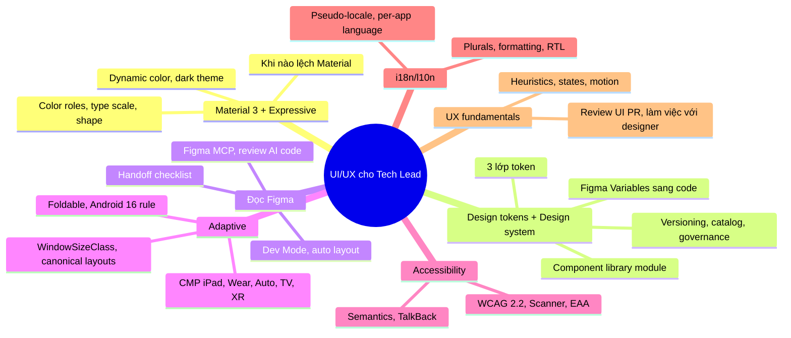
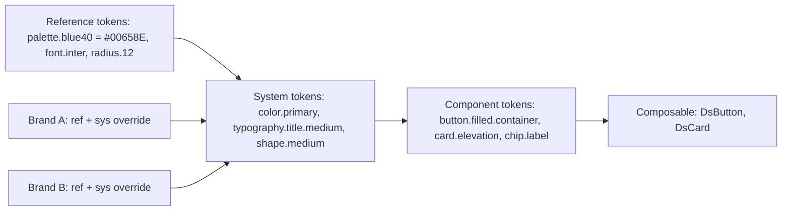
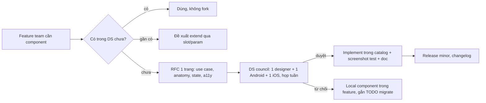
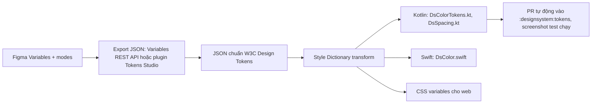

# 21. UI/UX, Design System, Adaptive và Accessibility

> Mục tiêu: nói chuyện ngang hàng với designer, ra quyết định sản phẩm về UI, thiết kế được design system theo kiểu "Design System Architect" (JD GoTymeX), và bảo đảm app chạy đúng trên phone, tablet, foldable, iPad, với TalkBack và nhiều ngôn ngữ. | Mức cần đạt: Senior: áp dụng M3, WindowSizeClass, semantics, i18n đúng / Staff: thiết kế token và component library có versioning, governance, metric / Lead: review UI PR, tranh luận với designer bằng dữ liệu, ra quyết định "lệch Material hay không". | Thời gian gợi ý: tuần 8, ~12 giờ

## 0. Bản đồ chủ đề

Theo `01-Market-Research-2026.md`: "Design system" xuất hiện 4/15 JD, nổi bật là GoTymeX "Design System Architect"; Compose 3/15; mọi JD Staff/Lead đều có "translate tech to business" và "code review". Interviewer ở mảng này không hỏi bạn vẽ, họ hỏi:

- Bạn tổ chức design system thế nào để 3 squad và 2 platform không lệch nhau (token, component, versioning, governance).
- Bạn đọc Figma và chuyển sang Compose ra sao, kể cả khi AI sinh code: bạn review gì.
- App của bạn chạy trên tablet và foldable ra sao, nhất là với quy tắc Android 16 bỏ qua khóa orientation trên màn hình lớn.
- Accessibility: TalkBack, contrast, font scale, và EU Accessibility Act có ảnh hưởng gì tới fintech.
- i18n: plurals, RTL, per-app language, workflow dịch.
- UX: bạn đưa quyết định sản phẩm với designer như thế nào, dựa trên gì.



**Đọc thêm:**
- https://m3.material.io/
- https://developer.android.com/develop/ui/compose/layouts/adaptive
- `01-Market-Research-2026.md`

## 1. Material 3 và M3 Expressive

### 1.1 Color roles, dynamic color, dark theme

M3 không đưa cho bạn "màu xanh", nó đưa **role**: mỗi role là một vị trí trong UI, màu cụ thể được sinh từ tonal palette (tone 0 đến 100) của seed color.

| Nhóm role | Role | Dùng cho |
|---|---|---|
| Primary | `primary`, `onPrimary`, `primaryContainer`, `onPrimaryContainer`, `inversePrimary` | hành động chính, FAB, filled button |
| Secondary | `secondary`, `onSecondary`, `secondaryContainer`, `onSecondaryContainer` | filter chip, tonal button, nhấn phụ |
| Tertiary | `tertiary`, `onTertiary`, `tertiaryContainer`, `onTertiaryContainer` | điểm nhấn tương phản, badge |
| Error | `error`, `onError`, `errorContainer`, `onErrorContainer` | lỗi, destructive |
| Surface | `surface`, `onSurface`, `surfaceVariant`, `onSurfaceVariant`, `surfaceDim`, `surfaceBright`, `surfaceContainerLowest`, `surfaceContainerLow`, `surfaceContainer`, `surfaceContainerHigh`, `surfaceContainerHighest`, `surfaceTint`, `inverseSurface`, `inverseOnSurface` | nền, card, sheet, phân tầng |
| Outline | `outline`, `outlineVariant` | viền, divider |
| Khác | `background`, `onBackground`, `scrim` | nền gốc, lớp mờ sau dialog |

Quy tắc sinh: light theme `primary` lấy tone 40, `onPrimary` tone 100, `primaryContainer` tone 90, `onPrimaryContainer` tone 10; dark theme đảo lại (`primary` tone 80, container tone 30). Vì thế contrast giữa role và "on" role luôn đạt tối thiểu 4.5:1 nếu bạn dùng đúng cặp.

```kotlin
import android.os.Build
import androidx.compose.foundation.isSystemInDarkTheme
import androidx.compose.material3.MaterialTheme
import androidx.compose.material3.darkColorScheme
import androidx.compose.material3.dynamicDarkColorScheme
import androidx.compose.material3.dynamicLightColorScheme
import androidx.compose.material3.lightColorScheme
import androidx.compose.runtime.Composable
import androidx.compose.ui.graphics.Color
import androidx.compose.ui.platform.LocalContext

private val LightColors = lightColorScheme(
    primary = Color(0xFF00658E),
    onPrimary = Color(0xFFFFFFFF),
    primaryContainer = Color(0xFFC7E7FF),
    onPrimaryContainer = Color(0xFF001E2E),
)

private val DarkColors = darkColorScheme(
    primary = Color(0xFF85CFFF),
    onPrimary = Color(0xFF00344C),
    primaryContainer = Color(0xFF004C6C),
    onPrimaryContainer = Color(0xFFC7E7FF),
)

@Composable
fun AppTheme(
    darkTheme: Boolean = isSystemInDarkTheme(),
    dynamicColor: Boolean = false,          // bank thường tắt để giữ brand
    content: @Composable () -> Unit,
) {
    val context = LocalContext.current
    val colorScheme = when {
        dynamicColor && Build.VERSION.SDK_INT >= Build.VERSION_CODES.S ->
            if (darkTheme) dynamicDarkColorScheme(context) else dynamicLightColorScheme(context)
        darkTheme -> DarkColors
        else -> LightColors
    }
    MaterialTheme(
        colorScheme = colorScheme,
        typography = AppTypography,
        shapes = AppShapes,
        content = content,
    )
}
```

**Dynamic color** (Android 12+) lấy màu từ wallpaper. Trong Compose Multiplatform không có `dynamicLightColorScheme`; `kmp-template-impl` dùng thư viện `material-kolor` để sinh `ColorScheme` từ seed trên mọi platform, đó là lý do nó có trong catalog.

**Dark theme**: không phải "đảo màu". Nền dùng `surface` tone 6 (không phải đen tuyệt đối, trừ khi có chế độ OLED riêng), giảm saturation màu nhấn, phân tầng bằng `surfaceContainer*` thay vì shadow, kiểm tra ảnh và illustration có nền trắng cứng.

**Lỗi hay gặp / trade-off**
- Dùng `Color(0xFF...)` trực tiếp trong màn hình: không đổi theo dark theme, không đổi theo brand. Lint rule cấm hex ngoài module theme.
- Dùng `primary` cho text dài trên `surface`: contrast thiếu; text dùng `onSurface`/`onSurfaceVariant`.
- Dynamic color cho app ngân hàng: logo và brand bị đổi màu theo wallpaper. Tắt hoặc chỉ áp cho một phần.

**Đọc thêm:**
- https://m3.material.io/styles/color/roles
- https://developer.android.com/develop/ui/compose/designsystems/material3
- https://m3.material.io/styles/color/overview

### 1.2 Typography scale, shape, elevation

**Type scale**: 5 vai trò x 3 cỡ = 15 style: `displayLarge/Medium/Small`, `headlineLarge/Medium/Small`, `titleLarge/Medium/Small`, `bodyLarge/Medium/Small`, `labelLarge/Medium/Small`. Quy ước: display cho hero number (số dư), headline cho tiêu đề màn, title cho tiêu đề card và app bar, body cho nội dung, label cho button và caption. Chỉ nên dùng 5-7 style trong một app; designer và dev thống nhất tên style này trong Figma (text style đặt tên đúng `title/medium`).

```kotlin
import androidx.compose.material3.Typography
import androidx.compose.ui.text.TextStyle
import androidx.compose.ui.text.font.FontFamily
import androidx.compose.ui.text.font.FontWeight
import androidx.compose.ui.unit.sp

val AppFontFamily: FontFamily = FontFamily.Default   // thay bằng Font(R.font.inter) khi có brand font

val AppTypography = Typography(
    headlineMedium = TextStyle(fontFamily = AppFontFamily, fontWeight = FontWeight.SemiBold, fontSize = 28.sp, lineHeight = 36.sp),
    titleMedium = TextStyle(fontFamily = AppFontFamily, fontWeight = FontWeight.Medium, fontSize = 16.sp, lineHeight = 24.sp, letterSpacing = 0.15.sp),
    bodyLarge = TextStyle(fontFamily = AppFontFamily, fontWeight = FontWeight.Normal, fontSize = 16.sp, lineHeight = 24.sp, letterSpacing = 0.5.sp),
    labelLarge = TextStyle(fontFamily = AppFontFamily, fontWeight = FontWeight.Medium, fontSize = 14.sp, lineHeight = 20.sp, letterSpacing = 0.1.sp),
)
```

Luôn `sp` cho `fontSize` và `lineHeight` để font scale hoạt động (mục 5.2). Android 14 dùng non-linear font scaling: text nhỏ phóng nhiều hơn text lớn, nên heading không "nổ" layout.

**Shape scale**: `Shapes(extraSmall = 4.dp, small = 8.dp, medium = 12.dp, large = 16.dp, extraLarge = 28.dp)` và `CircleShape` (full). Component M3 đã gắn sẵn với shape token (button = full, card = medium, bottom sheet = extraLarge trên). Đổi `Shapes` một lần đổi cả app, không override từng component.

**Elevation**: M3 có hai cơ chế: **tonal elevation** (surface càng cao càng được pha `surfaceTint`, thấy rõ ở dark theme) và **shadow elevation**. Level 0, 1, 3, 6, 8, 12 dp. Từ M3 1.1 phần lớn component chuyển sang dùng `surfaceContainer*` role thay cho tonal elevation để designer kiểm soát rõ hơn; `Surface(tonalElevation = ...)` vẫn hoạt động. Trong Compose: `Surface(shadowElevation = 2.dp)`, `Card(elevation = CardDefaults.elevatedCardElevation())`.

**Lỗi hay gặp / trade-off**
- `fontSize` bằng `dp` hoặc `TextUnit.Unspecified` bị override sai: font scale không ăn, bị a11y audit fail.
- Dùng `Modifier.shadow()` với elevation cao trên list item: tốn fill rate, drop frame trên máy yếu.
- Bo góc "đẹp hơn Material" mỗi màn một kiểu: designer và dev phải chốt shape scale chung.

**Đọc thêm:**
- https://m3.material.io/styles/typography/type-scale-tokens
- https://m3.material.io/styles/shape
- https://m3.material.io/styles/elevation/overview

### 1.3 M3 Expressive, mapping Compose Material3, và khi nào lệch khỏi Material

**M3 Expressive** (Google công bố 2025) mở rộng M3: motion scheme dựa trên spring (spatial và effects), shape morphing, bộ component mới (button group, split button, floating toolbar, loading indicator mới, flexible app bar), và typography có biến thể emphasized. Trong Compose, Material3 1.4.0 là bản stable hiện tại (brief), và `kmp-template-impl` dùng `org.jetbrains.compose.material3:material3 1.10.0-alpha05` để lấy Expressive trên CMP. Entry point là `MaterialExpressiveTheme` với `MotionScheme`; tên chính xác của từng component và annotation experimental cần kiểm tra tại https://developer.android.com/jetpack/androidx/releases/compose-material3.

Mapping Compose Material3:

| Khái niệm M3 | Compose |
|---|---|
| Color roles | `MaterialTheme.colorScheme.primary` ... (`ColorScheme`) |
| Type scale | `MaterialTheme.typography.titleMedium` (`Typography`) |
| Shape scale | `MaterialTheme.shapes.medium` (`Shapes`) |
| Motion scheme | `MaterialTheme.motionScheme` (Expressive; cần kiểm tra) |
| Component tokens | `ButtonDefaults.buttonColors()`, `CardDefaults.cardElevation()`, `TopAppBarDefaults.topAppBarColors()` |
| Dynamic color | `dynamicLightColorScheme(context)` |
| Ripple / state layer | `LocalRippleConfiguration` (M3 1.3+), `Indication` |
| Min touch target | `LocalMinimumInteractiveComponentSize` (mặc định 48.dp) |

**Khi nào lệch Material**: lệch là quyết định sản phẩm, không phải sở thích. Khung quyết định:

1. Brand yêu cầu (ngân hàng có hệ thống nhận diện riêng): lệch ở token (màu, font, shape), **giữ** cấu trúc component và hành vi (state layer, a11y). Đây là cách rẻ nhất.
2. Hành vi khác (ví dụ app trẻ em cần nút rất to, animation vui): tạo component riêng trong design system, vẫn xây trên `Surface`, `BasicText`, `foundation` để giữ a11y và theming.
3. Nền tảng khác (iOS user mong Cupertino): với CMP, cân nhắc component riêng cho một vài chỗ nhạy (date picker, action sheet), còn lại giữ shared.
4. Không lệch khi: team nhỏ, deadline gần, chưa có designer system; lệch tạo nợ bảo trì khi Material cập nhật.

Chi phí của lệch phải nêu được: mất component mới của Material, tự lo a11y, tự lo dark theme, tự viết screenshot test.

**Lỗi hay gặp / trade-off**
- "Lệch một chút" bằng cách copy source của `Button` rồi sửa: mất update, mất a11y khi Material sửa bug.
- Dùng Expressive alpha trong app production mà không pin version và không có screenshot test.

**Đọc thêm:**
- https://m3.material.io/blog/building-with-m3-expressive
- https://developer.android.com/jetpack/androidx/releases/compose-material3
- https://developer.android.com/develop/ui/compose/designsystems/custom

## 2. Design tokens và kiến trúc design system

### 2.1 Ba lớp token và theming đa brand

Token là "biến có tên theo ý nghĩa" thay cho giá trị thô. M3 chia 3 lớp, và đây là cách trả lời câu hỏi JD "Design System Architect":



- **Reference**: giá trị thô, không có ngữ nghĩa UI (`blue40`, `space4`). Không được dùng trực tiếp trong màn hình.
- **System**: ngữ nghĩa (`color.primary`, `space.md`, `typography.body.large`). Đây là lớp theme đổi theo brand, dark mode, density.
- **Component**: gắn với component (`button.filled.container.color = color.primary`). Chỉ component library dùng; màn hình không bao giờ chạm.

**Đa brand** (GoTymeX có nhiều sản phẩm, bank có app retail và app SME): mỗi brand là một bộ system token; component chỉ tham chiếu system token nên không biết brand. App chọn brand lúc khởi động (hoặc theo tenant), không rebuild.

```kotlin
import androidx.compose.runtime.Composable
import androidx.compose.runtime.CompositionLocalProvider
import androidx.compose.runtime.Immutable
import androidx.compose.runtime.ReadOnlyComposable
import androidx.compose.runtime.staticCompositionLocalOf
import androidx.compose.ui.graphics.Color
import androidx.compose.ui.unit.Dp
import androidx.compose.ui.unit.dp

// System tokens ngoài Material: spacing, brand colors không có trong ColorScheme
@Immutable
data class DsSpacing(val xs: Dp = 4.dp, val sm: Dp = 8.dp, val md: Dp = 16.dp, val lg: Dp = 24.dp, val xl: Dp = 32.dp)

@Immutable
data class DsBrandColors(val success: Color, val onSuccess: Color, val warning: Color, val onWarning: Color)

val LocalDsSpacing = staticCompositionLocalOf { DsSpacing() }
val LocalDsBrandColors = staticCompositionLocalOf<DsBrandColors> { error("DsTheme not provided") }

object DsTheme {
    val spacing: DsSpacing
        @Composable @ReadOnlyComposable get() = LocalDsSpacing.current
    val brand: DsBrandColors
        @Composable @ReadOnlyComposable get() = LocalDsBrandColors.current
}

@Immutable
data class DsBrand(val name: String, val light: DsBrandColors, val dark: DsBrandColors, val seed: Color)

@Composable
fun DsTheme(brand: DsBrand, darkTheme: Boolean = isSystemInDarkTheme(), content: @Composable () -> Unit) {
    val brandColors = if (darkTheme) brand.dark else brand.light
    CompositionLocalProvider(
        LocalDsSpacing provides DsSpacing(),
        LocalDsBrandColors provides brandColors,
    ) {
        AppTheme(darkTheme = darkTheme, dynamicColor = false, content = content)   // MaterialTheme bên trong
    }
}
```

`staticCompositionLocalOf` cho token vì token hiếm khi đổi runtime; khi đổi sẽ recompose toàn bộ subtree, chấp nhận được cho theme switch.

**Lỗi hay gặp / trade-off**
- Token đặt tên theo giá trị (`blue`, `padding16`): đổi brand là đổi tên khắp nơi. Đặt theo ý nghĩa.
- Quá nhiều lớp cho app nhỏ: 2 lớp (system + component) là đủ; 3 lớp khi có 2+ brand hoặc 2+ platform.
- Mỗi brand một module Compose riêng: nhân đôi UI. Brand chỉ nên là **data** (token), không phải code.

**Đọc thêm:**
- https://m3.material.io/foundations/design-tokens/overview
- https://developer.android.com/develop/ui/compose/designsystems/custom
- https://developer.android.com/develop/ui/compose/compositionlocal

### 2.2 Component library như Gradle module và pattern Compose

Cấu trúc module đề xuất (đọc kèm "api/impl" trong JD):

```
:designsystem:tokens        # KMP, không phụ thuộc Compose: Color/Dp/TextStyle value class hoặc raw Long/Float; sinh từ Figma
:designsystem:theme-api     # interface DsBrand, DsTheme composable, CompositionLocal (api cho feature)
:designsystem:theme-brandA  # impl: token cụ thể brand A
:designsystem:theme-brandB  # impl: token cụ thể brand B
:designsystem:components    # DsButton, DsCard, DsTextField... chỉ phụ thuộc theme-api + tokens
:designsystem:catalog       # app showcase, chạy riêng, có screenshot test
```

Feature module `implementation(projects.designsystem.components)` và `implementation(projects.designsystem.themeApi)`; app module mới chọn `theme-brandA`. Trong `kmp-template-impl` hiện `core:ui` gộp cả theme, component và navigation; khi lớn lên tách như trên.

Pattern Compose cho component:

```kotlin
import androidx.compose.foundation.layout.RowScope
import androidx.compose.foundation.layout.Spacer
import androidx.compose.foundation.layout.height
import androidx.compose.foundation.layout.width
import androidx.compose.material3.Button
import androidx.compose.material3.ButtonColors
import androidx.compose.material3.ButtonDefaults
import androidx.compose.material3.MaterialTheme
import androidx.compose.material3.Text
import androidx.compose.runtime.Composable
import androidx.compose.ui.Modifier
import androidx.compose.ui.unit.dp

enum class DsButtonSize { Medium, Large }

object DsButtonDefaults {
    val MinHeight = 48.dp
    @Composable
    fun primaryColors(): ButtonColors = ButtonDefaults.buttonColors(
        containerColor = MaterialTheme.colorScheme.primary,
        contentColor = MaterialTheme.colorScheme.onPrimary,
    )
}

@Composable
fun DsButton(
    text: String,
    onClick: () -> Unit,
    modifier: Modifier = Modifier,                       // modifier luôn là tham số optional đầu tiên
    enabled: Boolean = true,
    size: DsButtonSize = DsButtonSize.Medium,
    colors: ButtonColors = DsButtonDefaults.primaryColors(),
    leadingIcon: (@Composable () -> Unit)? = null,       // slot
) {
    Button(
        onClick = onClick,
        modifier = modifier.height(if (size == DsButtonSize.Large) 56.dp else DsButtonDefaults.MinHeight),
        enabled = enabled,
        colors = colors,
        shape = MaterialTheme.shapes.medium,
    ) {
        if (leadingIcon != null) {
            leadingIcon()
            Spacer(Modifier.width(DsTheme.spacing.sm))
        }
        Text(text, style = MaterialTheme.typography.labelLarge)
    }
}
```

Quy tắc API component (viết thành `CONTRIBUTING.md` của design system):

1. Tham số bắt buộc trước, `modifier` là optional đầu tiên, sau đó state, rồi slot, `content` cuối cùng.
2. Slot (`@Composable () -> Unit`) thay vì tham số dữ liệu khi nội dung có thể khác nhau (icon, trailing).
3. `XxxDefaults` object cho màu, kích thước, padding để caller override có chủ đích.
4. State hoisting: component không giữ state nghiệp vụ; `value` + `onValueChange`.
5. `@Immutable`/`@Stable` cho class tham số để tránh recomposition thừa (xem `04-Android-Kotlin-Deep-Dive.md`).
6. Mọi component có `@Preview` cho light/dark, font scale 1.5, RTL, và được catalog app thu thập.
7. Không business logic, không ViewModel, không navigation trong component.

**Đọc thêm:**
- https://developer.android.com/develop/ui/compose/api-guidelines
- https://github.com/androidx/androidx/blob/androidx-main/compose/docs/compose-component-api-guidelines.md
- https://github.com/android/nowinandroid (module `core:designsystem`)

### 2.3 Versioning, catalog app, docs, governance, adoption metrics, migration

**Versioning**: semver cho module design system khi publish nội bộ (Maven, bạn đã publish library nên quen). Breaking change = đổi chữ ký composable, đổi tên token, đổi hành vi visual mặc định. Quy trình deprecate: `@Deprecated(level = WARNING, replaceWith = ReplaceWith(...))` một release, `ERROR` release sau, xóa release kế tiếp. Dùng `kotlinx binary-compatibility-validator` để diff API public mỗi PR. Changelog theo Keep a Changelog, có ảnh before/after cho thay đổi visual.

**Catalog / showcase app**: app riêng liệt kê mọi component với mọi state, light/dark, RTL, font scale. Cách rẻ: annotation processor như Showkase (Airbnb) gom mọi `@Preview`; cách tự làm: một `LazyColumn` của `ComponentEntry(name, content)`. Catalog là nơi screenshot test chạy (Roborazzi hoặc Compose Preview Screenshot Testing), là nơi designer QA, là demo cho interviewer.

**Docs**: mỗi component một trang: khi nào dùng, khi nào không, anatomy, state, a11y, code mẫu, link Figma. KDoc sinh Dokka; trang tổng ở Confluence/Notion/README. Doc ngắn và có ảnh tốt hơn doc dài.

**Governance** (ai duyệt component mới):



Nguyên tắc: feature được phép có component cục bộ (không chặn delivery), nhưng phải đánh dấu và council review hàng tháng để "promote" lên DS khi dùng ở 2+ nơi.

**Adoption metrics** (nói được số là lợi thế lớn trong phỏng vấn):

- % màn hình chỉ dùng DS component (lint rule đếm import `androidx.compose.material3.Button` ngoài module DS).
- Số hard-coded `Color(0x`/`.dp` ngoài DS (grep trong CI, trend theo tuần).
- Số visual bug / sprint, thời gian build một màn hình mới (story point), số component cục bộ còn tồn.
- Độ phủ screenshot test của DS (100% component x state).

**Migration từ UI ad-hoc**:

1. Inventory: chụp mọi màn hình, đếm số kiểu button/card/text style thực tế (thường 20+ biến thể cho 1 button).
2. Token trước: thay màu và typography bằng token, không đổi layout; đây là bước ít rủi ro, nhìn thấy ngay.
3. Component theo tần suất: button, text field, list item, card, app bar, dialog.
4. Lint chặn regression: cấm hex và raw Material component trong feature mới.
5. Strangler theo màn hình, ưu tiên màn hình đang được sửa vì lý do khác.
6. Đo adoption hàng tuần; dừng khi 80-90%, phần còn lại để tự nhiên.

**Lỗi hay gặp / trade-off**
- DS team làm hết, feature team chỉ "xin": nghẽn cổ chai. Mô hình tốt hơn là federated: feature team contribute, DS council review.
- Không có catalog: không ai biết có gì, lại fork.
- Versioning quá chặt cho monorepo: dùng "trunk + deprecation cycle" thay vì publish artifact nếu cùng repo.

**Đọc thêm:**
- https://github.com/airbnb/Showkase
- https://github.com/Kotlin/binary-compatibility-validator
- https://github.com/takahirom/roborazzi
- https://developer.android.com/studio/preview/compose-screenshot-testing

### 2.4 Figma Variables sang code tokens

Figma Variables (color, number, string, boolean) với **modes** (light/dark, brand A/B, compact/comfortable) là nguồn sự thật của system token. Pipeline:



- Figma Variables REST API cần plan Enterprise; nếu không có, plugin Tokens Studio xuất JSON và push lên Git.
- Style Dictionary (Amazon, open source) có transform/format tùy chỉnh để sinh Kotlin `object` hoặc `val` trong `@Immutable data class`.
- Quy ước tên: `color/primary` trong Figma thành `colorPrimary` hoặc `DsColors.primary`; giữ bảng map trong repo để designer và dev tra cùng một chỗ.
- CI: mỗi lần token đổi, mở PR tự động, screenshot test chạy, designer review diff ảnh.

```kotlin
// Sinh tự động từ Style Dictionary, không sửa tay
object DsColorTokensLight {
    val primary = Color(0xFF00658E)
    val onPrimary = Color(0xFFFFFFFF)
    val success = Color(0xFF1B6E3C)
}
```

**Lỗi hay gặp / trade-off**
- Designer đổi tên variable: code sinh lại đổi tên, feature compile fail. Quy ước đổi tên là breaking change, đi qua council.
- Token có đơn vị px trong Figma, dp trong Android, pt trong iOS: để Style Dictionary chuyển đơn vị, không chuyển tay.
- Không phải mọi thứ là token: khoảng cách nội bộ của một component là component token, không đưa vào system.

**Đọc thêm:**
- https://help.figma.com/hc/en-us/articles/15339657135383-Guide-to-variables
- https://styledictionary.com/
- https://tokens.studio/
- https://www.designtokens.org/

## 3. Đọc Figma như một tech lead

### 3.1 Dev Mode, auto layout sang Row/Column, constraints, variables, components

**Dev Mode**: chế độ inspect cho dev: xem token (variable) thay vì hex, đo khoảng cách, xuất asset (SVG, PNG @1x/2x/3x), snippet code (Compose/SwiftUI, chỉ để tham khảo), trạng thái "Ready for dev", so sánh thay đổi giữa hai version. Yêu cầu designer bật "Ready for dev" và gắn variable thì snippet mới có tên token.

**Auto layout** là Flexbox của Figma; map gần như 1:1 sang Compose:

| Figma auto layout | Compose |
|---|---|
| Direction horizontal / vertical | `Row` / `Column` |
| Gap (spacing between items) | `Arrangement.spacedBy(gap)` |
| Padding | `Modifier.padding(...)` |
| Horizontal resizing: Fill container | `Modifier.fillMaxWidth()` hoặc `weight(1f)` trong Row |
| Hug contents | mặc định (wrap content) |
| Fixed width | `Modifier.width(x.dp)` |
| Alignment (top-left, center...) | `verticalAlignment`, `horizontalAlignment`, `Alignment` trong Box |
| Space between | `Arrangement.SpaceBetween` |
| Wrap | `FlowRow` / `FlowColumn` |
| Absolute position item | `Box` với `Modifier.align` hoặc `offset` |
| Clip content | `Modifier.clip(shape)` |
| Min/max width | `Modifier.widthIn(min, max)` |

**Constraints** (frame không auto layout): left/right/top/bottom/center/scale. Trong Compose, hầu hết thành `Box` với `Alignment`; "scale" thành `fillMaxWidth(fraction)`; `ConstraintLayout` chỉ khi quan hệ phức tạp và phẳng hơn lồng nhau.

**Variables và styles**: color style và text style cũ; variables mới có mode. Khi inspect thấy hex thay vì tên: thiết kế chưa gắn token, trả lại designer thay vì hard-code.

**Components và variants**: một component Figma với property (`size = sm/md/lg`, `state = default/pressed/disabled`, `icon = boolean`) map sang một composable với enum và boolean param. Variant "state" không map sang param, nó map sang `InteractionSource` và `enabled`. Instance swap (icon) map sang slot.

```kotlin
// Figma: Card / horizontal, gap 12, padding 16, Fill container, items center
@Composable
fun LevelCard(title: String, subtitle: String, onClick: () -> Unit, modifier: Modifier = Modifier) {
    Surface(onClick = onClick, shape = MaterialTheme.shapes.medium, color = MaterialTheme.colorScheme.surfaceContainer, modifier = modifier.fillMaxWidth()) {
        Row(
            modifier = Modifier.padding(DsTheme.spacing.md),
            horizontalArrangement = Arrangement.spacedBy(12.dp),
            verticalAlignment = Alignment.CenterVertically,
        ) {
            Icon(Icons.Default.Star, contentDescription = null, tint = MaterialTheme.colorScheme.primary)
            Column(Modifier.weight(1f)) {
                Text(title, style = MaterialTheme.typography.titleMedium)
                Text(subtitle, style = MaterialTheme.typography.bodyMedium, color = MaterialTheme.colorScheme.onSurfaceVariant)
            }
        }
    }
}
```

**Lỗi hay gặp / trade-off**
- Copy snippet code của Dev Mode nguyên xi: hard-code `width(360.dp)`, màu hex, font size cố định. Snippet là gợi ý, không phải code.
- Designer vẽ frame cố định 390 wide, không auto layout: không biết hành vi khi text dài hoặc màn rộng. Yêu cầu auto layout + min/max.
- Icon xuất PNG: dùng SVG rồi import thành vector drawable (`Res.drawable` trong CMP cần SVG hoặc XML; cần kiểm tra).

**Đọc thêm:**
- https://help.figma.com/hc/en-us/articles/15023124644247
- https://help.figma.com/hc/en-us/articles/360040451373-Explore-auto-layout-properties
- https://developer.android.com/develop/ui/compose/layouts/basics

### 3.2 Handoff checklist, Figma MCP và AI design-to-code: review output thế nào

**Handoff checklist** (gửi designer trước khi "Ready for dev"):

- [ ] Mọi màu, text, spacing, radius gắn variable/style; không hex lẻ.
- [ ] Mỗi component có đủ state: default, pressed, focused, disabled, error, loading, selected.
- [ ] Có bản dark theme (ít nhất cho màn chính).
- [ ] Có biến thể compact (phone), medium (foldable mở / tablet dọc), expanded (tablet ngang) cho màn hình chính; hoặc ghi rõ "chỉ phone".
- [ ] Text dài, text ngắn, số lớn (ví dụ số dư 12 chữ số), tên dài, ngôn ngữ dài hơn (tiếng Đức, tiếng Việt có dấu).
- [ ] Font scale lớn (1.3x, 2x): layout nào được phép cuộn, phần nào cắt.
- [ ] RTL nếu sản phẩm có thị trường Ả Rập/Hebrew.
- [ ] Empty, loading (skeleton), error, offline state cho mọi màn có dữ liệu.
- [ ] Icon ở dạng SVG, lưới 24dp, tên theo quy ước.
- [ ] Motion: duration, easing, và cái gì chuyển động (shared element?) được ghi chú.
- [ ] Accessibility note: thứ tự đọc, label cho icon button, vùng chạm 48dp.
- [ ] Spec hành vi: tap, long press, swipe, pull to refresh, back.

**Figma MCP và AI design-to-code**: Figma có Dev Mode MCP Server cho phép agent (Claude Code, Cursor, Android Studio Agent Mode với MCP theo brief) đọc frame đang chọn: lấy cấu trúc node, variable đã gắn, ảnh render, và sinh code. `compose-template` của bạn đã có skill "ui-from-screenshot" theo hướng này. Tên tool và cách bật cần kiểm tra tại https://help.figma.com/ (tìm "Dev Mode MCP Server").

Checklist review code do AI sinh từ Figma (bạn là reviewer, không phải người gõ):

1. **Token**: không hex, không `sp`/`dp` lẻ ngoài tham chiếu `MaterialTheme`/`DsTheme`. Nếu AI sinh `Color(0xFF00658E)`, trả lại.
2. **Reuse**: có dùng `DsButton` thay vì tự vẽ `Box` + `clickable`? Quy trình "search before write" (như skill `ios-component-discovery` của bạn) phải chạy trước.
3. **Layout**: `fillMaxWidth` + `weight` thay cho width cố định; `LazyColumn` cho list; không `Modifier.height(812.dp)`.
4. **State hoisting**: không `remember { mutableStateOf }` chứa dữ liệu nghiệp vụ; nhận `uiState` và callback.
5. **Semantics**: icon có `contentDescription` hoặc `null` có chủ đích; nhóm có `mergeDescendants`; role đúng.
6. **Text**: string qua resource, không literal; plurals đúng.
7. **Adaptive**: không giả định 1 cột; ít nhất không vỡ ở 600dp.
8. **Preview**: có preview light/dark/font scale; chụp screenshot so với Figma (pixel diff hoặc nhìn).
9. **Performance**: không `Modifier.blur` lớn, không `drawBehind` nặng, `key` trong list.
10. **Diff size**: AI hay sinh file 500 dòng; yêu cầu tách component. Xem `10-AI-for-Mobile-Lead.md` về quy trình review code AI.

**Lỗi hay gặp / trade-off**
- Tin ảnh render của AI "giống Figma": giống ở 390dp, vỡ ở 600dp và font scale 1.5.
- Dùng MCP đọc frame chưa "Ready for dev": lấy thiết kế dở dang vào code.

**Đọc thêm:**
- https://help.figma.com/
- https://developer.android.com/studio/gemini/features
- `10-AI-for-Mobile-Lead.md`
- `18-AI-Study-Workflow.md`

## 4. Adaptive và multi-device

### 4.1 dp/sp/density, resource qualifiers, WindowSizeClass

- `dp = px / (dpi / 160)`. Bucket: mdpi 1x, hdpi 1.5x, xhdpi 2x, xxhdpi 3x, xxxhdpi 4x. `sp = dp * fontScale`. Compose: `LocalDensity.current.density` và `.fontScale`; `with(LocalDensity.current) { 16.dp.toPx() }`.
- **Resource qualifiers** (`values-sw600dp`, `layout-land`, `drawable-night`) vẫn hoạt động cho string, dimen, drawable, nhưng với Compose layout thì **không dùng qualifier để chọn layout**: dùng `WindowSizeClass` vì nó phản ánh cửa sổ thực (multi-window, foldable, desktop windowing), còn `sw600dp` phản ánh màn hình vật lý.
- **WindowSizeClass**: chia theo chiều rộng và chiều cao của cửa sổ app, không phải device.

| Width class | Khoảng | Thiết bị điển hình |
|---|---|---|
| Compact | < 600dp | phone dọc, foldable gập |
| Medium | 600 đến 839dp | foldable mở, tablet dọc nhỏ, phone ngang |
| Expanded | 840 đến 1199dp | tablet ngang, desktop window |
| Large | 1200 đến 1599dp | tablet lớn ngang, desktop (thêm ở androidx.window 1.4; cần kiểm tra) |
| Extra large | >= 1600dp | màn ngoài, desktop (cần kiểm tra) |

Height class: Compact < 480dp (phone ngang), Medium 480 đến 899dp, Expanded >= 900dp.

```kotlin
import androidx.compose.material3.adaptive.currentWindowAdaptiveInfo
import androidx.compose.runtime.Composable
import androidx.window.core.layout.WindowSizeClass

@Composable
fun HomeRoute() {
    val windowSizeClass = currentWindowAdaptiveInfo().windowSizeClass
    val isExpanded = windowSizeClass.isWidthAtLeastBreakpoint(WindowSizeClass.WIDTH_DP_EXPANDED_LOWER_BOUND)
    val isMedium = windowSizeClass.isWidthAtLeastBreakpoint(WindowSizeClass.WIDTH_DP_MEDIUM_LOWER_BOUND)
    when {
        isExpanded -> HomeTwoPane()
        isMedium -> HomeMediumLayout()
        else -> HomeCompact()
    }
}
```

`isWidthAtLeastBreakpoint` và hằng `WIDTH_DP_*_LOWER_BOUND` thuộc androidx.window 1.4+; bản cũ dùng `windowSizeClass.windowWidthSizeClass == WindowWidthSizeClass.EXPANDED` (đã deprecated ở bản mới; cần kiểm tra tại https://developer.android.com/jetpack/androidx/releases/window). `currentWindowAdaptiveInfo()` nằm trong `androidx.compose.material3.adaptive:adaptive` (Android) và `org.jetbrains.compose.material3.adaptive:adaptive` (CMP, `kmp-template-impl` dùng 1.2.0).

Quy tắc thiết kế: không branch theo "tablet hay phone"; branch theo size class, và truyền size class xuống như tham số (hoặc CompositionLocal) chứ không gọi `currentWindowAdaptiveInfo()` ở mọi composable con.

**Lỗi hay gặp / trade-off**
- Dùng `LocalConfiguration.current.screenWidthDp`: trả về màn hình, sai trong split screen; và không có trên CMP.
- `BoxWithConstraints` ở root để chọn layout: hoạt động nhưng đắt (subcomposition); dùng cho component cục bộ, không cho màn hình.
- Chỉ test ở 2 size: luôn test compact, medium, expanded vì medium (foldable) là nơi hay vỡ.

**Đọc thêm:**
- https://developer.android.com/develop/ui/compose/layouts/adaptive/window-size-classes
- https://developer.android.com/jetpack/androidx/releases/window
- https://developer.android.com/training/multiscreen/screendensities

### 4.2 Canonical layouts, NavigationSuiteScaffold, thư viện adaptive

Ba **canonical layout** của Android:

| Layout | Dùng khi | Compose |
|---|---|---|
| List-detail | danh sách + chi tiết (email, giao dịch, bài học) | `ListDetailPaneScaffold` |
| Supporting pane | nội dung chính + pane phụ (bộ lọc, ghi chú, chat) | `SupportingPaneScaffold` |
| Feed | lưới card thay đổi số cột | `LazyVerticalGrid(GridCells.Adaptive(minSize = 240.dp))` |

Thư viện (`androidx.compose.material3.adaptive`):

- `adaptive`: `currentWindowAdaptiveInfo()`, `WindowAdaptiveInfo`, `Posture`.
- `adaptive-layout`: `ListDetailPaneScaffold`, `SupportingPaneScaffold`, `AnimatedPane`, `PaneScaffoldDirective`.
- `adaptive-navigation`: `rememberListDetailPaneScaffoldNavigator`, `ThreePaneScaffoldNavigator`, back handling.
- `material3-adaptive-navigation-suite`: `NavigationSuiteScaffold` tự chọn bottom bar, rail hoặc drawer theo size class.

```kotlin
import androidx.compose.material3.adaptive.ExperimentalMaterial3AdaptiveApi
import androidx.compose.material3.adaptive.layout.AnimatedPane
import androidx.compose.material3.adaptive.layout.ListDetailPaneScaffold
import androidx.compose.material3.adaptive.layout.ListDetailPaneScaffoldRole
import androidx.compose.material3.adaptive.navigation.rememberListDetailPaneScaffoldNavigator
import androidx.compose.runtime.rememberCoroutineScope
import kotlinx.coroutines.launch

@OptIn(ExperimentalMaterial3AdaptiveApi::class)
@Composable
fun TransactionsListDetail() {
    val navigator = rememberListDetailPaneScaffoldNavigator<String>()
    val scope = rememberCoroutineScope()
    ListDetailPaneScaffold(
        directive = navigator.scaffoldDirective,
        value = navigator.scaffoldValue,
        listPane = {
            AnimatedPane {
                TransactionList(onSelect = { id ->
                    scope.launch { navigator.navigateTo(ListDetailPaneScaffoldRole.Detail, id) }
                })
            }
        },
        detailPane = {
            AnimatedPane {
                navigator.currentDestination?.contentKey?.let { id -> TransactionDetail(id) }
            }
        },
    )
}
```

`navigateTo` là `suspend` từ adaptive-navigation 1.1 (cần kiểm tra); bản 1.0 là hàm thường. Trên compact, scaffold tự hiện một pane và xử lý back; trên expanded hiện hai pane.

```kotlin
import androidx.compose.material3.adaptive.navigationsuite.NavigationSuiteScaffold

@Composable
fun AppShell(tabs: List<AppTab>, current: AppTab, onSelect: (AppTab) -> Unit, content: @Composable () -> Unit) {
    NavigationSuiteScaffold(
        navigationSuiteItems = {
            tabs.forEach { tab ->
                item(
                    selected = tab == current,
                    onClick = { onSelect(tab) },
                    icon = { Icon(tab.icon, contentDescription = null) },
                    label = { Text(tab.label) },
                )
            }
        },
        content = content,
    )
}
```

**Lỗi hay gặp / trade-off**
- Hai pane nhưng detail ViewModel vẫn gắn với route: trên expanded, chọn item khác không reload. Scope ViewModel theo key.
- Hard-code `NavigationBar`: trên tablet ngang bar chiếm chiều cao, rail hợp hơn. `NavigationSuiteScaffold` lo việc này.
- Feed với `GridCells.Fixed(2)`: trên expanded card quá to; dùng `Adaptive(minSize)`.

**Đọc thêm:**
- https://developer.android.com/develop/ui/compose/layouts/adaptive/canonical-layouts
- https://developer.android.com/develop/ui/compose/layouts/adaptive/list-detail
- https://developer.android.com/develop/ui/compose/layouts/adaptive/build-adaptive-navigation

### 4.3 Foldables, large screen và quy tắc Android 16, multi-window

**Foldable**: Jetpack WindowManager (`androidx.window:window`) cung cấp `WindowInfoTracker.getOrCreate(context).windowLayoutInfo(activity)` là `Flow<WindowLayoutInfo>`; trong đó `displayFeatures` có `FoldingFeature` với `state` (`FLAT`, `HALF_OPENED`), `orientation` (`HORIZONTAL`, `VERTICAL`), `occlusionType`, `bounds`. Thư viện adaptive gói lại thành `Posture`:

```kotlin
@Composable
fun VideoScreen() {
    val posture = currentWindowAdaptiveInfo().windowPosture
    if (posture.isTabletop) {
        // Nửa trên: video; nửa dưới: điều khiển. Hinge ở posture.hingeList.first().bounds
        TabletopVideoLayout()
    } else {
        FullVideoLayout()
    }
}
```

Postures: **tabletop** (gập ngang nửa, như laptop), **book** (gập dọc nửa). Thiết kế: tránh đặt nội dung tương tác lên bản lề (`hingeList` cho bounds), list-detail tách theo bản lề khi hinge dọc, không khóa orientation.

**Quy tắc Android 16 cho màn hình lớn** (brief): trên thiết bị sw600dp trở lên, hệ thống **bỏ qua** `android:screenOrientation`, `resizeableActivity="false"`, và các giới hạn aspect ratio (`minAspectRatio`, `maxAspectRatio`). App bị khóa portrait sẽ được xoay và resize như app bình thường. Có opt-out tạm thời (`PROPERTY_COMPAT_ALLOW_RESTRICTED_RESIZABILITY`), hết hiệu lực khi target API 37 (Android 17). Hệ quả cho lead: mọi màn hình phải sống sót khi rộng 840dp+ và khi xoay; đây không còn là "nice to have". Kế hoạch: (1) chạy app trên emulator resizable và foldable, chụp mọi màn hình; (2) sửa layout vỡ bằng size class; (3) ViewModel giữ state qua configuration change (Compose + ViewModel đã lo nếu không giữ state trong Activity); (4) camera/preview xoay đúng.

**Multi-window và resizing**: split screen, freeform, desktop windowing trên tablet Android 16. App nhận configuration change liên tục khi kéo cửa sổ; Compose recompose theo `currentWindowAdaptiveInfo()`; tránh làm việc nặng trong recomposition khi size đổi; `android:configChanges` không còn là cách né. Picture-in-picture cho video; drag-and-drop giữa app (`Modifier.dragAndDropSource/Target`).

**Lỗi hay gặp / trade-off**
- `screenOrientation="portrait"` ở mọi Activity vì "app chỉ cho phone": từ Android 16 trên tablet sẽ bị bỏ qua, UI vỡ.
- Giữ `Bitmap`/state nặng trong `remember` không `rememberSaveable`: mất khi xoay; nhưng cũng không nhét bitmap vào `SavedState` (giới hạn ~1MB transaction).
- Test foldable chỉ bằng preview: posture cần emulator foldable hoặc device.

**Đọc thêm:**
- https://developer.android.com/about/versions/16/behavior-changes-16
- https://developer.android.com/develop/ui/compose/layouts/adaptive/foldables/learn-about-foldables
- https://developer.android.com/guide/topics/large-screens
- https://developer.android.com/develop/ui/compose/layouts/adaptive/support-multi-window-mode

### 4.4 CMP trên iPad và desktop, Wear OS, Android Auto, Android TV, XR

**CMP trên iPad/desktop**: `org.jetbrains.compose.material3.adaptive:adaptive` cung cấp `currentWindowAdaptiveInfo()` trên iOS và desktop, nên cùng code size class chạy trên iPad Split View, Stage Manager, và cửa sổ desktop resize. Khác biệt: iPad không có `Posture` (không foldable), desktop cần xử lý keyboard shortcut, hover (`Modifier.hoverable`, `PointerIcon`), scrollbar; min window size đặt khi tạo `Window` trên desktop. `kmp-template-impl` target phone trước; nói với interviewer là bạn biết chi phí iPad: Apple review chạy trên iPad và từ chối UI vỡ.

**Wear OS**: Compose for Wear OS (`androidx.wear.compose:compose-material3`): màn tròn, `ScalingLazyColumn` hoặc `TransformingLazyColumn` (scale item ở mép), `TimeText`, rotary input (`Modifier.rotaryScrollable`), pin nhỏ nên ít animation, Tiles và Complications là entry point chính; data sync qua Data Layer API hoặc backend. Không reuse layout phone.

**Android Auto**: không có Compose; dùng Car App Library (`androidx.car.app`) với template cố định (`ListTemplate`, `MessageTemplate`, `NavigationTemplate`) vì quy định driver distraction; logic share qua module chung, UI theo template. Automotive OS (xe tích hợp) có thể chạy app đầy đủ nhưng cũng bị giới hạn.

**Android TV**: `androidx.tv:tv-material` và `tv-foundation`; input là D-pad và focus: mọi item phải `focusable`, có focus indication rõ (scale, border), `onFocusChanged` để hiện detail, `FocusRequester` để restore focus khi quay lại list, `Carousel` cho banner, overscan 5% padding, "10-foot UI" (text >= 16sp, ít thông tin trên một màn). Google Play yêu cầu banner, leanback launcher intent.

**XR**: Jetpack Compose for XR (`androidx.xr.compose`): app Android 2D chạy trong "Home Space" như một panel không cần sửa; "Full Space" cho phép `Subspace`, `SpatialPanel`, orbiter, 3D model. Mức khái niệm: adaptive layout tốt tự động hợp Home Space; đầu tư XR chỉ khi sản phẩm có lý do.

**Lỗi hay gặp / trade-off**
- Coi Wear/TV là "phone nhỏ/to": sai input model (rotary, D-pad) và sai density thông tin.
- Auto: cố làm UI riêng, bị từ chối vì không dùng template.

**Đọc thêm:**
- https://www.jetbrains.com/help/kotlin-multiplatform-dev/ (mục Compose Multiplatform: iOS, desktop)
- https://developer.android.com/training/wearables/compose
- https://developer.android.com/training/cars
- https://developer.android.com/training/tv/playback/compose
- https://developer.android.com/develop/xr

### 4.5 Test adaptive layout bằng preview và screenshot test

```kotlin
import androidx.compose.ui.tooling.preview.Devices
import androidx.compose.ui.tooling.preview.Preview

@Preview(name = "Phone", widthDp = 400, heightDp = 880)
@Preview(name = "Foldable open", widthDp = 673, heightDp = 841)
@Preview(name = "Tablet landscape", device = Devices.TABLET)
@Preview(name = "Font 1.5", widthDp = 400, heightDp = 880, fontScale = 1.5f)
@Preview(name = "Dark", widthDp = 400, heightDp = 880, uiMode = android.content.res.Configuration.UI_MODE_NIGHT_YES)
annotation class AdaptivePreviews

@AdaptivePreviews
@Composable
private fun HomeRoutePreview() {
    AppTheme { HomeContent(state = HomeUiState.sample()) }
}
```

Multipreview annotation gom các cấu hình; CMP 1.10 có unified `@Preview` trong commonMain (brief), tham số có thể ít hơn Android `@Preview`; cần kiểm tra.

**Screenshot test**: Compose Preview Screenshot Testing (plugin `com.android.compose.screenshot`) chụp mọi `@Preview` trong `screenshotTest` source set và so với reference; hoặc Roborazzi trên Robolectric với `RobolectricDeviceQualifiers.MediumTablet`/`Pixel5`. Chạy trên CI Linux, không cần emulator. Cho foldable posture: test bằng emulator "7.6 Fold-in with outer display" hoặc `adb shell wm size 673x841`. Xem `19-Testing-Deep-Dive.md`.

**Lỗi hay gặp / trade-off**
- Screenshot test khác font rendering giữa máy dev (macOS) và CI (Linux): chạy record và verify cùng một môi trường (CI), hoặc dùng Docker.
- Preview không chạy ViewModel: luôn có `Content(state)` tách khỏi `Route(viewModel)`.

**Đọc thêm:**
- https://developer.android.com/develop/ui/compose/tooling/previews
- https://developer.android.com/studio/preview/compose-screenshot-testing
- https://github.com/takahirom/roborazzi

## 5. Accessibility

### 5.1 TalkBack và Compose semantics

TalkBack đọc **semantics tree**, không phải cây UI. Compose tự sinh semantics cho `Text`, `Button`, `Switch`, `TextField`; bạn chỉnh bằng `Modifier.semantics { }`.

| API | Dùng khi |
|---|---|
| `contentDescription` (tham số của `Icon`, `Image`) | mô tả ảnh có ý nghĩa; `null` cho ảnh trang trí để TalkBack bỏ qua |
| `Modifier.semantics { contentDescription = "..." }` | mô tả cho composable tùy ý |
| `Modifier.semantics(mergeDescendants = true) { }` | gộp một card nhiều Text thành một mục đọc; `clickable` đã tự merge |
| `Modifier.clearAndSetSemantics { }` | thay toàn bộ semantics con bằng mô tả riêng (ví dụ biểu đồ) |
| `role = Role.Button / Switch / Checkbox / Tab / Image` | TalkBack đọc "nút", "công tắc" |
| `stateDescription = "Đang bật"` | trạng thái khi mặc định không đủ |
| `heading()` | TalkBack cho phép nhảy giữa heading |
| `liveRegion = LiveRegionMode.Polite` | thông báo thay đổi (số dư cập nhật, lỗi hiện ra) |
| `customActions = listOf(CustomAccessibilityAction("Lưu trữ") { ...; true })` | hành động swipe không tiếp cận được |
| `testTag` | cho test, không ảnh hưởng TalkBack |
| `Modifier.semantics { invisibleToUser() }` | ẩn phần tử khỏi a11y (deprecated ở bản mới, thay bằng `hideFromAccessibility()`; cần kiểm tra) |

```kotlin
import androidx.compose.ui.semantics.CustomAccessibilityAction
import androidx.compose.ui.semantics.Role
import androidx.compose.ui.semantics.contentDescription
import androidx.compose.ui.semantics.customActions
import androidx.compose.ui.semantics.heading
import androidx.compose.ui.semantics.role
import androidx.compose.ui.semantics.semantics
import androidx.compose.ui.semantics.stateDescription

@Composable
fun TransactionRow(tx: Transaction, onArchive: () -> Unit, onClick: () -> Unit) {
    Row(
        modifier = Modifier
            .fillMaxWidth()
            .clickable(onClick = onClick)             // clickable tự merge descendants và thêm role Button
            .semantics {
                customActions = listOf(CustomAccessibilityAction(label = "Lưu trữ giao dịch") { onArchive(); true })
            }
            .padding(16.dp),
        verticalAlignment = Alignment.CenterVertically,
    ) {
        Icon(Icons.Default.ArrowOutward, contentDescription = null)   // trang trí: null
        Column(Modifier.weight(1f)) {
            Text(tx.merchant, style = MaterialTheme.typography.titleMedium)
            Text(tx.formattedDate, style = MaterialTheme.typography.bodySmall)
        }
        Text(tx.formattedAmount, modifier = Modifier.semantics { contentDescription = tx.spokenAmount })
    }
}

@Composable
fun SectionTitle(text: String) {
    Text(text, style = MaterialTheme.typography.titleLarge, modifier = Modifier.semantics { heading() })
}

@Composable
fun NotificationToggle(checked: Boolean, onChange: (Boolean) -> Unit) {
    Row(
        Modifier
            .toggleable(value = checked, role = Role.Switch, onValueChange = onChange)
            .semantics { stateDescription = if (checked) "Đang bật thông báo" else "Đang tắt thông báo" }
            .padding(16.dp),
    ) {
        Text("Thông báo giao dịch", Modifier.weight(1f))
        Switch(checked = checked, onCheckedChange = null)   // null: Row đã toggleable, tránh đọc hai lần
    }
}
```

Lưu ý `spokenAmount`: "1.250.000 đ" TalkBack có thể đọc sai; cung cấp "một triệu hai trăm năm mươi nghìn đồng" hoặc ít nhất dạng chuẩn locale.

**Lỗi hay gặp / trade-off**
- `contentDescription = "icon"` hoặc "image": vô nghĩa; mô tả chức năng ("Mở menu").
- Row clickable chứa `Switch` có `onCheckedChange`: hai mục tiêu focus, đọc hai lần.
- Đặt `contentDescription` lên `Text`: ghi đè nội dung text, dịch không theo.

**Đọc thêm:**
- https://developer.android.com/develop/ui/compose/accessibility
- https://developer.android.com/develop/ui/compose/accessibility/semantics
- https://support.google.com/accessibility/android/answer/6283677?hl=en (TalkBack)

### 5.2 Touch target 48dp, contrast, font scaling, focus order

- **Touch target**: tối thiểu 48x48dp (Material; WCAG 2.2 tối thiểu 24 CSS px, Material nghiêm hơn). M3 component tự áp `LocalMinimumInteractiveComponentSize` (48.dp) cho `IconButton`, `Checkbox`; composable tùy ý dùng `Modifier.minimumInteractiveComponentSize()`. Icon 24dp trong vùng 48dp.
- **Contrast**: WCAG AA: text thường 4.5:1, text lớn (>= 18pt hoặc 14pt bold) 3:1, UI component và graphic 3:1. M3 role đúng cặp (`primary`/`onPrimary`) đã đạt; màu brand tự thêm phải kiểm tra bằng Accessibility Scanner hoặc công cụ contrast. Không truyền thông tin chỉ bằng màu (đỏ/xanh cho tăng/giảm): thêm icon hoặc dấu.
- **Font scaling**: `sp` cho text; không fixed `height` cho container chứa text (dùng `heightIn(min)`), `maxLines` + `overflow` có chủ đích; test ở fontScale 1.3 và 2.0 (Android 14 cho tới 200%, non-linear). Icon và spacing không scale theo font (dp) là đúng. Nếu buộc phải giới hạn (số lớn trong ô cố định): `autoSize` của `BasicText` (Compose 1.8+; cần kiểm tra) hoặc giảm `maxLines`.
- **Display size**: user tăng density; layout phải cuộn được, không cắt nút dưới cùng.
- **Focus order** (TalkBack swipe và keyboard/switch access): mặc định theo thứ tự layout; chỉnh bằng `Modifier.semantics { isTraversalGroup = true }` cho nhóm và `traversalIndex` cho thứ tự trong nhóm; keyboard focus dùng `Modifier.focusProperties { next = otherRequester }` và `FocusRequester`. Dialog/bottom sheet phải "bẫy" focus bên trong (M3 đã làm).
- **Reduced motion**: đọc `Settings.Global.ANIMATOR_DURATION_SCALE` hoặc dùng `LocalAccessibilityManager`; tắt animation trang trí khi user tắt animation. Trên CMP iOS: `UIAccessibility.isReduceMotionEnabled` qua expect/actual.

**Lỗi hay gặp / trade-off**
- Nút "x" đóng 24dp sát góc: fail touch target và dễ bấm nhầm.
- Text trắng trên ảnh: contrast phụ thuộc ảnh; thêm scrim gradient.
- Khóa font scale bằng `fontScale = 1f` trong `Density` để "giữ design": fail audit và EAA; chỉ chấp nhận cho một thành phần cụ thể với lý do.

**Đọc thêm:**
- https://m3.material.io/foundations/accessible-design/overview
- https://developer.android.com/develop/ui/compose/accessibility
- https://developer.android.com/develop/ui/compose/text

### 5.3 WCAG 2.2, Accessibility Scanner, EU Accessibility Act, cách làm audit

**WCAG 2.2** (W3C, 10/2023) là chuẩn mà luật tham chiếu. 4 nguyên tắc POUR: Perceivable, Operable, Understandable, Robust. Mức AA là mục tiêu thực tế. Tiêu chí mới của 2.2 liên quan mobile:

| SC | Nội dung | Ý nghĩa cho app |
|---|---|---|
| 2.4.11 Focus Not Obscured (Minimum) | phần tử focus không bị che hoàn toàn | sticky bar/keyboard không che field đang nhập |
| 2.4.13 Focus Appearance (AAA) | focus indicator rõ | keyboard/TV focus ring |
| 2.5.7 Dragging Movements | hành động kéo phải có cách thay thế | swipe-to-delete cần custom action hoặc nút |
| 2.5.8 Target Size (Minimum) | 24x24 CSS px | Material 48dp đã vượt |
| 3.2.6 Consistent Help | trợ giúp ở vị trí nhất quán | nút hỗ trợ cùng chỗ mọi màn |
| 3.3.7 Redundant Entry | không bắt nhập lại thông tin đã nhập | form eKYC nhiều bước |
| 3.3.8 Accessible Authentication (Minimum) | không bắt nhớ/chép mã nếu có cách khác | OTP autofill, biometric, không cấm paste |

4.1.1 Parsing bị bỏ ở 2.2.

**Accessibility Scanner** (app của Google): chạy trên device, quét màn hình hiện tại, báo: thiếu label, contrast thấp, touch target nhỏ, item trùng mô tả. Dùng cho audit nhanh từng màn; không thay TalkBack thật. Trong test tự động: Espresso `AccessibilityChecks.enable()`; Compose test có thể assert `contentDescription`, `hasClickAction`, và từ Compose 1.6+ có a11y check tích hợp (`enableAccessibilityChecks()` trên `ComposeTestRule`; cần kiểm tra).

**EU Accessibility Act (EAA)**: áp dụng từ 28/6/2025 cho sản phẩm và dịch vụ trong EU bao gồm dịch vụ ngân hàng tiêu dùng, thương mại điện tử, viễn thông, e-book, vận tải. Tiêu chuẩn kỹ thuật là EN 301 549 (tham chiếu WCAG 2.1 AA). Ý nghĩa với bạn: công ty Việt Nam làm outsourcing cho khách EU hoặc fintech có user EU phải tuân thủ; đây là lý do kinh doanh để xin budget a11y. Ngoài EU: ADA (Mỹ) qua án lệ, AODA (Canada), Việt Nam chưa có luật riêng cho app nhưng có chính sách người khuyết tật.

**Cách làm audit a11y cho một app** (trình bày được trong phỏng vấn lead):

1. **Scope**: chọn 5-8 flow quan trọng nhất (đăng nhập, chuyển tiền, xem số dư, thanh toán, hỗ trợ).
2. **Tự động**: Accessibility Scanner từng màn, lint `ContentDescription`, screenshot test ở font 2.0 và dark.
3. **TalkBack walkthrough**: tắt màn hình (screen curtain), đi hết flow chỉ bằng swipe và double tap; ghi chỗ kẹt.
4. **Switch Access / keyboard**: đi hết flow bằng bàn phím Bluetooth.
5. **Visual**: font 200%, display size lớn nhất, color correction/simulate color blind (Developer options), high contrast text.
6. **Motion / timing**: tắt animation; OTP có đủ thời gian; không auto-dismiss nhanh.
7. **Báo cáo**: mỗi lỗi có SC WCAG, severity (blocker: không hoàn thành flow; major; minor), ảnh, bước tái hiện.
8. **Sửa và chặn tái phát**: fix trong DS trước (một fix ăn mọi màn), thêm test, thêm checklist vào PR template.

**Đọc thêm:**
- https://www.w3.org/WAI/WCAG22/quickref/
- https://support.google.com/accessibility/android/answer/6376570?hl=en (Accessibility Scanner)
- https://ec.europa.eu/social/main.jsp?catId=1202 (European Accessibility Act)
- https://developer.android.com/guide/topics/ui/accessibility/testing

## 6. i18n và l10n

### 6.1 String resources, plurals, formatting ngày, số, tiền

- `strings.xml` với placeholder có chỉ số `%1$s`, `%2$d` để dịch giả đổi thứ tự. Comment cho context: `<!-- Button: confirm money transfer -->`. `translatable="false"` cho key kỹ thuật. `xliff:g` để đánh dấu phần không dịch.
- **Plurals**: `<plurals name="items"><item quantity="one">%d item</item><item quantity="other">%d items</item></plurals>`; Compose `pluralStringResource(R.plurals.items, count, count)`. Tiếng Việt chỉ có `other`; tiếng Nga có `one/few/many`; tiếng Ả Rập 6 dạng. Không ghép chuỗi "item" + "s".
- **Số và tiền**: `java.text.NumberFormat.getCurrencyInstance(Locale("vi", "VN")).format(1250000)` ra "1.250.000 ₫"; `NumberFormat.getInstance(locale)` cho số; không tự `String.format("%,d")` vì dấu phân cách khác locale. Tiền luôn tính bằng `Long` minor unit hoặc `BigDecimal`, format ở tầng UI.
- **Ngày giờ**: `java.time.format.DateTimeFormatter.ofLocalizedDateTime(FormatStyle.MEDIUM).withLocale(locale)`; `DateUtils.getRelativeTimeSpanString` cho "2 giờ trước". `kotlinx-datetime` có `LocalDate.Format { }` theo pattern nhưng không có tên tháng theo locale (cần kiểm tra); trong KMP, format theo locale nên qua expect/actual tới `NSDateFormatter`/`NSNumberFormatter` trên iOS và `java.text` trên Android.

```kotlin
// commonMain
expect class LocaleFormatter() {
    fun currency(amountMinor: Long, currencyCode: String): String
    fun mediumDate(epochMillis: Long): String
}

// androidMain
actual class LocaleFormatter actual constructor() {
    actual fun currency(amountMinor: Long, currencyCode: String): String {
        val nf = java.text.NumberFormat.getCurrencyInstance(java.util.Locale.getDefault())
        nf.currency = java.util.Currency.getInstance(currencyCode)
        val fraction = nf.currency.defaultFractionDigits.coerceAtLeast(0)
        return nf.format(java.math.BigDecimal.valueOf(amountMinor, fraction))
    }
    actual fun mediumDate(epochMillis: Long): String =
        java.time.format.DateTimeFormatter.ofLocalizedDate(java.time.format.FormatStyle.MEDIUM)
            .withLocale(java.util.Locale.getDefault())
            .format(java.time.Instant.ofEpochMilli(epochMillis).atZone(java.time.ZoneId.systemDefault()))
}
```

Phần `iosMain` dùng `NSNumberFormatter` với `numberStyle = NSNumberFormatterCurrencyStyle` và `NSDateFormatter` với `dateStyle = NSDateFormatterMediumStyle` (tên hằng cần kiểm tra khi viết).

**Lỗi hay gặp / trade-off**
- Ghép chuỗi: `"Bạn có " + n + " giao dịch"`: không dịch được sang ngôn ngữ đảo thứ tự.
- Format tiền bằng `Double`: sai số; dùng minor unit.
- Locale lấy từ `Locale.getDefault()` nhưng app có per-app language: dùng locale của `Configuration` hiện tại (`LocalConfiguration.current.locales[0]`).

**Đọc thêm:**
- https://developer.android.com/guide/topics/resources/localization
- https://developer.android.com/guide/topics/resources/string-resource
- https://developer.android.com/guide/topics/resources/string-resource#Plurals

### 6.2 RTL, pseudo-locale, per-app language, string freeze và workflow dịch, CMP resources

- **RTL**: `android:supportsRtl="true"`; Compose `padding(start = , end = )` tự mirror theo `LocalLayoutDirection`; `Icons.AutoMirrored.Filled.ArrowBack` cho icon có hướng; `Row` tự đảo; thứ tự đọc TalkBack đảo. Số và logo không mirror. Preview: `CompositionLocalProvider(LocalLayoutDirection provides LayoutDirection.Rtl) { ... }`.
- **Pseudo-locale**: `en-XA` (text dài hơn ~30%, ký tự có dấu, lộ chuỗi hard-code) và `ar-XB` (RTL giả). Bật trong `build.gradle.kts`: `buildTypes { debug { isPseudoLocalesEnabled = true } }`, rồi chọn trong Settings > Languages. Chạy pseudo-locale trước mỗi release lớn; CMP: cần kiểm tra hỗ trợ.
- **Per-app language** (Android 13+): khai báo `android:localeConfig="@xml/locales_config"` trong manifest; đổi qua `AppCompatDelegate.setApplicationLocales(LocaleListCompat.forLanguageTags("vi"))` (backward compatible qua AppCompat) hoặc `LocaleManager` API 33. Setting hệ thống hiện ngôn ngữ app. Trên iOS: `CFBundleLocalizations` và `AppleLanguages` user default; CMP cần expect/actual.
- **String freeze và workflow dịch**: mốc trong sprint sau đó không thêm/sửa string (ví dụ 5 ngày trước code freeze); string mới sau mốc đi bản sau hoặc có ngoại lệ ký bởi PM. Pipeline: dev thêm key vào `strings.xml` (source) với comment; CI push lên TMS (Crowdin/Lokalise/Phrase); dịch giả làm việc có screenshot context; CI pull về `values-xx`; lint `MissingTranslation` chặn release nếu thiếu. Đo: % key dịch, số key thay đổi sau freeze.
- **CMP resources**: `composeResources/values/strings.xml` và `values-vi/strings.xml`; `stringResource(Res.string.greeting, name)`; `pluralStringResource(Res.plurals.items, n, n)`; chọn locale theo hệ thống; đổi locale trong app cần API platform (cần kiểm tra hỗ trợ `Locale` override của CMP). `kmp-template-impl` để string trong `core:resource`, feature chỉ tham chiếu `Res.string`.

**Lỗi hay gặp / trade-off**
- `padding(left = )` thay vì `start`: không mirror.
- Font tiếng Việt: một số brand font thiếu glyph dấu; kiểm tra "ờ ở ỡ ợ" và "Ấ Ẩ" với font custom.
- TMS trả về placeholder bị sửa (`%1$s` thành `%1 $s`): lint `StringFormatInvalid` bắt.

**Đọc thêm:**
- https://developer.android.com/guide/topics/resources/pseudolocales
- https://developer.android.com/guide/topics/resources/app-languages
- https://developer.android.com/training/basics/supporting-devices/languages
- https://www.jetbrains.com/help/kotlin-multiplatform-dev/compose-multiplatform-resources.html

## 7. UX fundamentals cho engineer

### 7.1 Nielsen's 10 heuristics, states, skeleton, optimistic UI

**10 heuristics của Nielsen** (ngôn ngữ chung với designer, dùng để review):

1. Visibility of system status: loading, progress, "đã lưu".
2. Match between system and real world: từ ngữ của user, không mã lỗi.
3. User control and freedom: undo, back, hủy.
4. Consistency and standards: theo platform và theo DS.
5. Error prevention: confirm destructive, validate inline.
6. Recognition rather than recall: gợi ý, lịch sử, autofill.
7. Flexibility and efficiency: shortcut cho power user.
8. Aesthetic and minimalist design: bỏ thứ không phục vụ task.
9. Help users recognize, diagnose, recover from errors: lỗi nói gì xảy ra và làm gì tiếp.
10. Help and documentation: trợ giúp trong ngữ cảnh.

**States bắt buộc** cho mọi màn có dữ liệu: loading, empty, error, offline, content, và partial (có cache + đang refresh). `kmp-template-impl` có `ScreenState<T>` + `AsyncLoadContents` để ép mọi màn xử lý đủ state; đây là điểm nên kể trong phỏng vấn.

```kotlin
sealed interface ScreenState<out T> {
    data object Loading : ScreenState<Nothing>
    data class Idle<T>(val data: T) : ScreenState<T>
    data class Error(val cause: Throwable, val cached: Any? = null) : ScreenState<Nothing>
}

@Composable
fun <T> AsyncLoadContents(
    state: ScreenState<T>,
    onRetry: () -> Unit,
    modifier: Modifier = Modifier,
    loading: @Composable () -> Unit = { ListSkeleton() },
    empty: @Composable () -> Unit = { EmptyView() },
    isEmpty: (T) -> Boolean = { false },
    content: @Composable (T) -> Unit,
) {
    Box(modifier) {
        when (state) {
            ScreenState.Loading -> loading()
            is ScreenState.Error -> ErrorView(message = state.cause.toUserMessage(), onRetry = onRetry)
            is ScreenState.Idle -> if (isEmpty(state.data)) empty() else content(state.data)
        }
    }
}
```

- **Skeleton vs spinner**: skeleton khi biết hình dạng nội dung (list, card) và thời gian >300ms; spinner cho hành động ngắn hoặc không biết hình dạng. Không hiện loading cho thao tác <100ms (nhấp nháy). Tránh "double loading" (skeleton + spinner).
- **Empty state**: nói vì sao trống và hành động tiếp theo ("Chưa có giao dịch. Chuyển tiền ngay").
- **Error**: nguyên nhân bằng ngôn ngữ user + hành động ("Không có mạng. Thử lại"), giữ dữ liệu đã nhập, không mã lỗi trần (mã lỗi đặt nhỏ dưới để support).
- **Offline**: banner nhỏ, hiện dữ liệu cache với timestamp, hàng đợi hành động nếu offline-first (xem `06-Mobile-System-Design.md`).
- **Optimistic UI**: cập nhật UI ngay (like, đánh dấu đã đọc, thêm vào giỏ), gửi request, rollback khi lỗi kèm thông báo. Điều kiện: hành động ít rủi ro và idempotent (có request id). Không optimistic cho chuyển tiền.

**Đọc thêm:**
- https://www.nngroup.com/articles/ten-usability-heuristics/
- https://m3.material.io/foundations/content-design/overview
- https://developer.android.com/develop/ui/compose/layouts/adaptive (mục state và layout)

### 7.2 Motion principles, Material motion, shared element trong Compose, microcopy

**Nguyên tắc motion**: motion phải có mục đích (chỉ quan hệ, phản hồi, hướng), nhanh (phần lớn 150-400ms), và có thể tắt. M3 định nghĩa duration token (short 50-200ms, medium 250-400ms, long 450-600ms, extra long 700-1000ms) và easing (emphasized cho chuyển màn, standard cho thành phần nhỏ). M3 Expressive thêm motion scheme dựa trên spring (spatial cho vị trí/kích thước, effects cho màu/alpha) qua `MaterialTheme.motionScheme` (cần kiểm tra API).

**Transition pattern của Material**: container transform (card thành màn chi tiết), shared axis (bước tiếp theo trong flow, trục X/Y/Z), fade through (đổi tab không liên quan), fade (dialog, snackbar).

**Shared element trong Compose** (Compose 1.7+):

```kotlin
import androidx.compose.animation.ExperimentalSharedTransitionApi
import androidx.compose.animation.SharedTransitionLayout
import androidx.compose.animation.AnimatedContent

@OptIn(ExperimentalSharedTransitionApi::class)
@Composable
fun LevelFlow() {
    var selected by remember { mutableStateOf<Level?>(null) }
    SharedTransitionLayout {
        AnimatedContent(targetState = selected, label = "level") { target ->
            if (target == null) {
                LevelGrid(onSelect = { selected = it }, sharedScope = this@SharedTransitionLayout, animatedScope = this@AnimatedContent)
            } else {
                LevelDetail(level = target, onBack = { selected = null }, sharedScope = this@SharedTransitionLayout, animatedScope = this@AnimatedContent)
            }
        }
    }
}

// Trong cả grid item và detail:
// Image(..., modifier = with(sharedScope) {
//     Modifier.sharedElement(rememberSharedContentState(key = "cover-${level.id}"), animatedVisibilityScope = animatedScope)
// })
```

`sharedElement` cho nội dung giống hệt (ảnh), `sharedBounds` cho container khác nội dung (card thành màn). Với Navigation 3, `NavDisplay` cung cấp `AnimatedContentScope` qua `LocalNavAnimatedContentScope` (tên cần kiểm tra theo version). Luôn có `key` ổn định và tôn trọng reduced motion.

**Microcopy / UX writing**:

- Nút là động từ cụ thể: "Chuyển tiền", không "OK"; "Xóa" thay "Có".
- Lỗi: cái gì + làm gì tiếp; không đổ lỗi ("Bạn nhập sai" thành "Số tài khoản cần 10 chữ số").
- Nhất quán thuật ngữ: một thứ một tên ("Tài khoản" không lúc "Ví").
- Sentence case, ngắn, không jargon ("Phiên hết hạn" thay "Token expired").
- Số, ngày, tiền theo locale (mục 6).
- Placeholder không thay label (mất khi gõ).

**Đọc thêm:**
- https://m3.material.io/styles/motion/overview
- https://developer.android.com/develop/ui/compose/animation/shared-elements
- https://m3.material.io/foundations/content-design/overview

### 7.3 Review UI PR, và tranh luận với designer một cách hiệu quả

**Checklist review UI PR** (dán vào PR template):

- [ ] Khớp Figma ở compact; không vỡ ở medium/expanded (ảnh preview đính kèm).
- [ ] Chỉ dùng token và DS component; không hex, không raw Material component khi DS đã có.
- [ ] Đủ state: loading/empty/error/offline; text dài; số lớn.
- [ ] Semantics: contentDescription, role, merge, heading; touch target 48dp; contrast.
- [ ] Font scale 1.5 và 2.0 không cắt; dark theme; RTL nếu áp dụng.
- [ ] String qua resource, plurals đúng, không ghép chuỗi.
- [ ] State hoisting; không logic nghiệp vụ trong composable; tham số `@Immutable`.
- [ ] Performance: `key` trong list, không `BoxWithConstraints` ở root, không allocation trong draw.
- [ ] Animation có mục đích, <400ms, tôn trọng reduced motion.
- [ ] Preview/screenshot test cập nhật; ảnh before/after trong PR.

**Tranh luận với designer** (câu hỏi hành vi hay gặp, xem `12-Behavioral-STAR-Bank.md`):

1. Tách **mục tiêu** khỏi **giải pháp**: hỏi "thiết kế này giải quyết vấn đề gì của user?" trước khi nói "không làm được".
2. Mang **dữ liệu**: analytics (tỷ lệ hoàn thành flow), user research, support ticket, a11y audit, platform guideline (M3/HIG), chi phí engineering (ngày công, nợ bảo trì, size).
3. Đưa **2-3 phương án** kèm trade-off thay vì "không": phương án A đúng thiết kế 5 ngày, phương án B dùng DS component 1 ngày đạt 90%, phương án C thử A/B.
4. **Prototype nhanh** khi tranh luận về cảm giác (animation, gesture): 1 giờ Compose preview rẻ hơn 1 tuần tranh luận.
5. Chốt **ownership**: designer sở hữu quyết định visual trong giới hạn DS và a11y; engineer sở hữu khả thi và hiệu năng; PM sở hữu scope. Khi bế tắc: escalate với lựa chọn đã viết rõ, không với phàn nàn.
6. Thắng hay thua đều ghi quyết định (ADR ngắn) để lần sau không cãi lại.

**Lỗi hay gặp / trade-off**
- Nói "Material không cho phép": Material là guideline, không phải luật; lý do phải là user/a11y/chi phí.
- Review UI chỉ nhìn code, không chạy: luôn mở preview hoặc cài build.

**Đọc thêm:**
- https://m3.material.io/foundations/overview/principles
- https://developer.apple.com/design/human-interface-guidelines/
- `11-Leadership-Management.md` mục code review và conflict
- `12-Behavioral-STAR-Bank.md`

## Interview Q&A (English)

Nhóm A: Material và theming (Q1-Q6). Nhóm B: design system và token (Q7-Q14). Nhóm C: Figma và AI (Q15-Q17). Nhóm D: adaptive (Q18-Q23). Nhóm E: accessibility (Q24-Q28). Nhóm F: i18n (Q29-Q31). Nhóm G: UX và làm việc với designer (Q32-Q35).

### Q1. What are Material 3 color roles and why are they better than a palette of named colors?
**A:** A role describes where a color is used, not what it looks like: `primary` for the main action, `onPrimary` for content on top of it, `primaryContainer` and `onPrimaryContainer` for emphasized surfaces, the `surfaceContainer` family for layering, `outline` for borders, `error` for failures. Each role is generated from a tonal palette so that paired roles always meet contrast requirements, and dark theme is a different tone mapping rather than a hand-made second palette. The benefit over named colors is that a screen written against roles survives a brand change, a dark theme, dynamic color and an accessibility audit without edits, while `blue500` scattered across screens survives none of them.
**Follow-ups:** How many surface container levels are there and when do you use them? What tone does `primary` use in light versus dark? How do you add a semantic color such as success that Material does not define?
**Điểm interviewer muốn nghe:** Role là vị trí dùng, sinh từ tonal palette, contrast được bảo đảm theo cặp.

### Q2. How does Compose Material 3 map the Material spec, and how do you extend it for brand colors?
**A:** `MaterialTheme` takes a `ColorScheme`, a `Typography` with the fifteen type scale styles, and a `Shapes` object; component defaults such as `ButtonDefaults.buttonColors()` read from those. For anything outside the spec, for example success and warning colors or a spacing scale, I define an immutable data class, provide it through a `staticCompositionLocalOf`, and expose it from a `DsTheme` object next to `MaterialTheme`, so screens use `DsTheme.brand.success` the same way they use `MaterialTheme.colorScheme.primary`. The theme composable wraps `MaterialTheme` and provides both.
**Follow-ups:** Why `staticCompositionLocalOf` instead of `compositionLocalOf`? Where do dynamic colors come from on Android 12? How do you do this in Compose Multiplatform without `dynamicLightColorScheme`?
**Điểm interviewer muốn nghe:** Biết ba object của `MaterialTheme`, mở rộng bằng CompositionLocal, lý do static.

### Q3. When would you deviate from Material Design, and what does it cost?
**A:** I deviate for a product reason, never for taste. The cheap deviation is at the token layer: brand colors, fonts and shape scale, while keeping component structure and behavior, which preserves accessibility, state layers and future Material updates. The expensive deviation is new behavior or a different interaction model, which I build as design system components on top of foundation primitives like `Surface` and `BasicText` so theming and semantics still work. The cost is explicit: we own dark theme, accessibility, screenshot tests and motion for every custom component, and we stop receiving Material improvements for it. For a bank the first kind is normal; the second needs a design system team.
**Follow-ups:** How do you prevent a team from forking `Button` by copying its source? How do you keep custom components accessible? How do you decide for iOS where users expect Cupertino?
**Điểm interviewer muốn nghe:** Lệch ở token rẻ, lệch ở hành vi đắt; nêu chi phí sở hữu.

### Q4. What is Material 3 Expressive and how would you adopt it safely?
**A:** Expressive is the 2025 evolution of Material 3: spring-based motion schemes, shape morphing, emphasized typography variants and a set of new components such as button groups, split buttons, floating toolbars and new loading indicators. In Compose it arrives through the Material 3 library with an expressive theme entry point and a motion scheme on the theme. To adopt it safely I pin the library version, enable it behind the design system so only the component library touches experimental APIs, cover the affected components with screenshot tests, and roll it out per component rather than switching the whole app. In my multiplatform template the Expressive build of Material 3 is an alpha, so the pin and the screenshot tests are what make it acceptable.
**Follow-ups:** What is a motion scheme? Which Expressive components would you use in a banking app and which would you avoid? How do you handle experimental annotations in a shared module?
**Điểm interviewer muốn nghe:** Biết Expressive là gì ở mức component và motion; chiến lược adopt có kiểm soát.

### Q5. How do you implement dark theme properly rather than inverting colors?
**A:** Dark theme is a separate tone mapping: surfaces use low tones rather than pure black, accent colors use lighter tones with reduced saturation so they do not vibrate, and elevation is expressed through lighter surface containers instead of shadows. In Compose that means a `darkColorScheme` with roles filled from the same tonal palettes, `isSystemInDarkTheme()` as the default, and components reading roles, never literals. Images and illustrations need dark variants or a scrim, and I test contrast in both themes with screenshot tests. The common failure is a screen that passes in light mode because it used a hard-coded white background.
**Follow-ups:** What about an OLED black option? How does tonal elevation interact with dark theme? How do you handle user override versus system setting?
**Điểm interviewer muốn nghe:** Dark theme là mapping tone khác, không đảo màu; xử lý ảnh và elevation.

### Q6. Explain the Material type scale and how you keep designers and developers using the same names.
**A:** The scale has five roles, display, headline, title, body and label, each in large, medium and small, fifteen styles in total. A product uses five to seven of them consistently: display for hero numbers, headline for screen titles, title for cards and app bars, body for content, label for buttons and captions. The alignment trick is naming: Figma text styles are named exactly like the Compose `Typography` properties, so `title/medium` in Figma is `MaterialTheme.typography.titleMedium` in code, and Dev Mode shows the token name instead of a font size. Sizes stay in `sp` with explicit line height so font scaling works.
**Follow-ups:** What changes with non-linear font scaling on Android 14? How do you handle a brand font missing Vietnamese glyphs? When is a fixed text height acceptable?
**Điểm interviewer muốn nghe:** 15 style, dùng 5-7, tên trùng giữa Figma và code.

### Q7. What are the three layers of design tokens and why does a multi-brand product need them?
**A:** Reference tokens are raw values with no meaning, such as a palette color or a spacing step. System tokens give those values meaning: primary color, medium shape, body typography, and they are what changes per brand, per theme and per density. Component tokens bind system tokens to parts of a component, such as the filled button container color. Screens only touch system tokens through components, components only touch component tokens, and brands are just different system token sets. That is why a second brand becomes data rather than code: the component library does not know which brand is active, and switching brand at start-up or per tenant needs no rebuild.
**Follow-ups:** How do you represent tokens in Kotlin without pulling Compose into the tokens module? What is a breaking change at the token level? How do you keep reference tokens out of screens?
**Điểm interviewer muốn nghe:** Ba lớp với ví dụ, brand là dữ liệu, component không biết brand.

### Q8. How would you structure a design system as Gradle modules, including an api and impl split?
**A:** A tokens module in pure Kotlin that can be generated from Figma and shared with iOS; a theme-api module exposing the theme composable, composition locals and a brand contract; one theme implementation module per brand holding concrete token values; a components module depending only on theme-api and tokens; and a catalog application that renders every component in every state and hosts screenshot tests. Features depend on components and theme-api; only the app module picks a brand implementation. This keeps brand code out of features, keeps components brand-agnostic, and lets a second app reuse the library with a different brand module.
**Follow-ups:** Why keep the tokens module free of Compose? How does a feature add a local component without breaking the rule? How does this map to the `core:ui` module in your template?
**Điểm interviewer muốn nghe:** Cấu trúc module cụ thể, lý do tách api/impl theo brand, catalog riêng.

### Q9. What are the Compose API conventions you enforce for design system components?
**A:** Required parameters first, `modifier` as the first optional parameter, then state and configuration, slots after that, and a trailing `content` lambda last. Slots instead of data parameters when the content varies, a `Defaults` object for colors, sizes and padding so overrides are deliberate, state hoisting with value plus callback, parameter classes marked `@Immutable` or `@Stable`, no business logic, ViewModel or navigation inside a component, and previews for light, dark, font scale and RTL that the catalog collects. These are the official Compose API guidelines plus a few house rules, and they are enforced in review and partly by lint.
**Follow-ups:** Why is `modifier` the first optional parameter? When is a slot worse than a parameter? How do you detect accidental unstable parameters?
**Điểm interviewer muốn nghe:** Thứ tự tham số, slot, Defaults, hoisting, stability.

### Q10. How do you version a design system and handle breaking changes?
**A:** Semantic versioning on the published artifact, with a written definition of breaking: a changed composable signature, a renamed or removed token, or a changed default appearance. Deprecation runs over three releases, warning with `ReplaceWith`, then error, then removal, and the binary compatibility validator diffs the public API on every pull request so nothing breaks silently. Visual changes ship with before and after screenshots in the changelog. In a monorepo I prefer trunk development with the same deprecation cycle over publishing artifacts, because feature teams then migrate in small steps instead of pinning old versions.
**Follow-ups:** How do you force adoption of a new major version? What tooling diffs the Kotlin API? How do you handle a visual change that is technically compatible?
**Điểm interviewer muốn nghe:** Định nghĩa breaking, chu kỳ deprecate, tool diff API, changelog có ảnh.

### Q11. Who approves a new component, and how do you avoid the design system team becoming a bottleneck?
**A:** A small council, one designer and one engineer per platform, meets weekly and reviews one-page proposals describing the use case, anatomy, states and accessibility. The rule that prevents the bottleneck is that feature teams are allowed to ship a local component when the council has not approved yet, as long as it is tagged, and the council reviews tagged components monthly to promote the ones used in two or more places. Contribution is federated: the feature team implements the promoted component in the catalog with screenshot tests and documentation, and the council reviews. The design system team curates rather than builds everything.
**Follow-ups:** What goes in the one-page proposal? How do you resolve a designer and engineer disagreeing in the council? What metrics tell you the process works?
**Điểm interviewer muốn nghe:** Council nhỏ, cho phép local component có tag, federated contribution.

### Q12. Which metrics show that a design system is actually adopted?
**A:** The share of screens that use only design system components, measured by a lint rule that flags raw Material components or hard-coded colors outside the design system modules; the count of hard-coded color and dimension literals trending down week by week; the number of locally tagged components still waiting for promotion; visual bugs per sprint; time to build a new screen; and screenshot coverage of the component catalog. I report these monthly, and the first two are the ones that move budget conversations because they are objective.
**Follow-ups:** How do you build that lint rule? What adoption percentage is good enough? How do you measure design-to-code time?
**Điểm interviewer muốn nghe:** Metric đo được bằng lint và trend, không chỉ cảm nhận.

### Q13. How would you migrate an app with ad-hoc UI to a design system without stopping feature work?
**A:** Inventory first: screenshot every screen and count the real variants, typically twenty button styles for one intended button. Then tokens before components: replace colors and typography with tokens without touching layout, which is low risk and immediately visible. Then components in order of frequency: button, text field, list item, card, app bar, dialog. Add lint so new code cannot regress, migrate screen by screen preferring screens already being touched for other reasons, and measure adoption weekly. I stop pushing at around ninety percent and let the tail migrate naturally.
**Follow-ups:** How do you keep two button styles alive during migration without confusing users? How do you prioritize screens? What if designers are still producing ad-hoc designs?
**Điểm interviewer muốn nghe:** Inventory, token trước, component theo tần suất, lint chặn, strangler.

### Q14. How do Figma variables become code tokens in your pipeline?
**A:** Designers own variables with modes for light, dark and brands. An export step, either the Variables REST API on an enterprise plan or the Tokens Studio plugin, produces JSON in the W3C design tokens format. Style Dictionary transforms it into Kotlin objects for the tokens module, Swift for iOS and CSS for web, converting units in the transform. CI opens a pull request with the regenerated files, screenshot tests run, and a designer reviews the image diff. A renamed variable is treated as a breaking change that goes through the council, because it renames a generated symbol that features reference.
**Follow-ups:** What do you do without the enterprise API? Which values should not be tokens? How do you keep iOS and Android token names aligned?
**Điểm interviewer muốn nghe:** Pipeline cụ thể với tool thật, quy tắc rename, CI tự mở PR.

### Q15. How do you translate a Figma auto layout frame into Compose?
**A:** Auto layout is flexbox, so horizontal becomes `Row`, vertical becomes `Column`, the item gap becomes `Arrangement.spacedBy`, padding becomes `Modifier.padding`, fill container becomes `fillMaxWidth` or `weight`, hug contents is the default, fixed becomes an explicit size, wrap becomes `FlowRow`, and alignment maps to the arrangement and alignment parameters. Variants map to enum parameters, instance swap maps to slots, and the state variant maps to `enabled` and interaction state rather than a parameter. I treat Dev Mode code snippets as hints: anything with hex colors, fixed widths or literal font sizes gets rewritten against tokens.
**Follow-ups:** When would you use `ConstraintLayout` in Compose? What do you do with a frame that is not auto layout? How do you handle text that is longer than the design?
**Điểm interviewer muốn nghe:** Mapping đúng từng thuộc tính, snippet chỉ là gợi ý.

### Q16. What is on your design handoff checklist?
**A:** Every color, text style, spacing and radius bound to a variable; all component states including pressed, focused, disabled, error, loading and selected; a dark theme version; compact, medium and expanded layouts for key screens or an explicit phone-only note; long text, large numbers and long names; large font scale behavior; RTL when relevant; empty, loading, error and offline states; icons as SVG on a 24 dp grid; motion notes with duration and easing; accessibility notes for reading order and labels; and behavior specs for tap, long press, swipe and back. I ask for this before a frame is marked ready for development, because every missing item becomes a guess in code.
**Follow-ups:** What do you do when the designer only has time for the phone layout? How do you handle states the designer did not draw? Who owns the checklist?
**Điểm interviewer muốn nghe:** Checklist đầy đủ và lý do: thiếu thì dev đoán.

### Q17. An AI agent generated a screen from a Figma frame. What do you check before merging?
**A:** Tokens: no hex colors or literal sizes outside theme references. Reuse: it used existing design system components instead of redrawing a button with a box and clickable, which means a search-before-write step ran. Layout: fill and weight rather than fixed widths, lazy lists for collections, nothing that only works at the frame's width. State hoisting: no business state in `remember`. Semantics: content descriptions, roles, merged groups. Strings in resources with correct plurals. At least no breakage at 600 dp. Previews for dark and large font, and a screenshot compared with the design. Then diff size: a five-hundred-line file gets split. The agent is fast at the happy path and blind to everything on that list.
**Follow-ups:** How do you give the agent your design system so it reuses components? What would make you reject outright? How do you measure the quality of AI-generated UI over time?
**Điểm interviewer muốn nghe:** Checklist review cụ thể, nhấn token, reuse, a11y, adaptive; AI mù ở đâu.

### Q18. Explain window size classes and why you use them instead of resource qualifiers for layout.
**A:** Window size classes bucket the app window, not the device: compact under 600 dp wide, medium up to 839, expanded from 840, with newer large and extra-large buckets above 1200 and 1600, plus height classes. In Compose I read them from `currentWindowAdaptiveInfo()` and branch at the screen level, passing the class down. Resource qualifiers like `sw600dp` describe the physical screen, so they are wrong in split screen, on a folded device, and in a resized desktop window, and they do not exist in Compose Multiplatform. Qualifiers remain fine for strings and drawables; layout decisions follow the window.
**Follow-ups:** Why not use `BoxWithConstraints` at the root? How do you test the medium class? What does `LocalConfiguration.screenWidthDp` get wrong?
**Điểm interviewer muốn nghe:** Window vs device, ngưỡng đúng, branch ở cấp màn hình.

### Q19. What are the canonical layouts and which Compose APIs implement them?
**A:** List-detail for collections with a detail view, implemented with `ListDetailPaneScaffold` and its navigator which shows one pane on compact and two on expanded and handles back; supporting pane for primary content with a secondary pane such as filters or notes, implemented with `SupportingPaneScaffold`; and feed, a grid whose column count follows width, implemented with `LazyVerticalGrid` and adaptive cells. Navigation chrome follows the same idea with `NavigationSuiteScaffold`, which picks a bottom bar, a rail or a drawer by size class. The libraries are `material3.adaptive`, `adaptive-layout`, `adaptive-navigation` and the navigation suite artifact.
**Follow-ups:** How do you scope the detail ViewModel so selecting another item reloads on a tablet? What changed when `navigateTo` became suspending? How do these behave in Compose Multiplatform?
**Điểm interviewer muốn nghe:** Ba layout, API đúng tên, scaffold điều hướng.

### Q20. What does Android 16 change for apps on large screens, and what is your plan?
**A:** On devices 600 dp and wider the system ignores orientation locks, `resizeableActivity="false"` and aspect ratio restrictions, so a portrait-locked phone app is rotated and resized like any other. There is a temporary opt-out that disappears when targeting Android 17. My plan is an audit on resizable and foldable emulators, screenshots of every screen at medium and expanded widths, fixes through size classes rather than per-screen hacks, verification that state survives configuration changes through ViewModels, and a check of camera and media screens that assumed portrait. It is a deadline, not a nice-to-have, because Play requires targeting current APIs on a schedule.
**Follow-ups:** How do you prioritize screens? What about games or camera apps that truly need portrait? How do you keep this from regressing?
**Điểm interviewer muốn nghe:** Nêu đúng quy tắc và opt-out hết hạn; kế hoạch audit cụ thể.

### Q21. How do you support foldables?
**A:** Jetpack WindowManager exposes folding features with state, orientation and bounds; the adaptive library wraps that into a posture with `isTabletop` and a hinge list. I use size classes for layout and posture for special cases: tabletop puts media above the hinge and controls below, book mode splits list-detail at the hinge, and nothing interactive sits on the hinge bounds. I never lock orientation, and I test on the foldable emulator because previews cannot express posture.
**Follow-ups:** How do you get the hinge bounds in Compose? What happens to state when the device folds? Which apps actually benefit from tabletop mode?
**Điểm interviewer muốn nghe:** Posture vs size class, hinge bounds, test trên emulator foldable.

### Q22. How do adaptive layouts carry over to iPad and desktop in Compose Multiplatform, and what about Wear, Auto, TV and XR?
**A:** The multiplatform adaptive artifact provides the same `currentWindowAdaptiveInfo()`, so size-class code works in iPad split view and resized desktop windows; iPad has no posture, desktop adds hover, keyboard and scrollbars. Wear OS is its own Compose library with round screens, scaling lists and rotary input, not a reused phone layout. Android Auto has no Compose: the Car App Library templates are mandatory for driver distraction rules, so only logic is shared. TV uses the TV Material library and is all about D-pad focus, focus indication and restoring focus. XR runs a well-behaved 2D app as a panel without changes and offers spatial APIs if the product needs them.
**Follow-ups:** What do you have to add for desktop input? Why can't you build a custom Auto UI? What is the first thing that breaks on TV with a phone app?
**Điểm interviewer muốn nghe:** Biết mỗi form factor có mô hình riêng, không phải "phone to hơn".

### Q23. How do you test adaptive layouts automatically?
**A:** Multipreview annotations that render each screen at phone, foldable-open and tablet widths plus large font and dark theme; screenshot tests over those previews with the Compose preview screenshot tool or Roborazzi on Robolectric, which run on Linux CI without an emulator; and a small set of instrumented runs on foldable and resizable emulators for posture and real resizing. The key enabler is separating `Route(viewModel)` from `Content(state)` so previews and screenshot tests render pure state.
**Follow-ups:** How do you keep screenshot tests stable across macOS and Linux? What is the cost of recording references? How do you review image diffs in pull requests?
**Điểm interviewer muốn nghe:** Preview đa cấu hình, screenshot test trên CI, tách Content khỏi ViewModel.

### Q24. How does TalkBack see a Compose screen, and what are the semantics APIs you use most?
**A:** TalkBack reads the semantics tree that Compose builds beside the UI tree. Built-in components contribute semantics; I shape them with `contentDescription` for meaningful images and null for decorative ones, `mergeDescendants` so a card reads as one item, `clearAndSetSemantics` to replace a complex child tree with one description, `role` so TalkBack announces button or switch, `stateDescription` for state words, `heading` for navigation by headings, live regions for changing values such as balances, and `customActions` for anything reachable only by swipe. The most common bug is a clickable row containing a switch with its own handler, which produces two focus targets and double announcements.
**Follow-ups:** How do you make a currency amount read correctly? How do you hide an element from accessibility? How do you test semantics in a Compose UI test?
**Điểm interviewer muốn nghe:** Semantics tree, các API chính với lý do, lỗi phổ biến.

### Q25. What are the hard numbers you check in an accessibility review?
**A:** Touch targets at least 48 by 48 dp, which Material enforces through the minimum interactive component size; contrast of 4.5 to 1 for body text, 3 to 1 for large text, icons and component boundaries; font scaling up to 200 percent without clipping, which means `sp` for text and no fixed heights around text; display size at maximum; and animation durations that can be disabled when the user turns animations off. Color is never the only carrier of meaning, so a red or green amount also has a sign or icon.
**Follow-ups:** How does non-linear font scaling change the rules? What do you do with a numeric cell that must fit? Where do you check contrast for text over images?
**Điểm interviewer muốn nghe:** Số cụ thể: 48dp, 4.5:1, 3:1, 200%.

### Q26. What changed in WCAG 2.2 that matters for mobile apps?
**A:** Focus not obscured, so a sticky bar or keyboard may not fully hide the focused field; dragging movements must have a non-drag alternative, so swipe-to-delete needs a custom action or a button; a minimum target size of 24 pixels, which Material's 48 dp already exceeds; consistent help placement; redundant entry, so multi-step forms must not ask for the same data twice; and accessible authentication, so an OTP flow must allow autofill or paste and offer biometrics instead of memorizing codes. The parsing criterion was removed. For a fintech these map directly to onboarding, eKYC and transfer flows.
**Follow-ups:** Which level do you target, A, AA or AAA? How do you document conformance? Which criterion is most often failed by banking apps?
**Điểm interviewer muốn nghe:** Nêu đúng vài SC mới và liên hệ flow fintech.

### Q27. Why does the European Accessibility Act matter to a Vietnamese mobile team?
**A:** It applies from June 2025 to services offered in the EU, including consumer banking, e-commerce, telecom and e-books, with EN 301 549 as the technical standard, which references WCAG AA. Any outsourcing contract for an EU client, and any product with EU users, inherits the obligation, and the client's compliance team will ask for evidence. For me it is the business case that funds accessibility work: an audit report, fixes in the design system, and tests that keep it fixed. Even outside the EU the same work reduces support tickets and improves usability for everyone.
**Follow-ups:** What evidence does a client ask for? How do you estimate an accessibility remediation? What happens on iOS with VoiceOver in a Compose Multiplatform app?
**Điểm interviewer muốn nghe:** Biết phạm vi và ngày, chuyển thành lý do kinh doanh.

### Q28. Describe how you would run an accessibility audit on an existing app.
**A:** Scope five to eight critical flows. Run Accessibility Scanner on each screen for labels, contrast and target size, plus lint for missing content descriptions and screenshot tests at 200 percent font. Walk every flow with TalkBack and the screen curtain on, then with a Bluetooth keyboard or Switch Access, then at maximum display size, color-blind simulation and animations off. Record each finding with the WCAG criterion, a severity where blocker means the flow cannot be completed, a screenshot and steps. Fix in the design system first so one change covers many screens, add tests, and add the checklist to the pull request template so it does not regress.
**Follow-ups:** How long does this take for a mid-size app? Who should do the TalkBack walkthrough? How do you prioritize fixes?
**Điểm interviewer muốn nghe:** Quy trình có bước, có công cụ, có cách chặn tái phát.

### Q29. How do you handle plurals and formatting of numbers, dates and currency across locales?
**A:** Plurals go through plural resources with the CLDR quantity categories, because languages differ: Vietnamese has only one form, Russian has several, Arabic has six, so string concatenation is never acceptable. Numbers and currency use `NumberFormat` with the current locale and the currency's fraction digits, with amounts stored as minor units in `Long` or `BigDecimal`, never `Double`. Dates use localized formatters from `java.time` on Android. In shared Kotlin, `kotlinx-datetime` handles arithmetic but locale-aware names and currency formatting go through expect/actual to `NSNumberFormatter` and `NSDateFormatter` on iOS and `java.text` on Android.
**Follow-ups:** How do you format Vietnamese dong correctly? What breaks when the user picks a per-app language? How do you unit test formatting across locales?
**Điểm interviewer muốn nghe:** Plural category, minor unit, formatter theo locale, expect/actual cho KMP.

### Q30. How do you support RTL and verify it without an RTL speaker on the team?
**A:** Declare RTL support, use `start` and `end` instead of `left` and `right`, use auto-mirrored icons for directional icons and keep logos and numbers unmirrored; Compose rows and padding mirror automatically through the layout direction. For verification I enable pseudo-locales in debug builds: `ar-XB` forces right-to-left with fake text, and `en-XA` lengthens strings and exposes hard-coded text. Previews wrap content in a right-to-left layout direction provider, and screenshot tests include one RTL configuration for the design system.
**Follow-ups:** What should not mirror? How does TalkBack reading order change? Does Compose Multiplatform support pseudo-locales?
**Điểm interviewer muốn nghe:** start/end, AutoMirrored, pseudo-locale, cái gì không mirror.

### Q31. Describe your translation workflow, including string freeze.
**A:** Developers add keys to the source `strings.xml` with a comment for context and placeholders with indexes. CI pushes new keys to the translation platform, translators work with screenshots, and CI pulls finished translations into locale folders. A string freeze date sits a few days before code freeze; after it, new strings move to the next release unless the product manager signs an exception. Lint blocks the release on missing translations and on broken placeholders. Per-app language preference is declared in the manifest and switched through AppCompat so Android 13 and older behave the same. The metrics are translation coverage and the number of strings changed after freeze.
**Follow-ups:** How do you handle strings that depend on gender or formality? What about strings coming from the backend? How does this work for Compose Multiplatform resources?
**Điểm interviewer muốn nghe:** Pipeline, freeze có ngoại lệ ký, lint chặn, per-app language.

### Q32. Which screen states do you require, and when do you use a skeleton versus a spinner?
**A:** Every data screen handles loading, empty, error, offline and content, plus a partial state when cached content is shown while refreshing. In my template a sealed `ScreenState` and a wrapper composable force every screen to handle them. A skeleton is for content whose shape is known and that takes longer than about three hundred milliseconds, because it reduces perceived wait and layout shift; a spinner is for short actions or unknown shapes; nothing is shown under about a hundred milliseconds to avoid flicker; and never both at once. Empty states explain why and offer the next action, errors say what happened and what to do, and offline shows cached data with a timestamp.
**Follow-ups:** How do you implement the delay before showing loading? What is the risk of optimistic UI in a payment flow? How do you test all states?
**Điểm interviewer muốn nghe:** Danh sách state, ngưỡng thời gian, lý do skeleton.

### Q33. How do you implement a shared element transition in Compose and when is it worth it?
**A:** `SharedTransitionLayout` provides a scope; inside an `AnimatedContent` or a Navigation 3 display, both the source and the destination apply `sharedElement` with the same shared content state key, or `sharedBounds` when the content differs but the container should morph. It is worth it for container transforms where continuity helps the user understand where they went, such as a card expanding into a detail screen; it is not worth it for every navigation, and it must respect reduced motion. Keys must be stable per item, and the animated visibility scope must be the one that drives the transition.
**Follow-ups:** How does this interact with Navigation 3? What about lists where the item scrolled out of view? How do you keep performance acceptable with large images?
**Điểm interviewer muốn nghe:** API đúng, khi nào dùng, reduced motion.

### Q34. A designer insists on a custom gesture that you believe hurts accessibility. How do you handle it?
**A:** First I ask what user problem the gesture solves, so we argue about the goal rather than the solution. Then I bring evidence: the WCAG dragging criterion, how TalkBack users would reach the action, analytics on gesture discoverability if we have them, and the cost of a custom action implementation. I offer options: keep the gesture and add a visible button and a custom accessibility action, replace it with a standard pattern, or run a quick prototype and a small usability test. The designer owns the visual within the design system and accessibility constraints, I own feasibility, the product manager owns scope; if we are still stuck I escalate with the written options, and whatever we decide goes into a short decision record.
**Follow-ups:** What if the data supports the designer? How do you keep the relationship healthy after a disagreement? When do you simply defer?
**Điểm interviewer muốn nghe:** Tách mục tiêu và giải pháp, dữ liệu, phương án, ownership, ghi quyết định.

### Q35. What is on your UI pull request review checklist?
**A:** Match with the design at compact width and no breakage at medium and expanded, with preview images attached; tokens and design system components only; all screen states with long text and large numbers; semantics, touch targets and contrast; font scale at 1.5 and 2.0, dark theme and RTL when relevant; strings in resources with correct plurals; state hoisting with no business logic in composables and stable parameters; list keys, no constraints-based layout at the root, no allocation in draw; purposeful animation under four hundred milliseconds that respects reduced motion; and updated previews or screenshot tests with before and after images. I run the build or the preview rather than reviewing code alone.
**Follow-ups:** Which item do reviewers skip most often? How do you keep the checklist from becoming noise? What would you automate?
**Điểm interviewer muốn nghe:** Checklist có thứ tự, có cả hành vi review (chạy thử).

## Hands-on / Bài tập

### Bài 1: Làm side project adaptive phone + tablet + foldable (3h)

1. Chọn màn hình list + detail trong `kmp-template-impl` (ví dụ Level list và Unit detail) hoặc `compose-template`.
2. Thêm `currentWindowAdaptiveInfo()` ở Route; tách `Content(state)`; dùng `ListDetailPaneScaffold` cho expanded, giữ Nav3 push cho compact.
3. Tạo multipreview `AdaptivePreviews` (phone, foldable 673x841, tablet, font 1.5, dark) và chụp cho cả hai màn.
4. Chạy trên emulator "Resizable" và "7.6 Fold-in": xoay, gập, split screen. Ghi 5 lỗi tìm thấy và sửa.
5. Bỏ `screenOrientation` nếu có trong manifest; test lại. Ghi ADR 10 dòng về quy tắc Android 16.

### Bài 2: Accessibility Scanner và sửa (2h)

1. Cài Accessibility Scanner, quét 5 màn hình chính; xuất báo cáo.
2. Bật TalkBack, screen curtain, đi hết một flow (onboarding tới bài học đầu). Ghi chỗ kẹt.
3. Sửa: contentDescription cho icon button, `mergeDescendants` cho card, `heading()` cho tiêu đề, touch target cho nút đóng, contrast cho text trên ảnh.
4. Đặt font scale 200% và display size lớn nhất; sửa layout cắt.
5. Viết test Compose: `onNodeWithContentDescription("...").assertHasClickAction()` cho 3 nút chính.

### Bài 3: Pseudo-locale pass (1h)

1. Bật `isPseudoLocalesEnabled = true` cho debug; chọn `en-XA` rồi `ar-XB`.
2. Chụp mọi màn hình; ghi chuỗi hard-code (không đổi), text tràn, icon không mirror.
3. Sửa và thêm `values-vi` cho ít nhất 20 string nếu chưa có; thêm 1 plural.

### Bài 4: Viết đề xuất design system 1 trang (2h)

Viết bằng English (dùng cho phỏng vấn GoTymeX kiểu "Design System Architect"):

- Problem: số biến thể button/card hiện có (đếm thật từ app của bạn), bug visual, thời gian build màn hình.
- Proposal: cấu trúc module (mục 2.2), 3 lớp token, pipeline Figma Variables (mục 2.4), catalog + screenshot test, governance (mục 2.3).
- Rollout: 3 giai đoạn (token, 6 component đầu, lint + migration), mốc thời gian, metric adoption.
- Risks: bottleneck, designer không dùng variables, chi phí screenshot test; cách giảm.
- Ask: 1 designer 50%, 1 engineer 100% trong 1 quý.

Lưu vào `16-Side-Project-Portfolio.md` làm tài liệu demo.

### Drill "Own your own code"

1. "Which colors in my app are hard-coded hex, and what breaks if I switch to a second brand tomorrow?" (chạy grep `Color(0x` và đếm).
2. "Open my home screen at 840 dp. What does the user see, and is that a decision or an accident?"
3. "Turn on TalkBack on my paywall. Can a blind parent buy the product, and does that matter legally for EU users?"
4. "Which strings in my app cannot be translated because they are concatenated, and which plurals are wrong in Vietnamese?"
5. "Where does my `ScreenState` wrapper hide an empty state as loading, and how long does the skeleton show on a fast network?"

## Checklist tự đánh giá

- [ ] Tôi kể được các nhóm color role M3, lý do role thắng palette, và tone mapping giữa light và dark.
- [ ] Tôi viết được `AppTheme` với `ColorScheme`, `Typography`, `Shapes`, mở rộng bằng CompositionLocal cho token ngoài Material.
- [ ] Tôi nói được M3 Expressive là gì và cách adopt an toàn với version alpha trong repo của mình.
- [ ] Tôi quyết định được khi nào lệch Material và nêu chi phí sở hữu.
- [ ] Tôi mô tả được 3 lớp token, cấu trúc module design system với api/impl theo brand, và pipeline Figma Variables sang Kotlin.
- [ ] Tôi có quy trình governance, versioning với deprecation cycle, catalog app, và metric adoption đo được.
- [ ] Tôi đọc Figma Dev Mode và map auto layout sang `Row`/`Column`/`Modifier` đúng; có handoff checklist.
- [ ] Tôi review được code UI do AI sinh theo checklist 10 mục.
- [ ] Tôi dùng `WindowSizeClass`, canonical layouts, `NavigationSuiteScaffold`, posture foldable, và nêu đúng quy tắc Android 16 cho màn hình lớn.
- [ ] Tôi test adaptive bằng multipreview và screenshot test trên CI.
- [ ] Tôi dùng đúng semantics API cho TalkBack, số 48dp, 4.5:1, 200%, và nêu được 5 tiêu chí mới của WCAG 2.2.
- [ ] Tôi chạy được audit a11y 8 bước và giải thích EAA cho quản lý.
- [ ] Tôi xử lý plurals, format tiền/ngày theo locale, RTL, pseudo-locale, per-app language, và có workflow dịch với string freeze.
- [ ] Tôi liệt kê đủ screen state, biết khi nào skeleton, khi nào optimistic UI, và implement được shared element.
- [ ] Tôi tranh luận với designer bằng mục tiêu, dữ liệu, phương án và ghi quyết định.

## Đọc thêm tổng hợp

1. https://m3.material.io/ (Color roles, Typography, Shape, Elevation, Motion, Accessible design, Design tokens)
2. https://m3.material.io/blog/building-with-m3-expressive và https://developer.android.com/jetpack/androidx/releases/compose-material3
3. https://developer.android.com/develop/ui/compose/designsystems/material3 và https://developer.android.com/develop/ui/compose/designsystems/custom
4. https://developer.android.com/develop/ui/compose/api-guidelines và https://github.com/android/nowinandroid (module `core:designsystem`)
5. https://m3.material.io/foundations/design-tokens/overview, https://styledictionary.com/, https://www.designtokens.org/
6. https://help.figma.com/ (Guide to Dev Mode, Guide to variables, auto layout, Dev Mode MCP Server)
7. https://developer.android.com/develop/ui/compose/layouts/adaptive (Window size classes, Canonical layouts, Foldables, Multi-window)
8. https://developer.android.com/about/versions/16/behavior-changes-16 và https://developer.android.com/guide/topics/large-screens
9. https://developer.android.com/develop/ui/compose/accessibility và https://www.w3.org/WAI/WCAG22/quickref/
10. https://support.google.com/accessibility/android/answer/6376570?hl=en (Accessibility Scanner) và https://ec.europa.eu/social/main.jsp?catId=1202 (EAA)
11. https://developer.android.com/guide/topics/resources/localization, https://developer.android.com/guide/topics/resources/app-languages, https://developer.android.com/guide/topics/resources/pseudolocales
12. https://www.jetbrains.com/help/kotlin-multiplatform-dev/compose-multiplatform-resources.html
13. https://www.nngroup.com/articles/ten-usability-heuristics/ và https://developer.android.com/develop/ui/compose/animation/shared-elements
14. https://developer.android.com/studio/preview/compose-screenshot-testing và https://github.com/takahirom/roborazzi
15. Sách: Jetpack Compose Internals (Castillo, Leanpub), chương về semantics và CompositionLocal; The Staff Engineer's Path (Reilly), chương về influencing without authority (dùng cho làm việc với designer).
