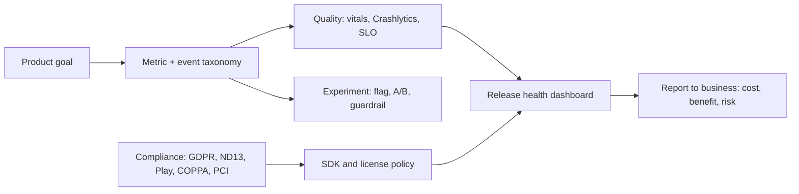
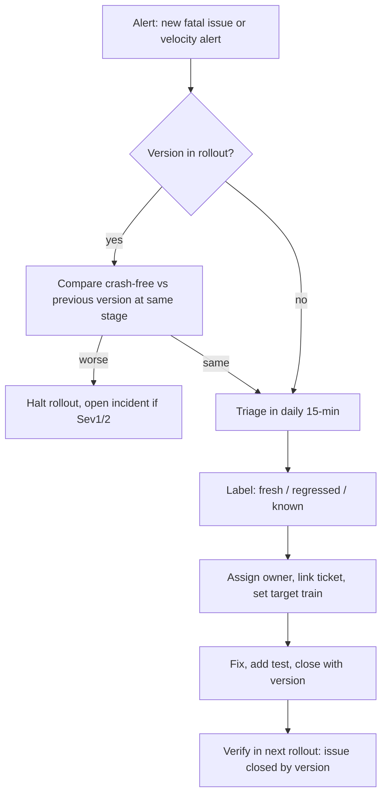

# 22. Product thinking, Metrics, Privacy và Compliance cho Mobile Lead

> Mục tiêu: nói chuyện được với PM bằng metric, với compliance bằng điều khoản, với CFO bằng chi phí; biết đọc Android vitals, Crashlytics, kết quả A/B test; biết app của mình thu thập gì, khai báo gì, dùng license gì. | Mức cần đạt: Senior: biết crash-free, ANR, startup, event analytics, Data safety form. Staff: thiết kế taxonomy event, đọc kết quả experiment, đánh giá SDK, hiểu GDPR/ND13/COPPA ở mức ảnh hưởng tới code. Lead: đặt SLO, release health dashboard, chính sách SDK và license, trình bày cost/benefit, trả lời câu hỏi compliance của bank. | Thời gian gợi ý: tuần 11, ~8 giờ (đọc 4h, hands-on 4h)

Ghi chú trước khi đọc: file này có nhiều điều khoản pháp lý và ngưỡng do Google đặt. Các con số và ngày đã được đối chiếu với trang gốc ngày 18/11/2026 (link ngay cạnh từng con số). Google và cơ quan nhà nước đổi ngưỡng theo thời gian, nên trước buổi phỏng vấn quan trọng hãy mở lại link. Chỗ nào vẫn ghi "chưa xác minh" là nơi chưa tìm được văn bản gốc; nói đúng như vậy khi bị hỏi. Interviewer bank không trừ điểm khi bạn nói "tôi cần kiểm tra lại văn bản gốc"; họ trừ điểm khi bạn nói sai một cách tự tin.

## 0. Bản đồ chủ đề

JD Staff/Lead ở VN ghi "translate tech to business", "product mindset", "data-driven", và với bank: "compliance", "security", "eKYC" (xem `01-Market-Research-2026.md`). Interviewer hỏi ở ba lớp:

1. **Bạn có nghĩ tới user và tiền không?** ("How did you measure success of that feature?", "What metric would you define for X?")
2. **Bạn có biết app mình đang ở đâu về chất lượng không?** ("What is your crash-free rate? What do you do when ANR spikes?")
3. **Bạn có đưa team vào rủi ro pháp lý không?** ("What data does your app collect? Which licenses do you allow? How do you handle consent?")



## 1. Product thinking cho tech lead

### 1.1 Outcomes, không phải outputs

Output là thứ team làm ra: feature, release, module. Outcome là thay đổi hành vi user hoặc business: nhiều user quay lại, nhiều người mua, ít ticket support. Lead kỹ thuật được đánh giá bằng outcome, dù bạn không sở hữu roadmap sản phẩm. Khi PM đưa feature, hỏi: "Outcome nào, đo bằng gì, bao giờ biết là thành công hay thất bại?" Nếu không trả lời được, feature chưa sẵn sàng để build.

Ví dụ: output "ship offline mode cho lesson"; outcome "tỷ lệ session bị bỏ dở vì lỗi mạng giảm từ 9% xuống dưới 3%, và D7 retention của user ở vùng mạng yếu (lọc theo `network_type`) tăng 2 điểm trong 4 tuần". Câu thứ hai cho biết đo bằng event nào, nhóm nào, và khi nào kết luận.

### 1.2 Metric sản phẩm cơ bản

| Metric | Nghĩa | Lead mobile cần biết |
|---|---|---|
| DAU / MAU | User hoạt động ngày / tháng; tỷ lệ DAU/MAU là "stickiness" | Định nghĩa "active" là gì (mở app? hoàn thành 1 lesson?) phải thống nhất với PM |
| Retention cohort | % user của một cohort (ví dụ cài tuần 1) còn quay lại sau D1, D7, D30 | Cold start chậm và crash ở lần mở đầu giết D1 |
| Funnel | Chuỗi bước: install -> onboarding -> first lesson -> paywall -> purchase; đo drop ở mỗi bước | Mỗi bước là một event; thứ tự và tên event phải ổn định qua version |
| Conversion | % đi hết funnel (ví dụ trial -> paid) | Billing lỗi, restore lỗi, consent form chặn đều làm conversion giảm |
| ARPU / LTV | Doanh thu trung bình mỗi user; giá trị trọn đời (LTV ~ ARPU x thời gian giữ chân) | Dùng để biện minh chi phí: "giảm crash 1 điểm giữ thêm N user x LTV" |
| Churn | % user rời đi trong kỳ | Uninstall rate trên Play Console là proxy |

Ví dụ tính bằng số (để nói trôi chảy khi bị hỏi "define it precisely"):
- **D7 retention** của cohort cài ngày 1/11 = số user trong cohort có ít nhất một `lesson_started` vào đúng ngày thứ 7 sau cài / số user cài ngày 1/11. Cohort 2.000 user, 360 user quay lại ngày 7: D7 = 18%. Ghi rõ "classic" (đúng ngày 7) hay "rolling" (ngày 7 trở đi), vì hai cách cho số khác nhau.
- **Stickiness** = DAU trung bình / MAU. DAU 3.000, MAU 20.000: 15%, nghĩa là user trung bình mở app khoảng 4,5 ngày/tháng (0,15 x 30).
- **Conversion trial -> paid** = số `purchase_completed` có `sku` subscription trong 14 ngày kể từ `trial_started` / số `trial_started`. Mẫu số phải là cùng cohort, không phải tổng purchase trong tháng chia tổng trial trong tháng.
- **LTV đơn giản** = ARPU tháng x (1 / churn tháng). ARPU 20.000 đ, churn 10%/tháng: LTV khoảng 200.000 đ. Dùng để quy đổi: giữ thêm 500 user/tháng nhờ giảm crash onboarding tương đương khoảng 100 triệu đ LTV.

### 1.3 Kỹ thuật mobile ảnh hưởng metric thế nào

- **Startup**: cold start chậm làm user bỏ ở lần mở đầu; vitals coi cold start từ 5 giây là "excessive" (mục 2.1), Macrobenchmark đo được trong CI (xem `04-Android-Kotlin-Deep-Dive.md`).
- **Crash và ANR**: crash trong onboarding hoặc checkout làm mất D1 và conversion; Play còn giảm visibility nếu vượt ngưỡng xấu (1,09% crash, 0,47% ANR, mục 2.1).
- **App size**: size lớn làm giảm install conversion (nhất là thị trường data đắt) và tăng uninstall; Play Console cho so sánh size với app cùng loại.
- **Battery và data**: excessive wakeups, background network làm user gỡ app; Play có cảnh báo trong vitals.
- **Offline**: app trẻ em dùng ở nơi không mạng; content pack cache quyết định session length.

### 1.4 Viết metric cho một feature

Khung: **Tên metric, định nghĩa chính xác (event nào, điều kiện nào), baseline hiện tại, mục tiêu, thời hạn, guardrail, chủ sở hữu**.

Ví dụ cho feature "content pack tải về" ở app phonics:

| Mục | Nội dung |
|---|---|
| Metric chính | Lesson completion rate: `lesson_completed` / `lesson_started` trong 7 ngày đầu |
| Baseline | [điền số từ Analytics] |
| Mục tiêu | +[N] điểm trong 4 tuần sau rollout 100% |
| Guardrail | Crash-free users không giảm; cold start p90 không tăng; download failure rate dưới [N]% |
| Event cần có | `pack_download_started`, `pack_download_completed{size, duration_ms, network}`, `pack_download_failed{reason}` |
| Owner | Bạn (kỹ thuật), PM (mục tiêu) |

**Lỗi hay gặp / trade-off:**
- Metric đo output ("số pack tải") thay vì outcome ("lesson hoàn thành").
- Không có baseline: không biết thành công hay không.
- Quá nhiều metric: chọn 1 chính + 2-3 guardrail.

**Đọc thêm:**
- https://firebase.google.com/docs/analytics (khái niệm active user, retention, funnel trong Analytics)
- Lean Analytics (Croll, Yoskovitz), ch. 2-3 (one metric that matters)
- https://support.google.com/googleplay/android-developer/?hl=en (Play Console: statistics, user acquisition, uninstall)

## 2. Android vitals và quality metrics

### 2.1 Android vitals

Play Console thu thập từ thiết bị đã đồng ý chia sẻ dữ liệu (chỉ thiết bị certified, chỉ app cài từ Play) và hiển thị trong Android vitals. Rate tính **theo daily active user**, không theo session: user mở app 3 lần trong ngày, crash 1 lần thì vitals tính 100% cho user đó trong ngày, Crashlytics tính 33% theo session ([vitals FAQ](https://developer.android.com/topic/performance/vitals)).

**Core vitals** (ảnh hưởng visibility trên Play): stability gồm **user-perceived crash rate** và **user-perceived ANR rate**; battery gồm **excessive partial wake locks**; memory gồm **memory usage (Anonymous RSS + Swap)** và **bitmap memory usage**. Riêng nhóm memory và DEX code optimization chỉ bắt đầu ảnh hưởng visibility từ **tháng 2/2027**.

Bad behavior threshold ([nguồn](https://developer.android.com/topic/performance/vitals#what_are_the_bad_behavior_thresholds), kiểm tra 18/11/2026):

| Metric | Overall (trung bình mọi thiết bị) | Per phone model |
|---|---|---|
| User-perceived crash rate | 1,09% | 8% |
| User-perceived ANR rate | 0,47% | 8% |
| Excessive partial wake locks | 5% session | không có ngưỡng per-device |

- Play đánh giá trên **28 ngày gần nhất**, tính lại mỗi ngày; vượt ngưỡng thì Play có thể giảm visibility và hiện cảnh báo trên store listing. Vitals gắn nhãn "emerging issue" khi crash/ANR ảnh hưởng thiết bị quá 7 ngày, tức bạn còn khoảng 21 ngày trước khi trung bình 28 ngày bị kéo lên.
- **Excessive partial wake lock** = tổng mọi partial wake lock giữ từ 2 giờ trở lên trong 24 giờ khi app ở background hoặc chạy foreground service (wake lock của audio, location, user-initiated job được miễn); ảnh hưởng visibility khi xảy ra ở hơn 5% session trong 28 ngày ([nguồn](https://developer.android.com/google/play/vitals/excessive-wakelock)).
- **Startup "excessive"** theo TTID: cold từ 5 giây, warm từ 2 giây, hot từ 1,5 giây ([nguồn](https://developer.android.com/google/play/vitals/launch-time)). Đây không phải core vital nhưng là số dễ bị hỏi.

Các vitals khác bạn phải gọi tên được: excessive wakeups, stuck partial wake locks, slow rendering, slow sessions, LMK (low memory killer), excessive background network/Wi-Fi scans, permission denials (danh sách đầy đủ ở cuối [trang vitals](https://developer.android.com/topic/performance/vitals)). Có thể kéo số vitals vào dashboard riêng qua [Play Developer Reporting API](https://developers.google.com/play/developer/reporting).

Cách nói trong phỏng vấn: "I track the core vitals per release against Play's bad behavior thresholds: 1.09% user-perceived crash rate and 0.47% ANR rate overall, 8% for any single phone model, over a 28-day window. The per-model threshold matters because one popular low-end device can trigger a warning for users of that device even when the overall number is fine."

### 2.2 Crash-free, ANR và cách đọc

- **Crash-free users** (Crashlytics): % user không gặp crash trong kỳ. So **theo version**, không so tổng; bản mới ở 5% rollout có crash-free thấp hơn bản cũ là tín hiệu halt.
- **Crash-free sessions**: nhạy hơn với crash lặp ở ít user.
- **ANR** xảy ra khi ([nguồn](https://developer.android.com/topic/performance/vitals/anr), kiểm tra 18/11/2026):
  - Input dispatching: không phản hồi input (chạm, phím) trong **5 giây**.
  - `BroadcastReceiver` chưa xong `onReceive` trong thời hạn; nếu app có activity ở foreground thì hạn là **10 giây** (receiver nền có hạn dài hơn, trang không nêu số), hoặc gọi `goAsync()` mà không `finish()`.
  - Service: `onCreate`/`onStartCommand`/`onBind` không xong trong "vài giây"; `startForegroundService()` mà service không gọi `startForeground()` trong **5 giây**.
  - `JobService.onStartJob`/`onStopJob` không trả về trong vài giây; với app target Android 14+ ANR này được báo cho app.
  - Nguyên nhân phổ biến: IO trên main, lock contention/deadlock, binder call đồng bộ chậm, `SharedPreferences.commit`, init SDK nặng trong `Application.onCreate`. Chi tiết ở `04`.
- Đọc stack trace ANR trong vitals: nhìn main thread, tìm frame của app, bỏ qua frame framework chờ. Vitals thấy cả crash trước khi SDK khởi tạo, nên số vitals thường cao hơn Crashlytics.
- Tự thu lý do process chết ở lần mở sau bằng [`ApplicationExitInfo`](https://developer.android.com/reference/android/app/ApplicationExitInfo) (API 30+), gửi kèm vào Crashlytics làm non-fatal:

```kotlin
// API 30+. Gọi ở background khi app khởi động.
fun reportPreviousExits(context: Context) {
    if (Build.VERSION.SDK_INT < Build.VERSION_CODES.R) return
    val am = context.getSystemService(ActivityManager::class.java)
    am.getHistoricalProcessExitReasons(context.packageName, /* pid = */ 0, /* max = */ 5)
        .filter { it.reason == ApplicationExitInfo.REASON_ANR }
        .forEach { info ->
            val trace = info.traceInputStream?.bufferedReader()?.use { it.readText() }
            Firebase.crashlytics.log("ANR at ${info.timestamp}: ${info.description}")
            trace?.lineSequence()?.take(40)?.forEach { Firebase.crashlytics.log(it) }
            Firebase.crashlytics.recordException(IllegalStateException("Previous ANR"))
        }
}
```
Lưu ý: cần tự lưu `timestamp` đã báo để không gửi trùng ở lần mở sau.

### 2.3 Startup time và app size

- Startup đo bằng Macrobenchmark (`StartupMode.COLD`, `TimeToInitialDisplay`, `TimeToFullDisplay`) và vitals; Baseline Profile là đòn bẩy rẻ nhất. Khi `reportFullyDrawn()` không gọi, vitals chỉ có TTID.
- App size: dùng App Bundle, Play Asset Delivery hoặc content tải về (bạn đã làm), R8 full mode, resource shrinking, bỏ ABI không cần, kiểm tra size diff trên mỗi PR (gate trong `11` mục 6.2).

### 2.4 Crashlytics triage workflow



Quy ước team:
- Daily 15 phút: ai on-call mở Crashlytics, lọc version đang rollout, xem top 5 issue theo user ảnh hưởng.
- Alert bật: new fatal issue, regression (issue đã close xuất hiện lại), velocity (một issue tăng nhanh ở một version).
- Custom keys: `user_segment`, `content_pack_version`, `feature_flags` (không PII) để lọc; breadcrumbs từ Analytics để biết user đang ở màn hình nào.
- Non-fatal: log có chủ đích (download fail, parse error) để thấy lỗi "im lặng".
- Close issue "by version": Crashlytics mở lại nếu tái xuất.

### 2.5 SLO và alerting cho mobile

SLO cho mobile đặt theo **release** và theo **user**, không theo request. Ví dụ bộ SLO bạn có thể đề xuất (số là ví dụ cấu trúc, team tự chọn):
- Crash-free users của version mới sau 7 ngày >= [X]% và không thấp hơn version trước quá [Y] điểm.
- User-perceived ANR rate dưới ngưỡng Play (0,47% overall, 8% mỗi model, mục 2.1) ở mọi model top 20; team nên đặt ngưỡng nội bộ chặt hơn, ví dụ 0,3%, để có khoảng đệm trước khi chạm ngưỡng Play.
- Cold start p90 (Macrobenchmark, thiết bị tham chiếu) <= [Z] ms, không tăng quá [W]% giữa hai version.
- Download failure rate content pack < [V]%.

Error budget: nếu bản mới vượt ngưỡng ở bậc rollout nào thì halt; nếu hai train liên tiếp phải hotfix thì train kế dành 30% cho quality. Alert gửi về channel on-call, không gửi email.

### 2.6 Observability

- **Firebase Performance Monitoring**: tự động đo app start, screen rendering (slow/frozen frames), network request theo URL pattern; custom trace cho luồng quan trọng (`Trace` quanh download pack, quanh lesson load). Không log PII vào trace attribute.
- **Datadog RUM mobile** (hoặc Sentry, New Relic): session replay, view load, error, resource, long task, liên kết với backend trace qua trace header. Dùng khi backend đã ở Datadog; chi phí theo session.
- **Logging**: structured, có correlation id, mask PII (mục 4.8), level khác nhau debug/release.
- Nguyên tắc: một dashboard cho release, một cho feature; alert chỉ trên thứ cần hành động.

### 2.7 Release health dashboard

Một bảng, mỗi dòng một version đang sống:

| Version | Rollout % | Adoption % (7d) | Crash-free users | ANR rate | Cold start p90 | Top 3 issues | Owner | Trạng thái |
|---|---|---|---|---|---|---|---|---|

Nguồn: Play Console (rollout, vitals), Crashlytics (crash-free, issues), Macrobenchmark CI (startup), Analytics (adoption). Lead xem mỗi sáng trong thời gian rollout.

**Lỗi hay gặp / trade-off:**
- So crash-free tổng thay vì theo version ở cùng bậc rollout.
- Không bật velocity alert; biết crash khi user review 1 sao.
- Quá nhiều custom trace: Firebase Performance có giới hạn và chi phí; đo luồng quan trọng thôi.

**Đọc thêm:**
- https://developer.android.com/topic/performance/vitals
- https://firebase.google.com/docs/crashlytics
- https://firebase.google.com/docs/perf-mon
- https://developer.android.com/topic/performance/benchmarking/macrobenchmark-overview

## 3. Analytics và experimentation

### 3.1 Event taxonomy và đặt tên

Quy ước đề xuất (một trang trong repo, có owner):
- Tên event: `object_action`, snake_case, thì quá khứ cho hành động đã xảy ra: `lesson_started`, `lesson_completed`, `purchase_completed`, `pack_download_failed`.
- Param chuẩn cho mọi event: `screen_name`, `source` (từ đâu tới), `app_version`, `content_pack_version`; param riêng theo event: `lesson_id`, `duration_ms`, `reason`.
- Không PII trong tên và giá trị param (không email, không tên trẻ).
- Mỗi event có: mô tả, khi nào bắn, param và kiểu, owner, version thêm vào, version bỏ.
- Giới hạn Google Analytics for Firebase (bản standard, kiểm tra 18/11/2026; nguồn: [GA4 collection limits](https://support.google.com/analytics/answer/9267744?hl=en) và Javadoc [`FirebaseAnalytics.logEvent` / `setUserProperty`](https://firebase.google.com/docs/reference/android/com/google/firebase/analytics/FirebaseAnalytics)):

| Giới hạn | Giá trị |
|---|---|
| Số tên event khác nhau | 500 mỗi app instance (event tự động thu không tính) |
| Param mỗi event | 25 |
| Độ dài tên event / tên param | 40 ký tự, bắt đầu bằng chữ cái, chỉ chữ số và `_` |
| Độ dài giá trị param kiểu string | 100 ký tự |
| User property | 25 tên; tên tối đa 24 ký tự, giá trị tối đa 36 ký tự |
| User-ID | 256 ký tự |
| Prefix cấm | `firebase_`, `google_`, `ga_` (cho event, param, user property); cộng danh sách tên event reserved trong [`FirebaseAnalytics.Event`](https://firebase.google.com/docs/reference/android/com/google/firebase/analytics/FirebaseAnalytics.Event) |

  Hệ quả thiết kế: tên event phân biệt hoa thường (`Lesson_Started` và `lesson_started` là hai event); không nhét JSON vào param vì bị cắt ở 100 ký tự; 25 user property là ít, dành cho thứ thật sự dùng để chia segment (`subscription_status`, `content_pack_version`).
- Registry là code: sealed class hoặc enum trong `core/analytics`, không string rải rác.

```kotlin
sealed interface AnalyticsEvent {
    val name: String
    val params: Map<String, Any>

    data class LessonStarted(val lessonId: String, val source: String) : AnalyticsEvent {
        override val name = "lesson_started"
        override val params = mapOf("lesson_id" to lessonId, "source" to source)
    }

    data class PackDownloadFailed(val packVersion: Int, val reason: String) : AnalyticsEvent {
        override val name = "pack_download_failed"
        override val params = mapOf("pack_version" to packVersion, "reason" to reason)
    }
}

interface AnalyticsTracker {
    fun track(event: AnalyticsEvent)
}
```

Kiến trúc analytics SDK (interface trong core, nhiều sink, gating theo consent, buffer khi chưa có consent, debug sink in log): xem bài system design "Analytics SDK" trong `06-Mobile-System-Design.md`.

### 3.2 Firebase Analytics, Remote Config, A/B Testing

- **Analytics**: user property (ví dụ `subscription_status`, không PII), audience, funnel exploration, retention; DebugView để kiểm tra event khi dev.
- **Remote Config**: default value trong app (XML hoặc map), fetch theo chiến lược (fetch lúc start và activate ở lần sau để không "nhảy" UI; hoặc activate ngay cho kill switch), minimum fetch interval, real-time update listener; dùng cho kill switch, config, và làm nền cho experiment. **Minimum fetch interval mặc định là 12 giờ**; hạ xuống (ví dụ 0 hoặc 3600 giây) chỉ dùng khi dev, không dùng cho production ([throttling](https://firebase.google.com/docs/remote-config/android/get-started#throttling)). Từ **1/9/2026**, trên gói Blaze fetch request miễn phí tới 100.000/ngày/project, vượt thì tính tiền ($0,06 / 10K request tới 10 triệu/ngày) ([pricing](https://firebase.google.com/pricing)), nên đừng fetch mỗi lần mở màn hình. Ví dụ (Firebase Android BoM 35.x, Kotlin, API Kotlin nằm trong module chính từ BoM 34):

```kotlin
val remoteConfig = Firebase.remoteConfig
remoteConfig.setConfigSettingsAsync(remoteConfigSettings {
    minimumFetchIntervalInSeconds = if (BuildConfig.DEBUG) 0 else 12 * 3600
})
remoteConfig.setDefaultsAsync(R.xml.remote_config_defaults) // giá trị khi offline hoặc lần đầu

// Lần mở app: fetch + activate; UI đọc giá trị sau khi activate xong (hoặc ở lần mở sau).
remoteConfig.fetchAndActivate().addOnCompleteListener { task ->
    val packV2Enabled = remoteConfig.getBoolean("pack_download_v2_enabled")
}

// Real-time: dùng cho kill switch, activate ngay khi server đổi.
remoteConfig.addOnConfigUpdateListener(object : ConfigUpdateListener {
    override fun onUpdate(configUpdate: ConfigUpdate) {
        if ("pack_download_v2_enabled" in configUpdate.updatedKeys) remoteConfig.activate()
    }
    override fun onError(error: FirebaseRemoteConfigException) { /* log non-fatal */ }
})
```
- **A/B Testing**: chọn Remote Config param làm biến, chia nhóm theo audience, metric mục tiêu từ Analytics (retention, event, revenue). Firebase A/B Testing dùng **frequentist inference**: one-tailed t-test/z-test, mức ý nghĩa 0,05, hiển thị p-value và khoảng tin cậy 95%; variant được gọi là "leader" khi khác biệt có ý nghĩa thống kê so với baseline ([ab-concepts, Interpret test results](https://firebase.google.com/docs/ab-testing/ab-concepts#interpreting-test-results), kiểm tra 18/11/2026; các tài liệu cũ mô tả kết quả kiểu Bayesian "probability to beat baseline", không còn đúng). Giới hạn: chỉ metric có trong Analytics; đọc kỹ trước khi kết luận.
- Thay thế: Statsig, LaunchDarkly, Optimizely; tự build với flag server + analytics warehouse khi quy mô lớn.

### 3.3 Feature flag vs experiment

| | Feature flag | Experiment (A/B) |
|---|---|---|
| Mục đích | Bật/tắt, rollout dần, kill switch | Đo tác động nhân quả của thay đổi |
| Chia nhóm | Theo %, theo segment, theo version | Ngẫu nhiên, ổn định theo user, có nhóm control |
| Kết luận | Có lỗi không | Metric đổi bao nhiêu, có ý nghĩa không |
| Vòng đời | Xoá sau khi 100% | Kết thúc khi đủ mẫu, rồi thành flag hoặc bỏ |

Flag là hạ tầng; experiment là phương pháp chạy trên hạ tầng đó. Flag tồn tại mãi là nợ: đặt ngày hết hạn.

Ví dụ cụ thể: `pack_download_v2_enabled` là **flag** (rollout 5% -> 25% -> 100% theo Remote Config condition "percent of users", tắt ngay nếu `pack_download_failed` tăng). Câu hỏi "downloader v2 có làm lesson completion tăng không" là **experiment**: Firebase A/B Testing chia 50/50 ngẫu nhiên trên cùng param, metric chính `lesson_completed`/`lesson_started`, chạy đủ số ngày đã tính ở 3.4, rồi mới đẩy flag lên 100%. Mỗi flag ghi trong registry: owner, ngày tạo, ngày hết hạn, ticket xoá.

### 3.4 Sample size và ý nghĩa thống kê, nói đơn giản

- Bạn muốn phát hiện thay đổi nhỏ nhất đáng quan tâm (MDE, ví dụ +1 điểm conversion). Hiệu ứng càng nhỏ, baseline càng thấp, càng cần nhiều user mỗi nhánh.
- Hai tham số chuẩn: mức ý nghĩa (thường 5%: xác suất kết luận "có khác" khi thật ra không khác) và power (thường 80%: xác suất phát hiện được khi thật sự khác).
- Dùng calculator (ví dụ Evan Miller sample size calculator) trước khi chạy; ghi số mẫu cần và ngày dự kiến đủ mẫu vào experiment doc.
- Với app nhỏ, nhiều experiment không bao giờ đủ mẫu cho MDE 1 điểm; chọn metric gần hơn (ví dụ click paywall thay vì purchase) hoặc chấp nhận MDE lớn hơn.
- Khoảng tin cậy quan trọng hơn p-value: "+2 điểm, CI từ -1 tới +5" nghĩa là chưa biết.
- Công thức nhẩm (α = 5% hai phía, power 80%): **n mỗi nhánh ≈ 16 · σ² / δ²**, với metric tỷ lệ thì σ² = p(1 − p) (Kohavi, Tang, Xu, ch. 17). Ví dụ: conversion paywall baseline p = 20%, muốn phát hiện +1 điểm (δ = 0,01): n ≈ 16 · 0,2 · 0,8 / 0,0001 = **25.600 user mỗi nhánh**, tổng 51.200. App có 3.000 user mới/ngày vào paywall thì cần khoảng 17 ngày; muốn phát hiện +2 điểm thì chỉ cần 1/4, khoảng 6.400 mỗi nhánh. Đây là cách giải thích cho PM vì sao "test 1 tuần" thường không đủ.

### 3.5 Guardrail metrics

Mỗi experiment có metric chính và guardrail: crash-free, ANR, cold start, uninstall, revenue, support ticket. Experiment "thắng" ở metric chính nhưng guardrail xấu thì không ship. Guardrail phải được định nghĩa trước khi chạy.

Ví dụ bảng guardrail viết trong experiment doc trước khi bật:

| Guardrail | Định nghĩa | Ngưỡng dừng |
|---|---|---|
| Crash-free users | Crashlytics, lọc theo variant qua custom key `exp_variant` | Thấp hơn control quá 0,2 điểm |
| User-perceived ANR | Vitals theo version (vitals không tách variant, nên đọc kèm non-fatal ANR từ `ApplicationExitInfo`) | Vượt 0,47% hoặc tăng quá 0,1 điểm |
| Cold start p90 | Custom trace Firebase Performance quanh startup, có attribute `exp_variant` (trace tự động `_app_start` không gắn được attribute riêng), cộng Macrobenchmark chạy cả hai variant | Tăng quá 10% |
| Refund / uninstall 7 ngày | Play Console + event `subscription_refunded` | Tăng có ý nghĩa thống kê |

### 3.6 Lỗi phổ biến

- **Peeking**: xem kết quả mỗi ngày và dừng khi "có ý nghĩa". Với test tần suất cổ điển, điều này làm tỷ lệ kết luận sai tăng mạnh. Định ngày kết thúc trước, hoặc dùng phương pháp sequential.
- **Novelty effect**: feature mới được bấm nhiều tuần đầu rồi hết. Chạy ít nhất 2 chu kỳ tuần, xem cohort theo ngày exposure.
- **Sample ratio mismatch**: nhóm A/B không đúng tỷ lệ 50/50 (do crash ở một nhánh, do exposure sai). Kiểm tra trước khi đọc metric bằng chi-square một bậc tự do. Ví dụ: control 50.000, treatment 48.500, kỳ vọng 49.250 mỗi nhánh: χ² = 2 · 750² / 49.250 ≈ 22,8, p < 0,001, tức SRM thật, không đọc metric nữa mà đi tìm nguyên nhân (Kohavi, Tang, Xu, ch. 21).
- **Version confounding**: experiment chỉ chạy trên bản mới, user bản mới khác user bản cũ (họ update sớm hơn). So trong cùng version.
- **Multiple comparisons**: 20 metric thì có 1 "có ý nghĩa" ngẫu nhiên. Một metric chính.
- **Exposure sai**: tính user vào nhóm khi họ chưa thấy feature. Bắn event exposure đúng chỗ.

### 3.7 Đọc kết quả experiment như một lead

Thứ tự: (1) sample ratio có đúng không; (2) exposure event có bắn đúng không; (3) metric chính với khoảng tin cậy; (4) guardrail; (5) phân rã theo platform, version, country, new vs returning để tìm nhóm bị hại; (6) so với decision rule đã viết trước; (7) quyết định: ship, iterate, hoặc dừng; ghi vào experiment log. Nếu kết quả "gần có ý nghĩa", câu trả lời là "chưa biết", không phải "ship vì có vẻ tốt".

Ví dụ decision rule viết trước: "Ship nếu lesson completion tăng và cận dưới CI 95% > 0; giữ nguyên nếu CI chứa 0 sau đủ 25.600 user mỗi nhánh; dừng ngay nếu một guardrail chạm ngưỡng dừng." Kết quả thực tế "+1,4 điểm, CI [+0,3; +2,5], SRM p = 0,41, guardrail xanh" thì ship; "+1,4 điểm, CI [-0,2; +3,0]" thì ghi "không kết luận được", không ship vì "gần".

**Đọc thêm:**
- https://firebase.google.com/docs/remote-config/android/get-started
- https://firebase.google.com/docs/ab-testing/ab-concepts
- Trustworthy Online Controlled Experiments (Kohavi, Tang, Xu), ch. 1-3, ch. 17 (thống kê, công thức sample size), ch. 21 (SRM và trust-related guardrail)
- https://www.evanmiller.org/ab-testing/sample-size.html

## 4. Privacy và compliance

### 4.1 GDPR: những gì ảnh hưởng tới code mobile

Áp dụng khi app có user ở EU/EEA, bất kể công ty ở đâu (Điều 3(2)). Văn bản gốc: [Regulation (EU) 2016/679 trên EUR-Lex](https://eur-lex.europa.eu/legal-content/EN/TXT/HTML/?uri=CELEX:32016R0679); mỗi điều có anchor dạng `#art_33`. Số liệu dưới đây đối chiếu với EUR-Lex ngày 18/11/2026.
- **Lawful basis** ([Điều 6(1)](https://eur-lex.europa.eu/legal-content/EN/TXT/HTML/?uri=CELEX:32016R0679#art_6)): consent, contract, legal obligation, vital interests, public task, legitimate interests. Analytics và ads cá nhân hoá thường dựa trên consent; chức năng cốt lõi dựa trên contract. Chọn basis trước, rồi mới code consent.
- **Consent** ([Điều 4(11)](https://eur-lex.europa.eu/legal-content/EN/TXT/HTML/?uri=CELEX:32016R0679#art_4) và [Điều 7](https://eur-lex.europa.eu/legal-content/EN/TXT/HTML/?uri=CELEX:32016R0679#art_7)) phải tự nguyện, cụ thể, có thông tin, rõ ràng. Điều 7(3) viết nguyên văn: "It shall be as easy to withdraw as to give consent", nên nếu đồng ý bằng một nút trên màn hình đầu thì rút lại cũng phải là một nút trong Settings. Điều 7(4): không được ép consent cho dữ liệu không cần thiết để cung cấp dịch vụ. Không pre-tick, không gộp "đồng ý tất cả" bắt buộc. SDK analytics/ads chỉ khởi tạo **sau** consent; sự kiện trước consent phải buffer hoặc bỏ.
- **Trẻ em** ([Điều 8(1)](https://eur-lex.europa.eu/legal-content/EN/TXT/HTML/?uri=CELEX:32016R0679#art_8)): với dịch vụ xã hội thông tin cung cấp trực tiếp cho trẻ và dựa trên consent, trẻ từ **16 tuổi** tự đồng ý được; dưới 16 cần người giữ quyền phụ huynh đồng ý; mỗi nước thành viên được hạ tuổi nhưng **không thấp hơn 13**. Vì vậy UMP/consent flow phải biết quốc gia và tuổi.
- **Dữ liệu đặc biệt** ([Điều 9](https://eur-lex.europa.eu/legal-content/EN/TXT/HTML/?uri=CELEX:32016R0679#art_9)): biometric data dùng để định danh duy nhất một người (face match eKYC) bị cấm xử lý trừ khi có ngoại lệ ở Điều 9(2), thường là explicit consent.
- **Quyền của chủ thể dữ liệu** (Điều 15 truy cập, 16 sửa, 17 xoá, 18 hạn chế, 20 portability, 21 phản đối, 22 quyết định tự động). Theo [Điều 12(3)](https://eur-lex.europa.eu/legal-content/EN/TXT/HTML/?uri=CELEX:32016R0679#art_12), phải phản hồi trong **1 tháng** kể từ khi nhận yêu cầu, gia hạn thêm tối đa 2 tháng nếu phức tạp. Code cần: xoá account và dữ liệu (cả log, cả backup theo lịch), export dữ liệu, tắt profiling.
- **DPIA** ([Điều 35](https://eur-lex.europa.eu/legal-content/EN/TXT/HTML/?uri=CELEX:32016R0679#art_35)) khi xử lý rủi ro cao: sinh trắc học, dữ liệu trẻ em, theo dõi quy mô lớn. eKYC khuôn mặt gần như chắc chắn cần DPIA.
- **Privacy by design, data minimization** (Điều 25, Điều 5(1)(c)): thu đúng thứ cần, giữ đúng thời gian cần.
- **Thông báo vi phạm** ([Điều 33(1)](https://eur-lex.europa.eu/legal-content/EN/TXT/HTML/?uri=CELEX:32016R0679#art_33)): controller báo cơ quan giám sát "without undue delay and, where feasible, not later than **72 hours** after having become aware of it", trừ khi vi phạm khó gây rủi ro; báo trễ phải kèm lý do. Processor (ví dụ vendor SDK) phải báo controller "without undue delay" (Điều 33(2)); nếu rủi ro cao cho người dùng thì báo cả người dùng (Điều 34). Lead mobile phải biết đường escalate khi phát hiện rò rỉ từ app (log, SDK, cache), vì đồng hồ 72 giờ chạy từ lúc tổ chức biết, không phải lúc pháp chế biết.
- **Mức phạt** ([Điều 83](https://eur-lex.europa.eu/legal-content/EN/TXT/HTML/?uri=CELEX:32016R0679#art_83)): Điều 83(5) (vi phạm nguyên tắc, consent, Điều 5, 6, 7, 9, quyền chủ thể, chuyển dữ liệu ra ngoài EU) tối đa **20 triệu EUR hoặc 4% doanh thu toàn cầu năm trước**, lấy mức cao hơn; Điều 83(4) (nghĩa vụ controller/processor như Điều 8, 25, 33, 35) tối đa 10 triệu EUR hoặc 2%.

### 4.2 Việt Nam: Nghị định 13/2023/NĐ-CP và Luật Bảo vệ dữ liệu cá nhân 2025

Tình trạng tại 18/11/2026 (khung pháp lý đã đổi từ 1/1/2026, đừng nói "Nghị định 13 là văn bản chính" nữa):

| Văn bản | Vai trò | Hiệu lực |
|---|---|---|
| **Luật Bảo vệ dữ liệu cá nhân số 91/2025/QH15** | Luật gốc, 5 chương 39 điều; Quốc hội khoá XV kỳ họp 9 thông qua **26/6/2025** | **1/1/2026** |
| **Nghị định 356/2025/NĐ-CP** (ký 31/12/2025) | Quy định chi tiết Luật, có 10 biểu mẫu hồ sơ; **thay thế Nghị định 13/2023/NĐ-CP** | 1/1/2026 |
| **Nghị định 330/2026/NĐ-CP** | Xử phạt vi phạm hành chính về an ninh mạng và bảo vệ dữ liệu cá nhân | 19/8/2026, không có thời gian chuyển tiếp |
| Nghị định 13/2023/NĐ-CP (17/4/2023) | Văn bản cũ, hiệu lực 1/7/2023 đến hết 31/12/2025 | Hết hiệu lực, chỉ còn ý nghĩa chuyển tiếp |

Nguồn: toàn văn Luật trên [Công báo số 971+972 ngày 24/7/2025 (PDF)](https://congbaocdn.chinhphu.vn/CongBaoCP/VanBan/2025/6/45578/57730-1-2025971-97291-2025-qh15.pdf) và [trang văn bản trên vanban.chinhphu.vn](https://vanban.chinhphu.vn/?pageid=27160&docid=214590&classid=1&typegroupid=3) (số điều dưới đây đối chiếu với bản Công báo ngày 18/11/2026); [so sánh NĐ 356 với NĐ 13 (LuatVietnam)](https://luatvietnam.vn/legal-updates/new-features-of-decree-356-2025-compared-with-decree-13-2023-on-personal-data-protection-892-106712-article.html); [VOV về NĐ 330/2026](https://vov.vn/chinh-tri/tu-1982026-tu-y-thu-thap-xu-ly-du-lieu-ca-nhan-bi-phat-toi-70-trieu-dong-post1326424.vov). Nội dung NĐ 356 (Điều 5, Điều 8) và mức phạt từng hành vi trong NĐ 330 mới đọc qua bản tóm tắt của LuatVietnam và báo chí, chưa đối chiếu văn bản gốc trên Công báo.

Điểm ảnh hưởng tới app (theo số điều của Luật 91/2025/QH15):
- **Phân loại** (Điều 2): **dữ liệu cá nhân cơ bản** và **dữ liệu cá nhân nhạy cảm**; NĐ 356 liệt kê danh mục cụ thể. Sinh trắc học, tài chính, vị trí, sức khoẻ là nhạy cảm; eKYC và biometrics login thuộc nhóm này. Điều 31 riêng cho dữ liệu vị trí và sinh trắc học.
- **Sự đồng ý** (Điều 9): chỉ có hiệu lực khi tự nguyện và chủ thể biết rõ loại dữ liệu, mục đích, bên kiểm soát; rút lại và hạn chế xử lý theo Điều 10. Consent cũ lấy theo NĐ 13 trước 1/1/2026 vẫn dùng tiếp, **không phải xin lại** (Điều 39).
- **Quyền chủ thể** (Điều 4): biết, đồng ý hoặc không, rút lại; xem, sửa; yêu cầu cung cấp, xoá, hạn chế, phản đối; khiếu nại, bồi thường. NĐ 356 Điều 5 đặt hạn xử lý: rút lại/hạn chế/phản đối phải phản hồi trong 2 ngày làm việc, xong trong 15 ngày; truy cập/sửa 10 ngày; xoá 20 ngày (cộng thêm khi có bên xử lý hoặc bên thứ ba).
- **Chuyển dữ liệu xuyên biên giới** (Điều 20) và **hồ sơ đánh giá tác động** (Điều 21, 22): Firebase, Crashlytics, RevenueCat, AdMob đều là chuyển ra nước ngoài, cần hồ sơ đánh giá tác động chuyển dữ liệu xuyên biên giới. Hồ sơ đã nộp theo NĐ 13 trước 1/1/2026 tiếp tục dùng, chỉ cập nhật theo luật mới (Điều 39). Doanh nghiệp nhỏ và startup được chọn không áp dụng Điều 21, 22 và khoản 2 Điều 33 trong 5 năm từ 1/1/2026, trừ khi kinh doanh dịch vụ xử lý dữ liệu, xử lý dữ liệu nhạy cảm, hoặc xử lý dữ liệu số lượng lớn.
- **Trẻ em** (Điều 24): người đại diện theo pháp luật (cha mẹ, người giám hộ) thay mặt trẻ thực hiện các quyền của chủ thể dữ liệu, kể cả việc đồng ý; nếu xử lý để công bố, tiết lộ thông tin đời sống riêng tư, bí mật cá nhân của trẻ **từ đủ 07 tuổi** thì cần cả trẻ và người đại diện đồng ý (Điều 24 khoản 2). Phải ngừng xử lý khi người đại diện rút lại đồng ý (khoản 3).
- **Ngân hàng** (Điều 27) và **quảng cáo** (Điều 28) có điều riêng; NĐ 356 Điều 8 yêu cầu ngân hàng báo cơ quan chuyên trách và chủ thể trong **72 giờ** khi phát hiện lộ, mất dữ liệu nhạy cảm.
- **Nhân sự bảo vệ dữ liệu** (khoản 2 Điều 33): chỉ định bộ phận/nhân sự hoặc thuê dịch vụ.
- **Mức phạt tiền tối đa** (Điều 8): mua bán dữ liệu cá nhân tới **10 lần khoản thu** từ vi phạm; vi phạm chuyển dữ liệu xuyên biên giới tới **5% doanh thu năm trước liền kề**; vi phạm khác tới **3 tỷ đồng**. Đó là mức cho tổ chức; cá nhân bằng 1/2.

Với bank, phòng pháp chế sẽ dẫn; lead mobile cần biết: dữ liệu nào trong app là nhạy cảm, SDK nào gửi dữ liệu ra nước ngoài, consent flow có đúng không, và yêu cầu xoá có chạy hết đường (server, log, vendor) trong 20 ngày không.

Cách nói trong phỏng vấn (EN): "Since 1 January 2026 Vietnam's framework is the Personal Data Protection Law 91/2025, passed in June 2025, with Decree 356/2025 replacing Decree 13 as the implementing decree, and Decree 330/2026 adding administrative sanctions since August. For the app that means: classify data into basic and sensitive, consent that is informed and per purpose, an inventory of SDKs that transfer data abroad for the cross-border impact assessment, and deletion requests honored within the decree's deadlines. Fines go up to 5% of the previous year's revenue for cross-border violations, so legal takes it seriously and needs my inventory."

### 4.3 Google Play Data safety form

- Bắt buộc cho mọi app; khai: dữ liệu **thu thập** (collected) và **chia sẻ** (shared) theo loại (location, personal info, financial, device IDs, app activity...), mục đích, bắt buộc hay tuỳ chọn, mã hoá khi truyền, cách yêu cầu xoá, có tuân theo Families policy không.
- Phải bao gồm hành vi của **SDK bên thứ ba** (Firebase, AdMob, AppLovin, RevenueCat). Google Play SDK Index và trang data safety của từng SDK cho thông tin.
- Sai khai báo là vi phạm policy (có thể bị gỡ). Quy trình: mỗi khi thêm/đổi SDK hoặc event mới, cập nhật một file `data-inventory.md` trong repo rồi đồng bộ lên form; review mỗi release lớn.
- Yêu cầu **xoá tài khoản** ([Play Console Help 13327111](https://support.google.com/googleplay/android-developer/answer/13327111?hl=en), kiểm tra 18/11/2026): app cho tạo tài khoản phải (1) có đường xoá account **và dữ liệu liên quan** ngay trong app, và (2) có **web link** để yêu cầu xoá kể cả khi user đã gỡ app; link khai trong mục Data deletion của Data safety. Xoá dữ liệu cả trên server của bạn và yêu cầu vendor xử lý dữ liệu xoá theo. Được giữ lại một phần vì bảo mật, chống gian lận, tuân thủ pháp luật (ví dụ log giao dịch ngân hàng) nhưng phải nói rõ trong privacy policy. Hạn cuối tuân thủ là 31/5/2024; app không đạt có thể bị gỡ. App không có đăng nhập (như app phonics không account) không thuộc phạm vi, nhưng vẫn phải trả lời câu hỏi Data deletion.

### 4.4 Permissions best practices

- Xin đúng lúc (in context), có rationale, hoạt động được khi bị từ chối (graceful degradation), không xin lại liên tục.
- Dùng Photo Picker thay quyền media; dùng contacts picker hệ thống của Android 17 (`ACTION_PICK_CONTACTS`: chỉ trả về các trường user chọn, quyền truy cập tạm thời theo session, không cần `READ_CONTACTS`; [Android 17 is here, mục Privacy-preserving choices](https://developer.android.com/blog/posts/android-17-is-here)); location chỉ foreground và chỉ khi cần (Android 17 có thêm nút location do hệ thống vẽ, cấp precise location cho session hiện tại); không SMS/Call log trừ khi là chức năng cốt lõi được Play duyệt.
- **Local network**: trên Android 16 đây mới là chế độ **opt-in để test** (bật bằng `adb shell am compat enable RESTRICT_LOCAL_NETWORK <package>`), không có permission mới cho production. Từ **Android 17 (API 37)**, app target 37 trở lên bị chặn truy cập LAN mặc định và phải xin runtime permission **`ACCESS_LOCAL_NETWORK`** (nhóm `NEARBY_DEVICES`) hoặc dùng picker hệ thống (`NsdManager` với `DiscoveryRequest.FLAG_SHOW_PICKER`, Output Switcher cho cast). App target 36 trở xuống vẫn được cấp ngầm qua `INTERNET` và **không nên** khai báo `ACCESS_LOCAL_NETWORK` ([Local network permission](https://developer.android.com/privacy-and-security/local-network-permission#android-17-enforcement)).
- **Health**: app target Android 16 dùng permission chi tiết `android.permission.health.*` (ví dụ `READ_HEART_RATE`, `READ_HEALTH_DATA_IN_BACKGROUND`) thay `BODY_SENSORS`/`BODY_SENSORS_BACKGROUND`, và app mobile phải khai activity hiện privacy policy, thiếu thì permission bị thu hồi ([behavior changes 16, Health and fitness permissions](https://developer.android.com/about/versions/16/behavior-changes-16#health-fitness-permissions)).
- Kiểm tra merged manifest trên mỗi PR vì SDK có thể thêm quyền.
- Mọi quyền trong manifest phải map được vào Data safety form và vào một dòng trong privacy policy.

### 4.5 Consent management: UMP cho ads

- Google yêu cầu: từ **16/1/2024** với EEA và UK, và từ **31/7/2024** với Thuỵ Sĩ, chỉ traffic qua **CMP được Google chứng nhận, tích hợp IAB TCF** mới được ads cá nhân hoá; CMP không chứng nhận chỉ còn non-personalized/limited ads ([AdMob Help 13554116](https://support.google.com/admob/answer/13554116?hl=en), kiểm tra 18/11/2026). UMP SDK của Google là một CMP chứng nhận.
- UMP cũng xử lý thông báo cho các bang Mỹ có luật riêng và iOS ATT. Luồng: `requestConsentInfoUpdate` -> `loadAndShowConsentFormIfRequired` -> chỉ khởi tạo Mobile Ads và load ads khi `canRequestAds()`; thêm nút "Privacy options" trong Settings khi `privacyOptionsRequirementStatus == REQUIRED` ([UMP Android](https://developers.google.com/admob/android/privacy)). Ví dụ (UMP `com.google.android.ump:user-messaging-platform:4.0.0`):

```kotlin
private val adsInitialized = AtomicBoolean(false)

fun gatherConsent(activity: Activity, isChildDirected: Boolean) {
    val info = UserMessagingPlatform.getConsentInformation(activity)
    val params = ConsentRequestParameters.Builder()
        .setTagForUnderAgeOfConsent(isChildDirected) // TFUA: báo UMP đây là user dưới tuổi consent
        .build()
    info.requestConsentInfoUpdate(activity, params, {
        UserMessagingPlatform.loadAndShowConsentFormIfRequired(activity) { formError ->
            if (info.canRequestAds()) initAds(activity)
        }
    }, { requestError -> /* log non-fatal; vẫn thử canRequestAds với trạng thái cũ */ })
    if (info.canRequestAds()) initAds(activity) // consent từ phiên trước
}

private fun initAds(context: Context) {
    if (!adsInitialized.compareAndSet(false, true)) return
    MobileAds.initialize(context)
}
// Settings: nếu info.privacyOptionsRequirementStatus == REQUIRED, hiện nút gọi
// UserMessagingPlatform.showPrivacyOptionsForm(activity) { error -> }
```
- App trẻ em: đặt tag ở **cả hai nơi**, UMP (`setTagForUnderAgeOfConsent`) và request ads qua [`RequestConfiguration`](https://developers.google.com/admob/android/targeting#set_the_age_treatment). API hiện hành là **`setAgeRestrictedTreatment(AgeRestrictedTreatment.CHILD)`** (giá trị `CHILD`, `TEEN`, `UNSPECIFIED`; thêm tham số `tfat` vào ad request). Hai API cũ `setTagForChildDirectedTreatment()` (TFCD) và `setTagForUnderAgeOfConsent()` (TFUA) trên `RequestConfiguration` đã **deprecated**; TFCD/TFUA `TRUE` tương đương `CHILD`, `TEEN` không có tương đương cũ; nếu đặt cả mới lẫn cũ, Google áp dụng mức bảo thủ nhất. Kèm `setMaxAdContentRating(MAX_AD_CONTENT_RATING_G)`, rồi `MobileAds.setRequestConfiguration(...)` **trước** khi load ad. App trong Designed for Families dạng "primarily child-directed" và user Family Link luôn bị coi là child-directed. Với mediation, adapter chỉ chuyển tiếp tín hiệu age treatment từ một số phiên bản tối thiểu (trang targeting liệt kê, ví dụ AppLovin 13.6.3.0), nên kiểm tra phiên bản adapter.
- Consent cho analytics tách khỏi consent cho ads; lưu trạng thái, cho đổi trong Settings.

### 4.6 Families policy và COPPA cho app trẻ em

Bạn ship app trẻ em, đây là nơi bạn có lợi thế nếu nói chính xác.
- **COPPA** (Mỹ, 16 CFR Part 312): bảo vệ trẻ dưới 13; thu thập thông tin cá nhân từ trẻ cần **verifiable parental consent**; FTC thực thi. **Bản sửa đổi** của COPPA Rule đăng Federal Register ngày **22/4/2025**, có hiệu lực **23/6/2025**, hạn tuân thủ chung **22/4/2026** (một số nghĩa vụ của Safe Harbor có hạn sớm hơn) ([Federal Register 2025-05904](https://www.federalregister.gov/documents/2025/04/22/2025-05904/childrens-online-privacy-protection-rule), [FTC press release](https://www.ftc.gov/news-events/news/press-releases/2025/01/ftc-finalizes-changes-childrens-privacy-rule-limiting-companies-ability-monetize-kids-data), kiểm tra 18/11/2026). Thay đổi chính ảnh hưởng tới app: cần **consent riêng** của phụ huynh trước khi chia sẻ dữ liệu trẻ cho bên thứ ba để quảng cáo nhắm mục tiêu hoặc mục đích khác; không được giữ dữ liệu trẻ vô thời hạn, chỉ giữ tới khi hết mục đích (cần chính sách retention bằng văn bản); "personal information" nay gồm cả **biometric identifiers** và giấy tờ định danh do nhà nước cấp; Safe Harbor program phải công khai danh sách thành viên.
- **Google Play Families policy** ([Play Console Help 9893335](https://support.google.com/googleplay/android-developer/answer/9893335?hl=en)): khai target audience; nếu có trẻ em trong đối tượng thì:
  - Ads cho trẻ hoặc user chưa rõ tuổi chỉ qua **Google Play Families Self-Certified Ads SDKs**; không interest-based ads, không remarketing.
  - App chỉ nhắm trẻ em **không được gửi AAID**, IMEI, MAC... ; app nhắm cả trẻ và người lớn không được gửi các ID này từ trẻ hoặc user chưa rõ tuổi (cần neutral age screen). App chỉ nhắm trẻ em target API 33+ **không nên khai `AD_ID` permission**.
  - App chỉ nhắm trẻ em không được xin location permission hay thu precise location; Bluetooth phải qua Companion Device Manager.
  - Không dùng API/SDK không được duyệt cho dịch vụ hướng tới trẻ em; nội dung phù hợp; parental gate cho link ngoài, mua hàng, chia sẻ. Nếu dùng Firebase Analytics, tắt thu Advertising ID và dùng tối thiểu event.
  - App đạt chuẩn có thể opt in chương trình **Teacher Approved** (không bảo đảm được chọn).
- Kỹ thuật bạn đã làm (`references/coppa.md`): không đăng nhập, không PII, ads non-personalized qua SDK certified, parental gate, Data safety khai đúng, analytics tối thiểu.
- Khi trả lời bank: "the same discipline applies to adult sensitive data: inventory, minimize, gate, declare."

### 4.7 Bank/fintech: PCI DSS, 3-D Secure, eKYC

- **PCI DSS** áp dụng khi lưu, xử lý hoặc truyền dữ liệu thẻ (PAN). Mục tiêu của mobile là **ra khỏi scope**: không chạm PAN; dùng SDK của payment gateway (hosted field/tokenization) để PAN đi thẳng tới gateway; app chỉ giữ token. Nếu app nhập PAN trực tiếp thì app và backend vào scope đầy đủ. Phiên bản hiện hành là **PCI DSS v4.0.1** (limited revision phát hành 6/2024, không thêm hay bỏ requirement); v4.0 bị retire ngày **31/12/2024**; 51 requirement "future-dated" của v4.x bắt buộc từ **31/3/2025** ([PCI SSC blog: Just Published PCI DSS v4.0.1](https://blog.pcisecuritystandards.org/just-published-pci-dss-v4-0-1), [future-dated requirements](https://blog.pcisecuritystandards.org/now-is-the-time-for-organizations-to-adopt-the-future-dated-requirements-of-pci-dss-v4-x), kiểm tra 18/11/2026). Trong nhóm future-dated có yêu cầu cho trang thanh toán web (6.4.3 quản lý script trên payment page, 11.6.1 phát hiện thay đổi trang), liên quan khi app mở WebView checkout. Với SoftPOS (điện thoại làm máy POS) có chuẩn riêng **PCI MPoC** (Mobile Payments on COTS); chi tiết version chưa xác minh trong lần kiểm tra này, xem [Document Library](https://www.pcisecuritystandards.org/document_library/).
- **3-D Secure 2 (EMV 3DS)**: xác thực chủ thẻ khi thanh toán online; luồng **frictionless** (dựa trên risk, không hỏi user) và **challenge** (OTP, biometric trong app ngân hàng). Trên mobile dùng 3DS SDK của nhà cung cấp hoặc web flow; app ngân hàng là nơi nhận challenge (push, in-app). Ở EU gắn với yêu cầu SCA của PSD2.
- **eKYC Việt Nam** (mốc chính):

| Văn bản | Nội dung với app | Hiệu lực |
|---|---|---|
| Thông tư 16/2020/TT-NHNN (ký 4/12/2020, sửa TT 23/2014) | Lần đầu cho mở tài khoản thanh toán bằng eKYC | Năm 2021 (ngày cụ thể chưa đối chiếu) |
| Quyết định 2345/QĐ-NHNN (18/12/2023) | Bắt buộc xác thực sinh trắc học khi chuyển tiền online **trên 10 triệu đồng/lần** hoặc **tổng trên 20 triệu đồng/ngày**, và khi cài Mobile Banking trên thiết bị mới; đối chiếu khuôn mặt với chip CCCD hoặc VNeID | 1/7/2024; **bị bãi bỏ toàn bộ** bởi Quyết định 2872/QĐ-NHNN từ 1/1/2025, nội dung chuyển vào TT 50/2024 ([LuatVietnam](https://luatvietnam.vn/tai-chinh/quyet-dinh-2872-qd-nhnn-405747-d1.html)) |
| Thông tư 17/2024/TT-NHNN (thay TT 23/2014) | Mở và sử dụng tài khoản thanh toán, eKYC có kiểm soát gian lận; từ 1/1/2025 tài khoản chưa đối chiếu sinh trắc học với CCCD gắn chip/VNeID không được giao dịch online | 1/7/2024 (một số điều từ 1/10/2024 và 1/1/2025) |
| Thông tư 18/2024/TT-NHNN | Hoạt động thẻ ngân hàng; chủ thẻ chưa đối chiếu sinh trắc học không giao dịch thẻ online được | Mốc sinh trắc 1/1/2025 (ngày hiệu lực chung chưa đối chiếu) |
| Thông tư 50/2024/TT-NHNN (thay TT 35/2016) | An toàn, bảo mật dịch vụ ngân hàng trực tuyến, đưa nội dung QĐ 2345 vào thông tư, quy định hình thức xác nhận giao dịch theo Luật Giao dịch điện tử 2023 | 1/1/2025 (một số điều muộn hơn) |

  Nguồn: [Thị trường Tài chính Tiền tệ (cơ quan của Hiệp hội Ngân hàng), 21/12/2024](https://thitruongtaichinhtiente.vn/sau-10-ngay-nua-khong-the-chuyen-khoan-thanh-toan-hoa-don-truc-tuyen-neu-chua-xac-thuc-sinh-trac-hoc-64815.html), [div.gov.vn: TT 50/2024 và yêu cầu với app Mobile Banking](https://div.gov.vn/tang-cuong-dam-bao-an-toan-bao-mat-trong-cung-cap-dich-vu-ngan-hang-truc-tuyen); bản gốc tra tại [sbv.gov.vn](https://www.sbv.gov.vn/). Các điều có hiệu lực muộn của TT 50 và ngưỡng chính xác trong TT 50 (thay cho QĐ 2345) chưa đối chiếu với văn bản gốc; khi phỏng vấn bank, nói "QĐ 2345 đã được thay bằng TT 50/2024 từ 1/1/2025". Kỹ thuật: đọc chip CCCD qua NFC, liveness detection, so khớp khuôn mặt với dữ liệu chip/CSDL dân cư, chống giả mạo (anti-spoofing), log đầy đủ cho audit; dữ liệu sinh trắc là dữ liệu nhạy cảm theo Luật 91/2025/QH15 (Điều 31 riêng cho sinh trắc học). Security phía client ở `08-Security.md`.
- **TT 50/2024 với code app Mobile Banking** (Điều 8 và 11, theo [div.gov.vn](https://div.gov.vn/tang-cuong-dam-bao-an-toan-bao-mat-trong-cung-cap-dich-vu-ngan-hang-truc-tuyen)): có giải pháp phòng chống, phát hiện can thiệp trái phép vào app (anti-tamper); **không cho phép ghi nhớ mật khẩu đăng nhập**; với khách cá nhân, xác thực lại khi truy cập lần đầu hoặc từ thiết bị khác thiết bị lần trước (tối thiểu OTP SMS/voice tới số đã đăng ký, hoặc Soft OTP/Token OTP, cộng sinh trắc học khi luật chuyên ngành yêu cầu); mật khẩu tối thiểu 8 ký tự gồm số, chữ hoa, chữ thường, hiệu lực tối đa 12 tháng (30 ngày nếu là mật khẩu mặc định); PIN tối thiểu 6 số; OTP SMS/email hết hạn sau 5 phút, voice 3 phút, thẻ ma trận 2 phút. Đây là những thứ interviewer bank VN hỏi trực tiếp.
- Bank thường có thêm: yêu cầu nội bộ về RASP, anti-tamper, không root, pinning, và pentest định kỳ bao gồm SDK bên thứ ba.

### 4.8 Log masking và data retention

- Không log PII, token, PAN, OTP, nội dung tin nhắn. Mask: PAN hiện 6 đầu 4 cuối tối đa; email `a***@domain`; số điện thoại 3 cuối.
- Timber tree (hoặc tương đương) cho release chỉ log level >= WARN và chạy qua redactor allowlist; Crashlytics custom key và log không chứa PII; ProGuard mapping giữ để đọc crash nhưng không giữ log debug.
- Retention: log client gửi lên giữ theo chính sách công ty (ví dụ 30-90 ngày; số do pháp chế quyết, không tự đặt); phải xoá được theo user id khi có yêu cầu erasure; backup có lịch xoá.
- Tài liệu: một trang "what we log, where, how long, who can read".

### 4.9 Accessibility law: EU Accessibility Act

Chỉ thị (EU) 2019/882 áp dụng từ 28/6/2025 cho nhiều dịch vụ số ở EU, trong đó có dịch vụ ngân hàng tiêu dùng và thương mại điện tử; chuẩn kỹ thuật tham chiếu thường là EN 301 549 (dựa trên WCAG 2.1 AA). Nếu bạn làm app cho khách hàng EU (outsourcing, fintech có user EU), a11y không còn là "nice to have": TalkBack, contrast, touch target, focus order phải pass. Chi tiết kỹ thuật ở `21-UI-UX-Design-Adaptive.md`.

**Lỗi hay gặp / trade-off:**
- Khởi tạo Firebase/AdMob trong `Application.onCreate` trước consent.
- Data safety form khai theo trí nhớ, không theo inventory.
- Coi compliance là việc của pháp chế: pháp chế không biết SDK nào gửi gì đi đâu; bạn biết.

**Đọc thêm:**
- https://eur-lex.europa.eu/legal-content/EN/TXT/HTML/?uri=CELEX:32016R0679 (GDPR, văn bản chính thức; anchor `#art_6`, `#art_7`, `#art_8`, `#art_33`, `#art_83`)
- https://congbaocdn.chinhphu.vn/CongBaoCP/VanBan/2025/6/45578/57730-1-2025971-97291-2025-qh15.pdf (Luật 91/2025/QH15 trên Công báo); https://vanban.chinhphu.vn/ để tra NĐ 356/2025 và NĐ 330/2026
- https://support.google.com/googleplay/android-developer/answer/10787469?hl=en (Data safety)
- https://support.google.com/googleplay/android-developer/answer/13327111?hl=en (account deletion)
- https://support.google.com/googleplay/android-developer/answer/9893335?hl=en (Families policy)
- https://developers.google.com/admob/android/privacy (UMP) và https://developers.google.com/admob/android/targeting#set_the_age_treatment (age treatment)
- https://www.federalregister.gov/documents/2025/04/22/2025-05904/childrens-online-privacy-protection-rule (COPPA Rule sửa đổi 2025)
- https://blog.pcisecuritystandards.org/just-published-pci-dss-v4-0-1 (PCI DSS v4.0.1)
- https://www.sbv.gov.vn/ (văn bản NHNN về eKYC, sinh trắc học)

## 5. SDK, vendor evaluation và OSS licensing

### 5.1 Checklist đánh giá SDK

```markdown
- [ ] Size: APK/AAB diff, method count, native libs (ABI nào, 16 KB page support chưa)
- [ ] Permissions thêm vào merged manifest; có quyền nào không giải thích được với user không
- [ ] Network: endpoint nào, dữ liệu gì, có cho tắt không; có pinning riêng gây xung đột không
- [ ] Privacy: data collected/shared để khai Data safety; iOS privacy manifest nếu KMP (từ 1/5/2024 App Store Connect yêu cầu khai approved reason cho required-reason API, kể cả API do SDK bên thứ ba gọi; SDK phổ biến phải kèm privacy manifest và chữ ký: [Apple upcoming requirements](https://developer.apple.com/news/upcoming-requirements/?id=05012024a))
- [ ] Startup: init nặng không; có lazy init / App Startup không; có chạy background job không
- [ ] Compat: minSdk, compileSdk, Kotlin/Coroutines version, KMP support nếu cần
- [ ] Maintenance: release gần nhất, issue mở, phản hồi maintainer, có trong Play SDK Index không
- [ ] License: loại gì (mục 5.2), có NOTICE phải kèm không
- [ ] Security: CVE đã biết, cách cập nhật, có ký artifact không
- [ ] Kill switch và exit plan: bọc interface, tắt được bằng Remote Config, thay được trong 1 sprint
- [ ] Cost: license, theo MAU hay theo event, phí tăng khi scale
```

### 5.2 Các license và ý nghĩa với app

| License | Loại | Với app đóng nguồn trên store | Việc phải làm |
|---|---|---|---|
| Apache-2.0 | Permissive, có patent grant | Dùng được | Giữ LICENSE và NOTICE, ghi thay đổi nếu sửa |
| MIT | Permissive | Dùng được | Giữ copyright notice |
| BSD-2/3 | Permissive | Dùng được | Giữ notice; BSD-3 không dùng tên tác giả để quảng cáo |
| LGPL | Copyleft yếu | Rủi ro: yêu cầu user có thể thay thư viện (relink); với app Android đóng nguồn, R8 và đóng gói tĩnh làm khó đáp ứng; nhiều công ty cấm | Hỏi pháp chế; thường tránh |
| GPL | Copyleft mạnh | Không dùng được trừ khi phát hành toàn bộ app dưới GPL | Tránh |
| AGPL | Copyleft mạnh, kể cả dùng qua mạng | Không dùng trong app; cẩn thận cả backend | Tránh |

Việc phải có trong app: màn hình "Open source licenses" sinh tự động (Google OSS Licenses Gradle plugin hoặc AboutLibraries), kiểm tra license tự động trong CI (ví dụ Gradle License Report, hoặc task tự viết đọc POM), SBOM (CycloneDX Gradle plugin) cho bank khi audit yêu cầu. Chính sách team: allowlist Apache-2.0/MIT/BSD; mọi thứ khác qua lead và pháp chế.

### 5.3 Play policy về SDK

Developer chịu trách nhiệm về hành vi của SDK trong app: User Data policy, Families policy (ad SDK certified), Permissions, không SDK tải code động, Data safety phải phản ánh SDK. Google Play SDK Index hiển thị thông tin SDK (version, quyền, data safety, cảnh báo). Nhà cung cấp SDK có Play SDK Console để đăng ký. Khi SDK vi phạm, app bị xử lý, không phải SDK.

### 5.4 Dependency verification và supply chain

- **Gradle dependency verification**: file `gradle/verification-metadata.xml` chứa checksum (và chữ ký PGP nếu bật) của mọi artifact; Gradle từ chối artifact không khớp. Tạo lần đầu: `./gradlew --write-verification-metadata sha256 help`; cập nhật khi nâng version. Chi phí: phải maintain file; lợi ích: chặn artifact bị thay thế trên mirror hoặc repo lạ.
- **Repository hygiene**: chỉ `google()` và `mavenCentral()`; JitPack và repo lạ không dùng trong app bank; dùng `exclusiveContent` để khoá group vào repo.
- **Dependabot** (`.github/dependabot.yml`, `package-ecosystem: gradle`) hoặc **Renovate** (hỗ trợ version catalog tốt): PR tự động nâng version, nhóm theo lịch, có changelog; cần CI đủ test để merge an toàn. Xem `20-Git-CICD.md`.
- Pin version chính xác trong `libs.versions.toml`; không dùng dynamic version `+`.
- Kiểm tra CVE: OWASP Dependency-Check hoặc GitHub Dependabot alerts.

### 5.5 Rủi ro SDK bên thứ ba trong app ngân hàng

- Rủi ro: SDK thu thập dữ liệu ngoài khai báo, SDK có lỗ hổng, SDK bị chiếm (supply chain), SDK tải code động, SDK làm tăng attack surface (webview, exported component).
- Kiểm soát: vendor risk assessment trước khi dùng; pentest định kỳ bao gồm SDK; giám sát traffic (proxy) trên build test để xem SDK gửi gì; chính sách "mỗi SDK phải có owner và ngày review"; RASP/anti-tamper không thay thế việc này.
- Khi trả lời bank: nêu rằng bạn có inventory SDK với owner, mục đích, dữ liệu, license, ngày review; và bạn có cách tắt SDK từ xa.

**Đọc thêm:**
- https://play.google.com/sdks
- https://developer.android.com/quality (app quality hub; SDK guidance nằm trong Play policy center)
- https://docs.gradle.org/current/userguide/dependency_verification.html
- https://choosealicense.com/licenses/ và https://opensource.org/licenses
- https://docs.github.com/en/code-security/dependabot

## 6. Cost awareness

### 6.1 Các khoản chi lead mobile phải nhìn thấy

| Khoản | Cơ chế tính | Đòn bẩy |
|---|---|---|
| Cloud/Firebase (Blaze) | Storage và egress (content pack qua CDN), Firestore read/write, Functions, Auth MAU trên ngưỡng free; Analytics, A/B Testing, Performance Monitoring, FCM, App Distribution miễn phí; Crashlytics miễn phí cho mobile (Blaze có thể phát sinh Cloud Logging/Storage); Remote Config từ 1/9/2026 miễn phí tới 100.000 fetch/ngày/project, vượt thì $0,06/10K ([pricing](https://firebase.google.com/pricing), kiểm tra 18/11/2026) | Cache client, nén pack, CDN cache header, giảm read bằng local DB |
| AI tokens | Theo token input/output, theo model; cache prefix; on-device "miễn phí" per inference nhưng tốn engineering | Chọn model nhỏ nhất đủ dùng, cap per user, hybrid on-device (xem `10-AI-for-Mobile-Lead.md`) |
| CI minutes | GitHub Actions tính phút theo loại runner; giá/phút runner chuẩn: Linux 2-core $0,006, Windows 2-core $0,010, macOS $0,062 (khoảng 10 lần Linux); gói Free có $12 compute/tháng ([GitHub Actions billing](https://docs.github.com/en/billing/concepts/product-billing/github-actions)) | Gradle cache, remote build cache, chỉ chạy iOS build khi đổi code iOS, self-hosted runner |
| Device farm | Firebase Test Lab, BrowserStack, AWS Device Farm theo device-phút | Ma trận device nhỏ cho PR, lớn cho nightly |
| Tool license | Datadog theo session, Sentry theo event, LaunchDarkly theo MAU | Sample, giới hạn event, xem lại mỗi quý |
| Người | Lớn nhất: giờ review, giờ chờ CI, giờ fix flaky | Đo và báo cáo như chi phí thật |

### 6.2 Trình bày cost/benefit

Một trang: vấn đề, phương án (2-3), chi phí mỗi phương án (tiền + người-tuần + rủi ro), lợi ích đo được (tiền tiết kiệm, giờ tiết kiệm, metric sản phẩm), đề xuất, khi nào xem lại. Ví dụ: "Remote build cache: chi phí [N]/tháng + 2 ngày setup; CI trung bình giảm từ [A] phút xuống [B] phút trên [C] build/ngày = [D] giờ engineer/tháng". Số phải thật; nếu chưa đo, ghi "ước tính, sẽ đo sau 2 tuần".

**Đọc thêm:**
- https://firebase.google.com/pricing
- https://docs.github.com/en/billing (GitHub Actions billing)
- https://firebase.google.com/docs/test-lab (quota và giá)

## 7. Documentation và communication

Template ngắn cho từng loại (ADR và RFC đầy đủ ở `11-Leadership-Management.md` mục 1.1-1.2):

- **ADR** (1 trang): Status, Context, Decision, Options, Consequences, Revisit when.
- **RFC** (1-3 trang): Summary, Motivation (số), Proposal, Alternatives, Risks, Rollout, Cost, Open questions, Decision log.
- **Runbook** (cho một tình huống vận hành):
  ```markdown
  # Runbook: <tình huống, ví dụ "Crash spike during rollout">
  Trigger: alert nào, ngưỡng nào
  Owner / on-call: ai, kênh nào
  Steps (đánh số, mỗi bước có lệnh hoặc link màn hình): 1. Halt rollout tại Play Console > Release > ... 2. Bật flag X trong Remote Config ... 3. ...
  Verify: thấy gì là đã ổn
  Escalate: khi nào, tới ai
  Postmortem: template link
  ```
- **Onboarding doc**: cách build từng app, cấu trúc module (link ADR), quy trình release, công cụ (Crashlytics, Play Console quyền gì), on-call, 30/60/90 (xem `11` mục 7.4), danh sách "ai hỏi gì".
- **Tech talk** (30 phút): vấn đề (3 phút), cách làm cũ và đau (5), giải pháp với demo (12), trade-off và điều chưa xong (5), Q&A (5). Một slide một ý; code trên slide tối đa 10 dòng.
- **Proposal cho executive** (1 trang): Problem với số, Proposal, Options bảng, Ask, Risks, Metric và ngày review. Kết luận ở dòng đầu.
- **Tech radar** (1 trang, mỗi quý): 4 vòng Adopt/Trial/Assess/Hold, mỗi mục một dòng lý do, ai đề xuất.

**Đọc thêm:**
- https://sre.google/sre-book/ (chương về playbooks/runbooks trong "Being On-Call" và "Emergency Response")
- https://www.thoughtworks.com/radar

## 8. ASO và release marketing cơ bản

- **Store listing**: title ngắn có từ khoá chính, short description là câu bán hàng, full description có từ khoá tự nhiên; giới hạn ký tự: app name 30, short description 80, full description 4.000 ([Play Console Help 9859152](https://support.google.com/googleplay/android-developer/answer/9859152?hl=en)). Localize listing cho từng thị trường (VN, EN tối thiểu).
- **Screenshots**: 2-3 ảnh đầu quyết định; mỗi ảnh một lợi ích, chữ to; video ngắn nếu có; feature graphic. Dùng Play store listing experiments để A/B icon và screenshot.
- **Rating và review**: In-App Review API đúng lúc (sau lesson hoàn thành, không phải lúc mở app); trả lời review; rating thấp của một version là tín hiệu quality.
- **Staged rollout như đòn bẩy marketing**: ra 10% để lấy review và crash sớm; 100% kèm thông báo, blog, push; release notes "what's new" viết cho user, không phải changelog kỹ thuật.
- **Pre-registration và custom store listing** theo quốc gia khi mở thị trường mới (ví dụ iOS launch hoặc thị trường mới).
- Đo: conversion của listing (Play Console > Store performance), install theo nguồn, uninstall rate.

**Đọc thêm:**
- https://support.google.com/googleplay/android-developer/?hl=en (store listing, experiments, pre-registration)
- https://developer.android.com/guide/playcore/in-app-review

## Interview Q&A (English)

### Q1. How do you define success for a feature you are about to build?
**A:** Before writing code I ask for the outcome, not the output: what user or business behavior should change, measured by which event, from which baseline, by when. I write it as one primary metric with two or three guardrails, for example lesson completion rate for a content pack feature, with crash-free users, cold start p90 and download failure rate as guardrails. I add the events to the analytics registry in the same PR as the feature. If the PM cannot name the outcome, we are not ready to build; we are ready to run a cheaper experiment.
**Follow-ups:** What if the metric cannot move within a quarter? How do you handle features that are table stakes with no metric? Who owns the metric after launch?
**Điểm interviewer muốn nghe:** Outcome trước output, metric chính + guardrail, event vào cùng PR.

### Q2. What is the difference between DAU/MAU and retention, and why does a mobile lead care?
**A:** DAU/MAU is a snapshot of how many users are active and how sticky the app is; retention follows a cohort over time, so it tells you whether users who installed last week come back on day 1, 7 and 30. Retention is the one engineering affects most directly: a slow cold start or a crash in onboarding kills day-1 retention before the product has a chance. I look at retention by app version and device tier to find engineering-caused drops, and I make "active" a precise definition agreed with the PM, because "opened the app" and "completed a lesson" give very different numbers.
**Follow-ups:** How do you separate product causes from engineering causes in a retention drop? What is a good D1 for your category? How do you instrument retention without PII?
**Điểm interviewer muốn nghe:** Hiểu cohort, biết engineering tác động D1, định nghĩa "active".

### Q3. What are Android vitals and which ones matter most?
**A:** Android vitals is the quality data Play collects from opted-in, certified devices for apps installed from Play, measured per daily active user rather than per session. The core vitals are user-perceived crash rate and user-perceived ANR rate, excessive partial wake locks, and, with visibility impact from February 2027, memory and bitmap memory usage. The bad behavior thresholds are 1.09% crash and 0.47% ANR overall, 8% for any single phone model, and 5% of sessions for excessive wake locks, evaluated over the last 28 days; exceeding them can reduce discoverability and show a warning on the listing. Beyond those, I watch startup time, where vitals flags cold starts of 5 seconds or more, slow rendering, excessive wakeups and stuck wake locks, because they show up as uninstalls before they show up as crashes.
**Follow-ups:** How does per-device threshold change your release process? How do you reproduce an ANR from vitals? Where does Crashlytics differ from vitals?
**Điểm interviewer muốn nghe:** Biết core vitals, nói đúng ngưỡng 1,09% / 0,47% / 8% per model / 28 ngày, biết vitals tính theo user-day.

### Q4. Your crash-free rate drops after a release. Walk me through what you do.
**A:** First confirm it is the new version: compare crash-free of the new version against the previous version at the same rollout stage, not the overall number. If it is worse, halt the rollout and open an incident if it is a core flow. Look at the top issue by affected users, read the stack with custom keys such as feature flags and content pack version, and reproduce. Mitigate first: a kill switch if the crash is behind a flag, otherwise a hotfix from the release tag. Then the postmortem asks why the gate did not catch it and adds the test or the check. Throughout, a comms update every 30 minutes to the PM and support.
**Follow-ups:** What if the crash is in a third-party SDK? How do you decide between hotfix and waiting for the next train? How do you know the hotfix worked?
**Điểm interviewer muốn nghe:** So theo version, halt, mitigate trước root cause, postmortem.

### Q5. How do you set an SLO for a mobile app?
**A:** Per release and per user, not per request. Examples: crash-free users of the new version at day 7 at least X% and not more than Y points below the previous version; user-perceived ANR under Play's threshold on the top device models; cold start p90 on a reference device under Z ms with no more than W% regression between versions; content download failure under V%. Each has an alert and an action: halt rollout, or dedicate capacity in the next train. The numbers come from the current baseline, not from wishes, and they are reviewed quarterly.
**Follow-ups:** What is your error budget policy? How do you handle a device model that is always over threshold? Who gets paged?
**Điểm interviewer muốn nghe:** SLO theo release, có hành động gắn với mỗi SLO, baseline thật.

### Q6. How do you triage Crashlytics issues day to day?
**A:** A 15-minute daily during rollout: the on-call engineer filters by the version in rollout, looks at the top five issues by affected users, labels each as fresh, regressed or known, assigns an owner, links a ticket and sets the target train. Alerts are on for new fatal issues, regressions and velocity spikes. We use custom keys for segment, feature flags and content version, never PII, and we log deliberate non-fatals for silent failures like download errors. Issues are closed by version so Crashlytics reopens them if they come back.
**Follow-ups:** How do you prioritize a crash affecting 0.1% of users versus a non-fatal affecting 10%? How do you handle crashes you cannot reproduce? What do you do with obfuscated stacks?
**Điểm interviewer muốn nghe:** Nhịp cố định, label, owner, close by version, custom key không PII.

### Q7. How would you design an event taxonomy for a new app?
**A:** One document with an owner and a code registry. Names are object_action in snake_case and past tense: lesson_started, purchase_completed. Every event carries standard parameters such as screen_name, source and content version; event-specific parameters are typed in a sealed class so nobody invents strings. No PII in names or values. Each event has a description, trigger, parameters, owner and the version it was added. I design inside the Firebase limits: 500 distinct event names, 25 parameters per event, 40-character names, 100-character string values, 25 user properties, and no firebase_, google_ or ga_ prefixes. And I keep the number of events small; a funnel needs five good events, not fifty.
**Follow-ups:** How do you version events when the meaning changes? How do you test that events fire? How do you handle consent for analytics?
**Điểm interviewer muốn nghe:** Quy ước tên, registry trong code, không PII, có owner.

### Q8. Feature flags versus A/B experiments: when do you use which?
**A:** A flag is infrastructure: turn a feature on or off, roll it out gradually, kill it in an incident. An experiment is a method that runs on top of flags: random, stable assignment with a control group to measure causal impact on a metric. I use flags for every risky feature regardless of whether we experiment. I run an experiment only when there is a decision to make and enough users to detect the effect we care about. Flags get an expiry date so they do not become debt; experiments get a pre-registered decision rule and an end date so nobody peeks.
**Follow-ups:** How do you keep flag assignment stable across app restarts? How many flags is too many? How do you test code paths behind flags?
**Điểm interviewer muốn nghe:** Phân biệt hạ tầng và phương pháp, flag có hạn, experiment có decision rule.

### Q9. Explain sample size and statistical significance to a product manager.
**A:** The smaller the change you want to detect, the more users you need in each group; a one-point lift on a 20% conversion needs far more users than a five-point lift. Two settings are standard: a 5% chance of calling a difference real when it is not, and an 80% chance of catching a real difference. We put those into a calculator before the test to get the number of users and the end date. Until that date, the dashboard will wobble; reading it early and stopping when it looks good is how teams ship things that do nothing. The confidence interval matters more than the p-value: plus two points with an interval from minus one to plus five means we do not know yet.
**Follow-ups:** What if we never reach the sample size? What is a sequential test? How do you handle a test with a small negative result?
**Điểm interviewer muốn nghe:** Nói đơn giản, đúng ý nghĩa của alpha và power, cảnh báo peeking.

### Q10. What are the most common experiment pitfalls you have seen?
**A:** Peeking and stopping early. Novelty effects, where a new button gets tapped for a week and then not. Sample ratio mismatch, where one arm has fewer users because it crashes more or exposure is logged wrongly, which invalidates everything. Version confounding, where the experiment only exists in the new version and early updaters differ from everyone else. Multiple comparisons: twenty metrics guarantee one false winner. And exposure logged before the user actually sees the change. My reading order is: check the ratio, check exposure, then the primary metric with its interval, then guardrails, then segments.
**Follow-ups:** How do you detect SRM? How long do you run a test to avoid novelty? How do you handle an experiment that wins on the primary metric but hurts a guardrail?
**Điểm interviewer muốn nghe:** Biết SRM, peeking, novelty, confounding; có thứ tự đọc.

### Q11. What does GDPR change in how you build a mobile app?
**A:** Four things in code. Lawful basis first: core features run on contract, analytics and personalized ads on consent, so SDKs that need consent are initialized only after it is given and events before that are dropped or buffered. Data subject rights become features: delete account and data including logs and backups, export data, turn off profiling. Data minimization and retention become design constraints: collect what the feature needs and set a deletion schedule. And high-risk processing, such as biometrics or children's data, needs a DPIA with legal before launch under Article 35. Operationally I know the clocks: data subject requests are answered within one month under Article 12(3), and a breach goes to the supervisory authority within 72 hours of becoming aware under Article 33, so an engineer who finds tokens in a log escalates the same day. I keep a data inventory in the repo so the Data safety form and the DPIA come from the same source.
**Follow-ups:** What is a lawful basis for crash reporting? How do you handle a user who withdraws consent mid-session? What is the breach notification timeline?
**Điểm interviewer muốn nghe:** Lawful basis, consent trước SDK init, quyền thành feature, DPIA.

### Q12. What do you know about Vietnam's personal data regulations?
**A:** Since 1 January 2026 the framework is the Personal Data Protection Law 91/2025/QH15, passed on 26 June 2025, with Decree 356/2025 as its implementing decree replacing Decree 13/2023, and Decree 330/2026 on administrative sanctions in force since 19 August 2026. Consent and impact assessment dossiers made under Decree 13 remain valid under the transition article. In practice for an app: classify data into basic and sensitive, with biometrics, location and financial data as sensitive; consent that is voluntary, informed and per purpose, with withdrawal and restriction handled within the decree's deadlines; a processing impact assessment and a cross-border transfer impact assessment, because Firebase, Crashlytics and most SDKs send data abroad; and children's data handled through the legal representative, with the child's own consent too from age 7 when private information is disclosed. Maximum fines are ten times the proceeds for selling personal data, 5% of the previous year's revenue for cross-border violations and 3 billion dong for others. My job as lead is the inventory: which SDK sends what where, so legal can file correctly.
**Follow-ups:** Which of your current SDKs transfer data abroad? What counts as sensitive data in your app? Who in your company owns the dossier?
**Điểm interviewer muốn nghe:** Biết Luật 91/2025 thay khung ND13 từ 1/1/2026, NĐ 356 và NĐ 330, biết phân loại, hồ sơ chuyển dữ liệu xuyên biên giới, mức phạt.

### Q13. How do you keep the Google Play Data safety form accurate?
**A:** It comes from an inventory, not from memory. A data-inventory file in the repo lists every data type we collect or share, the purpose, whether it is optional, the SDK responsible, and the retention. Any PR that adds an SDK, a permission or an analytics event must update the inventory, and the release checklist includes syncing it to the form. I use the Play SDK Index and each SDK's published data safety information to fill the SDK rows, and I treat a mismatch as a policy risk because a wrong form can get the app removed.
**Follow-ups:** How do you know what a closed-source SDK actually sends? How do you handle the account deletion requirement? What changes for a Families app?
**Điểm interviewer muốn nghe:** Inventory trong repo, quy trình cập nhật, biết rủi ro gỡ app.

### Q14. How do you approach runtime permissions?
**A:** Ask in context with a rationale, degrade gracefully when denied, never loop the request. Prefer system pickers over broad permissions: the photo picker instead of media permissions, the contacts picker, foreground-only location. Check the merged manifest on every PR because SDKs add permissions. Every permission maps to a line in the Data safety form and the privacy policy. I also track platform changes: Android 16 replaced BODY_SENSORS with granular health permissions for apps targeting it and offered local network restrictions only as an opt-in test mode; Android 17 enforces them for apps targeting API 37, which must request ACCESS_LOCAL_NETWORK or use a system picker, and adds a system contacts picker that grants temporary, per-field access without READ_CONTACTS. So the flows need re-testing whenever we raise the target SDK.
**Follow-ups:** How do you test the denied path? What do you do when a vendor SDK requires a permission you do not want? How do you handle "don't ask again"?
**Điểm interviewer muốn nghe:** In-context, graceful, picker thay permission, merged manifest, theo dõi OS mới.

### Q15. How do you implement consent for ads and analytics?
**A:** Separate consents for separate purposes. For ads I use the UMP SDK because Google requires a certified consent platform for users in the EEA and UK; the flow is request consent info, show the form if required, and only load ads once the SDK says ads can be requested. For analytics I gate SDK initialization and buffer or drop events until consent, and I expose a settings screen to change it. The certified-CMP rule has applied since 16 January 2024 for the EEA and UK and 31 July 2024 for Switzerland; without it only non-personalized or limited ads serve. For the kids app I tag under age of consent in UMP and set the ad request to child treatment with setAgeRestrictedTreatment, which replaced the deprecated child-directed and under-age-of-consent tags, plus a G content rating, so ads are non-personalized and no advertising ID is sent.
**Follow-ups:** What happens to events fired before consent? How do you handle consent across reinstalls? How do you test the EEA flow from Vietnam?
**Điểm interviewer muốn nghe:** UMP, tách mục đích, init sau consent, child treatment (API age treatment mới), biết mốc 16/1/2024.

### Q16. You ship a kids app. What does COPPA and the Families policy mean for your code?
**A:** No account, no personal data, no advertising ID transmitted for children, no precise location, only ad SDKs on the Families self-certified list and configured child-directed, minimal analytics configured for children, a parental gate in front of external links and purchases, and content rated appropriately. COPPA covers under-13s in the US and requires verifiable parental consent for any personal data collection, which we avoid entirely by not collecting any. The amended COPPA Rule, published on 22 April 2025 with compliance required from 22 April 2026, adds separate parental consent before disclosing children's data to third parties for targeted advertising, limits retention to what the purpose needs, and counts biometric identifiers as personal information. On Play, apps solely targeting children must not transmit the advertising ID or request the AD_ID permission when targeting API 33 or higher, and must not request location. The Data safety form says exactly what we do. I keep a constraints doc that every feature is checked against before design.
**Follow-ups:** How does a parental gate work? What if the business wants a leaderboard with names? How do you handle a teacher or school account?
**Điểm interviewer muốn nghe:** Danh sách ràng buộc cụ thể, parental gate, không thu thập dữ liệu, biết policy thay đổi.

### Q17. How do you keep a banking app out of PCI DSS scope?
**A:** By never touching the card number in our code. The card entry is handled by the payment gateway's SDK or hosted fields so the PAN goes straight to the gateway, and the app only holds a token. No PAN in logs, in analytics, in screenshots, in crash reports. If a product requirement forces us to handle the PAN, then the app and backend are fully in scope and the cost is a full assessment, so I push hard for tokenization. The current standard is PCI DSS v4.0.1, released in June 2024 after v4.0 was retired at the end of 2024, and its future-dated requirements, such as script management on payment pages, have been mandatory since 31 March 2025, which matters if checkout runs in a WebView.
**Follow-ups:** What about storing the last four digits? How does 3-D Secure fit in? What about SoftPOS apps?
**Điểm interviewer muốn nghe:** Tokenization, không chạm PAN, biết chi phí khi vào scope, biết v4.0.1 và mốc 31/3/2025.

### Q18. Explain 3-D Secure 2 from a mobile perspective.
**A:** It is the cardholder authentication step for online card payments. In the frictionless flow the issuer's risk engine approves without user interaction; in the challenge flow the user authenticates, typically with an OTP or with biometrics inside the issuing bank's app. On the merchant side the app integrates a 3DS SDK or a web flow and must handle both outcomes plus timeouts and app switching. On the issuer side, the banking app is where the challenge arrives, usually by push, so reliability of push and deep links becomes a payment metric. In the EU this ties to strong customer authentication under PSD2.
**Follow-ups:** What breaks when the user has two banking apps? How do you test 3DS in staging? What are the UX failure points?
**Điểm interviewer muốn nghe:** Frictionless vs challenge, vai trò merchant vs issuer, push và deep link.

### Q19. What do you know about eKYC regulation in Vietnam?
**A:** The State Bank allowed electronic account opening with eKYC from 2021 through Circular 16/2020. Decision 2345 made biometric authentication mandatory from 1 July 2024 for online transfers above 10 million dong per transaction or 20 million per day and for setting up mobile banking on a new device; it was repealed from 1 January 2025 when Circular 50/2024 on online banking security took over its content. Circular 50 also requires anti-tamper measures, no saved login passwords, and re-authentication on a new device. Circular 17/2024 on payment accounts blocks online transactions from 1 January 2025 for accounts whose biometrics have not been matched against the chip ID card or VNeID. Technically it means NFC reading of the citizen ID chip, liveness detection, face matching against the chip or national database, anti-spoofing, full audit logging, and treating biometric data as sensitive personal data under the 2025 Personal Data Protection Law. The security side, attestation, anti-tamper and secure capture, I cover separately.
**Follow-ups:** How do you handle devices without NFC? How do you store or not store the face template? How do you audit an eKYC session?
**Điểm interviewer muốn nghe:** Biết khung TT 16/2020, QĐ 2345 -> TT 50/2024, TT 17/2024, nói được kỹ thuật và phân loại dữ liệu.

### Q20. How do you prevent sensitive data from leaking into logs and crash reports?
**A:** A logging layer with an allowlist and a redactor: release builds log warnings and above only, and everything passes through masking for card numbers, phone numbers, emails, tokens and OTPs. Crashlytics custom keys and breadcrumbs contain identifiers like content version and feature flags, never user data. A lint rule flags logging of objects from the user or payment packages. Retention follows the company policy set by legal, and logs are deletable by user id to honor erasure requests. I review this with a traffic capture on a test build once per release.
**Follow-ups:** How do you handle a leak you discover in production logs? What about third-party SDK logs? How do you test the redactor?
**Điểm interviewer muốn nghe:** Allowlist, redactor, lint, retention theo pháp chế, xoá theo user.

### Q21. How do you evaluate a third-party SDK before adding it?
**A:** A fixed checklist: size and native library impact including 16 KB page support; permissions added to the merged manifest; network endpoints and data sent; privacy declarations for the Data safety form; startup cost and whether it can be lazily initialized; compatibility with our Kotlin, coroutines and KMP setup; maintenance signals such as last release and issue response; license; known CVEs; and an exit plan, meaning we wrap it behind an interface and can disable it remotely. For a banking app I add a vendor risk assessment and traffic inspection on a test build. The result is a one-page record that the SDK inventory links to.
**Follow-ups:** Give an example where you rejected an SDK. How do you handle an SDK that becomes unmaintained? How do you measure its startup impact?
**Điểm interviewer muốn nghe:** Checklist đầy đủ, exit plan, inventory.

### Q22. Which open source licenses do you allow in a commercial app and why?
**A:** Apache-2.0, MIT and BSD are permissive: keep the notices, and for Apache keep the NOTICE file and you are fine. LGPL is a problem for a closed-source mobile app because it expects users to be able to replace the library, which static packaging and R8 make impractical, so most companies avoid it. GPL would require releasing the whole app under GPL, and AGPL extends that to network use, so both are out for the app and AGPL is a watch item for the backend. We enforce an allowlist in CI, generate the open source licenses screen automatically, and produce an SBOM when a bank audit asks for it.
**Follow-ups:** What about dual-licensed libraries? How do you handle a transitive GPL dependency? What is the difference between Apache-2.0 and MIT in practice?
**Điểm interviewer muốn nghe:** Phân biệt permissive và copyleft, lý do LGPL khó trên mobile, enforce bằng CI.

### Q23. How do you protect the build against supply-chain attacks?
**A:** Pin exact versions in the version catalog, allow only Google and Maven Central as repositories with exclusive content rules, and enable Gradle dependency verification so checksums and optionally signatures are checked for every artifact. Dependabot or Renovate opens upgrade PRs on a schedule so we do not drift, and CI must be strong enough to merge them safely. CVE scanning runs on the dependency graph. For a banking app I add an SBOM and a rule that every SDK has an owner and a review date. The convention plugins apply all of this to every module so nobody opts out by accident.
**Follow-ups:** What does dependency verification cost in maintenance? How do you handle a compromised upstream release? Do you vendor dependencies?
**Điểm interviewer muốn nghe:** Pin, repo lock, verification metadata, bot update, SBOM.

### Q24. How do you reason about cloud and tooling costs as a mobile lead?
**A:** I know the cost model of each thing the app touches: storage egress for content delivery, database reads, auth users above the free tier, AI tokens per feature, CI minutes by runner type with macOS being the expensive one, device farm minutes, and per-session observability pricing. Then I look for the engineering levers: client caching and compression for egress, a local database to cut reads, model choice and caps for AI, Gradle and remote build caches for CI, a small device matrix for PRs and a large one nightly. I present it as a one-page cost/benefit with measured numbers, and when I have not measured yet I say so and set a date.
**Follow-ups:** What is your biggest cost line? How do you cap AI spend per user? When is a self-hosted runner worth it?
**Điểm interviewer muốn nghe:** Biết cơ chế tính tiền, có đòn bẩy kỹ thuật, trình bày có số.

### Q25. How do you present a cost/benefit case for a technical investment?
**A:** One page. Problem with a number: CI takes 25 minutes and we run 40 builds a day. Options with cost in money and engineer-weeks and risk. Benefit in measured units: hours saved per month, defects avoided, metric moved. A recommendation, what I need decided, and a review date when we check the actual numbers. For example, a remote build cache: setup two days plus a monthly fee, expected CI time down by a measured percentage from a pilot on one module, which translates into engineer hours; we review after two weeks with real data.
**Follow-ups:** What if the benefit is hard to quantify? How do you handle an executive who only cares about headcount? What investments have you declined?
**Điểm interviewer muốn nghe:** Một trang, số thật, đề xuất, ngày review.

### Q26. What documents does a healthy mobile team maintain?
**A:** ADRs for decisions, RFCs for changes bigger than a module, runbooks for operational situations like a crash spike during rollout, an onboarding doc with build steps and the module map, a tech radar updated quarterly, the analytics event registry, the data inventory for privacy, the SDK inventory with owners, and the release checklist. Each one is short, lives in the repo, and has an owner. The test is whether a new engineer can ship a PR and handle a halted rollout using only those documents and the CLAUDE.md rules.
**Follow-ups:** How do you keep docs from rotting? What do you not document? How do AI agents use these docs?
**Điểm interviewer muốn nghe:** Danh sách cụ thể, ngắn, trong repo, có owner, có test "người mới".

### Q27. How would you structure a 30-minute tech talk about your KMP template?
**A:** Three minutes on the problem: two codebases, one team. Five minutes on the old way and what hurt, with one number. Twelve minutes on the solution with a live demo: adding a feature module with the convention plugin, running it on Android and iOS, showing where expect/actual lives. Five minutes on trade-offs and what is not done: iOS-specific UI polish, build times, runtime DI. Five minutes of questions. One idea per slide, at most ten lines of code on a slide, and the demo rehearsed with a recorded fallback.
**Follow-ups:** How do you adapt it for a non-technical audience? What question do you expect to be hardest? How do you measure whether the talk worked?
**Điểm interviewer muốn nghe:** Cấu trúc thời gian, demo, trade-off, dự phòng.

### Q28. What ASO basics should a tech lead know?
**A:** The first two or three screenshots and the short description drive listing conversion, so they deserve an experiment through Play's store listing experiments. The title and short description carry the main keywords within Play's character limits, which I check in the console. Listings should be localized for each market. Ratings are a quality signal per version, and the in-app review prompt should fire after a success moment, not at launch. Staged rollout doubles as a marketing lever: 10% to gather early reviews and crashes, then 100% with the announcement. Release notes are written for users, not as a changelog.
**Follow-ups:** How do you measure listing conversion? When do you ask for a review? How do you handle a wave of one-star reviews?
**Điểm interviewer muốn nghe:** Biết đòn bẩy chính, biết experiment listing, biết timing review.

### Q29. How does app size affect the business and how do you control it?
**A:** Larger downloads lower install conversion, especially where data is expensive, and raise uninstalls when storage is tight; Play Console compares your size to peers. We control it with App Bundles, R8 full mode with resource shrinking, removing unneeded ABIs, Play Asset Delivery or downloadable content packs for heavy assets, and a size gate on every PR that fails when the AAB grows beyond a budget. In the phonics app, moving audio into versioned content packs cut the initial download by [điền số] and let content ship without a release.
**Follow-ups:** How do you set the size budget? What about dynamic feature modules? How do you measure install conversion versus size?
**Điểm interviewer muốn nghe:** Tác động business, đòn bẩy kỹ thuật, gate trên PR, ví dụ thật.

### Q30. How do you decide whether to use Firebase A/B Testing or build your own experimentation?
**A:** Firebase A/B Testing is enough when the variable is a Remote Config parameter, the metrics live in Firebase Analytics, and the team is small; it is free, integrated, and uses frequentist tests at a 0.05 significance level with 95% confidence intervals. Remote Config fetches have been billed above 100,000 per day per project on Blaze since 1 September 2026, which is usually negligible but worth knowing. It becomes limiting when you need metrics from your warehouse, custom statistics, mutually exclusive experiments at scale, or server-side experiments shared with backend. At that point a dedicated platform or an in-house flag service with a warehouse analysis pipeline pays off. I would start with Firebase, write the experiment doc discipline into the process from day one, and move when a concrete limitation blocks a decision, not before.
**Follow-ups:** How do you keep assignment consistent across client and server? How do you handle experiments across Android and iOS? What is your experiment doc template?
**Điểm interviewer muốn nghe:** Biết giới hạn, bắt đầu rẻ, chuyển khi có lý do cụ thể.

### Q31. What is the EU Accessibility Act and does it affect you?
**A:** It is an EU directive that has applied since June 2025 to many digital services, including consumer banking and e-commerce, and it references a technical standard built on WCAG 2.1 AA. If the app serves EU customers, accessibility becomes a legal requirement: screen reader support, contrast, touch target size, focus order and labels. For a Vietnamese team building for a European client or a fintech with EU users this moves accessibility from the backlog into the definition of done, with a TalkBack pass and automated checks in CI. I would confirm the exact scope with legal for the specific product.
**Follow-ups:** How do you test accessibility in CI? What is the cost of retrofitting? How do you handle a design that fails contrast?
**Điểm interviewer muốn nghe:** Biết luật tồn tại và từ khi nào, ảnh hưởng tới definition of done.

### Q32. How do you measure the impact of a performance improvement on the business?
**A:** Pair the engineering metric with a product metric and compare cohorts. For example, after shipping a Baseline Profile and lazy SDK initialization, cold start p90 on the reference device dropped by a measured amount; I then compare day-1 retention and onboarding completion between users on the new version and the previous version at the same rollout stage, and ideally run it as an experiment with a holdback. I present both numbers: the technical one proves we did the work, the product one proves it mattered. If retention does not move, that is also a result and it changes what we do next.
**Follow-ups:** How do you isolate the effect from other changes in the release? What if you cannot run a holdback? Which performance metric correlates best with retention in your app?
**Điểm interviewer muốn nghe:** Ghép metric kỹ thuật với metric sản phẩm, so cohort, chấp nhận kết quả âm.

### Q33. How do you handle a request from marketing to add a tracking SDK?
**A:** I run it through the SDK checklist and the privacy inventory before anyone writes code: what it collects, where it sends data, whether it needs consent, what it adds to the Data safety form, its size and startup cost, its license and maintenance, and whether it is allowed under the Families policy for the kids app. Then I bring marketing a clear answer: yes with these conditions, or no with the policy or legal reason and an alternative that meets their goal, such as first-party attribution events. The decision goes into the inventory with an owner and a review date.
**Follow-ups:** What if legal says yes but you still think it is risky? How do you measure the SDK's impact after adding it? How do you remove an SDK later?
**Điểm interviewer muốn nghe:** Checklist, inventory, trả lời có điều kiện với phương án thay thế.

### Q34. What would you put on a release health dashboard?
**A:** One row per live version: rollout percentage, adoption after seven days, crash-free users, ANR rate, cold start p90 from the benchmark CI, the top three issues with owners, and a status. Sources are Play Console for rollout and vitals, Crashlytics for crashes and issues, the benchmark job for startup, and Analytics for adoption. I look at it every morning during a rollout and it drives the halt decision. The dashboard is boring on purpose; alerts handle urgency, the dashboard handles trends.
**Follow-ups:** How do you automate the halt decision? What is the adoption number for and why does it matter for hotfixes? Who else looks at this dashboard?
**Điểm interviewer muốn nghe:** Cột cụ thể, nguồn dữ liệu, dùng để quyết định halt.

## Hands-on / Bài tập

### Bài 1: Định nghĩa 5 metric cho side project (45 phút)
Cho app "Ledger" (`16-Side-Project-Portfolio.md`) hoặc app phonics. Với mỗi metric điền bảng ở mục 1.4: tên, định nghĩa bằng event, baseline (hoặc "chưa đo"), mục tiêu, guardrail, owner. Gợi ý 5 metric: crash-free users theo version, cold start p90, D7 retention, funnel onboarding -> first transaction, AI feature usage (tỷ lệ transaction được phân loại bằng AI và tỷ lệ user sửa lại kết quả).

### Bài 2: Taxonomy 10 event (60 phút)
Viết `docs/analytics-events.md` và sealed class trong `core/analytics` cho 10 event: `app_opened`, `onboarding_completed`, `transaction_created{source, offline}`, `transaction_synced{latency_ms}`, `sync_failed{reason}`, `ai_classify_requested{mode: on_device|cloud}`, `ai_classify_completed{latency_ms, confidence_bucket}`, `ai_classify_overridden`, `paywall_viewed{source}`, `purchase_completed{sku}`. Kiểm tra bằng DebugView. Không PII.

### Bài 3: Data safety form nháp (30 phút)
Lập `docs/data-inventory.md`: mỗi dòng một loại dữ liệu, mục đích, bắt buộc/tuỳ chọn, SDK chịu trách nhiệm, mã hoá khi truyền, có xoá được không. Liệt kê SDK: Firebase Analytics, Crashlytics, Remote Config, Auth, Firebase AI Logic, (RevenueCat/AdMob nếu có). Đối chiếu với Play SDK Index. Đánh dấu dòng nào "cần kiểm tra với docs SDK".

### Bài 4: Cost/benefit 1 trang (30 phút)
Đề: "Bật remote build cache (hoặc self-hosted macOS runner) cho CI". Đo CI time hiện tại trên 5 build, ước tính số build/tuần, viết 1 trang theo mục 6.2 với số thật và dòng "sẽ đo lại sau 2 tuần".

### Bài 5: Runbook (30 phút)
Viết `docs/runbooks/crash-spike-during-rollout.md` theo template mục 7: trigger (velocity alert), bước halt trên Play Console, bước bật kill switch Remote Config, verify, escalate, link postmortem template (`11` mục 6.5).

### Drill "Own your own code"
1. App phonics của bạn thu thập đúng những dữ liệu nào? SDK nào gửi dữ liệu ra nước ngoài? Bạn trả lời không cần mở Play Console được không?
2. Crash-free users của bản release gần nhất là bao nhiêu, so với bản trước? Nếu không biết, đó là việc đầu tiên tuần này.
3. Event nào trong app của bạn có tên không theo quy ước? Event nào không ai dùng?
4. License của mọi dependency trong `libs.versions.toml`: có cái nào không phải Apache/MIT/BSD không?
5. Nếu ngày mai AdMob đổi yêu cầu consent, bạn sửa ở đâu, test thế nào, mất bao lâu?

## Checklist tự đánh giá

- [ ] Tôi phân biệt được output và outcome, và viết được metric cho một feature với baseline, mục tiêu, guardrail.
- [ ] Tôi giải thích được DAU/MAU, retention cohort, funnel, conversion, LTV và kỹ thuật mobile ảnh hưởng tới chúng thế nào.
- [ ] Tôi gọi tên được core vitals và nhớ ngưỡng: crash 1,09% / ANR 0,47% overall, 8% mỗi phone model, cửa sổ 28 ngày.
- [ ] Tôi có quy trình triage Crashlytics hằng ngày và biết so crash-free theo version ở cùng bậc rollout.
- [ ] Tôi đề xuất được bộ SLO cho mobile với hành động gắn mỗi SLO.
- [ ] Tôi thiết kế được event taxonomy với quy ước tên, registry trong code, không PII.
- [ ] Tôi phân biệt được flag và experiment, giải thích được sample size và peeking cho PM.
- [ ] Tôi đọc kết quả experiment theo thứ tự: SRM, exposure, metric chính + CI, guardrail, segment.
- [ ] Tôi nói được GDPR ảnh hưởng tới code ở 4 điểm: lawful basis, consent trước SDK, quyền thành feature, DPIA.
- [ ] Tôi nói được Luật 91/2025/QH15, NĐ 356/2025 (thay NĐ 13) và NĐ 330/2026 ở mức phân loại dữ liệu, consent, hồ sơ chuyển dữ liệu xuyên biên giới, mức phạt tối đa.
- [ ] Tôi có data inventory trong repo và biết cách đồng bộ lên Data safety form.
- [ ] Tôi mô tả được ràng buộc Families/COPPA cho app trẻ em bằng danh sách cụ thể.
- [ ] Tôi giải thích được cách giữ app ngoài scope PCI DSS, 3DS2 frictionless vs challenge, và khung eKYC VN (TT 17/2024, TT 50/2024 thay QĐ 2345).
- [ ] Tôi có checklist đánh giá SDK, bảng license, và policy allowlist trong CI.
- [ ] Tôi biết Gradle dependency verification, Dependabot/Renovate là gì và cấu hình ở đâu.
- [ ] Tôi trình bày được một cost/benefit 1 trang với số đo được.

## Đọc thêm tổng hợp

1. https://developer.android.com/topic/performance/vitals : core vitals, bảng bad behavior threshold, cửa sổ 28 ngày.
2. https://play.google.com/about/developer-content-policy/ : Play policy center: User Data, Data safety, Families, Permissions, SDK.
3. https://play.google.com/sdks : Google Play SDK Index.
4. https://firebase.google.com/docs/analytics , https://firebase.google.com/docs/crashlytics , https://firebase.google.com/docs/remote-config , https://firebase.google.com/docs/ab-testing , https://firebase.google.com/docs/perf-mon
5. https://developers.google.com/admob/android/privacy : UMP và yêu cầu consent cho AdMob.
6. https://eur-lex.europa.eu/legal-content/EN/TXT/HTML/?uri=CELEX:32016R0679 : GDPR văn bản chính thức (EUR-Lex), mỗi điều có anchor `#art_N`.
7. https://vanban.chinhphu.vn/ : Luật Bảo vệ dữ liệu cá nhân 91/2025/QH15, NĐ 356/2025/NĐ-CP, NĐ 330/2026/NĐ-CP; https://www.sbv.gov.vn/ cho văn bản eKYC và sinh trắc học.
8. https://www.federalregister.gov/documents/2025/04/22/2025-05904/childrens-online-privacy-protection-rule : COPPA Rule sửa đổi 2025 (hiệu lực 23/6/2025, tuân thủ 22/4/2026).
9. https://www.pcisecuritystandards.org/ : PCI DSS, MPoC; https://www.emvco.com/ cho EMV 3DS.
10. https://choosealicense.com/licenses/ và https://opensource.org/licenses : license OSS; https://docs.gradle.org/current/userguide/dependency_verification.html ; https://docs.github.com/en/code-security/dependabot
11. Trustworthy Online Controlled Experiments (Kohavi, Tang, Xu): ch. 1-3, 17 (thống kê), 21 (SRM); https://www.evanmiller.org/ab-testing/sample-size.html
12. Lean Analytics (Croll, Yoskovitz), ch. 2-3; Accelerate (Forsgren, Humble, Kim), ch. 2 về đo lường.
13. https://firebase.google.com/pricing và https://docs.github.com/en/billing : mô hình chi phí.
14. `06-Mobile-System-Design.md` (Analytics SDK design), `08-Security.md` (eKYC client security), `10-AI-for-Mobile-Lead.md` (AI cost), `11-Leadership-Management.md` (ADR/RFC/postmortem), `21-UI-UX-Design-Adaptive.md` (a11y).
