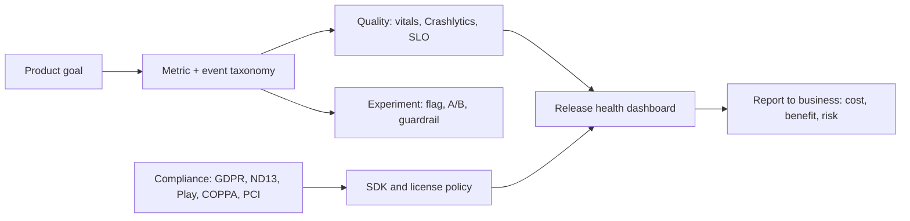
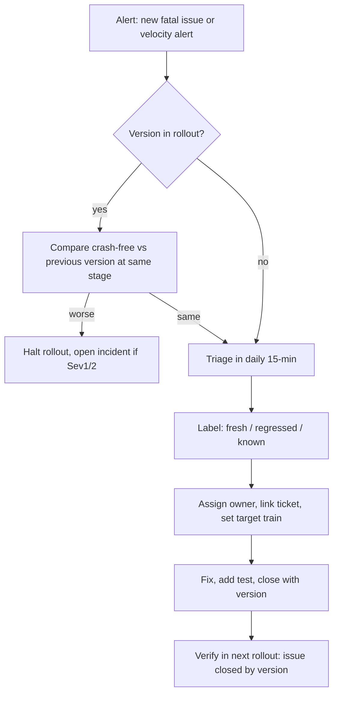

# 22. Product thinking, Metrics, Privacy và Compliance cho Mobile Lead

> Mục tiêu: nói chuyện được với PM bằng metric, với compliance bằng điều khoản, với CFO bằng chi phí; biết đọc Android vitals, Crashlytics, kết quả A/B test; biết app của mình thu thập gì, khai báo gì, dùng license gì. | Mức cần đạt: Senior: biết crash-free, ANR, startup, event analytics, Data safety form. Staff: thiết kế taxonomy event, đọc kết quả experiment, đánh giá SDK, hiểu GDPR/ND13/COPPA ở mức ảnh hưởng tới code. Lead: đặt SLO, release health dashboard, chính sách SDK và license, trình bày cost/benefit, trả lời câu hỏi compliance của bank. | Thời gian gợi ý: tuần 11, ~8 giờ (đọc 4h, hands-on 4h)

Ghi chú trước khi đọc: file này có nhiều điều khoản pháp lý và ngưỡng do Google đặt. Mọi con số và ngày trong file chỉ là điểm bắt đầu; chỗ nào ghi "cần kiểm tra" thì bạn phải mở link gốc trước khi nói trong phỏng vấn. Interviewer bank sẽ không trừ điểm nếu bạn nói "tôi cần kiểm tra ngưỡng hiện tại"; họ trừ điểm khi bạn nói sai một cách tự tin.

## 0. Bản đồ chủ đề

JD Staff/Lead ở VN ghi "translate tech to business", "product mindset", "data-driven", và với bank: "compliance", "security", "eKYC" (xem `01-Market-Research-2026.md`). Interviewer hỏi ở ba lớp:

1. **Bạn có nghĩ tới user và tiền không?** ("How did you measure success of that feature?", "What metric would you define for X?")
2. **Bạn có biết app mình đang ở đâu về chất lượng không?** ("What is your crash-free rate? What do you do when ANR spikes?")
3. **Bạn có đưa team vào rủi ro pháp lý không?** ("What data does your app collect? Which licenses do you allow? How do you handle consent?")



## 1. Product thinking cho tech lead

### 1.1 Outcomes, không phải outputs

Output là thứ team làm ra: feature, release, module. Outcome là thay đổi hành vi user hoặc business: nhiều user quay lại, nhiều người mua, ít ticket support. Lead kỹ thuật được đánh giá bằng outcome, dù bạn không sở hữu roadmap sản phẩm. Khi PM đưa feature, hỏi: "Outcome nào, đo bằng gì, bao giờ biết là thành công hay thất bại?" Nếu không trả lời được, feature chưa sẵn sàng để build.

### 1.2 Metric sản phẩm cơ bản

| Metric | Nghĩa | Lead mobile cần biết |
|---|---|---|
| DAU / MAU | User hoạt động ngày / tháng; tỷ lệ DAU/MAU là "stickiness" | Định nghĩa "active" là gì (mở app? hoàn thành 1 lesson?) phải thống nhất với PM |
| Retention cohort | % user của một cohort (ví dụ cài tuần 1) còn quay lại sau D1, D7, D30 | Cold start chậm và crash ở lần mở đầu giết D1 |
| Funnel | Chuỗi bước: install -> onboarding -> first lesson -> paywall -> purchase; đo drop ở mỗi bước | Mỗi bước là một event; thứ tự và tên event phải ổn định qua version |
| Conversion | % đi hết funnel (ví dụ trial -> paid) | Billing lỗi, restore lỗi, consent form chặn đều làm conversion giảm |
| ARPU / LTV | Doanh thu trung bình mỗi user; giá trị trọn đời (LTV ~ ARPU x thời gian giữ chân) | Dùng để biện minh chi phí: "giảm crash 1 điểm giữ thêm N user x LTV" |
| Churn | % user rời đi trong kỳ | Uninstall rate trên Play Console là proxy |

### 1.3 Kỹ thuật mobile ảnh hưởng metric thế nào

- **Startup**: cold start chậm làm user bỏ ở lần mở đầu; vitals và Macrobenchmark đo được (xem `04-Android-Kotlin-Deep-Dive.md`).
- **Crash và ANR**: crash trong onboarding hoặc checkout làm mất D1 và conversion; Play còn giảm visibility nếu vượt ngưỡng xấu.
- **App size**: size lớn làm giảm install conversion (nhất là thị trường data đắt) và tăng uninstall; Play Console cho so sánh size với app cùng loại.
- **Battery và data**: excessive wakeups, background network làm user gỡ app; Play có cảnh báo trong vitals.
- **Offline**: app trẻ em dùng ở nơi không mạng; content pack cache quyết định session length.

### 1.4 Viết metric cho một feature

Khung: **Tên metric, định nghĩa chính xác (event nào, điều kiện nào), baseline hiện tại, mục tiêu, thời hạn, guardrail, chủ sở hữu**.

Ví dụ cho feature "content pack tải về" ở app phonics:

| Mục | Nội dung |
|---|---|
| Metric chính | Lesson completion rate: `lesson_completed` / `lesson_started` trong 7 ngày đầu |
| Baseline | [điền số từ Analytics] |
| Mục tiêu | +[N] điểm trong 4 tuần sau rollout 100% |
| Guardrail | Crash-free users không giảm; cold start p90 không tăng; download failure rate dưới [N]% |
| Event cần có | `pack_download_started`, `pack_download_completed{size, duration_ms, network}`, `pack_download_failed{reason}` |
| Owner | Bạn (kỹ thuật), PM (mục tiêu) |

**Lỗi hay gặp / trade-off:**
- Metric đo output ("số pack tải") thay vì outcome ("lesson hoàn thành").
- Không có baseline: không biết thành công hay không.
- Quá nhiều metric: chọn 1 chính + 2-3 guardrail.

**Đọc thêm:**
- https://firebase.google.com/docs/analytics (khái niệm active user, retention, funnel trong Analytics)
- Lean Analytics (Croll, Yoskovitz), ch. 2-3 (one metric that matters)
- https://support.google.com/googleplay/android-developer/?hl=en (Play Console: statistics, user acquisition, uninstall)

## 2. Android vitals và quality metrics

### 2.1 Android vitals

Play Console thu thập từ thiết bị đã bật chia sẻ dữ liệu và hiển thị trong Android vitals. Hai **core vitals** quyết định visibility trên Play: **user-perceived crash rate** và **user-perceived ANR rate** (tính trên user, không phải trên session). Play đặt **bad behavior threshold** tổng và theo từng model thiết bị; vượt ngưỡng thì app có thể bị giảm khả năng hiển thị và có cảnh báo trên store listing. Ngưỡng cụ thể: **cần kiểm tra tại developer.android.com/topic/performance/vitals** trước khi nói số trong phỏng vấn.

Các vitals khác bạn phải gọi tên được: excessive wakeups, stuck partial wake locks, slow rendering và frozen frames, app startup time (cold/warm/hot, Play đánh dấu "slow" theo ngưỡng riêng cho mỗi loại, cần kiểm tra), excessive background network/Wi-Fi scans.

Cách nói trong phỏng vấn: "I track the two core vitals per release against Play's thresholds, both overall and per device model, because a single bad device model can push you over. I check the current thresholds on the vitals page rather than remembering them."

### 2.2 Crash-free, ANR và cách đọc

- **Crash-free users** (Crashlytics): % user không gặp crash trong kỳ. So **theo version**, không so tổng; bản mới ở 5% rollout có crash-free thấp hơn bản cũ là tín hiệu halt.
- **Crash-free sessions**: nhạy hơn với crash lặp ở ít user.
- **ANR**: main thread bị chặn quá 5 giây (input dispatch) hoặc BroadcastReceiver/Service quá hạn; nguyên nhân phổ biến: IO trên main, lock contention, `SharedPreferences.commit`, init SDK nặng trong `Application.onCreate`. Chi tiết ở `04`.
- Đọc stack trace ANR trong vitals: nhìn main thread, tìm frame của app, bỏ qua frame framework chờ.

### 2.3 Startup time và app size

- Startup đo bằng Macrobenchmark (`StartupMode.COLD`, `TimeToInitialDisplay`, `TimeToFullDisplay`) và vitals; Baseline Profile là đòn bẩy rẻ nhất. Khi `reportFullyDrawn()` không gọi, vitals chỉ có TTID.
- App size: dùng App Bundle, Play Asset Delivery hoặc content tải về (bạn đã làm), R8 full mode, resource shrinking, bỏ ABI không cần, kiểm tra size diff trên mỗi PR (gate trong `11` mục 6.2).

### 2.4 Crashlytics triage workflow



Quy ước team:
- Daily 15 phút: ai on-call mở Crashlytics, lọc version đang rollout, xem top 5 issue theo user ảnh hưởng.
- Alert bật: new fatal issue, regression (issue đã close xuất hiện lại), velocity (một issue tăng nhanh ở một version).
- Custom keys: `user_segment`, `content_pack_version`, `feature_flags` (không PII) để lọc; breadcrumbs từ Analytics để biết user đang ở màn hình nào.
- Non-fatal: log có chủ đích (download fail, parse error) để thấy lỗi "im lặng".
- Close issue "by version": Crashlytics mở lại nếu tái xuất.

### 2.5 SLO và alerting cho mobile

SLO cho mobile đặt theo **release** và theo **user**, không theo request. Ví dụ bộ SLO bạn có thể đề xuất (số là ví dụ cấu trúc, team tự chọn):
- Crash-free users của version mới sau 7 ngày >= [X]% và không thấp hơn version trước quá [Y] điểm.
- User-perceived ANR rate dưới ngưỡng Play (cần kiểm tra) ở mọi model top 20.
- Cold start p90 (Macrobenchmark, thiết bị tham chiếu) <= [Z] ms, không tăng quá [W]% giữa hai version.
- Download failure rate content pack < [V]%.

Error budget: nếu bản mới vượt ngưỡng ở bậc rollout nào thì halt; nếu hai train liên tiếp phải hotfix thì train kế dành 30% cho quality. Alert gửi về channel on-call, không gửi email.

### 2.6 Observability

- **Firebase Performance Monitoring**: tự động đo app start, screen rendering (slow/frozen frames), network request theo URL pattern; custom trace cho luồng quan trọng (`Trace` quanh download pack, quanh lesson load). Không log PII vào trace attribute.
- **Datadog RUM mobile** (hoặc Sentry, New Relic): session replay, view load, error, resource, long task, liên kết với backend trace qua trace header. Dùng khi backend đã ở Datadog; chi phí theo session.
- **Logging**: structured, có correlation id, mask PII (mục 4.8), level khác nhau debug/release.
- Nguyên tắc: một dashboard cho release, một cho feature; alert chỉ trên thứ cần hành động.

### 2.7 Release health dashboard

Một bảng, mỗi dòng một version đang sống:

| Version | Rollout % | Adoption % (7d) | Crash-free users | ANR rate | Cold start p90 | Top 3 issues | Owner | Trạng thái |
|---|---|---|---|---|---|---|---|---|

Nguồn: Play Console (rollout, vitals), Crashlytics (crash-free, issues), Macrobenchmark CI (startup), Analytics (adoption). Lead xem mỗi sáng trong thời gian rollout.

**Lỗi hay gặp / trade-off:**
- So crash-free tổng thay vì theo version ở cùng bậc rollout.
- Không bật velocity alert; biết crash khi user review 1 sao.
- Quá nhiều custom trace: Firebase Performance có giới hạn và chi phí; đo luồng quan trọng thôi.

**Đọc thêm:**
- https://developer.android.com/topic/performance/vitals
- https://firebase.google.com/docs/crashlytics
- https://firebase.google.com/docs/perf-mon
- https://developer.android.com/topic/performance/benchmarking/macrobenchmark-overview

## 3. Analytics và experimentation

### 3.1 Event taxonomy và đặt tên

Quy ước đề xuất (một trang trong repo, có owner):
- Tên event: `object_action`, snake_case, thì quá khứ cho hành động đã xảy ra: `lesson_started`, `lesson_completed`, `purchase_completed`, `pack_download_failed`.
- Param chuẩn cho mọi event: `screen_name`, `source` (từ đâu tới), `app_version`, `content_pack_version`; param riêng theo event: `lesson_id`, `duration_ms`, `reason`.
- Không PII trong tên và giá trị param (không email, không tên trẻ).
- Mỗi event có: mô tả, khi nào bắn, param và kiểu, owner, version thêm vào, version bỏ.
- Giới hạn Firebase Analytics về số event khác tên, số param mỗi event, độ dài tên và giá trị: cần kiểm tra giới hạn hiện tại tại firebase.google.com/docs/analytics trước khi thiết kế.
- Registry là code: sealed class hoặc enum trong `core/analytics`, không string rải rác.

```kotlin
sealed interface AnalyticsEvent {
    val name: String
    val params: Map<String, Any>

    data class LessonStarted(val lessonId: String, val source: String) : AnalyticsEvent {
        override val name = "lesson_started"
        override val params = mapOf("lesson_id" to lessonId, "source" to source)
    }

    data class PackDownloadFailed(val packVersion: Int, val reason: String) : AnalyticsEvent {
        override val name = "pack_download_failed"
        override val params = mapOf("pack_version" to packVersion, "reason" to reason)
    }
}

interface AnalyticsTracker {
    fun track(event: AnalyticsEvent)
}
```

Kiến trúc analytics SDK (interface trong core, nhiều sink, gating theo consent, buffer khi chưa có consent, debug sink in log): xem bài system design "Analytics SDK" trong `06-Mobile-System-Design.md`.

### 3.2 Firebase Analytics, Remote Config, A/B Testing

- **Analytics**: user property (ví dụ `subscription_status`, không PII), audience, funnel exploration, retention; DebugView để kiểm tra event khi dev.
- **Remote Config**: default value trong app (XML hoặc map), fetch theo chiến lược (fetch lúc start và activate ở lần sau để không "nhảy" UI; hoặc activate ngay cho kill switch), minimum fetch interval, real-time update listener; dùng cho kill switch, config, và làm nền cho experiment.
- **A/B Testing**: chọn Remote Config param làm biến, chia nhóm theo audience, metric mục tiêu từ Analytics (retention, event, revenue); kết quả hiển thị dạng xác suất nhóm tốt hơn baseline (Bayesian). Giới hạn: chỉ metric có trong Analytics; đọc kỹ trước khi kết luận.
- Thay thế: Statsig, LaunchDarkly, Optimizely; tự build với flag server + analytics warehouse khi quy mô lớn.

### 3.3 Feature flag vs experiment

| | Feature flag | Experiment (A/B) |
|---|---|---|
| Mục đích | Bật/tắt, rollout dần, kill switch | Đo tác động nhân quả của thay đổi |
| Chia nhóm | Theo %, theo segment, theo version | Ngẫu nhiên, ổn định theo user, có nhóm control |
| Kết luận | Có lỗi không | Metric đổi bao nhiêu, có ý nghĩa không |
| Vòng đời | Xoá sau khi 100% | Kết thúc khi đủ mẫu, rồi thành flag hoặc bỏ |

Flag là hạ tầng; experiment là phương pháp chạy trên hạ tầng đó. Flag tồn tại mãi là nợ: đặt ngày hết hạn.

### 3.4 Sample size và ý nghĩa thống kê, nói đơn giản

- Bạn muốn phát hiện thay đổi nhỏ nhất đáng quan tâm (MDE, ví dụ +1 điểm conversion). Hiệu ứng càng nhỏ, baseline càng thấp, càng cần nhiều user mỗi nhánh.
- Hai tham số chuẩn: mức ý nghĩa (thường 5%: xác suất kết luận "có khác" khi thật ra không khác) và power (thường 80%: xác suất phát hiện được khi thật sự khác).
- Dùng calculator (ví dụ Evan Miller sample size calculator) trước khi chạy; ghi số mẫu cần và ngày dự kiến đủ mẫu vào experiment doc.
- Với app nhỏ, nhiều experiment không bao giờ đủ mẫu cho MDE 1 điểm; chọn metric gần hơn (ví dụ click paywall thay vì purchase) hoặc chấp nhận MDE lớn hơn.
- Khoảng tin cậy quan trọng hơn p-value: "+2 điểm, CI từ -1 tới +5" nghĩa là chưa biết.

### 3.5 Guardrail metrics

Mỗi experiment có metric chính và guardrail: crash-free, ANR, cold start, uninstall, revenue, support ticket. Experiment "thắng" ở metric chính nhưng guardrail xấu thì không ship. Guardrail phải được định nghĩa trước khi chạy.

### 3.6 Lỗi phổ biến

- **Peeking**: xem kết quả mỗi ngày và dừng khi "có ý nghĩa". Với test tần suất cổ điển, điều này làm tỷ lệ kết luận sai tăng mạnh. Định ngày kết thúc trước, hoặc dùng phương pháp sequential.
- **Novelty effect**: feature mới được bấm nhiều tuần đầu rồi hết. Chạy ít nhất 2 chu kỳ tuần, xem cohort theo ngày exposure.
- **Sample ratio mismatch**: nhóm A/B không đúng tỷ lệ 50/50 (do crash ở một nhánh, do exposure sai). Kiểm tra trước khi đọc metric.
- **Version confounding**: experiment chỉ chạy trên bản mới, user bản mới khác user bản cũ (họ update sớm hơn). So trong cùng version.
- **Multiple comparisons**: 20 metric thì có 1 "có ý nghĩa" ngẫu nhiên. Một metric chính.
- **Exposure sai**: tính user vào nhóm khi họ chưa thấy feature. Bắn event exposure đúng chỗ.

### 3.7 Đọc kết quả experiment như một lead

Thứ tự: (1) sample ratio có đúng không; (2) exposure event có bắn đúng không; (3) metric chính với khoảng tin cậy; (4) guardrail; (5) phân rã theo platform, version, country, new vs returning để tìm nhóm bị hại; (6) so với decision rule đã viết trước; (7) quyết định: ship, iterate, hoặc dừng; ghi vào experiment log. Nếu kết quả "gần có ý nghĩa", câu trả lời là "chưa biết", không phải "ship vì có vẻ tốt".

**Đọc thêm:**
- https://firebase.google.com/docs/remote-config
- https://firebase.google.com/docs/ab-testing
- Trustworthy Online Controlled Experiments (Kohavi, Tang, Xu), ch. 1-3 và ch. 17 (SRM, pitfalls)
- https://www.evanmiller.org/ab-testing/sample-size.html

## 4. Privacy và compliance

### 4.1 GDPR: những gì ảnh hưởng tới code mobile

Áp dụng khi app có user ở EU/EEA, bất kể công ty ở đâu.
- **Lawful basis** (Điều 6): consent, contract, legal obligation, vital interests, public task, legitimate interests. Analytics và ads cá nhân hoá thường dựa trên consent; chức năng cốt lõi dựa trên contract. Chọn basis trước, rồi mới code consent.
- **Consent** phải tự nguyện, cụ thể, có thông tin, rõ ràng, rút lại dễ như cho. Không pre-tick, không gộp "đồng ý tất cả" bắt buộc. SDK analytics/ads chỉ khởi tạo **sau** consent; sự kiện trước consent phải buffer hoặc bỏ.
- **Quyền của chủ thể dữ liệu**: truy cập, sửa, xoá (right to erasure), hạn chế, chuyển dữ liệu (portability), phản đối, không bị quyết định tự động. Code cần: xoá account và dữ liệu (cả log, cả backup theo lịch), export dữ liệu, tắt profiling.
- **DPIA** (Điều 35) khi xử lý rủi ro cao: sinh trắc học, dữ liệu trẻ em, theo dõi quy mô lớn. eKYC khuôn mặt gần như chắc chắn cần DPIA.
- **Privacy by design, data minimization**: thu đúng thứ cần, giữ đúng thời gian cần.
- **Thông báo vi phạm** cho cơ quan giám sát trong 72 giờ kể từ khi biết (Điều 33; cần kiểm tra chi tiết). Lead mobile phải biết đường escalate khi phát hiện rò rỉ từ app (log, SDK, cache).
- Mức phạt tối đa theo % doanh thu toàn cầu: cần kiểm tra tại gdpr.eu khi cần nêu số.

### 4.2 Việt Nam: Nghị định 13/2023/NĐ-CP và Luật Bảo vệ dữ liệu cá nhân 2025

- **Nghị định 13/2023/NĐ-CP** về bảo vệ dữ liệu cá nhân, có hiệu lực từ 1/7/2023. Điểm ảnh hưởng tới app:
  - Phân loại **dữ liệu cá nhân cơ bản** và **dữ liệu cá nhân nhạy cảm** (sinh trắc học, tài chính, vị trí, sức khoẻ...). eKYC và biometrics login thuộc nhạy cảm.
  - Consent phải rõ ràng, tự nguyện, có thể in/sao chép được, tách riêng cho từng mục đích; được rút lại.
  - **Hồ sơ đánh giá tác động xử lý dữ liệu cá nhân** gửi Bộ Công an (A05) trong thời hạn quy định kể từ khi bắt đầu xử lý (cần kiểm tra thời hạn và biểu mẫu hiện hành); hồ sơ riêng cho **chuyển dữ liệu ra nước ngoài** (Firebase, Crashlytics, RevenueCat đều là chuyển ra nước ngoài).
  - Dữ liệu trẻ em: yêu cầu consent của cha mẹ/người giám hộ theo độ tuổi quy định (cần kiểm tra điều khoản cụ thể).
  - Quyền của chủ thể: biết, đồng ý, truy cập, rút lại, xoá, hạn chế, phản đối, khiếu nại, bồi thường.
- **Luật Bảo vệ dữ liệu cá nhân** được Quốc hội thông qua tháng 6/2025, hiệu lực từ 1/1/2026 (cần kiểm tra ngày hiệu lực và nghị định hướng dẫn tại vanban.chinhphu.vn). Luật nâng Nghị định 13 lên tầm luật, bổ sung quy định về mua bán dữ liệu cá nhân, chuyên gia/tổ chức bảo vệ dữ liệu, và chế tài theo % doanh thu (cần kiểm tra mức cụ thể). Với bank, phòng pháp chế sẽ dẫn; lead mobile cần biết: dữ liệu nào trong app là nhạy cảm, SDK nào gửi dữ liệu ra nước ngoài, consent flow có đúng không.

Cách nói trong phỏng vấn (EN): "For Vietnam I work from Decree 13 and the 2025 Personal Data Protection Law: classify what the app collects into basic and sensitive data, make consent explicit and per purpose, keep an inventory of SDKs that transfer data abroad for the cross-border dossier, and involve legal early for the impact assessment. I check the current effective dates and forms with legal rather than from memory."

### 4.3 Google Play Data safety form

- Bắt buộc cho mọi app; khai: dữ liệu **thu thập** (collected) và **chia sẻ** (shared) theo loại (location, personal info, financial, device IDs, app activity...), mục đích, bắt buộc hay tuỳ chọn, mã hoá khi truyền, cách yêu cầu xoá, có tuân theo Families policy không.
- Phải bao gồm hành vi của **SDK bên thứ ba** (Firebase, AdMob, AppLovin, RevenueCat). Google Play SDK Index và trang data safety của từng SDK cho thông tin.
- Sai khai báo là vi phạm policy (có thể bị gỡ). Quy trình: mỗi khi thêm/đổi SDK hoặc event mới, cập nhật một file `data-inventory.md` trong repo rồi đồng bộ lên form; review mỗi release lớn.
- Yêu cầu **xoá tài khoản**: app cho tạo tài khoản phải có đường xoá trong app và link web (cần kiểm tra chi tiết policy hiện hành tại Play policy center).

### 4.4 Permissions best practices

- Xin đúng lúc (in context), có rationale, hoạt động được khi bị từ chối (graceful degradation), không xin lại liên tục.
- Dùng Photo Picker thay quyền media; dùng contacts picker (Android 17 chuyển sang session-only, xem brief); location chỉ foreground và chỉ khi cần; không SMS/Call log trừ khi là chức năng cốt lõi được Play duyệt.
- Android 16: local network permission opt-in; health permissions thay `BODY_SENSORS` (brief). Kiểm tra merged manifest trên mỗi PR vì SDK có thể thêm quyền.
- Mọi quyền trong manifest phải map được vào Data safety form và vào một dòng trong privacy policy.

### 4.5 Consent management: UMP cho ads

- Google yêu cầu app dùng AdMob phục vụ user ở EEA/UK phải dùng CMP được Google chứng nhận (UMP là lựa chọn mặc định, hỗ trợ TCF). Yêu cầu này có hiệu lực từ đầu 2024 (cần kiểm tra thông báo hiện hành của AdMob).
- UMP cũng xử lý thông báo cho các bang Mỹ có luật riêng và iOS ATT. Luồng: `requestConsentInfoUpdate` -> hiện form nếu cần -> chỉ load ads sau khi `canRequestAds`.
- App trẻ em: cấu hình child-directed / under-age-of-consent trong request ads và UMP; ads phải non-personalized; cần kiểm tra hướng dẫn cấu hình hiện tại cho app trong Families.
- Consent cho analytics tách khỏi consent cho ads; lưu trạng thái, cho đổi trong Settings.

### 4.6 Families policy và COPPA cho app trẻ em

Bạn ship app trẻ em, đây là nơi bạn có lợi thế nếu nói chính xác.
- **COPPA** (Mỹ): bảo vệ trẻ dưới 13; thu thập thông tin cá nhân từ trẻ cần **verifiable parental consent**; FTC thực thi. Quy tắc COPPA được FTC sửa đổi gần đây (cần kiểm tra ngày hiệu lực và thay đổi về consent cho chia sẻ dữ liệu với bên thứ ba).
- **Google Play Families policy**: khai target audience; nếu có trẻ em trong đối tượng thì: chỉ dùng ad SDK trong danh sách Families self-certified; không truyền advertising ID cho trẻ; không vị trí chính xác; không API nhạy cảm; nội dung phù hợp; parental gate cho link ngoài, mua hàng, chia sẻ; nếu dùng Firebase Analytics phải cấu hình đúng cho trẻ em. Chi tiết: Play policy center, mục Families (cần kiểm tra bản hiện hành).
- Kỹ thuật bạn đã làm (`references/coppa.md`): không đăng nhập, không PII, ads non-personalized qua SDK certified, parental gate, Data safety khai đúng, analytics tối thiểu.
- Khi trả lời bank: "the same discipline applies to adult sensitive data: inventory, minimize, gate, declare."

### 4.7 Bank/fintech: PCI DSS, 3-D Secure, eKYC

- **PCI DSS** áp dụng khi lưu, xử lý hoặc truyền dữ liệu thẻ (PAN). Mục tiêu của mobile là **ra khỏi scope**: không chạm PAN; dùng SDK của payment gateway (hosted field/tokenization) để PAN đi thẳng tới gateway; app chỉ giữ token. Nếu app nhập PAN trực tiếp thì app và backend vào scope đầy đủ. Phiên bản hiện hành của chuẩn và các yêu cầu mới có hiệu lực: cần kiểm tra tại pcisecuritystandards.org. Với SoftPOS (điện thoại làm máy POS) có chuẩn riêng PCI MPoC (cần kiểm tra).
- **3-D Secure 2 (EMV 3DS)**: xác thực chủ thẻ khi thanh toán online; luồng **frictionless** (dựa trên risk, không hỏi user) và **challenge** (OTP, biometric trong app ngân hàng). Trên mobile dùng 3DS SDK của nhà cung cấp hoặc web flow; app ngân hàng là nơi nhận challenge (push, in-app). Ở EU gắn với yêu cầu SCA của PSD2.
- **eKYC Việt Nam**: NHNN cho phép mở tài khoản thanh toán bằng eKYC từ 2021 (Thông tư 16/2020/TT-NHNN sửa Thông tư 23/2014); quy định hiện hành về tài khoản thanh toán, xác thực sinh trắc học với CCCD gắn chip, và an toàn giao dịch online (Quyết định 2345/QĐ-NHNN về sinh trắc học cho giao dịch giá trị lớn từ 7/2024, sau đó Thông tư 50/2024/TT-NHNN; Thông tư 17/2024/TT-NHNN về tài khoản thanh toán): **cần kiểm tra số hiệu và hiệu lực tại sbv.gov.vn và vanban.chinhphu.vn**. Kỹ thuật: đọc chip CCCD qua NFC, liveness detection, so khớp khuôn mặt với dữ liệu chip/CSDL dân cư, chống giả mạo (anti-spoofing), log đầy đủ cho audit, dữ liệu sinh trắc là dữ liệu nhạy cảm theo Nghị định 13. Security phía client ở `08-Security.md`.
- Bank thường có thêm: yêu cầu nội bộ về RASP, anti-tamper, không root, pinning, và pentest định kỳ bao gồm SDK bên thứ ba.

### 4.8 Log masking và data retention

- Không log PII, token, PAN, OTP, nội dung tin nhắn. Mask: PAN hiện 6 đầu 4 cuối tối đa; email `a***@domain`; số điện thoại 3 cuối.
- Timber tree (hoặc tương đương) cho release chỉ log level >= WARN và chạy qua redactor allowlist; Crashlytics custom key và log không chứa PII; ProGuard mapping giữ để đọc crash nhưng không giữ log debug.
- Retention: log client gửi lên giữ theo chính sách công ty (ví dụ 30-90 ngày; số do pháp chế quyết, không tự đặt); phải xoá được theo user id khi có yêu cầu erasure; backup có lịch xoá.
- Tài liệu: một trang "what we log, where, how long, who can read".

### 4.9 Accessibility law: EU Accessibility Act

Chỉ thị (EU) 2019/882 áp dụng từ 28/6/2025 cho nhiều dịch vụ số ở EU, trong đó có dịch vụ ngân hàng tiêu dùng và thương mại điện tử; chuẩn kỹ thuật tham chiếu thường là EN 301 549 (dựa trên WCAG 2.1 AA). Nếu bạn làm app cho khách hàng EU (outsourcing, fintech có user EU), a11y không còn là "nice to have": TalkBack, contrast, touch target, focus order phải pass. Chi tiết kỹ thuật ở `21-UI-UX-Design-Adaptive.md`.

**Lỗi hay gặp / trade-off:**
- Khởi tạo Firebase/AdMob trong `Application.onCreate` trước consent.
- Data safety form khai theo trí nhớ, không theo inventory.
- Coi compliance là việc của pháp chế: pháp chế không biết SDK nào gửi gì đi đâu; bạn biết.

**Đọc thêm:**
- https://gdpr.eu/ (tóm tắt điều khoản, checklist)
- https://vanban.chinhphu.vn/ (tra Nghị định 13/2023/NĐ-CP và Luật Bảo vệ dữ liệu cá nhân 2025)
- https://support.google.com/googleplay/android-developer/answer/10787469?hl=en (Data safety; nếu link đổi, vào Play policy center)
- https://play.google.com/about/developer-content-policy/ (Play policy center: User Data, Families, Permissions)
- https://developers.google.com/admob/android/privacy (UMP)
- https://www.ftc.gov/ (COPPA rule, tìm "Children's Online Privacy Protection Rule")
- https://www.pcisecuritystandards.org/
- https://www.sbv.gov.vn/ (văn bản NHNN về eKYC, sinh trắc học)

## 5. SDK, vendor evaluation và OSS licensing

### 5.1 Checklist đánh giá SDK

```markdown
- [ ] Size: APK/AAB diff, method count, native libs (ABI nào, 16 KB page support chưa)
- [ ] Permissions thêm vào merged manifest; có quyền nào không giải thích được với user không
- [ ] Network: endpoint nào, dữ liệu gì, có cho tắt không; có pinning riêng gây xung đột không
- [ ] Privacy: data collected/shared để khai Data safety; iOS privacy manifest nếu KMP (cần kiểm tra yêu cầu Apple hiện hành)
- [ ] Startup: init nặng không; có lazy init / App Startup không; có chạy background job không
- [ ] Compat: minSdk, compileSdk, Kotlin/Coroutines version, KMP support nếu cần
- [ ] Maintenance: release gần nhất, issue mở, phản hồi maintainer, có trong Play SDK Index không
- [ ] License: loại gì (mục 5.2), có NOTICE phải kèm không
- [ ] Security: CVE đã biết, cách cập nhật, có ký artifact không
- [ ] Kill switch và exit plan: bọc interface, tắt được bằng Remote Config, thay được trong 1 sprint
- [ ] Cost: license, theo MAU hay theo event, phí tăng khi scale
```

### 5.2 Các license và ý nghĩa với app

| License | Loại | Với app đóng nguồn trên store | Việc phải làm |
|---|---|---|---|
| Apache-2.0 | Permissive, có patent grant | Dùng được | Giữ LICENSE và NOTICE, ghi thay đổi nếu sửa |
| MIT | Permissive | Dùng được | Giữ copyright notice |
| BSD-2/3 | Permissive | Dùng được | Giữ notice; BSD-3 không dùng tên tác giả để quảng cáo |
| LGPL | Copyleft yếu | Rủi ro: yêu cầu user có thể thay thư viện (relink); với app Android đóng nguồn, R8 và đóng gói tĩnh làm khó đáp ứng; nhiều công ty cấm | Hỏi pháp chế; thường tránh |
| GPL | Copyleft mạnh | Không dùng được trừ khi phát hành toàn bộ app dưới GPL | Tránh |
| AGPL | Copyleft mạnh, kể cả dùng qua mạng | Không dùng trong app; cẩn thận cả backend | Tránh |

Việc phải có trong app: màn hình "Open source licenses" sinh tự động (Google OSS Licenses Gradle plugin hoặc AboutLibraries), kiểm tra license tự động trong CI (ví dụ Gradle License Report, hoặc task tự viết đọc POM), SBOM (CycloneDX Gradle plugin) cho bank khi audit yêu cầu. Chính sách team: allowlist Apache-2.0/MIT/BSD; mọi thứ khác qua lead và pháp chế.

### 5.3 Play policy về SDK

Developer chịu trách nhiệm về hành vi của SDK trong app: User Data policy, Families policy (ad SDK certified), Permissions, không SDK tải code động, Data safety phải phản ánh SDK. Google Play SDK Index hiển thị thông tin SDK (version, quyền, data safety, cảnh báo). Nhà cung cấp SDK có Play SDK Console để đăng ký. Khi SDK vi phạm, app bị xử lý, không phải SDK.

### 5.4 Dependency verification và supply chain

- **Gradle dependency verification**: file `gradle/verification-metadata.xml` chứa checksum (và chữ ký PGP nếu bật) của mọi artifact; Gradle từ chối artifact không khớp. Tạo lần đầu: `./gradlew --write-verification-metadata sha256 help`; cập nhật khi nâng version. Chi phí: phải maintain file; lợi ích: chặn artifact bị thay thế trên mirror hoặc repo lạ.
- **Repository hygiene**: chỉ `google()` và `mavenCentral()`; JitPack và repo lạ không dùng trong app bank; dùng `exclusiveContent` để khoá group vào repo.
- **Dependabot** (`.github/dependabot.yml`, `package-ecosystem: gradle`) hoặc **Renovate** (hỗ trợ version catalog tốt): PR tự động nâng version, nhóm theo lịch, có changelog; cần CI đủ test để merge an toàn. Xem `20-Git-CICD.md`.
- Pin version chính xác trong `libs.versions.toml`; không dùng dynamic version `+`.
- Kiểm tra CVE: OWASP Dependency-Check hoặc GitHub Dependabot alerts.

### 5.5 Rủi ro SDK bên thứ ba trong app ngân hàng

- Rủi ro: SDK thu thập dữ liệu ngoài khai báo, SDK có lỗ hổng, SDK bị chiếm (supply chain), SDK tải code động, SDK làm tăng attack surface (webview, exported component).
- Kiểm soát: vendor risk assessment trước khi dùng; pentest định kỳ bao gồm SDK; giám sát traffic (proxy) trên build test để xem SDK gửi gì; chính sách "mỗi SDK phải có owner và ngày review"; RASP/anti-tamper không thay thế việc này.
- Khi trả lời bank: nêu rằng bạn có inventory SDK với owner, mục đích, dữ liệu, license, ngày review; và bạn có cách tắt SDK từ xa.

**Đọc thêm:**
- https://play.google.com/sdks
- https://developer.android.com/quality (app quality hub; SDK guidance nằm trong Play policy center)
- https://docs.gradle.org/current/userguide/dependency_verification.html
- https://choosealicense.com/licenses/ và https://opensource.org/licenses
- https://docs.github.com/en/code-security/dependabot

## 6. Cost awareness

### 6.1 Các khoản chi lead mobile phải nhìn thấy

| Khoản | Cơ chế tính | Đòn bẩy |
|---|---|---|
| Cloud/Firebase (Blaze) | Storage và egress (content pack qua CDN), Firestore read/write, Functions, Auth MAU trên ngưỡng free; Analytics, Crashlytics, Remote Config miễn phí (cần kiểm tra bảng giá hiện tại) | Cache client, nén pack, CDN cache header, giảm read bằng local DB |
| AI tokens | Theo token input/output, theo model; cache prefix; on-device "miễn phí" per inference nhưng tốn engineering | Chọn model nhỏ nhất đủ dùng, cap per user, hybrid on-device (xem `10-AI-for-Mobile-Lead.md`) |
| CI minutes | GitHub Actions tính phút theo loại runner; macOS runner (cần cho iOS) có hệ số giá cao hơn Linux (cần kiểm tra bảng giá) | Gradle cache, remote build cache, chỉ chạy iOS build khi đổi code iOS, self-hosted runner |
| Device farm | Firebase Test Lab, BrowserStack, AWS Device Farm theo device-phút | Ma trận device nhỏ cho PR, lớn cho nightly |
| Tool license | Datadog theo session, Sentry theo event, LaunchDarkly theo MAU | Sample, giới hạn event, xem lại mỗi quý |
| Người | Lớn nhất: giờ review, giờ chờ CI, giờ fix flaky | Đo và báo cáo như chi phí thật |

### 6.2 Trình bày cost/benefit

Một trang: vấn đề, phương án (2-3), chi phí mỗi phương án (tiền + người-tuần + rủi ro), lợi ích đo được (tiền tiết kiệm, giờ tiết kiệm, metric sản phẩm), đề xuất, khi nào xem lại. Ví dụ: "Remote build cache: chi phí [N]/tháng + 2 ngày setup; CI trung bình giảm từ [A] phút xuống [B] phút trên [C] build/ngày = [D] giờ engineer/tháng". Số phải thật; nếu chưa đo, ghi "ước tính, sẽ đo sau 2 tuần".

**Đọc thêm:**
- https://firebase.google.com/pricing
- https://docs.github.com/en/billing (GitHub Actions billing)
- https://firebase.google.com/docs/test-lab (quota và giá)

## 7. Documentation và communication

Template ngắn cho từng loại (ADR và RFC đầy đủ ở `11-Leadership-Management.md` mục 1.1-1.2):

- **ADR** (1 trang): Status, Context, Decision, Options, Consequences, Revisit when.
- **RFC** (1-3 trang): Summary, Motivation (số), Proposal, Alternatives, Risks, Rollout, Cost, Open questions, Decision log.
- **Runbook** (cho một tình huống vận hành):
  ```markdown
  # Runbook: <tình huống, ví dụ "Crash spike during rollout">
  Trigger: alert nào, ngưỡng nào
  Owner / on-call: ai, kênh nào
  Steps (đánh số, mỗi bước có lệnh hoặc link màn hình): 1. Halt rollout tại Play Console > Release > ... 2. Bật flag X trong Remote Config ... 3. ...
  Verify: thấy gì là đã ổn
  Escalate: khi nào, tới ai
  Postmortem: template link
  ```
- **Onboarding doc**: cách build từng app, cấu trúc module (link ADR), quy trình release, công cụ (Crashlytics, Play Console quyền gì), on-call, 30/60/90 (xem `11` mục 7.4), danh sách "ai hỏi gì".
- **Tech talk** (30 phút): vấn đề (3 phút), cách làm cũ và đau (5), giải pháp với demo (12), trade-off và điều chưa xong (5), Q&A (5). Một slide một ý; code trên slide tối đa 10 dòng.
- **Proposal cho executive** (1 trang): Problem với số, Proposal, Options bảng, Ask, Risks, Metric và ngày review. Kết luận ở dòng đầu.
- **Tech radar** (1 trang, mỗi quý): 4 vòng Adopt/Trial/Assess/Hold, mỗi mục một dòng lý do, ai đề xuất.

**Đọc thêm:**
- https://sre.google/sre-book/ (chương về playbooks/runbooks trong "Being On-Call" và "Emergency Response")
- https://www.thoughtworks.com/radar

## 8. ASO và release marketing cơ bản

- **Store listing**: title ngắn có từ khoá chính, short description là câu bán hàng, full description có từ khoá tự nhiên; giới hạn ký tự của từng trường cần kiểm tra tại Play Console help. Localize listing cho từng thị trường (VN, EN tối thiểu).
- **Screenshots**: 2-3 ảnh đầu quyết định; mỗi ảnh một lợi ích, chữ to; video ngắn nếu có; feature graphic. Dùng Play store listing experiments để A/B icon và screenshot.
- **Rating và review**: In-App Review API đúng lúc (sau lesson hoàn thành, không phải lúc mở app); trả lời review; rating thấp của một version là tín hiệu quality.
- **Staged rollout như đòn bẩy marketing**: ra 10% để lấy review và crash sớm; 100% kèm thông báo, blog, push; release notes "what's new" viết cho user, không phải changelog kỹ thuật.
- **Pre-registration và custom store listing** theo quốc gia khi mở thị trường mới (ví dụ iOS launch hoặc thị trường mới).
- Đo: conversion của listing (Play Console > Store performance), install theo nguồn, uninstall rate.

**Đọc thêm:**
- https://support.google.com/googleplay/android-developer/?hl=en (store listing, experiments, pre-registration)
- https://developer.android.com/guide/playcore/in-app-review

## Interview Q&A (English)

### Q1. How do you define success for a feature you are about to build?
**A:** Before writing code I ask for the outcome, not the output: what user or business behavior should change, measured by which event, from which baseline, by when. I write it as one primary metric with two or three guardrails, for example lesson completion rate for a content pack feature, with crash-free users, cold start p90 and download failure rate as guardrails. I add the events to the analytics registry in the same PR as the feature. If the PM cannot name the outcome, we are not ready to build; we are ready to run a cheaper experiment.
**Follow-ups:** What if the metric cannot move within a quarter? How do you handle features that are table stakes with no metric? Who owns the metric after launch?
**Điểm interviewer muốn nghe:** Outcome trước output, metric chính + guardrail, event vào cùng PR.

### Q2. What is the difference between DAU/MAU and retention, and why does a mobile lead care?
**A:** DAU/MAU is a snapshot of how many users are active and how sticky the app is; retention follows a cohort over time, so it tells you whether users who installed last week come back on day 1, 7 and 30. Retention is the one engineering affects most directly: a slow cold start or a crash in onboarding kills day-1 retention before the product has a chance. I look at retention by app version and device tier to find engineering-caused drops, and I make "active" a precise definition agreed with the PM, because "opened the app" and "completed a lesson" give very different numbers.
**Follow-ups:** How do you separate product causes from engineering causes in a retention drop? What is a good D1 for your category? How do you instrument retention without PII?
**Điểm interviewer muốn nghe:** Hiểu cohort, biết engineering tác động D1, định nghĩa "active".

### Q3. What are Android vitals and which ones matter most?
**A:** Android vitals is the quality data Play collects from opted-in devices. The two core vitals are user-perceived crash rate and user-perceived ANR rate; Play sets bad behavior thresholds overall and per device model, and exceeding them reduces discoverability and can show a warning on the listing. I check the current thresholds on the vitals page rather than quoting numbers from memory. Beyond those, I watch startup time, slow and frozen frames, excessive wakeups and stuck wake locks, because they show up as uninstalls before they show up as crashes.
**Follow-ups:** How does per-device threshold change your release process? How do you reproduce an ANR from vitals? Where does Crashlytics differ from vitals?
**Điểm interviewer muốn nghe:** Biết hai core vitals, biết ngưỡng theo model, không bịa số.

### Q4. Your crash-free rate drops after a release. Walk me through what you do.
**A:** First confirm it is the new version: compare crash-free of the new version against the previous version at the same rollout stage, not the overall number. If it is worse, halt the rollout and open an incident if it is a core flow. Look at the top issue by affected users, read the stack with custom keys such as feature flags and content pack version, and reproduce. Mitigate first: a kill switch if the crash is behind a flag, otherwise a hotfix from the release tag. Then the postmortem asks why the gate did not catch it and adds the test or the check. Throughout, a comms update every 30 minutes to the PM and support.
**Follow-ups:** What if the crash is in a third-party SDK? How do you decide between hotfix and waiting for the next train? How do you know the hotfix worked?
**Điểm interviewer muốn nghe:** So theo version, halt, mitigate trước root cause, postmortem.

### Q5. How do you set an SLO for a mobile app?
**A:** Per release and per user, not per request. Examples: crash-free users of the new version at day 7 at least X% and not more than Y points below the previous version; user-perceived ANR under Play's threshold on the top device models; cold start p90 on a reference device under Z ms with no more than W% regression between versions; content download failure under V%. Each has an alert and an action: halt rollout, or dedicate capacity in the next train. The numbers come from the current baseline, not from wishes, and they are reviewed quarterly.
**Follow-ups:** What is your error budget policy? How do you handle a device model that is always over threshold? Who gets paged?
**Điểm interviewer muốn nghe:** SLO theo release, có hành động gắn với mỗi SLO, baseline thật.

### Q6. How do you triage Crashlytics issues day to day?
**A:** A 15-minute daily during rollout: the on-call engineer filters by the version in rollout, looks at the top five issues by affected users, labels each as fresh, regressed or known, assigns an owner, links a ticket and sets the target train. Alerts are on for new fatal issues, regressions and velocity spikes. We use custom keys for segment, feature flags and content version, never PII, and we log deliberate non-fatals for silent failures like download errors. Issues are closed by version so Crashlytics reopens them if they come back.
**Follow-ups:** How do you prioritize a crash affecting 0.1% of users versus a non-fatal affecting 10%? How do you handle crashes you cannot reproduce? What do you do with obfuscated stacks?
**Điểm interviewer muốn nghe:** Nhịp cố định, label, owner, close by version, custom key không PII.

### Q7. How would you design an event taxonomy for a new app?
**A:** One document with an owner and a code registry. Names are object_action in snake_case and past tense: lesson_started, purchase_completed. Every event carries standard parameters such as screen_name, source and content version; event-specific parameters are typed in a sealed class so nobody invents strings. No PII in names or values. Each event has a description, trigger, parameters, owner and the version it was added. I check the analytics SDK limits on event count and parameter sizes before designing, and I keep the number of events small; a funnel needs five good events, not fifty.
**Follow-ups:** How do you version events when the meaning changes? How do you test that events fire? How do you handle consent for analytics?
**Điểm interviewer muốn nghe:** Quy ước tên, registry trong code, không PII, có owner.

### Q8. Feature flags versus A/B experiments: when do you use which?
**A:** A flag is infrastructure: turn a feature on or off, roll it out gradually, kill it in an incident. An experiment is a method that runs on top of flags: random, stable assignment with a control group to measure causal impact on a metric. I use flags for every risky feature regardless of whether we experiment. I run an experiment only when there is a decision to make and enough users to detect the effect we care about. Flags get an expiry date so they do not become debt; experiments get a pre-registered decision rule and an end date so nobody peeks.
**Follow-ups:** How do you keep flag assignment stable across app restarts? How many flags is too many? How do you test code paths behind flags?
**Điểm interviewer muốn nghe:** Phân biệt hạ tầng và phương pháp, flag có hạn, experiment có decision rule.

### Q9. Explain sample size and statistical significance to a product manager.
**A:** The smaller the change you want to detect, the more users you need in each group; a one-point lift on a 20% conversion needs far more users than a five-point lift. Two settings are standard: a 5% chance of calling a difference real when it is not, and an 80% chance of catching a real difference. We put those into a calculator before the test to get the number of users and the end date. Until that date, the dashboard will wobble; reading it early and stopping when it looks good is how teams ship things that do nothing. The confidence interval matters more than the p-value: plus two points with an interval from minus one to plus five means we do not know yet.
**Follow-ups:** What if we never reach the sample size? What is a sequential test? How do you handle a test with a small negative result?
**Điểm interviewer muốn nghe:** Nói đơn giản, đúng ý nghĩa của alpha và power, cảnh báo peeking.

### Q10. What are the most common experiment pitfalls you have seen?
**A:** Peeking and stopping early. Novelty effects, where a new button gets tapped for a week and then not. Sample ratio mismatch, where one arm has fewer users because it crashes more or exposure is logged wrongly, which invalidates everything. Version confounding, where the experiment only exists in the new version and early updaters differ from everyone else. Multiple comparisons: twenty metrics guarantee one false winner. And exposure logged before the user actually sees the change. My reading order is: check the ratio, check exposure, then the primary metric with its interval, then guardrails, then segments.
**Follow-ups:** How do you detect SRM? How long do you run a test to avoid novelty? How do you handle an experiment that wins on the primary metric but hurts a guardrail?
**Điểm interviewer muốn nghe:** Biết SRM, peeking, novelty, confounding; có thứ tự đọc.

### Q11. What does GDPR change in how you build a mobile app?
**A:** Four things in code. Lawful basis first: core features run on contract, analytics and personalized ads on consent, so SDKs that need consent are initialized only after it is given and events before that are dropped or buffered. Data subject rights become features: delete account and data including logs and backups, export data, turn off profiling. Data minimization and retention become design constraints: collect what the feature needs and set a deletion schedule. And high-risk processing, such as biometrics or children's data, needs a DPIA with legal before launch. I keep a data inventory in the repo so the Data safety form and the DPIA come from the same source.
**Follow-ups:** What is a lawful basis for crash reporting? How do you handle a user who withdraws consent mid-session? What is the breach notification timeline?
**Điểm interviewer muốn nghe:** Lawful basis, consent trước SDK init, quyền thành feature, DPIA.

### Q12. What do you know about Vietnam's personal data regulations?
**A:** Decree 13/2023 has been in force since mid-2023 and the Personal Data Protection Law passed in 2025 raises it to law; I verify the current effective dates and guidance with legal rather than from memory. In practice for an app: classify data into basic and sensitive, with biometrics and financial data as sensitive; make consent explicit, per purpose and withdrawable; prepare the processing impact assessment dossier and the cross-border transfer dossier, because Firebase, Crashlytics and most SDKs send data abroad; and handle children's data with guardian consent rules. My job as lead is the inventory: which SDK sends what where, so legal can file correctly.
**Follow-ups:** Which of your current SDKs transfer data abroad? What counts as sensitive data in your app? Who in your company owns the dossier?
**Điểm interviewer muốn nghe:** Biết ND13 và luật 2025, biết phân loại, biết hồ sơ chuyển dữ liệu ra nước ngoài, không bịa ngày.

### Q13. How do you keep the Google Play Data safety form accurate?
**A:** It comes from an inventory, not from memory. A data-inventory file in the repo lists every data type we collect or share, the purpose, whether it is optional, the SDK responsible, and the retention. Any PR that adds an SDK, a permission or an analytics event must update the inventory, and the release checklist includes syncing it to the form. I use the Play SDK Index and each SDK's published data safety information to fill the SDK rows, and I treat a mismatch as a policy risk because a wrong form can get the app removed.
**Follow-ups:** How do you know what a closed-source SDK actually sends? How do you handle the account deletion requirement? What changes for a Families app?
**Điểm interviewer muốn nghe:** Inventory trong repo, quy trình cập nhật, biết rủi ro gỡ app.

### Q14. How do you approach runtime permissions?
**A:** Ask in context with a rationale, degrade gracefully when denied, never loop the request. Prefer system pickers over broad permissions: the photo picker instead of media permissions, the contacts picker, foreground-only location. Check the merged manifest on every PR because SDKs add permissions. Every permission maps to a line in the Data safety form and the privacy policy. I also track platform changes: Android 16 made local network access opt-in and replaced body sensors with health permissions, and Android 17 moved the contacts picker to session-only access, so the flows need re-testing on new OS versions.
**Follow-ups:** How do you test the denied path? What do you do when a vendor SDK requires a permission you do not want? How do you handle "don't ask again"?
**Điểm interviewer muốn nghe:** In-context, graceful, picker thay permission, merged manifest, theo dõi OS mới.

### Q15. How do you implement consent for ads and analytics?
**A:** Separate consents for separate purposes. For ads I use the UMP SDK because Google requires a certified consent platform for users in the EEA and UK; the flow is request consent info, show the form if required, and only load ads once the SDK says ads can be requested. For analytics I gate SDK initialization and buffer or drop events until consent, and I expose a settings screen to change it. For the kids app the request is configured as child-directed so ads are non-personalized, and I verify the Families-specific configuration against current AdMob guidance.
**Follow-ups:** What happens to events fired before consent? How do you handle consent across reinstalls? How do you test the EEA flow from Vietnam?
**Điểm interviewer muốn nghe:** UMP, tách mục đích, init sau consent, child-directed.

### Q16. You ship a kids app. What does COPPA and the Families policy mean for your code?
**A:** No account, no personal data, no advertising ID transmitted for children, no precise location, only ad SDKs on the Families self-certified list and configured child-directed, minimal analytics configured for children, a parental gate in front of external links and purchases, and content rated appropriately. COPPA covers under-13s in the US and requires verifiable parental consent for any personal data collection, which we avoid entirely by not collecting any. The Data safety form says exactly that. I keep a constraints doc that every feature is checked against before design, and I re-check the policy pages when the FTC or Google updates them, which both did recently; the details need to be verified.
**Follow-ups:** How does a parental gate work? What if the business wants a leaderboard with names? How do you handle a teacher or school account?
**Điểm interviewer muốn nghe:** Danh sách ràng buộc cụ thể, parental gate, không thu thập dữ liệu, biết policy thay đổi.

### Q17. How do you keep a banking app out of PCI DSS scope?
**A:** By never touching the card number in our code. The card entry is handled by the payment gateway's SDK or hosted fields so the PAN goes straight to the gateway, and the app only holds a token. No PAN in logs, in analytics, in screenshots, in crash reports. If a product requirement forces us to handle the PAN, then the app and backend are fully in scope and the cost is a full assessment, so I push hard for tokenization. I check the current PCI DSS version and any newly effective requirements on the council's site before committing to a design.
**Follow-ups:** What about storing the last four digits? How does 3-D Secure fit in? What about SoftPOS apps?
**Điểm interviewer muốn nghe:** Tokenization, không chạm PAN, biết chi phí khi vào scope, không bịa version.

### Q18. Explain 3-D Secure 2 from a mobile perspective.
**A:** It is the cardholder authentication step for online card payments. In the frictionless flow the issuer's risk engine approves without user interaction; in the challenge flow the user authenticates, typically with an OTP or with biometrics inside the issuing bank's app. On the merchant side the app integrates a 3DS SDK or a web flow and must handle both outcomes plus timeouts and app switching. On the issuer side, the banking app is where the challenge arrives, usually by push, so reliability of push and deep links becomes a payment metric. In the EU this ties to strong customer authentication under PSD2.
**Follow-ups:** What breaks when the user has two banking apps? How do you test 3DS in staging? What are the UX failure points?
**Điểm interviewer muốn nghe:** Frictionless vs challenge, vai trò merchant vs issuer, push và deep link.

### Q19. What do you know about eKYC regulation in Vietnam?
**A:** The State Bank allowed electronic account opening with eKYC from 2021 and has since added rules on biometric authentication for online transactions above certain values and on reading chip-based ID cards; the exact circulars, thresholds and effective dates I confirm on the SBV site before relying on them. Technically it means NFC reading of the citizen ID chip, liveness detection, face matching against the chip or national database, anti-spoofing, full audit logging, and treating biometric data as sensitive under Decree 13. The security side, attestation, anti-tamper and secure capture, I cover separately.
**Follow-ups:** How do you handle devices without NFC? How do you store or not store the face template? How do you audit an eKYC session?
**Điểm interviewer muốn nghe:** Biết khung, không bịa số hiệu, nói được kỹ thuật và phân loại dữ liệu.

### Q20. How do you prevent sensitive data from leaking into logs and crash reports?
**A:** A logging layer with an allowlist and a redactor: release builds log warnings and above only, and everything passes through masking for card numbers, phone numbers, emails, tokens and OTPs. Crashlytics custom keys and breadcrumbs contain identifiers like content version and feature flags, never user data. A lint rule flags logging of objects from the user or payment packages. Retention follows the company policy set by legal, and logs are deletable by user id to honor erasure requests. I review this with a traffic capture on a test build once per release.
**Follow-ups:** How do you handle a leak you discover in production logs? What about third-party SDK logs? How do you test the redactor?
**Điểm interviewer muốn nghe:** Allowlist, redactor, lint, retention theo pháp chế, xoá theo user.

### Q21. How do you evaluate a third-party SDK before adding it?
**A:** A fixed checklist: size and native library impact including 16 KB page support; permissions added to the merged manifest; network endpoints and data sent; privacy declarations for the Data safety form; startup cost and whether it can be lazily initialized; compatibility with our Kotlin, coroutines and KMP setup; maintenance signals such as last release and issue response; license; known CVEs; and an exit plan, meaning we wrap it behind an interface and can disable it remotely. For a banking app I add a vendor risk assessment and traffic inspection on a test build. The result is a one-page record that the SDK inventory links to.
**Follow-ups:** Give an example where you rejected an SDK. How do you handle an SDK that becomes unmaintained? How do you measure its startup impact?
**Điểm interviewer muốn nghe:** Checklist đầy đủ, exit plan, inventory.

### Q22. Which open source licenses do you allow in a commercial app and why?
**A:** Apache-2.0, MIT and BSD are permissive: keep the notices, and for Apache keep the NOTICE file and you are fine. LGPL is a problem for a closed-source mobile app because it expects users to be able to replace the library, which static packaging and R8 make impractical, so most companies avoid it. GPL would require releasing the whole app under GPL, and AGPL extends that to network use, so both are out for the app and AGPL is a watch item for the backend. We enforce an allowlist in CI, generate the open source licenses screen automatically, and produce an SBOM when a bank audit asks for it.
**Follow-ups:** What about dual-licensed libraries? How do you handle a transitive GPL dependency? What is the difference between Apache-2.0 and MIT in practice?
**Điểm interviewer muốn nghe:** Phân biệt permissive và copyleft, lý do LGPL khó trên mobile, enforce bằng CI.

### Q23. How do you protect the build against supply-chain attacks?
**A:** Pin exact versions in the version catalog, allow only Google and Maven Central as repositories with exclusive content rules, and enable Gradle dependency verification so checksums and optionally signatures are checked for every artifact. Dependabot or Renovate opens upgrade PRs on a schedule so we do not drift, and CI must be strong enough to merge them safely. CVE scanning runs on the dependency graph. For a banking app I add an SBOM and a rule that every SDK has an owner and a review date. The convention plugins apply all of this to every module so nobody opts out by accident.
**Follow-ups:** What does dependency verification cost in maintenance? How do you handle a compromised upstream release? Do you vendor dependencies?
**Điểm interviewer muốn nghe:** Pin, repo lock, verification metadata, bot update, SBOM.

### Q24. How do you reason about cloud and tooling costs as a mobile lead?
**A:** I know the cost model of each thing the app touches: storage egress for content delivery, database reads, auth users above the free tier, AI tokens per feature, CI minutes by runner type with macOS being the expensive one, device farm minutes, and per-session observability pricing. Then I look for the engineering levers: client caching and compression for egress, a local database to cut reads, model choice and caps for AI, Gradle and remote build caches for CI, a small device matrix for PRs and a large one nightly. I present it as a one-page cost/benefit with measured numbers, and when I have not measured yet I say so and set a date.
**Follow-ups:** What is your biggest cost line? How do you cap AI spend per user? When is a self-hosted runner worth it?
**Điểm interviewer muốn nghe:** Biết cơ chế tính tiền, có đòn bẩy kỹ thuật, trình bày có số.

### Q25. How do you present a cost/benefit case for a technical investment?
**A:** One page. Problem with a number: CI takes 25 minutes and we run 40 builds a day. Options with cost in money and engineer-weeks and risk. Benefit in measured units: hours saved per month, defects avoided, metric moved. A recommendation, what I need decided, and a review date when we check the actual numbers. For example, a remote build cache: setup two days plus a monthly fee, expected CI time down by a measured percentage from a pilot on one module, which translates into engineer hours; we review after two weeks with real data.
**Follow-ups:** What if the benefit is hard to quantify? How do you handle an executive who only cares about headcount? What investments have you declined?
**Điểm interviewer muốn nghe:** Một trang, số thật, đề xuất, ngày review.

### Q26. What documents does a healthy mobile team maintain?
**A:** ADRs for decisions, RFCs for changes bigger than a module, runbooks for operational situations like a crash spike during rollout, an onboarding doc with build steps and the module map, a tech radar updated quarterly, the analytics event registry, the data inventory for privacy, the SDK inventory with owners, and the release checklist. Each one is short, lives in the repo, and has an owner. The test is whether a new engineer can ship a PR and handle a halted rollout using only those documents and the CLAUDE.md rules.
**Follow-ups:** How do you keep docs from rotting? What do you not document? How do AI agents use these docs?
**Điểm interviewer muốn nghe:** Danh sách cụ thể, ngắn, trong repo, có owner, có test "người mới".

### Q27. How would you structure a 30-minute tech talk about your KMP template?
**A:** Three minutes on the problem: two codebases, one team. Five minutes on the old way and what hurt, with one number. Twelve minutes on the solution with a live demo: adding a feature module with the convention plugin, running it on Android and iOS, showing where expect/actual lives. Five minutes on trade-offs and what is not done: iOS-specific UI polish, build times, runtime DI. Five minutes of questions. One idea per slide, at most ten lines of code on a slide, and the demo rehearsed with a recorded fallback.
**Follow-ups:** How do you adapt it for a non-technical audience? What question do you expect to be hardest? How do you measure whether the talk worked?
**Điểm interviewer muốn nghe:** Cấu trúc thời gian, demo, trade-off, dự phòng.

### Q28. What ASO basics should a tech lead know?
**A:** The first two or three screenshots and the short description drive listing conversion, so they deserve an experiment through Play's store listing experiments. The title and short description carry the main keywords within Play's character limits, which I check in the console. Listings should be localized for each market. Ratings are a quality signal per version, and the in-app review prompt should fire after a success moment, not at launch. Staged rollout doubles as a marketing lever: 10% to gather early reviews and crashes, then 100% with the announcement. Release notes are written for users, not as a changelog.
**Follow-ups:** How do you measure listing conversion? When do you ask for a review? How do you handle a wave of one-star reviews?
**Điểm interviewer muốn nghe:** Biết đòn bẩy chính, biết experiment listing, biết timing review.

### Q29. How does app size affect the business and how do you control it?
**A:** Larger downloads lower install conversion, especially where data is expensive, and raise uninstalls when storage is tight; Play Console compares your size to peers. We control it with App Bundles, R8 full mode with resource shrinking, removing unneeded ABIs, Play Asset Delivery or downloadable content packs for heavy assets, and a size gate on every PR that fails when the AAB grows beyond a budget. In the phonics app, moving audio into versioned content packs cut the initial download by [điền số] and let content ship without a release.
**Follow-ups:** How do you set the size budget? What about dynamic feature modules? How do you measure install conversion versus size?
**Điểm interviewer muốn nghe:** Tác động business, đòn bẩy kỹ thuật, gate trên PR, ví dụ thật.

### Q30. How do you decide whether to use Firebase A/B Testing or build your own experimentation?
**A:** Firebase A/B Testing is enough when the variable is a Remote Config parameter, the metrics live in Firebase Analytics, and the team is small; it is free and integrated. It becomes limiting when you need metrics from your warehouse, custom statistics, mutually exclusive experiments at scale, or server-side experiments shared with backend. At that point a dedicated platform or an in-house flag service with a warehouse analysis pipeline pays off. I would start with Firebase, write the experiment doc discipline into the process from day one, and move when a concrete limitation blocks a decision, not before.
**Follow-ups:** How do you keep assignment consistent across client and server? How do you handle experiments across Android and iOS? What is your experiment doc template?
**Điểm interviewer muốn nghe:** Biết giới hạn, bắt đầu rẻ, chuyển khi có lý do cụ thể.

### Q31. What is the EU Accessibility Act and does it affect you?
**A:** It is an EU directive that has applied since June 2025 to many digital services, including consumer banking and e-commerce, and it references a technical standard built on WCAG 2.1 AA. If the app serves EU customers, accessibility becomes a legal requirement: screen reader support, contrast, touch target size, focus order and labels. For a Vietnamese team building for a European client or a fintech with EU users this moves accessibility from the backlog into the definition of done, with a TalkBack pass and automated checks in CI. I would confirm the exact scope with legal for the specific product.
**Follow-ups:** How do you test accessibility in CI? What is the cost of retrofitting? How do you handle a design that fails contrast?
**Điểm interviewer muốn nghe:** Biết luật tồn tại và từ khi nào, ảnh hưởng tới definition of done.

### Q32. How do you measure the impact of a performance improvement on the business?
**A:** Pair the engineering metric with a product metric and compare cohorts. For example, after shipping a Baseline Profile and lazy SDK initialization, cold start p90 on the reference device dropped by a measured amount; I then compare day-1 retention and onboarding completion between users on the new version and the previous version at the same rollout stage, and ideally run it as an experiment with a holdback. I present both numbers: the technical one proves we did the work, the product one proves it mattered. If retention does not move, that is also a result and it changes what we do next.
**Follow-ups:** How do you isolate the effect from other changes in the release? What if you cannot run a holdback? Which performance metric correlates best with retention in your app?
**Điểm interviewer muốn nghe:** Ghép metric kỹ thuật với metric sản phẩm, so cohort, chấp nhận kết quả âm.

### Q33. How do you handle a request from marketing to add a tracking SDK?
**A:** I run it through the SDK checklist and the privacy inventory before anyone writes code: what it collects, where it sends data, whether it needs consent, what it adds to the Data safety form, its size and startup cost, its license and maintenance, and whether it is allowed under the Families policy for the kids app. Then I bring marketing a clear answer: yes with these conditions, or no with the policy or legal reason and an alternative that meets their goal, such as first-party attribution events. The decision goes into the inventory with an owner and a review date.
**Follow-ups:** What if legal says yes but you still think it is risky? How do you measure the SDK's impact after adding it? How do you remove an SDK later?
**Điểm interviewer muốn nghe:** Checklist, inventory, trả lời có điều kiện với phương án thay thế.

### Q34. What would you put on a release health dashboard?
**A:** One row per live version: rollout percentage, adoption after seven days, crash-free users, ANR rate, cold start p90 from the benchmark CI, the top three issues with owners, and a status. Sources are Play Console for rollout and vitals, Crashlytics for crashes and issues, the benchmark job for startup, and Analytics for adoption. I look at it every morning during a rollout and it drives the halt decision. The dashboard is boring on purpose; alerts handle urgency, the dashboard handles trends.
**Follow-ups:** How do you automate the halt decision? What is the adoption number for and why does it matter for hotfixes? Who else looks at this dashboard?
**Điểm interviewer muốn nghe:** Cột cụ thể, nguồn dữ liệu, dùng để quyết định halt.

## Hands-on / Bài tập

### Bài 1: Định nghĩa 5 metric cho side project (45 phút)
Cho app "Ledger" (`16-Side-Project-Portfolio.md`) hoặc app phonics. Với mỗi metric điền bảng ở mục 1.4: tên, định nghĩa bằng event, baseline (hoặc "chưa đo"), mục tiêu, guardrail, owner. Gợi ý 5 metric: crash-free users theo version, cold start p90, D7 retention, funnel onboarding -> first transaction, AI feature usage (tỷ lệ transaction được phân loại bằng AI và tỷ lệ user sửa lại kết quả).

### Bài 2: Taxonomy 10 event (60 phút)
Viết `docs/analytics-events.md` và sealed class trong `core/analytics` cho 10 event: `app_opened`, `onboarding_completed`, `transaction_created{source, offline}`, `transaction_synced{latency_ms}`, `sync_failed{reason}`, `ai_classify_requested{mode: on_device|cloud}`, `ai_classify_completed{latency_ms, confidence_bucket}`, `ai_classify_overridden`, `paywall_viewed{source}`, `purchase_completed{sku}`. Kiểm tra bằng DebugView. Không PII.

### Bài 3: Data safety form nháp (30 phút)
Lập `docs/data-inventory.md`: mỗi dòng một loại dữ liệu, mục đích, bắt buộc/tuỳ chọn, SDK chịu trách nhiệm, mã hoá khi truyền, có xoá được không. Liệt kê SDK: Firebase Analytics, Crashlytics, Remote Config, Auth, Firebase AI Logic, (RevenueCat/AdMob nếu có). Đối chiếu với Play SDK Index. Đánh dấu dòng nào "cần kiểm tra với docs SDK".

### Bài 4: Cost/benefit 1 trang (30 phút)
Đề: "Bật remote build cache (hoặc self-hosted macOS runner) cho CI". Đo CI time hiện tại trên 5 build, ước tính số build/tuần, viết 1 trang theo mục 6.2 với số thật và dòng "sẽ đo lại sau 2 tuần".

### Bài 5: Runbook (30 phút)
Viết `docs/runbooks/crash-spike-during-rollout.md` theo template mục 7: trigger (velocity alert), bước halt trên Play Console, bước bật kill switch Remote Config, verify, escalate, link postmortem template (`11` mục 6.5).

### Drill "Own your own code"
1. App phonics của bạn thu thập đúng những dữ liệu nào? SDK nào gửi dữ liệu ra nước ngoài? Bạn trả lời không cần mở Play Console được không?
2. Crash-free users của bản release gần nhất là bao nhiêu, so với bản trước? Nếu không biết, đó là việc đầu tiên tuần này.
3. Event nào trong app của bạn có tên không theo quy ước? Event nào không ai dùng?
4. License của mọi dependency trong `libs.versions.toml`: có cái nào không phải Apache/MIT/BSD không?
5. Nếu ngày mai AdMob đổi yêu cầu consent, bạn sửa ở đâu, test thế nào, mất bao lâu?

## Checklist tự đánh giá

- [ ] Tôi phân biệt được output và outcome, và viết được metric cho một feature với baseline, mục tiêu, guardrail.
- [ ] Tôi giải thích được DAU/MAU, retention cohort, funnel, conversion, LTV và kỹ thuật mobile ảnh hưởng tới chúng thế nào.
- [ ] Tôi gọi tên được hai core vitals, biết Play có ngưỡng theo model, và biết nơi kiểm tra ngưỡng.
- [ ] Tôi có quy trình triage Crashlytics hằng ngày và biết so crash-free theo version ở cùng bậc rollout.
- [ ] Tôi đề xuất được bộ SLO cho mobile với hành động gắn mỗi SLO.
- [ ] Tôi thiết kế được event taxonomy với quy ước tên, registry trong code, không PII.
- [ ] Tôi phân biệt được flag và experiment, giải thích được sample size và peeking cho PM.
- [ ] Tôi đọc kết quả experiment theo thứ tự: SRM, exposure, metric chính + CI, guardrail, segment.
- [ ] Tôi nói được GDPR ảnh hưởng tới code ở 4 điểm: lawful basis, consent trước SDK, quyền thành feature, DPIA.
- [ ] Tôi nói được Nghị định 13 và Luật 2025 ở mức phân loại dữ liệu, consent, hồ sơ chuyển dữ liệu ra nước ngoài, và biết chỗ cần kiểm tra.
- [ ] Tôi có data inventory trong repo và biết cách đồng bộ lên Data safety form.
- [ ] Tôi mô tả được ràng buộc Families/COPPA cho app trẻ em bằng danh sách cụ thể.
- [ ] Tôi giải thích được cách giữ app ngoài scope PCI DSS, 3DS2 frictionless vs challenge, và khung eKYC VN (có "cần kiểm tra").
- [ ] Tôi có checklist đánh giá SDK, bảng license, và policy allowlist trong CI.
- [ ] Tôi biết Gradle dependency verification, Dependabot/Renovate là gì và cấu hình ở đâu.
- [ ] Tôi trình bày được một cost/benefit 1 trang với số đo được.

## Đọc thêm tổng hợp

1. https://developer.android.com/topic/performance/vitals : core vitals, ngưỡng, cách đọc; đọc trước khi nói bất kỳ số nào.
2. https://play.google.com/about/developer-content-policy/ : Play policy center: User Data, Data safety, Families, Permissions, SDK.
3. https://play.google.com/sdks : Google Play SDK Index.
4. https://firebase.google.com/docs/analytics , https://firebase.google.com/docs/crashlytics , https://firebase.google.com/docs/remote-config , https://firebase.google.com/docs/ab-testing , https://firebase.google.com/docs/perf-mon
5. https://developers.google.com/admob/android/privacy : UMP và yêu cầu consent cho AdMob.
6. https://gdpr.eu/ : GDPR tóm tắt theo điều, checklist cho developer.
7. https://vanban.chinhphu.vn/ : Nghị định 13/2023/NĐ-CP, Luật Bảo vệ dữ liệu cá nhân 2025; https://www.sbv.gov.vn/ cho văn bản eKYC và sinh trắc học.
8. https://www.ftc.gov/ : COPPA rule và bản sửa đổi mới nhất.
9. https://www.pcisecuritystandards.org/ : PCI DSS, MPoC; https://www.emvco.com/ cho EMV 3DS.
10. https://choosealicense.com/licenses/ và https://opensource.org/licenses : license OSS; https://docs.gradle.org/current/userguide/dependency_verification.html ; https://docs.github.com/en/code-security/dependabot
11. Trustworthy Online Controlled Experiments (Kohavi, Tang, Xu): ch. 1-3, 17; https://www.evanmiller.org/ab-testing/sample-size.html
12. Lean Analytics (Croll, Yoskovitz), ch. 2-3; Accelerate (Forsgren, Humble, Kim), ch. 2 về đo lường.
13. https://firebase.google.com/pricing và https://docs.github.com/en/billing : mô hình chi phí.
14. `06-Mobile-System-Design.md` (Analytics SDK design), `08-Security.md` (eKYC client security), `10-AI-for-Mobile-Lead.md` (AI cost), `11-Leadership-Management.md` (ADR/RFC/postmortem), `21-UI-UX-Design-Adaptive.md` (a11y).
