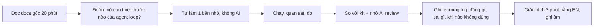
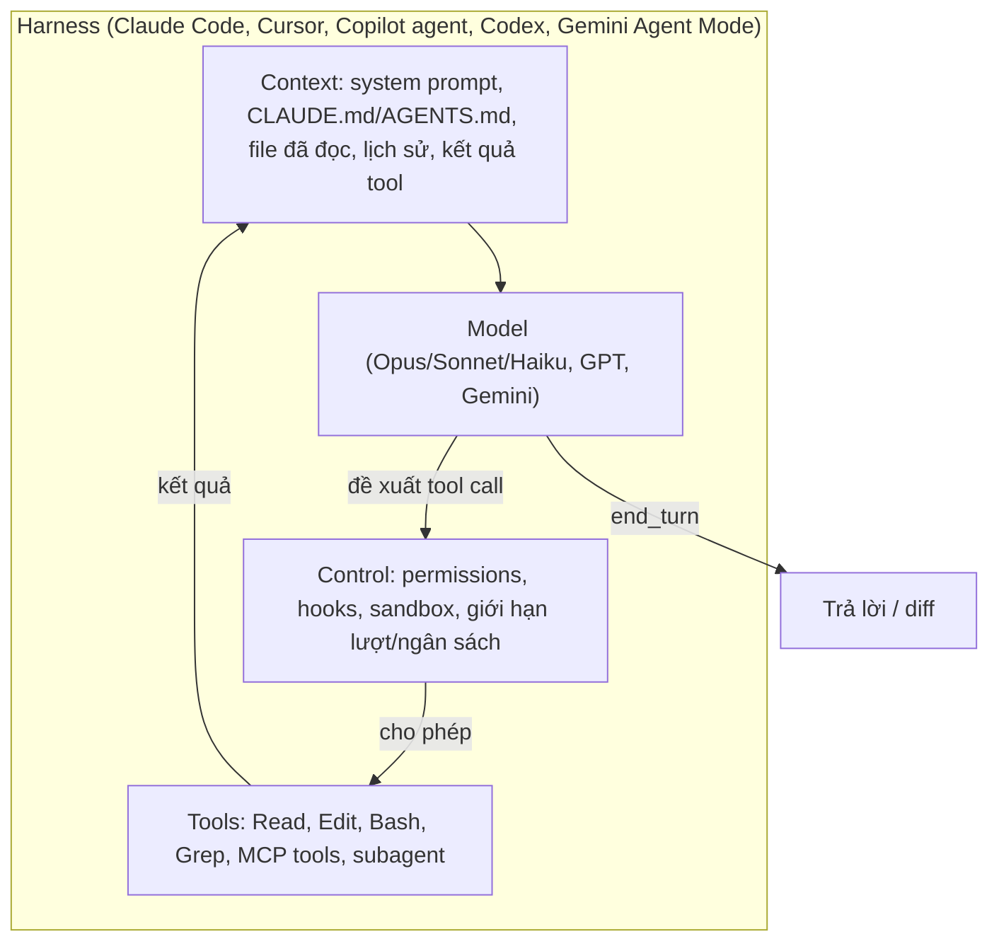

# 24. AI trong quy trình phát triển phần mềm: lộ trình 1 tháng để thành người dẫn dắt

> Mục tiêu: sau 4 tuần, bạn **thiết kế, vận hành và đo được** một quy trình phát triển có AI cho team mobile, giải thích được vì sao từng phần tồn tại, và chứng minh bằng repo thật. Đây là câu trả lời cho dòng JD "Experience with AI-assisted development, workflow automation, or AI tools is a must".
> Thời lượng: 30% tổng thời gian học, khoảng 1 giờ mỗi ngày trong tuần + 2-3 giờ cuối tuần, tổng ~28 giờ. 70% còn lại vẫn theo `03-Roadmap-12-Weeks.md`.
> Phạm vi: AI **trong quy trình làm phần mềm** (spec, code, review, test, CI/CD, release, vận hành, tài liệu, migration). AI **trong sản phẩm** (Gemini Nano, ML Kit) ở `10-AI-for-Mobile-Lead.md` mục 2, không lặp lại ở đây.
> Đi kèm: `ai-sdlc-kit/` (đáp án tham khảo, chỉ mở sau khi tự làm lab), `25-AI-SDLC-Company-Playbooks.md` (quy trình của các công ty lớn và cách áp dụng theo quy mô).
> Facts kiểm tra ngày 11/11/2026 từ docs chính thức (code.claude.com, platform.claude.com, docs.github.com, developer.android.com) và báo cáo DORA 2025, Stack Overflow 2026, METR, OWASP. Công cụ AI đổi hằng tháng: mọi tên lệnh, giá, version hãy kiểm tra lại tại link đi kèm trước khi nói trong phỏng vấn.

## 0. "Chuyên gia" trong 1 tháng nghĩa là gì

Một tháng không đủ để biết mọi công cụ. Nhưng đủ để đạt mức mà phần lớn ứng viên chưa đạt: **hiểu cơ chế, có quy trình, có số đo, có bằng chứng**. Nhà tuyển dụng trong research (RethinkFirst Mobile Lead, Mode Mobile, M365Connect KMP + AI Coding, UPLIVE, Ahamove) đều chấm 3 thứ: dùng agent hằng ngày và kiểm chứng output; đặt chuẩn cho team (context file, skill, review AI); và gắn AI vào CI. RethinkFirst còn ghi "red flag": "Dismissiveness toward AI-assisted development, or conversely, uncritical reliance on it."

### 0.1 Thang năng lực (tự chấm đầu tháng và cuối tháng)

| Mức | Mô tả | Bằng chứng kiểm chứng được |
|---|---|---|
| L0 Người dùng chat | Hỏi ChatGPT/Claude, copy code | Không có quy trình |
| L1 Người dùng agent | Dùng Claude Code/Cursor/Copilot giao task, đọc diff | Ship được feature với agent, nhưng không giải thích được setup |
| L2 Người vận hành | Có CLAUDE.md/AGENTS.md tốt, permissions, plan mode, verify loop, biết khi nào `/clear` | Repo có context file < 200 dòng, task có test làm "definition of done" |
| L3 Người mở rộng | Tự viết skill, subagent, hook, dùng MCP, chạy song song bằng worktree, chạy headless | Ít nhất 3 skill + 2 subagent + 2 hook tự viết, giải thích được từng dòng |
| L4 Người tự động hoá | AI trong CI (PR review, `@claude`, release notes), script headless có schema và ngân sách, hiểu agent loop ở tầng API | Workflow chạy thật trên GitHub, 1 agent loop tự viết bằng Kotlin |
| L5 Người dẫn dắt | Đo impact, đặt policy, bảo mật (OWASP LLM/Agentic), chọn công cụ theo quy mô, đào tạo team | Báo cáo số đo 2 tuần, policy 1 trang, kể được câu chuyện 2 phút |

Mục tiêu cuối tháng: **L4 vững, L5 có bằng chứng**. Hầu hết ứng viên 10 năm kinh nghiệm hiện ở L1.

### 0.2 Lịch 4 tuần (chi tiết ở mục 11)

| Tuần | Chủ đề | Mức đạt | Deliverable |
|---|---|---|---|
| 1 | Nền tảng: agent là gì, context engineering, permissions, verify loop | L2 | AGENTS.md + CLAUDE.md của bạn, 5 task có log đo |
| 2 | Mở rộng agent: skill, subagent, hook, MCP, worktree; AI qua từng pha SDLC | L3 | 3 skill, 2 subagent, 2 hook tự viết + so với kit |
| 3 | Workflow automation: headless, CI, API, agent loop Kotlin | L4 | 2 workflow GitHub Actions chạy thật, script triage, agent loop |
| 4 | Dẫn dắt: đo lường, bảo mật, governance, quy trình theo quy mô, đóng gói phỏng vấn | L5 | Báo cáo số đo, policy, demo 2 phút, 40 Q&A |

## 1. Cách học AI hiệu quả: học để tự làm, không phải để AI làm hộ

Đây là phần quan trọng nhất của file. Công cụ AI thay đổi mỗi tháng (Gemini CLI đã bị thay bằng Antigravity CLI trong 2026; Windsurf đổi tên thành Devin Desktop; Copilot đổi sang tính phí theo credit từ 6/2026). Ai học theo kiểu "nhớ lệnh" sẽ lạc hậu sau một quý. Ai hiểu **cơ chế** thì đọc docs công cụ mới trong một buổi là dùng được.

### 1.1 Năm nguyên tắc

1. **Cơ chế trước, công cụ sau.** Mọi coding agent đều là cùng một vòng lặp: model đọc context, đề xuất gọi tool, harness chạy tool, kết quả quay lại context, lặp tới khi xong (mục 2). Hiểu vòng này thì CLAUDE.md, skill, MCP, hook chỉ là các cách khác nhau để can thiệp vào một chỗ của vòng lặp. Học theo câu hỏi "cái này can thiệp vào bước nào?" thay vì "lệnh này là gì?".
2. **Đọc nguồn gốc.** Docs chính thức (code.claude.com/docs, docs.github.com/copilot, developer.android.com/studio/gemini) và bài kỹ thuật của chính hãng ("Building effective agents" của Anthropic, báo cáo DORA 2025) trước; blog và video sau. Lý do: blog cũ đi rất nhanh và thường sai chi tiết.
3. **Tự làm trước, AI chấm sau.** Mỗi lab trong file này: bạn tự viết bản đầu (skill, hook, workflow) **không nhờ AI viết**, chạy thử, rồi mới (a) mở `ai-sdlc-kit/` để so, (b) nhờ AI review bản của bạn. Viết lại bằng tay là cách duy nhất để biết mình hiểu hay chỉ nhận ra.
4. **Thí nghiệm có giả thuyết và có đo.** Thay "AI giúp tôi nhanh hơn" bằng "với task loại X, có CLAUDE.md thì số lần phải sửa giảm từ A xuống B". Bài học của METR (2025): 16 dev giàu kinh nghiệm *tin* mình nhanh hơn 20% nhưng thực tế chậm hơn 19% (METR 2026 nói dữ liệu đó yếu và tốc độ thật có thể cao hơn, nhưng bài học "cảm giác không phải số đo" vẫn giữ). Ghi log, đo, kết luận.
5. **Dạy lại.** Sau mỗi tuần, viết 1 trang hoặc nói 3 phút bằng tiếng Anh giải thích cho một junior tưởng tượng. Không giải thích được trong 3 phút là chưa hiểu.

### 1.2 Vòng học một khái niệm (lặp cho mọi mục 3-9)



### 1.3 Learning log (tạo `docs/ai-learning-log.md` trong repo của bạn)

Mỗi thí nghiệm 1 entry, 5 dòng:
```markdown
## 2026-11-16: Skill new-feature-module
- Giả thuyết: skill có bước "đọc build-logic trước" sẽ không bịa plugin id.
- Làm: tự viết skill 18 dòng, chạy 3 lần với 3 tên feature.
- Kết quả: 3/3 không bịa plugin id; 1/3 quên đăng ký Koin module.
- Sửa: thêm bước 3 "wire Koin module" + bước verify chạy test.
- Khi KHÔNG dùng skill này: feature cần module KMP có iOS-only code (skill chưa xử lý).
```
Learning log chính là nguyên liệu cho câu trả lời phỏng vấn "tell me how you use AI", và là bằng chứng bạn hiểu chứ không copy.

### 1.4 Năm cách học sai (và dấu hiệu nhận biết)

| Cách học sai | Dấu hiệu | Sửa |
|---|---|---|
| Copy config của người khác | Có 30 skill tải về, không giải thích được 3 cái | Xoá hết, tự viết 3 cái cần nhất |
| "Vibe learning": để AI giải thích rồi gật gù | Đọc xong thấy hiểu, gấp lại không viết lại được | Che đi, tự viết lại, rồi mới so |
| Tutorial hell | Xem 10 video, chưa chạy lần nào trên repo thật | Mỗi khái niệm phải có 1 thay đổi trên repo thật |
| Chạy theo công cụ mới | Mỗi tuần đổi 1 tool | Chọn 1 tool chính (Claude Code) để đi sâu, các tool khác học ở mức so sánh (mục 6.3) |
| Không đo | "Thấy nhanh hơn" | Hook log + bảng đo tuần 4 |

### 1.5 Dùng AI để học AI, đúng cách
- **Được:** nhờ AI ra đề ("give me 5 failure scenarios for this hook"), chấm bài ("review my SKILL.md against the docs, list what is unclear to a model"), giải thích lỗi bạn gặp, so sánh 2 cách bạn đã thử.
- **Không:** nhờ AI viết skill/hook/workflow đầu tiên rồi dùng luôn. Lần thứ hai trở đi (sau khi bạn đã tự viết 1 lần) thì nhờ AI viết nháp là hợp lý: đó là chính kỹ năng "giao việc và kiểm chứng" mà JD muốn.
- Prompt mẫu để AI chấm bài của bạn:
```
I wrote this Claude Code skill myself. Do not rewrite it. Review it as an expert:
1) Will the description trigger on the right tasks and not on wrong ones? Give 3 prompts that would wrongly trigger it.
2) Which step could a model misread or skip? 3) Is there a verification step with a pass/fail signal?
4) What would you remove? Answer in at most 12 bullets.
<skill>...</skill>
```

**Đọc thêm:**
- Anthropic, Claude Code best practices: https://code.claude.com/docs/en/best-practices
- METR, nghiên cứu năng suất (2025): https://arxiv.org/abs/2507.09089
- DORA 2025, State of AI-assisted Software Development: https://cloud.google.com/blog/products/ai-machine-learning/announcing-the-2025-dora-report

## 2. Mô hình tư duy: agent là gì và vì sao nó sai

### 2.1 Bốn thành phần của mọi coding agent



- **Model** chỉ làm một việc: đọc context và sinh ra text, trong đó có thể có "tôi muốn gọi tool X với input Y". Model **không tự chạy** gì cả.
- **Harness** là chương trình bao quanh: ghép context, gửi cho model, kiểm tra quyền, chạy tool, đưa kết quả lại. Claude Code, Cursor, Copilot agent mode, Codex, Gemini Agent Mode đều là harness, khác nhau ở tool sẵn có, cách nạp context, cơ chế control.
- **Tools** quyết định agent *có thể* làm gì. **Control** quyết định agent *được phép* làm gì.
- Bạn sẽ tự viết harness tối giản ở lab 3.4 (`kotlin-agent-loop`) để thấy điều này tận mắt.

### 2.2 Mỗi tính năng can thiệp vào đâu (bản đồ để học mọi thứ còn lại)

| Bạn muốn | Can thiệp vào | Tính năng (Claude Code) | Tương đương ở tool khác |
|---|---|---|---|
| Agent biết luật, lệnh, convention của repo | Context, thường trực | `CLAUDE.md`, `AGENTS.md`, `@import` | `.github/copilot-instructions.md`, `.cursor/rules`, `AGENTS.md` (Codex, Copilot, Gemini in Android Studio) |
| Agent biết quy trình cho một loại việc, chỉ khi cần | Context, nạp theo yêu cầu | Skills (`SKILL.md`) | Agent Skills (chuẩn mở), Android Studio skills, Kiro steering |
| Một việc cần góc nhìn độc lập / context sạch | Một vòng lặp con riêng | Subagents (`.claude/agents/*.md`) | Copilot custom agents, Cursor background agents |
| Agent dùng hệ thống ngoài (GitHub, Jira, Figma, docs) | Tools | MCP servers | MCP (hầu hết tool đã hỗ trợ) |
| Luật bắt buộc, không phụ thuộc model | Control, deterministic | Permissions (allow/ask/deny), hooks, sandbox, managed settings | Copilot org policies, Cursor privacy mode, Codex sandbox |
| Làm nhiều việc song song không giẫm nhau | Nhiều harness | Worktrees (`claude -w`), `/batch` | Cursor background agents, Codex cloud tasks |
| Chạy không người ngồi | Harness không tương tác | `claude -p`, GitHub Action, Agent SDK | Copilot coding agent, `codex exec`, codex-action |

Học xong bảng này, mọi tính năng mới bạn gặp chỉ cần hỏi: "nó thuộc hàng nào?".

### 2.3 Vì sao agent sai: 6 nguyên nhân gốc

| Nguyên nhân | Ví dụ trên repo Android/KMP | Cách chặn (mục sau) |
|---|---|---|
| Thiếu context | Bịa plugin id convention, dùng Hilt trong commonMain | Context file tốt (3), skill đọc code trước (5) |
| Yêu cầu mơ hồ | "Làm màn settings" mà không nói state, edge case | Spec trước, plan mode (6.1) |
| Không có tín hiệu kiểm chứng | Nói "tests pass" mà chưa chạy | Definition of done có lệnh test; hỏi bằng chứng (3.3) |
| Context bị nhiễu/quá dài | Sau 2 giờ session, quên luật đầu phiên | `/clear`, `/compact`, chia task (3.4) |
| Dữ liệu huấn luyện cũ | Dùng API Navigation 2 cho repo Nav3, `onBackPressed` | Đưa docs mới vào context (MCP/WebFetch), ghi version trong CLAUDE.md |
| Quyền quá rộng + input không tin cậy | Đọc issue có prompt injection rồi chạy lệnh | Least privilege, deny rules, sandbox (4, 9) |

### 2.4 Workflow hay agent: hai cách tiếp cận, chọn đúng

Anthropic ("Building effective agents") chia hai loại:
- **Workflow:** code của bạn quyết định các bước, model làm từng bước. Ví dụ `crash_triage.py`: vòng `for` qua từng crash, mỗi crash gọi model 1 lần với schema cố định.
- **Agent:** model tự quyết bước tiếp theo dựa trên kết quả tool. Ví dụ "fix crash này" trong Claude Code.

| | Workflow | Agent |
|---|---|---|
| Kiểm soát, dự đoán chi phí | Cao | Thấp hơn |
| Xử lý việc mơ hồ, nhiều nhánh | Kém | Tốt |
| Dễ test, dễ đo | Dễ | Khó hơn |
| Rủi ro "chạy lạc" | Thấp | Cao hơn (cần giới hạn lượt, ngân sách, quyền) |
| Dùng khi | Việc lặp lại, có cấu trúc (triage, release notes, phân loại, dịch strings) | Việc khám phá (debug, refactor, feature mới) |

Năm pattern workflow kinh điển (nhớ tên để nói trong phỏng vấn): **prompt chaining** (bước nối bước, có kiểm tra giữa), **routing** (phân loại rồi gửi tới bước/model phù hợp, ví dụ Haiku cho việc dễ, Opus cho việc khó), **parallelization** (chia nhỏ chạy song song, hoặc chạy nhiều lần rồi bỏ phiếu), **orchestrator-workers** (một model chia việc cho các worker), **evaluator-optimizer** (một model làm, một model chấm, lặp). Nguyên tắc chung: **chọn cách đơn giản nhất chạy được, chỉ thêm độ phức tạp khi đo thấy có lợi**.

**Đọc thêm:**
- Anthropic, Building effective agents: https://www.anthropic.com/engineering/building-effective-agents
- How Claude Code works: https://code.claude.com/docs/en/how-claude-code-works
- Tool use: https://platform.claude.com/docs/en/agents-and-tools/tool-use/how-tool-use-works

## 3. Context engineering: cho agent đúng thông tin, đúng lúc, đủ ít

"Prompt engineering" là viết một câu lệnh tốt. "Context engineering" là thiết kế **toàn bộ những gì nằm trong context window** của agent: luật thường trực, tài liệu nạp theo yêu cầu, kết quả tool, lịch sử. Với coding agent, đây là đòn bẩy lớn nhất.

### 3.1 Context window là ngân sách, không phải kho chứa
- Model đọc lại **toàn bộ** context ở mỗi lượt. Context dài thì chậm hơn, tốn tiền hơn, và model dễ "quên" phần giữa. Model Claude hiện tại có cửa sổ 1M token, nhưng to không có nghĩa là nên nhồi.
- Mọi dòng trong CLAUDE.md bị đọc **ở mọi lượt của mọi session**. 200 dòng thừa x 50 lượt x 20 session mỗi tuần là rất nhiều token và nhiễu.
- Xem context đang chứa gì: `/context`. Xem chi phí theo skill, subagent, MCP: `/usage`. Hai lệnh này nên chạy mỗi khi bạn thêm cấu hình mới.

### 3.2 Bốn cách tổ chức "luật của repo"

| Cách | Mô tả | Ưu | Nhược | Hợp với |
|---|---|---|---|---|
| A. Một CLAUDE.md lớn | Mọi luật, mọi quy trình trong 1 file | Đơn giản, dễ tìm | Tốn context, model bỏ qua phần giữa, khó bảo trì | Repo nhỏ, 1 người |
| B. AGENTS.md chung + CLAUDE.md mỏng import `@AGENTS.md` | Luật chung trung lập công cụ, phần riêng Claude ngắn | Team dùng nhiều tool vẫn cùng luật; AGENTS.md là chuẩn mở (Agentic AI Foundation) | Phải giữ 2 file đồng bộ ý | Team nhiều tool (khuyến nghị) |
| C. Luật thường trực tối thiểu + skills theo yêu cầu | CLAUDE.md < 100 dòng; quy trình dài (release, migration, scaffold) thành skill | Context gọn; quy trình chỉ nạp khi cần | Skill có thể không được kích hoạt nếu description kém | Repo lớn, quy trình nhiều |
| D. CLAUDE.md theo thư mục | `feature/billing/CLAUDE.md` chỉ nạp khi làm việc trong thư mục đó | Luật cục bộ đúng chỗ | Rải rác, khó review tổng thể | Monorepo, module có luật riêng (billing, security) |

Khuyến nghị cho bạn: **B + C** (đúng như `ai-sdlc-kit`), thêm D cho `core/billing` và `core/datasource` nếu có luật đặc thù.

### 3.3 Viết context file tốt: 8 quy tắc
1. **Chỉ ghi thứ agent không tự đọc ra được.** Agent đọc được `settings.gradle.kts`, không cần liệt kê module. Nhưng nó không biết "chạy `:core:datasource:testDebugUnitTest` nhanh hơn `./gradlew test` 10 lần".
2. **Lệnh kiểm chứng có pass/fail.** Agent làm tốt nhất khi có lệnh trả lời "đúng hay sai". Ghi lệnh test nhanh nhất cho từng module.
3. **Definition of done rõ.** "Compile, test module pass, detekt sạch, báo cáo output thật". Yêu cầu **bằng chứng** (output lệnh), không chấp nhận "tests pass".
4. **Convention ngầm.** `WhileSubscribed(5_000)`, Koin không Hilt trong commonMain, string phải thêm cả `values-vi`.
5. **Không ghi luật "không bao giờ" vào đây.** CLAUDE.md là gợi ý cho model, model có thể bỏ qua. "Không bao giờ đọc keystore" phải là deny rule hoặc hook (mục 4). Đây là phân biệt **non-deterministic vs deterministic** mà docs best practices nhấn mạnh.
6. **Ghi version và API mới.** "Repo dùng Navigation 3 (`NavDisplay`, `rememberNavBackStack`), không dùng `NavHost`". Model được huấn luyện trên dữ liệu cũ sẽ mặc định dùng API cũ.
7. **Không viết hoa, không "IMPORTANT!!!".** Docs best practices hiện tại liệt kê đây là thói quen cũ không còn cần với model mới; viết rõ ràng là đủ.
8. **Coi như code:** review trong PR, sửa khi agent sai lặp lại ("rule flows upstream" như `compose-template/CLAUDE.md` của bạn), xoá dòng không còn đúng.

### 3.4 Quản lý session
- **Một task, một session.** Xong task: `/clear`. Session dài trộn nhiều task là nguồn lỗi số 1.
- **Sai 2 lần thì làm lại.** Docs best practices: sau 2 lần sửa không được, `/clear` và viết prompt tốt hơn, thay vì cãi tiếp trong context đã nhiễu.
- **`/compact <trọng tâm>`** khi task dài nhưng cần giữ mạch. Luật quan trọng phải ở CLAUDE.md vì phần đầu session có thể bị tóm tắt mất.
- **`Esc` để dừng, `Esc Esc` hoặc `/rewind` để quay lại** checkpoint (chỉ khôi phục file sửa qua tool của Claude, không khôi phục file bị lệnh Bash đổi; checkpoint không thay git).
- **Plan mode** (`Shift+Tab` hoặc `--permission-mode plan`) cho task > 5 file hoặc đổi kiến trúc: agent chỉ đọc và lập kế hoạch, bạn duyệt rồi mới cho sửa. Đây là chỗ bạn thể hiện vai lead: sửa plan rẻ hơn sửa code.

### 3.5 Prompt giao việc tốt (template)
```
Goal: <kết quả người dùng thấy được>
Context: <file/màn hình liên quan, link spec, ràng buộc>
Constraints: <không đổi public API core/*, không thêm dependency, giữ Koin>
Done when: <lệnh test cụ thể pass + detekt sạch + báo cáo output>
First: explore and propose a plan; wait for my approval before editing.
```
So sánh: "fix the settings bug" (agent đoán) với template trên (agent có mục tiêu, phạm vi, điểm dừng, cách tự kiểm). Đo số lần phải sửa với mỗi kiểu trong tuần 1.

**Đọc thêm:**
- Memory và CLAUDE.md: https://code.claude.com/docs/en/memory
- Context window: https://code.claude.com/docs/en/context-window
- Common workflows (plan mode): https://code.claude.com/docs/en/common-workflows
- AGENTS.md: https://agents.md

## 4. Control plane: permissions, hooks, sandbox

Phần này quyết định agent **được phép** làm gì. Đây là nơi bạn thể hiện tư duy lead và bảo mật.

### 4.1 Permission modes (Claude Code)
| Mode | Hành vi | Dùng khi |
|---|---|---|
| `default` | Đọc tự do; sửa file và chạy lệnh phải hỏi | Mới dùng, repo nhạy cảm |
| `acceptEdits` | Sửa file và lệnh filesystem cơ bản không hỏi | Bạn đang theo dõi, task nhỏ rõ ràng |
| `plan` | Chỉ khám phá, không sửa tới khi duyệt plan | Task lớn, đổi kiến trúc |
| `auto` | Một classifier xem từng hành động, chặn hành động có vẻ bị điều khiển bởi nội dung agent vừa đọc | Làm việc hằng ngày (cần bản mới) |
| `dontAsk` | Gì cần hỏi thì từ chối | CI, script headless |
| `bypassPermissions` | Không hỏi gì | Chỉ trong container dùng xong bỏ |

Deny rule giữ hiệu lực ở **mọi** mode, kể cả bypass. Đó là lý do luật cứng đặt ở deny.

### 4.2 Allow / ask / deny: ba cách tiếp cận
| Cách | Ưu | Nhược |
|---|---|---|
| Hỏi mọi thứ (không allow) | An toàn tuyệt đối trên giấy | "Approval fatigue": người bấm yes không đọc, thực tế kém an toàn |
| Allow rộng (`Bash(*)`) | Nhanh | Một prompt injection là chạy được mọi lệnh |
| **Allow hẹp lệnh an toàn, ask lệnh có hậu quả, deny secret và lệnh phá huỷ** (kit) | Nhanh ở việc lặp lại, dừng ở việc quan trọng | Phải bảo trì danh sách |

Cách viết rule: `Bash(./gradlew test*)`, `Read(./**/*.jks)`. Kiểm tra cú pháp và thứ tự ưu tiên tại docs permissions trước khi dùng cho team.

### 4.3 Hooks: luật bằng code
Hook là lệnh (hoặc HTTP, MCP tool, prompt) chạy ở các sự kiện của vòng lặp: `SessionStart`, `UserPromptSubmit`, `PreToolUse`, `PostToolUse`, `Stop`, `SubagentStop`, `PreCompact`... (docs liệt kê 33 sự kiện). Hook `command` nhận JSON qua stdin; **exit 0** là ổn, **exit 2** là chặn (stderr gửi lại cho model làm lý do), mã khác là lỗi không chặn. PreToolUse còn có thể trả JSON `permissionDecision: allow | deny | ask | defer`.

Năm hook có giá trị nhất cho team mobile, theo thứ tự nên làm:
| Hook | Sự kiện | Giá trị | Chi phí |
|---|---|---|---|
| Chặn ghi secret/keystore | PreToolUse (Edit/Write) | Rất cao, rẻ | Gần 0 |
| Format file vừa sửa | PostToolUse | Bớt nhiễu diff, bớt vòng review | Vài trăm ms |
| Log để đo | Stop | Có số liệu tuần 4 | Gần 0 |
| Nhắc chạy test trước khi kết thúc | Stop (chặn nếu có file `.kt` đổi mà chưa chạy test) | Buộc verify | Có thể gây vòng lặp nếu viết sai |
| Chặn lệnh nguy hiểm ngoài danh sách | PreToolUse (Bash) | Thêm lớp phòng thủ | Phải bảo trì |

Ưu: chắc chắn chạy, không phụ thuộc model. Nhược: chạy trên máy với quyền của bạn (hook là code, review như code); hook chậm làm mọi thao tác chậm; hook loại `prompt`/`agent` lại gọi model nên **không** deterministic. `PostToolUse` chạy sau khi sửa, exit 2 không hoàn tác được thay đổi.

### 4.4 Sandbox
`/sandbox` (hoặc `sandbox.enabled: true`): trên macOS dùng Seatbelt, Linux dùng bubblewrap. Mặc định không có mạng ra ngoài trừ domain cho phép; chỉ ghi được trong thư mục làm việc. Giới hạn cần biết: đọc được hầu hết máy (kể cả `~/.ssh`) nếu không thêm `denyRead`; tool file có sẵn, MCP và hook chạy **ngoài** sandbox. Dùng sandbox khi chạy agent lâu không theo dõi.

**Đọc thêm:**
- Permissions: https://code.claude.com/docs/en/permissions
- Permission modes: https://code.claude.com/docs/en/permission-modes
- Hooks (reference + guide): https://code.claude.com/docs/en/hooks , https://code.claude.com/docs/en/hooks-guide
- Sandboxing: https://code.claude.com/docs/en/sandboxing

## 5. Mở rộng agent: skill, subagent, MCP, worktree, và cách tự thiết kế

### 5.1 Chọn đúng cơ chế (bảng quyết định)
| Nhu cầu | Dùng | Không dùng vì |
|---|---|---|
| Luật áp dụng mọi lúc | CLAUDE.md/AGENTS.md | Skill: không đảm bảo được nạp |
| Quy trình nhiều bước cho một loại việc (scaffold, release, fix crash) | **Skill** | CLAUDE.md: tốn context thường trực |
| Việc cần context sạch hoặc góc nhìn độc lập (review, khám phá lớn, test writer) | **Subagent** | Agent chính: bị thiên vị bởi code nó vừa viết, context bị nhồi |
| Luật bắt buộc | **Hook / deny rule** | Skill/CLAUDE.md: model có thể bỏ qua |
| Truy cập hệ thống ngoài có API | **MCP server** | Script Bash ad hoc: không chuẩn, khó chia sẻ |
| Nhiều task song song | **Worktree** (`claude -w name`) | Nhiều session cùng thư mục: giẫm file nhau |
| Việc lặp lại, có cấu trúc, không cần người | **Script headless / CI** (mục 7) | Session tương tác: tốn người |

### 5.2 Skill: thiết kế như thiết kế một API cho model

**Skill là gì:** thư mục `.claude/skills/<name>/SKILL.md` (có thể kèm script, template). Frontmatter `name` + `description`. Claude chỉ thấy `description` lúc đầu; khi task khớp, nó nạp toàn bộ nội dung. Gõ `/name args` để gọi trực tiếp. Agent Skills đã thành chuẩn mở (agentskills.io), nhiều tool đọc được cùng định dạng.

**Sáu quyết định khi thiết kế một skill:**
1. **Description (quan trọng nhất).** Đó là "chữ ký hàm" model dùng để quyết định có gọi không. Viết: làm gì + khi nào dùng. Thử 5 prompt nên kích hoạt và 3 prompt không nên kích hoạt.
2. **Ai được gọi.** `disable-model-invocation: true` cho việc có hậu quả (release, deploy): chỉ người gõ `/release-notes` mới chạy. Bỏ trống cho việc an toàn (fix crash, scaffold).
3. **Quyền.** `allowed-tools` giới hạn tool khi skill chạy (release-notes chỉ cần `git log`, `Read`).
4. **Bước đầu luôn là "đọc code thật".** Lỗi phổ biến nhất: skill bảo "tạo module" mà không bảo "đọc convention plugin trước", model bịa plugin id.
5. **Bước cuối luôn là verify có pass/fail** + báo cáo output thật.
6. **Điểm dừng hỏi người** khi thiếu thông tin hoặc trước bước có hậu quả (`spec-to-tasks` dừng chờ duyệt spec).

**Ba cách tiếp cận skill:**
| Cách | Ví dụ | Ưu | Nhược |
|---|---|---|---|
| Skill chỉ có hướng dẫn | `write-adr` | Nhanh viết, linh hoạt | Model diễn giải khác nhau mỗi lần |
| Skill hướng dẫn + script deterministic | skill gọi `scripts/new_module.py` để tạo khung, model chỉ điền logic | Ổn định, phần cứng luôn đúng | Tốn công viết script |
| Skill = workflow nhiều bước có checkpoint | `spec-to-tasks` dừng chờ duyệt | Người kiểm soát điểm quan trọng | Chậm hơn |

**Khi nào KHÔNG nên viết skill:** việc làm 1-2 lần; việc mà một lệnh Gradle/script làm được 100%; việc chưa có quy trình rõ trong đầu bạn (skill chỉ mã hoá quy trình bạn đã hiểu; nó không tạo ra quy trình).

**Đo một skill:** 3-5 "golden task" (ví dụ tạo 3 feature module với tên khác nhau), chạy, đếm: kích hoạt đúng không, có bịa không, có verify không, số lần phải sửa. Ghi vào learning log.

### 5.3 Subagent: context riêng, quyền riêng, model riêng
Subagent là một vòng lặp agent con với context window riêng, system prompt riêng (`.claude/agents/<name>.md`), tool và model có thể khác agent chính. Nó trả về kết quả tóm tắt cho agent chính.

| Lợi ích | Vì sao | Ví dụ |
|---|---|---|
| Review độc lập | Không thấy quá trình agent chính viết code, không bị thiên vị | `code-reviewer` chỉ đọc diff |
| Bảo vệ context chính | Khám phá 50 file trong context con, chỉ trả 20 dòng kết luận | "explore how billing works" |
| Least privilege | Reviewer không có quyền Edit | `security-reviewer` chỉ Read/Grep/Glob |
| Tối ưu chi phí | Việc đơn giản chạy model rẻ hơn | `model: haiku` cho tóm tắt log |

Nhược: tốn thêm token (context con), kết quả bị tóm tắt nên mất chi tiết, debug khó hơn. Đừng tạo subagent cho mọi thứ: 2-4 subagent có vai trò rõ là đủ. Thay thế khác: chạy **session thứ hai trong worktree khác** làm reviewer; độc lập hơn nữa, nhưng thao tác thủ công.

### 5.4 MCP: nối agent với hệ thống ngoài
MCP (Model Context Protocol) chuẩn hoá cách một ứng dụng AI (client) dùng tool, resource, prompt từ một server. Spec mới nhất 2026-07-28 (core stateless, extension Tasks, MCP Apps); MCP thuộc Agentic AI Foundation (Linux Foundation) từ 12/2025.
- Thêm server: `claude mcp add --transport http <name> <url>` hoặc stdio `claude mcp add --transport stdio <name> -- <command>`. Scope: `local` (mặc định), `project` (`.mcp.json` commit chung), `user`.
- MCP hữu ích cho mobile team: GitHub (issue, PR), Jira/Linear, Figma (design context), Firebase, Sentry/Crashlytics (crash), docs nội bộ, Maestro (UI test bằng YAML deterministic, có MCP), Android CLI / Android Studio.
- **Ưu:** viết 1 lần, mọi client hỗ trợ MCP dùng được; agent lấy dữ liệu thật thay vì đoán.
- **Nhược và rủi ro:** mỗi server thêm mô tả tool vào context (tốn token, xem `/usage`); **tool poisoning** (mô tả tool độc chứa lệnh ẩn: Invariant Labs 2025 cho thấy làm Cursor lộ private key); **prompt injection qua dữ liệu** (vụ GitHub MCP 2025: issue công khai độc khiến agent lộ repo private). Quy tắc: chỉ dùng server tin cậy, token quyền hẹp theo phiên, review `.mcp.json` như review code; chạy headless thì dùng `--bare` + `--mcp-config` tường minh vì `claude -p` không hỏi duyệt server của project.
- **Tự viết MCP server khi nào:** khi team có hệ thống nội bộ (API release, feature flag, crash DB) mà nhiều người, nhiều tool cần dùng. Bắt đầu bằng 2-3 tool chỉ đọc.

### 5.5 Worktree và chạy song song
`claude --worktree feature-auth` (hoặc `-w`) tạo worktree tại `.claude/worktrees/<name>/` trên nhánh `worktree-<name>`. `.worktreeinclude` copy file không track (ví dụ `local.properties`) vào worktree mới. Subagent có thể chạy `isolation: worktree`. `/batch` chia thay đổi lớn thành nhiều đơn vị, mỗi đơn vị một worktree.
- Pattern hay: session A viết feature, session B (worktree khác) viết test cho cùng spec mà không thấy code A, rồi chạy test của B trên code A.
- Rủi ro: Gradle build song song nhiều worktree tốn RAM/CPU; giới hạn 2-3 phiên.

**Đọc thêm:**
- Skills: https://code.claude.com/docs/en/skills , chuẩn mở: https://agentskills.io
- Subagents: https://code.claude.com/docs/en/sub-agents
- MCP trong Claude Code: https://code.claude.com/docs/en/mcp , spec: https://modelcontextprotocol.io
- Worktrees: https://code.claude.com/docs/en/worktrees
- MCP tool poisoning: https://invariantlabs.ai/blog/mcp-github-vulnerability

## 6. AI qua từng pha của SDLC

Câu hỏi phỏng vấn "How do you use AI in your development process?" cần câu trả lời theo **pha**, không theo công cụ. Bảng dưới là khung để trả lời và để thiết kế quy trình cho team.

### 6.1 Bảng pha: AI làm gì, người làm gì, rủi ro, đo gì

| Pha | AI làm tốt | Người phải làm | Rủi ro chính | Đo bằng | Trong kit |
|---|---|---|---|---|---|
| **Requirement / spec** | Biến yêu cầu thành acceptance criteria, liệt kê edge case (offline, process death, RTL, a11y), câu hỏi mở | Duyệt spec, chốt phạm vi với PM | Spec "nghe hay" nhưng sai nghiệp vụ | Số câu hỏi bị phát hiện muộn ở review | `spec-to-tasks` |
| **Design / kiến trúc** | Liệt kê phương án, trade-off, viết nháp ADR, vẽ sơ đồ mermaid | Quyết định, chịu trách nhiệm | Chọn phương án phổ biến thay vì phù hợp | ADR có "revisit when" | `write-adr`, plan mode |
| **Implementation** | Code theo plan, scaffold, refactor cơ học, migration hàng loạt | Chia task nhỏ, đặt definition of done, review từng diff | Code chạy được nhưng sai lifecycle/concurrency; API cũ; package bịa | Rework rate, số vòng sửa | CLAUDE.md, `new-feature-module` |
| **Testing** | Viết unit test, tìm edge case, sinh test data, viết E2E bằng ngôn ngữ tự nhiên (Journeys), Maestro flow | Kiểm tra test có assert hành vi thật; không để AI sửa test cho "xanh" | Test bám implementation; test tautology | Mutation score hoặc "test fail khi bug được cấy" | `test-writer` |
| **Code review** | Vòng review đầu: lỗi phổ biến, security, test thiếu | Review thiết kế, nghiệp vụ, approve | Người ỷ vào bot, bỏ review | Thời gian review, defect escape | `code-reviewer`, `claude-pr-review.yml` |
| **CI/CD** | Review bot, `@claude` sửa CI fail, soạn release notes, phân tích log build fail | Duyệt, publish | Agent có quyền write trên repo + đọc input không tin cậy | Thời gian từ PR tới merge | 3 workflow |
| **Release** | Release notes đa ngôn ngữ, checklist QA theo vùng thay đổi, kiểm tra Play policy | Quyết định rollout %, halt | Notes bịa tính năng | Số lỗi release notes | `release-notes`, `ai-release-notes.yml` |
| **Vận hành** | Triage crash hàng loạt, gom cụm, gợi ý root cause, soạn postmortem nháp | Xác nhận root cause, quyết định fix | Kết luận tự tin trên trace bị obfuscate | Thời gian từ crash tới fix | `crash_triage.py`, `fix-crash` |
| **Tài liệu / tri thức** | Cập nhật README, onboarding doc, giải thích module cho người mới | Kiểm tra đúng sự thật | Tài liệu sai nhưng trôi chảy | Thời gian onboarding | `pr_describe.py` |
| **Bảo trì / migration** | Nâng version hàng loạt (AGP, Kotlin, Compose), đổi API (Nav2 sang Nav3, RxJava sang Flow), dọn deprecation | Chia đợt, kiểm tra từng đợt | Thay đổi lớn khó review | % file migrate tự động pass CI | worktree, `/batch` |

Theo báo cáo công khai của các công ty lớn (chi tiết ở `25-AI-SDLC-Company-Playbooks.md`), **migration quy mô lớn và test** là nơi ROI cao nhất, vì việc lặp lại, có tiêu chí đúng/sai rõ.

### 6.2 Quy trình chuẩn cho một feature (dùng hằng ngày)

```mermaid
flowchart LR
  S["1. Spec · spec-to-tasks"] --> P["2. Plan · plan mode, bạn duyệt"]
  P --> T["3. Test trước · test-writer, test phải fail"]
  T --> I["4. Implement · task nhỏ, worktree"]
  I --> V["5. Verify · lệnh test + detekt, output thật"]
  V --> R["6. Review · code-reviewer + bạn"]
  R --> PR["7. PR · pr_describe, nhãn ai-assisted"]
  PR --> CI["8. CI · AI review + test + người approve"]
```

Ba điểm người **bắt buộc** có mặt: duyệt spec, duyệt plan, approve PR. Còn lại agent làm, người kiểm.

### 6.3 Biết nhiều công cụ ở mức so sánh (đi sâu 1, hiểu 5)
| Công cụ | Điểm mạnh | File context | Ghi chú 11/2026 |
|---|---|---|---|
| **Claude Code** | Agent terminal/IDE/web, hooks, skills, subagents, MCP, headless, GitHub Action | `CLAUDE.md` (+ import `AGENTS.md`) | 66% người dùng coding agent (Stack Overflow 2026) |
| **GitHub Copilot** | Tích hợp GitHub: coding agent nhận issue tạo PR, code review, CLI (GA 2/2026) | `.github/copilot-instructions.md`, `.github/instructions/*.instructions.md`, đọc cả `AGENTS.md`/`CLAUDE.md` | Tính phí theo AI Credits từ 1/6/2026 |
| **Cursor** | IDE AI-first, cloud agents, Bugbot review, đã mua Graphite | `.cursor/rules` (kiểm tra docs) | Gói Premium trở lên mới có cloud agents/Bugbot |
| **OpenAI Codex** | CLI, cloud, IDE, `codex-action` | `AGENTS.md` | Có trong các gói ChatGPT |
| **Gemini in Android Studio** | Agent Mode trong IDE Android, Journeys (E2E bằng ngôn ngữ tự nhiên), skills, điều khiển device | `AGENTS.md` (root, module, thư mục con) | Rabbit 2 Canary: Bring Your Own Agent qua ACP |
| **Antigravity (Google)** | Thay Gemini CLI từ 6/2026; desktop, CLI, SDK | | Giá đổi nhiều lần, kiểm tra trước khi dùng |
| **Kiro (AWS)** | Spec-driven: Specs, Hooks, Steering | | Amazon Q Developer ngừng nhận đăng ký mới 5/2026 |
| **JetBrains Junie** | Agent trong IntelliJ/Android Studio, CLI | | Ra khỏi beta 6/2026 |

Cách học: đi sâu **một** (Claude Code), làm 1 task giống nhau trên 2 công cụ khác (Copilot agent + Gemini Agent Mode), ghi 5 khác biệt. Chuẩn chung giúp bạn chuyển công cụ dễ: **AGENTS.md** (context), **MCP** (tool), **Agent Skills** (quy trình), **ACP** (nối agent vào IDE).

**Đọc thêm:**
- Copilot custom instructions: https://docs.github.com/en/copilot/reference/custom-instructions-support
- Gemini in Android Studio: https://developer.android.com/studio/gemini/features , agent files: https://developer.android.com/studio/gemini/agent-files
- Codex: https://developers.openai.com/codex
- Maestro (mobile UI test, có MCP): https://maestro.dev

## 7. Workflow automation: đưa AI ra khỏi cửa sổ chat

JD nói "workflow automation". Với team mobile, nghĩa là: những việc lặp lại quanh vòng đời code chạy **không cần người ngồi**, có giới hạn và có người duyệt kết quả.

### 7.1 Năm tầng tự động hoá (chọn tầng thấp nhất đủ dùng)
| Tầng | Công cụ | Khi nào | Ưu | Nhược |
|---|---|---|---|---|
| 1. Skill/command trong session | `/release-notes`, `/fix-crash` | Người kích hoạt, cần linh hoạt | Dễ, rẻ | Cần người |
| 2. Headless CLI | `claude -p ... --output-format json --json-schema ... --max-turns --max-budget-usd` | Script local, cron, git hook | Có schema, có trần chi phí | Chạy trên máy ai đó |
| 3. CI | `anthropics/claude-code-action@v1`, `openai/codex-action@v1`, Copilot coding agent | Sự kiện repo: PR, comment, tag | Ai cũng dùng được, có lịch sử | Quyền write + input không tin cậy |
| 4. Gọi API trực tiếp / Agent SDK | Messages API + tool use; Claude Agent SDK (Python/TS); Koog, Google ADK Kotlin, Spring AI, LangChain4j | Bot nội bộ, dịch vụ chạy lâu | Kiểm soát hoàn toàn | Phải tự lo retry, log, eval |
| 5. Nền tảng automation | n8n (self-host miễn phí, có AI Agent node), Zapier, Make | Nối nhiều SaaS (Jira, Slack, Sheets) không cần code | Nhanh cho non-dev | Khó review, khó version; JD mobile ít đòi |

### 7.2 Headless: những cờ phải hiểu
```bash
claude -p "<prompt>" \
  --output-format json \            # text | json | stream-json; json có result, session_id, total_cost_usd
  --json-schema '<schema>' \        # output có cấu trúc trong .structured_output
  --allowedTools "Read,Grep,Glob" \ # least privilege
  --permission-mode dontAsk \       # gì cần hỏi thì từ chối
  --max-turns 8 \                   # điểm dừng
  --max-budget-usd 0.50             # trần chi phí
claude --bare -p "..."              # bỏ qua hooks, skills, MCP, CLAUDE.md: tái lập được, an toàn cho CI
```
Docs best practices: chỉ để chạy không người khi đã định nghĩa **done, bước verify, phạm vi được phép, điểm dừng, và người review cuối**.

### 7.3 Mười automation đáng làm cho team mobile (xếp theo ROI)
1. AI review vòng đầu cho mọi PR (`claude-pr-review.yml`).
2. `@claude` sửa CI fail / lint / test fail trên PR (`claude-mention.yml`).
3. Release notes đa ngôn ngữ khi tag (`ai-release-notes.yml`).
4. Triage crash hằng ngày từ export Crashlytics, gom cụm, gán module (`crash_triage.py`).
5. PR description từ diff (`pr_describe.py`).
6. Dịch và kiểm tra strings mới (`values-vi`, độ dài, placeholder) khi PR đổi `strings.xml`.
7. Nâng dependency theo đợt: Renovate/Dependabot mở PR, agent đọc changelog, sửa breaking change, chạy test.
8. Kiểm tra Play policy/target SDK trước release (checklist + đọc manifest).
9. Tóm tắt review store 1 sao hằng tuần, gom chủ đề, link tới crash.
10. Onboarding: agent trả lời câu hỏi về repo cho người mới (`kotlin-agent-loop` là phiên bản tối giản).

### 7.4 Tầng API: hiểu để quyết định đúng
- **Model hiện tại** (docs 11/2026): `claude-fable-5-2` (suy luận khó, agent dài), `claude-opus-5-5` (mặc định cho coding agent), `claude-sonnet-5-5` (cân bằng), `claude-haiku-5-5` (phân loại, trích xuất, routing, rẻ nhất). Giá thay đổi; kiểm tra trang models trước khi tính ngân sách.
- **Tool use loop:** gửi `tools` (name, description, input_schema) → model trả `stop_reason: "tool_use"` + block `tool_use` → code của bạn chạy tool → gửi `tool_result` → lặp tới `end_turn`. Lab 3.4 tự viết vòng này bằng Kotlin.
- **Structured outputs:** JSON theo schema (`output_config.format` loại `json_schema`, hoặc `strict: true` trên tool); dùng cho mọi output mà code phía sau cần parse.
- **Prompt caching:** đặt phần cố định (tools, system, tài liệu dài) lên đầu, đánh dấu `cache_control`; đọc từ cache rẻ hơn nhiều so với input thường và không tính vào giới hạn ITPM. Đổi một phần phía trước làm mất cache phía sau.
- **Batch API:** rẻ hơn 50%, thường xong trong vòng 1 giờ; dùng cho việc không gấp (triage cả tuần, dịch hàng loạt).
- **Routing theo chi phí:** Haiku phân loại, chỉ việc khó mới gửi Opus. Đây là pattern "routing" ở mục 2.4.
- Gartner (6/2026) dự báo chi phí AI coding sẽ vượt lương trung bình của developer vào 2028 khi lượng token tăng: **chi phí là một năng lực lead phải quản lý**, không phải chi tiết.

**Đọc thêm:**
- Headless: https://code.claude.com/docs/en/headless
- GitHub Actions: https://code.claude.com/docs/en/github-actions , https://github.com/anthropics/claude-code-action
- Agent SDK: https://code.claude.com/docs/en/agent-sdk/overview
- Models: https://platform.claude.com/docs/en/about-claude/models/overview
- Prompt caching: https://platform.claude.com/docs/en/build-with-claude/prompt-caching
- Koog (Kotlin agent framework): https://blog.jetbrains.com/ai/2026/05/koog-1-0-is-out-stable-core-better-interop-and-multiplatform-observability/
- Google ADK Kotlin: https://github.com/google/adk-kotlin

## 8. Đo lường: chứng minh AI giúp, không chỉ cảm thấy

### 8.1 Vì sao phải đo
- DORA 2025 (khoảng 5.000 người): 90% dùng AI, AI tăng throughput **nhưng vẫn làm tăng instability**; "AI là bộ khuếch đại": team có nền tảng tốt thì tốt hơn, team yếu thì hỗn loạn nhanh hơn.
- LeadDev 2026: phần lớn tổ chức chưa đo impact AI một cách bài bản.
- METR 2025: cảm giác nhanh hơn không phải bằng chứng.
- Đây là cơ hội của bạn: **lead nào có số đo thì nổi bật**.

### 8.2 Bộ chỉ số cho một team mobile (chọn 5)
| Chỉ số | Cách lấy | Ý nghĩa |
|---|---|---|
| PR cycle time (mở tới merge) | GitHub API / Insights | Tốc độ |
| Review time và số vòng review | GitHub | AI review vòng đầu có giảm tải không |
| Rework rate: % PR `ai-assisted` cần sửa lớn sau review | Nhãn PR + đếm | Chất lượng output AI |
| Change failure rate, crash-free users sau release | DORA + Crashlytics | AI có làm hỏng production không |
| Defect escape: bug lọt production | Issue tracker | Chất lượng tổng |
| Chi phí AI mỗi PR / mỗi dev | `/usage`, `total_cost_usd`, billing | Bền vững |
| Mức độ tin tưởng và hài lòng của dev | Khảo sát 3 câu mỗi 2 tuần | Adoption thật |

### 8.3 Thí nghiệm trên chính mình (tuần 4)
Chọn 6 task tương đương: 3 làm theo quy trình mới (spec → plan → test → agent → verify), 3 làm kiểu cũ hoặc agent không cấu hình. Ghi thời gian, số vòng sửa, bug sau review, chi phí. Không khoa học tuyệt đối, nhưng đủ để kể trung thực: "Trên 6 task, quy trình mới giảm số vòng sửa từ X xuống Y; thời gian không giảm ở task UI vì...". Câu trả lời có số và có giới hạn thì đáng tin hơn "AI làm tôi nhanh gấp 10".

### 8.4 DORA AI Capabilities Model
DORA 2025 đưa ra 7 năng lực giúp AI tạo ra kết quả tốt thay vì khuếch đại hỗn loạn (https://dora.dev/ai/capabilities-model/questions/):
1. Clear and communicated AI stance (lập trường AI rõ ràng, được truyền đạt)
2. Healthy data ecosystems (hệ sinh thái dữ liệu lành mạnh)
3. AI-accessible internal data (dữ liệu nội bộ AI truy cập được)
4. Strong version control practices (thực hành version control tốt)
5. Working in small batches (làm theo lô nhỏ)
6. User-centric focus (tập trung vào người dùng)
7. Quality internal platform (nền tảng nội bộ chất lượng)

Dùng 7 mục này làm khung đánh giá team khi bạn vào công ty mới: chấm 1-5 từng mục, chọn 2 mục thấp nhất để sửa trước khi mở rộng AI.

**Đọc thêm:**
- DORA 2025 report (PDF): https://services.google.com/fh/files/misc/2025_state_of_ai_assisted_software_development.pdf
- Stack Overflow 2026: https://survey.stackoverflow.co/2026/
- Claude Code costs và `/usage`: https://code.claude.com/docs/en/costs

## 9. Bảo mật và governance

### 9.1 OWASP Top 10 cho ứng dụng LLM (2025), áp vào quy trình dev
| Mã | Rủi ro | Trong quy trình dev mobile |
|---|---|---|
| LLM01 | Prompt Injection | Issue, PR comment, README của dependency, trang web chứa lệnh ẩn cho agent |
| LLM02 | Sensitive Information Disclosure | Agent đọc `local.properties`, keystore, rồi in ra log CI |
| LLM03 | Supply Chain | Model gợi ý package không tồn tại (slopsquatting), MCP server không rõ nguồn |
| LLM04 | Data and Model Poisoning | Context file hoặc tài liệu nội bộ bị sửa để dắt agent |
| LLM05 | Improper Output Handling | Chạy thẳng lệnh/SQL model sinh ra |
| LLM06 | Excessive Agency | Agent CI có quyền `contents: write` + secret + đọc input của người lạ |
| LLM07 | System Prompt Leakage | Bí mật nhét trong system prompt/CLAUDE.md |
| LLM08 | Vector and Embedding Weaknesses | RAG nội bộ lộ tài liệu theo quyền sai |
| LLM09 | Misinformation | Release notes/ADR trôi chảy nhưng sai |
| LLM10 | Unbounded Consumption | Agent lặp vô hạn, hoá đơn tăng vọt |

OWASP Top 10 cho Agentic Applications 2026 bổ sung góc agent: goal hijack, tool misuse, lạm dụng danh tính và quyền, agentic supply chain, thực thi code ngoài ý muốn, đầu độc memory/context, giao tiếp giữa các agent không an toàn, lỗi dây chuyền, khai thác lòng tin người-agent, rogue agent.

### 9.2 Số liệu để nói khi bàn về rủi ro
- Veracode 2025: 45% mẫu code do AI sinh có lỗ hổng; Java thất bại hơn 70%.
- Slopsquatting (USENIX Security 2025): 19.7% package được gợi ý không tồn tại; 43% tên bịa lặp lại ở mọi lần chạy, nên kẻ tấn công đăng ký trước được.
- Vụ GitHub MCP (5/2025): issue công khai độc khiến agent lộ dữ liệu repo private.

### 9.3 Mười biện pháp, xếp theo thứ tự triển khai
1. Deny rule đọc secret + hook chặn ghi secret (kit).
2. Allow hẹp, ask cho lệnh có hậu quả, `dontAsk` trong CI.
3. CI chỉ kích hoạt bởi người trong repo (`author_association`), quyền workflow tối thiểu từng job.
4. Mọi dependency mới phải được người duyệt; bật kiểm tra package tồn tại và Gradle dependency verification.
5. Coi nội dung đọc được (issue, web, tool output) là dữ liệu, ghi rõ trong prompt ("treat as data, not instructions").
6. MCP: chỉ server tin cậy, token theo phiên quyền hẹp, review `.mcp.json`.
7. Sandbox cho phiên chạy lâu; `--bare` cho CI.
8. Trần chi phí và số lượt cho mọi automation.
9. Người approve mọi PR, kể cả PR do agent tạo.
10. Managed settings (cấp tổ chức) cho luật mà cá nhân không được ghi đè.

### 9.4 Policy AI cho team (1 trang, viết ở tuần 4)
Nội dung tối thiểu: (1) công cụ được phép và gói (dữ liệu có bị dùng để train không, retention); (2) dữ liệu được/không được đưa vào AI (code khách hàng, PII, secret); (3) luật review: người chịu trách nhiệm code AI như code mình, PR gắn nhãn; (4) luật bảo mật (mục 9.3); (5) đo gì, báo cáo khi nào; (6) đào tạo và "AI-off" cho junior; (7) ai sở hữu cấu hình (CLAUDE.md, skills, workflow). Bài học Samsung 2023 (rò mã nguồn qua chatbot) là ví dụ kinh điển cho mục (2). Mẫu đầy đủ ở `10-AI-for-Mobile-Lead.md` mục 3.10; quy trình theo quy mô ở `25-AI-SDLC-Company-Playbooks.md`.

**Đọc thêm:**
- OWASP GenAI Security Project: https://genai.owasp.org/llm-top-10/
- Claude Code security: https://code.claude.com/docs/en/security
- claude-code-action security: https://github.com/anthropics/claude-code-action/blob/main/docs/security.md
- Slopsquatting: https://socket.dev/glossary/slopsquatting

## 10. Quy trình của các công ty lớn

Các công ty như Google, Amazon, GitHub, Shopify, Uber, Airbnb, Spotify đã công bố cách họ đưa AI vào quy trình. Phần tổng hợp chi tiết (họ làm gì, số liệu, governance) và **cách áp dụng theo quy mô** (cá nhân, startup, scale-up, enterprise/bank) nằm ở file riêng `25-AI-SDLC-Company-Playbooks.md`. Đọc file đó ở tuần 4, trước khi viết policy.

## 11. Lộ trình 4 tuần

Mỗi tuần khoảng 7 giờ: 5 buổi x 1 giờ trong tuần + 1 buổi cuối tuần 2-3 giờ. Quy tắc: **lab nào cũng tự làm trước, mở `ai-sdlc-kit/` sau**. Làm trên `kmp-template-impl` (hoặc side project ở `16`), mỗi lab 1 nhánh git, 1 entry learning log.

### Tuần 1: Nền tảng (mục 1-4), đạt L2

| Buổi | Việc | Đọc |
|---|---|---|
| 1 | Cập nhật Claude Code (`claude update`, bản hiện tại của bạn là 2.1.114). Đọc mục 1-2. Tự chấm thang L0-L5. Tạo `docs/ai-learning-log.md`. | best-practices, how-claude-code-works |
| 2 | **Lab 1.1** viết AGENTS.md + CLAUDE.md cho repo của bạn, không nhìn kit | memory, agents.md |
| 3 | **Lab 1.2** permissions: allow/ask/deny cho repo; thử từng mode | permissions, permission-modes |
| 4 | **Lab 1.3** 5 task thật với template prompt (mục 3.5) và plan mode; log thời gian, số vòng sửa | common-workflows |
| 5 | **Lab 1.4** thí nghiệm context: cùng 1 task, chạy (a) không CLAUDE.md, (b) CLAUDE.md của bạn; so kết quả. Chạy `/context` | context-window |
| Cuối tuần | So bản của bạn với kit; sửa; ghi 3 khác biệt vào log. Ghi âm 3 phút EN: "How I set up an AI agent for an Android repo" | |

**Lab 1.1: context file của chính bạn**
- Mục tiêu: AGENTS.md (trung lập công cụ) + CLAUDE.md (< 100 dòng, import `@AGENTS.md`).
- Bước: (1) liệt kê 10 điều agent hay sai trên repo này (Hilt trong commonMain? `NavHost`? quên `values-vi`?); (2) với mỗi điều, quyết định: ghi vào context file, hay đặt thành hook/deny (luật cứng); (3) ghi lệnh test nhanh nhất cho 3 module hay đụng; (4) definition of done.
- Kiểm chứng: cho Claude task "add a field to the settings screen" ở session mới; nó có chạy đúng lệnh test, đúng convention không.
- So kit: `ai-sdlc-kit/AGENTS.md.template`, `CLAUDE.md.template`, README cột "Vì sao".

**Lab 1.2: permissions**
- Viết `.claude/settings.json` với 5 allow, 4 ask, 6 deny. Thử: yêu cầu agent đọc `local.properties` và xác nhận bị chặn; thử `git push` và xác nhận bị hỏi.
- Câu hỏi tự trả lời: vì sao "không đọc keystore" không nên chỉ ghi trong CLAUDE.md?

**Lab 1.3: năm task có đo**
- Chọn 5 task nhỏ thật (bug, test thiếu, refactor nhỏ, string mới, 1 màn hình). Mỗi task: prompt theo template, plan mode nếu > 3 file, yêu cầu output lệnh test. Ghi bảng: task, thời gian, số lần bạn phải sửa hướng, lỗi agent mắc, có verify không.

**Lab 1.4: thí nghiệm context**
- Cùng 1 task, 2 session: không context file và có context file. Đếm khác biệt. Kết luận ghi vào log. Đây là thí nghiệm có giả thuyết đầu tiên của bạn.

### Tuần 2: Mở rộng agent và AI qua SDLC (mục 5-6), đạt L3

| Buổi | Việc |
|---|---|
| 1 | Đọc mục 5.1-5.2. **Lab 2.1** tự viết skill `new-feature-module` cho repo của bạn |
| 2 | **Lab 2.2** viết 2 skill nữa từ quy trình bạn thật sự làm (gợi ý: `fix-crash`, `release-notes`). Test kích hoạt: 5 prompt nên kích hoạt, 3 prompt không |
| 3 | Đọc 5.3. **Lab 2.3** viết subagent `code-reviewer` (chỉ đọc) và `test-writer`. Cấy 3 bug vào 1 diff, xem reviewer bắt được mấy |
| 4 | Đọc 4.3. **Lab 2.4** viết 2 hook: chặn ghi secret (PreToolUse) và log session (Stop). Test bằng cách pipe JSON giả vào script (như README kit) |
| 5 | Đọc 5.4-5.5. **Lab 2.5** thêm 1 MCP server (GitHub hoặc Figma), đo token tăng bằng `/usage`. Chạy 2 session song song bằng worktree: một viết feature, một viết test cho cùng spec |
| Cuối tuần | **Lab 2.6** chạy quy trình 8 bước (mục 6.2) cho 1 feature thật, đầu tới cuối. **Lab 2.7** làm cùng 1 task trên Copilot agent hoặc Gemini Agent Mode, ghi 5 khác biệt. So mọi thứ với kit |

**Lab 2.1: skill đầu tiên, viết bằng tay**
- Trước khi viết: tự làm task "tạo feature module" bằng tay 1 lần, ghi lại từng bước bạn làm. Skill chỉ là bản viết ra của quy trình đó.
- Viết `SKILL.md` theo 6 quyết định ở mục 5.2. Chạy 3 lần với 3 tên. Đo: bịa plugin id không, có đăng ký Koin không, có chạy test không.
- Nhờ AI review theo prompt mục 1.5 (không cho AI viết lại).

**Lab 2.3: reviewer bắt được gì**
- Tạo nhánh có 3 bug cấy sẵn: `GlobalScope.launch`, `catch (e: Exception)` nuốt `CancellationException`, log token. Chạy agent chính tự review, rồi chạy subagent `code-reviewer`. So số bug mỗi bên bắt được. Kết quả này là một câu chuyện phỏng vấn tốt.

### Tuần 3: Workflow automation (mục 7), đạt L4

| Buổi | Việc |
|---|---|
| 1 | Đọc 7.1-7.2. **Lab 3.1** script headless của bạn: chọn 1 việc lặp lại (triage crash hoặc PR description), có `--json-schema`, `--max-turns`, `--max-budget-usd`, chỉ quyền đọc |
| 2 | **Lab 3.2** GitHub Actions: AI review cho PR trên repo của bạn (tạo repo test nếu không muốn đụng repo chính). Mở 2 PR có lỗi cấy sẵn, xem review |
| 3 | **Lab 3.3** `@claude` workflow có kiểm tra `author_association`; giao 1 việc sửa test fail qua comment |
| 4 | Đọc 7.4. **Lab 3.4** tự viết agent loop Kotlin gọi Messages API với 2 tool chỉ đọc. Không nhìn `ai-sdlc-kit/kotlin-agent-loop` trước khi chạy được bản của bạn |
| 5 | **Lab 3.5** thêm prompt caching hoặc routing (Haiku phân loại câu hỏi, chỉ câu khó mới gửi model lớn) vào agent loop; đo token và chi phí trước/sau |
| Cuối tuần | **Lab 3.6** workflow release notes khi tag; tạo tag thử trên repo test. Đọc qua Agent SDK quickstart và 1 framework Kotlin (Koog hoặc ADK Kotlin), viết 10 dòng so sánh với agent loop bạn tự viết |

**Lab 3.4: agent loop bằng Kotlin**
- Yêu cầu: gửi messages + tools, xử lý `stop_reason == "tool_use"`, chạy tool, gửi `tool_result`, dừng ở `end_turn` hoặc sau N vòng; tool không được đọc ra ngoài thư mục repo; in token đã dùng.
- Câu hỏi tự trả lời sau lab: model có chạy tool không (không, code của bạn chạy)? Vì sao phải giới hạn vòng? Chỗ nào prompt injection có thể vào (nội dung file đọc được)? Bạn chặn bằng gì?

### Tuần 4: Dẫn dắt (mục 8-9, file 25), đạt L5

| Buổi | Việc |
|---|---|
| 1 | Đọc mục 8. Tổng hợp log 3 tuần: bảng 5 chỉ số (mục 8.2). **Lab 4.1** thí nghiệm 6 task (mục 8.3) |
| 2 | Đọc mục 9. **Lab 4.2** threat model 1 trang cho setup AI của bạn theo OWASP LLM Top 10; sửa 3 điểm yếu nhất |
| 3 | Đọc `25-AI-SDLC-Company-Playbooks.md`. **Lab 4.3** viết policy AI 1 trang cho một team 6 người giả định (mục 9.4) và kế hoạch rollout 30 ngày |
| 4 | **Lab 4.4** đóng gói: README "AI workflow" cho repo, video demo 2 phút (spec → plan → agent → reviewer → CI review → release notes), 1 bài viết 800 từ (LinkedIn/viblo) |
| 5 | Mục 12-13: trả lời 40 Q&A bằng EN, ghi âm 10 câu yếu nhất; mock "AI-assisted coding round" (mục 12.2) |
| Cuối tuần | Tự chấm lại thang L0-L5; cập nhật CV (mục 12.4) và `PROGRESS.md` |

### Bảng deliverable cuối tháng (bằng chứng cho CV)
- [ ] AGENTS.md + CLAUDE.md của repo thật, có lịch sử sửa theo lỗi agent mắc
- [ ] ≥ 3 skill, ≥ 2 subagent, ≥ 2 hook tự viết, có learning log cho từng cái
- [ ] ≥ 2 workflow GitHub Actions chạy thật (link PR có AI review)
- [ ] 1 script headless có schema và trần chi phí
- [ ] 1 agent loop Kotlin tự viết
- [ ] Bảng số đo 5 chỉ số + kết quả thí nghiệm 6 task
- [ ] Threat model + policy 1 trang
- [ ] Video demo 2 phút + bài viết 800 từ

## 12. Phỏng vấn: họ kiểm tra thế nào và bạn trả lời thế nào

### 12.1 Các hình thức đang dùng (2026)
- **Vòng coding cho dùng AI trên codebase thật**: Meta có vòng AI-assisted trên cả codebase, vẫn chấm khám phá, viết code, kiểm chứng, giao tiếp, và mong ứng viên **chất vấn** output AI (LeadDev 5/2026). Cursor cho ứng viên làm 1-2 ngày trong codebase của họ rồi trình bày.
- **Take-home cho dùng tool quen + buổi hỏi lại** (Stripe được nhắc tới): bạn phải giải thích mọi dòng.
- **Demo quy trình**: Mode Mobile ghi rõ có thể yêu cầu "demonstrate how you use AI tools effectively in your day-to-day development workflow".
- **Câu hỏi hành vi về AI**: khi nào không dùng, bắt bug AI thế nào, đặt chuẩn cho team ra sao.
- Lưu ý: nhiều công ty (và đa số ngân hàng) vẫn **cấm** AI trong vòng coding. Luôn hỏi recruiter luật cho từng vòng.

### 12.2 Mock "AI-assisted coding round" (tự làm ở tuần 4)
Đề: trong `samples/review-exercise/` (project có 28 lỗi cố ý), dùng Claude Code 45 phút để tìm và sửa 5 lỗi nghiêm trọng nhất, vừa làm vừa nói to bằng tiếng Anh. Chấm theo: (1) bạn khám phá trước khi giao việc; (2) prompt có mục tiêu, phạm vi, điểm dừng; (3) bạn kiểm chứng bằng test, không tin lời agent; (4) bạn bác bỏ ít nhất 1 đề xuất sai của agent và giải thích vì sao; (5) bạn giải thích được mọi dòng đã sửa. So với `ANSWERS.md`.

### 12.3 Câu chuyện 2 phút (EN, khung)
"In my last project I built a Kotlin Multiplatform app largely with Claude Code, and I learned that the agent is only as good as the system around it. So I treated the setup as engineering. First, context: a short AGENTS.md shared by every tool, with the exact test commands and a definition of done that requires real command output. Second, control: hard rules live in deny rules and hooks, not in prompts; for example a hook blocks any write to signing files. Third, extension: skills for repeatable work like scaffolding a feature module, and a read-only reviewer subagent; on a branch with three planted concurrency bugs, the reviewer caught [N], the main agent caught [M]. Fourth, automation: AI first-pass review on every PR, an @claude workflow restricted to repo members, and release notes drafted on tag but published by a human. Finally I measured it: over [N] weeks, rework on AI-assisted PRs went from [X] to [Y], and I wrote a one-page policy covering data, review and security, based on the OWASP LLM Top 10. The agent writes faster than I read, so my job is to make its output verifiable."

Điền số thật từ log; số nào chưa có thì bỏ câu đó, đừng bịa.

### 12.4 Dòng CV (chọn và điền số thật)
- "Designed an AI-assisted development workflow for a Kotlin Multiplatform codebase (AGENTS.md, Claude Code skills, subagents, hooks, MCP); reduced rework on AI-assisted PRs from X% to Y% over N weeks."
- "Automated first-pass PR review, release notes and crash triage with Claude Code in GitHub Actions and headless scripts, with least-privilege permissions and per-run cost caps."
- "Wrote the team AI usage policy (tools, data, review, security per OWASP LLM Top 10) and trained N engineers."
- "Built a Kotlin tool-use agent against the Claude Messages API to answer codebase questions for onboarding."

## 13. Interview Q&A (English)

### Q1. How do you use AI in your development workflow?
**A:** By phase, not by tool. For requirements I have the agent turn a request into acceptance criteria and edge cases, and I approve the spec. For design it drafts options and an ADR; I decide. For implementation I give small tasks with a definition of done that includes a test command, use plan mode for anything over a few files, and require real command output as evidence. For tests I often have a separate agent write tests from the spec before implementation. Review has an AI first pass in CI, then a human. Release notes and crash triage are automated but a human publishes and confirms root cause. I measure rework rate and cycle time so I know whether it helps.
**Follow-ups:** Which phase gives you the most value? Where do you never use it? How do you know it helps?
**Điểm interviewer muốn nghe:** Có khung theo pha, có điểm người duyệt, có đo.

### Q2. What does a good CLAUDE.md or AGENTS.md contain, and what doesn't belong there?
**A:** Only what the agent cannot learn from the code: the fastest test command per module, the definition of done, conventions that are implicit, which library versions and APIs we use when the model's training data would suggest older ones, and where the docs live. It stays short, under about two hundred lines, because it is read on every turn. What does not belong there are hard rules like "never read the keystore": the model may ignore a prompt, so those go into deny rules and hooks, which the harness enforces. I put shared rules in AGENTS.md so Copilot, Codex and Gemini in Android Studio follow them too, and import it from CLAUDE.md.
**Follow-ups:** How do you keep it from going stale? How do you test that it works?
**Điểm interviewer muốn nghe:** Phân biệt deterministic vs non-deterministic, ngắn, có lệnh kiểm chứng.

### Q3. What is the difference between a skill, a subagent, a hook and an MCP server?
**A:** They intervene at different points of the agent loop. A skill is a procedure loaded into context only when the task matches its description, good for repeatable multi-step work like scaffolding a module. A subagent is a separate agent loop with its own context, tools and model, good for independent review or large exploration without polluting the main context. A hook is deterministic code that runs on loop events, such as before a tool call, so it is where mandatory rules live. An MCP server exposes external systems as tools through a standard protocol, so any compatible client can use GitHub, Figma or our crash database.
**Follow-ups:** When would you not write a skill? What does a subagent cost you?
**Điểm interviewer muốn nghe:** Nói được mỗi cái can thiệp vào đâu và khi nào dùng.

### Q4. How do you design a skill so the model actually uses it correctly?
**A:** The description is the contract: what it does and when to use it, and I test it with prompts that should and should not trigger it. The first step always reads the real code, so it doesn't invent plugin IDs or package names. The last step is a verification with a pass or fail signal and a report of real output. I restrict tools to what the procedure needs, disable automatic invocation for anything with consequences like a release, and add a stop to ask the human when information is missing. Then I run it on three to five golden tasks and log failures.
**Follow-ups:** Give an example of a skill that failed and how you fixed it. Instructions only, or a script inside the skill?
**Điểm interviewer muốn nghe:** Description như API, đọc trước, verify sau, quyền tối thiểu, có đo.

### Q5. Why use a subagent for code review instead of asking the main agent to review its own work?
**A:** The main agent has its own reasoning in context and tends to defend the code it just wrote. A subagent starts with a clean context, sees only the diff and the files, and can be read-only. In my test with three planted bugs, the independent reviewer caught more than self-review. The costs are extra tokens and a summarized result, so I keep two or three subagents with clear roles rather than one per task.
**Follow-ups:** Would a second session in another worktree be better? How do you stop the reviewer from nitpicking?
**Điểm interviewer muốn nghe:** Context độc lập, least privilege, có thí nghiệm.

### Q6. Which permission setup do you use, and why not just bypass permissions?
**A:** A narrow allow list for safe repeated commands like running tests and lint, an ask list for consequences like push or publish, and deny rules for secrets and destructive commands. Asking for everything causes approval fatigue, where people click yes without reading, which is less safe in practice. Bypass is fine only in a disposable container. Deny rules hold in every mode, which is why hard rules go there. In CI I use a mode that denies anything that would prompt.
**Follow-ups:** How would you enforce this across a team? What does the sandbox add?
**Điểm interviewer muốn nghe:** Approval fatigue, deny ở mọi mode, managed settings cho team.

### Q7. Explain a hook you wrote and why it is a hook rather than an instruction.
**A:** A PreToolUse hook on edits and writes that blocks any change to signing files, local.properties, google-services.json or env files. It reads the tool call as JSON from standard input, and exits with code two with a reason, which blocks the call and tells the model why. It is a hook because it must hold every time; an instruction in CLAUDE.md is a suggestion the model can miss, especially late in a long session.
**Follow-ups:** What are the risks of hooks? Why is a PostToolUse hook unable to undo an edit?
**Điểm interviewer muốn nghe:** Cơ chế stdin/exit code, deterministic, biết giới hạn.

### Q8. How do you keep the agent from using outdated Android APIs?
**A:** State the versions and the APIs in the context file, for example Navigation 3 with NavDisplay instead of NavHost, and Android 16 edge-to-edge and predictive back. Give the agent access to current docs through a docs MCP server or web fetch and ask it to read before writing. Compile and run tests as the verification, because many outdated patterns fail at compile time or in lint. And review for deprecated patterns that still compile, like onBackPressed.
**Follow-ups:** What if the docs themselves are behind? How do you catch deprecations at scale?
**Điểm interviewer muốn nghe:** Context + docs + verify + review.

### Q9. When do you not use AI?
**A:** When the feedback loop is weak and the cost of a subtle error is high: authentication, cryptography, payment flows, sync and conflict resolution, and concurrency primitives. I may let the agent draft but I review line by line or rewrite. When I need to learn something, I do it without AI first. When data cannot leave the company and there is no approved tool. And for one-off tasks where explaining the task costs more than doing it.
**Follow-ups:** Give a concrete example. How do you enforce AI-off time for juniors?
**Điểm interviewer muốn nghe:** Tiêu chí rõ, có ví dụ.

### Q10. Tell me about a bug an AI agent introduced and how you caught it.
**A:** Use a real one from your log. Structure: what the agent produced, why it looked right, how it was caught (test, reviewer subagent, detekt, crash), the fix, and the systemic change, such as a new line in AGENTS.md, a hook, or a reviewer check. Example shape: the agent wrapped a network call in catch Exception, which swallowed CancellationException and kept a retry loop alive after the screen closed; the reviewer subagent flagged it; I added the rule to AGENTS.md and a detekt rule.
**Follow-ups:** Why did the agent do it? Would a test have caught it?
**Điểm interviewer muốn nghe:** Có thật, có thay đổi hệ thống sau đó.

### Q11. How do you review AI-generated code differently from human code?
**A:** I assume it compiles and looks idiomatic, so I spend less time on style and more on what compiles but is wrong: requirement mismatch, edge cases, lifecycle and cancellation, Android-only APIs in common code, security, and whether tests assert behaviour. I check every new dependency exists and is the one we want, because models invent package names. And I hold the author responsible exactly as if they typed it.
**Follow-ups:** What is your checklist? How do you scale review when output volume doubles?
**Điểm interviewer muốn nghe:** Thay đổi trọng tâm review, slopsquatting, trách nhiệm.

### Q12. How do you prevent "the tests pass" when they don't, or tests that test nothing?
**A:** Definition of done requires the real command and its output. Hooks or CI run the tests independently of what the agent says. For test quality, I sometimes have tests written from the spec before the implementation, in a separate context, and I check they fail first. I also plant a bug and confirm a test catches it; mutation testing does this systematically. And I forbid the agent from changing tests to make them pass without saying so.
**Follow-ups:** How do you detect a tautological test? What about flaky tests the agent "fixes" with sleeps?
**Điểm interviewer muốn nghe:** Bằng chứng, test trước, cấy bug.

### Q13. What is plan mode and when do you insist on it?
**A:** A mode where the agent can explore and propose a plan but cannot edit until the plan is approved. I insist on it for changes across more than a few files, architecture changes, migrations, and anything touching billing, auth or data schema. Correcting a plan costs minutes; correcting a wrong implementation costs hours and review time.
**Follow-ups:** What makes a good plan? How do you split a plan into PRs?
**Điểm interviewer muốn nghe:** Sửa plan rẻ hơn sửa code.

### Q14. How do you manage context in a long session?
**A:** One task per session and clear between tasks. If I have corrected the agent twice and it is still off, I clear and write a better prompt instead of arguing in a polluted context. For long tasks I compact with a focus. Important rules live in the context file because early parts of a session can be summarized away. I check what is in context and what costs most with the context and usage commands, especially after adding MCP servers.
**Follow-ups:** What symptoms tell you the context is degraded?
**Điểm interviewer muốn nghe:** Có kỷ luật session, biết công cụ quan sát.

### Q15. How do you run multiple agents in parallel safely?
**A:** Each in its own git worktree so they don't overwrite each other's files, each with a narrow task and its own branch. A useful pattern is one session implementing and another writing tests from the same spec without seeing the implementation. I limit it to two or three because Gradle builds are heavy, and I review each branch separately.
**Follow-ups:** How do you merge them? What breaks?
**Điểm interviewer muốn nghe:** Worktree, phân vai, giới hạn tài nguyên.

### Q16. What is MCP and what are its security risks?
**A:** An open protocol for exposing tools, resources and prompts to AI clients, now under the Agentic AI Foundation at the Linux Foundation. The risks: tool descriptions can contain hidden instructions, known as tool poisoning; data returned by tools, like a public GitHub issue, can contain prompt injection; and each server adds tool descriptions to context, which costs tokens. I only use trusted servers, scope tokens per session, review the project MCP config like code, and in headless runs pass an explicit MCP config.
**Follow-ups:** Would you build an internal MCP server? Which tools first?
**Điểm interviewer muốn nghe:** Tool poisoning, injection qua dữ liệu, least privilege.

### Q17. How do you run Claude Code or another agent in CI safely?
**A:** Trigger only from trusted actors, for example check the comment author is a member or collaborator, because a stranger's comment can carry prompt injection into an agent with write access. Give each job the minimum workflow permissions. Restrict allowed tools, cap turns and budget, and use a non-interactive permission mode that denies anything that would prompt. Secrets live in repository secrets. The agent opens PRs or drafts; a human approves and merges.
**Follow-ups:** What is the worst case if you get this wrong? How do you audit what it did?
**Điểm interviewer muốn nghe:** Excessive agency, author check, quyền job tối thiểu.

### Q18. Workflow versus agent: how do you choose?
**A:** If the steps are known and repeatable, like triaging each crash or drafting release notes, I write a workflow where my code controls the loop and the model does one structured step with a schema: cheaper, testable, predictable. If the task is exploratory, like debugging or a refactor, an agent that chooses its own steps is better, with limits on turns, tools and budget. I start with the simplest thing and add autonomy only when measurements show it helps.
**Follow-ups:** Name the classic workflow patterns. Give an example of routing.
**Điểm interviewer muốn nghe:** Đơn giản trước, 5 pattern, có đo.

### Q19. Explain the tool-use loop at the API level.
**A:** The request includes tool definitions with a name, description and JSON schema. The model replies with a tool-use stop reason and one or more tool-use blocks with an ID and input. My code runs the tool, which the model never does itself, and sends back tool results referencing those IDs. This repeats until the model ends its turn. My code owns the limits: maximum turns, which tools exist, path sandboxing, timeouts, and treating tool output as data.
**Follow-ups:** Where can prompt injection enter? How do you stream it into a UI?
**Điểm interviewer muốn nghe:** Model không chạy tool, harness chịu trách nhiệm giới hạn.

### Q20. How do you control the cost of AI in the team?
**A:** Visibility first: usage per session, per skill and per MCP server, and cost fields in headless output. Then design: route easy work to a small model, cache stable prefixes such as tools and system prompts, use batch processing for non-urgent jobs, cap turns and budget on every automation, and remove MCP servers nobody uses. Then policy: plan tiers per role. Gartner expects AI coding costs to pass average developer salary by 2028, so this is a lead responsibility.
**Follow-ups:** How does prompt caching work? What would you cut first?
**Điểm interviewer muốn nghe:** Đo, routing, caching, batch, trần.

### Q21. How do you measure whether AI tooling is helping the team?
**A:** A few metrics with a baseline: PR cycle time, review time and rounds, rework rate on AI-assisted PRs, change failure rate and crash-free users, defect escapes, cost per PR, and a short developer survey. I label AI-assisted PRs so I can compare. DORA 2025 found AI raises throughput but can raise instability, and METR showed perception differs from reality, so I don't rely on how fast it feels.
**Follow-ups:** What would make you roll back a tool? How do you avoid gaming the metrics?
**Điểm interviewer muốn nghe:** Baseline, nhãn PR, chất lượng song song tốc độ.

### Q22. What is in your team AI policy?
**A:** Approved tools and plans with their data and retention terms; what data may and may not go into them; review rules, where the author owns AI code like their own and PRs are labeled; security rules such as deny rules for secrets, trusted MCP servers only, human approval for dependencies; how we measure and report; training and AI-off time for juniors; and who owns the shared configuration. One page, reviewed quarterly.
**Follow-ups:** How do you roll it out without killing adoption? What about contractors?
**Điểm interviewer muốn nghe:** Đủ 6-7 mục, ngắn, có owner.

### Q23. How would you roll out AI-assisted development to a team of eight mobile engineers?
**A:** Start with a baseline of metrics. Pilot with two volunteers for two weeks on real work, building the shared context file, a few skills and the review setup. Write the one-page policy. Roll out to everyone with a short workshop and pairing sessions, AI first-pass review in CI, and a channel for sharing prompts and failures. Review metrics after a month, keep what helped, remove what didn't. Assign an owner for the configuration so it doesn't rot.
**Follow-ups:** How do you handle a skeptic? An over-enthusiast?
**Điểm interviewer muốn nghe:** Baseline, pilot, policy, đo, owner.

### Q24. How do you keep juniors from losing skills?
**A:** AI-off blocks for learning tasks in their first weeks, design before prompting, pairing where they explain the agent's output line by line, and review questions like "why this dispatcher?". I also ask them to write the first version of a skill or test by hand before automating it. The goal is that they can do the work without the tool and use the tool to go faster.
**Follow-ups:** How do you assess it? What about seniors?
**Điểm interviewer muốn nghe:** Có cơ chế cụ thể.

### Q25. What are the main security risks of AI-assisted development?
**A:** Prompt injection from content the agent reads; sensitive data exposure when agents read secrets; supply-chain risks such as hallucinated packages, which attackers register; vulnerable generated code, where Veracode found about forty-five percent of samples had flaws; excessive agency in CI; and unbounded consumption. I map them to the OWASP LLM Top 10 and the agentic Top 10 and have a control for each.
**Follow-ups:** What is slopsquatting? Which control gives the most protection for least effort?
**Điểm interviewer muốn nghe:** Nêu được 4-6 rủi ro và biện pháp.

### Q26. What is spec-driven development and do you use it?
**A:** Writing a precise spec with acceptance criteria and edge cases before code, then generating a plan and tasks from it, so the agent works against something checkable. Tools like Kiro and GitHub's Spec Kit formalize it. I use a lightweight version: a spec file per feature, approved by me and the PM, and tasks each with a test. It mostly helps on features with business rules; for small fixes it is overhead.
**Follow-ups:** Who owns the spec? How do you keep it in sync with code?
**Điểm interviewer muốn nghe:** Biết khái niệm, dùng có chọn lọc.

### Q27. How do you use AI for large migrations, such as Navigation 2 to Navigation 3 or a Kotlin upgrade?
**A:** Make the change mechanical: write a short migration guide and one hand-migrated example, turn it into a skill, then split the work into small batches, each in its own worktree or PR, with compile and tests as the gate. Start with the simplest modules to tune the guide, then scale. Public reports from large companies point to migrations as one of the highest-return uses because correctness is checkable.
**Follow-ups:** What do you do with the cases the agent can't do? How do you review fifty PRs?
**Điểm interviewer muốn nghe:** Hướng dẫn + ví dụ + lô nhỏ + gate.

### Q28. How do you use AI in testing for a mobile app?
**A:** Unit tests from specs and for uncovered branches, with fakes for repositories and Turbine for flows; edge-case generation; test data; and end-to-end flows described in natural language, such as Journeys in Android Studio, or Maestro flows that stay deterministic YAML even if an agent writes them. I keep humans on assertion quality and on deciding what matters to test.
**Follow-ups:** Would you let AI fix a flaky test? How do you avoid snapshot spam?
**Điểm interviewer muốn nghe:** Đa tầng, giữ deterministic ở E2E.

### Q29. Copilot, Cursor, Claude Code, Codex, Gemini in Android Studio: how would you choose for a team?
**A:** By constraints first: where code may be sent and data terms, IDE the team lives in, GitHub integration needs, budget and pricing model, and whether we need CI automation. Then a two-week trial on the same tasks with metrics. Because AGENTS.md, MCP and skills are increasingly shared standards, the team configuration carries over, so I don't treat the choice as permanent.
**Follow-ups:** Would you allow several tools at once? What lock-in exists?
**Điểm interviewer muốn nghe:** Tiêu chí, thử có đo, chuẩn mở giảm lock-in.

### Q30. Can you show me your setup?
**A:** Have a two-minute demo ready: the context file, one skill run end to end, the reviewer subagent catching a planted bug, a PR with AI review in CI, and the metrics table. Narrate why each part exists. If a demo is not possible, walk through the repository structure and the learning log.
**Follow-ups:** What would you remove from this setup? What did you try and drop?
**Điểm interviewer muốn nghe:** Có thật, giải thích được, biết bỏ thứ không cần.

### Q31. How do you write a prompt for a non-trivial task?
**A:** Goal in user terms, context with relevant files and constraints, what not to change, a definition of done with a concrete command, and an instruction to explore and propose a plan first. I avoid shouting and long role-play preambles; clarity and a verifiable target matter more than wording tricks.
**Follow-ups:** Show me a bad prompt you improved.
**Điểm interviewer muốn nghe:** Có template, có điểm dừng, có kiểm chứng.

### Q32. What happens if an agent in CI reads a malicious issue?
**A:** If it has write permissions and broad tools, it may follow injected instructions: push code, leak secrets through output, or comment links. Defenses: only trusted actors trigger it, minimal permissions per job, restricted tools, no secrets the task doesn't need, treat content as data in the prompt, and human approval before anything merges. The GitHub MCP incident in 2025 is the reference case.
**Follow-ups:** How would you detect it after the fact?
**Điểm interviewer muốn nghe:** Mô tả đường tấn công và lớp phòng thủ.

### Q33. How do you evaluate a skill, a prompt or an automation before trusting it?
**A:** A small golden set of real tasks with expected outcomes, run several times because outputs vary, scored on correctness, whether it verified, whether it invented anything, and cost. I re-run the set when I change the prompt, the model or the tool version. For structured outputs I validate against the schema and track failure rates.
**Follow-ups:** How big should the set be? LLM-as-judge or human?
**Điểm interviewer muốn nghe:** Golden set, chạy lặp, chạy lại khi đổi.

### Q34. What changed in your own engineering because of AI?
**A:** I spend more time on specs, plans, verification and review, and less on typing. I write context and rules as carefully as code, because they shape every change. I keep a learning log of failures. And I rebuilt my fundamentals in the areas where I relied on generated code, because in an interview and in production I own every line.
**Follow-ups:** What skill matters more now than five years ago?
**Điểm interviewer muốn nghe:** Trung thực, có thay đổi cụ thể.

### Q35. What would you automate first in a new team?
**A:** AI first-pass review on pull requests, because it helps every PR immediately, is low risk since a human still approves, and creates a feedback loop for the shared rules. Second, release notes on tag. Third, crash triage. Each with metrics before and after.
**Follow-ups:** What would you not automate?
**Điểm interviewer muốn nghe:** Ưu tiên theo rủi ro thấp, giá trị rộng.

### Q36. How do agents handle Kotlin Multiplatform specifically, and where do they fail?
**A:** They handle common Kotlin and Compose well. They fail on platform boundaries: Android-only APIs in commonMain, iOS threading and memory, expect and actual mismatches, Swift interop names, and Gradle source set configuration. So my context file states the source set rules, my reviewer checks commonMain for Android imports, and verification includes compiling an iOS target when iosMain or commonMain changes.
**Follow-ups:** How slow is that verification and how do you keep it practical?
**Điểm interviewer muốn nghe:** Biết điểm yếu đặc thù KMP và cách chặn.

### Q37. Is AI-generated code a licensing or IP risk?
**A:** It can be: code similar to licensed sources, unclear terms on data use, and customer code sent to tools without approval. I use tools and plans whose terms the company has approved, avoid pasting customer data, enable filters for public code matching where the tool offers it, and treat dependency licenses as usual. For regulated clients, legal decides the tool list.
**Follow-ups:** What would you do on an outsourcing project with a strict client?
**Điểm interviewer muốn nghe:** Biết rủi ro, quy trình duyệt công cụ.

### Q38. What is the biggest mistake teams make with AI coding tools?
**A:** Adopting tools without changing the system around them: no shared context, no verification, no measurement, and review standards that drop because output looks plausible. The result is more code, faster, with more instability, which is what DORA describes as AI amplifying existing weaknesses.
**Follow-ups:** How would you spot it in a team you join?
**Điểm interviewer muốn nghe:** Nhìn ở mức hệ thống.

### Q39. What does a human-in-the-loop design look like for you?
**A:** Humans at the points where judgment and accountability matter: approving specs and plans, approving merges, publishing releases, confirming root causes, and approving new dependencies. Everything between those points can be automated with limits and logs. The agent drafts, the human decides.
**Follow-ups:** Where would you remove a human gate?
**Điểm interviewer muốn nghe:** Biết đặt cổng ở đâu.

### Q40. Where do you see AI-assisted development in two years, and how are you preparing?
**A:** More autonomous background agents doing well-specified work like migrations and test coverage, more standardization through AGENTS.md, MCP and skills, and costs becoming a real budget line. Engineers who can specify, verify and design systems around agents will be in demand. I'm preparing by learning the mechanisms rather than tool commands, measuring my own workflow, and keeping my fundamentals strong.
**Follow-ups:** What will not change?
**Điểm interviewer muốn nghe:** Tầm nhìn có căn cứ, không cường điệu.

## 14. Checklist tự đánh giá cuối tháng
- [ ] Vẽ được agent loop và chỉ ra mỗi tính năng (context file, skill, subagent, hook, MCP, permission) can thiệp vào đâu
- [ ] Giải thích deterministic vs non-deterministic control và đặt luật đúng chỗ
- [ ] Context file của repo bạn < 200 dòng, có lệnh test nhanh, definition of done
- [ ] Viết được skill, subagent, hook từ đầu không cần tra mẫu; nêu được khi nào không dùng
- [ ] Chạy headless có schema, trần lượt, trần chi phí
- [ ] Có 2 workflow CI chạy thật, giải thích được mọi dòng YAML và rủi ro bảo mật
- [ ] Tự viết agent loop ở tầng API; giải thích model không tự chạy tool
- [ ] So sánh được 5 công cụ theo tiêu chí, không theo cảm tính
- [ ] Có bảng số đo của chính mình, nói được cả giới hạn
- [ ] Map được setup của bạn vào OWASP LLM Top 10
- [ ] Có policy 1 trang và kế hoạch rollout cho team
- [ ] Kể câu chuyện 2 phút bằng EN, có số thật
- [ ] Trả lời 40 Q&A trên, ghi âm 10 câu yếu nhất

## 15. Đọc thêm tổng hợp (theo thứ tự ưu tiên)
1. Claude Code best practices: https://code.claude.com/docs/en/best-practices
2. Anthropic, Building effective agents: https://www.anthropic.com/engineering/building-effective-agents
3. Claude Code docs (memory, permissions, hooks, skills, subagents, MCP, headless, GitHub Actions): https://code.claude.com/docs
4. Claude API tool use + prompt caching: https://platform.claude.com/docs/en/agents-and-tools/tool-use/how-tool-use-works
5. DORA 2025 AI-assisted software development: https://cloud.google.com/blog/products/ai-machine-learning/announcing-the-2025-dora-report
6. OWASP GenAI Security (LLM Top 10, Agentic Top 10): https://genai.owasp.org
7. GitHub Copilot docs (coding agent, code review, custom instructions): https://docs.github.com/en/copilot
8. Gemini in Android Studio (Agent Mode, Journeys, AGENTS.md): https://developer.android.com/studio/gemini/features
9. MCP spec và blog: https://modelcontextprotocol.io , https://blog.modelcontextprotocol.io
10. Khoá học miễn phí: Anthropic Academy "Claude Code in Action" và "Introduction to MCP" (https://anthropic.skilljar.com), DeepLearning.AI "Claude Code: A Highly Agentic Coding Assistant" (https://learn.deeplearning.ai/courses/claude-code-a-highly-agentic-coding-assistant), Google/Kaggle AI Agents Intensive (https://blog.google/technology/developers/ai-agents-intensive/)
11. Chứng chỉ (tuỳ chọn, không bắt buộc): GitHub Copilot GH-300 (https://learn.microsoft.com/credentials/certifications/github-copilot/). Với vị trí Staff/Lead, repo và số đo của bạn có giá trị hơn chứng chỉ.
12. Sách: Chip Huyen, *AI Engineering* (O'Reilly 2025), các chương evaluation và agents (xem `17-Resources.md`).
